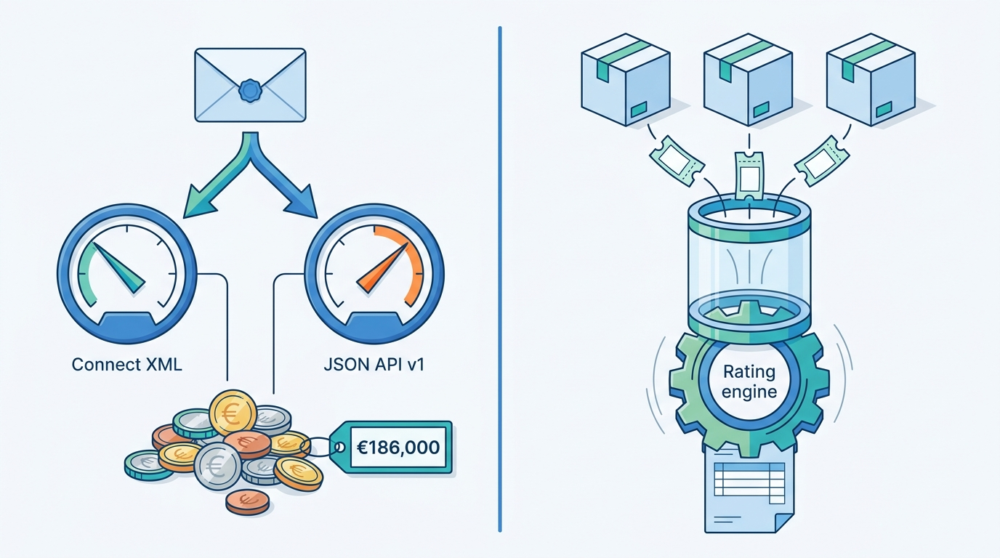
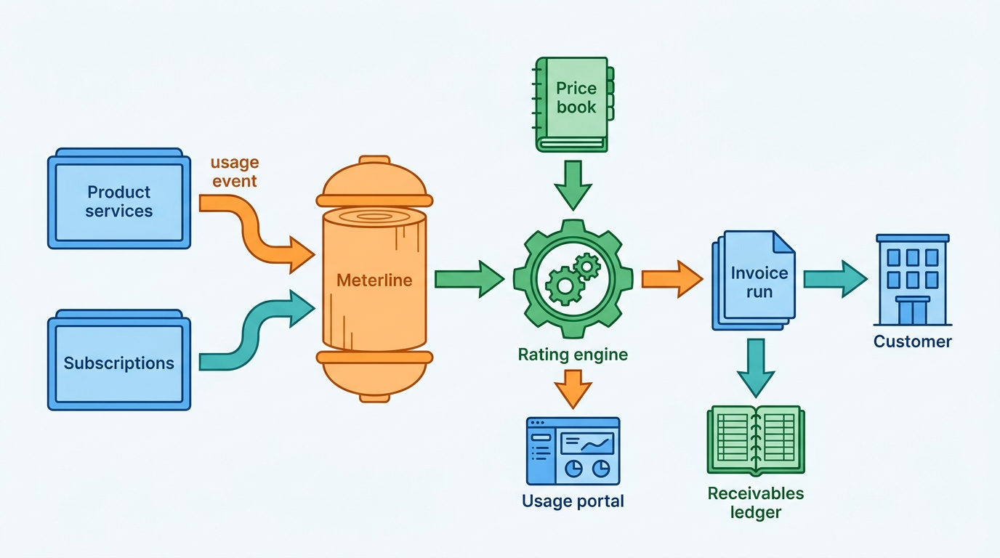
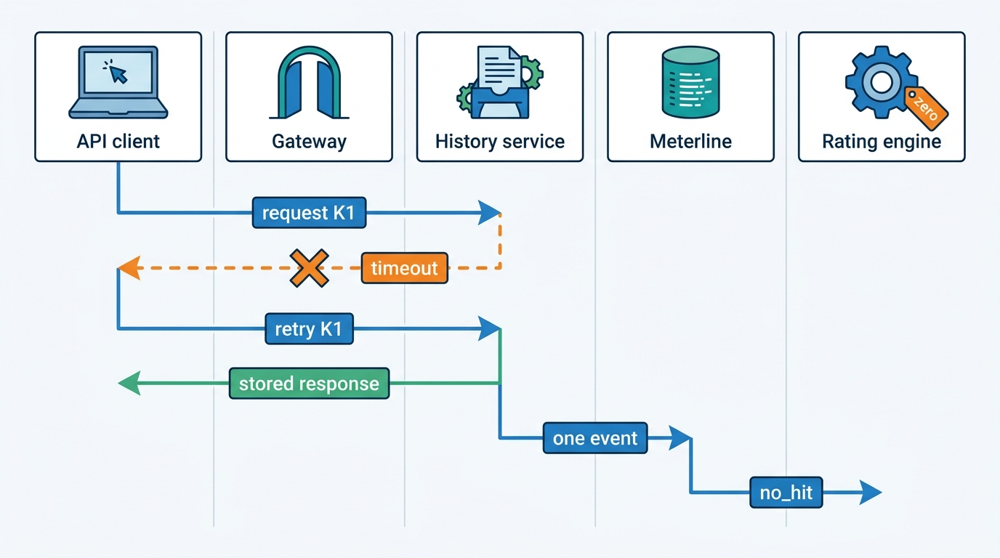
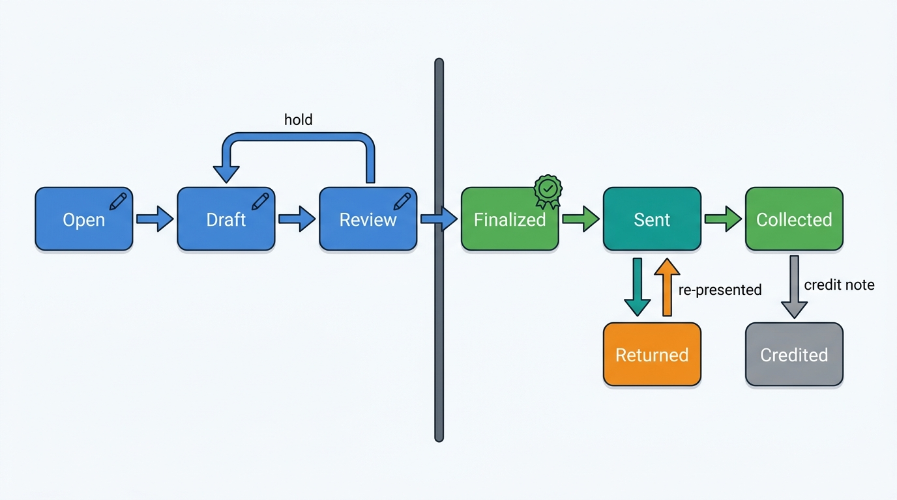
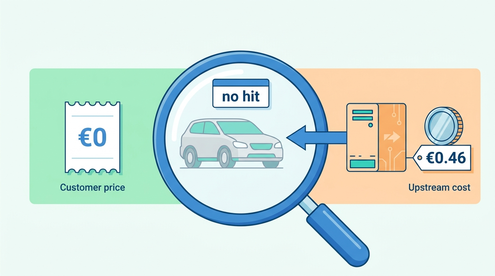

> **IN THIS CHAPTER, YOU WILL:** Design the billing and metering backbone of a platform that sells both by the month and by the call: the usage event, the rating engine and its price book, bundles, allowances, no-hit-no-fee, proration, the invoice run, direct-debit collection, credits and disputes, revenue recognition basics, upstream cost metering and the usage view customers see.

> **WHY THE BUSINESS CARES:** A dealer who cannot explain a €30 surcharge rings support; an insurer that cannot reconcile its API bill against its own logs withholds payment and questions the contract. Billing errors are paid back as credits, and the explanations cost support and account-management time on top of that, so an unexplainable invoice costs revenue and trust together.

> **WHY ARCHITECTS SHOULD CARE:** Every product in an acquired portfolio counts, prices and credits usage its own way, and each counting rule sits in the code of the product that serves the request. Unless the platform separates "what happened" (the usage event) from "what it costs" (rating), every pricing change becomes a code change in several systems and every dispute becomes a log search.

> **KEY POINTS:**
>
> * **The service that knows the outcome records it; one rating engine prices it.** A history service knows whether it found records; a gateway does not. Emit an immutable, idempotent usage event at the business moment, tagged with tenant, rooftop, product and outcome, and let a single rating engine apply no-hit-no-fee, bundles, tiers and credits. Rules applied in two places drift apart, and Axleby paid €186,000 in credits for that drift.
> * **Usage events are evidence, so billing is a ledger.** Dealers dispute per-vehicle charges. Keep raw events with their business key for the dispute window and the fiscal retention period, never edit them (correct by reversal), version every price book and contract, and make every invoice line traceable to the events and the price-book version that produced it.
> * **Meter cost as well as price.** A no-hit is free to the customer but may still cost the platform a paid upstream request. Record the upstream cost on the same event so cost to serve, margin per client and pass-through fees come from one source, and so pricing rules such as no-hit-no-fee can be judged against what they actually cost.

> **[FAILURE PATTERNS THIS CHAPTER ADDRESSES](where-vehicle-platforms-go-wrong.html):**
>
> * **The Unmetered Call** — Connect XML and JSON API v1 each decided what a "no hit" was, the meter reconstructed usage from request logs, and nobody could explain an invoice line without reading code.
> * **The Acquisition Archipelago** — Axleby bills from three systems (Connect XML stored procedures, Lotwise Classic and Showroomly's SaaS billing tool), so a dealer group that buys from two brands receives two invoices with two definitions of a rooftop.
> * **The Tenant Blur** — when billing accounts are bolted onto a single-dealer model, a group cannot get one invoice per legal entity with a rooftop breakdown, and allowances cannot be pooled or split along the group's real structure.

 
A Dutch dealer's monthly bill from a vehicle data and dealer software group looks simple: a handful of module subscriptions, some history reports beyond the bundle, a few register transactions with the register's own fee passed through. Behind it sit four pricing models with different units, clocks and failure modes. **Subscriptions** are priced per rooftop per month and change mid-month. **Per-report fees** depend on what the report found. **API calls** are tiered by volume and free when nothing is found. **Transaction fees** are only earned when an external register confirms the transaction. One customer often pays under all four.

Groups rarely get this wrong through bad arithmetic. They get it wrong because **the rule deciding whether something is billable lives in the code of each product**, and the invoice is reconstructed from request logs at month-end. When the rules drift apart, nobody notices until a customer reconciles its own logs against the invoice.

This chapter owns three terms: the **usage event**, the **rating engine** and the **price book**. It builds on [[tenancy-and-dealer-groups]] for the customer hierarchy and on [[identity-access-and-entitlements]] for what a customer has bought, and it hands license and purpose checks to [[data-licensing-and-governance]], cost per lookup to [[scale-and-cost]] and the accounting ledger itself to the finance book's [[designing-financial-ledgers]].

## Setting the Scene at Axleby: €186,000 for Nothing

Axleby, the fictional vehicle data and dealer software group this book follows (see [[meet-axleby]]), sells vehicle data by the call through two API stacks. **Connect XML**, the SOAP/XML platform from 2006, still carries 38% of the 2.6 million billable lookups a day and runs the monthly usage invoice in SQL Server stored procedures. **JSON API v1**, the Kotlin services on AWS built since 2022, carries the rest. About 70% of those lookups come from Axleby's own products and are rated at internal transfer prices or covered by module bundles; external API clients make about **780,000** a day at an average effective price of about €0.13. Both stacks promise the same commercial rule from the price list: **no-hit-no-fee** applies to history and specification calls.

In the autumn of 2026 an insurer that had moved its integration from Connect XML to JSON API v1 reconciled six months of its own request logs against Axleby's invoices. The volume of calls had not changed; the bill had risen. Lena Vos (Billing and Finance Systems Lead) traced the difference with Priya Raman's data-services team, and then widened the search to every client that called both stacks or had migrated. They found three divergences, none of them a bug in the narrow sense: each was a reasonable reading of "no hit" by a different team.

| Divergence | Connect XML behavior | JSON API v1 behavior | Credit (Axleby, illustrative split) |
| --- | --- | --- | --- |
| **Empty history** | A plate found in the register mirror but with no history events returned "no records" and was not billed | The same case returned a report with an empty event list and was billed as a hit at €4.95 | €97,400 |
| **Partial specification** | A plate with register data but no build data from the licensed build-data provider was billed only if build data came back | Billed at €0.09 whenever the register part of the response was filled | €51,300 |
| **Retried calls** | Billed per distinct client request reference | Billed per HTTP request; a client retry after a gateway timeout produced a second billable call | €37,300 |
| **Total** | | | **€186,000 to 41 API clients** |

The third row worried Ines Marchetti (Group Chief Architect) most, because it had nothing to do with the no-hit rule: JSON API v1 metered from gateway access logs, which cannot tell a retry from a new request, while Connect XML metered inside the report back end. **Two places counted, two places classified outcomes, and two places priced.** Neither kept the raw evidence a customer could be shown: the January invoice line "History report × 3,412" could only be explained by re-running a SQL query against log tables that were purged after 90 days.

**Figure 1:** *Two stacks that each counted, classified and priced the same calls their own way cost Axleby €186,000 in credits; the fix is one place to record what happened and one rating engine to price it.*

The credit itself was paid. The question Ines put to the architecture forum was the one this chapter answers: **where should the decision "this happened, and it costs this much" be made, once, for every product the group sells?** The answer became **Meterline**, the usage metering service that is a Year 1 deliverable of the One Dossier program, and the rating and invoicing design around it.

## Concepts: What Is Sold, What Is Counted, What Is Charged

### Four pricing models, one customer

Microsoft's multitenant pricing guidance advises to "implement only one or two models, with a few tiers", and gives a per-store price for retail software as its per-unit example ([Microsoft Learn, 2024](https://learn.microsoft.com/en-us/azure/architecture/guide/multitenant/considerations/pricing-models)). A rooftop is that unit. Vehicle data groups cannot keep to two models, because the data half and the workflow half grew up selling differently ([[dealer-and-data-economics]]).

| Model | Unit | Axleby example (2027 list price, fictional) | What makes it hard to bill |
| --- | --- | --- | --- |
| **Module subscription** | Rooftop per month | Lotwise Stock & Pricing €189; Syndication €129; Website & Leads €149 | Mid-month changes, rooftops opening, closing and changing owner, group discounts |
| **Subscription with allowance** | Rooftop per month, plus included units | Lotwise Appraise €99 with 25 history reports a month | Counting against the allowance across products, pooling across a group |
| **Per-report or per-call fee** | Report or API call, outcome-dependent | Business history report €4.95; valuation call €0.18 tiered down to €0.06; plate-to-specification €0.09 with no-hit-no-fee | Outcome classification, retries, volume tiers, free re-opens |
| **Transaction fee plus pass-through** | Completed external transaction | Registration in a new name €6.50 plus the register's own fee | Billing only on confirmation, separating Axleby's fee from the third party's fee |

Seat pricing is missing from the table on purpose. Dealer staff turn over quickly and dealers share logins when seats are priced, which is a security problem ([[identity-access-and-entitlements]]). Per-rooftop and per-use pricing avoid it.

### Usage event

A **usage event** is an immutable record that one billable thing happened, written by the service that did it, at the moment it happened. "Billable" is decided by the product catalog, not by the price: a no-hit history lookup is a usage event with a price of zero, because the event is evidence that the call was made and was free. The event says **what happened**; it never says what it costs.

The **business moment** is the point at which the platform has done the thing it will charge for: the report is delivered, the register has confirmed the transaction, the subscription period has started. An event created earlier counts attempts; one created at month-end is reconstruction.

### Outcome

The **outcome** is the service's classification of the result, from a closed list the catalog defines per product: `hit`, `partial`, `no_hit`, `failed`, plus the billing-only `cached_reopen`. The rating engine maps outcomes to prices. The service is the only component that can classify correctly, because only the history assembler knows whether "no events" means "we have no history for this car" or "a source timed out" ([[vehicle-history]]). **Outcome classification is a contract between the product and billing**, owned jointly and versioned like an API.

### No-hit-no-fee, precisely

**No-hit-no-fee** is the commercial promise that a lookup returning nothing useful is not charged. VWE offers a public example: its international damage report costs €9.95 and is free when no damage is found ([VWE, n.d., accessed 2026-10](https://vwe.nl/schadeverleden)). Stating the rule is easy. Making it billable requires three definitions in the catalog:

1. **What counts as a hit, per product.** For Axleby's history report after the credit: a hit is a report containing at least one dated event from any source *other than* the register's basic vehicle record; a plate found with no history events is `no_hit`. For plate-to-specification: a hit is a resolved specification at the level the client asked for (catalog level with candidates by default, as-built equipment when requested); register data with no specification match is `partial`, priced at zero for the specification SKU.
2. **What counts as one call.** One client request reference (the `Idempotency-Key` header in JSON API v2, the client reference element in Connect XML), not one HTTP request.
3. **What counts as a re-open.** Re-opening a report the same billing account bought for the same vehicle within 30 days shows the stored report free of charge (`cached_reopen`); refreshing it to pick up new events is a new, billable report.

The third is a **rating rule**, not deduplication: deduplication removes the same event sent twice; the re-open rule prices a genuinely new event at zero.

### Rating engine and price book

The **rating engine** turns usage events into **rated usage**: priced lines, each referencing its events, the price-book version, the contract terms and every rule that changed the price. It is the only component that knows money.

The **price book** is the versioned, effective-dated catalog of list prices: SKU, unit, currency, market, tiers, and the outcome-to-price map. A **contract** overrides the price book for one customer: discounts, negotiated tiers, minimum commitments, pooled allowances, prepaid credits, and its own effective dates.

### Billing account and tenant

A **billing account** is who receives the invoice and pays it, usually one legal entity with a VAT number, a payment mandate and an invoice address. A **tenant** is the contracting organization whose data is isolated ([[tenancy-and-dealer-groups]] owns the term). A dealer group is one tenant with several legal entities, each of which may want its own invoice with a rooftop and cost-center breakdown. **Billing accounts map to the tenant hierarchy but must not be derived from the authorization hierarchy**; the person who may approve a price change at a rooftop is not the entity that pays for it.

## Architecture: Meter at the Source, Rate in One Place

Meterline is not a billing system. It is the **usage log**: an append-only, deduplicated store of usage events from every product, with an ingestion API and an outbox contract. The rating engine, the invoice run, collection and the receivables ledger sit behind it. The design fixes the 2026 failure by moving two decisions to opposite ends of the pipeline: **classification moves into the products, and pricing moves into one engine.**

**Figure 2:** *Products classify and record what happened; Meterline keeps the evidence; one rating engine prices it against the price book, contracts and entitlements; the invoice run, collection and receivables ledger work only from rated usage. No component downstream of Meterline reads product logs.*

### Components and their contracts

| Component | Responsibility | Owns | Must not |
| --- | --- | --- | --- |
| **Product service** (history assembler, Specbook, Vantage, Axleby Trade back office, Lotwise) | Classify the outcome and emit a usage event at the business moment | Outcome classification for its SKUs | Compute prices or apply discounts |
| **Outbox** (per service) | Make "the report was delivered" and "the event was recorded" one transaction | Delivery to Meterline, at least once | Drop events when Meterline is slow |
| **Meterline** | Accept, validate, deduplicate and store usage events; serve them by account, period and business key | The usage log and its retention | Change an event after acceptance |
| **Subscription service** | Hold subscriptions per billing account and rooftop with effective dates; emit period-start, change and cancel events | Subscription state | Decide what features a rooftop may use (entitlements do that) |
| **Price book and contract store** | Versioned list prices and customer overrides | Prices, tiers, commitments, effective dates | Be edited in place |
| **Rating engine** | Price events; apply allowances, tiers, no-hit, re-open, minimums and credits | Rated usage with references to events and versions | Read product logs or databases |
| **Invoice run** | Assemble rated usage and subscription charges into draft invoices, hold them for review, finalize | Invoice documents and numbering | Re-rate silently after finalization |
| **Receivables ledger** | Record invoices, credit notes, payments, returns and write-offs | Balances per billing account | Hold usage detail |

**The outbox is not optional.** A report delivered without an event is a €4.95 report given away; an event without a delivery is a dispute. Writing the event to an outbox in the same transaction as the delivery record makes the two facts agree ([[events-webhooks-and-sync]] owns the outbox pattern). Meterline's deduplication on event id turns "at least once" into "exactly once in effect".

**Gateways meter protection, not billing.** Gateway request counts drive rate limits and quotas ([[vehicle-data-apis]]) and serve as a completeness check on Meterline, but never as a billable line: the gateway sees neither outcomes nor retries for what they are.

### The usage event schema

| Field | Example | Why it is there |
| --- | --- | --- |
| `event_id` | Hash of client request reference + SKU + billing account | Idempotency: the same business act always produces the same id, so retries and replays deduplicate |
| `occurred_at` | 2027-10-14T09:12:44Z | The business moment; decides the billing period and the price-book version |
| `billing_account_id`, `tenant_id`, `rooftop_id` | BA-NL-004812, T-0731, R-0731-01 | Who pays, whose data, which rooftop's allowance and cost center |
| `actor` | user id or API client id | Dispute evidence; spend alerts per integration |
| `sku`, `quantity` | `history_report_business`, 1 | What was sold |
| `outcome` | `hit`, `partial`, `no_hit`, `failed`, `cached_reopen` | Input to no-hit-no-fee and re-open rules |
| `business_key` | Axleby Vehicle Key (AVK), report id, register transaction id, stock item id | Links the charge to the vehicle and the artifact the customer received |
| `fact_version` | Dossier snapshot or valuation id | Lets a later data correction find every billed artifact built on the wrong fact |
| `source_system`, `market` | `json-api-v2`, NL | Attribution, price-book selection and tax |
| `upstream_costs` | `[{supplier: build-data, amount: 0.46, currency: EUR}]` | Cost to serve and pass-through ([[scale-and-cost]]) |
| `licence_ref` | Charter decision id | Proof that the use was licensed for this client's purpose ([[data-licensing-and-governance]]) |

Three choices in this schema carry most of the weight.

- **The event id is derived, not generated.** A random id created at send time makes every retry a new event; a hash of the client's request reference, SKU and billing account collapses a retried "buy report" into one, whichever stack it arrived through. Metronome documents the same principle: events with the same `transaction_id` "within the next 34 days ... are treated as duplicates and ignored" ([Metronome docs, n.d., accessed 2026-10](https://docs.metronome.com/guides/events/send-usage-events)). Vendor windows are finite (Stripe may prune API v1 idempotency keys after 24 hours, [Stripe docs, n.d., accessed 2026-10](https://docs.stripe.com/api/idempotent_requests)), so the platform needs its own deduplication store covering the open period plus the correction window.
- **The business key is the vehicle and the artifact, not the plate.** Plates change over a car's life and may be personal data ([[vehicle-identity]], [[privacy-and-retention]]); the AVK and the report id identify what was sold.
- **Corrections are new events.** A reclassification is a reversal event plus a corrected event, both referencing the original. The rating engine sees the net; the evidence keeps both.

### One lookup, from request to rated line

**Figure 3:** *A client retry after a lost response returns the stored result and creates no second event, and the no-hit is priced at zero by the rating engine rather than suppressed by the service. In 2026 the same sequence produced two billed calls in JSON API v1.*

### Requirements per interaction

| Interaction | Consistency | Latency | Freshness | Availability |
| --- | --- | --- | --- | --- |
| Product emits usage event | Atomic with the business act (outbox) | Must add no latency to the customer's request | n/a | Meterline outage must not stop lookups; outboxes buffer for days |
| Meterline ingestion and deduplication | Exactly once in effect per event id | Seconds *(assumption)* | Events visible to rating within 5 minutes *(assumption)* | 99.9% monthly; backlog drains after outage |
| Spend cap and quota check on the request path | Eventually consistent counter; bounded overshoot | Under 5 ms added at the gateway *(assumption)* | Counter lag under 1 minute *(assumption)* | Fail open for contracted clients, closed for trial keys |
| Usage portal and daily export | Read-your-rated-usage; provisional until period close | Interactive | Within 15 minutes of occurrence *(assumption)* | Business hours critical |
| Rating | Deterministic and repeatable for a given event set and versions | Batch or streaming | Continuous during the period, final at close | Can lag hours without customer impact |
| Invoice run | Strongly consistent snapshot at period close | Hours | Closed period, late events handled by policy | Must finish by working day 3 *(Axleby target)* |
| Collection and receivables | Ledger-grade: balanced, append-only | Bank cycles (days) | Daily bank files | Bank and payment-provider dependent |

Two rows surprise teams. **Metering must never sit in the critical path of the thing it meters**: if Meterline is down, dealers still get reports and the outboxes catch up. And the **spend cap** cannot wait for rating; it runs on an approximate gateway counter and accepts a few seconds of overshoot.

## Rating: Price Books, Allowances, Tiers and Credits

### Versioned price books and contracts

A price book is a set of rows with effective dates, never a table that is edited. A new history-report price from 1 January is a new version; events dated 31 December still rate at €4.95 even if they arrive late. Contracts (an insurer's tier, a group discount, a minimum commitment) carry their own effective dates and a reference to the signed document.

Auto Trader UK shows why. For the year to 31 March 2026 it decomposed average revenue per retailer (ARPR, £2,995 a month) into a **price** lever (+£117, from "the annual 1 April 2025 pricing and product event"), a **stock** lever (−£48) and a **product** lever (+£72) ([Auto Trader Group plc, 2026](https://plc.autotrader.co.uk/media/usjleen0/full-year-press-release-fy26.pdf)). Auto Trader has not described its billing systems, but a decomposition like that needs billing data recording which price version, package and stock volume produced each charge; it is impossible when prices live in code.

Microsoft's guidance adds the operational rule for any price change: "Calculate or simulate each tenant's bill before and after the change" ([Microsoft Learn, 2024](https://learn.microsoft.com/en-us/azure/architecture/guide/multitenant/considerations/pricing-models)). With raw events and a versioned price book, that simulation is a re-rating of last month's events under the new version, per customer, before the change is announced.

### The rating pipeline

The rating engine applies rules in a fixed order, and the order is part of the contract with finance:

1. **Select** the price-book version and contract terms effective at `occurred_at` for the billing account and market.
2. **Map outcome to price** (no-hit-no-fee, partial pricing).
3. **Apply the re-open rule** (same billing account, vehicle and SKU within 30 days).
4. **Draw down allowances** (Appraise's 25 reports, pooled or per rooftop according to the contract).
5. **Apply volume tiers** across the period (the valuation call from €0.18 down to €0.06).
6. **Apply minimums and commitments** at period close (a shortfall line if usage is below the committed minimum).
7. **Apply credits** (prepaid balances, goodwill credits, dispute credits), each with a reason code and an actor.

Allowances come before tiers so that included reports do not push a customer into a cheaper tier; the opposite order is legitimate, but it must be one choice, written down. Every rated line carries the rules that touched it, so the usage portal can say "free: your 12th of 25 included reports" instead of €0.00.

### Allowances, pooling and group contracts

Appraise includes 25 business history reports per rooftop per month. For Velto Mobility Group's 46 rooftops that is a negotiation: a busy trade-in rooftop in Breda may use 60 reports a month, a franchise rooftop with a small used-car operation 8. Axleby's group contracts therefore offer **pooled allowances**: the sum of the rooftop allowances (46 × 25 = 1,150 a month for Velto), drawn down by any rooftop under the billing account, with usage still shown per rooftop and cost center, and one invoice for each of Velto's seven legal entities (five Dutch, two Belgian).

Pooling is a rating rule on the billing account, so billing accounts must model the group's structure. When Velto reorganized into regional hubs in 2027 ([[journey-lead-to-dms]] tells what that did to its leads), cost centers and allowance reporting had to follow the new hubs on an effective date, while invoices and mandates stayed with the legal entities that own the rooftops.

### Proration and mid-month changes

Subscriptions change mid-month: a rooftop adds a module, a group opens a rooftop on the 10th, a dealer downgrades. Axleby prorates **daily** on calendar days, charges additions from the activation date and credits removals from the effective date, and bills subscriptions **in advance** and usage **in arrears**. Two rules keep this explainable:

- **The subscription change is an event**, rated like usage; a proration line references it, rather than a diff of two subscription snapshots.
- **Entitlements and billing read the same subscription**, so a module switched on is a module charged from the same date. Entitlements kept as release flags turn the flag tool into a shadow billing system with no effective dates ([[identity-access-and-entitlements]]).

### Credits and disputes

A **credit** is a negative rated line with a reason code (`no_hit_misclassified`, `data_correction`, `service_outage`, `goodwill`), an actor, an approval and links to the disputed events, never a quiet edit of an invoice. Rising `no_hit_misclassified` credits for one SKU mean a product's classification has drifted from the catalog.

## The Invoice Run, Collection and Billing as a Ledger

### Invoice lifecycle

**Figure 4:** *An invoice is editable only until it is finalized. After that, every change is a new document: a credit note, a re-presented collection or a write-off, each recorded in the receivables ledger.*

Axleby's target close calendar after Meterline is live: the period closes at midnight on the last day of the month (Central European Time); events for that period arriving within **48 hours** are rated into it; drafts are ready on working day 2; anomaly review runs on day 2 and 3; invoices are finalized and sent on day 3; SEPA collections are presented with the pre-notification period the mandate requires.

**Review is automated first, human second.** Checks flag drafts that deviate sharply from the customer's last three invoices, accounts whose no-hit share jumped, and any line without a price-book version; Lena Vos's team reviews the flags, not every invoice.

**Late events after close go into the next period as catch-up lines**, labeled with their original date. Orb documents the same approach for its query-based billing: usage for closed periods is carried as "catch-up adjustments to the next open period" ([Orb docs, n.d., accessed 2026-10](https://docs.withorb.com/architecture/query-based-billing)). Re-opening a finalized invoice to add a line is not allowed; Stripe, for example, will not issue a corrected invoice for usage on a finalized invoice ([Stripe docs, n.d., accessed 2026-10](https://docs.stripe.com/billing/subscriptions/usage-based/meters/configure)).

### Collection by direct debit

Most Axleby customers pay by **SEPA direct debit** in the euro markets and **Bacs Direct Debit** in the United Kingdom. The difference between the two SEPA schemes matters for an architect, because it changes how long a "collected" invoice can still turn into a debt:

- Under the EU Payment Services Directive (PSD2), a payer has "an unconditional right to a refund" of a direct debit, which it can request "for a period of 8 weeks from the date on which the funds were debited", and may claim rectification of an *unauthorised* transaction "no later than 13 months after the debit date" (Directive (EU) 2015/2366, Articles 71, 76 and 77, [CELEX 32015L2366](http://publications.europa.eu/resource/celex/32015L2366)). The SEPA Core scheme implements these rights.
- The **SEPA B2B** scheme is for business payers only; payment-provider guides describe it as removing the refund right for authorized collections and requiring the debtor's bank to hold the mandate before the first collection ([GoCardless, n.d., accessed 2026-10](https://gocardless.com/en-us/guides/sepa/timings)). The same guide describes a pre-notification two weeks before collection unless a shorter period is agreed.
- Bacs Direct Debit is covered by the **Direct Debit Guarantee**: the payer is told in advance (normally 10 working days) of changes to amount, date or frequency and is entitled to an immediate refund from their bank if an error is made ([Stripe, n.d., accessed 2026-10](https://stripe.com/en-ch/resources/more/what-is-the-direct-debit-guarantee)).

The architectural consequence is that **"collected" is a provisional state for eight weeks under SEPA Core**, and longer for disputes. A dealer who disagrees with a €30 line can reverse the whole monthly debit. Returns and refunds arrive as bank messages days or weeks later, and the receivables ledger must post them, re-open the receivable, notify the account owner and decide whether to re-present. Large dealer groups and API clients are better placed on SEPA B2B mandates, where a dispute goes through Axleby's credit process rather than the bank; small independents usually sign Core mandates.

### Billing as a ledger

Billing sits between two ledgers. Upstream, Meterline is a ledger of **evidence**: append-only, never edited, corrected by reversal. Downstream, the receivables ledger is a ledger of **money**: invoices, credit notes, payments, returns and write-offs as balanced entries per billing account. The finance book covers ledger design in depth ([[designing-financial-ledgers]]) and the payment rails behind direct debit ([[payments-fundamentals]], [[payments-to-ledger]]). The rule I use for the boundary between them is simple: **the invoice is the only object that crosses it**, and once finalized it is immutable. Everything that billing does after that is another entry.

### Revenue recognition basics

International Financial Reporting Standard (IFRS) 15, issued in 2014 alongside the US standard ASC 606, recognizes revenue to "depict the transfer of promised goods or services to the customer" in five steps: contract, performance obligations, transaction price, allocation by stand-alone selling price, and recognition as each obligation is satisfied ([IFRS Foundation, n.d., accessed 2026-10](https://www.ifrs.org/issued-standards/list-of-standards/ifrs-15-revenue-from-contracts-with-customers/)). Billing does not do the accounting, but it must produce the data the accounting needs:

| Charge type | Typical treatment (confirm with auditors) | What billing must export |
| --- | --- | --- |
| Module subscription | Over time, across the month | Contract, SKU, service period |
| Allowance inside a subscription (Appraise's 25 reports) | Part of the subscription price may need allocating to the reports by stand-alone selling price | Stand-alone selling prices per SKU in the catalog |
| Per-report and per-call fees | At a point in time, when delivered | Rated usage by SKU and date |
| Prepaid credits and commitments | Contract liability until consumed or expired | Balance movements per account |
| Register fee passed through | Often agent treatment (net) when the platform does not control the register's service; a judgement under IFRS 15's principal-versus-agent guidance | Axleby's fee and the third-party fee as separate lines |
| Onboarding and migration fees | May need deferral over the contract | Fee and the contract it belongs to |

The practical requirement: **billing exports contract, SKU and performance-obligation detail to the general ledger, not invoice totals**.

## Metering for Cost: Upstream Fees and Cost to Serve

The data half has a cost structure the workflow half does not: **many calls cost Axleby money before they earn any.** Specbook fetches licensed build data per vehicle identification number (VIN) from a commercial build-data provider at an average of **€0.46** per request at 2027 volumes, while the plate-to-specification API call lists at **€0.09**. Caching within the license makes that arithmetic work ([[specification-and-equipment]], [[scale-and-cost]]). For billing the lesson is different: **a no-hit is free to the customer but not to Axleby.** A `partial` specification lookup costs the customer nothing but may still cost Axleby the provider's fee, depending on the provider's own no-hit terms.

**Figure 5:** *A no-hit is free to the customer but can still cost Axleby a build-data fee averaging €0.46, so the usage event records upstream cost as well as outcome.*

That is why the usage event carries `upstream_costs`. The same event stream then answers three questions that otherwise come from three spreadsheets:

- **Margin per client and per SKU**: revenue from rated usage minus upstream cost recorded on the same events.
- **Pass-through**: for fees Axleby recharges at cost (the register's fee on a registration in a new name), the charge line is generated from the cost recorded on the event, so the two cannot diverge.
- **Pricing rule cost**: the no-hit rate per client, multiplied by the upstream cost of no-hits, is the price of the no-hit-no-fee promise. A client whose traffic is mostly no-hits (an enumeration pattern, or a data-quality problem in its own plate capture) is visible as a cost, not only as a security signal ([[vehicle-platform-security]]).

The FinOps Foundation calls these business unit metrics ("cost per tenant, cost per transaction, cost to serve") ([FinOps Foundation, n.d., accessed 2026-10](https://www.finops.org/framework/capabilities/unit-economics/)); upstream data fees are the part cloud cost tools never see.

## Usage Visibility for Customers

The insurer found the No-Hit Credit with its own logs; a customer should not need them. Meterline's usage portal and API give every billing account:

- **Usage to date by SKU, rooftop and outcome**, provisional during the period, with the allowance consumed and remaining.
- **Line drill-down** from every invoice line to its events: time, user or client, outcome, vehicle and rules applied.
- **A daily usage export** with the event id and the client's own request reference, for automatic reconciliation.
- **Spend alerts and caps** per API client: an alert at a threshold and an optional hard cap. OWASP lists missing spending limits among the causes of unrestricted resource consumption ([OWASP, 2023](https://owasp.org/API-Security/editions/2023/en/0xa4-unrestricted-resource-consumption/)); for a leaked key, a cap is the cheapest control there is.

The portal enforces the tenant boundary in the query, not the user interface ([[tenancy-and-dealer-groups]]), and shows only what the customer already knew: the plate it typed, never the keeper's personal data ([[privacy-and-retention]]).

## In Practice: Public Evidence and an Axleby Month

### What the public record shows

No dealer-software or vehicle-data company has published how its billing systems are built. The public evidence is about pricing structures, and it is enough to show that every one of them needs the separation this chapter describes.

- **Per-location subscriptions in the United States.** Mobility Global, Carfax's parent as of 2026, states in its August 2026 quarterly report that Carfax segment revenue "is primarily driven by the number of dealer locations enrolled in dealer subscription products ... the average monthly price per location ... and the number of BIG customers" (its banking and insurance group) ([Mobility Global Form 10-Q, 2026](https://www.sec.gov/Archives/edgar/data/2090312/000209031226000014/mbgl-20260630.htm)). A rooftop-priced subscription is the core of a US data business, not only of dealer software.
- **Subscriptions plus integration fees in DMS pricing.** CDK Global's last public annual report (fiscal year to June 2021) defined "average revenue per DMS customer site" (DMS: dealer management system) as including "DMS monthly fees, layered applications and data integration fees" ([CDK Global 10-K, 2021](https://www.sec.gov/Archives/edgar/data/1609702/000160970221000058/cdk-20210630.htm)). The evidence is five years old, from before CDK's 2022 take-private.
- **Outcome-dependent fees in the Netherlands.** VWE's public pricing combines monthly modules ([Occasion Manager](https://vwe.nl/occasion-manager/), n.d., accessed 2026-10) with per-report fees, including the no-damage-no-charge report above. How VWE meters them is not public.
- **Metering products describe two architectures.** Stripe's billing meters aggregate events on ingest, and adjustments can cancel only events "sent to Stripe within the last 24 hours" ([Stripe docs, n.d., accessed 2026-10](https://docs.stripe.com/billing/subscriptions/usage-based/meters/configure)). Orb stores "every usage event ... immutably in a columnar data store" and runs "a fresh query over the raw event data" at invoice time ([Orb docs, n.d., accessed 2026-10](https://docs.withorb.com/architecture/query-based-billing)). Stripe completed its acquisition of Metronome on 14 January 2026 and now recommends Metronome for new usage-based integrations ([Stripe, 2026](https://stripe.com/newsroom/news/stripe-completes-metronome-acquisition); [Stripe docs, n.d., accessed 2026-10](https://docs.stripe.com/billing/subscriptions/usage-based/recording-usage)).

### Autobedrijf Brandsma's October 2027 bill

Sietse Brandsma runs one rooftop in Leeuwarden with about 55 cars in stock. In October 2027 his Lotwise subscriptions were still billed from Lotwise Classic, his report usage was counted by the Connect XML invoice run and carried as usage lines onto his Lotwise invoice, and his register transactions were invoiced through Axleby Trade. Meterline ran in **shadow mode**, rating the same month from usage events, and the comparison below is the shadow run's view of his bill.

| Line | Events behind it | Rule applied | Amount (€, excl. VAT) |
| --- | --- | --- | --- |
| Stock & Pricing, October | Subscription period event | List price | 189.00 |
| Syndication, October | Subscription period event | List price | 129.00 |
| Website & Leads, October | Subscription period event | List price | 149.00 |
| Appraise, October | Subscription period event | List price, includes 25 reports | 99.00 |
| Sales Admin, October | Subscription period event (module added January 2027) | List price | 59.00 |
| Business history reports: 34 events | 29 `hit`, 2 `no_hit`, 3 `cached_reopen` | 25 hits from allowance; 4 hits at €4.95; no-hits and re-opens at zero | 19.80 |
| Registration in a new name: 12 events | 12 register-confirmed transactions | €6.50 each | 78.00 |
| Register fees passed through | Same 12 events, register fee recorded as upstream cost | At cost, separate line | (register's fee × 12) |
| **Axleby charges** | | | **722.80** |

The legacy run produced the same subscription lines but a report line of €34.65: seven reports above the allowance, not four. Connect XML counted Brandsma's three re-opens as new reports, because the 30-day re-open rule lived in the Lotwise user interface ("already purchased") but not in the stored procedure that billed. Across all Lotwise rooftops, the October shadow run found re-open differences on **11%** of invoices, most of them under €20. No dealer had complained; nobody checks a €15 difference, which is why it had survived for years.

### What the shadow run is for

Every difference between Meterline's draft and the legacy invoice is classified as **legacy wrong** (the re-open case), **Meterline wrong** (a product not yet classifying outcomes to the catalog) or **policy undecided** (no written rule existed). Ines Marchetti set the cut-over criterion at two consecutive months with every difference above €1 per account classified and every "Meterline wrong" fixed. The "policy undecided" bucket is the most valuable output: each item becomes a catalog line owned by a product manager instead of a behavior in a stored procedure.

## Failure Handling

| Failure | Example | Detection | Recovery |
| --- | --- | --- | --- |
| **Duplicate events** | Client retry after a timeout; outbox relays twice; replay after a Meterline restore | Derived `event_id` collides | Deduplication store drops the second; replay is safe by design |
| **Missing events** | A product deploy disables event emission for one SKU | Daily completeness check: gateway request counts and product delivery logs vs Meterline events per SKU and client, with tolerance bands | Backfill from the product's outbox or delivery log as events with a `backfilled` flag; review before rating |
| **Incomplete events** | Event without `rooftop_id` because a Lotwise screen did not pass it | Schema validation at ingestion | Accept into a quarantine partition, never drop; resolve from the user's session or rate at billing-account level with a flag |
| **Misclassified outcomes** | History service returns `hit` for an empty report after a refactor | Outcome mix per SKU compared with its baseline; rising dispute credits | Fix classification; emit reversal and corrected events for the affected window; credit automatically |
| **Conflicting price changes** | A contract amendment signed on the 20th, effective from the 1st | Contract store records signature date and effective date | Re-rate the open period; if the period is closed, credit or debit as catch-up lines in the next invoice, never by editing a finalized invoice |
| **Late events** | Outbox backlog after a Meterline outage spills past the 48-hour cut-off | Event `occurred_at` in a closed period | Catch-up lines in the next period, labeled with their original dates |
| **Billing on ambiguous external outcomes** | A register submission times out; the retry queue resubmits | The register transaction id and the register's confirmation | Emit the usage event only on confirmation, keyed on the register transaction; a double submission that needs correction produces no second fee |
| **Partial invoice-run failure** | 300 drafts fail on a tax-rule error | Run report per account; every account must reach Draft or Hold | Re-run only failed accounts; the run is idempotent per account and period |
| **Collection failure** | SEPA return for insufficient funds; Core refund request after a dispute | Bank return and refund messages | Post to receivables ledger, re-open the receivable, notify, re-present or route to credit process |
| **Data correction after billing** | The Odometer Correction of May 2027: 6,140 valuations computed on wrong mileage | `fact_version` on valuation usage events joined with the correction's affected vehicles | A credit policy decided per product and customer type, applied to exactly the affected events |

The last row deserves a word. When the Kilometra batch recorded miles as kilometers for 2,870 UK-imported vehicles in May 2027, finance asked which billed valuations and reports used the wrong readings. Without a fact version on the billing record, answering took days of joining log tables with valuation-ledger timestamps ([[journey-data-correction]]). With `fact_version` on every usage event it is a query, and the credit decision can be made on facts.

**Meterline outages** are absorbed by the outboxes, sized to buffer **72 hours** of peak usage *(Axleby target)*; the customer-visible effect is a stale usage portal and spend caps running on the gateway counter alone.

## Trade-offs

| Decision | Option A | Option B | When A is right | When B is right |
| --- | --- | --- | --- | --- |
| **Where to classify outcomes** | In each product service | At the gateway from responses | Always for outcome-priced products; only the service knows what "found" means | Pure request-counted products with no outcome rule |
| **Aggregate on ingest vs store raw** | Counters per account and SKU (Stripe-meter style) | Raw immutable events, rated by query (Orb-style) | Very high volume, simple prices, no per-vehicle disputes | Outcome-dependent prices, per-vehicle disputes, frequent price changes; Axleby's case |
| **Build vs buy the rating engine** | Buy a usage-billing product (Metronome, Orb, others) | Build rating in-house over Meterline | Prices fit the product's model; volumes fit its limits; team is small | Pass-through fees, register confirmations, pooled group allowances and market-specific rules the product cannot express |
| **Rating timing** | Continuous (streaming) | Batch at close | Customers need live spend and caps | Monthly invoices only; but then the usage portal lies until month-end |
| **Allowances** | Per rooftop | Pooled per billing account | Independents; groups that want rooftop accountability | Groups with uneven rooftops; but needs billing accounts that model the group |
| **Usage pricing** | Postpaid in arrears | Prepaid credits or commitments | Established dealers with mandates | New API clients, trial keys, consumer-facing resellers; caps credit risk |

My recommendation for a group like Axleby is to **build Meterline and the rating rules in-house and buy the commodity edges**: tax calculation, e-invoice delivery through a Peppol access point, payment-provider connections, and possibly invoice rendering. Axleby's rules depend on register confirmations, pass-through costs, Charter license references and group hierarchies, which are core domain; its volume (about 2.7 million events a day *(assumption, mostly API lookups)*) fits purchased products, but its rule set may not; and the evidence must be kept for seven years. I would reverse this for a product that can express outcome-based pricing, pooled allowances and pass-through natively, and that exports raw events back to Axleby's own store, at a cost below a team of four to six engineers.

The decision I would not compromise on is **one rating engine for the whole group**. Two engines, even two good ones, recreate the No-Hit Credit.

## Across Markets: What Changes by Country

Axleby has no US customers; the US column describes what a group entering that market would meet.

| Topic | Netherlands / Belgium | Germany | United Kingdom | United States |
| --- | --- | --- | --- | --- |
| **Usual pricing shape** | Separate modules per rooftop plus per-report and per-transaction fees (VWE's public prices are an example) | Data clients on licenses and per-call fees; dealers on per-rooftop software with data from valuation specialists | Data products often bundled into the advertising package (Auto Trader's package staircase) | Per-location subscriptions (Carfax), DMS per-site pricing including integration fees (CDK, 2021) |
| **Collection** | SEPA direct debit, Core for small dealers, B2B for groups and data clients | SEPA direct debit; invoice and transfer common for large data clients | Bacs Direct Debit under the Direct Debit Guarantee | Automated Clearing House (ACH) debits and cards; invoice terms for groups *(industry practice)* |
| **E-invoicing** | Belgium: structured B2B e-invoices mandatory since 1 January 2026, Peppol-based ([FPS Finance, n.d.](https://einvoice.belgium.be/en)); Netherlands: no domestic B2B mandate found | Receiving EN 16931 e-invoices required since 1 January 2025; issuing required from 2027 above €800,000 prior-year turnover and from 2028 for all ([IHK Stuttgart, n.d.](https://www.ihk.de/stuttgart/fuer-unternehmen/recht-und-steuern/steuerrecht/steuermeldungen/e-rechnungen-5864496); [KPMG, 2024](https://kpmg.com/us/en/taxnewsflash/news/2024/10/tnf-germany-guidelines-for-complying-with-first-phase-of-e-invoicing-mandate.html)) | Mandatory B2B and B2G e-invoicing announced from 2029 ([HM Treasury, 2025](https://www.gov.uk/government/publications/budget-2025-document/budget-2025-html)) | No federal B2B mandate |
| **Tax on the platform's own fees** | VAT, reverse charge for cross-border B2B within the EU | VAT | VAT, separate post-Brexit regime | State sales tax on SaaS and data varies by state; remote sellers can be required to collect since *South Dakota v. Wayfair* (2018) ([US Supreme Court, 2018](https://www.supremecourt.gov/opinions/17pdf/17-494_j4el.pdf)) |
| **Pass-through fees** | Register fees on Dutch transactions passed through at cost; Belgian registrations through a partner | Few register pass-throughs; build-data and valuation license costs are upstream costs | Register data under per-key API terms; few per-transaction pass-throughs | Title and registration fees handled by dealers and state agencies; history data licensed per report |
| **Currency** | EUR | EUR | GBP | USD |

The judgement: **the meter, the event schema, the rating engine and the receivables ledger are common.** Market differences are four kinds of adapter: a **price book per market and currency**, a **tax-calculation service** (VAT rules in Europe, a sales-tax service for any US entry), an **invoice delivery channel** (PDF, Peppol for Belgium now and Germany from 2027, the UK format once its roadmap is final) and a **collection connector** (SEPA Core and B2B, Bacs, ACH). None of these justifies a separate billing system per country; every one of them justifies a separate, replaceable component. The EU's VAT in the Digital Age package adds digital reporting for cross-border B2B transactions from 1 July 2030 ([European Commission, n.d.](https://taxation-customs.ec.europa.eu/taxation/vat/vat-digital-age-vida_en)).

The less obvious difference is commercial: a UK dealer used to an all-in package (Showroomly's £325 per rooftop) reads per-report fees as nickel-and-diming; a Dutch dealer expects them. What to bundle per market belongs in the price book, not in code.

## The Chief Architect's View

**What to decide.** Five decisions shape billing for a decade, and they belong in architecture decision records, not in tickets:

1. **One usage event schema and one Meterline for the group**, with outcome classification owned by products and pricing owned by rating.
2. **The outcome catalog per SKU**, versioned and approved jointly by the product owner and finance. No product ships a billable feature without its outcome contract.
3. **Billing accounts as their own model**, mapped to the tenant hierarchy, with legal entities, mandates, cost centers and effective-dated rooftop membership.
4. **Raw events retained for the fiscal period** (seven years in the Netherlands for the invoice basis *(confirm per market)*), with personal data minimized: AVK and report ids, not plates and names.
5. **The migration path**: shadow rating, classified differences, a written cut-over criterion, and the order of retirement. For Axleby: API clients first (they are where the 2026 money was lost), then Lotwise usage, then Lotwise subscriptions, then Showroomly, with Connect XML's invoice run switched off before Connect XML itself ([[modernizing-the-platform]]).

**Who decides.** Pricing: product and commercial leadership. The outcome catalog: product owners with finance. Rating order, late-event policy and retention: finance with the Chief Architect. The event schema and platform: Lena Vos's billing team with Marta Nowak's platform team. The failure to avoid is a price change approved commercially and implemented by whichever team owns the screen.

**What to watch.** Billing health belongs on the reliability dashboard ([[observability-and-data-operations]]): event completeness per SKU, quarantine size, outcome mix against baseline, invoices held in review, credits by reason code, SEPA returns, days to finalized invoices and margin per SKU. The **credit rate by reason code** is the single best early warning: it is how the No-Hit Credit would have been caught in its first month instead of after half a year.

**The long view.** Billing is where an acquired portfolio becomes one company to its customers. When Velto receives one invoice per legal entity covering Lotwise, Axleby Data and Axleby Trade, with one rooftop list and one allowance, the group has fixed a visible symptom of the Acquisition Archipelago. That is also why Meterline is a Year 1 deliverable of One Dossier, ahead of the event backbone: it is cheaper to fix the meter than to keep paying for its disagreements ([[one-platform-from-many-products]]).

## Questions to Ask

1. For each billable product, which component decides whether a call was a hit, and is that rule written down anywhere other than code?
2. If a client retries a paid request after a timeout, how many charges result, and in which code path is that decided?
3. Can you show a customer, for any invoice line, the events, the vehicle and the price-book version behind it, without an engineer?
4. What happens to a usage event that arrives after the invoice run, and is the answer the same in every product?
5. Where does the platform record what a no-hit cost upstream, and what is the no-hit-no-fee promise costing per month?
6. Do billing accounts model legal entities, cost centers and rooftop membership with effective dates, or are they the tenant record with an address?
7. What share of collected direct debits can still be reversed today, and how does a reversal reach the account manager?
8. Which pricing rules exist only in a user interface (such as "already purchased") and not in the billing path?
9. Before the next price change, can you re-rate last month under the new price book and show each customer's before and after?

Billing tells the platform what a customer may be charged for; it does not tell it what the customer may do with the data it paid for. A data client that pays every invoice on time can still resell history reports against its license, as Axleby learned in January 2027. The next chapter, [[data-licensing-and-governance]], takes the `licence_ref` on every usage event and asks what must stand behind it.

## Sources and Evidence

### Company, product and investor sources

- [Full year results, year ended 31 March 2026](https://plc.autotrader.co.uk/media/usjleen0/full-year-press-release-fy26.pdf), Auto Trader Group plc, 2026. ARPR of £2,995 a month and its price, stock and product levers; the annual pricing and product event; the package staircase.
- [Form 10-Q, quarter ended 30 June 2026](https://www.sec.gov/Archives/edgar/data/2090312/000209031226000014/mbgl-20260630.htm), Mobility Global Inc., 2026. Carfax segment revenue driven by dealer locations and average monthly price per location.
- [Form 10-K, fiscal year ended 30 June 2021](https://www.sec.gov/Archives/edgar/data/1609702/000160970221000058/cdk-20210630.htm), CDK Global, 2021. Average revenue per DMS customer site including DMS fees, layered applications and data integration fees.
- [Schadeverleden](https://vwe.nl/schadeverleden) and [Occasion Manager](https://vwe.nl/occasion-manager/), VWE Automotive, n.d., accessed 2026-10. Per-report fees with no charge when no damage is found; module pricing.
- [Recording usage](https://docs.stripe.com/billing/subscriptions/usage-based/recording-usage), [Configure meters](https://docs.stripe.com/billing/subscriptions/usage-based/meters/configure) and [Idempotent requests](https://docs.stripe.com/api/idempotent_requests), Stripe, n.d., accessed 2026-10. Meter aggregation, 24-hour adjustment window, no corrected invoices after finalization, idempotency key pruning, recommendation of Metronome.
- [Stripe completes Metronome acquisition](https://stripe.com/newsroom/news/stripe-completes-metronome-acquisition), Stripe, 2026. Completion on 14 January 2026.
- [Send usage events](https://docs.metronome.com/guides/events/send-usage-events), Metronome, n.d., accessed 2026-10. Required event fields and the 34-day deduplication window.
- [Query-based billing](https://docs.withorb.com/architecture/query-based-billing), Orb, n.d., accessed 2026-10. Immutable raw events, query at invoice time, catch-up adjustments for closed periods.
- [What is the Direct Debit Guarantee?](https://stripe.com/en-ch/resources/more/what-is-the-direct-debit-guarantee), Stripe, n.d., accessed 2026-10. Advance notice and immediate refund under the Bacs Direct Debit Guarantee.
- [SEPA timings](https://gocardless.com/en-us/guides/sepa/timings), GoCardless, n.d., accessed 2026-10. SEPA Core and B2B refund rights and pre-notification practice.

### Standards, regulation and official documentation

- [Directive (EU) 2015/2366 on payment services (PSD2)](http://publications.europa.eu/resource/celex/32015L2366), European Parliament and Council, 2015, CELEX 32015L2366. Articles 71, 76 and 77: 13-month and 8-week refund periods for direct debits.
- [IFRS 15 Revenue from Contracts with Customers](https://www.ifrs.org/issued-standards/list-of-standards/ifrs-15-revenue-from-contracts-with-customers/), IFRS Foundation, n.d., accessed 2026-10. The five-step model.
- [E-invoicing in Belgium](https://einvoice.belgium.be/en), FPS Finance, n.d., accessed 2026-10. Mandatory structured B2B e-invoices from 1 January 2026.
- [E-Rechnungen: Ende der Übergangsfrist](https://www.ihk.de/stuttgart/fuer-unternehmen/recht-und-steuern/steuerrecht/steuermeldungen/e-rechnungen-5864496), IHK Stuttgart, n.d., accessed 2026-10; and [Germany: Guidelines for complying with first phase of e-invoicing mandate](https://kpmg.com/us/en/taxnewsflash/news/2024/10/tnf-germany-guidelines-for-complying-with-first-phase-of-e-invoicing-mandate.html), KPMG, 2024. German e-invoicing phases; not checked against the BMF letter itself.
- [Budget 2025](https://www.gov.uk/government/publications/budget-2025-document/budget-2025-html), HM Treasury, 2025. UK e-invoicing for B2B and B2G VAT invoices from 2029.
- [VAT in the Digital Age](https://taxation-customs.ec.europa.eu/taxation/vat/vat-digital-age-vida_en), European Commission, n.d., accessed 2026-10. Cross-border digital reporting from 1 July 2030.
- [South Dakota v. Wayfair, Inc., 585 U.S. (2018)](https://www.supremecourt.gov/opinions/17pdf/17-494_j4el.pdf), Supreme Court of the United States, 2018. States may require remote sellers to collect sales tax.
- [API4:2023 Unrestricted Resource Consumption](https://owasp.org/API-Security/editions/2023/en/0xa4-unrestricted-resource-consumption/), OWASP, 2023. Spending limits as a control.

### Research and practitioner sources

- [Pricing models for a multitenant solution](https://learn.microsoft.com/en-us/azure/architecture/guide/multitenant/considerations/pricing-models), Microsoft Azure Architecture Center, 2024. Pricing model catalog, per-unit pricing for retailers, simulating bills before price changes.
- [Unit Economics](https://www.finops.org/framework/capabilities/unit-economics/), FinOps Foundation, n.d., accessed 2026-10. Business unit metrics and fully loaded cost.

Axleby is fictional; architectural recommendations, labeled inferences and labeled assumptions are the author's judgement.
