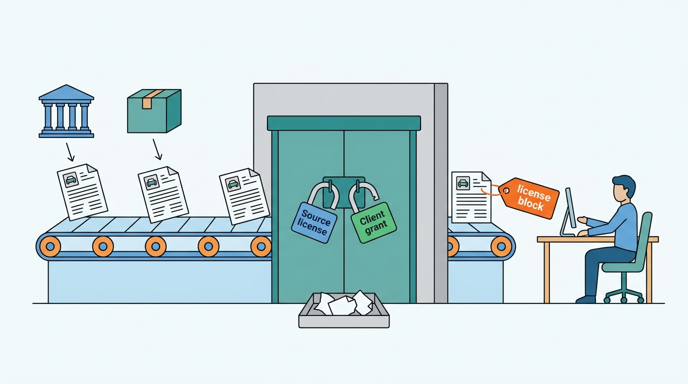
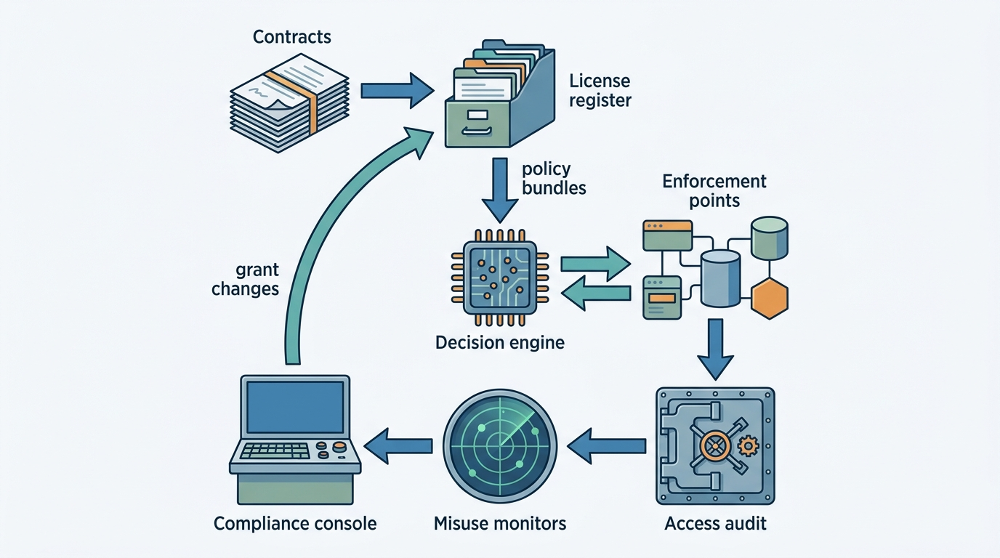
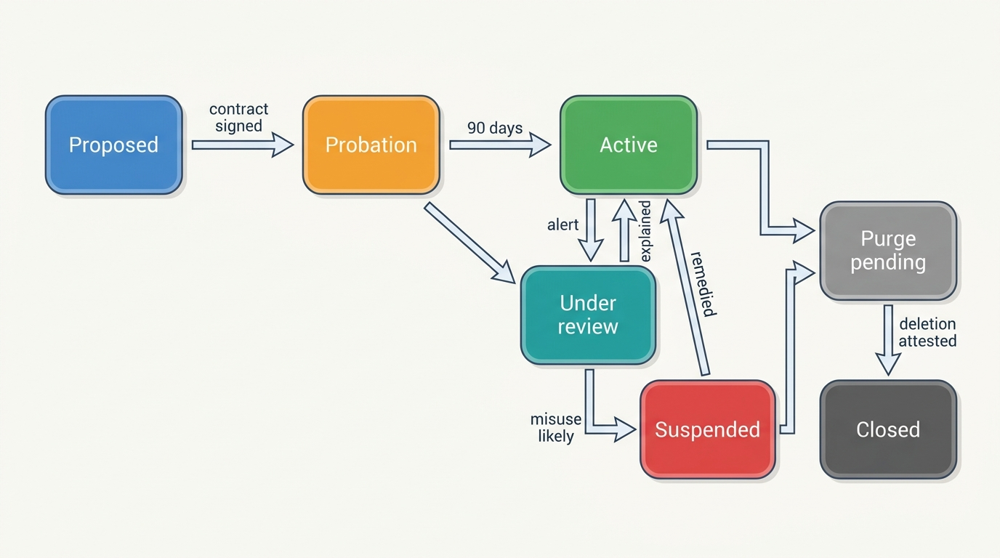
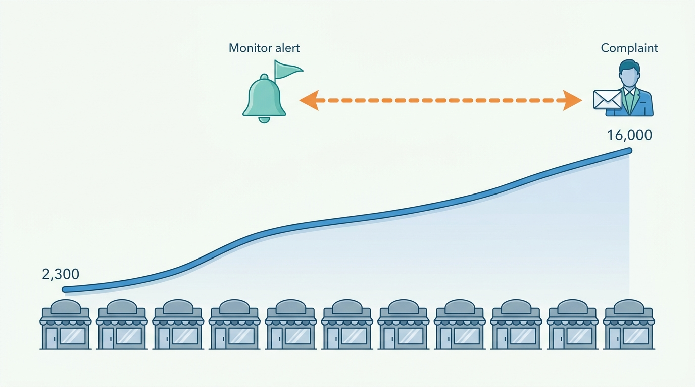

> **IN THIS CHAPTER, YOU WILL:** Design the license and purpose layer of a vehicle data platform: the license register, the purpose register and client grants, the purpose check in the request path, caching and retention bound by license, the obligations that flow down to API clients, the immutable access audit, misuse detection, and the governance roles and console that keep all of it current.

> **WHY THE BUSINESS CARES:** A vehicle data business resells facts it does not own. One client that republishes licensed history data can cost the group a supplier settlement, a register relationship or a regulator's attention, and the client will usually have paid every invoice. The CEO needs to be able to answer a supplier's audit letter with evidence, not with a promise.

> **WHY ARCHITECTS SHOULD CARE:** License terms decide what may be cached, combined, shown to consumers and resold. If the terms live only in contracts, every cache, report, insight cube and API response is an unreviewed license decision. Moving those decisions into one policy layer is an architecture change. It touches the provenance of every fact, every enforcement point and the audit store.

> **KEY POINTS:**
>
> * **License terms are rules, so store them as data and enforce them on every request.** A license register holds each source's terms, a purpose register holds what clients may use data for, and client grants bind the two. A purpose check in the request path decides which sources and fields a client receives, for which audience and for how long. A fact without a license class is not served.
> * **Obligations leave with the data.** Each response carries its license metadata, client contracts pass the source terms on, and an append-only recipient audit records who received which licensed data, for which purpose and under which decision. Misuse monitors compare each client's traffic with its declared purpose, because the evidence of resale is in the traffic long before a customer complains.
> * **Decide locally, fail closed where the terms are strict, and do not over-log.** Policy evaluation embedded next to each enforcement point keeps the check fast and independent of a central service. Restricted data is refused when the policy or the audit is unavailable. The audit records recipients and purposes, not everything a user does, because data-protection law and the EU Data Act cap how much access logging is allowed.

> **[FAILURE PATTERNS THIS CHAPTER ADDRESSES](where-vehicle-platforms-go-wrong.html):**
>
> * **License Blindness** — Axleby's contracts named a purpose for each API client, but no system checked it. A lead-generation client resold history data to consumers for five months, and a complaint found it.
> * **Provenance Amnesia** — when the breach was found, nobody could say which supplier's records were in which report, so Axleby could not size its exposure to its own suppliers.
> * **The Acquisition Archipelago** — Supplier terms lived in four places (Axleby Data procurement, Wertlauf, Lotwise and a shared drive), each with its own reading of the same contracts. A group-wide license register had to reconcile four interpretations before it could enforce one.

<br>
A vehicle data platform's raw material comes with conditions. A register allows some data to be reused freely and forbids other data from ever being sold. A build-data provider sets how long a response may be kept. A damage-data partner allows business reports but not consumer display. A dealer's data from its dealer management system (DMS) may serve that dealer and nothing else. Each condition attaches to a fact, and each fact flows into reports, valuations, responses and caches that the contract's negotiator has never seen.

The platform then sells those facts on under conditions of its own, to insurers, lessors, software vendors and consumers. **Two sets of conditions meet on every response: what the source allows and what this client has agreed to.** A platform that cannot evaluate both, per request, is relying on every client to read and keep its contract.


**Figure 1:** *Two sets of conditions meet on every response: what the source allows and what this client has agreed to, and the response leaves carrying both.*

This chapter owns three terms: the **license register**, the **purpose check** and the **access audit**. It builds on [[provenance-and-data-quality]], which puts a license class on every fact, and on [[identity-access-and-entitlements]], which tells the platform who is calling. It hands data-protection law in depth to [[privacy-and-retention]], register access regimes to [[registers-and-official-data]], gateway mechanics to [[vehicle-data-apis]] and scraping defense to [[vehicle-platform-security]].

## Setting the Scene at Axleby: The Free Check That Was Not Ours

Axleby, the fictional vehicle data and dealer software group this book follows (see [[meet-axleby]]), sells history reports, specification and valuations to **640** API clients. One of them was **Lintvelt Leads B.V.**, a small Rotterdam lead-generation company and JSON API v1 client since March 2024. Its contract named one purpose: qualifying trade-in leads for about 85 partner dealers. History summaries could be shown to those dealers only. Consumer display was prohibited, and storage was limited to 30 days. Through 2025 Lintvelt made about **2,300** history-report calls a month.

In August 2026 Lintvelt launched a free plate-check website for consumers. Its calls rose month by month to about **16,000** in December. Between August 2026 and 19 January 2027 it made **71,400** history-report calls at its contract price of €1.90 each, and it paid every invoice (about €135,700). Nothing in Axleby's systems looked at whether the volume fitted the purpose. The billing run saw a growing, well-paying client.

On **11 January 2027** an Odolo customer asked for a refund of a €12.95 consumer report because, she wrote, the same damage history was free on another website. Odolo support escalated it. Within three days Femke de Boer (Head of Data Governance and Privacy, and Data Protection Officer) had matched the free site's wording, which was Axleby's report wording, and a supplier reference code left in the page markup to Axleby reports bought through Lintvelt's API key. Axleby suspended the key on 19 January and terminated the contract on **27 January 2027**.

The harder questions came next, and Axleby could not answer them:

| Question | What Axleby could show in January 2027 |
| --- | --- |
| Which reports did Lintvelt receive? | Gateway logs were kept for 90 days, so **47,900** of the 71,400 calls could be tied to a plate and a time; the rest existed only as invoice counts |
| Which suppliers' records were in them? | Not recorded per response. A sample showed records from Axleby's licensed damage-data partner in **58%** of reports, and that partner's license forbids display to consumers by third parties |
| Was the purpose ever checked? | No. The purpose was a sentence in a PDF contract, and the API key allowed every history product |
| Were other clients doing the same? | Unknown. No monitor compared any client's usage with its contract |

Axleby had to disclose the breach to the damage-data partner under its own contract; an audit and a settlement of **€145,000** followed. With forensic and legal work the incident cost about **€230,000**, more than Lintvelt had paid. Worse, Axleby **could not prove what any client had received or why**, to a supplier, to the Dutch register under its data-supply relationship, or to itself.

Ines Marchetti (Group Chief Architect) put the question to the architecture forum in February 2027: **how does the platform enforce, on every request, the conditions under which each fact may be used, and keep the evidence that it did?** The answer was **Charter**, built during 2027 and part of the One Dossier program's first year: a license and purpose register, request-path license checks and an immutable access audit.

## Concepts: Licenses, Purposes, Grants and Evidence

### Source license and license class

A **source license** is the set of conditions under which the platform obtained a fact. The conditions come from a register's terms, a supplier contract, a portal agreement, a dealer's permission, a statute or the Data Act. A **license class** is the platform's label for a family of identical conditions. Each fact carries one in its provenance envelope ([[provenance-and-data-quality]]). Classes keep the decision tractable: Axleby has 46 source agreements but only seven classes.

| License class (Axleby) | Example source | Typical conditions |
| --- | --- | --- |
| `open` | Dutch register open data | Reuse free; conditions on how the source may be named |
| `register-restricted` | Register data under a data-supply contract | Named purposes, no bulk resale, audit by the register |
| `supplier-retainable` | Build data (since July 2027) | Keep for the vehicle's life inside the group; per-call resale only |
| `supplier-per-request` | Some damage partners | Use for the request that bought it; no reuse |
| `display-limited` | Damage-data partner, portal adverts | Business display only, or summaries only |
| `tenant-owned` | DMS stock, dealer assertions, leads | Serve that tenant; any other use needs its permission |
| `derived` | Vantage valuations, Tracewell judgements | Axleby's own, but bounded by the inputs' derivative rights |

### Purpose, client grant and display audience

A **purpose** is an enumerated reason for using data, such as `claims-fraud-check`, `insurance-quote-prefill`, `trade-in-appraisal`, `consumer-history-report`, `fleet-administration` or `dealer-lead-qualification`. Each purpose carries its legal basis per jurisdiction, a reference to its data protection impact assessment (DPIA) and a retention rule ([[privacy-and-retention]] owns the legal analysis). A **client grant** binds one client, through its contract, to a product, a purpose, a **display audience** (the client's own staff, its business customers or consumers), a retention limit and any onward-transfer rights. Lintvelt had one grant on paper: `dealer-lead-qualification`, business audience, 30 days, no onward transfer.

### The three terms this chapter owns

- The **license register** is the system of record for source licenses, license classes, purposes and client grants, each stored as a machine-readable, effective-dated rule linked to its contract clause.
- The **purpose check** is the per-request decision: given caller, product, purpose and market, which sources and fields may be returned and which obligations travel with them. Each decision has an id.
- The **access audit** is the append-only record of decisions and deliveries: who received what, for which purpose, under which decision and rule versions.

### What real licenses say

License clauses are less exotic than their reputation. The public examples show the same handful of rule types: purpose, onward transfer, retention, attribution, granularity and audit.

| Source and date | Clause (quoted or close paraphrase) | Rule type for the register |
| --- | --- | --- |
| RDW open data terms ([RDW, n.d., accessed 2026-10](https://www.rdw.nl/over-rdw/dienstverlening/open-data/bijsluiter)) | Creative Commons Zero applies; on reuse "it is not permitted to state that the data come from the RDW", nor to use its logo or house style (translated) | Attribution, here a prohibition on attribution |
| RDW paid access to non-sensitive plate data ([RDW, n.d., accessed 2026-10](https://www.rdw.nl/over-rdw/dienstverlening/betaald-toegang-tot-ongevoelige-kentekengegevens)) | Businesses registered with the Chamber of Commerce only, per plate and not in bulk, no odometer readings, no personal data | Client eligibility, granularity |
| RDW on personal data ([RDW, n.d., accessed 2026-10](https://www.rdw.nl/over-rdw/privacy-en-security/privacyverklaring/gegevens-die-de-rdw-registreert)) | "Market parties such as garage businesses never receive personal data from the RDW for commercial purposes" (translated) | Field prohibition by purpose |
| DVLA KADOE (Keeper at Date of Event) fee-paying contract, version 4.0 ([DVLA, 2014](https://assets.publishing.service.gov.uk/government/uploads/system/uploads/attachment_data/file/455973/Annex_A_-_KADOE_Fee_Paying_Contract_V4.pdf)) | Data "may be used only in relation to the particular date, event and purpose for which it was requested and must not be re-used" (B2.2); held "on only one database", not copied or linked to another without permission (B2.4); requests limited to events in the preceding 26 weeks (B5.2); evidence of compliance kept two years (D6.3); misuse reported "immediately" (D10.1); the DVLA may check "the electronic trail" of any activity (D11.3) | Purpose binding, storage, time window, audit retention, incident duty, inspection |
| US Driver's Privacy Protection Act, 18 U.S.C. § 2721(c) ([Cornell LII, n.d.](https://www.law.cornell.edu/uscode/text/18/2721)) | Recipients may "resell or redisclose the information only for a use permitted"; resellers "must keep for a period of 5 years records identifying each person or entity that receives information" and the permitted purpose | Onward-transfer restriction, recipient audit |
| EU Data Act, Regulation (EU) 2023/2854, Art. 6 ([EU, 2023](http://publications.europa.eu/resource/celex/32023R2854)) | A third party receiving product data processes it "only for the purposes and under the conditions agreed with the user", erases it "when they are no longer necessary for the agreed purpose", and may not pass it on except under a contract with the user | Purpose binding, purpose-scoped retention, onward transfer |

The KADOE contract is a 2014 parking-company version, more than three years old and narrower than history products, but it is one of the few register contracts published in full. The DPPA adds a second lesson: a statute can make the recipient audit a legal duty. Commercial suppliers' licenses for specification and history data are not public, so this chapter treats their clauses as variables the contract sets, following the pattern of the public examples.

## Architecture: Charter

### Components and boundaries

Charter splits the problem the way access-control standards do. NIST's guide to attribute-based access control names the parts: a **policy decision point** (PDP) "to render a decision", a **policy enforcement point** (PEP) "to enforce the decision", and administration and information points behind them ([NIST SP 800-162, 2014, updated 2019](https://csrc.nist.gov/pubs/sp/800/162/upd2/final)). The Open Policy Agent project describes the same separation: it "decouples policy decision-making from policy enforcement" ([OPA docs, n.d., accessed 2026-10](https://www.openpolicyagent.org/docs/latest/)). License enforcement is attribute-based access control with unusual attributes: source, license class, purpose and display audience.


**Figure 2:** *Charter separates the rules (the license register), the decisions (an engine embedded next to each enforcement point) and the evidence (the audit). The console closes the loop: monitors raise cases, and governance changes grants in the register, never in the enforcement points.*

| Component | Responsibility | Owns | Does not own |
| --- | --- | --- | --- |
| **License register** | Source licenses, license classes, purposes, client grants; each rule effective-dated and linked to its clause | The rules and their versions | Contracts themselves (legal holds them); who the caller is ([[identity-access-and-entitlements]]) |
| **Policy compiler** | Turns register rules into signed, versioned policy bundles; rejects conflicting rules before publishing | Bundle versions | Evaluation |
| **Embedded decision engine** | Evaluates a request locally against the latest bundle and returns allowed sources and fields, obligations and a decision id | Nothing persistent | Fetching data |
| **Enforcement points** | Ask before reading or returning licensed data; apply field filters and obligations; write audit records | Their own outputs | The rules |
| **Access audit** | Append-only, tamper-evident record of decisions and deliveries | Recipient evidence | Operational debugging logs |
| **Misuse monitors** | Compare each client's traffic with its grant's expected profile | Alerts and cases | Blocking traffic (they suspend through the console) |
| **Compliance console** | Licenses, purposes, grants, DPIA links, audit queries, supplier audit packs, cases | Workflow state | Legal judgement |

Axleby's enforcement points are the data APIs' **response composer** ([[vehicle-data-apis]]), the **Tracewell report assembler** ([[vehicle-history]]), **Specbook's cache** ([[specification-and-equipment]]), **Inlet's** landing-zone retention ([[ingestion-and-entity-resolution]]), **Pulse and insight exports**, Vantage's comparables screen ([[valuation-engine]]) and the Pitwall support console ([[observability-and-data-operations]]). An entitlement says the client has bought the history product; the purpose check says which history records it may receive for this purpose and audience.

### Rules as data

The register stores each clause as a rule with a type, a scope and an effect, and keeps the clause text next to it. The W3C's Open Digital Rights Language (ODRL) models license terms the same way, as permissions, prohibitions and duties attached to an asset, an assigner and an assignee ([W3C ODRL Information Model 2.2, 2018](https://www.w3.org/TR/odrl-model/)). Axleby uses its own compact schema and borrows ODRL's vocabulary, not its serialization. The damage-data partner's license, as revised after the breach, reads like this:

```yaml
source: damage-partner-nl          # fictional supplier agreement, version 2027-03
licence_class: display-limited
clause_ref: "Agreement §4.2, §4.5, §7.1"
effective_from: 2027-04-01
permissions:
  - purposes: [trade-in-appraisal, claims-fraud-check, consumer-history-report]
    audiences: [client-staff, business-customer]
  - purposes: [consumer-history-report]
    audiences: [consumer]
    only_via_products: [odolo]       # Axleby's own consumer product, with partner wording
prohibitions:
  - onward_transfer: third-party-consumer-display
  - bulk_export: true
duties:
  - attribution: "Damage data: partner name, retrieved date"
  - client_retention_max_days: 30
  - recipient_audit_years: 5
  - incident_notice_hours: 72
```

Three properties matter more than the syntax. **Every rule names its clause**, so a lawyer can check the translation. **Rules are effective-dated**, so a March decision can be replayed under March's rules. **Conflicts are found at compile time**, and a conflicting bundle is not published.

### One decision, from request to audit

Rijnstaal Verzekeringen, the fictional insurer that is one of Axleby's largest API clients, holds two grants. One is `claims-fraud-check` with a staff-only audience, the other `insurance-quote-prefill` with a consumer-facing audience, because a quote form shows the prefilled values to the applicant. The same history request yields different answers under the two grants.


**Figure 3:** *The decision comes before the data is read, so a source the client may not see is never queried or paid for. The audit record and the usage event both carry the decision id, which links the bill, the evidence and the response.*

Under `claims-fraud-check`, the response includes the damage partner's events, odometer readings and import history. Under `insurance-quote-prefill`, it has no damage events, because that purpose has a consumer audience. Every response carries a license block:

| Field in the license block | Example | Why the client needs it |
| --- | --- | --- |
| `decision_id` | `chd-2027-10-14-7f3a…` | Quote it in disputes and audits; it is also Meterline's `licence_ref` ([[billing-and-metering]]) |
| `purpose`, `audience` | `claims-fraud-check`, `client-staff` | States what the data was released for |
| `retain_until` | 2027-11-13 | The strictest retention duty among the sources in the response |
| `attribution` | Required texts per source, or "do not attribute" | Display obligations |
| `onward_transfer` | `prohibited` | Contract term, visible in every payload |
| `withheld` | `damage: not licensed for this purpose` | So "not returned" is not read as "no damage" |

The last row prevents a quiet failure: a filtered response that looks like a clean history is worse than an error ([[vehicle-history]] owns the "no record" wording).

### Requirements per interaction

| Interaction | Consistency | Latency | Freshness | Availability |
| --- | --- | --- | --- | --- |
| Purpose check on an API call or report | Decision under one bundle version, recorded | p99 under 2 ms, evaluated in process *(assumption)* | Bundle at most 60 seconds behind the register | As available as the enforcement point; no network hop |
| Grant suspension (a client is cut off) | Must reach every enforcement point | Seconds | Within one bundle cycle; keys revoked in parallel ([[identity-access-and-entitlements]]) | Must work when the register is degraded |
| Audit write for restricted classes | No delivery without a durable record | Under 10 ms to a local durable outbox *(assumption)* | Searchable within 5 minutes | Fail closed: no record, no restricted data |
| Audit write for open and derived classes | At least once, deduplicated by decision id | Asynchronous | Searchable within 1 hour | Fail open, with a gap alert |
| License register edits | Strong; four-eyes approval | Minutes to hours | Effective at a stated date, never "now" by default | Business hours suffice |
| Misuse monitors | Eventual | Daily and hourly batches | Up to 24 hours | Best effort |
| Supplier audit query | Complete for the period requested | Hours | Full history for the retention period | Planned |

About **2.6 million** billable lookups a day, plus reports, internal reads and support views, give roughly **4.1 million** decisions a day *(assumption)*, near 600 a second at peak. A central decision service would sit on the critical path of every data product; an embedded engine with pushed bundles does not.

### Fail closed or fail open

The default when the policy cannot be evaluated (a stale bundle, a missing rule, an unwritable audit) is set per license class. Open, derived and tenant-owned data **fail open** on a stale bundle for up to 24 hours, with an alert. Register-restricted, display-limited and per-request supplier data **fail closed**: a history report returns the open parts with a `withheld: licence check unavailable` marker. This is a deliberate degraded mode ([[reliability-and-dependencies]]).

A second rule follows from Lintvelt: **a fact without a license class is not served.** When Charter went live, 3.8% of Tracewell's stored events, mostly pre-Inlet imports, had no class and were withheld until backfilled. Inlet now refuses to land a source with no entry in the license register.

## Caching and Retention Bound by License

What the platform may keep is a license question first and a cost question second. [[scale-and-cost]] works through the cost side. This section covers the rules. Charter gives every cache and store the same three answers per fact: how long it may be kept, whether it may be reused for another tenant or client, and whether derived values may outlive it.

| Store | Rule source | Axleby rule (2027) |
| --- | --- | --- |
| Register mirror (Dutch open data) | CC0; no attribution to the register | Keep indefinitely; never label as register-endorsed |
| Specbook as-built records | Build-data license | Before July 2027: 30 days, which made 41% of fetches repurchases. Since July 2027: life of the vehicle inside Axleby products; resale to API clients counted per call; bulk export of option lists prohibited |
| Tracewell events from per-request partners | Partner license | Not stored as reusable events; the report snapshot keeps them for liability only |
| Report snapshots | Partner licenses plus Axleby's liability needs | Kept 5 years as delivered artifacts (the retention schedule of [[privacy-and-retention]]); re-display only to the buying billing account, which is what makes Meterline's free 30-day re-open lawful as well as fair |
| Inlet landing zone | Each source's raw-retention clause | Per source; where a supplier forbids raw retention, late errors can be corrected but not replayed |
| DMS-sourced stock data | Dealer's agreement ([[dms-integration]]) | Serve that dealer; excluded from Pulse and Vantage training unless the dealer opted in |
| Client copies | Flow-down duty in the response | `retain_until` on every response; attested yearly |

**Derived data is where license terms are easiest to lose.** A valuation trained on portal adverts or a market cube from register sale events is Axleby's own product, and the EU Data Act treats derived data as outside its scope ([Regulation (EU) 2023/2854, recital 15](http://publications.europa.eu/resource/celex/32023R2854)). Supplier contracts may still limit derivative works. Charter therefore records a `derivatives` rule per source (`free`, `aggregate-only` with a minimum cell size, or `prohibited`), and Vantage's training pipeline reads it before it reads the data.

## Downstream Obligations: What Clients Inherit

Once data leaves the platform, its tools are contract, metadata and evidence.

1. **Purpose at onboarding.** Clients declare purposes and audiences before their first production key ([[onboarding-and-configuration]]). Keys are scoped to grants, so a lead-qualification key cannot call a consumer-report product.
2. **Flow-down clauses.** The client contract repeats each source's binding terms by license class, as the KADOE contract binds sub-contractors to its own schedules (D5.1).
3. **Terms in the payload.** A client engineer who has never seen the contract still sees `onward_transfer: prohibited`.
4. **Sub-clients made explicit.** Software vendors that embed Axleby data register each end customer and its purpose, and their calls name it. Otherwise one vendor key covers hundreds of unknown users.
5. **Attestation and audit rights.** Clients attest yearly that copies are deleted at `retain_until`; contracts give Axleby an audit right, including screenshots of how display-limited data is shown.
6. **Probation.** The DVLA makes new electronic-link customers serve a six-month probation in which it monitors their behavior, and its transactions "are subject to DVLA audit and review" ([DVLA, 2022](https://assets.publishing.service.gov.uk/media/624dabc7e90e0729f6bf8167/inf-266-release-of-information-from-dvlas-registers.pdf)). Axleby copied the idea: a new grant starts with a volume ceiling and tighter monitor thresholds for 90 days.


**Figure 4:** *A client grant has a lifecycle. Suspension acts in seconds through the register; termination is not finished until the client attests deletion of every copy whose retention outlives the contract.*

## Detecting Misuse

Lintvelt was detected by a customer, so its traffic was never examined while the misuse was happening. Afterwards, Axleby replayed its 2026 calls through candidate monitors to see which signals would have fired. A client's declared purpose predicts the shape of its traffic. Resale changes that shape.

| Signal | What it compares | Lintvelt in 2026 |
| --- | --- | --- |
| **Volume against declared need** | Calls per month against the grant's stated volume and the client's business size | From 2,300 to 16,000 a month with the same 85 partner dealers |
| **Vehicle mix** | Distribution of makes, ages and private versus trade vehicles against the purpose's profile | Shifted toward older private-sale cars, typical of consumer buyers, not trade-ins |
| **Time pattern** | Hour-of-day and weekday curve | Evening and weekend peaks; dealer purposes peak on weekday working hours |
| **Follow-through** | Share of lookups followed by the expected next step (a valuation, an appraisal) | Fell from 64% to 9% |
| **Repeat plates** | The same vehicle looked up by the same client repeatedly | Low, consistent with one-time consumer checks |
| **External sighting** | Axleby wording or trap records found outside | The page markup carried a supplier reference code |

The replay flagged Lintvelt in the **third week** of August 2026, about five months before the complaint; the volume and time-pattern monitors fired first. Axleby runs them as daily jobs over the access audit and Meterline events, with thresholds per purpose. **An alert opens a case, not a block**, because a fleet manager whose fleet doubled after a merger trips the volume monitor for a good reason. The outcome is recorded against the grant.


**Figure 5:** *Replayed through the monitors, Lintvelt's history-report calls, rising from 2,300 to 16,000 a month with the same 85 partner dealers, would have raised an alert about five months before the complaint.*

Two techniques detect resale outside the platform:

- **Watermarked rendering.** Rendered reports and PDF outputs carry a per-client reference and small, harmless variations in the order of non-material fields. A copy found on the web can then be traced to the key that bought it. This is cheap, and it identifies the client, although it does not stop the resale.
- **Trap records.** Bulk and file deliveries ([[data-products-and-insights]]) include a few records, unique to each recipient, for plates the register has never issued, in the tradition of map makers' trap streets. They cannot affect a real car, and their appearance elsewhere proves where the file went. They do not help with per-plate lookups; only an enumerator asks for a plate that does not exist, and that is [[vehicle-platform-security]]'s territory.

The law supports monitoring too. The EU Database Directive lets a database maker prevent extraction or re-use of a substantial part of its database, and Article 7(5) also prohibits "the repeated and systematic extraction and/or re-utilization of insubstantial parts" that conflicts with normal exploitation ([Directive 96/9/EC, 1996](http://publications.europa.eu/resource/celex/31996L0009)). Per-lookup resale is that pattern, and the audit is how the platform shows it. [[market-data]] covers the same law from the harvester's side.

In Q4 2027, the first quarter with monitors live, Axleby's monitors raised **11** cases. **Three** were confirmed misuse: a fleet-management client building lead lists from vehicles outside its fleet, a software vendor serving an unregistered end customer, and a test integration running production traffic on a trial-scope grant. Each ended with an amended grant, not a lawsuit.

## The Access Audit

### Two levels of record

The access audit answers a supplier, a register or a regulator who asks who received what, for which purpose and when. It is not a debug log, and it must not grow into a log of everything every user does. Two legal limits set its size. GDPR requires that personal data be "adequate, relevant and limited to what is necessary" and kept no longer than necessary (Art. 5(1)(c) and (e), [Regulation (EU) 2016/679](http://publications.europa.eu/resource/celex/32016R0679)). Where the platform is a Data Act data holder, it "shall not keep any information, in particular log data, on the user's access to the data requested beyond what is necessary" (Art. 4(5), [Regulation (EU) 2023/2854](http://publications.europa.eu/resource/celex/32023R2854)). The law brief therefore recommends two levels, and Axleby built them:

| Level | What it records | Who it is for | Axleby retention |
| --- | --- | --- | --- |
| **Recipient audit** | Decision id, time, client and grant, end customer, purpose, audience, AVK, sources and license classes returned, fields withheld, rule and bundle versions, response hash | Suppliers, registers, regulators, disputes | 5 years *(Axleby rule, matching its longest supplier clause and the DPPA period)* |
| **Operational log** | Request traces, errors, latency | Engineers | 30 days, with plates and vehicle identification numbers (VINs) redacted ([[observability-and-data-operations]]) |

The recipient audit stores the **Axleby Vehicle Key (AVK)**, not the plate. The plate can be resolved through Anchor when an investigation needs it, and that resolution is itself audited. The UK DVLA keeps plates and VINs out of URLs "to reduce the chance of it appearing in web server logs" ([DVLA KADOE API guide, n.d., accessed 2026-10](https://developer-portal.driver-vehicle-licensing.api.gov.uk/apis/kadoe/kadoe-description.html)). The same principle keeps plates out of general logs.

### Immutable and complete

"Immutable" has to be engineered at two levels. Records are written through a local durable outbox to an append-only stream and then into write-once object storage with retention locks, the same storage pattern as Inlet's landing zone. Each daily partition is sealed with a hash chain, and the chain heads are copied to a separate account that the platform team cannot write to. Completeness is checked as well: every Meterline usage event with a `licence_ref` must have a matching audit record, and every audit record for a billable product must have a usage event. A gap in either direction raises an incident. The cross-check works because both carry the same decision id. When a supplier asks "show me every consumer display of our data in 2027", the answer comes from the audit, and the meter confirms the audit is complete.

At about 4.1 million records a day and 600 bytes each *(assumption)*, the audit grows by about 2.5 GB a day, under 5 TB over five years. Storage is cheap; the effort goes into indexing by client, source and vehicle.

## Governance: Roles, the Console and DPIAs

Charter is a governance system with software in it. The software only works if somebody owns each kind of decision.

| Decision | Responsible | Accountable | Consulted |
| --- | --- | --- | --- |
| Translating a new or changed contract into rules | License steward in Femke de Boer's team | Femke de Boer | Legal; Hendrik Maes (supplier contracts) |
| Adding a purpose | Product owner of the data product | Femke de Boer | DPIA screening; legal per market |
| Granting a client a purpose | Account manager | Priya Raman (VP Data and Valuation) for data clients | License steward |
| License classes, enforcement points, fail-closed policy | Platform team (Marta Nowak) | Ines Marchetti | Femke de Boer |
| Misuse case outcome | Account manager and license steward | Femke de Boer | Legal |
| New data source onboarding | Hendrik Maes | Priya Raman | License steward, [[scale-and-cost]] review |

The **compliance console** shows each source with its clauses and rules, each purpose with its legal basis per market and DPIA reference, each client's grants and probation status, open cases, and prepared supplier-audit queries. In November 2027 the damage-data partner's first annual audit under the new agreement took **two working days** to answer; the January investigation had taken about three weeks of SQL against partly purged logs.

**DPIAs sit beside purposes, not systems.** GDPR requires an impact assessment where processing is "likely to result in a high risk" (Art. 35, [Regulation (EU) 2016/679](http://publications.europa.eu/resource/celex/32016R0679)). A new purpose such as the lead-list model of [[data-products-and-insights]] is screened before any client can be granted it. [[privacy-and-retention]] owns the assessment; Charter refuses to publish a purpose whose DPIA reference is empty.

Two rules keep the register from becoming a second unread contract archive. **No grant without a clause.** **No local exceptions in enforcement points**: a team that needs a different answer changes the reviewed rule, never adds an `if client == …` in its code, the licensing form of the no-tenant-conditional-code rule in [[onboarding-and-configuration]].

## In Practice: Public Evidence and Axleby's First Year

### What the public record shows

No vehicle data company read for this book describes how it enforces licenses internally. The public record shows what registers and lawmakers demand of recipients, and those demands describe the system a recipient needs:

- **Registers inspect their recipients.** The KADOE contract lets the DVLA "check the electronic trail relating to any activity" (D11.3), and the DVLA says it monitors new customers during probation. A recipient without a recipient audit cannot pass that inspection.
- **Access is tiered by sensitivity and audience.** The RDW separates open, per-plate business and personal data. Reports from the National Motor Vehicle Title Information System (NMVTIS) reach consumers only through approved providers, some of which serve commercial customers only ([US DOJ, n.d., accessed 2026-10](https://vehiclehistory.bja.ojp.gov/nmvtis_vehiclehistory)). A platform that mixes tiers in one response must know which field came from which tier and for which audience.
- **Purpose-bound data is becoming a legal category.** Under the Data Act, connected-vehicle data received at a user's request serves only the purpose agreed with that user. Pooling it into a market-wide history product is a different purpose ([[connected-vehicle-data]]). For Charter, a Data Act data right is a license class scoped per vehicle and per user.

> **INFERENCE, NOT DOCUMENTED:** Large history providers that resell register- and insurer-sourced data almost certainly run some form of per-client purpose control and recipient logging, because the DPPA and register contracts require it. How they implement it (central service, gateway rules, or contractual control with periodic audits) is not public, and nothing in this chapter describes any real company's system.

### Axleby's first year with Charter

| Milestone (2027) | What changed |
| --- | --- |
| **February** | Architecture forum decision; Femke de Boer's team starts the clause inventory |
| **May** | License register and console live: 46 source agreements, 311 rules, 7 license classes, 16 purposes |
| **July** | Decision engine in the JSON API composer (field-level) and Tracewell's assembler; build-data life-of-vehicle rule live in Specbook; recipient audit starts |
| **September** | Pitwall support views audited through Charter |
| **October** | Connect XML checked at the edge proxy in front of the Utrecht data center, at **category-block level** because the legacy responses cannot be filtered by field; misuse monitors live |
| **December** | Every external data API call passes Charter; Pulse and insight exports gated |

The client side was the larger job. Of 640 API clients, **188** had pre-2020 contracts with no usable purpose statement. They received a provisional `legacy` grant (business audience only, no consumer display of display-limited classes, volume capped at their 2026 peak) while account managers re-signed them. By December 2027 **23** remained provisional, mostly small Connect XML clients due to migrate ([[modernizing-the-platform]]). Two clients left rather than accept the flow-down terms.

The Connect XML compromise has a cost. A client licensed for some damage sources and not others cannot be served the damage block through Connect XML at all. Those clients were offered the JSON API, which raised migration demand the sunset plan had not expected.

## Failure Handling

| Failure | Example | Detection | Recovery |
| --- | --- | --- | --- |
| **Duplicate decisions and records** | A client retries after a gateway timeout; the composer evaluates twice | Decision id derived from client request reference and grant, as Meterline derives its event id | Audit deduplicates by decision id; one delivery record per response actually sent |
| **Conflicting rules** | A supplier amendment allows consumer display for one purpose while the original clause forbids it | Policy compiler rejects the bundle | Steward resolves with legal; previous bundle stays live; most restrictive rule wins until resolved |
| **Conflicting licenses on one fact** | The same odometer reading came from a public source and from a restricted partner | Two attestations on one event ([[vehicle-history]]) | Serve under the least restrictive valid attestation; record which one was used |
| **Incomplete records** | Event without license class; grant without retention | Enforcement point sees missing class; compiler refuses incomplete grant | Not served (fail closed); backfill queue; console shows count per source |
| **Partial failure** | Data assembled, audit write fails | Outbox write error | Restricted classes not delivered; open parts returned with a withheld marker |
| **Stale policy** | Bundle distribution stalls in one cluster | Bundle age metric per enforcement point | Fail open for open and derived classes up to 24 h; fail closed for restricted |
| **Late-discovered breach of terms by Axleby** | A cache kept per-request partner data beyond the request (found by a nightly retention scan) | Retention scanner compares store contents with rules | Purge; incident record; supplier notice where the contract demands it |
| **Supplier terms change** | Partner shortens client retention from 30 to 14 days | New contract version | Effective-dated rule; responses after that date carry the new `retain_until`; earlier deliveries keep their terms |
| **Register outage** | License register database unavailable | Health checks | Enforcement points continue on their last bundle; edits wait; suspensions go out through an emergency deny list pushed with the bundle |

Purging after termination needs its own runbook. Axleby can delete its own caches but not a client's copies. The recipient audit makes the client's deletion attestation checkable: Axleby can name the vehicles the client received and ask for evidence that they are gone.

## Trade-offs

| Approach | Strength | Weakness | Right when |
| --- | --- | --- | --- |
| **Contract only** (purpose in the PDF, periodic review) | Cheap; no engineering | Misuse found by complaint; no evidence; Lintvelt | Few sources, few clients, all low sensitivity |
| **Gateway rules per client and product** | Simple; stops wrong products | Cannot filter sources inside a response; license knowledge copied into gateway config | Products map one-to-one to license classes |
| **Embedded purpose check with field filtering** (Charter) | Per-source and per-field decisions; evidence; fast | Needs license classes on every fact; rule translation effort | Mixed-source responses, display-limited suppliers, regulated data |
| **Central decision service** | One place to change and observe | On the critical path of every product; latency and outage coupling | Low volume, or decisions that need fresh external context |
| **Data-level enforcement only** (separate stores per license class) | Strong isolation | Duplicated data; every cross-source product becomes a join problem | One very restrictive source, such as keeper data, kept physically apart |

My recommendation for a group like Axleby is the third approach, with the fifth for the most restrictive classes: **keep keeper and other personal register data in a physically separate store**, and put every other licensed fact behind an embedded purpose check. Build the license register, because its schema is domain knowledge. Adopt the evaluation engine; OPA and similar engines are mature, and license rules do not need a custom evaluator. The recommendation does not hold for a single-source business with one product and one purpose, where gateway rules and a solid contract are enough.

Granularity is the second trade-off. Field-level decisions are precise but need license classes on every fact and filtering in every composer. Block-level decisions, as in Axleby's Connect XML compromise, are cheaper and sometimes refuse data a client could have had. Move to field level where one block mixes sources with different terms, which history and valuation responses almost always do.

## Across Markets: What Changes by Country

Axleby has no US customers. The US column describes what a group entering that market would meet.

| Topic | Netherlands / Belgium | Germany | United Kingdom | United States |
| --- | --- | --- | --- | --- |
| **Register data terms** | NL: open data under CC0, with the rule not to attribute it to the RDW; paid per-plate access to non-sensitive data; personal data never for commercial use. BE: Car-Pass is a statutory odometer body; business access to data of the Belgian vehicle registration service (DIV) not verified here | Central register (KBA, the Federal Motor Transport Authority) releases keeper data only to pursue legal claims (§ 39 of the Road Traffic Act, StVG); no commercial register channel comparable to the Dutch one ([§ 39 StVG](https://www.gesetze-im-internet.de/stvg/__39.html)) | DVLA releases data for "reasonable cause" under contract, with probation and audit; MOT (annual roadworthiness test) history API open to registrants, but its data-reuse terms were not verified | State DMV data under DPPA permissible uses; NMVTIS reports only through approved providers |
| **Statutory recipient audit** | None specific to vehicles; GDPR accountability and register contracts | None specific; GDPR | Contractual (KADOE: 2-year evidence) | DPPA: 5-year recipient and purpose records |
| **Connected-vehicle data** | EU Data Act: purpose-bound, erase when no longer needed, no onward transfer without a user contract | Same | Not bound by the EU Data Act | Contractual; FTC's 2026 GM order requires express consent before sharing connected-vehicle data ([FTC, 2026](https://www.ftc.gov/node/327916)) |
| **Database protection** | EU sui generis database right (Directive 96/9/EC) | Same | Retained UK database right *(not checked against the current UK text)* | No database right; facts are not copyrightable (*Feist*, [1991](https://www.law.cornell.edu/supremecourt/text/499/340)); protection rests on contract and terms of use |
| **Personal-data status of plates** | Treated as personal by default; the RDW keeps holder data apart ([[privacy-and-retention]]) | Same, under GDPR | Information Commissioner's Office (ICO): a plate is personal data "in most circumstances" | DPPA "personal information" covers names and addresses, not vehicle attributes as such |

**Judgement.** The license register, the purpose check, the access audit and the monitors are common to every market. What is market-specific is **content, not mechanism**: the source agreements and their rules, the purposes allowed per jurisdiction with their legal bases, the audit retention each regime requires, and the database-right posture that decides how much protection rests on contract. The US is the one market where a contract is the main protection against resale, because no database right exists. A US entry would make flow-down clauses and monitoring more important, not less. Germany is the market where the register contributes least. Licenses there are almost entirely commercial supplier contracts, so the register's supplier section carries most of the weight.

## The Chief Architect's View

**What to decide.**

1. **License class as a mandatory field of the provenance envelope**, set at ingestion, with "no class, no serve" as the rule ([[provenance-and-data-quality]]).
2. **One license register for the group**, with clause-linked, effective-dated rules. Acquired products give up their own readings of supplier contracts.
3. **Where decisions are evaluated**: embedded engines with pushed bundles, and the fail-closed policy per license class, written down before the first outage forces a choice.
4. **What the audit records and for how long**: recipients and purposes for the longest contractual or statutory period, and operational logs kept short.
5. **Physical separation for the most restrictive data**, keeper and personal register data first.

**Who decides.** The governance table above assigns the roles. The failure to avoid is a commercial deal that promises a client a purpose no source license allows. The fix is procedural: **no data contract is signed until the purpose exists in the register**, and procurement and architecture sign new source agreements together, as [[scale-and-cost]] argues for cost clauses.

**What to watch.** Facts without a license class, by source; bundle age per enforcement point; withheld-data rate by purpose (rising means a product promises more than its sources allow); misuse cases opened and confirmed; clients on provisional grants; audit and meter mismatches; time to answer a supplier audit. They belong on the reliability dashboard ([[observability-and-data-operations]]).

**The long view.** License terms will get more specific: per-vehicle Data Act rights, priced derivative use, tighter personal-data access. Where license knowledge lives in code, each change is a project; where it lives in a register, most are a rule edit. The register is also a negotiating asset: Axleby can show a new supplier exactly how its terms will be enforced and audited.

## Questions to Ask

1. For each data source, where are its terms written down in a form a system can enforce, and who translated them?
2. Can you show, for one response sent last month, which sources contributed which fields and which license allowed each?
3. What happens to a fact that has no license class: is it served, withheld or flagged?
4. When a client's declared purpose has a consumer audience, which sources are excluded, and where is that decided?
5. If the policy service or the audit store is down, which data still flows, and was that decided on purpose?
6. How long would it take to answer a supplier's request for every delivery of its data to every client in the last year?
7. Which client traffic patterns would reveal resale, and does anyone look at them before a customer complains?
8. Do derived products (valuations, cubes, scores) record which inputs' derivative rights they rely on?
9. How do software-vendor clients identify their end customers, and is the purpose granted per end customer?
10. When a client contract ends, what does the platform do about the copies the client still holds?

Charter decides what each client may receive. The next part of the book is about how clients receive it: the API products, events, insight files and consumer checks through which vehicle data leaves the platform. [[part-6]] opens it, and [[vehicle-data-apis]] begins with the response composer where Charter's decisions are applied.

## Sources and Evidence

### Company, product and investor sources

- [Open data: bijsluiter](https://www.rdw.nl/over-rdw/dienstverlening/open-data/bijsluiter), RDW, n.d., accessed 2026-10. CC0 licence; reusers may not state that the data come from the RDW or use its logo or house style.
- [Betaald toegang tot ongevoelige kentekengegevens](https://www.rdw.nl/over-rdw/dienstverlening/betaald-toegang-tot-ongevoelige-kentekengegevens), RDW, n.d., accessed 2026-10. Paid per-plate access for registered businesses; not in bulk; no odometer or personal data.
- [Gegevens die de RDW registreert](https://www.rdw.nl/over-rdw/privacy-en-security/privacyverklaring/gegevens-die-de-rdw-registreert), RDW, n.d., accessed 2026-10. Personal data never released to market parties for commercial purposes.
- [NMVTIS vehicle history](https://vehiclehistory.bja.ojp.gov/nmvtis_vehiclehistory), US Department of Justice, Bureau of Justice Assistance, n.d., accessed 2026-10. Approved data providers; consumer versus commercial-only providers.

### Standards, regulation and official documentation

- [KADOE Fee Paying Contract, version 4.0](https://assets.publishing.service.gov.uk/government/uploads/system/uploads/attachment_data/file/455973/Annex_A_-_KADOE_Fee_Paying_Contract_V4.pdf), DVLA, 2014 (published 2015). Clauses B2.2, B2.4, B5.2, D5.1, D6.3, D10.1 and D11 on purpose binding, single database, 26-week window, onward disclosure, two-year evidence, incident notice and inspection; parking-company version; evidence more than three years old.
- [INF266: Release of information from DVLA's registers](https://assets.publishing.service.gov.uk/media/624dabc7e90e0729f6bf8167/inf-266-release-of-information-from-dvlas-registers.pdf), DVLA, 2022. Reasonable cause, use only for the requested purpose, six-month probation, audit and review.
- [KADOE API guide](https://developer-portal.driver-vehicle-licensing.api.gov.uk/apis/kadoe/kadoe-description.html), DVLA, n.d., accessed 2026-10. Plates and VINs kept out of URLs and web server logs.
- [18 U.S.C. § 2721](https://www.law.cornell.edu/uscode/text/18/2721), Cornell Legal Information Institute, n.d., accessed 2026-10. DPPA permissible uses, resale limits and five-year recipient records.
- [Regulation (EU) 2023/2854 (Data Act)](http://publications.europa.eu/resource/celex/32023R2854), European Parliament and Council, 2023, CELEX 32023R2854. Articles 4(5) and 6; recital 15 on derived data.
- [Regulation (EU) 2016/679 (GDPR)](http://publications.europa.eu/resource/celex/32016R0679), European Parliament and Council, 2016, CELEX 32016R0679. Articles 5(1)(c) and (e), 35.
- [Directive 96/9/EC on the legal protection of databases](http://publications.europa.eu/resource/celex/31996L0009), European Parliament and Council, 1996, CELEX 31996L0009. Article 7, including 7(5) on repeated and systematic extraction of insubstantial parts.
- [§ 39 StVG](https://www.gesetze-im-internet.de/stvg/__39.html), Bundesministerium der Justiz, n.d., accessed 2026-10. Keeper data released only to pursue legal claims.
- [Feist Publications, Inc. v. Rural Telephone Service Co., 499 U.S. 340](https://www.law.cornell.edu/supremecourt/text/499/340), Supreme Court of the United States, 1991. Facts are not copyrightable.
- [FTC finalizes order with General Motors and OnStar](https://www.ftc.gov/node/327916), Federal Trade Commission, 2026. Express consent before sharing connected-vehicle data.
- [ODRL Information Model 2.2](https://www.w3.org/TR/odrl-model/), W3C, 2018. Policies as permissions, prohibitions and duties.
- [SP 800-162: Guide to Attribute Based Access Control](https://csrc.nist.gov/pubs/sp/800/162/upd2/final), NIST, 2014, updated 2019. Policy decision and enforcement points.

### Research and practitioner sources

- [Open Policy Agent documentation](https://www.openpolicyagent.org/docs/latest/), Open Policy Agent project, n.d., accessed 2026-10. Decoupling policy decisions from enforcement.
- [Can we identify an individual indirectly?](https://ico.org.uk/for-organisations/uk-gdpr-guidance-and-resources/personal-information-what-is-it/what-is-personal-data/can-we-identify-an-individual-indirectly/), Information Commissioner's Office, n.d., accessed 2026-10, with the ICO's ANPR guidance. Plates as personal data in most circumstances; guidance under review.

Axleby is fictional; architectural recommendations, labeled inferences and labeled assumptions are the author's judgement.
