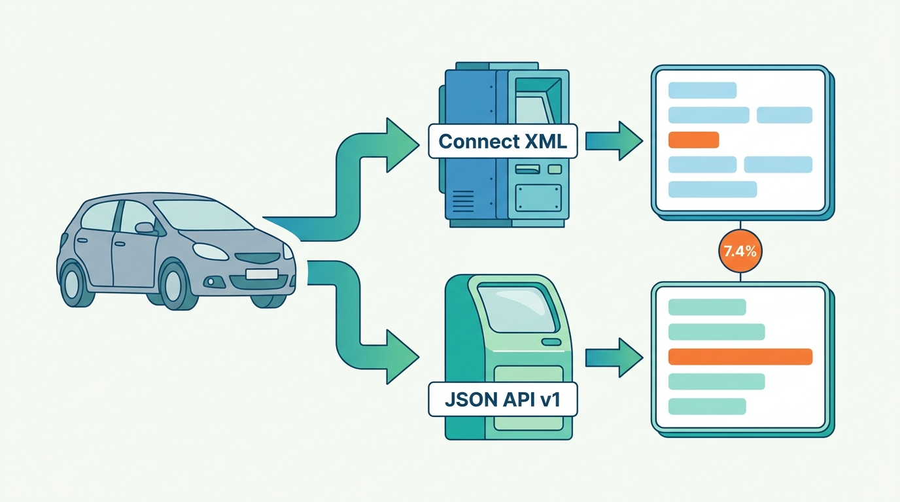
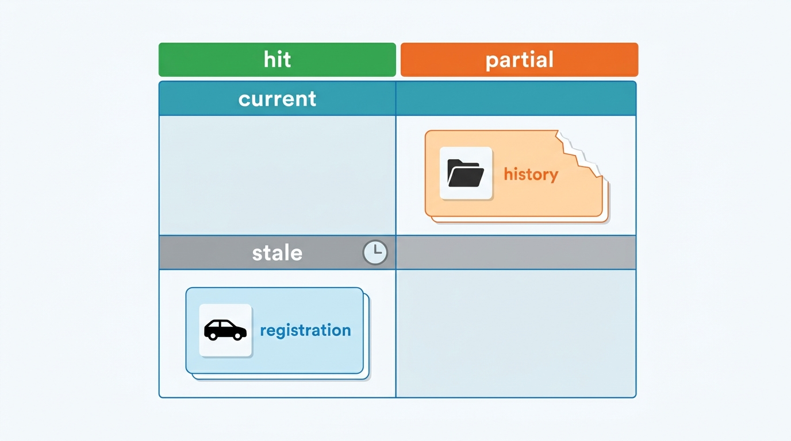
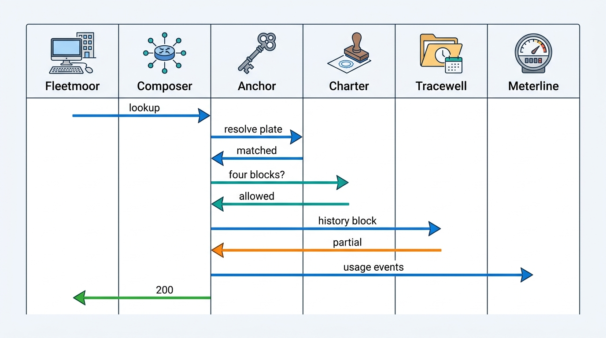
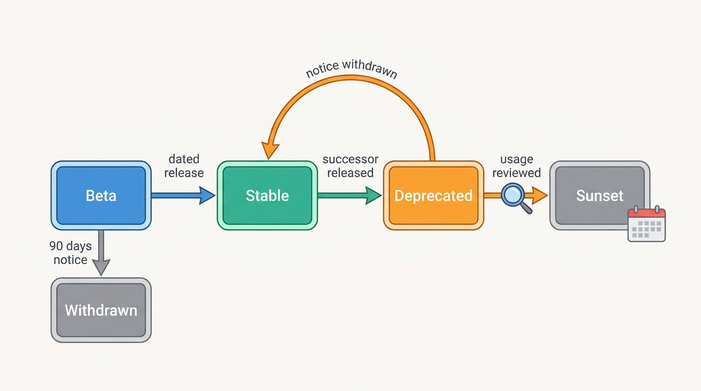

> **IN THIS CHAPTER, YOU WILL:** Design the external data API of a vehicle data platform: the product shape (lookups by plate or vehicle identification number (VIN), category blocks, reports and batch), the response composer that assembles answers from internal contexts, the metadata and error semantics clients need, the contract registry and versioning model, authentication, metering and limits at the gateway, the developer portal and sandbox, service levels, and the deprecation of a legacy XML interface.

> **WHY THE BUSINESS CARES:** For a vehicle data provider the API *is* the product: insurers, lessors and software vendors build it into claims systems, remarketing tools and dealer software, and then leave the integration alone for years. A breaking change or an ambiguous "not found" costs the client a release and costs the provider credits, renewals and the next contract.

> **WHY ARCHITECTS SHOULD CARE:** A data API sits on top of every hard problem in the book (identity, specification, history, valuation, license, metering) and exposes each of them in a contract that outside teams code against. Mistakes in the contract live as long as the slowest client's integration, so the shape of the response and the rules for changing it matter more than the framework behind them.

> **KEY POINTS:**
>
> * **Sell category blocks, not endpoints or sources.** The unit a client buys is a block (registration, specification, history, valuation) with its own price, license, freshness and outcome. A response composer assembles blocks from the internal contexts that own them, so a failure in one block is reported in that block and never turns the whole answer into an error or a "not found".
> * **One outcome vocabulary for the response, the meter and the service level.** Hit, partial, no hit and failed, plus a freshness label of current, stale or unavailable, decide what the client sees, what Meterline bills and what the availability figure counts. When each of those is decided in a different place, the result is the €186,000 No-Hit Credit.
> * **The contract is a governed asset with a registry, and its clock is set by the slowest client.** Describe every block once and render XML and JSON from that one description. Pin each client to a dated version, classify every change as breaking or not in CI, and let per-client usage data, not a calendar, decide when an old version or field can go.

> **[FAILURE PATTERNS THIS CHAPTER ADDRESSES](where-vehicle-platforms-go-wrong.html):**
>
> * **The Unmetered Call** — two API stacks classified "no hit" and retries differently, and the gateway counted requests that the services had not classified.
> * **Provenance Amnesia** — a response without source, observation time and license per block leaves the client unable to tell a fresh register fact from a six-hour-old copy, or to find the answers built on a corrected fact.
> * **License Blindness** — exposing licensors' data per source schema, or as one undifferentiated document, makes it hard to prove which client received which licensed field for which purpose.

<br>
A vehicle data API looks like a lookup service: send a plate, get a car. But the answer is not one fact. It is a **bundle of facts from different owners**, with different licenses, prices, freshness and failure modes: register status from a national register, specification from a licensed build-data provider, history from insurers, workshops and inspection bodies, a valuation from the platform's own model. The client wants one call. The platform has to keep the bundle's seams visible, because each seam is where something can be stale, missing, unlicensed or unbilled.

The clients are also unusual. **Most of them are other software companies**: claims platforms, lease-management systems, dealer software, portals. They integrate once, under a project budget, and then leave the integration alone until something breaks. A breaking change does not reach the insurer's claims handler until the insurer's vendor ships. The provider's change policy is set by the slowest of several hundred release calendars, not by its own.

This chapter owns three terms: the **response composer**, the **category block** and the **API contract registry**. It builds on [[vehicle-identity]] for the key a lookup resolves, on [[identity-access-and-entitlements]] for API clients and their credentials, on [[billing-and-metering]] for usage events, on [[data-licensing-and-governance]] for the license check, and on [[scale-and-cost]] for the batch lane and the upstream budget. It hands webhooks and event feeds to [[events-webhooks-and-sync]] and file enrichment to [[data-products-and-insights]].

## Setting the Scene at Axleby: Two APIs, One Car, Seven Percent Disagreement

Axleby, the fictional vehicle data and dealer software group this book follows (see [[meet-axleby]]), sold data through two API stacks at the start of 2027. **Connect XML**, the SOAP/XML platform from 2006 on SQL Server in Utrecht, carried 38% of the 2.6 million billable lookups a day, and **210** of Axleby's **640** API client organizations used nothing else. **JSON API v1**, Kotlin services on AWS since 2022, carried the rest. (Axleby's Connect XML has no relation to Auto Trader UK's Autotrader Connect platform discussed below; the names only collide.)

In April 2027 Bas Hendriks, remarketing manager at Fleetmoor Lease, asked for something simple. Fleetmoor takes back about **14,000** cars a year from its 64,000-vehicle fleet. For each return its remarketing system wanted one call returning register status, specification, a damage and odometer history and a trade valuation. It was making four calls across both stacks and had found answers that disagreed.

Priya Raman (VP Data and Valuation) and Ines Marchetti (Group Chief Architect) ran an inventory before replying. Its findings (Axleby illustration):

| Finding | Connect XML | JSON API v1 |
| --- | --- | --- |
| Surface | 23 SOAP operations; 11 category groups in its XML Schema Definitions (XSDs) | 34 REST endpoints, one per internal service, OpenAPI generated from code |
| Client-specific variants | **57** client "response profiles" (field subsets and renamed elements created for large clients since 2006), **41** still called in 2027 | None formally; 3 endpoints with client-specific query flags |
| Versioning | None; the XSD changed in place 9 times since 2015 | `/v1` in the path; **4** changes in 2026 broke at least one client without notice |
| Metadata | None per field | `updated_at` on some resources, meaning different things in each |
| No-hit and retries | Billed per client reference; empty history not billed | Billed per HTTP request; empty history billed (the No-Hit Credit, [[billing-and-metering]]) |

The most damaging number came from a comparison. The team sent **20,000** sampled plates through both stacks and compared 18 fields that both returned. For **7.4%** of plates at least one field differed. The causes were mundane: Connect XML's own nightly register loader had failed silently on several nights ([[registers-and-official-data]]); the two stacks used different fuel-type code lists; and Connect XML derived an "edition" string from the register's model name, while JSON API v1 asked Specbook, the specification resolver ([[specification-and-equipment]]). **Two contracts had become two products** that happened to share a brand.


**Figure 1:** *The same car sent through both stacks came back as two answers for 7.4% of 20,000 sampled plates: two contracts had become two products.*

Ines put the question to the architecture forum in May: what exactly does Axleby sell through an API, and how can one product be served in two wire formats until Connect XML's announced sunset on **31 December 2029**? The design record for **JSON API v2** was approved on **9 June 2027**. Its response composer went live in July 2027 behind JSON API v1's endpoints, carrying Charter's decision engine, and the v2 public lookup contract and developer portal followed in October 2027. Webhooks are a later v2 milestone, arriving in Q3 2028 ([[events-webhooks-and-sync]]). This chapter follows that design.

## Concepts: What a Data API Sells

### Four product shapes

Vehicle data reaches clients in four shapes, and most providers sell all four.

| Shape | What the client sends and gets | Typical client | Pricing unit | Owner in this book |
| --- | --- | --- | --- | --- |
| **Lookup** | A plate (with country) or VIN in; selected facts out, in milliseconds | Claims, quoting, appraisal and dealer software | Per call or per block, outcome-dependent | This chapter |
| **Report** | A request in; an immutable, stored document out (history, valuation certificate, battery report), retrievable later by id | Dealers, lessors, consumers through apps | Per report | [[vehicle-history]], [[consumer-vehicle-checks]] |
| **Batch** | A list of vehicles in; results out, asynchronously | Fleet audits, insurer portfolio re-checks | Per record, with surcharges for paid upstream misses | [[scale-and-cost]], [[data-products-and-insights]] |
| **Change feed** | A subscription in; events out when a vehicle's facts change | Lessors, insurers, dealer groups | Subscription | [[events-webhooks-and-sync]] |

The shapes share one data model. A batch is many lookups paced by a budget; a report is a lookup whose answer is frozen and stored; a change feed tells a client that a lookup it made earlier would now answer differently. **Designing the lookup well makes the other three cheap.**

### Category block

A **category block** is the unit of a vehicle data response that is sold, licensed, sourced and failed independently: identity, registration, specification, history, valuation, market, tax, battery health. Each block has a **definition** in the contract registry:

- its **fields and schema**;
- the **internal context that owns it** (Anchor for identity, the register mirror for registration, Specbook, Tracewell, Vantage, Pulse);
- its **sources and their licenses**, and the client purposes Charter must find before serving it ([[data-licensing-and-governance]]);
- its **SKU** (stock-keeping unit, the priced item in the price book) **and outcome rules** for Meterline;
- its **freshness class** (how old a fact may be before it is labeled stale) and whether it may ever be served from a copy.

A block is not the same as a source. Axleby's specification block draws on register technical data, catalog data and per-VIN build data, and returns one resolved view with the source on each field. VWE, a Dutch vehicle-data and dealer-software company, publicly documents the alternative: its Interdata XML interface groups XSDs by licensor, with separate type sets for RDW, Autotelex, Jato, SilverDAT and others ([VWE API documentation, n.d., accessed 2026-10](https://vwe.nl/api-documentatie/); [[case-vwe]]). Per-source schemas make license scoping simple and push harmonization onto every client. **Blocks keep license scoping at block level and do the harmonization once**, which is the job [[specification-and-equipment]] describes.

### Response composer

The **response composer** is the stateless service that turns one client request into one answer. It resolves the vehicle, asks Charter which requested blocks this client may receive for its purpose, fetches the permitted blocks from their owning contexts in parallel under a deadline per block, wraps each in its metadata and outcome, emits one usage event per billable block and hands the result to a renderer (JSON or XML). It owns **assembly, not data**: it never stores a fact, computes a valuation or decides a hit class. Those decisions belong to the contexts, as [[vehicle-bounded-contexts]] argues. A composer that starts interpreting data becomes a second copy of the domain, and a second copy is what produced Axleby's 7.4%.

### API contract registry

The **API contract registry** is the system of record for what the API promises: block definitions, canonical schemas (JSON Schema 2020-12 inside OpenAPI 3.1), dated versions with the change class of every difference, the XML serializations for the legacy base, each client credential's version pin, deprecation dates, and per-client usage of every block and deprecated field. CDK Global's Fortellis is the best-known automotive example of a contract held apart from its implementation ([[case-cdk-global]]). A provider selling its own data needs one for a narrower reason: **the contract is the product specification**, and it must exist somewhere other than in the code.

### Outcome and freshness

Every block in a response carries two labels.

- **Outcome**: `hit`, `partial`, `no_hit` or `failed`. These are the same classes the history assembler uses ([[vehicle-history]]) and the same outcomes Meterline rates ([[billing-and-metering]]). The owning context decides the outcome; the composer copies it.
- **Freshness**: `current`, `stale` or `unavailable`, the labels [[reliability-and-dependencies]] uses for degraded answers. Freshness is decided by comparing the fact's observation time with the block's freshness class.

The two are independent. A registration block read from the register mirror six hours after the register's channel went down is a `hit` that is `stale`. A history block with one source timed out is `partial` and `current`. Keeping the two apart lets the client decide what it can act on, and lets the price book decide what it charges for.


**Figure 2:** *Outcome and freshness are separate labels: a registration block can be a hit that is stale, and a history block can be partial and current.*

## Architecture: Gateway, Composer, Contexts, Registry

The JSON API v2 design puts four layers between a client and the facts: the **gateway** (who is calling, and may they call now), the **composer** (what to assemble), the **contexts** (the facts), and the **renderers** (which wire format). The contract registry configures all four.


**Figure 3:** *The gateway decides whether a call may run, the composer decides what to assemble and asks Charter and Anchor first, the owning contexts supply facts with outcomes, and the renderers turn one canonical answer into JSON or legacy XML. The contract registry configures the gateway and renderers, so both wire formats are generated from one description.*

### Responsibilities and boundaries

| Component | Responsibility | Owns | Must not |
| --- | --- | --- | --- |
| **API gateway** | Authenticate the client; attach client id, contract version pin and request id; enforce rate limits, quotas and spend caps; reject malformed requests | Admission decisions, protective counters | Classify outcomes or bill; read vehicle data |
| **Response composer** | Resolve identity, check licenses per block, fan out to contexts with per-block deadlines, assemble the canonical answer, emit usage events, store the idempotency record | Assembly rules and idempotency records | Store facts, apply business rules of a context, guess a missing value |
| **Owning contexts** | Serve their block with outcome, sources, observation times and fact version | Their facts and hit classes | Shape responses for a particular client |
| **Charter** | Decide which blocks and fields the client may receive for its stated purpose; record the decision | License and purpose register, access audit | Be bypassed by a cache or a renderer |
| **Renderers** | Turn the canonical answer into JSON (current and older dated versions) or Connect XML (frozen XSD profiles) | Version-change transforms | Add or drop facts the canonical answer did not contain |
| **Contract registry** | Hold definitions, versions, change classes, pins, deprecations and usage | The published contract | Be edited without a review and a changelog entry |

Two boundaries carry most of the weight. **The gateway does not decide what is billable**: it counts requests for capacity and quotas, while Meterline counts outcomes decided by the contexts. **The renderer does not decide what is true**: in 2026 Connect XML computed its own "edition" field; in v2 XML and JSON clients asking the same question at the same moment get the same facts, and a golden test proves it on every release.

### Request shape: identifiers belong in the body

A v2 lookup is a `POST` to `/v2/vehicle-lookups` with the identifier, the country, the requested blocks, the client's purpose code and an `Idempotency-Key` header. Plates go in the body, never in the URL, which ends up in server logs. The UK's Driver and Vehicle Licensing Agency (DVLA) does the same in its Vehicle Enquiry Service because the number "is deemed sensitive information" under the guidance of the Information Commissioner's Office (ICO) ([DVLA, n.d., accessed 2026-10](https://developer-portal.driver-vehicle-licensing.api.gov.uk/apis/vehicle-enquiry-service/vehicle-enquiry-service-description.html)).

Requesting blocks explicitly does three jobs: the composer fetches only what was asked for, Charter checks purpose per block, and the registry learns **what each client actually uses**. A server sees what it sent, never what the client read, so explicit block selection is the cheapest usage evidence a deprecation will ever have.

### What a v2 answer looks like

A shortened answer to one of Fleetmoor's return lookups, a 2022 Kia e-Niro (Axleby design, fictional values):

```json
{
  "request_id": "rq_01J9…",
  "match": { "status": "matched", "avk": "01HZX…", "vin": "KNA…",
             "identity_tier": "confirmed" },
  "blocks": {
    "registration": { "outcome": "hit", "freshness": "current",
      "observed_at": "2027-10-12T06:10:00Z", "sources": ["nl-register-mirror"],
      "fact_version": "reg:4471902", "data": { … } },
    "specification": { "outcome": "hit", "freshness": "current",
      "resolution_state": "edition_unknown", "candidates": 2, "data": { … } },
    "history": { "outcome": "partial", "freshness": "current",
      "coverage": [{ "section": "damage", "status": "unavailable",
                     "reason": "source_timeout" }],
      "report_id": "hr_88c…", "data": { … } },
    "valuation": { "outcome": "hit", "freshness": "current",
      "segment_status": "watch", "interval": [17100, 19400], "data": { … } }
  },
  "license": { "decision_id": "chd-2027-11-…", "purpose": "remarketing",
               "retain_until": "2027-12-12", "withheld": [] }
}
```

Each block says where its facts came from, when they were observed and which **fact version** it was built from, so a later correction can find this answer ([[journey-data-correction]]). The license block is Charter's, defined in [[data-licensing-and-governance]]: its decision id is also Meterline's `licence_ref`, and `withheld` makes "not returned" impossible to read as "nothing found". The specification block carries Specbook's resolution state rather than a guessed edition. The valuation block carries Vantage's segment status, introduced after the EV Overvaluation ([[valuation-engine]]): a battery-electric vehicle (BEV) in a segment under `watch` comes with a wider interval. The history block says which section is missing and why. **None of this metadata is decoration; each field answers a question a client's support desk will otherwise ask Axleby's.**

### Composition, step by step


**Figure 4:** *Identity and license come first, because a block served for the wrong car or the wrong purpose cannot be taken back. Blocks are fetched in parallel under their own deadlines, and a partial block is reported inside a successful response. Meterline receives one event per billable block, carrying the outcome the context decided.*

The order matters. **Identity before anything paid.** If Anchor returns `ambiguous` (two vehicles carry the plate on that date, as in the Cloned Plate) or the vehicle's identity tier is only `asserted`, the composer serves the identity block and declines paid history; [[vehicle-identity]] sets that rule. **License before fetch.** A block or field Charter refuses is listed under `withheld` with a reason and is neither fetched nor metered, so an unlicensed block costs nothing upstream either.

### Error semantics: transport errors and business answers

The most consequential design choice in a data API is which answers are HTTP errors. Auto Trader UK made the same choice visible in October 2026. Its Connect changelog announces, as a breaking change, that failed vehicle lookups, which previously returned "404 Not Found", will return 200 with an empty `results` array and `totalResults: 0`, released to its sandbox on 11 September 2026 and scheduled for 30 November 2026 ([Autotrader Connect documentation, n.d., accessed 2026-10](https://developers.autotrader.co.uk/documentation); [[case-auto-trader-uk]]). Axleby's rule is the same in substance: **a valid question about a car the platform does not know is a business answer, not a transport failure.**

| Situation | HTTP status | Body | Metered as | Client should |
| --- | --- | --- | --- | --- |
| Vehicle matched, all blocks answered | 200 | Blocks with `hit` or `no_hit` | Each block per its outcome | Use the data |
| Vehicle matched, one block partial or stale | 200 | Block-level `partial` or `stale`, with coverage and age | `partial`, priced by the price book | Decide whether the gap matters |
| Vehicle matched, one block's source down | 200 | Block `failed`, freshness `unavailable`, `retry_after` | `failed`, free | Retry that block later, not the whole call |
| Plate valid but unknown, or VIN unknown | 200 | `match.status: not_found` | Free under no-hit-no-fee | Not retry; check the input |
| Plate shared by two vehicles on that date | 200 | `match.status: ambiguous`, ask for VIN | Free | Supply the VIN |
| Block not licensed for this purpose | 200 | Block listed under `withheld` with reason | Not metered | Fix the contract, not the code |
| Malformed plate or VIN, unknown block | 400 | RFC 9457 problem details | Not metered | Fix the request |
| Bad or expired credential | 401 / 403 | Problem details | Not metered | Re-authenticate |
| Rate limit or quota exceeded | 429 | Problem details, `Retry-After`, rate-limit fields | Not metered | Back off |
| Composer overloaded or down | 503 | Problem details, `Retry-After` | Not metered | Retry with jitter, same idempotency key |

Error bodies use **RFC 9457 Problem Details for HTTP APIs**, which obsoleted RFC 7807 in 2023 ([RFC 9457, 2023](https://www.rfc-editor.org/rfc/rfc9457.txt)), with stable `type` URIs listed in the registry. Rate-limit responses also carry the `RateLimit-Policy` and `RateLimit` fields from the IETF draft, which lets servers "advertise their quota policies and the current service limits"; it was still an Internet-Draft (version -11, May 2026) when this was written, so Axleby documents the fields as provisional ([IETF draft-ietf-httpapi-ratelimit-headers, 2026](https://datatracker.ietf.org/doc/draft-ietf-httpapi-ratelimit-headers/)).

The rule behind the table: **never use a 5xx status for a failure confined to one block.** Retry libraries retry 5xx automatically, and without an idempotency key the retry buys the healthy blocks again.

### Metering, limits and spend at the gateway

The gateway runs three meters that are often confused:

1. **Protective rate limits**: requests per second per client and globally, to keep the composer and the upstream budget healthy.
2. **Commercial quotas**: lookups per month in the client's contract, as entitlements ([[identity-access-and-entitlements]]).
3. **Spend caps**: upstream spend per client, fed by the upstream budget broker of [[scale-and-cost]].

None of the three is the billing meter: Meterline's events come from the composer, and the gateway's counts serve only as a completeness check ([[billing-and-metering]]).

Interactive and batch traffic use **different endpoints and different client credentials**. After the Saturday Batch of May 2027, in which Rijnstaal Verzekeringen sent 1.1 million calls in 41 minutes through the interactive path, batch work moved to `/v2/lookup-jobs`. That endpoint accepts a file or a list, paces work by the upstream budget, and returns results by job id ([[scale-and-cost]]). Rijnstaal's batch now runs on its own client with its own limits ([[identity-access-and-entitlements]]).

### Requirements per interaction

| Interaction | Consistency | Latency | Freshness | Availability |
| --- | --- | --- | --- | --- |
| Interactive lookup, base blocks (identity, registration, catalog specification) | Same answer in JSON and XML for the same request at the same moment | p99 under 800 ms *(assumption, as [[scale-and-cost]])* | Labeled `stale` when the mirror is more than 1 h behind the register's change stream *(Axleby freshness class)* | 99.9% monthly; degraded blocks count as available if labeled |
| Interactive lookup with history | History is a stored snapshot with a report id | p95 under 3 s *(assumption, as [[vehicle-history]])* | As the history assembler; theft status never from cache | Partial with stated gaps, or declined without charge on request |
| Valuation block | Recorded in the valuation ledger with model version | p95 under 800 ms *(assumption)* | Model retrained weekly; segment status daily | Degrade to `failed`, never to an older cached value without a label |
| Idempotent replay of a lookup | Exactly the stored answer for 72 h *(Axleby choice)* | As the original | As stored | As the composer |
| Batch job | Same results as interactive for the same vehicle and moment | Completion within the agreed window | As interactive | Pauses when the upstream budget is exhausted |
| Usage and spend API for clients | Provisional until period close | Interactive | Within 15 minutes *(assumption, as [[billing-and-metering]])* | Business hours |
| Contract registry reads at the gateway | Cached per version; a pin change takes effect within a minute | Not on the request path | Not applicable | Gateway keeps last good copy |

## The Contract Registry and Versioning

### One description, several renderings

Axleby's registry, named **Folio**, holds the canonical model once. Each block's JSON Schema is the source; the OpenAPI document for each dated version is generated from it; and the Connect XML XSDs, including the 41 live client response profiles, are recorded as **frozen serializations**: mappings from canonical fields to the old element names. This is the platform-operations principle of modeling the domain once and treating XML/SOAP, CSV and STAR messages as "adapters at the edge", where STAR (Standards for Technology in Automotive Retail) is the US dealer-messaging standards body with "over 200 XML message formats" ([STAR, n.d., accessed 2026-10](https://www.starstandard.org/?p=488)). The same pattern exists in public-sector APIs: NHTSA's vPIC VIN decoder, from the US National Highway Traffic Safety Administration, serves the same operations as JSON, XML and CSV ([NHTSA, n.d., accessed 2026-10](https://vpic.nhtsa.dot.gov/api/)).

**Client-specific response profiles stop being schemas.** In v2 a client's view of the API is three things the registry holds about it: which blocks it requests, which fields Charter's license filter removes for its purpose, and which dated version it is pinned to. No client gets renamed fields or a private shape. Of the 57 Connect XML profiles, the inventory found that 38 were field subsets, which v2 expresses as block selection. Eleven renamed elements for one client's parser, and v2 does not reproduce them. Eight existed to hide fields the client had not licensed, which v2 handles with Charter's filter. That is **Customization Creep** expressed as a contract, and the registry is where it ends.

### Choosing a versioning model

Public API providers document four models.

| Model | Mechanism | Documented by | Strength | Cost |
| --- | --- | --- | --- | --- |
| **Major version in the path** | `/v1`, `/v2`; no breaking change within a major; beta channels | Google AIP-185 and AIP-180 ([Google, 2024](https://google.aip.dev/185)) | Simple; obvious to clients | Each major is a migration for every client |
| **Date-pinned versions per account** | Account pinned to the version current at its first call; header override; server-side "version change modules" transform responses backward | Stripe, 2017 ([Stripe, 2017](https://stripe.com/blog/api-versioning)) | Clients upgrade when they choose; the provider ships continuously | A permanently growing chain of transforms |
| **Named releases on a cadence** | Breaking changes only twice a year in a named release; monthly additive releases | Stripe since October 2024 ([Stripe, 2024](https://stripe.com/blog/introducing-stripes-new-api-release-process)) | Predictable for clients' planning | Breaking work waits for the window |
| **Required date-valued parameter** | `api-version=YYYY-MM-DD`, previews retired after at least 90 days' notice | Microsoft Azure guidelines ([Microsoft, n.d.](https://github.com/microsoft/api-guidelines/blob/vNext/azure/Guidelines.md)) | Explicit on every call | Clients must choose; no default |

Stripe's 2017 post says it had kept compatibility "with every version of our API since the company's inception in 2011"; both posts are vendor descriptions of their own practice, the older one nine years old.

Axleby combined two of them, because its clients are the Stripe case: a few hundred integrators who cannot be forced to move. JSON API v2 keeps **`/v2` in the path** as the outer boundary, then **pins each client credential to a dated version** (`Axleby-Version: 2027-10-01`) at its first call, with a header override for testing. Breaking changes ship only in **two dated releases a year, in April and October**, and version-change transforms in the JSON renderer walk each answer back to the client's pin. Additive changes (a new block, a new optional field, a new enum value in a field documented as open) ship whenever they are ready.

### What counts as breaking

Auto Trader's Connect documentation defines a breaking change as one that "could require a change to your integration to avoid any disruption", promises at least 30 days' notice, and lists removed properties, new mandatory parameters, moved status classes and additional validation errors as breaking ([Autotrader Connect documentation, n.d., accessed 2026-10](https://developers.autotrader.co.uk/documentation)). Folio applies the same classes automatically. Every pull request that touches a schema is compared with the previous version in continuous integration. The diff is labeled additive, breaking or behavioral, and a breaking diff fails the build unless it is attached to the next dated release.

Vehicle data adds three kinds of breaking change that schema diffs do not catch:

- **Semantic changes.** Moving the hit definition for history (the No-Hit Credit fix), changing how odometer judgements are worded ([[vehicle-history]]), or switching a valuation from asking-price to transaction-price basis changes no field and breaks every client's interpretation. Folio requires a **behavioral change record** for outcome rules, code lists and computation bases, and these ship in dated releases like schema changes.
- **Code-list changes.** Fuel types, body types and equipment codes are enumerations that grow. Axleby documents every code list as open ("clients must accept unknown values") from the first v2 version, because adding a value to a closed enum breaks strict parsers.
- **Privacy removals.** Auto Trader's scheduled removal of `vehicle.previousOwners` from Stock and Search in favor of `history.previousOwners` ([[case-auto-trader-uk]]) is the pattern: personal-data and license decisions move fields between blocks. At Axleby that is a block-definition change, reviewed by Femke de Boer's governance team.

### The version lifecycle


**Figure 5:** *A block or dated version moves from beta to stable in a dated release, and from deprecated to sunset only when its date has passed and per-client usage has been reviewed. Beta blocks may be withdrawn at shorter notice because clients opted into them.*

Axleby's published terms (fictional): beta blocks can change or be withdrawn with **90 days'** notice, the time-box Google's AIP-181 calls "a good rule of thumb"; a stable dated version is supported for at least **24 months** after its successor ships; and a stable field or block is removed only after **12 months'** notice. Deprecated responses carry the `Deprecation` header (RFC 9745, March 2025) and, once a date is fixed, the `Sunset` header (RFC 8594), which signals that a resource "is likely to become unresponsive at a specified point in the future" ([RFC 9745, 2025](https://www.rfc-editor.org/rfc/rfc9745.txt); [RFC 8594, 2019](https://www.rfc-editor.org/rfc/rfc8594.txt)).

**The 12 months is a contract term, not an engineering preference.** Auto Trader's 30 days works for a known partner set that is paid to keep up ([[case-auto-trader-uk]] argues it is still short); Google recommends 180 days for beta functionality. A data provider whose clients are insurers' and lessors' IT departments, releasing quarterly behind procurement, needs a window measured in their release cycles. Axleby put the window into the API terms of every renewed contract from 2028, which makes it enforceable in both directions.

## Developer Portal, Sandbox and Service Levels

### The portal is part of the product

Auto Trader's Connect portal shows the components that matter: a separate sandbox host, so that integration work happens "without impacting any API call quotas"; production credentials only after sandbox testing; 15-minute access tokens; credentials removed after 90 days unused; a deprecated-APIs page; and a dated changelog ([Autotrader Connect documentation, n.d., accessed 2026-10](https://developers.autotrader.co.uk/documentation)). VWE's public page offers PDF manuals, XSDs and the advice to test with SoapUI ([[case-vwe]]); only the first approach produces evidence of who uses what.

Axleby's portal (live with v2, October 2027) has six parts: generated reference documentation per dated version; a changelog with every release's change records; self-service client registration, with production access after certification; per-client **usage and spend** views fed by Meterline, not by gateway counts; a status page with block-level component status (register mirror, history sources, valuation); and the sandbox.

### Sandbox data that exercises the contract

A sandbox that returns production data for any plate is a leak; the Plate Enumeration Attack of August 2027 used leaked trial keys against the JSON API ([[vehicle-platform-security]]). A sandbox that returns one happy-path car teaches clients nothing about the cases that break integrations. Axleby's sandbox returns only **synthetic scenario vehicles**, each built to produce one documented outcome:

| Scenario vehicle | What it returns | What it tests in the client |
| --- | --- | --- |
| Clean hit | Every block `hit`, `current` | Parsing |
| Empty history | History `no_hit` | No-hit handling and no charge in the sandbox usage view |
| Source down | History `partial` with a damage gap | Gap display; partial-policy setting |
| Stale register | Registration `hit`, `stale`, observed 7 hours ago | Age labels |
| Cloned plate | `match.status: ambiguous` | Asking the user for a VIN |
| Asserted identity | Identity only; paid blocks omitted | Not treating omission as failure |
| Unlicensed block | Block under `withheld`, not licensed for the purpose | Contract, not retry |
| Edition unknown | Specification with two candidates | Candidate display, not a guess |
| BEV under watch | Valuation with `segment_status: watch`, wide interval | Interval use |
| Throttled | 429 with `Retry-After` | Back-off |

Certification for production access is a recorded run of the client against these scenarios, checked from the sandbox logs. It takes a client about a day, and Priya Raman's support team credits it with preventing more integration tickets than any document (Axleby illustration).

### Service levels clients can check

A service-level agreement (SLA) for a composed API must say what "available" means when one block is degraded. Axleby's standard data-client terms (fictional, 2028 renewals) define it as the share of valid requests that received a well-formed response, counting labeled `stale`, `partial` and `failed` blocks as available, with a monthly target of **99.9%**. A second, block-level objective covers what the first hides: the share of blocks answered `current`, per block, published monthly per client. Service credits apply only to the first; the second is reported, not credited, because its failures are mostly upstream outages, which Axleby's error budget separates from its own ([[reliability-and-dependencies]]).

## In Practice: Public Records and Axleby's Migration

### What the public record shows

Public vehicle-data APIs fall into three groups. **Registers publish narrow, quota-bound APIs**: the UK's Driver and Vehicle Standards Agency (DVSA) MOT (annual roadworthiness test) history API allows 500,000 requests a day, a burst of 10 and an average of 15 a second, and restricts a key "for 24 hours" after the quota is exceeded ([DVSA, n.d., accessed 2026-10](https://documentation.history.mot.api.gov.uk/mot-history-api/rate-limits/)); the DVLA issues one key per company and, as of October 2026, accepts no new registrations; the Dutch RDW serves open register data through a Socrata endpoint with no versioning promise beyond dataset identifiers ([RDW, accessed 2026-10](https://opendata.rdw.nl/resource/m9d7-ebf2.json)). These limits flow into the blocks built on them. **A marketplace publishes a partner platform**: Autotrader Connect, with capabilities, sandbox, signed webhooks, change policy and changelog, used by more than 220 technology partners according to its FY2026 results ([[case-auto-trader-uk]]). **A national data provider publishes schemas**: VWE's per-licensor XSDs ([[case-vwe]]). No public source describes how any of them composes responses, meters them or measures per-client field usage; the composer and registry here are the book's reference design.

### Fleetmoor's return lookup, rated

Fleetmoor's remarketing system moved to v2 in November 2027 and makes one lookup per returned car with four blocks. At Axleby's 2027 list prices (fictional), the identity block is free, registration comes with the specification block under the plate-to-specification SKU, and the other blocks map to existing SKUs:

| Block | SKU | List price | Outcome on the e-Niro | Rated |
| --- | --- | --- | --- | --- |
| Identity | none | free | matched, confirmed | €0.00 |
| Registration + specification | Plate-to-specification | €0.09 | hit (catalog level, two candidates) | €0.09 |
| History | Business history report | €4.95 | partial (damage source timed out; gap stated) | €4.95, credit on request |
| Valuation | Valuation API call | €0.18 | hit | €0.18 |
| **Lookup total** | | | | **€5.22** |

At about 14,000 returns a year, about **1,170 lookups a month**, Fleetmoor's list-price spend is about **€6,100 a month** before its contract discounts and volume tiers. Two details of the rated line matter more than the total. Fleetmoor's system used to retry timed-out calls without a reference, and under JSON API v1 each retry was billed. Under v2 every return carries `Idempotency-Key: <return id>`, and a retry inside 72 hours returns the stored answer without a new event. And the partial history is visible to Fleetmoor before it prices the car: its system flags the car and its remarketing desk decides whether the missing damage section matters for that car. When it does, the desk orders a refresh, which is a new, billable report under [[billing-and-metering]], and claims the credit that [[vehicle-history]] allows on the original partial report.

### Running two wire formats until 2029

The design record set four milestones for Connect XML (Axleby plan, fictional):

1. **1 January 2028: contract freeze.** No new fields or operations in Connect XML. New blocks (battery health, market) exist only in v2.
2. **Q2 2028: the facade.** Connect XML's SOAP endpoints are served by the XML renderer over the response composer, using Folio's frozen serializations, so XML clients get the same facts as JSON clients and the same Meterline events. The SQL Server back end stops serving lookups, though it keeps the legacy invoice run until Meterline's cut-over ([[billing-and-metering]]). The frozen XSDs cannot express withheld fields, so Charter still filters XML responses at block level, as [[data-licensing-and-governance]] describes.
3. **2028–2029: client-by-client migration**, tracked in Folio per client, per operation and per profile, with a named owner on Axleby's side for each of the 210 XML-only clients ([[modernizing-the-platform]]).
4. **31 December 2029: sunset**, announced in March 2027 and carried in `Sunset` headers on every SOAP response from 2028 (the header is HTTP, so SOAP clients see it only if they log headers; the portal and account managers carry the message for the rest).

Keeping Connect XML's back end until 2029 would have kept the 7.4% problem alive for 33 months; forcing migration earlier would have broken 210 integrations on Axleby's schedule. Before the facade went live, a **golden comparison** sent the April inventory's 20,000 plates through both paths. Every difference was either fixed or recorded as a documented behavior change and announced to the clients that called the affected operation.

## Failure Handling

| Failure | Example | Detection | Response |
| --- | --- | --- | --- |
| **Duplicate requests** | Client retries after a gateway timeout | Same `Idempotency-Key` (JSON) or client reference element (XML) within 72 h | Return the stored answer; no new usage event; a key reused with a different body gets 422 |
| **Duplicate vehicles** | Plate on two vehicles on the lookup date (Cloned Plate) | Anchor returns `ambiguous` | Identity block only; ask for VIN; nothing paid served or metered |
| **Conflicting facts across blocks** | Register says plug-in hybrid, build data says BEV | The specification context flags a conflict in its resolution state | Show the resolved value with the conflict flag and both sources; the composer never picks between blocks |
| **Incomplete records** | History source times out; specification edition unknown | Block outcome `partial`, coverage list, resolution state | Answer with the gap; client's `partial_policy: decline` turns the block into `failed` and free |
| **Upstream outage** | Register channel down for hours | Turnstile's session monitor; freshness class exceeded | Serve mirror facts labeled `stale` with age; theft status never from cache |
| **Retry storms** | Many clients retry a slow composer | 503 rate and retry ratio at the gateway | `Retry-After`; shed batch lane first; documented jittered back-off in the client guide |
| **Renderer drift** | XML and JSON disagree after a change | Golden comparison on every release | Release blocked; fix in the renderer, not in a context |
| **Transform bug for old pins** | A version-change transform drops a field for clients pinned to 2027-10-01 | Contract tests per supported pin, replaying recorded requests | Roll back the transform; affected clients notified with request ids |
| **Corrected facts already served** | Odometer Correction reaches API answers | `fact_version` per block, stored with the usage event | List affected client answers by fact version; notify through `vehicle.fact.corrected` from Q4 2028 ([[events-webhooks-and-sync]]) |

Two rows need comment. **Conflicts stay inside the block that owns them**: a composer that reconciled blocks would become a resolver without tests, owner or provenance. **Corrections are why the metadata exists.** In the Odometer Correction of May 2027, 6,140 valuations, 412 history reports and 1,180 adverts carried wrong mileage, and nobody could list which API clients had received answers built on the bad readings, because neither stack recorded what facts an answer contained ([[journey-data-correction]]). A fact version per block, stored with the usage event, turns that question into a query.

## Trade-offs

### Product shape

| Option | Strengths | Weaknesses | Right when |
| --- | --- | --- | --- |
| **Per-source schemas** (one schema per licensor, as VWE documents) | License scoping is trivial; adding a source touches nothing else | Every client harmonizes; source changes are client changes; no cross-source resolution | Clients already map those sources and value raw provenance over convenience |
| **Endpoint per internal service** (Axleby's JSON API v1) | Cheap to build; teams ship independently | Clients compose; internal boundaries become public contract; each team invents metadata and errors | Internal APIs only |
| **Harmonized vehicle resource with category blocks** (v2) | One model; license and price per block; partial failure is local; usage evidence from block selection | The provider owns harmonization and per-block metadata; composer is a critical service | Several hundred external clients, mixed licenses, outcome-based pricing |
| **Query language with field selection** (for example GraphQL) | Clients ask for exactly what they use | License, price and freshness are per block, not per field; cost per query is hard to predict; caching and metering get harder | Internal product front ends over owned data; Axleby uses it for none of its external APIs |

### Legacy coexistence

| Option | Strengths | Weaknesses | Right when |
| --- | --- | --- | --- |
| **Keep the legacy stack until sunset** | No risk to legacy clients | Two classifications, two data paths, two meters for years | Sunset is months away, not years |
| **Facade over the new composer** (Axleby) | One truth, one meter; legacy wire format unchanged | Serialization mapping and golden testing cost; old quirks become documented behavior changes | Long sunset, many clients who cannot move soon |
| **Forced migration** | Shortest dual running | Breaks clients on the provider's schedule; churn and contract disputes | Few clients, or a contract that permits it |

The recommendation rests on three requirements: one classification of outcomes across wire formats, a migration on clients' schedules, and evidence per client of what is still in use. If Axleby had had 20 XML clients instead of 210, forced migration with a year's notice would have been cheaper than the facade.

## Across Markets: What Changes by Country

| Concern | Netherlands / Belgium | Germany | United Kingdom | United States |
| --- | --- | --- | --- | --- |
| Key clients send | NL: plate (*kenteken*), which follows the vehicle; BE: plates follow the owner to the next car ([Wikipedia, 2026](https://en.wikipedia.org/wiki/Vehicle_registration_plates_of_Belgium)), so VIN is the safer key | Plate is tied to keeper and district; VIN and type key numbers in practice | Registration mark follows the vehicle, but private numbers move between vehicles ([GOV.UK, n.d.](https://www.gov.uk/personalised-vehicle-registration-numbers)) | VIN first; plates vary by state |
| Register data in the registration block | NL open register data, mirrorable ([[registers-and-official-data]]); BE no public register API verified | No open vehicle-level register; keeper data only for a demonstrated legal claim (§39 of the Road Traffic Act, StVG) | DVLA and DVSA APIs with per-key quotas; DVLA registration closed (October 2026) | Title and brand data through approved National Motor Vehicle Title Information System (NMVTIS) providers; vPIC decoding open |
| Plate as personal data | Personal data under GDPR when linked to a keeper | As NL | Vehicle registration number (VRN) treated as sensitive by DVLA, citing the ICO | Driver's Privacy Protection Act (DPPA) restricts DMV personal information |
| Integration conventions | XML and SOAP common; VWE documents XML only | No public developer portal verified for the large data providers | REST and JSON with sandboxes (Autotrader Connect, DVSA) | STAR XML messages and dealer-platform API marketplaces (Fortellis) |

**What is common:** the composer, the block model, outcome and freshness labels, the registry, versioning, error semantics and the gateway's meters. **What is a market adapter:** which identifier is accepted as the primary key (plate in the Netherlands, VIN preferred in Belgium and the US), which register-sourced fields a registration block contains and how fresh they can be, which fields Charter strips for privacy in each market, and the number of upstream quota keys behind each block. **What is a rule set:** the personal-data treatment of plates and the redisclosure records the DPPA requires in the US. A Belgian plate lookup needs an "as of" date more than a Dutch one, because the plate moves to the owner's next car; [[vehicle-identity]] owns the time-bounded plate assignment.

## The Chief Architect's View

**Decide what the product is before deciding what the API looks like.** Axleby's v1 mirrored its service map, so its contract changed whenever its organization did. Blocks are a product decision (what is priced, licensed and promised) made by the data product team with architecture, governance and billing at the table. Endpoints follow.

**Give the registry an owner and a gate.** Folio sits with the API platform team in Kraków, but a block-definition change needs three approvals: the owning context, governance for license and personal-data impact, and billing for SKU and outcome mapping. A registry anyone may edit is only documentation; a registry nobody may edit quickly becomes the place where releases wait.

**Measure usage per client before promising a sunset.** With per-client block and field usage, the notice-period debate becomes a list of named clients and fields that account managers can work through.

**Keep the composer thin and treat it as tier zero.** Every external call goes through it, so it needs the same reliability treatment as the register gateway: per-block deadlines, bulkheads per context, load shedding by lane. It must stay boring: the day it holds business rules, the 7.4% returns.

**Watch these numbers:** share of calls on each dated version and on Connect XML; clients and fields still on deprecated versions; block `current` rate per block; disagreement rate in the golden comparison; idempotent replays as a share of calls (rising means clients are timing out); 429s per client; and credits paid for API disputes, which should fall toward zero after the No-Hit Credit.

**Long term:** the same contract should serve Axleby's own products, as Lotwise already does for register data ([[registers-and-official-data]]). When internal products call the same blocks under the same outcomes and meters, the group cannot quietly favor its own products, which matters commercially and, as [[case-cdk-global]] shows, legally.

## Questions to Ask

1. What is the unit our clients buy, and can each unit be priced, licensed and failed independently?
2. Where is the outcome of a lookup decided, and do the response, the meter and the SLA all read it from there?
3. Which answers return an HTTP error today that are really business answers, and what do clients' retry libraries do with them?
4. Does every block say its source, observation time, license decision and fact version, and could we list every client answer built on a fact we corrected last month?
5. Which versioning model have we published, and which clients are on which version right now?
6. Which changes do we classify as breaking that a schema diff cannot detect: hit rules, code lists, computation bases?
7. Does our sandbox return production data, and does it exercise ambiguous identity, partial blocks and throttling?
8. Could we name, today, every client still using the interface we plan to sunset, and what each one calls?

A lookup answers a question once. Clients who need to know when the answer changes, such as a lessor watching register status or a dealer group mirroring its stock, need the platform to tell them. The next page, [[events-webhooks-and-sync]], builds the event backbone and the webhooks that JSON API v2 adds in Q3 2028.

## Sources and Evidence

*Company, product and investor sources*

- [Autotrader Connect developer documentation](https://developers.autotrader.co.uk/documentation), Auto Trader UK, n.d. (changelog to 2026-09), accessed 2026-10: breaking-change policy and 30-day notice, failed-lookup change from 404 to 200, 15-minute tokens, 90-day credential removal, sandbox host and quotas.
- [API documentatie](https://vwe.nl/api-documentatie/), VWE Automotive, n.d., accessed 2026-10: Interdata and XMLmode XML interfaces with per-licensor XSDs.
- [APIs at Stripe: versioning](https://stripe.com/blog/api-versioning), Stripe, 2017: date-pinned versions and version change modules.
- [Introducing Stripe's new API release process](https://stripe.com/blog/introducing-stripes-new-api-release-process), Stripe, 2024: twice-yearly breaking releases with monthly additive releases.

*Standards, regulation and official documentation*

- [AIP-185: API versioning](https://google.aip.dev/185), Google, 2024; [AIP-181: Stability levels](https://google.aip.dev/181), 2019; [AIP-180: Backwards compatibility](https://google.aip.dev/180), 2019: major versions, beta time-box, deprecation periods.
- [Microsoft Azure REST API guidelines](https://github.com/microsoft/api-guidelines/blob/vNext/azure/Guidelines.md), Microsoft, n.d., accessed 2026-10: `api-version`, preview retirement, required fields.
- [RFC 9457 Problem Details for HTTP APIs](https://www.rfc-editor.org/rfc/rfc9457.txt), IETF, 2023: error bodies.
- [RFC 9745 The Deprecation HTTP Response Header Field](https://www.rfc-editor.org/rfc/rfc9745.txt), IETF, 2025; [RFC 8594 The Sunset HTTP Header Field](https://www.rfc-editor.org/rfc/rfc8594.txt), IETF, 2019: deprecation signaling.
- [RateLimit header fields for HTTP (draft -11)](https://datatracker.ietf.org/doc/draft-ietf-httpapi-ratelimit-headers/), IETF, 2026: quota and limit advertisement (Internet-Draft).
- [OpenAPI Specification 3.1.0](https://spec.openapis.org/oas/v3.1.0), OpenAPI Initiative, 2021; [JSON Schema specification](https://json-schema.org/specification), n.d., accessed 2026-10: contract description formats.
- [STAR standards overview](https://www.starstandard.org/?p=488), STAR, n.d., accessed 2026-10: XML message formats in US automotive retail.
- [vPIC API](https://vpic.nhtsa.dot.gov/api/), NHTSA, n.d., accessed 2026-10: one operation in several serializations.
- [MOT history API rate limits](https://documentation.history.mot.api.gov.uk/mot-history-api/rate-limits/), DVSA, n.d., accessed 2026-10: published quotas.
- [Vehicle Enquiry Service API description](https://developer-portal.driver-vehicle-licensing.api.gov.uk/apis/vehicle-enquiry-service/vehicle-enquiry-service-description.html), DVLA, n.d., accessed 2026-10: plate in POST body as sensitive data; one key per company; registration closed.
- [RDW open data: registered vehicles](https://opendata.rdw.nl/resource/m9d7-ebf2.json), RDW, live dataset, accessed 2026-10: plate-keyed open register data.
- [Personalised vehicle registration numbers](https://www.gov.uk/personalised-vehicle-registration-numbers), GOV.UK, n.d., accessed 2026-10: private numbers moving between vehicles.

*Research and practitioner sources*

- [Fairness in multi-tenant systems](https://aws.amazon.com/builders-library/fairness-in-multi-tenant-systems/), AWS Builders' Library, 2020: rate limits versus per-tenant quotas.
- [Vehicle registration plates of Belgium](https://en.wikipedia.org/wiki/Vehicle_registration_plates_of_Belgium), Wikipedia, 2026: Belgian plates follow the owner (secondary source).

Axleby is fictional; architectural recommendations, labeled inferences and labeled assumptions are the author's judgement.
