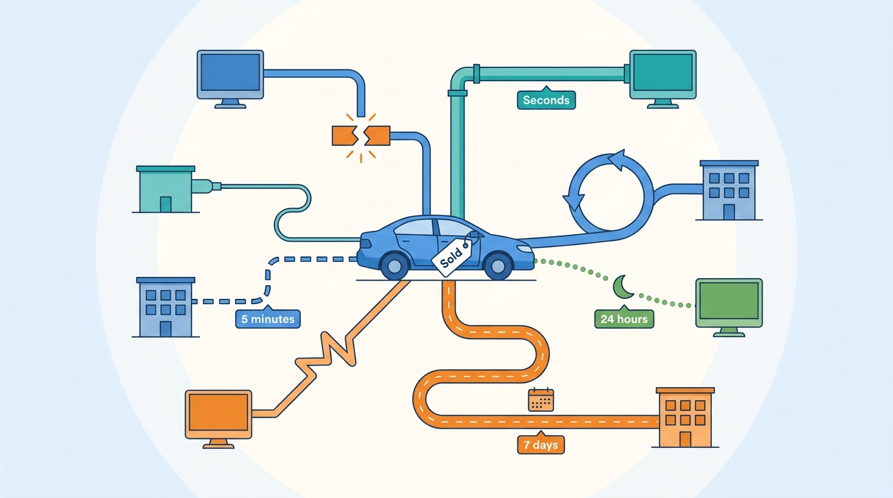
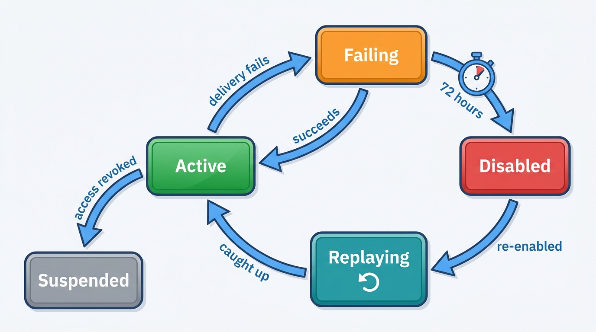
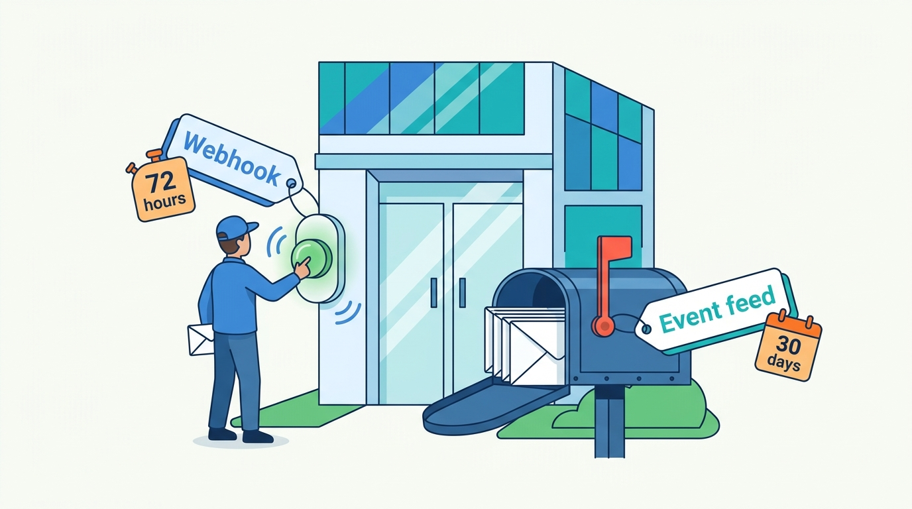
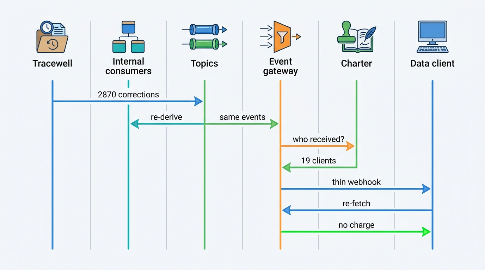

> **IN THIS CHAPTER, YOU WILL:** Design the event layer of a vehicle platform: which domain events to publish, how to envelope, key and version them, how a transactional outbox gets them out of a monolith, how partners receive them as signed webhooks with retries and replay, how to synchronize with portals, dealer management system (DMS) products and registers that cannot receive events, and what consistency, latency, freshness and availability each flow needs.

> **WHY THE BUSINESS CARES:** A sold car that stays advertised produces leads for a car that is gone. A corrected odometer reading that never reaches a data client's copy becomes a complaint about the platform, not the client. Dealer groups and data clients now expect to be told when something changes instead of asking every night, and the platform that tells them reliably becomes part of their own systems.

> **WHY ARCHITECTS SHOULD CARE:** Every product in a vehicle platform reacts to a few business facts: a stock item was sold, a price changed, a lead arrived, a fact was corrected. If each product learns those facts through its own poll, export or dual write, nobody can say who knows what, or how late. The event layer is where that becomes a contract with an owner, an order, a delivery guarantee and a measurable delay.

> **KEY POINTS:**
>
> * **Publish business facts, not table changes, and publish few of them.** A domain event says that something happened to one entity (a stock item was sold, a vehicle fact was corrected), carries that entity's key and version, and is owned by the context that decided it. Raw change data capture (CDC) of a monolith's tables is a migration tool; exposed to other teams or partners, it turns your schema into their contract.
> * **The outbox makes events as reliable as the commit; idempotency makes duplicates harmless.** Write the event in the same transaction as the change, relay it at least once, key it by the entity so its events stay in order, and give every consumer and webhook receiver an event id and an entity version to drop duplicates and superseded messages. Exactly-once delivery is not on offer; exactly-once effect is.
> * **Every push needs a pull behind it.** Webhook endpoints go down, portals retry for half an hour and then give up, file channels never answer, and registers publish snapshots. Pair each subscription with a replayable event feed and each external system with a reconciliation job that compares desired and actual state. Events give speed; reconciliation gives the guarantee.

> **[FAILURE PATTERNS THIS CHAPTER ADDRESSES](where-vehicle-platforms-go-wrong.html):**
>
> * **The Zombie Listing** — a sold status that leaves the monolith by a dual write, a nightly export or a cron job can be lost between commit and publish, and nothing notices until a buyer arrives for a car that is gone.
> * **The Sticky Error** — without a correction event and a record of who received the wrong fact, a fix in the source never reaches the valuations, adverts and client copies built on it.
> * **Customization Creep** — when a dealer group cannot subscribe to events, every integration request becomes a custom export script maintained by the vendor.

<br>
A vehicle platform is a set of products that each keep their own copy of the same few facts. Lotwise, the dealer software, holds the stock item. The syndication engine holds what each portal should show. The lead router needs to know which cars are still for sale. The valuation ledger needs the sale price. A dealer group's data warehouse wants all of it. A data client that bought a history report last week holds a copy of a mileage that may since have been corrected. **Every one of these copies is a synchronization problem**, and most platforms solve each one separately, with whatever mechanism was nearest when the integration was built.

The result is not slow systems but **systems whose delay and loss nobody can state**. This chapter replaces private synchronization paths with one contract: a catalog of domain events, a reliable way to publish them, a delivery model for consumers and partners, and a reconciliation job wherever events cannot be trusted alone.

This chapter owns four terms: the **domain event (vehicle)**, the **outbox**, the **webhook subscription** and the **reconciliation job**. It builds on [[inventory-and-vehicle-dossier]], whose stock item emits most of the events here; on [[dms-integration]], whose adapters publish canonical events and consume commands; and on [[vehicle-data-apis]], whose JSON API v2 (lookups live since October 2027) carries the webhooks from Q3 2028. It hands channel-specific delete propagation to [[listing-syndication]], lead routing to [[leads-and-crm]], publish-lag monitoring to [[observability-and-data-operations]] and the full correction journey to [[journey-data-correction]].

## Setting the Scene at Axleby: One Sold Car, Eight Paths

Axleby, the fictional vehicle data and dealer software group this book follows (see [[meet-axleby]]), ended 2027 with three synchronization incidents: the **Zombie Golf** (February, a sold car live on **4** portals for **4 days**), the **Lost Leads of Velto** (September, **1,460** leads discarded behind a success response) and the **DriveDesk Outage** (November, **2,140** discrepancy tickets after **12 days**). Each post-mortem fixed a component. None answered the question Ines Marchetti, Group Chief Architect, put to Marta Nowak (Head of Platform and SRE) and Hendrik Maes (Head of Partner Integrations) in late November: **when a car is sold in Lotwise, who finds out, how, and how late?**

They traced one transition, *stock item sold*, through Lotwise Classic, the PHP monolith on MySQL that still committed every stock state change in 2027 (Axleby figures, fictional):

| Who needs to know | Why | How it found out in 2027 | Typical delay | What happened when it failed |
| --- | --- | --- | --- | --- |
| **Relay** (syndication) | Withdraw adverts on all channels | RabbitMQ message published by PHP code after the MySQL commit | Seconds, then the channel queue | A crash between commit and publish lost the message; only the sold-but-live job noticed |
| **Lotwise dealer websites** | Hide the car | Website cache polls the stock API every 5 minutes | Up to 5 minutes | Stale page; harmless on its own |
| **Switchboard** (leads) | Stop routing leads to the car; send "sold" auto-reply | Nightly stock export | Up to 24 hours | Leads routed to salespeople for a sold car |
| **Pricing signals** | Remove the car from the price-position cohort | Nightly batch | 24 hours | Mildly wrong signals |
| **Vantage valuation ledger** | Link the sale price to the valuation | Weekly Snowflake export | Up to 7 days | Back-testing a week late |
| **Hitch** (DMS write-back) | Tell DriveDesk, if the sale was entered in Lotwise | Command through Hitch's own outbox | Minutes | Receipt or ticket, as designed in 2027 |
| **Axleby Trade** | Start registration in the buyer's name | Since June 2027, for Lotwise Sales Admin rooftops, the sale itself creates the registration transaction (held as Draft until the payment release rule is met, [[journey-sale-to-registration]]); for sales entered in a DMS, the dealer clicks a button | Immediate (Sales Admin); manual (DMS sales) | DMS sales: nothing; the dealer forgets |
| **Velto's data warehouse** | Group reporting | Custom script diffing MySQL every 30 minutes, built during onboarding | 30 minutes | Silent; Velto noticed gaps in month-end reports |

Eight consumers, six mechanisms, one of them designed. Marta's team then counted. In **October 2027**, Lotwise Classic recorded **152,400** transitions to *sold*. For **83** of them (0.054%), no RabbitMQ message ever reached Relay; the losses clustered around deploys and container restarts, when the PHP process died after committing and before publishing. None stayed live for days only because the 15-minute sold-but-live job built after the Zombie Golf ([[listing-syndication]]) caught all 83, at a median of **34 minutes** after the sale. **The reconciler was doing the event path's job**: this was the Zombie Golf's quieter cousin, not a queue blocked behind failures but a message that never existed.


**Figure 1:** *In 2027 one sold car reached eight consumers through six different mechanisms, with delays from seconds to 7 days and losses nobody could state.*

The data half had the mirror-image problem. When the **Odometer Correction** was fixed in May 2027 (a Kilometra batch had recorded miles as kilometers for **2,870** UK-imported vehicles), Axleby found its own **6,140** valuations, **412** history reports and **1,180** live adverts ([[journey-data-correction]]) but had no way to tell the API clients that had looked up those cars. Charter's access audit later showed that **19** external API clients had received affected mileage in **2,310** lookups during the 11 days. They learned of the correction, if at all, from an email.

Ines turned the audit into a design record approved on **14 December 2027**: the **One Dossier event backbone**, a Year 2 deliverable of the One Dossier program. It has four parts: a catalog of domain events with owners; a transactional outbox in every producing service, starting with Lotwise Classic; delivery on Amazon MSK (managed Kafka) internally and as webhooks in JSON API v2 externally; and a reconciliation job for every flow events alone cannot guarantee.

## Concepts: Events, Commands, Feeds and Reconciliation

A **domain event (vehicle)** is an immutable statement, published by the context that owns a fact, that something happened to one business entity: a vehicle, a stock item, a channel listing, a lead, a deal or a register transaction. It is named in the past tense (*stock item sold*, *vehicle fact corrected*), carries the entity's key and a **monotonic entity version**, and is published only after the change is committed. It is a fact, not a request: consumers may react, but they cannot refuse it.

| Term | What it is | Who owns the contract | Example |
| --- | --- | --- | --- |
| **Domain event** | A committed business fact about one entity | The owning context | *stock item sold*, version 41 |
| **Command** | A request to another system to do something; it can fail or be rejected | The sender, with a receipt from the receiver | Hitch's "set DriveDesk stock status to reserved" ([[dms-integration]]) |
| **Change-data event** | A row-level insert, update or delete captured from a database log | The database schema, which is to say nobody | `UPDATE stock SET status=5` |
| **Flow event** | A record that a unit of work passed a stage, for monitoring | [[observability-and-data-operations]] | "withdrawal acknowledged by channel 14" |
| **Usage event** | A billable business moment, with outcome | [[billing-and-metering]] | "history report delivered, `hit`" |

Martin Fowler's 2017 essay *What do you mean by "Event-Driven"?* separates two styles that matter here ([Fowler, 2017](https://martinfowler.com/articles/201701-event-driven.html)). In **event notification**, a system sends a message "to notify other systems of a change in its domain", and receivers call back for details. In **event-carried state transfer**, the event carries enough state that receivers "don't need to contact the source system in order to do further work", at the cost that "there's lots of data schlepped around and lots of copies". Stripe offers the same choice as **thin** and **snapshot** events and recommends thin ([Stripe, n.d., accessed 2026-10](https://docs.stripe.com/webhooks)). A vehicle platform needs both; personal data and licenses decide which.

An **outbox** is a table in the producing service's own database. The service writes the event there in the same transaction as the business change, and a separate relay publishes it to the broker. A **webhook subscription** is a registered, authorized request by an external party to receive selected event types at an HTTPS endpoint, with a secret, a filter, a delivery state and a delivery log. A **reconciliation job** is a scheduled comparison of what one system believes with what another system actually holds, for a defined set of entities, that produces discrepancies as tickets or corrective events and never overwrites silently.

## Which Events to Publish: The Catalog

Too few events and teams go back to polling; too many and the catalog mirrors the database. **The rule Axleby adopted: an event type exists only if it is a business transition that at least two consumers act on, and it has exactly one owning context.**

| Event type | Owner | Key (partition) | Payload style | Main internal consumers | Offered as webhook |
| --- | --- | --- | --- | --- | --- |
| `vehicle.fact.changed` / `.corrected` / `.disputed` (the dispute status from [[journey-data-correction]], August 2027); `vehicle.merged` / `.split` | Vehicle facts: Anchor, Specbook, Tracewell ([[vehicle-identity]], [[vehicle-history]]) | Axleby Vehicle Key (AVK) | Thin: attribute names, old and new fact versions | Vantage, dossier, Relay (advert text), report store | Yes, to data clients, filtered by what each received |
| `stockitem.created`, `.state_changed`, `.updated` | Lotwise Dossier ([[inventory-and-vehicle-dossier]]) | Stock item id | State: lifecycle state, rooftop, price, `changedFields` | Relay, Switchboard, pricing, websites, Hitch, ledger | Yes, to dealer groups for their own rooftops |
| `price.changed` | Lotwise Dossier | Stock item id | State: old and new price, reason (manual, rule) | Relay, websites, price history | Yes |
| `listing.published`, `.withdrawn`, `.rejected` | Relay ([[listing-syndication]]) | Stock item id | State: channel, portal id, evidence level | Dossier timeline, Pitwall, publish-lag monitor | Yes |
| `lead.received`, `lead.routed` | Switchboard ([[leads-and-crm]]) | Lead id | Thin: no buyer contact data | Inbox, Hitch, attribution | Yes, thin |
| `deal.signed`, `deal.canceled`, `deal.invoiced` | Sales Admin ([[deals-and-sales-documents]]) | Deal id | Thin | Dossier, ledger, Axleby Trade | Yes, thin |
| `registration.completed`, `.failed` | Axleby Trade ([[registration-and-trade-services]]) | Register transaction id | State: transaction type, register reference, time | Dossier, deal documents | Yes, to lessors and dealer groups |
| `valuation.issued` | Vantage ([[valuation-engine]]) | Valuation id | Thin | Valuation ledger outcome links | No (internal) |

Two exclusions are deliberate. **Usage events stay on Meterline's own contract** ([[billing-and-metering]]); in the business catalog they would let any consumer read revenue. **The nightly restock signals** (about **350,000** recomputed stock items) are published as a dataset, because 350,000 "signal changed" messages at 02:00 would bury the transitions that matter.

Granularity follows the consumer. Lifecycle transitions get their own `state_changed` event, because Relay, Switchboard and Hitch each branch on them; attribute edits share `stockitem.updated` with a `changedFields` list, the device Auto Trader's Connect stock notifications also use.

## Architecture: The One Dossier Event Backbone

The backbone has six parts: outboxes in the producing services, a relay, internal topics on MSK with a schema registry, internal consumers with their own inboxes, a public event gateway that turns internal events into partner events, and reconciliation jobs beside every external flow.


**Figure 2:** *Events leave a service only through its outbox, travel internally on keyed topics, and reach partners only through a gateway that applies tenant, entitlement and license rules. Webhooks are the fast path; the event feed and the reconciliation jobs are the guarantee.*

| Component | Responsibility | Owns |
| --- | --- | --- |
| **Outbox** (per service) | Make "the change happened" and "the event exists" one commit | Unpublished events, their order per entity |
| **Relay** | Read outboxes by log tailing, publish to topics, preserve per-key order | Relay offsets |
| **Internal topics and schema registry** | Durable, keyed, versioned event streams; compatibility checks | Topic configuration, schema versions |
| **Consumer inbox** (per consumer) | Deduplicate by event id; apply effects with version guards | Processed-event log |
| **Public event gateway** | Map internal events to the public catalog; filter by tenant, entitlement ([[identity-access-and-entitlements]]) and license ([[data-licensing-and-governance]]) | The public catalog and its versions |
| **Event feed API** | Cursor-based pull of a subscriber's events, 30 days back | Per-subscriber cursors |
| **Webhook dispatcher** | Sign, send, retry, record, disable failing endpoints | Webhook subscriptions, delivery log |
| **Reconciliation jobs** | Compare desired and actual state per external system; emit corrections or tickets | Runs, discrepancies, their resolution |

### The envelope

Axleby uses **CloudEvents 1.0** on internal topics and webhooks. CloudEvents graduated in the Cloud Native Computing Foundation on **25 January 2024**, with adopters including Azure Event Grid and Google Cloud Eventarc ([CNCF, 2024](https://www.cncf.io/announcements/2024/01/25/cloud-native-computing-foundation-announces-the-graduation-of-cloudevents/)). Its required attributes are `id`, `source`, `specversion` and `type`, and "producers MUST ensure that `source` + `id` is unique for each distinct event"; the optional `subject` lets middleware filter without reading the payload ([CloudEvents specification, n.d., accessed 2026-10](https://github.com/cloudevents/spec/blob/main/cloudevents/spec.md)). Its partitioning extension defines a `partitionkey` "typically for the purposes of defining a causal relationship/grouping" ([CloudEvents partitioning extension, n.d., accessed 2026-10](https://github.com/cloudevents/spec/blob/main/cloudevents/extensions/partitioning.md)).

A *stock item sold* event at Velto's Breda rooftop, as it leaves the outbox:

```json
{
  "specversion": "1.0",
  "id": "01JFXK3QW8Q2M7Z9V4T6R1B0CE",
  "source": "/lotwise/dossier",
  "type": "com.axleby.stockitem.state_changed.v1",
  "subject": "stockitem/SI-7731-0042",
  "time": "2028-03-14T10:42:07Z",
  "partitionkey": "SI-7731-0042",
  "entityversion": 41,
  "tenantid": "org-velto",
  "rooftopid": "rt-breda-01",
  "avk": "AVK-9F3K-22QX",
  "traceparent": "00-4bf92f3577b34da6a3ce929d0e0e4736-00f067aa0ba902b7-01",
  "data": { "from": "reserved", "to": "sold", "dealId": "D-2028-118402" }
}
```

Four extension attributes carry the platform's rules. `entityversion` lets any consumer drop a superseded event. `tenantid` and `rooftopid` set tenant context from the envelope, never from the payload, as [[tenancy-and-dealer-groups]] requires. `avk` joins every stock, listing and fact event to the vehicle. `traceparent` carries the W3C trace context, so the adapter call five minutes later links back to the dealer's click ([[observability-and-data-operations]]). The public gateway strips `traceparent` and internal ids before an event leaves the platform.

### Getting events out of a monolith: the outbox

The Zombie Golf's cousin in the audit was a **dual write**: commit to MySQL, then publish to RabbitMQ, as two steps with no shared transaction. The transactional outbox pattern exists for exactly this question, "How to atomically update the database and send messages to a message broker?", when distributed transactions are not an option. Its relay "might publish a message more than once", so consumers must be idempotent ([microservices.io, n.d., accessed 2026-10](https://microservices.io/patterns/data/transactional-outbox.html)).

In Lotwise Classic every code path that changes stock state already runs in a MySQL transaction; it now also inserts one row into an `outbox` table. **Debezium's outbox event router** reads the table from the binary log. It expects columns for the event id, the aggregate type and id, the event type and the payload; the aggregate type selects the topic, and the aggregate id becomes the Kafka message key, which Debezium describes as "important for maintaining correct order in Kafka partitions" ([Debezium documentation, n.d., accessed 2026-10](https://debezium.io/documentation/reference/stable/transformations/outbox-event-router.html)). Adevinta's Kleinanzeigen marketplace described a Debezium change-data pipeline from MySQL into Kafka at "3000 events per second" in January 2025 ([Adevinta Tech Blog, 2025](https://adevinta.com/techblog/make-data-migration-easy-with-debezium-and-apache-kafka/)); it is not an automotive marketplace, but it shares group ownership with mobile.de and shows the tooling working at marketplace scale.

Two legacy sources needed a different answer.

- **Relay's RabbitMQ queue** stays until Relay is rebuilt as desired-state sync. A temporary bridge consumer feeds it from the `stockitem` topics, and the PHP publish-after-commit code is deleted.
- **Connect XML** (the 2006 SOAP platform on SQL Server) uses SQL Server **change tracking**, which records only the primary keys of changed rows: "Only the fact that a row has changed is required, not how many times the row has changed or the values of any intermediate changes" ([Microsoft Learn, 2025](https://learn.microsoft.com/en-us/sql/relational-databases/track-changes/about-change-tracking-sql-server)). That is enough for its warehouse sync and nothing more. Debezium's SQL Server connector is built on the different **change data capture** feature, which "must be enabled on both the database and on each table" ([Debezium documentation, n.d., accessed 2026-10](https://debezium.io/documentation/reference/stable/connectors/sqlserver.html)). Ines decided not to publish domain events from Connect XML at all: it owns no vehicle facts after Anchor and Tracewell, its usage moves to Meterline, and it is sunset on **31 December 2029**. A contract wired into it would outlive it.

**Table-level change data capture is a migration tool, not a publication.** The [[modernizing-the-platform]] strangler uses it to keep new read models in step with Lotwise Classic tables, but never offers it as "the stock events": its consumers would depend on the column names the migration is trying to retire.

### Order, keys and versions

Kafka keeps order within a partition, so **the partition key decides what is ordered**. Axleby keys every event by its entity: stock item id for stock, price and listing events, AVK for vehicle facts, lead id for leads. All events for one stock item arrive in order; events for different stock items do not, and need not.

Keying by dealer is the tempting mistake. It orders events nobody needs ordered and creates hot partitions for large groups. Relay's 2027 queue was ordered per rooftop, which is why the Zombie Golf's delete waited behind failing updates for other cars ([[observability-and-data-operations]]).

Keys give order inside the broker, not at the receiver. Retries, replays and webhooks reorder events. So **every event carries the entity version, and every consumer applies a change only if its version is higher than the one it holds**. A `price.changed` with version 40 arriving after a `stockitem.state_changed` with version 41 is recorded and ignored. Auto Trader tells its receivers to use a message's `time` "to decide if it's relevant or has been superseded" ([Autotrader Connect documentation, n.d., accessed 2026-10](https://developers.autotrader.co.uk/documentation)); a version is safer, because two writes in one millisecond or on two clocks still compare correctly.

Ordering **across** entities is not offered. A consumer that cares whether a car is reserved acts on the stock item's own state, which [[deals-and-sales-documents]] sets in the deal transaction, rather than waiting for deal and stock streams to line up. **A decision should depend on one entity's stream.**

### Idempotent consumers

Every internal consumer keeps an **inbox**: processed event ids, written in the same transaction as the effect, so a duplicate is skipped. State effects also carry the version guard, so a replay cannot move state backwards. Effects with a cost or an external side effect, such as buying build data or emailing a buyer, take an idempotency key derived from the event id, so a reprocessed event cannot buy twice.

### Schema evolution

Event schemas live in a registry, and compatibility is checked in the build pipeline. Confluent's Schema Registry documentation distinguishes BACKWARD, in which "new schemas are checked for compatibility only against the latest schema", from BACKWARD_TRANSITIVE, in which the new schema is tested "against all previously registered schemas" ([Confluent documentation, n.d., accessed 2026-10](https://docs.confluent.io/platform/current/schema-registry/fundamentals/schema-evolution.html)). Internal topics use BACKWARD; **topics behind the public gateway use BACKWARD_TRANSITIVE**, because a client may replay 30 days of events with year-old code. A breaking change gets a new event type (`…state_changed.v2`), published in parallel until subscribers move. Receivers must tolerate unknown fields. Marktplaats's lead-webhook documentation states the same rule from the producer side: "We can always add new properties to our payloads (even in patch version updates)" ([Marktplaats Lead Management API, n.d., accessed 2026-10](https://api.marktplaats.nl/docs/v2/lms/index.html)).

## Webhooks for Partners

A webhook is an event delivered to someone else's server, which changes three things: the receiver may be down for days, the receiver's URL is attacker-controllable input, and the receiver may not be allowed to see everything the event says.

### The subscription

A webhook subscription at Axleby is a record in JSON API v2, created by an authorized API client ([[vehicle-data-apis]]) or by a dealer group's administrator. It holds the subscriber, the event types, a filter (rooftops, for a dealer group; nothing, for a data client, because the gateway filters by what the client received), the endpoint URL, the signing secrets, the state and the delivery log. Creating one is an authorization decision: Gatekeeper checks that the subscriber may see each event type for each rooftop, and the subscription is re-checked whenever the tenant hierarchy changes.

### Delivery: the published contract

Axleby adopted **Standard Webhooks**, a community specification whose steering committee includes engineers from Zapier, Twilio, Svix and Kong ([Standard Webhooks, n.d., accessed 2026-10](https://www.standardwebhooks.com/)). Its headers are `webhook-id`, `webhook-timestamp` and `webhook-signature`; signatures are HMAC-SHA256 or ed25519 over the id, timestamp and body; receivers should "use the `webhook-id` header as an idempotency key" and check the timestamp "within some allowable tolerance ... to prevent replay attacks"; producers retry on a schedule spanning days and disable an endpoint after prolonged failure ([Standard Webhooks specification, n.d., accessed 2026-10](https://github.com/standard-webhooks/standard-webhooks/blob/main/spec/standard-webhooks.md)). The published contracts differ widely, the best argument for not inventing another:

| Concern | Standard Webhooks | Stripe | Autotrader Connect (UK) | Marktplaats / 2dehands (NL, BE) |
| --- | --- | --- | --- | --- |
| Signature | HMAC-SHA256 or ed25519 over id, timestamp, body | `Stripe-Signature` with timestamp | `AutoTrader-Signature`, HMAC-SHA256 over time and body | RSA HTTP signatures |
| Retries | Exponential, over days; then disable | Up to 3 days in live mode | 10 s, 30 s, 30 min (about 31 minutes in total) | 5xx or timeout "may" be retried; 4xx never |
| Ordering | Not guaranteed | "doesn't guarantee ... order" | Per message; use `time` to drop superseded | "we do not give guarantees on the specific order" |

Sources: Standard Webhooks and Stripe as above; [Autotrader Connect documentation](https://developers.autotrader.co.uk/documentation) and [Marktplaats Lead Management API](https://api.marktplaats.nl/docs/v2/lms/index.html), both n.d., accessed 2026-10.

Axleby's contract, as published in the JSON API v2 documentation (Axleby design, fictional):

- **At least once, unordered, with versions.** Every webhook carries `webhook-id` (the CloudEvents `id`, stable across retries), the entity key and `entityversion`. Receivers deduplicate on the id and drop lower versions.
- **Acknowledge fast.** A 2xx within 10 seconds counts as delivered; the receiver should queue and process later.
- **Retries for three days**: at 5 seconds, 5 minutes, 30 minutes, 2 hours, 5 hours, 10 hours, then every 12 hours until 72 hours. After 72 hours of continuous failure, the subscription is **disabled** and its administrator is emailed.
- **Replay and the feed.** Every event the subscriber was entitled to stays readable for **30 days** through the event feed API, by cursor. Re-enabling a disabled subscription starts with a replay from the last acknowledged event.
- **Two secrets during rotation**, and **egress through a proxy "that filters internal IP addresses"**, as Standard Webhooks recommends, because dealer-supplied URLs are attacker-controllable ([[vehicle-platform-security]]).


**Figure 3:** *A webhook subscription is a stateful object. Failure is a state the platform tracks and tells the customer about; recovery is a replay from the last acknowledged event, not a hope that the partner noticed the gap.*

**A webhook is a doorbell; the feed is the mailbox.** Auto Trader's 31-minute window would not cover a dealer group's weekend deploy; Axleby's 72 hours covers most outages and the 30-day feed the rest. Large subscribers treat webhooks as a latency optimization over the feed.


**Figure 4:** *A webhook is a doorbell and the feed is the mailbox: retries ring for 72 hours, and the 30-day feed keeps every event the doorbell missed.*

### Thin events, personal data and licenses

The choice between notification and event-carried state is made per event type by two questions.

**Does the payload contain personal data?** A lead holds a buyer's name, phone and message; a deal holds a buyer's identity and address. Pushed in full, that data lands in every subscriber's logs, retry queues and dead-letter stores, outside any access control Axleby can audit. So `lead.received` and `deal.signed` are **thin**: ids, rooftop, vehicle, time. The subscriber fetches the details through the API, where Gatekeeper authorizes the call and Charter records it in the access audit. [[privacy-and-retention]] can then answer "who has this buyer's data" from one log.

**Is the receiver licensed to hold the data?** A `vehicle.fact.corrected` event that carried the corrected mileage to every data client would hand licensed data to clients who never bought it. So the gateway sends it only to subscribers who **received the affected fact** within their license's retention period, a list Charter's access audit provides, and only names the changed attributes. The client re-fetches. The re-fetch carries the notification's event id; Meterline records it as usage, and the rating engine applies a `data_correction` credit, so **the client does not pay for Axleby's error** ([[billing-and-metering]]).

Stock, price, listing and registration events carry state: they hold no personal data, and a callback for every price change would double the load for no control benefit. Fowler's warning about copies applies, which is why only these four families carry state.

## Synchronizing With Systems That Cannot Receive Events

Most of the systems a vehicle platform synchronizes with will never subscribe to anything. The sync method follows what each side can do:

| External system | What it offers | Sync method | Reconciliation job |
| --- | --- | --- | --- |
| Portals with APIs and status back-channels | Per-listing REST writes; webhooks or streams of state | Desired state per (vehicle, channel), converged by the adapter | Compare desired with actual listing state through the portal's list or status API |
| File-feed channels | Scheduled full snapshots, no status | Render the full snapshot from desired state | Only by observing the public listing, where permitted |
| DMS products | Files polled every 15 minutes or nightly; some partner APIs | Polling with watermarks and overlap, idempotent upserts ([[dms-integration]]) | Nightly per rooftop: counts, statuses, checksums |
| Lead sources | Signed webhooks; cursor-based pull APIs; Auto-lead Data Format (ADF/XML) email in the US | Durable inbox first, then process; cursor pull behind every webhook | Daily count of leads per source per rooftop against the portal's own records |
| Registers | Transaction responses; open-data snapshots; one explicit delta feed (the UK's Driver and Vehicle Standards Agency, DVSA) | Request/response for transactions; snapshot diffing for open data | Daily comparison of transaction log with register status queries |

**Polling with watermarks.** Where a source has no events, the adapter polls changes since a stored watermark, minus an overlap window, and relies on the version guard to make the overlap harmless. Hitch reads DriveDesk's export from "last watermark minus 10 minutes" ([[dms-integration]]). mobile.de's Lead API does better with a cursor: `GET …/events?cursor=…` returns events after the cursor plus a `nextCursor` ([mobile.de Lead API, version 2026-06-25](https://services.mobile.de/manual/lead-api.html)). With a cursor the producer decides the order, so a late clock cannot hide an event.

**Snapshot diffing.** The Dutch register's open dataset of registered vehicles is a plate-keyed snapshot of current state, not an event log; changes must be found by comparing snapshots ([[registers-and-official-data]]). Turnstile emits a `register-observed-change` event for each difference, which Anchor turns into `vehicle.fact.changed` where a fact changes. The classic failure is a truncated file that looks like mass deletion. Google's now-discontinued vehicle-listings feed blocked any feed that would "reduce the total inventory by more than 30%" ([Google Vehicle Listings feed setup, updated 2024-11-20](https://developers.google.com/vehicle-listings/integration-process/feed-setup)). Axleby applies the same guard to register snapshots and DMS files.

**Reconciliation jobs.** Every external flow that matters to the dealer has one. It compares **desired with actual**, not event with event; runs as often as being wrong is expensive (every 15 minutes for sold-but-live cars, nightly for DMS stock); **emits a corrective event or a ticket, never a silent overwrite**; and reports a **discrepancy rate**, which rises when the event path loses something even though every delivery reported success. It must catch appearance as well as disappearance: AutoScout24 notes that when a phished dealer's deleted listings are restored, "suddenly all listings reappear" ([AutoScout24 Listing Creation API FAQ, n.d., accessed 2026-10](https://listing-creation.api.autoscout24.com/assets/docs/faq.md)).

Reconciliation can only know what channels reveal: **19** of Axleby's **61** channels confirm state, **25** accept and process later, and **17** are file feeds with no status ([[observability-and-data-operations]]). For the 17, a full snapshot on every run is the whole guarantee.

## Requirements per Flow

The table below is the contract the backbone is built and monitored against. Targets marked *(assumption)* are illustrative design targets; the others come from Axleby's ledger or from the owning chapters.

| Flow | Consistency | Latency target | Freshness bound | Availability |
| --- | --- | --- | --- | --- |
| Deal signed → stock item reserved | Strong: conditional write on the stock item version, in the deal transaction; not an event | Synchronous | n/a | Needs only the dossier |
| Stock item sold or withdrawn → adverts withdrawn on all channels | Must converge; no lost event; per-advert order | 99% within 10 minutes of commit | Sold-but-live check every 15 minutes; full channel reconciliation nightly | Sale commits with backbone or portals down; outbox buffers |
| Price or content change → channels | Latest version wins; superseded updates may be skipped | 95% within 15 minutes | Nightly reconciliation; file channels at their schedule | Degrades to delay, never to loss |
| Stock-in or edit → group stock list, websites, pricing | Eventual; projections rebuildable from topics | Under 60 seconds *(assumption)* | Rebuild from topic on mismatch | Projection outage leaves source of truth intact |
| Portal lead → rooftop inbox | Exactly-once effect (dedupe on source lead id) | Under 60 seconds from receipt *(assumption)*; acknowledge webhooks within 2 seconds | Cursor pull every minute behind push sources *(assumption)* | Intake writes to a durable inbox before any processing |
| Lead routed → external customer relationship management (CRM) system or DMS | Exactly once, with read-back of owner and queue | Under 2 minutes *(assumption, from [[dms-integration]])* | Unacknowledged-lead monitor at 4 business hours | Lotwise inbox is the fallback |
| DMS stock sold → Lotwise | Idempotent versioned upsert | Under 15 minutes *(assumption, from [[dms-integration]])* | Nightly per-rooftop reconciliation | Lotwise keeps selling with the DMS down |
| Register transaction completed → dossier and documents | Exactly once per transaction id | Minutes | Status shown with its age | Queue during register outages; order preserved |
| Vehicle fact corrected → valuations, reports, adverts | Complete fan-out from the impact list; at least once | Internal consumers within 1 hour *(assumption)* | Corrected adverts within the price-change target | May lag; never lost |
| Vehicle fact corrected → affected data clients | Only to clients who received the fact; thin | Within 24 hours *(assumption)* | Event feed keeps 30 days | Delivery failure does not block the correction |
| Platform event → partner webhook | At least once, unordered, versioned | First attempt within 60 seconds at p95 *(assumption)* | Retries for 72 hours; feed for 30 days | Partner outage never slows internal consumers |

**Nothing a dealer does waits on the backbone**: the reservation is synchronous inside the dossier, and the outbox holds events while the broker is down. And **the targets are about convergence, not speed**: a 10-minute withdrawal with no loss beats a 5-second one that loses 83 sales a month.

## In Practice: Public Contracts and the Backbone at Axleby

### What the published contracts show

The public contracts agree on more than their formats suggest. **Nobody guarantees order**: Stripe, Marktplaats and Auto Trader each say so in writing. **Push comes with pull**: mobile.de's Ad Stream is a WebSocket whose `catchup=true` option replays events from the last disconnect, kept for **24 hours** ([mobile.de Ad Stream, n.d., accessed 2026-10](https://services.mobile.de/manual/ad-stream.html)), and Marktplaats pairs its lead webhook with a pull API for conversations. **DMS vendors have moved toward events**: CDK Global announced asynchronous Fortellis APIs in January 2023 "designed to meet needs for fast data updates, record synchronization and event-triggered workflows" ([BusinessWire, 2023](https://www.businesswire.com/news/home/20230123005590/en/CDK-Global-Introduces-New-Modern-Application-Programming-Interface-Tools-for-Developers-at-NADA-2023); widely reported, not fetched for this book), and Tekion's partner page promises to "keep dealership data up to date instantly with APIs and webhooks" ([Tekion, n.d., accessed 2026-10](https://tekion.com/products/apc)). Neither publishes delivery guarantees, so integrators should assume at least once and unordered. No public source describes how any of these companies builds its event infrastructure internally.

### Axleby: sizing and sequencing the backbone

The volumes are small (ledger figures and labeled assumptions; Axleby illustration):

| Event family | Basis | Events per day |
| --- | --- | --- |
| Stock lifecycle transitions | **1.9 million** stock-ins a year, about 6 transitions each *(assumption)* | about 31,000 |
| Stock edits and price changes | 352,000 cars in stock, about 0.5 edits per car per day *(assumption)* | about 176,000 |
| Listing state events | **1.4 million** channel operations a day; about 1 in 8 changes listing state *(assumption)* | about 175,000 |
| Leads | **4.8 million** a year, two events each (received, routed) | about 26,000 |
| Register transactions | **1.25 million** a year; month-end at about **4×** | about 3,400 average; 14,000 at month-end |
| Valuations issued | **19 million** a year | about 52,000 |
| Vehicle fact changes | Register snapshot diffs and supplier batches *(assumption)* | 100,000 to 300,000 |
| **Total** | | **roughly 0.6 to 0.8 million** |

At an assumed Monday-morning peak of ten times the average rate, that is under 100 events per second, far inside a three-broker MSK cluster. **The backbone is constrained by correctness, not throughput.** The capacity risk is replays, whose emission rate [[ingestion-and-entity-resolution]] caps.

Ines sequenced delivery so each step removes a measured failure: in **Q1 2028**, the Lotwise Classic outbox and RabbitMQ bridge (the 83-a-month loss goes to zero by construction, and the sold-but-live job becomes a check rather than the delivery path); in **Q2**, Switchboard, pricing and the valuation ledger move from exports to topics; in **Q3**, the public gateway, feed and webhooks, first for dealer groups, replacing Velto's 30-minute diff script ([[onboarding-and-configuration]]); in **Q4**, `vehicle.fact.corrected` for data clients, with Rijnstaal Verzekeringen and Fleetmoor Lease as pilots.

### The Odometer Correction, replayed on the backbone

Marta's team used the Odometer Correction as the acceptance test for step 4, as a dry run against May 2027's data (Axleby illustration):


**Figure 5:** *A correction is an event like any other, but its audience is computed. Internal consumers re-derive everything built on the old fact; external clients are told only if the access audit shows they received it, and they fetch the fix at no charge.*

The run produced **2,870** `vehicle.fact.corrected` events, one per vehicle, each with the changed attribute and the new fact version. Internally, Vantage flagged **6,140** valuations for reissue, the report store marked **412** reports (**96** consumer reports through Odolo) as superseded, and Relay queued mileage updates for **1,180** live adverts. In the dry run every internal consumer finished within **38 minutes** of the batch, against the one-hour target. Externally, the gateway asked Charter which clients had received the affected odometer facts; **19** clients with **2,310** lookups qualified, and each received thin notifications only for the vehicles it had looked up. In production in 2027, the same fan-out took 11 days of manual impact analysis and reached no external client systematically.

The run found two defects. The report store's "notify consumer by email" step had no idempotency key, so a replay sent **96** emails twice. And three clients' endpoints rejected the payload because they validated against a closed schema; "tolerate unknown fields" now belongs in the onboarding test.

## Failure Handling

| Failure | How it happens | Detection | Recovery |
| --- | --- | --- | --- |
| **Duplicate events** | Relay republishes after a restart; webhook retried after a slow 2xx; replay | Event id already in the consumer inbox | Skip; version guards make re-application harmless |
| **Out-of-order events** | Retries, parallel consumers, replays, webhook reordering | `entityversion` lower than the stored one | Record and ignore; never move state backwards |
| **Lost events** | Dual write; consumer commits offset before effect | Reconciler finds desired and actual state apart; outbox-to-topic counts differ | Outbox removes the cause; reconciler emits a corrective event |
| **Incomplete records** | Stock item without AVK; schema-invalid payload | Producer-side schema check | Quarantine with reason; never publish a keyless vehicle event |
| **Conflicting updates** | DMS and dealer change the same field; portal edits a listing by hand | Field-ownership check on apply; reconciler discrepancy | Owner's value wins; the other is recorded as an observation and ticketed ([[dms-integration]]) |
| **Poison event** | A payload that crashes one consumer every time | Repeated failure on one offset | Park it in a dead-letter topic after N attempts; alert the owning team; keep the partition moving only if the consumer's semantics allow skipping one entity |
| **Relay stalled** | Debezium connector failure; binlog retention exceeded | Age of the oldest unpublished outbox row | Alert at 5 minutes *(assumption)*; binlog retention set above the longest tolerated stall; outbox rows deleted only after publication |
| **Consumer backlog** | Slow consumer; replay flood | Consumer lag per group in seconds, not messages | Separate replay lane with emission caps; scale consumers per partition |
| **Subscriber outage** | Partner endpoint down or failing | Delivery failure rate per subscription | Retry for 72 hours, disable, notify, replay from cursor |
| **Cross-tenant delivery** | Filter bug; rooftop moved between groups | Gateway tests on tenant filters; audit sampling of deliveries | Subscriptions re-authorized on every hierarchy change; the gateway refuses an event whose `tenantid` the subscription does not cover |
| **External outage** | Portal, DMS or register unavailable | Adapter health; circuit breaker | Desired state persists; adapters converge after recovery; reconcile before resuming write-back ([[reliability-and-dependencies]]) |

**Poison events conflict with ordering**: skipping one breaks that entity's order; blocking stops the partition. Axleby parks the event, marks the entity "out of sync" so its later events are parked too, and lets the partition flow. **Cross-tenant delivery through a webhook is a personal-data breach** like the Cross-Tenant Lead ([[tenancy-and-dealer-groups]]), so the tenant check runs at subscription and again at delivery.

## Trade-offs

### How to publish

| Option | How it works | Strengths | Weaknesses | When it is right |
| --- | --- | --- | --- | --- |
| **Dual write** | Commit, then publish | Trivial | Loses events on crashes; publishes events for rolled-back changes if done in the other order | Never for business facts |
| **Outbox with log-tailing relay** | Event row in the same transaction; Debezium reads the log | Atomic with the change; ordered per key; no polling load | Needs binlog or CDC access and a connector to operate | The default for services with a relational store |
| **Outbox with polling relay** | Relay selects unpublished rows | No log access needed | Polling load and latency; ordering needs care | Databases where log tailing is not allowed or available |
| **Table-level CDC as the event stream** | Publish row changes directly | No producer code change | Couples consumers to the schema; no business meaning; leaks columns | Migrations and analytics only |
| **Event sourcing** | The event log is the store | Full history; replay by design | Large change to how services are built; queries need projections | New contexts with strong audit needs, such as Meterline's usage log |

### How partners receive events

| Option | Strengths | Weaknesses | When it is right |
| --- | --- | --- | --- |
| **Webhooks only** | Low latency; simple for small integrators | Missed events during outages; short windows | Never alone |
| **Event feed only** (cursor pull) | Complete; replayable; receiver controls pace | Polling latency and load | Batch-minded clients; regulated clients that disallow inbound calls |
| **Webhooks plus feed** | Latency of push, completeness of pull | Two interfaces to document and operate | The default |

My recommendation follows from the requirements table. Where a flow must converge without loss and the dealer must never wait, use **an outbox, entity-keyed topics, versioned idempotent consumers and a reconciler**. It costs a table and a connector per service and one discipline per consumer. It stops being the right answer only where a service has no transactional store, or where the cost of a missed update is so low that a nightly batch is honestly enough, as for pricing signals.

## Across Markets: What Changes by Country

The event backbone itself does not change by country. What changes is what each market's external parties can send and receive, and therefore which adapters and reconcilers are needed.

| Concern | Netherlands / Belgium | Germany | United Kingdom | United States |
| --- | --- | --- | --- | --- |
| **Register change signals** | Dutch register open data is a plate-keyed snapshot; changes found by diffing ([[registers-and-official-data]]). No public Belgian (DIV) feed found | No public per-vehicle register data from the KBA (Federal Motor Transport Authority); facts come from commercial providers | DVSA MOT (annual roadworthiness test) history: weekly bulk file plus daily deltas, the only explicit change feed among the registers studied. The Driver and Vehicle Licensing Agency's (DVLA) vehicle enquiry API closed to new registrations as of October 2026 | National Motor Vehicle Title Information System (NMVTIS) data only through approved providers; state DMV access varies |
| **Portal back-channels** | Marktplaats/2dehands: signed push webhooks (RSA HTTP signatures), 2-second deadline, no ordering; pull API for conversations | mobile.de: Ad Stream WebSocket with 24-hour catch-up; Lead API pull by cursor with status write-back | Autotrader Connect: HMAC-signed stock and deal notifications, retries over about 31 minutes, `changedFields` | Mostly files through inventory-management providers; leads by ADF/XML email |
| **Lead transport** | JSON webhooks | Cursor-based pull | Deal-centric APIs and notifications | ADF/XML email, with the 2025 Sales Lead API of STAR (Standards for Technology in Automotive Retail) as a possible successor |
| **DMS events** | Local vendors, mostly files (DriveDesk polled every 15 minutes in Axleby's case) | Brand-shaped DMS landscape; files and vendor APIs | Keyloop, Pinewood and a tail; vendor APIs | Fortellis asynchronous APIs (2023, widely reported), Tekion webhooks, Reynolds and Reynolds' RCI SOAP exchange |

Sources: portal documentation as cited above; [ADF 1.0 specification](https://adfxml.info/adf_spec.pdf), 2000; [DVSA MOT history bulk downloads](https://documentation.history.mot.api.gov.uk/mot-history-api/download-vehicle-mot-history-data/), n.d., accessed 2026-10.

The judgement: **the catalog, envelope, outbox, delivery contract and reconciler framework are common; the edge is a set of market adapters.** Each adapter translates a market's native signal (a snapshot, a cursor, a signed webhook, an email) into the platform's domain events and back, and each declares its reconciler. The UK and the Netherlands give the platform the most push signals; Germany relies on pull; the US still runs on files and email at the edge, even where its DMS vendors have moved to events. A platform entering the US should expect to build more reconciliation, not less, because its lead receipts are email bounces.

## The Chief Architect's View

**Own the catalog centrally; let teams own their events.** Public event types, names, keys and compatibility rules are reviewed in the architecture forum like an API. At Axleby, Ines's office holds the catalog; Marta's platform team runs MSK, the relay, the gateway and the dispatcher; product teams own their events and consumers.

**Decide what is public before anything is public.** Every internal event type will be requested by a partner within a year. The test I use: would we keep this field's meaning stable until 2032? If not, it stays internal.

**Make reconciliation a product requirement.** A flow without a reconciler has an unknown loss rate. Every flow that touches a customer's money, adverts or leads gets one, with an owner and a published discrepancy rate.

**Watch five numbers**: the oldest unpublished outbox row per service, consumer lag in seconds, webhook success and disabled subscriptions, reconciler discrepancy rates, and the private synchronization paths still running (six mechanisms for one event at the start).

**Date the compromises.** The RabbitMQ bridge and the absence of events from Connect XML need end dates in the program plan, or a temporary bridge becomes the next private path.

## Questions to Ask

1. For one fact, such as "car sold", how many consumers learn of it, by which mechanisms, how late, and with what loss rate?
2. Is every event written in the same transaction as its change? Where not, what detects the gap?
3. What is the partition key of each topic, and which ordering does it guarantee? Which consumer decisions depend on more than one entity's stream?
4. Which event types are public, which compatibility mode protects them, and how long will they be supported?
5. Which events carry personal data or licensed vehicle data in the payload? Why is that better than a thin event with an audited fetch?
6. What happens to a partner whose endpoint is down for four days? Can it replay, and from where?
7. Which external systems cannot receive events, and what reconciliation job covers each? What is its discrepancy rate this month?
8. When a vehicle fact is corrected, can you list every internal artifact and every external client that received the wrong value?

Events tell the platform's own products and partners what changed. The next chapter, [[data-products-and-insights]], turns to a different audience: clients who want the platform's data aggregated, enriched and predicted, delivered as files, dashboards and scores rather than as events.

## Sources and Evidence

**Company, product and investor sources**

- [Autotrader Connect developer documentation](https://developers.autotrader.co.uk/documentation), Autotrader, n.d., accessed 2026-10: stock and deal notifications, HMAC signatures, retry schedule, per-message delivery and the `time` field, `changedFields`.
- [Lead Management API and Lead Delivery Webhook](https://api.marktplaats.nl/docs/v2/lms/index.html), Marktplaats / 2dehands, n.d., accessed 2026-10: 2-second deadline, RSA HTTP signatures, no ordering guarantee, forward-compatible payloads.
- [Lead API](https://services.mobile.de/manual/lead-api.html), mobile.de, version 2026-06-25: cursor-based pull and status write-back; [Ad Stream](https://services.mobile.de/manual/ad-stream.html), mobile.de, n.d., accessed 2026-10: WebSocket with 24-hour catch-up.
- [Listing Creation API FAQ](https://listing-creation.api.autoscout24.com/assets/docs/faq.md), AutoScout24, n.d., accessed 2026-10: listings changed and restored by other systems.
- [Vehicle Listings feed setup](https://developers.google.com/vehicle-listings/integration-process/feed-setup), Google, updated 2024-11-20: snapshot feeds and the 30% inventory-reduction guard (feed since discontinued).
- [Webhooks](https://docs.stripe.com/webhooks), Stripe, n.d., accessed 2026-10: three-day retries, no ordering, thin and snapshot events.
- [CDK Global introduces new modern API tools](https://www.businesswire.com/news/home/20230123005590/en/CDK-Global-Introduces-New-Modern-Application-Programming-Interface-Tools-for-Developers-at-NADA-2023), BusinessWire, 2023: Fortellis asynchronous APIs (cited as widely reported; not fetched).
- [Automotive Partner Cloud](https://tekion.com/products/apc), Tekion, n.d., accessed 2026-10: APIs and webhooks for partners.
- [Make data migration easy with Debezium and Apache Kafka](https://adevinta.com/techblog/make-data-migration-easy-with-debezium-and-apache-kafka/), Adevinta Tech Blog, 2025: Kleinanzeigen's CDC pipeline at 3,000 events per second.

**Standards, regulation and official documentation**

- [CloudEvents specification 1.0](https://github.com/cloudevents/spec/blob/main/cloudevents/spec.md), CNCF, n.d., accessed 2026-10: required attributes, uniqueness of `source` + `id`, `subject`; [partitioning extension](https://github.com/cloudevents/spec/blob/main/cloudevents/extensions/partitioning.md), n.d., accessed 2026-10: `partitionkey`.
- [CNCF announces the graduation of CloudEvents](https://www.cncf.io/announcements/2024/01/25/cloud-native-computing-foundation-announces-the-graduation-of-cloudevents/), CNCF, 2024: graduation date and adopters.
- [Standard Webhooks specification](https://github.com/standard-webhooks/standard-webhooks/blob/main/spec/standard-webhooks.md) and [Standard Webhooks](https://www.standardwebhooks.com/), n.d., accessed 2026-10: headers, signing, idempotency, retries, disabling, SSRF guidance, steering committee.
- [About change tracking](https://learn.microsoft.com/en-us/sql/relational-databases/track-changes/about-change-tracking-sql-server), Microsoft Learn, 2025: change tracking records only that a row changed.
- [ADF 1.0 specification](https://adfxml.info/adf_spec.pdf), 2000: email as the standard lead transport in the US.
- [MOT history API: download vehicle MOT history data](https://documentation.history.mot.api.gov.uk/mot-history-api/download-vehicle-mot-history-data/), DVSA, n.d., accessed 2026-10: weekly bulk and daily delta files.

**Research and practitioner sources**

- [What do you mean by "Event-Driven"?](https://martinfowler.com/articles/201701-event-driven.html), Martin Fowler, 2017: event notification versus event-carried state transfer and their costs.
- [Pattern: Transactional outbox](https://microservices.io/patterns/data/transactional-outbox.html), Chris Richardson, microservices.io, n.d., accessed 2026-10: atomic update and publish; at-least-once relay; idempotent consumers.
- [Outbox event router](https://debezium.io/documentation/reference/stable/transformations/outbox-event-router.html) and [SQL Server connector](https://debezium.io/documentation/reference/stable/connectors/sqlserver.html), Debezium, n.d., accessed 2026-10: outbox table shape, aggregate id as message key; connector based on change data capture.
- [Schema evolution and compatibility](https://docs.confluent.io/platform/current/schema-registry/fundamentals/schema-evolution.html), Confluent, n.d., accessed 2026-10: BACKWARD versus BACKWARD_TRANSITIVE.

Axleby is fictional; architectural recommendations, labeled inferences and labeled assumptions are the author's judgement.
