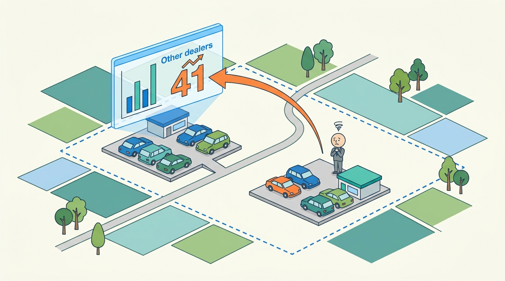
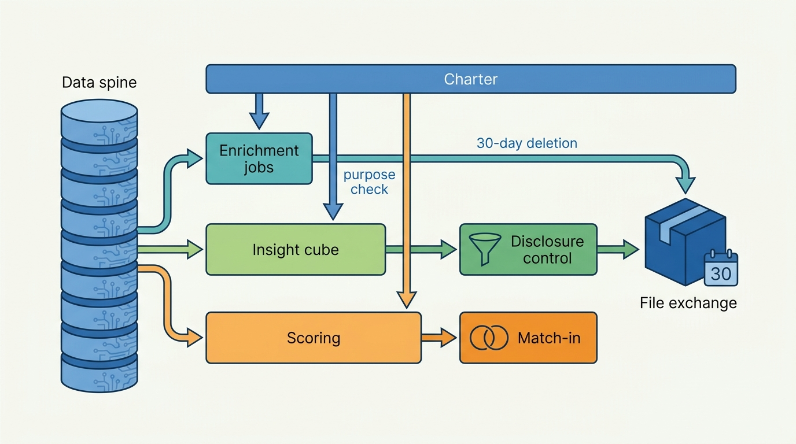
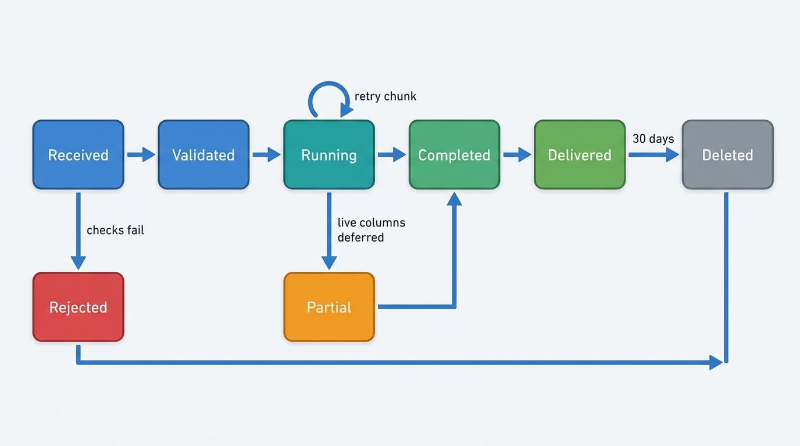
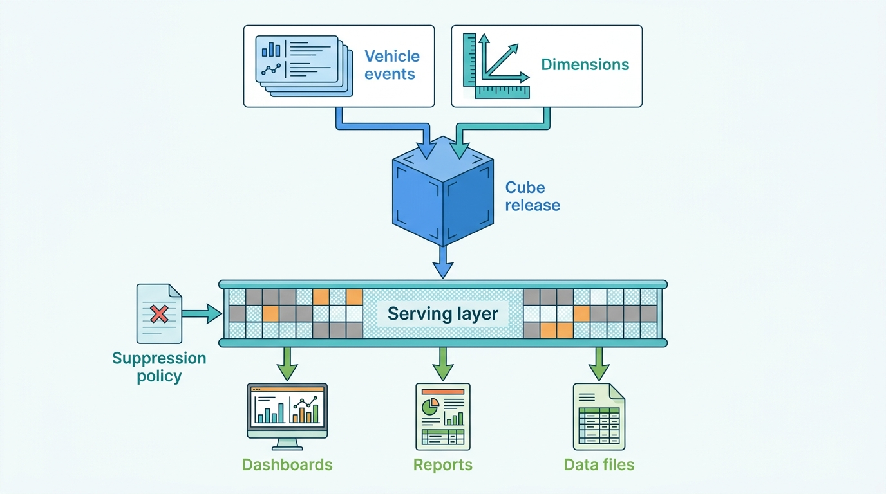
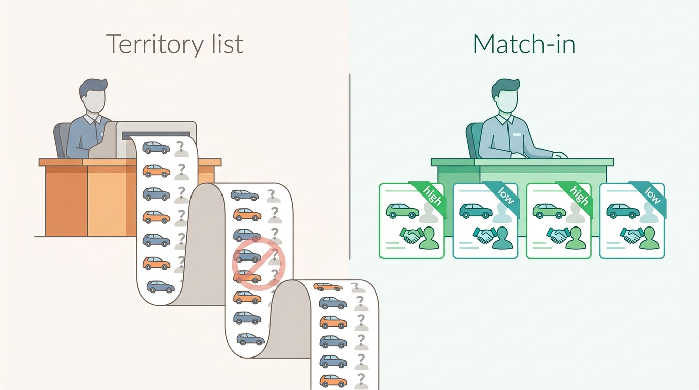
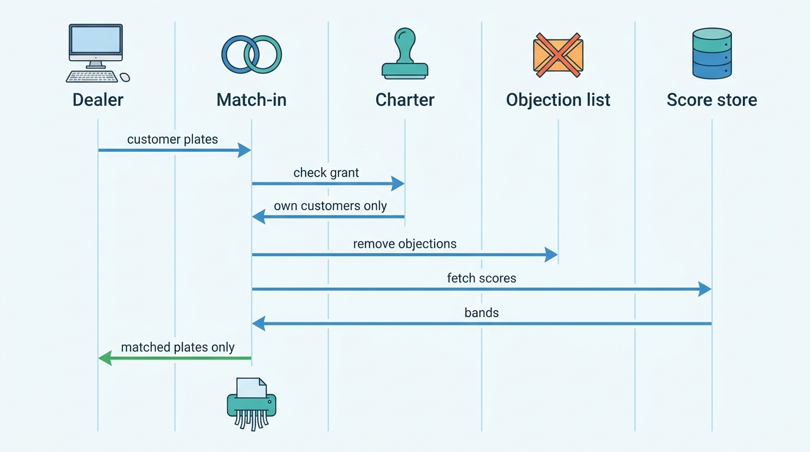

> **IN THIS CHAPTER, YOU WILL:** Design the three batch-shaped data products of a vehicle data platform: file enrichment of client plate lists, aggregated market insight (cubes, dashboards, reports and data files) and predictive vehicle scores such as change-of-ownership propensity. You will also cover their contracts, refresh and restatement rules, disclosure control, and the lawful basis for lead lists.

> **WHY THE BUSINESS CARES:** Importers, lessors, insurers and dealer groups pay annual fees for insight and enrichment. They renew only if the numbers stay consistent month to month, if competitors cannot read their figures, and if the lead list does not end up in a regulator's complaint file.

> **WHY ARCHITECTS SHOULD CARE:** These products copy vehicle data in bulk, combine sources that were licensed for other purposes, and leave the platform as files that cannot be recalled. The controls the request path enforces one call at a time (license, purpose, metering, correction) must be rebuilt for jobs that touch millions of records at once.

> **KEY POINTS:**
>
> * **A batch product is still a product.** Enrichment jobs, insight cubes and scores need a written data-product contract covering schema, semantics, refresh, restatement, suppression, license and retention. They also need their own lane, so a two-million-row portfolio never competes with a dealer's lookup. Treat a client's uploaded file as a liability and delete it 30 days after delivery.
> * **Aggregation is not anonymization.** A cell that counts one competitor's sales, or three Porsches in a village, discloses an individual. Enforce minimum cell sizes, dominance rules and fixed geographies in the cube's serving layer, where every dashboard, report and file passes, and not in each dashboard.
> * **Score only what the client already holds.** A plate-level ownership-change score on a privately owned car is personal data, and Dutch register data never supplies owners for commerce. The defensible product scores plates the dealer or importer already has a customer relationship with (match-in), honors objections, and gives everyone else aggregate forecasts.

> **[FAILURE PATTERNS THIS CHAPTER ADDRESSES](where-vehicle-platforms-go-wrong.html):**
>
> * **License Blindness** — enrichment files, cubes and lead lists combine register, market and tenant data in bulk, often for purposes the sources never allowed.
> * **The Sticky Error** — a corrected fact lives on in last month's cube, in a delivered enrichment file and in a scored list, because batch outputs have no correction path.
> * **Provenance Amnesia** — a dashboard figure that cannot say which sources, snapshot and suppression rule produced it cannot be defended when an importer's own numbers disagree.

 
The request path of a vehicle data platform answers one question about one car: what is it, what happened to it, what is it worth. A second family of products answers questions about **many cars at once**. An insurer wants its 2.4-million-vehicle portfolio checked against the register every month. An importer wants to know whether its dealers lose share to the brand down the road. A dealer wants to know which of its customers is likely to change cars before the summer. None of these is a lookup. They are **files, cubes and scores**, built in batch and delivered on a schedule.

These products are profitable because they reuse what the platform already holds. They are risky for the same reason. **A file leaves the platform and cannot be called back**, an aggregate can reveal the individual it was meant to hide, and a score about a car is often a score about its owner. The architecture must carry the request path's controls (license, purpose, metering, correction) into bulk work, where they are easiest to forget.

This chapter owns three terms: the **enrichment job**, the **insight cube** and the **propensity score (vehicle)**. It builds on [[market-data]] for sale detection, stand-time and segment statistics, and on [[registers-and-official-data]] for the Dutch register mirror. It hands license and purpose checks to [[data-licensing-and-governance]], the request-path API to [[vehicle-data-apis]] and the privacy assessment itself to [[privacy-and-retention]].

## Setting the Scene at Axleby: Two Lists and a Postcode

Axleby, the fictional vehicle data and dealer software group this book follows (see [[meet-axleby]]), earned **€16 million** in 2026 from insight and enrichment, inside Axleby Data's €71 million. The line hid three products with three histories. **Axleby Insight** (about €9.4 million) sold register-based market reports, dashboards and custom data files to importers, dealer groups, lessors and trade bodies. It also ran the **Rooftop Benchmark**, a Lotwise screen showing a dealer its used-car sales and share against competitors in its postcode area. **File enrichment** (about €4.1 million) ran some 5,800 jobs and enriched about 96 million plate records. The **change-of-ownership lead lists**, sold under the name **Horizon** (about €2.5 million), went monthly to about 380 dealers and four importers. All figures are Axleby illustrations.

Two complaints in early 2027 turned the three products into one architecture question.

The first came in **February 2027** from a dealer in a rural part of Drenthe. His Rooftop Benchmark said "other dealers in your area: 41 used-car sales in Q4." Only one other dealer advertised in his four-digit postcode area, so the figure was that competitor's quarterly sales, inferred from its public adverts and the register's ownership changes. The competitor, also a Lotwise customer, saw its own number reflected on his rival's screen and called Tomás Ferreira, the Lotwise Product Director. A review found that **18%** of the benchmark's postcode cells had fewer than three competing rooftops.

**Figure 1:** *With only one other dealer in the postcode area, "other dealers: 41 used-car sales" was that competitor's own figure; aggregation is not anonymization.*

The second came from Femke de Boer, Head of Data Governance and Privacy and Axleby's Data Protection Officer. She ran a data protection impact assessment (DPIA) on Horizon in **March 2027**, the first since the product launched. The territory lists gave each dealer the plates in its area most likely to change owner in the next 60 days, ranked by a "hotness" band. Most plates belonged to people with no relationship to the dealer. The register would never tell the dealer who they were, because Dutch register data about holders never goes to market parties for commercial purposes ([RDW, n.d.](https://www.rdw.nl/over-rdw/privacy-en-security/privacyverklaring/gegevens-die-de-rdw-registreert)). Support tickets showed that some dealers had asked how to find those owners anyway.

Ines Marchetti, the Group Chief Architect, framed one question for the architecture forum: **what rules must a data product obey when it leaves the platform in bulk, and where in the architecture are they enforced?**

## Concepts: Three Product Shapes

| Product | What the client sends | What the client receives | Unit of value | Typical clients |
| --- | --- | --- | --- | --- |
| **Enrichment job** | A file of identifiers (plates, vehicle identification numbers or VINs), often with its own reference per row | The same rows with requested attributes and a status per row | Per record, tiered | Insurers, lessors, fleet managers, data companies |
| **Insight cube** | A question: segment, region, period | Aggregated counts, shares, stand-times and prices, as dashboard, report or file | Annual subscription per scope | Importers, dealer groups, trade bodies, lessors |
| **Propensity score (vehicle)** | Nothing, or its own customer plates | A probability band per vehicle, or an aggregate forecast | Subscription per territory or per scored vehicle | Dealers, importers |

**Enrichment job.** A client-submitted batch of vehicle identifiers that the platform resolves and extends with licensed attributes, returning one result row per input row with a status. The job is the unit of validation, purpose check, metering, delivery and deletion. It is the batch twin of the lookup in [[vehicle-data-apis]].

**Insight cube.** A versioned, aggregated dataset of vehicle events (first registrations, ownership changes, exports, scrappings, inferred retail sales, stock and price observations), arranged by conformed dimensions such as segment, region, period and seller type. Disclosure rules are attached to the cube, and every dashboard, report and data file is a query against it. The cube does not store the vehicles. It stores counts and distributions that no longer identify them.

**Propensity score (vehicle).** A model's estimate that a given vehicle will reach an event, here a registration in a new name, within a stated horizon. Each score carries the model version, the snapshot date of its features and an expiry. It is a vehicle score that becomes a person score as soon as anyone can link the plate to a holder.

**Data-product contract.** The written promise for each product: schema and semantics of every field, refresh schedule, freshness, restatement policy, quality checks, suppression rules, license and purpose, retention and support hours. A data contract "defines the ownership, structure, semantics, quality, and terms of use for exchanging data between a data producer and their consumers" ([Data Mesh Manager, 2023](https://www.datamesh-manager.com/learn/what-is-a-data-contract)). The Open Data Contract Standard, maintained by the Linux Foundation project Bitol, has sections for schema, quality, pricing, roles and service-level agreements ([Bitol, n.d.](https://bitol-io.github.io/open-data-contract-standard/latest/)). For a data product sold to outside clients, the contract also forms part of the commercial agreement.

**Small-cell disclosure.** The risk that a published aggregate reveals something about one unit, such as a dealer's sales, a fleet's composition or a private owner's car. Three rules are common in statistical disclosure control. A **threshold rule** sets a minimum count per cell. A **dominance rule** requires that no single contributor makes up more than a set share of a cell. **Complementary suppression** hides more cells so that a hidden one cannot be recovered by subtraction from the totals.

## Architecture: One Bulk Platform, Three Products

All three products read the same data spine: Anchor for identity, the Turnstile register mirror, Pulse for market observations, Tracewell for history and Specbook for specification. They differ in what they hand back. Axleby's 2027 design puts them on one bulk platform with shared gates, rather than three products that each copy the spine.

**Figure 2:** *Three products, one spine and three shared gates: Charter decides what may enter each product, disclosure control decides what may leave a cube, and the file exchange enforces retention for everything delivered as a file.*

| Component | Responsibility | Owns | Design rule |
| --- | --- | --- | --- |
| **Enrichment intake** (upload, SFTP, batch API) | Accept files, validate format, normalize identifiers, dedupe, attach the client's purpose | Job record, input file | Reject the whole file only for format errors; row problems become row statuses |
| **Enrichment job runner** | Chunk, resolve, assemble attributes, checkpoint, retry | Chunk state, result rows | Reads the mirror and local stores; live upstream calls only for attributes the client bought as live |
| **Insight cube builder** | Build fact tables from events, conform dimensions, compute cubes per release | Cube releases | Every release is immutable and versioned; inputs are recorded by snapshot id |
| **Disclosure control** | Apply threshold, dominance and complementary suppression; fix geographies | Suppression policy versions | One serving layer for dashboard, report and file; no direct table access |
| **Feature snapshots and scoring pipeline** | Point-in-time features, monthly training and scoring | Score store with model version and expiry | Features as known on the snapshot date; no future data |
| **Match-in service** | Return scores only for identifiers the client submits under a customer-relationship purpose | Match requests (transient) | Objection list applied before return; nothing returned for unknown plates |
| **Client file exchange** | Deliver files and manifests; expire links; delete | Delivered files | Deletion 30 days after delivery for inputs and outputs; a deletion record kept |

### Requirements per interaction

| Interaction | Consistency | Latency | Freshness | Availability and degradation |
| --- | --- | --- | --- | --- |
| File upload → validation report | Exact per file; idempotent on file hash and job spec | Under 10 minutes for 1 million rows *(assumption)* | — | Intake can queue for hours; never silently drops rows |
| Enrichment job → result file | Each row resolved against one named mirror snapshot | 1 million rows within 4 hours *(assumption)* | Register attributes as of the snapshot date, stated in the manifest | Upstream outage pauses only live-attribute columns; the rest completes with "deferred" statuses |
| Register events → daily insight cube | Eventually consistent; provisional | Nightly | T+1 by 07:00 *(assumption)* | Missing or partial snapshot blocks the release; yesterday's release stays live, marked stale |
| Monthly close cube | Frozen release; restatements only in the next release | Working day 5 *(assumption)* | Month-end, with a 21-day settled window for inferred sales (from [[market-data]]) | Delay publication rather than publish without the settled window |
| Dashboard query | Read-only against one release | p95 under 2 s *(assumption)* | As of the release | Degrade to cached report pages |
| Monthly scoring run | Whole population scored from one feature snapshot | Overnight | Features as of the snapshot date | No run if the snapshot fails its load guards; old scores expire, never extended |
| Match-in request | Exact; per request | Minutes for 100,000 plates *(assumption)* | Current score if not expired and same registration episode | Fails closed if Charter or the objection list is unreachable |

The last row matters most. **A match-in request that cannot check objections returns nothing**, because a returned score is a marketing decision about a person, and an objection must win.

## Enrichment Jobs: Bulk Without Borrowed Uptime

### The job lifecycle

**Figure 3:** *The enrichment job as a state machine. Partial completion is a first-class state, and deletion is the end state for every job, including rejected ones.*

Five rules come from operating these jobs, not from the happy path.

**Resolve against a named snapshot.** A plate in a file is ambiguous without a date. In the Netherlands a plate normally stays with one vehicle, but imports, re-plating and UK retained plates break that assumption. The job therefore resolves each plate "as of" a reference date, by default the date of the snapshot it reads. It returns the AVK (Axleby Vehicle Key, the internal vehicle id from Anchor) only where the client's license allows, and states the snapshot in the manifest. **Two runs of the same file against the same snapshot must produce the same bytes**, which is what makes reruns and disputes cheap ([[vehicle-identity]]).

**Read local, buy only on purpose.** An enrichment job must not turn into two million live calls to a register or a paid build-data provider. Axleby learned the cost on the request path in the Saturday Batch, when one insurer's burst cost more in upstream fees than it earned ([[scale-and-cost]]). Jobs read the register mirror, Specbook's resolved specifications and Tracewell's stored events. Live columns, such as theft status, are a priced option, run through the upstream budget broker at a paced rate. Build data is never bought by default, in line with Specbook's purchase gate ([[specification-and-equipment]]).

**Every row gets a status.** `hit`, `partial`, `no_hit`, `invalid_identifier`, `ambiguous`, `withheld_by_licence`, `deferred`. Withheld is not the same as empty: a damage column the client's grant does not cover must say so, or the client reads "no damage." Duplicate rows return the same answer and are billed once. Meterline receives one usage event per distinct billable row with the job id as part of the event key, so a rerun after a crash does not bill twice ([[billing-and-metering]]).

**Checkpoint per chunk.** Jobs run in chunks of 50,000 rows *(assumption)*, each committed with its result rows and its usage events in one transaction. A worker crash resumes at the last committed chunk. A job that cannot complete its live columns completes everything else as `Partial` and fills the deferred columns when the upstream returns. The client gets the bulk of its answer on time, and the outage costs only the live columns.

**The input file is a liability.** A client's plate file tells the platform which vehicles an insurer covers or a lessor owns. That is commercially sensitive, and for private policyholders it is personal data. Axleby deletes input and output files **30 days after delivery** and keeps only the job record (counts, statuses, snapshot, purpose, deletion timestamp). Download links expire after seven days *(assumption)*. Charter records the purpose of each job in the access audit ([[data-licensing-and-governance]]). Each delivered file carries a few trap records unique to the recipient, so a copy found outside the platform can be traced.

### Axleby worked example: Fleetmoor's monthly audit

Fleetmoor Lease (fictional, about 64,000 vehicles) sends a plate file on the first working day of each month under the purpose `fleet-administration`. The October 2027 file had **64,180** rows. Intake found **312** duplicates (cars entered under two cost centers), **41** malformed plates and **118** Belgian plates, which were routed to the Belgian partner channel as a priced option. The job read the Dutch snapshot of 1 October and returned periodic inspection (*APK*) expiry dates, the export indicator, the open-recall flag, the odometer judgement and the registration-in-current-name date.

Two columns did the real work. **213** cars had an inspection due within 30 days that Fleetmoor's own system did not show. **19** cars showed a registration date later than Fleetmoor's purchase date, which meant they had changed holder without Fleetmoor's knowledge. All 19 were sold returns whose de-fleet record had never closed in Fleetmoor's system. Before 2027, that check needed someone to compare spreadsheets.

## Insight Cubes: Counting Without Exposing

### What feeds a cube, and what may not

The cube's value depends on what enters it, so the first design artifact is a **source-eligibility table** maintained in Charter. In Axleby's 2027 version:

| Source | May feed insight cubes? | Why |
| --- | --- | --- | 
| Dutch register open data (snapshots and derived change events) | Yes | CC0 open data, no personal data; changes derived by diffing snapshots ([[registers-and-official-data]]) |
| Pulse market observations and inferred sales | Yes, aggregated | Per-observation rights tags; dealer-derived figures only in cells of at least 5 rooftops and 20 cars, and dealer sale prices only with a 30-day delay ([[market-data]]) |
| Lotwise stock, price and sales data | Yes, under the 2027 Lotwise terms, aggregated | Contractual permission, the same cell rule, never per competitor |
| Axleby Trade register transactions | **No** | Processed on dealers' behalf to register cars; not a statistics purpose |
| Enrichment input files | **No** | Client data; deleted after 30 days |
| Horizon scores | Aggregate forecasts only | A plate-level score is personal data |

The Axleby Trade row was the hardest decision. Axleby Trade processes 1.25 million Dutch register transactions a year and knows, for every one, which dealer sold to whom. A cube built from that data would show exact dealer market shares. **Using customer transactions processed for one purpose to build a product sold to those customers' competitors is License Blindness at its most profitable**, and Femke's team ruled it out in writing.

### The cube and its serving layer

**Figure 4:** *Disclosure control sits in one serving layer between the cube and every delivery channel, so a custom file cannot bypass a rule that the dashboard enforces.*

Axleby builds cubes in Snowflake from Turnstile's register change events and Pulse's segment statistics. Each release records the snapshot ids of its inputs and the suppression policy version applied, which answers "where did this number come from" months later ([[provenance-and-data-quality]]).

Snowflake and AWS both document the mechanism as a product feature. A Snowflake aggregation policy sets "a minimum group size", and groups below it are combined into a remainder group with a null key ([Snowflake documentation, n.d.](https://docs.snowflake.com/en/user-guide/aggregation-policies)). AWS Clean Rooms' aggregation analysis rule enforces constraints of the form `COUNT(DISTINCT column) >= X` on every output row, "even if the submitted query itself does not use the specified column" ([AWS documentation, n.d.](https://docs.aws.amazon.com/clean-rooms/latest/userguide/analysis-rules-aggregation.html)). These are useful building blocks. They are not a policy. **Which column counts as the contributor (vehicle, rooftop, legal entity, dealer group) is a business decision**, and it differs per measure.

### Axleby's 2027 disclosure rules

After the Drenthe complaint, Priya Raman (VP Data and Valuation) and Femke de Boer wrote one suppression policy for all insight products.

| Measure family | Contributor counted | Threshold | Dominance | Geography floor |
| --- | --- | --- | --- | --- |
| Seller-attributed figures (sales, stock, stand-time, prices of "other dealers") | Rooftop | At least 5 rooftops and 20 cars | No rooftop above 60% of the cell; dealer groups counted as one | 340 fixed market areas (NL) instead of four-digit postcodes |
| Owner-related register counts (registrations, ownership changes by model) | Vehicle | At least 10 vehicles | — | Municipality; four-digit postcode only for counts by broad segment |
| Fleet composition of a named lessor or fleet | — | Never published | — | — |
| A client's own figures | The client | None | — | Any |

Two details matter as much as the thresholds. First, **dealer groups count as one contributor**: five Velto rooftops in an area are one company, so they do not satisfy "five rooftops." The cube reads group membership from the tenant directory's effective-dated hierarchy, so a reorganization like Velto's September 2027 hub change is reflected without code ([[tenancy-and-dealer-groups]]). Second, **fixed geographies beat ad hoc drill-down**. If a client can request "region" and "region minus one postcode", subtraction recovers the hidden cell. Complementary suppression handles it within one table, but only a fixed set of areas stops differencing across queries. Each market area was drawn to contain at least eight competing rooftops in 2026, and some rural areas cover most of a province.

The Rooftop Benchmark became a comparison against the market area, with "your share" exact and "others" suppressed or banded where the rule fails. In the first month, **11%** of benchmark views showed a banded figure instead of a number. Nobody complained about the bands. The competitor in Drenthe had complained about a number.

> **The rule I use:** if a figure is about one dealer, show it only to that dealer. If it is about the market, it must survive the question "could a competitor or a neighbor work out one company's or one person's data from this?"

### Restatements and the correction path

Register data gets corrected, inferred sales settle after 21 days, and a supplier error such as the Odometer Correction can poison a month of history ([[journey-data-correction]]). A cube that silently changes last month's numbers loses the importer's trust as surely as a wrong number does. Axleby's contract states three rules:

- **Daily figures are provisional**, labeled as such, and rebuilt each night.
- **Monthly releases are frozen.** A correction appears in the next monthly release as a restatement, with a delta table showing the old figure, the new figure and the reason.
- **Delivered files are listed.** The file exchange keeps, for each delivery, the release id and the recipient, so a material restatement can be announced to exactly the clients who received the affected figures.

The last rule is the batch form of the correction event that [[events-webhooks-and-sync]] gives API clients. Without it, last month's cube is a Sticky Error stored in an importer's board pack.

## Propensity Scores: From Lead Lists to Match-In

### What a change-of-ownership score is

The Dutch open data contains, for every plate, the date of the current registration in a holder's name (`datum_tenaamstelling`), along with inspection expiry, odometer judgement, recall flag and first admission date. It contains no holder identity ([RDW open data, queried 2026-10-22](https://opendata.rdw.nl/resource/m9d7-ebf2.json)). By diffing daily snapshots, a platform sees each registration in a new name as it happens. That provides both the label (did this car change holder within 60 days?) and many features (time since the last change, inspection due, age, segment, number of past changes) without touching personal data at the source.

The market already has products built on this idea. VWE's change-of-ownership lead generator page (undated, read October 2026) says that, by combining several data sources, a machine-learning model predicts which car owners will be looking for a new car in the next one to two months. The model produces predictions per plate, VWE supplies a "hotness" per plate, and the dealer links the plates to its own customer file to obtain personal details ([VWE, n.d.](https://vwe.nl/de-vwe-change-of-ownership-lead-generator/), translated). The page does not name the sources. [[case-vwe]] describes the split as a privacy seam. In the United States, Mobility Global's 2026 information statement describes automotiveMastermind as using "Behavior Prediction Scores" and integrating dealers' customer relationship management (CRM) and dealer management system (DMS) data "to identify in-market buyers" ([Mobility Global, May 2026](https://www.sec.gov/Archives/edgar/data/2090312/000110465926066592/tm2528763d9_ex99-1.htm)). Its website describes ranking prospects "on a scale of 0-100 based on propensity to buy" ([automotiveMastermind, n.d.](https://www.automotivemastermind.com/)). The two products score different things: one scores plates, the other scores the dealer's own prospects.

> **INFERENCE, NOT DOCUMENTED:** Neither company publishes its features, model family, label definition or accuracy. Nothing in this section describes how either product is built.

### Why the territory list failed its DPIA

Femke's DPIA on Horizon reached four conclusions, each a plain reading of the law:

1. **The score is personal data for the recipient.** The Court of Justice of the EU held in *Scania* (C-319/22, 9 November 2023) that a VIN is personal data for anyone who may have the means to link it to the owner ([CJEU, 2023](http://publications.europa.eu/resource/celex/62022CJ0319)), and the UK Information Commissioner's Office says that "in most circumstances" a vehicle registration mark is personal data ([ICO, n.d.](https://ico.org.uk/for-organisations/uk-gdpr-guidance-and-resources/cctv-and-video-surveillance/guidance-on-video-surveillance-including-cctv/additional-considerations-for-technologies-other-than-cctv/automatic-number-plate-recognition-anpr/)). A dealer holding a customer file has those means for its customers' plates. For strangers' plates it does not, unless it finds them elsewhere, which is the problem.
2. **Profiling for direct marketing can be objected to at any time, without conditions.** GDPR Article 21(2) gives the right "to object at any time to processing … for such marketing, which includes profiling to the extent that it is related to such direct marketing", and Article 21(3) says the data "shall no longer be processed for such purposes" ([Regulation (EU) 2016/679](http://publications.europa.eu/resource/celex/32016R0679)). Recital 47 allows that direct marketing "may be regarded as carried out for a legitimate interest", but that interest still has to pass a balancing test. A territory list gives the person no chance to object, because nobody tells them.
3. **The source closes the strangers' route.** RDW states that market parties such as garage businesses never receive personal data from the RDW for commercial purposes ([RDW, n.d.](https://www.rdw.nl/over-rdw/privacy-en-security/privacyverklaring/gegevens-die-de-rdw-registreert)). A list of strangers' plates is only useful if someone finds the owners another way, and every such way (number-plate cameras, bought address lists, asking at the forecourt) adds a processing step without a legal basis.
4. **Contact rules apply after the match.** The ePrivacy Directive allows e-mail marketing without prior consent only to existing customers, for "its own similar products or services", with an easy opt-out at collection and in every message (Article 13(2), [Directive 2002/58/EC](http://publications.europa.eu/resource/celex/32002L0058)). The dealer's own customer is the person it may lawfully contact.

The conclusion was not "stop scoring." It was **score only what the client already holds**.

**Figure 5:** *Score only what the client already holds: a list of strangers' plates has no lawful route to contact, while match-in returns bands only for the dealer's own customers.*

### The match-in design

**Figure 6:** *Match-in: the client submits its own customers' plates under a declared relationship, objections are removed first, and the platform returns bands only for those plates, never a list of strangers.*

The design has six rules:

- **The client declares the relationship.** Each submitted plate carries a relationship type (sold by us, serviced by us in the last 24 months, leased by us) taken from the client's DMS, CRM or Lotwise sold-vehicle records. Lotwise rooftops can run match-in from inside their tenant without uploading anything. For a dealer, Axleby acts as processor for the match and as controller of the model and its source data. [[privacy-and-retention]] records the split.
- **Bands, not probabilities.** The service returns one of four bands (low, normal, elevated, high) with the calibration published in the contract. A raw "0.137" invites false precision and ranking games.
- **Scores die.** Each score expires after 90 days, matching the three-month retention for score data. Before the redesign, monthly scores were kept indefinitely. The redesign was approved in March 2027, but the expiry was enforced only from **September 2027**: the erasure request of August 2027 still found 14 monthly scores on one plate, going back to 2024, and the old scores were purged then ([[privacy-and-retention]]). A score is void the moment Anchor records a new registration episode for the vehicle, because the new holder is not the person who was scored.
- **Objections are by plate and by episode.** Odolo, Axleby's consumer brand, hosts an objection form. An objection by plate suppresses scoring for that vehicle until the next registration in a new name. Nobody is asked to prove they are the holder, because the only effect of a false objection is that a car is not scored.
- **Nothing for unknown plates.** A plate that is not in the score store or has an objection returns "no score." The response does not reveal which of the two applies.
- **Importers get aggregates.** An importer receives expected ownership changes per dealer territory, segment and month, under the vehicle threshold of the disclosure policy. Where an importer holds its own owner relationships (warranty registrations, connected-service contracts), it can use match-in for those customers under its own legal basis.

### The model, briefly

Horizon trains monthly in Pulse's Databricks environment on point-in-time feature snapshots of about **9.1 million** Dutch passenger cars. The rule that matters is **no feature from after the snapshot date**. The most predictive signal in the raw data, "this car is currently advertised", was removed. An advert is the decision to sell, not a predictor of it, and a model that uses it scores best on the cars a dealer can already see on the portals. The label is a registration in a new name within 60 days, read from snapshot diffs. Dealer-stock intakes are excluded, so a trade-in passing through a dealer does not count twice.

On a rolling-origin back-test, the illustrative base rate for a 60-day change was about **3.8%** (roughly 2.1 million Dutch used-car ownership changes a year, per BOVAG and RAI Data Center figures for 2025 cited in [[dealer-and-data-economics]], over about 9 million cars). The high band captured cars changing hands at about **10.4%**, a lift of about 2.7 *(Axleby illustration)*. That is useful for choosing whom to call first. It does not tell a dealer who will buy. Bands are recalibrated monthly, and a band whose observed rate drifts more than a third from its published rate for two months raises a `watch` status, the same discipline [[valuation-engine]] applies to valuation segments.

### Axleby worked example: Meridal Import

Meridal Import B.V. (fictional) imports two car brands into the Netherlands through **58** dealer rooftops, 41 of them on Lotwise. In **April 2027** it signed an Axleby Insight contract worth **€118,000 a year**: monthly registration and ownership-change cubes per dealer territory, used-car stand-time and price position of its dealers against their market areas, and a loyalty forecast.

Meridal's first request was the old product: for each dealer territory, the plates of its brands' cars aged three to six years in the high band, about **210,000** plates a quarter. Under the 2027 design the answer had three parts:

| Meridal asked for | What it received | Why |
| --- | --- | --- |
| High-band plates of its brands per territory | Expected ownership changes per territory, brand, age band and month, at the 10-vehicle threshold | Strangers' plates are personal data without a route to a lawful contact |
| Its dealers' share against competitors per postcode | Share per fixed market area; competitor brands named, competitor dealers never | Seller-attributed figures need 5 rooftops, 20 cars and the dominance rule |
| Plate-level scores for its warranty-registered owners | Match-in on Meridal's own warranty file, run in a clean-room workspace in Snowflake, returning bands only for Meridal's own customers | Meridal holds the relationship and the legal basis; Axleby never receives its customer names |

Meridal's dealers ran match-in on their own service and sales customers. By September 2027, the 41 Lotwise dealers had scored about **96,000** customer plates. Meridal's aggregate forecast became a field-sales planning tool: territories where expected changes exceeded dealer capacity got extra campaign budget.

Commercially, the switch cost money. **61** of the 380 territory-list dealers canceled, and Horizon's run rate fell from €2.5 million to about **€2.1 million** by the end of 2027. Anouk Willems, the CEO, accepted the loss in the board pack in one sentence: a regulator's order to stop the product would have cost all of it.

## Failure Handling

| Failure | Detection | Recovery |
| --- | --- | --- |
| **Duplicate submission** of the same enrichment file | Job idempotency key from file hash, job spec and client | Return the existing job; no second bill |
| **Duplicate rows** within a file | Normalization and dedupe at intake | One resolution, same answer on every duplicate row, billed once |
| **Incomplete rows** (malformed plate, foreign plate, VIN with a bad check digit) | Validation per row | Row status `invalid_identifier` or routed to the market adapter; never dropped |
| **Worker crash mid-job** | Chunk heartbeat | Resume from the last committed chunk; usage events committed with chunks |
| **Upstream outage** during live columns | Budget broker and circuit breaker | Job completes as `Partial`; deferred columns filled later; manifest says which |
| **Partial register snapshot** (row count drop, schema change) | Load guards on the mirror ([[registers-and-official-data]]) | No cube release and no scoring run from it; previous release stays live, marked stale |
| **Conflicting figures** between a client's own data and the cube | Client query cites release id | Release lineage shows snapshot ids, suppression version and source coverage; differences explained, or restated |
| **Late correction** of register or supplier data | Correction events in Tracewell and the mirror | Restatement in the next monthly release; affected file recipients notified from the delivery list |
| **Differencing attack** across dashboard queries | Query-pattern monitor on the serving layer | Fixed geographies; complementary suppression; account review for repeated near-duplicate queries |
| **Score delivered after ownership change** | Registration-episode check at match time | Score void; "no score" returned |
| **Objection list unavailable** | Health check on match-in | Fail closed: no scores returned |
| **Model drift** | Monthly band calibration check | `watch` status, then bands withheld until retrained |

The theme is the same as on the request path: **a batch product must say what it could not do**, row by row and cell by cell, instead of filling the gap with a zero.

## Trade-Offs

### How to sell predictive scores

| Option | What the client gets | Lawful-basis position (EU) | Commercial value | When it is right |
| --- | --- | --- | --- | --- |
| **Territory plate lists** | Strangers' plates with bands | Weak: no relationship, no route to a lawful contact, no chance to object | Highest, until it is challenged | Never for privately held cars in the EU, in my view |
| **Match-in on own customers** | Bands for plates the client already holds | Defensible: relationship, objection handling, ePrivacy existing-customer rule | Lower; depends on the client's customer base | Dealers and importers with real customer files |
| **Aggregate forecasts** | Expected changes per area and segment | Strong: no plate-level output | Planning value, not leads | Importers, groups, field sales |
| **Clean-room join** | Bands or overlaps computed without either party seeing the other's records | Defensible if outputs are bands for own customers or aggregates above thresholds | Higher for large clients; costly to operate | Importers and lessors with their own owner data |

### Where to enforce disclosure control

| Option | Strength | Weakness | Choose when |
| --- | --- | --- | --- |
| In each dashboard | Fast to build | Custom files and APIs bypass it | Never as the only control |
| **In the serving layer over the cube** | One policy for all channels; versioned | Needs a curated query surface; no free SQL | Default for commercial insight |
| Warehouse aggregation policies (Snowflake, Clean Rooms) | Enforced by the engine | Contributor definition still yours; dominance not built in | Where clients query directly |
| Differential privacy (calibrated noise) | Formal guarantee across queries | Noisy small areas; hard to explain to an importer reconciling its own registrations | Large public statistics, not client reports |

My recommendation for a group of Axleby's size: **match-in plus aggregate forecasts, and a serving layer over immutable cube releases**. These hold as long as clients do not need free SQL access to row-level data. Once they do, the product is a clean room, with its own contracts and costs.

## Across Markets: What Changes by Country

| | Netherlands / Belgium | Germany | United Kingdom | United States |
| --- | --- | --- | --- | --- |
| **Register-based market statistics** | NL: open data (CC0) per plate, including the current registration-in-name date, so ownership changes can be derived daily; BE: registration statistics from industry bodies; a vehicle-level open dataset was not verified | The Kraftfahrt-Bundesamt (KBA, the federal motor transport authority) publishes new registrations monthly and yearly by selected attributes ([KBA, n.d.](https://www.kba.de/DE/Statistik/Fahrzeuge/Neuzulassungen/neuzulassungen_node.html)); no vehicle-level open data | Department for Transport (DfT) statistics from Driver and Vehicle Licensing Agency (DVLA) extracts hold keeper title and postcode; "a national fleet might be registered to a single administrative office" ([DfT, updated 23 Sept 2026](https://www.gov.uk/government/publications/vehicles-statistics-information/vehicle-licensing-statistics-notes-and-definitions)) | Commercial registration data, e.g. Polk Automotive Solutions, part of Mobility Global as of 2026, which supplies "national and sub-national registration data" (Mobility Global, 2026) |
| **Enrichment sources** | NL mirror of open data; paid per-plate business access "not in bulk"; BE via a partner channel | Commercial build and valuation data; register keeper data only for legal claims (§ 39 of the Road Traffic Act, StVG) | Driver and Vehicle Standards Agency (DVSA) MOT (annual roadworthiness test) history API (500,000 requests a day); DVLA bulk anonymized data under "reasonable cause" ([DVLA INF266, 2022](https://assets.publishing.service.gov.uk/media/624dabc7e90e0729f6bf8167/inf-266-release-of-information-from-dvlas-registers.pdf)) | VIN decoding (vPIC) and licensed history data with contractual cache limits |
| **Labels for ownership-change scores** | NL: snapshot diffs; BE: no comparable change stream verified | None public per vehicle; dealer's own DMS and service history only | Keeper changes not public; MOT due dates are a public signal, but reuse terms for resale were not verified | Registration and DMS/CRM data under contract |
| **Owner contact** | Never from the register for commerce; dealer's own customers under GDPR and ePrivacy | Same EU rules; register only for legal claims | DVLA anonymized data (make, model, partial postcode) "mainly for marketing"; UK GDPR and the Privacy and Electronic Communications Regulations apply | Driver's Privacy Protection Act (DPPA): bulk distribution "for surveys, marketing or solicitations" only if the state "has obtained the express consent" of the person (18 U.S.C. § 2721(b)(12), [Cornell LII](https://www.law.cornell.edu/uscode/text/18/2721)) |
| **Market-area geography** | Fixed market areas from four-digit postcodes | Postcode regions (*Postleitzahlgebiete*); fixed areas | Postcode districts; corrections needed for fleets registered at head offices | ZIP-based dealer areas; DPPA excludes the 5-digit ZIP from "personal information" (§ 2725) |

**What is common**: the enrichment job, the cube with its serving layer, the suppression policy, the restatement rules, match-in and the file-exchange retention are one design across markets. **What is a market adapter**: the event sources that feed the cube, the label source for scores, and the geography. **What is a rule set**: thresholds per measure, objection and contact rules, and which products exist at all. Horizon runs only in the Netherlands in 2027, because only Dutch open data provides a lawful, daily, vehicle-level label without personal data. In Germany and the UK, Axleby sells only dealer-side match-in models trained on the dealer's own service and sales history. That is the US shape, which reaches it through contract rather than through a register.

## The Chief Architect's View

**Decide that batch products are products, with owners.** In 2026 Axleby's enrichment was an engineering service, Insight a reporting team and Horizon a data-science side project. From 2027 each has a product owner, a written data-product contract and an entry in Charter's purpose register before any client is granted it. The purpose `change-of-ownership-propensity` was the first to be blocked until its DPIA reference was filled in ([[data-licensing-and-governance]]).

**Put the gates where bulk passes, once.** Three gates cover all three products: Charter's purpose check on intake, disclosure control in the cube's serving layer, and the file exchange's retention and delivery record. A team that needs an exception changes the policy, which is versioned and reviewed, not its code.

**Own the suppression policy jointly.** Thresholds are a commercial, legal and statistical decision. At Axleby, Priya Raman owns the policy, Femke de Boer approves changes, and Ines Marchetti arbitrates when a large client asks for a smaller cell. The answer so far has been no.

**Watch three numbers.** The share of insight cells suppressed or banded per product (rising means geography no longer fits the market). Restatement size per monthly release (rising means upstream quality problems are reaching clients). Objections per 10,000 scored plates (rising means the product is being used in ways people notice and dislike).

**Plan for the unrecallable file.** Every file delivered is a copy beyond the platform's control. Delivery lists, trap records and contractual deletion clauses are the only tools left once a file is gone. Fewer, smaller files are a design goal in their own right. Where a client can consume a match-in API or a dashboard instead of a file, prefer it.

## Questions to Ask

1. For each batch product, where is the written contract covering schema, refresh, restatement, suppression, license and retention, and does the client have it?
2. Can an enrichment job be rerun against the same snapshot and produce the same file? Does a rerun bill twice?
3. Which sources are allowed to feed the insight cube, and who signed off on excluding customer transaction data?
4. What counts as one contributor in a seller-attributed cell? Are dealer groups counted once?
5. Can a client recover a suppressed cell by subtracting two allowed queries? What stops it across queries rather than within one table?
6. When last month's figure is corrected, which clients received it, and how will they hear?
7. Is the propensity score personal data for its recipient? If so, what is the recipient's relationship with the person scored?
8. Where are objections recorded, how quickly do they take effect, and what happens to scores if the objection service is down?
9. Which features would not have been known on the snapshot date? Has anyone checked for leakage such as the car being advertised?
10. How long do client input files live, and can you show the deletion record for a file delivered six weeks ago?

The data half has now left the platform in three forms: as API responses, as events and, in this chapter, as files, cubes and scores. The last way out is the one with the least control over who reads it: the consumer, checking a plate on a phone before buying a car. [[consumer-vehicle-checks]] builds that product on the same data, with a different audience, different license limits and an abuse problem the business channels never had.

## Sources and Evidence

### Company, product and investor sources

- [De VWE Change of Ownership Lead Generator](https://vwe.nl/de-vwe-change-of-ownership-lead-generator/), VWE Automotive, n.d., accessed 2026-10. Plate-level ownership-change predictions for one to two months; dealer matches plates to its own customer file (Dutch, translated).
- [Marktinzicht](https://vwe.nl/marktinzicht/), VWE Automotive, n.d., accessed 2026-10. Market insight "based on official RDW registers", delivered as reports, dashboards or custom data files.
- [Mobility Global Information Statement (Ex. 99.1 to Form 10)](https://www.sec.gov/Archives/edgar/data/2090312/000110465926066592/tm2528763d9_ex99-1.htm), Mobility Global Inc. / SEC, 2026. automotiveMastermind's Behavior Prediction Scores on CRM and DMS data; Polk Automotive Solutions' registration data; DPPA named among applicable laws.
- [automotiveMastermind homepage](https://www.automotivemastermind.com/), automotiveMastermind, n.d., accessed 2026-10. Prospects ranked 0–100 on propensity to buy.
- [Aggregation policies](https://docs.snowflake.com/en/user-guide/aggregation-policies), Snowflake, n.d., accessed 2026-10. Minimum group size and remainder groups.
- [Aggregation analysis rule](https://docs.aws.amazon.com/clean-rooms/latest/userguide/analysis-rules-aggregation.html), AWS Clean Rooms, n.d., accessed 2026-10. `COUNT(DISTINCT)` output constraints enforced on every output row.

### Standards, regulation and official documentation

- [Regulation (EU) 2016/679 (GDPR)](http://publications.europa.eu/resource/celex/32016R0679), European Parliament and Council, 2016. Article 21(2)–(3) objection to direct marketing including profiling; recital 47 legitimate interest; Article 35 DPIA.
- [Directive 2002/58/EC (ePrivacy)](http://publications.europa.eu/resource/celex/32002L0058), European Parliament and Council, 2002. Article 13(2) existing-customer rule for e-mail marketing.
- [Judgment C-319/22, *Gesamtverband Autoteile-Handel v Scania*](http://publications.europa.eu/resource/celex/62022CJ0319), CJEU, 2023. VIN as personal data when linkable to the owner.
- [Gegevens die de RDW registreert](https://www.rdw.nl/over-rdw/privacy-en-security/privacyverklaring/gegevens-die-de-rdw-registreert), RDW, n.d., accessed 2026-10. Market parties never receive personal data for commercial purposes.
- [Gekentekende voertuigen open data](https://opendata.rdw.nl/resource/m9d7-ebf2.json), RDW, live dataset queried 2026-10-22. Per-plate fields including `datum_tenaamstelling`; no holder data.
- [Automatic number plate recognition guidance](https://ico.org.uk/for-organisations/uk-gdpr-guidance-and-resources/cctv-and-video-surveillance/guidance-on-video-surveillance-including-cctv/additional-considerations-for-technologies-other-than-cctv/automatic-number-plate-recognition-anpr/), ICO, n.d., accessed 2026-10. A registration mark is personal data in most circumstances.
- [INF266 Release of information from DVLA's registers](https://assets.publishing.service.gov.uk/media/624dabc7e90e0729f6bf8167/inf-266-release-of-information-from-dvlas-registers.pdf), DVLA, 2022. Reasonable cause; anonymized data for marketing; bulk anonymized data.
- [Vehicle licensing statistics: notes and definitions](https://www.gov.uk/government/publications/vehicles-statistics-information/vehicle-licensing-statistics-notes-and-definitions), Department for Transport, updated 2026. Keeper title and postcode; fleets registered at one office.
- [Neuzulassungen](https://www.kba.de/DE/Statistik/Fahrzeuge/Neuzulassungen/neuzulassungen_node.html), Kraftfahrt-Bundesamt, n.d., accessed 2026-10. Monthly and yearly new-registration statistics by selected attributes.
- [18 U.S.C. § 2721](https://www.law.cornell.edu/uscode/text/18/2721) and [§ 2725](https://www.law.cornell.edu/uscode/text/18/2725), Cornell LII, n.d., accessed 2026-10. DPPA permissible uses, including bulk marketing only with express consent; definition of personal information.

### Research and practitioner sources

- [What is a data contract?](https://www.datamesh-manager.com/learn/what-is-a-data-contract), Data Mesh Manager, 2023. Definition of a data contract.
- [Open Data Contract Standard](https://bitol-io.github.io/open-data-contract-standard/latest/), Bitol (LF AI & Data), n.d., accessed 2026-10. Contract sections for schema, quality, pricing, roles and SLA.

Axleby is fictional; architectural recommendations, labeled inferences and labeled assumptions are the author's judgement.
