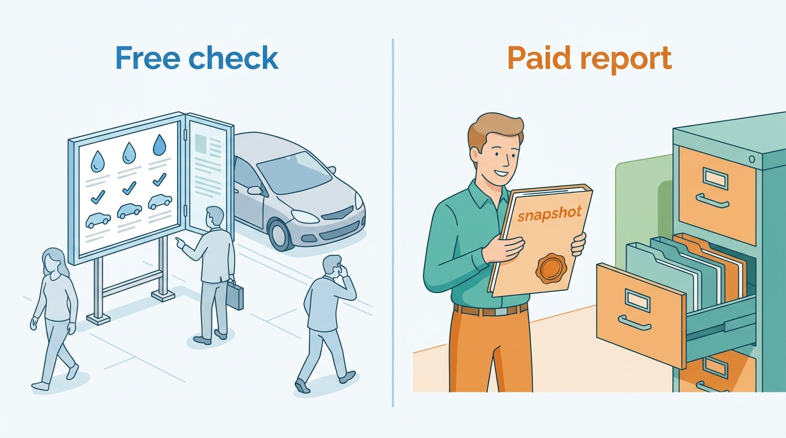
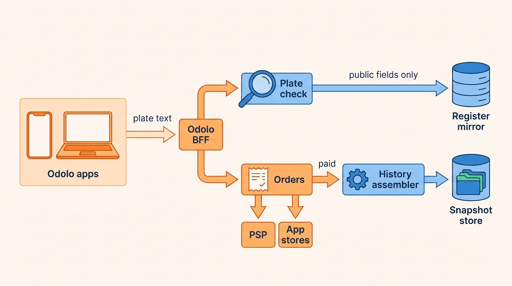
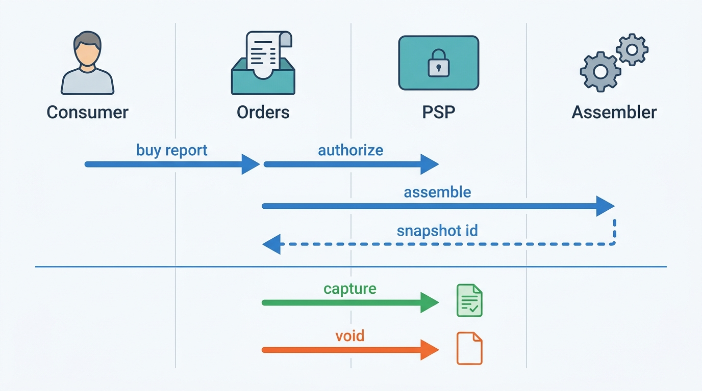
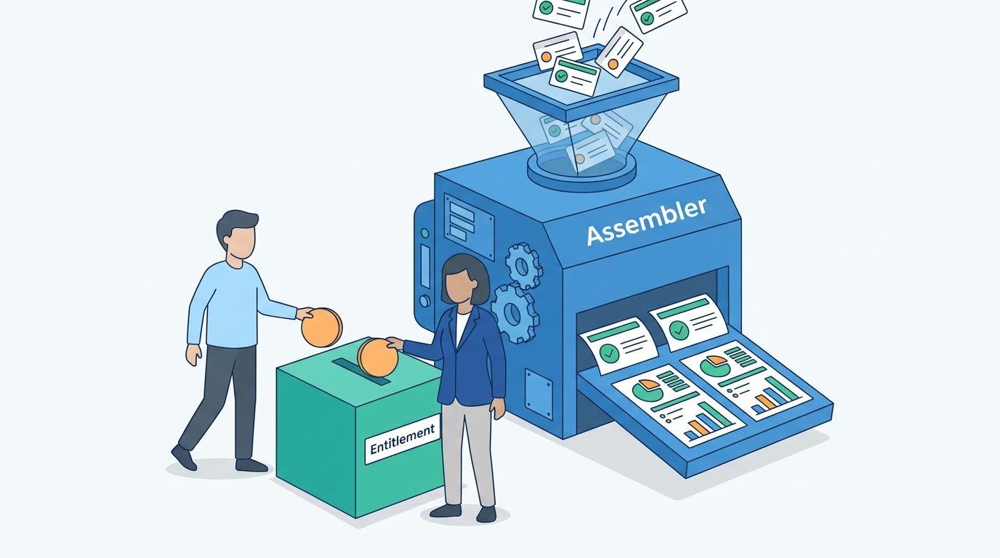

> **IN THIS CHAPTER, YOU WILL:** Design a consumer vehicle-check product on a shared data platform: the free plate check, the paid report and what each may show, camera plate scanning, payments through app stores and payment providers, consumer-law duties on accuracy, withdrawal and refunds, consumer documents such as environmental stickers, traffic peaks, and the conflict of interest when the consumer becomes a channel to dealers.

> **WHY THE BUSINESS CARES:** A consumer report is a small, high-trust purchase made just before a large one. One wrong word costs a refund, a complaint and sometimes a dealer's sale. The same product is the group's most visible brand and its easiest door for scrapers.

> **WHY ARCHITECTS SHOULD CARE:** The consumer product reuses the platform's history, valuation and register services, but adds anonymous traffic, two payment rails, consumer law and app-store rules. Each of these changes what a "report" must record, and each is cheaper to design in than to retrofit.

> **KEY POINTS:**
>
> * **The free check and the paid report are two different products.** The free check is a public, anonymous read that should return only facts already public, so walking it yields nothing worth reselling. The paid report is a contract: a stored, dated snapshot built under a consumer purpose, from sources whose licenses allow consumer display.
> * **Consumer law turns wording and snapshots into obligations.** Under the EU Digital Content Directive the trader carries the burden of proving conformity for a year after supply. Withdrawal rights lapse only with recorded consent and acknowledgement. A report that cannot be reproduced, superseded and refunded by design cannot meet these duties.
> * **The consumer is a channel to dealers, and the conflict must be designed out.** The report must read the same whoever pays for it. Paid placement next to it must be labeled. A plate check must never become a dealer lead without the consumer's explicit choice.

> **[FAILURE PATTERNS THIS CHAPTER ADDRESSES](where-vehicle-platforms-go-wrong.html):**
>
> * **The Sticky Error** — **96** consumer reports carried the Odometer Correction's wrong mileage. Consumers act on a report once, so a correction is worth only as much as the platform's ability to reach the buyer and refund.
> * **License Blindness** — consumer reports are where business-only data is most tempting to show and most visible when shown. The License Breach began with a consumer asking why a paid report was free elsewhere.
> * **The Cloned Identity** — a misread plate, a cloned plate or a Belgian plate that has moved to its owner's next car sells the consumer a report about the wrong vehicle.

 
Most vehicle-data businesses start with business clients and add a consumer product later, because private buyers ask the same question as dealers: **is this car what the seller says it is?** A consumer check answers it for one car, once, for the price of a lunch. The answer comes from the same history events, register facts and valuations that dealers and data clients use. That reuse is why the product is profitable. It is also why the product can damage the platform: it puts those services behind an anonymous, public, mobile front door.

The consumer door differs from the business doors in four ways. The caller is **anonymous** until they pay, so abuse cannot be handled by contract. The buyer is a **consumer**, so consumer law sets conditions on accuracy, withdrawal and refunds that business contracts negotiate away. Payment runs through **app stores and payment providers** with their own rules. And the consumer's attention has value to the dealers whose cars they check, which creates a **conflict of interest** inside a group that sells to both.

This chapter owns the **plate check** (the free, anonymous lookup) and the **consumer report** (the paid product). It builds on [[vehicle-history]] for events, judgements and wording, [[valuation-engine]] for the consumer value range and [[registers-and-official-data]] for the register mirror. Enumeration defense belongs to [[vehicle-platform-security]], license enforcement to [[data-licensing-and-governance]], personal-data rules to [[privacy-and-retention]] and correction propagation to [[journey-data-correction]].

## Setting the Scene at Axleby: Four Complaints and a Proposal

Axleby, the fictional vehicle data and dealer software group this book follows (see [[meet-axleby]]), runs **Odolo**, a consumer vehicle-check app and website for the Netherlands, Belgium and the United Kingdom, launched in 2018. In 2026 Odolo served about **2.1 million** free checks a month and sold about **0.8 million** full reports, at **€12.95** in the Netherlands and Belgium and **£11.99** in the UK (consumer prices, VAT included), for revenue of **€8 million**. Its stack is small: iOS and Android apps, a website, a backend-for-frontend (BFF) on AWS, and a payment service provider (PSP). Everything it shows comes from the shared platform.

By September 2027 Odolo had produced four incidents in nine months, each owned by another chapter:

| When | What happened | What it exposed in Odolo |
| --- | --- | --- |
| January 2027 | A customer asked for a refund because the same damage history was free on another website; it led to the **License Breach** ([[data-licensing-and-governance]]) | Odolo's support team was the group's only license-misuse detector |
| March 2027 | An Odolo report said "Damage history: none" on a 2019 Peugeot 3008 imported from Germany; refunded ([[vehicle-history]]) | The renderer had two states where the truth had three |
| May 2027 | The **Odometer Correction** put wrong mileage into **412** history reports, **96** of them sold to consumers ([[journey-data-correction]]) | Odolo could find the 96 reports but had no supersession or refund flow |
| August 2027 | The **Plate Enumeration Attack**: about **9 million** requests in six days, about 7.6 million through Odolo's free check ([[vehicle-platform-security]]) | The free check returned Axleby's own derived data (history counts, a value band) to anyone |

Then, in September, Tomás Ferreira, Product Director of Lotwise, proposed **Odolo Match**. After a free check, Odolo would show "similar cars at trusted dealers" from Lotwise stock. Lotwise dealers could buy a sponsored free Odolo report for each advert. And the dealer selling the checked car would get a lead. Lotwise dealers pay Axleby about **€1,110 per rooftop per month**, while Odolo sells about €8 million a year of reports, many of them about those dealers' cars.

Ines Marchetti, the Group Chief Architect, put the four incidents and the proposal on one architecture-forum agenda. The question was: **what should a consumer product built on the shared platform be allowed to show, promise and pass on, and how does the architecture enforce it?**

## Concepts: Checks, Reports and Who They Serve

### The plate check

A **plate check** is a free, anonymous lookup by registration plate (or VIN, the 17-character vehicle identification number) that identifies the vehicle and shows a few basic facts. It does three jobs. It confirms the right car before the consumer pays: make, model, color, first registration. It answers simple questions, such as whether the periodic roadworthiness test (the Dutch *APK*, the UK's MOT test) is current. And it sells the report.

A free check is a **public read surface**. Anyone can call it, as often as they like, from any address. Whatever it returns, the platform gives away in bulk to whoever walks the plate space; OWASP classes this as automated abuse of a legitimate business flow ([OWASP API6, 2023](https://owasp.org/API-Security/editions/2023/en/0xa6-unrestricted-access-to-sensitive-business-flows/)). Hence the August lesson: a free check should return only what is already public, so walking it yields nothing worth reselling.

### The consumer report

A **consumer report** is a paid, rendered, dated snapshot of one vehicle's identity, register status, history judgements and value range, issued to one consumer under one purpose. It is a product variant of the history report in [[vehicle-history]]: the same events, judgements and snapshot store, with consumer wording, consumer-safe fields and consumer-law obligations. Three properties distinguish it from a business report:

- **It is bought once, just before a decision**, by someone who cannot call an account manager. Most of its value lies in the next hour, and most of its liability over the next year.
- **It is the platform's most visible output.** A dealer reads a business report next to their own knowledge. A consumer reads a consumer report as the truth, and shows it to the seller.
- **Its buyer has no contract with the platform beyond the purchase**, so everything the business contract would say (permitted use, liability, refunds) is set by consumer law and the terms shown at checkout.

**Figure 1:** *The free check is a public read that should show only facts already public; the paid report is a stored, dated snapshot issued to one consumer under one purpose.*

### What may be shown to a consumer

Four constraints decide which fields may appear in a consumer report. They are independent of each other, and each needs a check in the architecture.

| Constraint | Question | Example at Axleby |
| --- | --- | --- |
| **Personal data** | Does the field identify or describe a person? | Keeper count yes; keeper names, addresses, finance-holder identity never |
| **License** | Does the source license allow display to consumers, and with what attribution? | Partner damage data licensed for business use only stays out; Dutch open-data fields may be shown, but not described as coming from the RDW |
| **Purpose** | Was the data collected for a purpose compatible with a consumer check? | A dealer's private appraisal notes stay out; the dealer's odometer reading, as a sourced event, may appear |
| **Accuracy and coverage** | Can the platform stand behind the statement, and say what it did not check? | "No damage records found in the sources checked for 2024–2027" instead of "no damage" |

The personal-data line follows the regulators. The UK Information Commissioner's Office (ICO) says that "in most circumstances, a VRM [vehicle registration mark] is personal data" ([ICO, n.d.](https://ico.org.uk/for-organisations/uk-gdpr-guidance-and-resources/cctv-and-video-surveillance/guidance-on-video-surveillance-including-cctv/additional-considerations-for-technologies-other-than-cctv/automatic-number-plate-recognition-anpr/)). The Court of Justice of the EU held in *Scania* (C-319/22, 2023) that a VIN is personal data for anyone with means to link it to its owner ([CJEU, 2023](http://publications.europa.eu/resource/celex/62022CJ0319)). The Dutch vehicle authority (RDW, *Rijksdienst voor het Wegverkeer*) separates vehicle data, which "can be viewed for free by everyone", from data about persons, and states that market parties "never receive personal data from the RDW for commercial purposes" ([RDW, n.d.](https://www.rdw.nl/over-rdw/privacy-en-security/privacyverklaring/gegevens-die-de-rdw-registreert), translated). A consumer report is therefore **about the vehicle, not the person**. That is also the strongest basis for the legitimate-interest balancing under Article 6(1)(f) of the General Data Protection Regulation (GDPR): buyer protection, keeper count instead of keeper identity, and coarse locations ([[privacy-and-retention]] owns the full argument).

The license line holds a surprise. The RDW's open-data terms, under which Axleby's Dutch register mirror is built, say that reusers may not state that the data come from the RDW and may not use its logo or house style ([RDW open-data terms, n.d.](https://www.rdw.nl/over-rdw/dienstverlening/open-data/bijsluiter), translated). A provenance label that reads "source: RDW" is the natural design and, for these fields, a breach. **Attribution is a license term, not a UI choice**, so the label comes from Charter, Axleby's license and purpose register, not from the renderer.

### Consumer documents

Some consumer products are not reports. Environmental stickers and vignettes are official documents that a driver needs for a trip abroad. Germany assigns vehicles to pollutant groups 1 to 4 by their emission performance under the 35th Federal Immission Control Ordinance ([35. BImSchV, § 2](https://www.gesetze-im-internet.de/bimschv_35/__2.html)). France sells its Crit'Air certificate for **€3.85** including postage within France, and states that certificat-air.gouv.fr "is the only official site" that issues it ([Service-Public.fr, verified 1 January 2026](https://www.service-public.gouv.fr/particuliers/vosdroits/F33371), translated). VWE, a Dutch register-connected vehicle-data and dealer-software company, sells environmental stickers and a vignette to consumers alongside its Finnik reports (VWE consumer page, accessed 2026-10, via the research brief).

For a data platform, a consumer document is mostly a **data question and a fulfillment question**. The data question is which class a vehicle qualifies for, decided from the register's emission data. Fulfillment means ordering from the issuer or an authorized partner and delivering it before the trip. The architecture keeps them apart: eligibility is a read of vehicle facts, and fulfillment is an order with its own state machine and partner adapter. Odolo, as an Axleby illustration, checks eligibility for the German sticker and refers the order to an authorized issuing partner for a referral fee. For Crit'Air it links to the official site, because the official issuer warns consumers about everyone else.

## Architecture: One Platform, a Thin Consumer Edge

Odolo owns little data. It owns consumer accounts, orders, payments, entitlements (which consumer may open which report) and its own wording overrides. The vehicle facts, judgements and snapshots belong to the platform.

**Figure 2:** *Odolo is a thin edge. The free check reads only public mirror fields; a paid report is assembled by the shared history assembler under a consumer purpose and stored as a snapshot; orders, payments and entitlements are the only state Odolo owns.*

### Components and responsibilities

| Component | Responsibility | Owns | Does not own |
| --- | --- | --- | --- |
| **Odolo apps and web** | Plate entry, camera scan, vehicle confirmation, checkout, report viewing | Nothing durable; device-local scan images | Vehicle facts |
| **Odolo BFF** | Session, consumer account, app attestation, challenge, routing | Consumer accounts (separate from the three business logins) | Abuse policy thresholds (security) |
| **Plate check service** | Resolve plate to vehicle through Anchor; return the public field set | The public field list per market | Register access ([[registers-and-official-data]]) |
| **Orders and entitlements** | Quote, payment, entitlement, refund, credit, supersession notices | Orders, payment references, entitlements, refunds | Prices (price book in Meterline) |
| **History assembler** (Tracewell) | Build the report under product `consumer-report`, market and purpose | Events, judgements, snapshots ([[vehicle-history]]) | Payment state |
| **Charter** | Decide which sources and fields the consumer purpose may show, with attribution rules | License and purpose register ([[data-licensing-and-governance]]) | Rendering |
| **Meterline** | Record each issued report and its upstream cost | Usage events ([[billing-and-metering]]) | Consumer refunds (Odolo's ledger) |

The rule behind this split: **Odolo may not hold a copy of a vehicle fact**. Before 2027, Odolo cached rendered reports as PDFs in its own bucket, which is why the Odometer Correction's 96 reports were findable only through Tracewell's snapshot inputs, not through Odolo. Now Odolo stores a snapshot id per entitlement, and the report is rendered from the snapshot on every view. A superseded snapshot shows a banner and a link to its successor.

### The free check

After August 2027 the free check returns a fixed public field set per market: identity (make, model, variant as registered, color, fuel, first registration), periodic-test expiry, and, for the Netherlands, the register's odometer judgement, which the RDW publishes per plate as open data. It ends with a binary "a full report is available". It reads Axleby's register mirror only and never spends a live register call or a paid source ([[registers-and-official-data]]). Abuse controls in front of it (app attestation, a challenge above a volume threshold, the walk detector) are specified in [[vehicle-platform-security]] and not repeated here.

Two design rules keep the free check cheap and boring:

- **No per-plate pages for search engines.** A vehicle-check site that publishes one indexable page per plate has enumerated itself and invited every crawler to copy the result. Odolo pages are rendered only for a session that asked.
- **No teaser computed from paid or derived data.** "14 history records found, including 2 damage records" was Axleby's own data, and walking it was the point of the August attack. A teaser that says nothing (a report is available for almost every car) is the price of a free check that can be public.

### The paid report

A paid report is the history assembler run with product `consumer-report`. It differs from a business report in four places:

1. **Field set.** Charter filters fields by the consumer purpose. Partner damage records licensed for consumer display appear with date, type and source class; records licensed for business use only appear as a coverage statement ("additional trade sources not included in consumer reports"), never silently.
2. **Wording.** The same wording table as business reports, with a consumer column that never uses verdict words ("accident car", "fraud") and always names the period and countries covered.
3. **Value.** A value range from Vantage, never a single number and never a suggested maximum purchase price; omitted rather than failing the report if Vantage is slow ([[valuation-engine]]).
4. **Live checks at issue time.** Theft status is asked live at assembly; if it cannot be checked, the report says so in words.

### Requirements per interaction

| Interaction | Consistency | Latency | Freshness | Availability |
| --- | --- | --- | --- | --- |
| Free check | Mirror read; shows the date of the data | p95 under 300 ms *(assumption)* | Mirror lag, typically 1–3 days | Stays up when registers and paid sources are down |
| Vehicle confirmation before payment | Same vehicle id carried into the order | Part of the free check | As above | As above |
| Payment to entitlement | Exactly one entitlement per paid order; idempotent on PSP and store retries | Under 5 s from payment confirmation *(assumption)* | Not applicable | Orders queue if the assembler is down; no capture without a report |
| Report assembly | Snapshot at issue time | p95 under 10 s *(assumption)* | Live theft check; stored events as ingested | Retry once, then issue with stated gaps or decline and do not charge |
| Report view (re-open, share link) | Rendered from the stored snapshot, never re-assembled | p95 under 1 s *(assumption)* | As issued; supersession banner if newer exists | Readable for the retention period |
| Supersession notice | Every holder of an affected snapshot notified once | Within 48 hours of the correction *(assumption)* | Not applicable | Durable queue; never lost |
| Sticker eligibility | Mirror read of emission data | Under 1 s *(assumption)* | Mirror lag | Degrade to "check with the issuer" |

### Camera plate scanning

Typing a plate on a phone on a forecourt is error-prone, so Odolo's apps read plates with the camera. Text recognition runs on the device. Google's ML Kit, for example, states that its "processing happens on-device" and "works while offline" for "images and text that need to remain on the device" ([Google, n.d.](https://developers.google.com/ml-kit)). Odolo uses on-device recognition for two reasons. A photo of a car on a street can contain other plates, faces and house numbers, which Odolo has no reason to receive. And on-device recognition keeps the camera feature working on a forecourt with poor reception.

The app sends only the recognized plate text, and the consumer sees the result before the check runs. The confirmation step does the real work. Recognition errors (O read as 0, B as 8) and typing errors both produce a valid plate of another car, so the check shows make, model, color and year, and asks "Is this the car?". **Wrong-vehicle purchases were the largest single cause of Odolo refunds in 2026** (see below). Confirmation before payment is cheaper than a refund after it.

### Payments: two rails, one entitlement

A consumer report bought in an app is digital content unlocked inside the app. Apple's App Store Review Guidelines require that "if you want to unlock features or functionality within your app, ... you must use in-app purchase", while purchases of "physical goods or services that will be consumed outside of the app" must use other payment methods ([Apple, accessed 2026-10](https://developer.apple.com/app-store/review/guidelines/), guidelines 3.1.1 and 3.1.3(e)). The same guidelines exempt the United States storefront from the ban on links to external purchasing. For Odolo, this means two rails. App purchases go through the store. Web purchases and physical documents go through the PSP, with the local methods consumers expect in each market.

The rails differ in ways that matter to the architecture:

| Property | Web (PSP) | In-app (store) |
| --- | --- | --- |
| Authorize, then capture | Yes: authorize, assemble, capture only if a report is issued | No: the purchase is charged when made |
| Refund | Odolo refunds directly, by API | Under the store's procedures; Odolo learns of it by server notification |
| Price | Odolo's price, VAT shown | Store price points per country |
| Customer identity | Email and payment reference | Store receipt; an Odolo account is optional |
| Fee | PSP fee per transaction | Store commission on the price |

So the **entitlement**, not the payment, is the center of the order model. An entitlement links one consumer (account or receipt), one vehicle, one product and one snapshot, and it records which rail paid and whether the payment was captured, refunded or compensated with a credit. Both rails write to the same entitlement ledger, so support, finance and the supersession process see one record.

**Figure 3:** *On the web rail Odolo authorizes, assembles and captures only when a report is issued, so no-hit-no-fee needs no refund. On the in-app rail the charge comes first, and a failed assembly becomes a credit and a refund request instead.*

The figure also explains a trade-off with security. The fairest way to apply no-hit-no-fee is to tell the consumer, before payment, whether there is anything to find. That is the teaser the August attack harvested. Authorize-then-capture resolves it on the web rail: the consumer learns the hit class only after committing a payment, and is not charged for an empty report. On the in-app rail Odolo gives the "anything to find?" answer only to attested app installs, a few times per account per day *(assumption)*, and treats a no-hit after purchase as a credit.

## Consumer Law: Accuracy, Withdrawal and Refunds

### Accuracy is conformity

Since 1 January 2022 the EU Digital Content Directive (EU) 2019/770 has governed digital content supplied to consumers in the Netherlands, Belgium and Germany. A consumer report is digital content. Article 8 requires it to have the qualities "the consumer may reasonably expect", taking into account "any public statement made by or on behalf of the trader". Article 14 gives the consumer the right to have it brought into conformity, to a price reduction or to terminate. Article 12(2) puts the burden of proof on the trader for a lack of conformity that becomes apparent **within one year** of a single act of supply ([Directive (EU) 2019/770](http://publications.europa.eu/resource/celex/32019L0770)). In the UK, the Consumer Rights Act 2015 gives comparable remedies for digital content: repair or replacement, or a price reduction (section 42) ([legislation.gov.uk](https://www.legislation.gov.uk/ukpga/2015/15/section/42)).

Three architectural consequences follow. They are a reading of the law for design purposes, not legal advice:

- **Marketing copy is part of the specification.** A landing page that promises "the complete history" raises what a consumer may reasonably expect. Odolo's marketing claims are kept in the same wording repository as the report wording, and the governance team approves both.
- **The snapshot is the evidence.** To carry the burden of proof for a year, Axleby must show what the report said, from which events, under which rule versions and coverage. That is exactly what the snapshot store keeps ([[vehicle-history]]). A report that is re-rendered from today's data cannot prove what it said in March.
- **"Brought into conformity" means supersession.** When an event is corrected, the remedy is a new snapshot linked to the old one, delivered to the holder, plus a refund or price reduction where the statement changed. A report edited in place destroys the evidence it would need.

### Withdrawal

A consumer who buys digital content at a distance normally has a 14-day right of withdrawal. The Consumer Rights Directive 2011/83/EU makes an exception, in Article 16(m), for digital content not supplied on a tangible medium "if the performance has begun with the consumer's prior express consent and his acknowledgment that he thereby loses his right of withdrawal" ([Directive 2011/83/EU](http://publications.europa.eu/resource/celex/32011L0083)). The UK has the same rule in regulation 37 of the Consumer Contracts Regulations 2013 ([legislation.gov.uk](https://www.legislation.gov.uk/uksi/2013/3134/regulation/37)).

A report delivered in seconds needs that exception, and the exception has two conditions, so the **order record must store both**: the consent and the acknowledgment, with the terms version shown, a timestamp and the rail. A checkbox in the UI that is not stored is not evidence. Odolo's order model stores the terms version and the consent record with every order, on both rails.

### Refunds as a product

Odolo refunded about **14,000** reports in 2026, about 1.75% of sales (Axleby illustration). The causes, from support tags:

| Cause | Share | Fix in the 2027 design |
| --- | --- | --- |
| Wrong vehicle (typo, scan misread, cloned or moved plate) | 38% | Vehicle confirmation before payment; VIN shown on every report |
| Duplicate purchase of the same vehicle within 24 hours | 22% | Entitlement check before checkout: "You already own this report" |
| Accuracy dispute (wording, missing events, judgement) | 17% | Three-state wording; supersession flow; dispute intake with evidence |
| "Nothing useful in it" (empty or thin report) | 15% | Authorize-then-capture on web; credit on in-app no-hit |
| Other | 8% | — |

Three quarters of refunds were caused by the order flow, not the data. This is the common shape of consumer data products: **the expensive failures are at the edges of the transaction, not inside the dataset.**

Since July 2027 refunds are rules, not support decisions: an automatic refund when a report is superseded and a statement in it changed, when the assembly declined after an in-app charge, or for a duplicate within 24 hours. All other refunds go through a support decision with a reason code. The 96 consumers who held Odometer Correction reports each received the corrected report and a refund, by email to the purchase address. Twelve in-app buyers without an Odolo account could be reached only through a notice inside the app on next open. **A consumer with no account is a consumer the platform cannot tell about a correction**, which is the argument for offering accounts without requiring them.

## The Consumer as a Channel to Dealers

### The conflict

A group that sells software to dealers and reports to consumers serves both sides of the same purchase. The consumer report helps the buyer judge the dealer's car. The dealer pays the group far more than the consumer does. Three pressures follow, and each has a documented precedent or an Axleby case:

- **Pressure on content.** A dealer harmed by a report wants it softened. Sietse Brandsma lost a sale in March 2027 because an Odolo report flagged a rollback caused by his own appraiser's typing error ([[vehicle-history]]). His complaint was right. The next dealer's complaint may not be.
- **Pressure on placement.** Dealers will pay to appear next to a consumer who is about to buy. The EU's Unfair Commercial Practices Directive, as amended by the Omnibus Directive (EU) 2019/2161 and applicable since 28 May 2022, blacklists providing search results "without clearly disclosing any paid advertisement or payment specifically for achieving higher ranking" ([Directive (EU) 2019/2161](http://publications.europa.eu/resource/celex/32019L2161), Annex I point 11a).
- **Pressure on data.** A consumer checking a plate on a forecourt is a hot prospect, and the dealer would like to know.

The market shows that sponsored reports can work. Carfax, part of Mobility Global Inc. since its separation from S&P Global on 1 July 2026 ([Mobility Global, July 2026](https://www.sec.gov/Archives/edgar/data/0002090312/000110465926080006/tm2619098d1_ex99-1.htm)), runs a dealer listings product in which "every vehicle listing includes a free CARFAX report", alongside a dealer subscription for reports and a consumer product, and reported more than 28 million report views a month on average in 2025 ([Mobility Global information statement, May 2026](https://www.sec.gov/Archives/edgar/data/2090312/000110465926066592/tm2528763d9_ex99-1.htm)). The report is the same report whoever pays for it. That is the property worth copying.

> **INFERENCE, NOT DOCUMENTED:** How Carfax keeps sponsored and paid reports identical internally is not public. The statement that every listing "includes a free CARFAX report" implies that the product does not vary by payer; the mechanism is not described.

### The rules Axleby adopted

The forum approved Odolo Match in a reduced form in October 2027, with five rules:

1. **One renderer, one wording table, whoever pays.** A dealer-sponsored report is generated by the same assembler call with the same product code as a consumer-paid one. The payer is a field on the entitlement, never an input to the assembler. An architecture test fails the build if the assembler's interface gains a payer parameter.
2. **Disputes, not edits.** A dealer can dispute an event through the same evidence-based process available to any consumer, and a correction supersedes the report for every holder. No dealer, and no Axleby employee outside the correction process, can annotate or suppress a section.
3. **Labeled placement.** "Similar cars for sale" is a separate panel, labeled as advertising where dealers pay for it, ranked by stated criteria (distance, match to the checked car, price position) with the paid boost disclosed.
4. **No plate check becomes a lead.** The selling dealer learns nothing about a check. A consumer who wants to contact a dealer presses a button that opens a lead form, which goes through Switchboard like any other lead ([[leads-and-crm]]). Aggregate counts ("your adverts' cars were checked 412 times this month") are offered to dealers only above a minimum cell size *(assumption: 10)*.
5. **Sponsored reports are disclosed to the reader.** A report on an advert says "provided free by the seller" in the header, and is otherwise identical.

**Figure 4:** *The payer is a field on the entitlement, never an input to the assembler, so a dealer-sponsored report reads the same as one the consumer paid for.*

Tomás's original proposal failed on rules 1 and 4. Its revenue case assumed dealers would pay more for a report that showed their stock favorably, and that check data would convert into leads. Ines's note for the forum put it in one sentence: **the consumer report is worth something to dealers only as long as consumers believe dealers cannot buy it.**

## In Practice: Odolo's Numbers and Its Busiest Hour

### The 2026 baseline

The following figures are Axleby illustrations consistent with the ledger.

| Figure | 2026 |
| --- | --- |
| Free checks | about 2.1 million a month (about 70,000 a day) |
| Paid reports | about 0.8 million (NL 61%, BE 13%, UK 26%) |
| Free-check-to-report conversion | about 3.2% |
| Purchase channel | web 57%, in-app 43% |
| Revenue | €8M: reports about €6.6M (net of VAT, store commission and refunds), referral fees about €1.4M |
| Refunds | about 14,000 (1.75%) |

Referral fees come from pre-purchase inspection partners, insurance-quote partners and the German environmental-sticker partner. Net report revenue of about €8.25 per report against a list price of €12.95 shows where a consumer product's margin goes: VAT, store commission and refunds take more than the data does ([[scale-and-cost]] covers the cost side).

### The Sunday spike

On Sunday 10 October 2027 a Dutch consumer-affairs television program ran a segment on odometer fraud and showed a plate check on screen (Axleby illustration). In the hour after the broadcast Odolo served about **52,000** free checks, against about 6,000 in a normal Sunday-evening hour, and sold about **2,300** reports that evening.

The absolute load was small: about 15 checks a second at peak, far below the platform's weekday peak of about 310 billable API calls a second. Three things made the hour hard anyway:

- **It looked like the attack.** Day one of the August attack was also a sudden rise of anonymous checks from residential addresses, and the on-call engineer called it organic. In October the walk detector stayed quiet because the plates followed the car parc (many common models, no series walking) and conversion held at about 4%. **On day one, the difference between fame and enumeration is the plate distribution and the conversion rate, not the volume.**
- **Paid reports have upstream cost.** Each report makes a live theft check and may buy build data. Odolo's reports run in the report-assembly lane of the upstream budget broker ([[scale-and-cost]]), below dealer decisions and above batch work, so a consumer spike cannot starve a dealer's purchase gate.
- **The payment rails have their own limits.** The PSP's checkout and the store's purchase sheet are outside Axleby's control. Orders are queued at the entitlement step, so a slow PSP delays a report but does not lose a paid order.

Odolo's load-shedding order for a spike: first the "similar cars" panel, then the value range on new reports (the report says the value is temporarily unavailable), then a waiting room for new free-check sessions. Paid assembly and report viewing are never shed.

## Failure Handling

| Failure | Detection | Recovery |
| --- | --- | --- |
| **Duplicate payment events** (PSP webhook retries, store notification replays) | Idempotency key per order; receipt id unique per entitlement | Second event acknowledged and ignored; reconciliation job compares PSP and store reports with entitlements daily |
| **Double purchase by the consumer** | Entitlement lookup on (account or device, vehicle, 24 hours) before checkout | Offer the existing report; automatic refund if bought anyway |
| **Wrong vehicle** (typo, scan misread, cloned plate) | Confirmation step; VIN on report; complaints tagged "wrong vehicle" | Refund by rule; a cloned-plate complaint becomes an identity case for Anchor ([[vehicle-identity]]) |
| **Belgian plate on its owner's next car** | Plate assignment date earlier than the car's Belgian registration | Belgian reports are bought by VIN; a plate entry asks for the VIN from the Car-Pass or registration certificate |
| **Event corrected after issue** | Correction log lists snapshots that used the event | New snapshot; notice to every holder; refund where a statement changed; the old version stays readable with a banner |
| **Source down during assembly** | Assembler hit class (partial, failed) | Web: issue with stated gaps or void; in-app: credit plus refund request; theft unchecked is said in words |
| **Assembler or Tracewell outage** | Journey service-level objective (SLO) on report issue | Free check keeps working from the mirror; checkout shows "reports temporarily unavailable"; queued paid orders complete or void |
| **PSP or store outage** | Checkout error rates per rail | The other rail continues (web stays open when a store is down); no report is issued unpaid |
| **Anonymous volume spike** | Volume plus walk-detector signals | Waiting room for free checks; challenge; never shed paid assembly ([[vehicle-platform-security]]) |
| **License change by a source** | Charter version change on a consumer-visible source | Re-render rules for new reports; existing snapshots keep what they showed, with the license version they were issued under |

## Trade-offs

| Decision | Option | Right when | Cost |
| --- | --- | --- | --- |
| **Free check content** | Public fields only plus "report available" | Free check is anonymous and public (Odolo after August) | Weaker sales argument; lower conversion *(assumption: about 0.3 points)* |
| | Teaser counts from derived data | Free check requires an account and attestation | Teaser data is harvestable at the rate accounts can be created |
| | No free check | Reports sold only through partners or dealers | No consumer acquisition |
| **Hit disclosure** | Authorize, assemble, capture | Web rail with authorize-then-capture | Authorization holds visible to consumers for a few seconds |
| | Pre-purchase availability answer | Attested app sessions, low per-account limits | A harvestable signal, however limited |
| **Platform reuse** | Odolo as a thin edge on shared services | Reports must agree with business reports and corrections must reach them | Odolo's roadmap depends on platform teams |
| | Separate consumer stack with copied data | Different markets or a different data supplier | Two truths; corrections miss one of them (the pre-2027 PDF cache) |
| **Plate scanning** | On-device recognition | Default | Model quality varies by device |
| | Server-side recognition | Recognition needs a model too large for phones | Receives photos with bystanders' plates and faces; needs reception |
| **Dealer channel** | None | Brand trust is the whole product | Forgoes referral revenue and dealer cross-sell |
| | Labeled panel, sponsored reports identical, no check-as-lead | A group that sells to dealers anyway (Axleby) | Rules must be enforced in code and audited |
| | Sponsored content shaped by payer | Never | Destroys the report's value to everyone, including dealers |

My recommendation for a group like Axleby is the first option in each row except the dealer channel, where the labeled middle option is right. The assumption behind it is that Odolo's value to the group is trust, not revenue: €8 million is under 4% of group revenue, but Odolo is the group's only consumer brand, and the one place where a private buyer judges Axleby's data directly.

## Across Markets: What Changes by Country

| Topic | Netherlands / Belgium | Germany | United Kingdom | United States |
| --- | --- | --- | --- | --- |
| **Free public data to build a free check on** | NL: register open data, free and CC0, including the odometer judgement per plate; reuse may not be attributed to the RDW. BE: no open register data found | No open register data for consumers; register information under § 39 of the Road Traffic Act (StVG) only for legal claims | Free MOT history by plate, with mileage at each test ([GOV.UK, n.d.](https://www.gov.uk/check-mot-history)); the Driver and Vehicle Licensing Agency (DVLA) vehicle enquiry API is closed to new registrations | National Motor Vehicle Title Information System (NMVTIS) title data through approved providers, paid; state rules differ |
| **Statutory buyer document** | NL: odometer judgement (the former *Nationale AutoPas*, NAP) available per plate. BE: Car-Pass mandatory at sale to a private buyer, €11.10 including VAT as of 2026, free under four readings ([Car-Pass, n.d.](https://www.car-pass.be/en/faq)) | None found | None; MOT history is the de facto mileage record | Odometer disclosure on transfer of title |
| **Plate as a key** | NL: plate stays with the car. BE: plate follows the owner to the next car, so consumer checks need the VIN | Plate tied to registration, not a public lookup key | Plate stays with the car unless a private plate is transferred | VIN is the consumer key |
| **Paid consumer products (documented)** | VWE sells Finnik reports, stickers and a vignette; Carfax Europe sells reports by Dutch plate or VIN ([carfax.eu, n.d.](https://www.carfax.eu/nl)) | Commercial VIN-based reports, such as autoDNA at €24.99 (as of 2026); Carfax Europe expected to enter Germany (Mobility Global, 2026) | HPI Check £9.99 basic, £19.99 full (as of 2026), with a guarantee up to £30,000 ([HPI, n.d.](https://www.home.hpicheck.com/)) | Carfax and AutoCheck reports; Carfax Buyback Guarantee for missed title brands |
| **Consumer law for the report** | Digital Content Directive (conformity, one-year burden of proof); withdrawal waiver under Consumer Rights Directive Art. 16(m) | Same EU rules | Consumer Rights Act 2015 digital-content remedies; withdrawal waiver under reg. 37 of the 2013 Regulations | State consumer-protection law; the Driver's Privacy Protection Act (DPPA) restricts personal information from motor-vehicle records |
| **Personal data in reports** | GDPR; RDW gives no personal data to market parties for commercial purposes | GDPR | UK GDPR; the ICO treats a plate as personal data in most circumstances | DPPA: personal information from state motor-vehicle records only for permitted uses |

US sources: the DOJ's NMVTIS pages ([n.d.](https://vehiclehistory.bja.ojp.gov/nmvtis_vehiclehistory)), 18 U.S.C. § 2721 ([Cornell LII](https://www.law.cornell.edu/uscode/text/18/2721)) and Carfax's archived company page ([December 2025](https://web.archive.org/web/20251219084511/https://www.carfax.com/company/about)). autoDNA pricing comes from the research brief's reading of its site (n.d.). In 2026 a US federal court in Maryland denied Carfax's motion to dismiss a proposed class action alleging that it obtained and sold personal data from a police crash report ([Data Privacy + Security Insider, March 2026](https://www.dataprivacyandsecurityinsider.com/2026/03/carfax-motion-to-dismiss-denied-in-dppa-crash-report-data-sales-case/), secondary report). The case was continuing; it shows that the "vehicle, not person" line is litigated in the US too.

The judgement: **the consumer edge is common, and the free-check field set, the identifier rules, the statutory document and the consumer-law terms are market adapters.** The free check differs most. The Netherlands gives a consumer product a rich free base in open data. The UK gives it MOT history. Belgium and Germany give it almost nothing, which is why Odolo does not operate in Germany and why its Belgian product is VIN-first and paid. A US consumer product would start from title brands and the DPPA, not from a register. The order model, entitlements, snapshots, supersession and the dealer-channel rules do not change by country.

## The Chief Architect's View

**Decide whether the consumer product is a brand or a business.** At Axleby, Odolo is under 4% of revenue and most of the group's public reputation. That ranks trust above conversion in every trade-off above. A group whose consumer product is its main business would weigh the free-check teaser differently, and should say so in writing.

**Keep the consumer edge thin, and test that it stays thin.** Odolo should own orders, payments, entitlements and accounts, and nothing about vehicles. The test is simple: when [[journey-data-correction]] runs, does every consumer report come back from one query on the snapshot store? Any local cache of vehicle facts, PDFs or teaser values breaks that.

**Put the consumer rules where engineers cannot route around them.** The payer-blind assembler, the consumer purpose in Charter, the attribution rule per source, the withdrawal-consent record and the automatic refund rules are enforced in code and covered by architecture tests. Femke de Boer's governance team owns wording and marketing claims, Odolo's product manager owns the order flow, and the architecture forum owns any change to what the assembler accepts.

**Watch five numbers.** Wrong-vehicle refunds per thousand reports (order-flow health). Reports issued with a coverage gap (source health). Days from correction to the last consumer notified (correction reach). Share of buyers without an account (correction reachability). And conversion during spikes (the cheapest attack signal).

**Hold the line on the dealer channel.** The next proposal will be more reasonable than Odolo Match: aggregated check counts per model for pricing, a "verified by Odolo" badge on adverts, or a lead form inside the report. Each is acceptable under the five rules and none is acceptable without them. I would make Rule 1, a payer-blind assembler, an architecture principle rather than an Odolo policy, because Lotwise appraisal summaries and Showroomly adverts will face the same pressure.

## Questions to Ask

1. Which fields does your free check return, and would you be content to see all of them, for every plate, on a competitor's website next month?
2. Can your consumer edge answer "which reports did we sell that used this event?" without searching its own storage?
3. What does your order record store as evidence of the consumer's withdrawal consent and acknowledgment, and for which terms version?
4. How do you notify and refund a consumer who bought a report in an app without an account?
5. Does any input to your report assembler reveal who paid for the report?
6. When a dealer disputes a report, which process handles it, and could an employee change the report outside that process?
7. Does any consumer action (a check, a scan, a report view) reach a dealer as a lead without the consumer pressing a button that says so?
8. Can you tell a television spike from an enumeration attack within the first hour, and by which signal?
9. Where does your provenance label come from, and does it respect each source's attribution terms?

Odolo is the last product chapter: with it, every door to the platform has been opened, for dealers, data clients, partners and consumers. Part VII ([[part-7]]) turns to running the platform behind those doors. It begins with [[reliability-and-dependencies]], because every product in this book, Odolo included, borrows its uptime from registers, suppliers, portals and payment providers it does not control.

## Sources and Evidence

### Company, product and investor sources

- [Information Statement of Mobility Global, Inc.](https://www.sec.gov/Archives/edgar/data/2090312/000110465926066592/tm2528763d9_ex99-1.htm), Mobility Global / SEC filing, 2026 — Carfax products (Car Listings with a free report on every listing, dealer subscriptions, consumer reports), report views in 2025, European expansion.
- [Mobility Global separation 8-K exhibit](https://www.sec.gov/Archives/edgar/data/0002090312/000110465926080006/tm2619098d1_ex99-1.htm), Mobility Global, 2026 — Carfax's ownership as of July 2026.
- [About CARFAX (archived)](https://web.archive.org/web/20251219084511/https://www.carfax.com/company/about), Carfax, archived 2025-12-19 — report contents, limits of data, Buyback Guarantee scope.
- [CARFAX Europe, Dutch site](https://www.carfax.eu/nl), CARFAX Europe GmbH, n.d., accessed 2026-10 — consumer reports by Dutch plate or VIN.
- [HPI Check](https://www.home.hpicheck.com/), HPI, n.d., accessed 2026-10 — UK consumer check contents, prices and guarantee.
- [App Store Review Guidelines](https://developer.apple.com/app-store/review/guidelines/), Apple, n.d., accessed 2026-10 — in-app purchase for unlocked content (3.1.1), other payment methods for goods and services consumed outside the app (3.1.3(e)), US storefront exception.
- [ML Kit](https://developers.google.com/ml-kit), Google, n.d., accessed 2026-10 — on-device and offline processing of images and text.
- VWE consumer page (vwe.nl/particulier), VWE, n.d., accessed 2026-10 via the research brief — Finnik reports, stickers and vignette sold to consumers.

### Standards, regulation and official documentation

- [Directive (EU) 2019/770 on contracts for the supply of digital content](http://publications.europa.eu/resource/celex/32019L0770), EU, 2019 (applies from 1 January 2022) — objective conformity (Art. 8), burden of proof for one year (Art. 12), remedies (Art. 14).
- [Directive 2011/83/EU on consumer rights](http://publications.europa.eu/resource/celex/32011L0083), EU, 2011 — loss of withdrawal right for digital content with express consent and acknowledgment (Art. 16(m)).
- [Directive (EU) 2019/2161 (Omnibus Directive)](http://publications.europa.eu/resource/celex/32019L2161), EU, 2019 (applies from 28 May 2022) — blacklisting undisclosed paid ranking (Annex I point 11a of Directive 2005/29/EC).
- [Consumer Rights Act 2015, section 42](https://www.legislation.gov.uk/ukpga/2015/15/section/42), UK, 2015 — remedies for non-conforming digital content.
- [Consumer Contracts Regulations 2013, regulation 37](https://www.legislation.gov.uk/uksi/2013/3134/regulation/37), UK, 2013 — loss of the right to cancel digital content.
- [CJEU, *Gesamtverband Autoteile-Handel v Scania* (C-319/22)](http://publications.europa.eu/resource/celex/62022CJ0319), 2023 — VIN as personal data for those able to link it to the owner.
- [ICO guidance on ANPR](https://ico.org.uk/for-organisations/uk-gdpr-guidance-and-resources/cctv-and-video-surveillance/guidance-on-video-surveillance-including-cctv/additional-considerations-for-technologies-other-than-cctv/automatic-number-plate-recognition-anpr/), ICO, n.d., accessed 2026-10 — a plate is personal data in most circumstances.
- [RDW: data the RDW registers](https://www.rdw.nl/over-rdw/privacy-en-security/privacyverklaring/gegevens-die-de-rdw-registreert), RDW, n.d., accessed 2026-10 — vehicle data public; no personal data to market parties for commercial purposes.
- [RDW open-data terms (*bijsluiter*)](https://www.rdw.nl/over-rdw/dienstverlening/open-data/bijsluiter), RDW, n.d., accessed 2026-10 — no attribution to the RDW, no logo or house style, no availability guarantee.
- [35. BImSchV, § 2](https://www.gesetze-im-internet.de/bimschv_35/__2.html), German federal law, n.d., accessed 2026-10 — vehicles assigned to pollutant groups 1 to 4 by emissions.
- [Crit'Air certificate](https://www.service-public.gouv.fr/particuliers/vosdroits/F33371), Service-Public.fr, verified 2026-01-01 — €3.85 price, certificat-air.gouv.fr as the only official issuer.
- [Car-Pass FAQ](https://www.car-pass.be/en/faq), Car-Pass, n.d., accessed 2026-10 — mandatory at sale to a private buyer, €11.10, free under four readings.
- [Check MOT history](https://www.gov.uk/check-mot-history), GOV.UK, n.d., accessed 2026-10 — free MOT history with mileage per test.
- [NMVTIS vehicle history](https://vehiclehistory.bja.ojp.gov/nmvtis_vehiclehistory), US DOJ / BJA, n.d., accessed 2026-10 — consumer reports through approved providers.
- [18 U.S.C. § 2721](https://www.law.cornell.edu/uscode/text/18/2721), Cornell LII, n.d., accessed 2026-10 — DPPA permitted uses.

### Research and practitioner sources

- [Carfax motion to dismiss denied in DPPA crash-report data sales case](https://www.dataprivacyandsecurityinsider.com/2026/03/carfax-motion-to-dismiss-denied-in-dppa-crash-report-data-sales-case/), Data Privacy + Security Insider, 2026 — US litigation on personal data in history products (secondary report).
- [OWASP API Security Top 10, API6: Unrestricted Access to Sensitive Business Flows](https://owasp.org/API-Security/editions/2023/en/0xa6-unrestricted-access-to-sensitive-business-flows/), OWASP, 2023 — automated abuse of legitimate flows, the class the free check belongs to.

Axleby is fictional; architectural recommendations, labeled inferences and labeled assumptions are the author's judgement.
