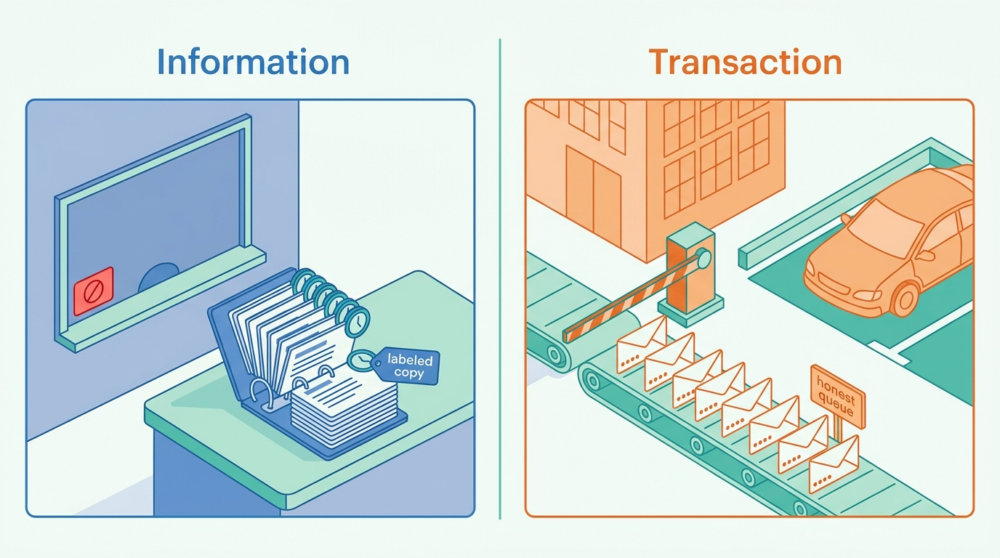
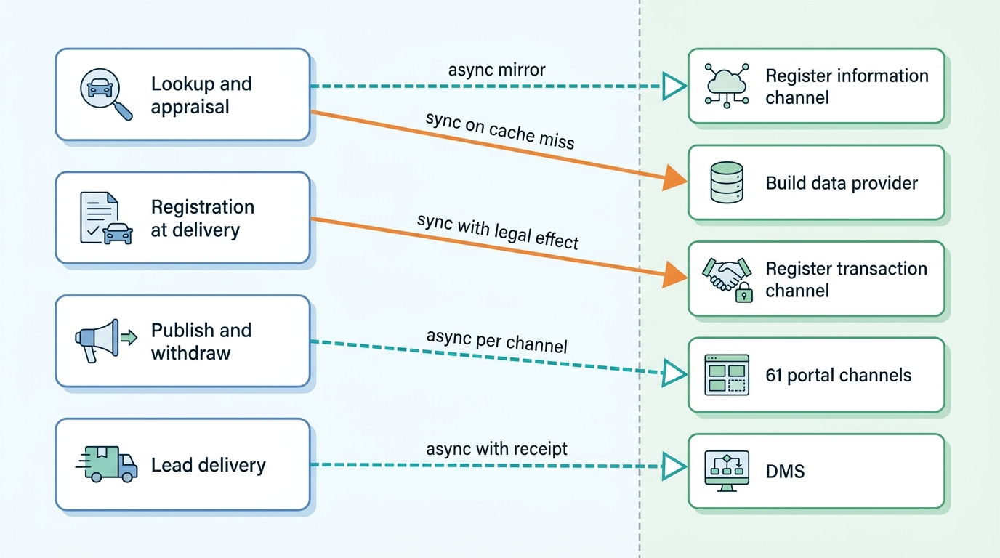
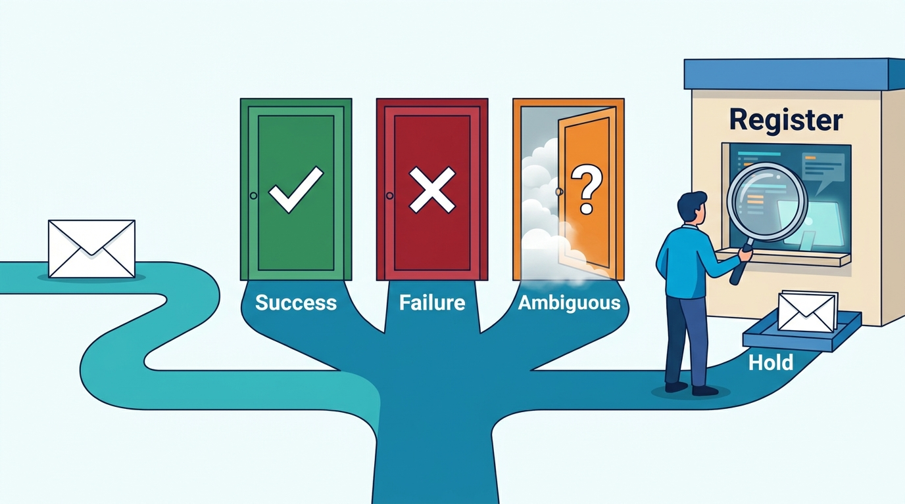

> **IN THIS CHAPTER, YOU WILL:** Learn to map a vehicle platform's external dependencies against the dealer and client journeys they can stop. You will set journey service level objectives (SLOs) and per-dependency budgets, and design timeouts, retries, circuit breakers, bulkheads, session and quota monitors and named degraded modes, so that a register, supplier, portal or dealer management system (DMS) outage costs the dealer time, not the sale.

> **WHY THE BUSINESS CARES:** On the last day of a quarter, a dealer who cannot register a car cannot hand it over, and a franchised dealer may miss a manufacturer target. A platform that keeps working through a supplier's outage keeps its renewals, while one that fails with its suppliers ends up paying credits and losing customers.

> **WHY ARCHITECTS SHOULD CARE:** Most of the facts and transactions this platform sells pass through systems it does not run and cannot replace. Its availability is decided by which of those calls sit synchronously on a critical path, how failures are retried and classified, and whether the degraded path is exercised before it is needed.

> **KEY POINTS:**
>
> * **Measure journeys, and give each dependency a budget.** A dealer experiences "I could not value this car" or "I could not register this sale", not a supplier's error rate. Set SLOs on five journeys (lookup, appraisal, publish, lead delivery, registration). Count every failure the dealer sees, including upstream ones, and attribute it to a dependency. Then give each synchronous dependency a share of the error budget. A new one on a critical path needs a budget line and a degraded mode before it ships.
> * **Reads degrade to a labeled copy; writes with legal effect degrade to an honest queue.** Register facts, specifications and history can be served from a mirror or cache with their age shown, because a slightly old fact is usually still useful. A registration in a new name cannot be faked or guessed. It waits in an ordered queue with a visible status, and the dealer is told that the car stays on the lot until the register confirms.
> * **An ambiguous timeout is neither a success nor a failure.** On 31 March 2027 Axleby's retry queue preserved order, but it treated 214 timeouts as failures, and those transactions were submitted twice. Classify every outcome as success, definitive failure or ambiguous. Resolve ambiguity by reading the authority's state before any retry. Retry in one place, with jitter and a budget.

> **[FAILURE PATTERNS THIS CHAPTER ADDRESSES](where-vehicle-platforms-go-wrong.html):**
>
> * **Borrowed Uptime** — every synchronous call to a register, build-data provider, portal or DMS multiplies into the availability of the dealer's journey, and peaks hit the platform and its suppliers on the same days.
> * **DMS Hostage** — a dealer whose stock, adverts and sales documents wait on the DMS stops selling when the DMS stops; Axleby's DriveDesk rooftops did not.
> * **Provenance Amnesia** — a degraded mode that serves cached facts without their source and observation time turns an outage into silently wrong answers.

 
A vehicle data and dealer SaaS platform is unusually dependent. **Its most valuable facts come from authorities and suppliers it cannot replace**: the register, build-data providers, workshop aggregators, portals and DMS products. A generic SaaS product depends on a cloud provider and a payment processor; this one depends on dozens of external parties on its main paths, some of which operate transaction channels with legal effect.

Two kinds of dependency need different treatment. **Information dependencies** (register facts, build data, history sources) can usually be copied in advance and served with an age label when the source is down. **Transaction dependencies** (a registration in a new name, a portal withdrawal, a write-back to the DMS) change the world outside the platform. They cannot be served from a copy, and a retry that does not know whether the first attempt succeeded can do harm.

**Figure 1:** *Information dependencies degrade to a labeled copy that shows its age; transaction dependencies degrade to an honest queue, because an act with legal effect cannot be served from a copy.*

This chapter owns three terms. A **journey SLO** is an objective set on an end-to-end dealer or client journey rather than on a service. A **dependency budget** is the share of a journey's error budget allotted to one external dependency, together with the rule that limits how many synchronous dependencies a critical journey may carry. A **degraded mode** is a named, tested way for a journey to keep working, or to fail honestly, while a dependency is impaired. The chapter builds on the transaction design in [[registration-and-trade-services]], the integration layer in [[dms-integration]] and the business-flow monitors in [[observability-and-data-operations]]. The cost side of the same dependencies is covered in [[scale-and-cost]].

## Setting the Scene at Axleby: The Last Day of the Quarter

Axleby, the fictional vehicle data and dealer software group this book follows (see [[meet-axleby]]), sends about **1.25 million** register transactions a year through Axleby Trade. Most are registrations in a buyer's name (*tenaamstellen*), releases of a seller's liability (*vrijwaren*) and stock-register actions. Month-end and quarter-end peaks reach about **4×** the daily average, because dealers deliver cars to close their month and franchised dealers deliver to close manufacturer targets.

On **Wednesday 31 March 2027**, the last working day of the quarter, the Dutch register's transaction channel was unavailable to Axleby for **5 hours 40 minutes**, from 14:20 to 20:00. It did not fail cleanly, and Axleby's design at the time could not tell a failure from a timeout. [[registration-and-trade-services]] owns the transaction story; this chapter reads the same afternoon as a dependency failure. The times after 15:00 are Axleby illustrations consistent with that chapter.

| Time | The register channel | What Axleby's systems did |
| --- | --- | --- |
| 14:20–15:05 | Slow: some messages answered late, many not at all | The 30-second client timeout fired on messages the register had committed; the worker treated each timeout as a failure and resubmitted |
| about 15:05 | Stops answering | Turnstile's session monitor, which watched for errors but not for latency, marks the channel down; the queue holds |
| about 15:20 | Down | Daan Visser (Product Manager, Axleby Trade) posts a banner in Lotwise and on the status page by hand |
| 15:05–20:00 | Down | **3,100** transactions queue in order; dealers postpone others to the next morning |
| 20:00–20:20 | Back, but slow under the queue's full-speed drain | A second window of timeouts and blind resubmissions |
| Evening | Normal | The queue drains in order; plates for late registrations are made on 1 April |

Something went right. **The queue held and preserved order**, so no registration in a buyer's name reached the register before the stock-in it depended on, and most quarter-end deliveries were registered the same evening.

Three things went wrong. **214 transactions were submitted twice**, all in the two slow windows. The register rejected each second message because the car was no longer in the state it assumed, and the back office recorded that rejection as the outcome: dealers saw "rejected" for 214 acts that had succeeded. Three people spent two working days correcting them. **The dependency had a slow state that nothing measured**: the monitor saw errors, not latency, so the queue kept submitting into a brownout for 45 minutes. And **the full-speed drain made the recovering channel slow again**, which recreated the conditions of the first window. For the first hour, dealers learned about the outage from their customers, not from Axleby.

The rule in the Netherlands is plain. The Dutch vehicle authority (RDW, Rijksdienst voor het Wegverkeer) tells recognized companies that during a disruption of message traffic they "may not receive confirmation of the registration" and "can only register the vehicle once the disruption is over" ([RDW informatiemap, January 2026](https://www.rdw.nl/-/media/rdwnl/documenten/bedrijf-met-rdw-erkenning/toezichtbeleid/tbb-en-informatiemap-2026/informatiemap.pdf)). There is no workaround, and there should not be one. **The architecture question is not how to avoid the outage. It is how to keep every journey that does not need the channel working, make the one that does wait honestly, and never turn a timeout into a second transaction.**

Ines Marchetti (Group Chief Architect) asked Marta Nowak (Head of Platform and SRE) for three things in April: a map of every external dependency and the journeys it can stop, an SLO per journey, and a named degraded mode for every dependency on a critical path.

## Concepts: Dependencies, Journeys, Budgets and Degraded Modes

### The dependency map

A **dependency** is any system outside the team's control that a journey relies on: a register, a data supplier, a portal, a DMS, a payment provider, another cloud, or another team's product. The **dependency map** records, for each, the journeys that touch it, whether the call is synchronous on a critical path, whether its effect is information or transaction, what its terms promise and what happens when it fails.

Criticality is a property of the pair (journey, dependency), not of the dependency alone. The Dutch register's information channel is critical for a purchase decision that needs today's transfer status. It is not critical for a valuation, which can use yesterday's mirrored facts. Axleby uses three tiers:

| Tier | Meaning | Example at Axleby |
| --- | --- | --- |
| **Tier 1: blocks a legal or commercial act** | The dealer cannot complete the act without the dependency; no copy can substitute | Register transaction channel for registration at delivery |
| **Tier 2: degrades a decision** | The journey can continue with older, partial or labeled data | Build-data provider for an appraisal; register information channel for a valuation |
| **Tier 3: delays a background flow** | Work queues and catches up; the dealer notices only if the delay is long | Portal adapters for price updates; DMS file imports; supplier batches into Tracewell |

### Journey SLOs

A **service level indicator (SLI)** is "a carefully defined quantitative measure of some aspect of the level of service", and an SLO is a target for it ([Google, *Site Reliability Engineering*, 2016](https://sre.google/sre-book/service-level-objectives/)). A **journey SLO** sets that target on what a dealer or client does, not on a service. AutoScout24 described the same move in 2024: it defines **critical user interactions** per journey, such as "Dealer is contacted by a Buyer about a car", manages SLOs on them with Terraform and Datadog, and translates error budgets into business effects such as lost leads ([AutoScout24 Tech Blog, September 2024](https://tech.autoscout24.com/blog/posts/slos-for-critical-user-interactions/)).

For this platform, each journey SLI has **three outcomes, not two**: *good* (complete answer or completed act), *degraded* (a labeled partial or stale answer, or an act honestly queued) and *bad* (an error, a wrong answer or a silent loss). The SLO covers good plus degraded. A second objective caps degraded, so a journey that is always "degraded" cannot pass as healthy.

### Counting upstream failures

A common design excludes upstream-caused errors from the SLI so that teams are not blamed for a supplier. I do the opposite. **The dealer does not care whose fault it was, so every failure the dealer sees counts.** Each failure is attributed to a cause (Axleby code, a named dependency, the client's input), and the attribution feeds two different conversations: fix our code, or change our dependency on the supplier (contract, cache, degraded mode or second source). Excluding upstream errors hides Borrowed Uptime in exactly the place the pattern lives.

### The dependency budget

If a journey calls several dependencies in series and needs all of them, its availability is at most the product of theirs. Five dependencies at 99.5% each give at most about 97.5%. The **dependency budget** turns that arithmetic into a design rule:

1. Each critical journey has an error budget from its SLO (0.5% of attempts for a 99.5% objective).
2. Part of it is reserved for the platform's own failures; the rest is divided among the synchronous dependencies on the critical path, weighted by the share of attempts that touch each.
3. A dependency whose measured failure rate times its share exceeds its line must leave the synchronous path: mirror it, cache it within the license, make it asynchronous, or give the journey a degraded answer when it fails.

### Degraded modes

A **degraded mode** is named, specified per journey and dependency, visible to the user and exercised on a schedule. Five kinds cover this domain:

| Kind | What the user gets | Fits | Never use for |
| --- | --- | --- | --- |
| **Labeled copy** | The last known fact, with source and observation time | Register facts, specification, history, market data | Facts whose staleness is dangerous (theft status at purchase) |
| **Partial answer** | Available sections, with the missing ones marked unavailable and why | Reports and lookups composed from several sources | Hiding a missing section as "nothing found" |
| **Honest queue** | The act is accepted, ordered and shown as pending at the authority | Register transactions, DMS write-backs, portal operations | Telling the user it is done |
| **Local system of record** | The platform takes ownership of a field until the owner returns, then reconciles | DMS-owned stock status during a DMS outage | Fields the platform has no right to own (the dealer's ledger) |
| **Fail fast with a reason** | A clear refusal, so the user can choose another path | Acts that need a live answer and cannot wait | — |

The UK MOT history service shows the partial-answer idea in a public contract. The Driver and Vehicle Standards Agency (DVSA) API returns a vehicle's `hasOutstandingRecall` field as Yes, No, Unknown or **Unavailable**, documented as "We were unable to retrieve data from the Recalls service due to an error" ([DVSA MOT history API specification, n.d., accessed 2026-10](https://documentation.history.mot.api.gov.uk/mot-history-api/api-specification/mot_history_open_api_specification.yml)). One dependency failing inside the service becomes one honest field, not a failed request and not a false "No".

## Architecture: From Dependency Map to Degraded Mode

### Axleby's dependency map

Marta's team built the map from the gateway logs, the adapters' configuration and the contracts register. It had 75 entries in May 2027: 61 portal channels, 5 register channels (two Dutch, the Belgian partner, DVLA and DVSA), 3 DMS families, the build-data provider, Kilometra and two other history suppliers, Vertex AI for valuation serving, and the payment service provider for Odolo. The figure shows the entries that sit on the five critical journeys.

**Figure 2:** *Axleby's critical journeys and the external dependencies under them. Of the arrows into external systems, only the build-data miss and the register transaction are synchronous; the rest are mirrored, queued or acknowledged asynchronously, so one outage does not stop several journeys. The other synchronous calls, live register status at purchase and Vantage's cross-cloud endpoint, are in the table below.*

The figure shows the mid-2027 target. In early 2027, Dutch register data still lived in three copies of different ages, and a purchase had no live check at all ([[registers-and-official-data]]). An excerpt of the table behind the figure:

| Dependency | Journeys | Tier | Call style | Published terms or contract | Degraded mode |
| --- | --- | --- | --- | --- | --- |
| Dutch register transaction channel | Registration at delivery, stock-in | 1 | Synchronous, certificate-based | Certificate valid 2 years; outage rule in RDW informatiemap | Honest queue, ordered per vehicle |
| Dutch register information and open data | Lookup, appraisal, purchase gate | 2 (1 at purchase confirmation) | Daily snapshots into the mirror; live status calls at appraisal open and purchase confirmation | Contractual data-supply relationship since 1999 | Labeled copy; appraisal shows "status unchecked"; purchase confirmation waits with a reason |
| Build-data provider | Lookup, appraisal, advert equipment | 2 | Synchronous on Specbook cache miss (3% of lookups) | Per-request fee; contractual retention | Partial answer: catalog-level specification, options marked pending |
| DVSA MOT history | UK history, Showroomly adverts | 2 | Daily delta and weekly bulk into Tracewell; live call for new plates | 500,000 requests a day, 15 a second average, burst 10 | Labeled copy from bulk and delta files |
| Vertex AI endpoint (Vantage) | Lookup, appraisal, nightly restock valuations | 2 | Synchronous, cross-cloud | Cloud provider service terms | Fail fast with a reason; nightly run retries later |
| Portal channels (61) | Publish and withdraw | 3 (withdrawals: 2) | Asynchronous per channel | Each portal's API terms and rate limits | Honest queue per channel; withdrawals ahead of updates |
| DriveDesk and other DMS | Lead delivery, stock sync, sales documents | 2 | Asynchronous through Hitch, with receipts | Partner agreement | Local system of record in Lotwise; queued write-backs with expiry |

### Requirements per interaction

| Interaction | Consistency | Latency | Freshness | Availability under dependency failure |
| --- | --- | --- | --- | --- |
| Plate lookup (API client) | One answer per request; result class and sources recorded | p95 ≤ 2 s *(assumption)* | Register facts ≤ 24 h, labeled with observation time | Good or degraded for 99.9% of requests *(assumption)* |
| Appraisal in Lotwise | Valuation inputs recorded in the valuation ledger | p95 ≤ 2 s to first value *(assumption)* | Valuation model ≤ 1 week old (weekly retraining) | Partial answer if build data is missing; never blocks capture |
| Purchase confirmation (theft, blocks, transfer possible) | Live register answer, stored with its timestamp; never from cache | p95 ≤ 3 s *(assumption)* | At the moment of decision | Decision waits and the dealer sees why; appraisal stays saved |
| Register transaction | Exactly-once effect at the register | Definitive outcome ≤ 2 min when the channel is up *(assumption)* | — | Honest queue, ordered per vehicle; status visible within 1 min |
| Withdrawal from portals | Delete wins over pending updates | ≤ 15 min *(assumption)* | — | Queue per channel; reconciliation finds stragglers |
| Lead delivery | At least once, deduplicated; acknowledged by the receiver | ≤ 60 s *(assumption)* | — | Lotwise inbox when the CRM or DMS is down |

The lookup, withdrawal and lead targets are those [[dealer-and-data-economics]] derives from each journey's economics.

### Timeouts and deadlines

Every call to a dependency has a timeout derived from data. Amazon's Builders' Library describes setting it by choosing "an acceptable rate of false timeouts (such as 0.1%)" and reading the matching percentile of the dependency's latency ([AWS Builders' Library, 2019](https://aws.amazon.com/builders-library/timeouts-retries-and-backoff-with-jitter/)). OWASP lists "does not implement timeouts for interactions with third-party services" among the causes of API10:2023, Unsafe Consumption of APIs ([OWASP, 2023](https://owasp.org/API-Security/editions/2023/en/0xaa-unsafe-consumption-of-apis/)).

Two refinements matter. **Deadlines propagate**: a lookup with a 2-second budget that has spent 1.4 seconds must not give the build-data call a fresh 3-second timeout ([Google, 2016](https://sre.google/sre-book/addressing-cascading-failures/)). And **a timeout on a write is not a failure**; it starts an ambiguous outcome, treated below.

### Retries: one place, with jitter and a budget

Amazon's guidance is to "retry at a single point in the stack", because "retries are 'selfish'", and to cap them locally with a token bucket ([AWS Builders' Library, 2019](https://aws.amazon.com/builders-library/timeouts-retries-and-backoff-with-jitter/)). Marc Brooker's 2015 simulation showed that exponential backoff without jitter "is the clear loser" against randomized ("full jitter") backoff ([AWS Architecture Blog, 2015](https://aws.amazon.com/blogs/architecture/exponential-backoff-and-jitter/)). Google's SRE book recommends at most three attempts per request and a per-client retry budget of 10% of requests, which caps the extra load at about 1.1× instead of 3× ([Google, 2016](https://sre.google/sre-book/handling-overload/)).

At Axleby the single retry point is the upstream budget broker for paid and quota-limited reads ([[scale-and-cost]]), the Hitch adapter for DMS writes ([[dms-integration]]), the Relay channel queue for portal operations and the Axleby Trade retry queue for register transactions. Services above those points do not retry; they return a degraded or bad result.

### Writes with legal effect: success, failure or ambiguous

Every write to a dependency (a register transaction, a DMS command, a portal delete) ends in one of three outcomes:

- **Success**: the counterpart confirmed it, and the evidence is stored.
- **Definitive failure**: the counterpart refused it with a reason. Do not retry; show the reason.
- **Ambiguous**: the call timed out, the connection broke after sending, or the response could not be parsed. The counterpart may or may not have acted.

**An ambiguous outcome is resolved by reading, not by resubmitting.** For register transactions, [[registration-and-trade-services]] designs this as *probe before retry*: ask the register for the car's current state, resubmit only if it clearly shows the act did not happen, and send the case to a person if the answer is unclear. The same rule holds for Hitch's DMS commands (read the DMS record back) and Relay's deletes (read the portal listing back). While an ambiguous item waits, only that vehicle's lane is held; ordering is needed per vehicle, not across the whole queue.

**Figure 3:** *An ambiguous timeout is neither a success nor a failure; the platform reads the counterpart's state before any retry, so a timeout never becomes a second transaction.*

The reliability side is about *when* the queue submits at all. A dependency's health state, shared across the platform, decides whether the queue sends, holds or drains, and it drives what dealers are told.

**Figure 4:** *One health state drives the queue and the dealer's screen. The queue stops on "slow", not only on "down", and it drains at a paced rate after trial submissions succeed. On 31 March 2027 the queue submitted into both slow windows, where all 214 double submissions happened.*

### Circuit breakers and the session monitor

A circuit breaker stops calling a dependency that is failing and lets a trial call through after a reset period. Martin Fowler's 2014 description names the closed, open and half-open states ([martinfowler.com, 2014](https://martinfowler.com/bliki/CircuitBreaker.html)). Amazon warns that breakers "introduce modal behavior into systems that can be difficult to test" ([AWS Builders' Library, 2019](https://aws.amazon.com/builders-library/timeouts-retries-and-backoff-with-jitter/)). That warning is the reason to tie each breaker state to a named degraded mode that is exercised, rather than to a code path that runs once a year.

For the register channels, the breaker's input is Turnstile's **session monitor**. It is a daemon that watches each channel's sessions, certificates, quotas and published maintenance windows so that transactions fail fast instead of timing out. It answers three questions continuously:

- **Is the channel up?** It checks connection success, latency and the error mix on real traffic and on scheduled probes ([[observability-and-data-operations]]).
- **Will it stay up?** It tracks credential expiry and quota consumption. RDW certificates for recognized companies are valid for two years ([RDW informatiemap, 2026](https://www.rdw.nl/-/media/rdwnl/documenten/bedrijf-met-rdw-erkenning/toezichtbeleid/tbb-en-informatiemap-2026/informatiemap.pdf)). DVSA client secrets expire every two years, and keys unused for 90 days are revoked ([DVSA, n.d., accessed 2026-10](https://documentation.history.mot.api.gov.uk/mot-history-api/authentication/)). A key that exceeds the daily quota of 500,000 requests is restricted "for 24 hours" ([DVSA, n.d., accessed 2026-10](https://documentation.history.mot.api.gov.uk/mot-history-api/rate-limits/)). A shared key that one batch client exhausts takes every UK dealer with it, so the monitor alerts at 70% of the daily quota *(assumption)*, and the broker reserves headroom for interactive traffic.
- **Is it planned to be down?** RDW publishes its major maintenance on Sundays from 07:00 to 11:00, listing eleven such Sundays for 2026, and announces other planned work on the same page ([RDW, onderhoud en storingen, n.d., accessed 2026-10](https://www.rdw.nl/paginas/onderhoud-en-storingen)). The monitor loads such calendars into a **dependency calendar**, so a planned window opens the breaker in advance and Lotwise warns dealers before they start a Sunday delivery.

**Figure 5:** *Each dependency has a health state that the whole platform shares. The degraded mode, the dealer banner and the queue's behavior are driven by this state, so the retry queue, Lotwise and the status page cannot disagree about whether the register is up.*

The **Slow** state matters most for transactions. On 31 March 2027 the channel was slow for 45 minutes before it went down and for 20 minutes after it came back, and that is when all 214 double submissions happened. Since the redesign went live on 14 June 2027, Turnstile opens the circuit on degraded latency, not only on errors, and the client timeout rose from 30 to 90 seconds, because a slow confirmation beats an ambiguous one. At the 30 June 2027 quarter-end, 41 ambiguous outcomes were all resolved by probe, with no double submissions.

### Bulkheads per supplier

A bulkhead isolates resources so that one failing dependency cannot exhaust what others need. Michael Nygard's *Release It!* (second edition, 2018) catalogs bulkheads, timeouts and circuit breakers among its stability patterns ([Pragmatic Bookshelf, 2018](https://pragprog.com/titles/mnee2/release-it-second-edition/)). In this domain, bulkheads are drawn per dependency and, where tenants share an upstream key, per tenant class:

- **Per register channel**: separate connection and worker pools for each Dutch channel, the Belgian partner, DVLA and DVSA.
- **Per portal channel**: Relay gives each of the 61 channels its own queue and concurrency limit, and withdrawals go in a lane ahead of updates. The Zombie Golf of February 2027 began with deletes stuck behind failed updates ([[listing-syndication]]).
- **Per DMS family and per rooftop**: Hitch isolates DriveDesk from the German DMS adapters and keeps a breaker per rooftop, so one rooftop with revoked credentials does not stop the others.
- **Per traffic class at shared upstreams**: the broker separates interactive lookups from client batches ([[scale-and-cost]] describes the lanes).

### Pushing data instead of pulling it

Amazon's 2019 article on avoiding fallback makes a point that changes this architecture more than any breaker: it prefers "pushing data to systems that need it instead of pulling and risking failure of a remote call at a critical time" ([AWS Builders' Library, 2019](https://aws.amazon.com/builders-library/avoiding-fallback-in-distributed-systems/)). The same article warns that fallback logic is "hard to test" and can lie dormant until "the most chaotic moments".

For information dependencies, the lesson is to **make the copy the normal path, not the fallback**. Axleby's register mirror holds about **16 million** Dutch plates, built from the register's daily open-data snapshots and diffed into change events ([[registers-and-official-data]]). Every lookup reads the mirror, including on normal days, and the answer carries each fact's observation time. When the source is unavailable, the lookup path does not change; only the age of the facts grows. The mirror's freshness has its own SLO and alert. Theft and awaiting-inspection status are not in the open data and are asked live, which is why the purchase gate makes live calls.

In the UK, DVSA publishes a full MOT bulk file every Sunday plus daily deltas ([DVSA, n.d., accessed 2026-10](https://documentation.history.mot.api.gov.uk/mot-history-api/download-vehicle-mot-history-data/)), so Tracewell loads MOT history in advance. Licenses decide what may be mirrored; mirroring beyond the license turns a reliability fix into a breach ([[data-licensing-and-governance]]).

### Labels on degraded answers

A degraded answer is useful only if the user can see that it is degraded. Every fact served from a copy carries its source and observation time ([[provenance-and-data-quality]]); Lotwise shows "Register status as of 06:12 today". In JSON API v2, each section of a response carries its source, observation time and a status of current, stale or unavailable ([[vehicle-data-apis]] owns the contract).

Some facts must never be served from a copy. [[vehicle-history]] sets the rule that **theft status is never served from cache**. If the theft source is down during a lookup, the report says "theft status could not be checked at 14:12", and the purchase gate in Lotwise refuses to confirm a purchase until a live check succeeds. The appraisal stays saved, and the dealer can still negotiate.

## In Practice

### Public evidence: how dealer groups survived the 2024 CDK outage

The best public record of a dealer-software dependency failing is the June 2024 attack on CDK Global, which served "nearly 15,000" dealer locations ([CyberScoop, June 2024](https://www.cyberscoop.com/cdk-ransomware-car-dealers/)). CDK, which is privately held, has published no post-incident report. The evidence comes from what listed dealer groups told the US Securities and Exchange Commission (SEC) in 2024; [[case-cdk-global]] tells the company story.

- **AutoNation** said all its locations stayed open, operating "through manual and alternative means and processes, albeit with lower productivity" ([AutoNation Form 8-K, June 2024](https://www.sec.gov/Archives/edgar/data/350698/000035069824000078/an-20240619.htm)). In a Form 8-K filed on 15 July 2024 it estimated that second-quarter earnings would be "negatively impacted by approximately $1.50 per share", without taking potential recoveries into account ([AutoNation Form 8-K, 15 July 2024](https://www.sec.gov/Archives/edgar/data/350698/000035069824000085/an-20240715.htm)). In August it reported that "certain ancillary systems and integrations, such as those that help automate ordering, scheduling, payment, and reporting processes, were restored by the end of July" ([AutoNation Form 10-Q, August 2024](https://www.sec.gov/Archives/edgar/data/350698/000035069824000098/an-20240630.htm)).
- **Sonic Automotive** kept dealerships open "utilizing workaround solutions" and resumed DMS transactions on 30 June only after "internal risk assessments and data validation procedures" ([Sonic Form 10-Q, August 2024](https://www.sec.gov/Archives/edgar/data/1043509/000104350924000065/sah-20240630.htm)).
- **Lithia Motors** severed "business service connections" between its systems and CDK's as part of its own incident response ([Lithia Form 8-K, June 2024](https://www.sec.gov/Archives/edgar/data/1023128/000102312824000079/lad-20240619.htm)).

Read together, the filings put the core DMS outage at about 7 to 11 days and integration recovery at up to about six weeks. **A degraded mode for a DMS dependency must last weeks, not hours.** Integrations came back last, after customers had validated their data, and a customer, not only the vendor, cut the connection on purpose.

> **INFERENCE, NOT DOCUMENTED:** None of the filings describes how the dealer groups' other software vendors behaved during the outage, or which of their products kept working. The lessons above are drawn from the groups' statements about their own operations.

### Axleby: the DriveDesk Outage as a planned-for dependency failure

[[dms-integration]] tells the DriveDesk Outage from the integration side: the ransomware attack on **Tuesday 9 November 2027**, **12 days** offline until Sunday 21 November, the partner API reopening with new credentials on Wednesday 24 November, write-back resuming rooftop by rooftop from Friday 26 November, and **2,140** discrepancy tickets. Here is the same event from the dependency side.

**The budget had already moved DriveDesk off the critical path.** After the Zombie Golf, the dependency review classified DriveDesk as Tier 2 for Lotwise's stock, advert and sales-document journeys: those journeys must work without it. Hitch's per-rooftop degraded mode made Lotwise the local system of record for stock status. Relay took its sold signals from Lotwise instead, and Switchboard delivered leads to the Lotwise inbox instead of DriveDesk's CRM.

**The degraded mode had been exercised.** In quarterly DMS game days from June 2027, the DriveDesk adapter was disabled for 40 sample rooftops *(illustrative)* for a business day. June's found that sales documents still waited for a DMS customer number and that the banner named the wrong rooftops. Both were fixed before November.

**The journey SLOs held, with a large degraded share.** During the 12 days, the **1,900** DriveDesk rooftops recorded about **16,000** stock-ins and about **19,000** sales in Lotwise, and about **34,000** leads went to the Lotwise inbox. The illustrative SLO figures for those rooftops:

| Journey (DriveDesk rooftops, 9–21 Nov 2027) | Good | Degraded | Bad | Note |
| --- | --- | --- | --- | --- |
| Withdrawal from portals within 15 minutes | 99.4% | — | 0.6% | Sold status originated in Lotwise; misses were portal-side delays |
| Lead delivery within 60 seconds | — | 99.8% | 0.2% | Degraded by design: delivered to the Lotwise inbox, not to the DMS CRM where the group normally works |
| Sales document issued | 97.9% | 2.1% | — | Degraded: documents without DMS customer numbers, completed after reconciliation |
| Stock-in | 99.7% | 0.3% | — | Cost fields marked incomplete until DMS data returned |

The lead row shows why the second objective exists. A journey can be 99.8% "working" and still outside its degraded cap, because the dealer group's salespeople worked from a second inbox for 12 days. The cap made that cost visible to Velto's management.

**Some data went dark, and the platform said so.** Cost data from DriveDesk stopped arriving, so gross-per-unit dashboards for the 1,900 rooftops showed "cost incomplete" rather than stale or zero margins ([[dealer-and-data-economics]]). About **3,900** queued write-back commands expired by design and were dropped rather than replayed.

**Communication came from the health state.** Each affected rooftop's banner and status message was generated from the DriveDesk dependency state and listed what worked, what was queued, what was paused and when the next update would come. Hendrik Maes (Head of Partner Integrations) re-keyed the adapter only out of band, because impostors exploited re-onboarding during the CDK recovery ([TechTarget, 2024](https://www.techtarget.com/whatis/feature/The-CDK-Global-outage-Explaining-how-it-happened)).

### Axleby: the appraisal lookup's dependency budget

The budget earned its keep in May 2027. After the Three Copies review ([[registers-and-official-data]]), the registers team proposed a live register status call when an appraisal opens, so that a dealer never again negotiates on a stale "transfer possible". Axleby had set the appraisal journey's SLO at 99.5% good-or-degraded per month *(assumption)*: a budget of 0.5% of attempts, with 0.2% reserved for its own code and 0.3% for dependencies. Marta's team added the proposed call to the existing path. The failure rates are illustrative.

| Synchronous dependency (proposed path) | Share of appraisals touching it | Measured failure rate in business hours | Contribution to bad outcomes |
| --- | --- | --- | --- |
| Live register status call at appraisal open, blocking | 100% | 0.40% | 0.40% |
| Connect XML itself (another team's legacy stack) | 100% | 0.30% | 0.30% |
| Build-data provider (Specbook miss) | 3% | 1.0% | 0.03% |
| Vertex AI endpoint (Vantage) | 100% | 0.10% | 0.10% |
| **Total from dependencies** | | | **0.83%, nearly three times the 0.3% line** |

Nobody argued against the live call; the budget changed how it was made. The call at appraisal open became non-blocking: the appraisal shows mirror facts at once, and the live status replaces them when it arrives or shows "status unchecked" if it fails, which counts as degraded. The second call, at purchase confirmation, stays blocking, because a purchase must not be confirmed without it. It belongs to a separate purchase-confirmation journey whose SLO accepts the register's availability. Lotwise Appraise moved from Connect XML to the JSON API, and a build-data failure now returns a catalog-level specification with options marked pending. What remained was Vertex AI at 0.10% and a small residual, under the 0.3% line. The budget did not ask for a second valuation provider. It asked which dependencies needed to be synchronous at all.

### Supplier SLAs versus what you measure

Supplier contracts commonly state a monthly availability, exclude announced maintenance, measure at the supplier's edge and cap credits at a share of the fee. The RDW and DVSA pages cited here publish maintenance windows, quotas and outage rules, but I found no availability commitment on them. Three practices follow:

- **Measure each dependency yourself, from your side.** Flow records and probes ([[observability-and-data-operations]]) give the availability that goes into the budget, not the contract's.
- **Weight by when it matters.** A supplier at 99.9% a month that loses its 0.1% at month-end has failed the business more than one that loses 0.3% on Sunday nights. Axleby reports peak windows separately.
- **Bring the measurement to the supplier review.** Hendrik's quarterly supplier reviews use Axleby's numbers, and renewals ask for incident notification times and data-validation duties after restores.

## Failure Handling

| Failure | How it shows up | Detection | Recovery |
| --- | --- | --- | --- |
| **Ambiguous write outcome** | Timeout after sending a register transaction, DMS command or portal delete | Outcome class "ambiguous" in the queue | Hold that vehicle's queue; read the counterpart's state; resubmit only on a clear "not done" |
| **Duplicate submissions** | Two transactions or commands for one act | Idempotency key per business act; read-back | Mark the duplicate; correct proof and fee lines; report the count per incident |
| **Retry storms** | Many callers retry a slow dependency at once | Retry ratio per dependency above budget | Single retry point; token-bucket retry budget; full jitter |
| **Recovery surge** | A queue drains into a dependency that just came back | Recovering state; error rate on trial submissions | Paced drain below the counterpart's normal rate; revalidate prerequisites before each submission |
| **Stale queued work** | Prerequisites changed while the act waited | Revalidation before submission | Reject with a reason to the dealer; expire commands that newer state has superseded |
| **Incomplete data after a restore** | The counterpart restores from an older backup | Read-only reconciliation before write-back resumes | Discrepancy tickets; the field owner decides |
| **Quota exhaustion** | A shared key hits its daily limit; all tenants lose the source | Quota meter in the session monitor | Reserve headroom for interactive traffic; batch lane pauses first |
| **Monitor wrong** | The session monitor says healthy while submissions fail | Flow monitor disagrees with the health state | Flow evidence wins; page on the disagreement |

Two cases deserve more than a table row.

**The recovery surge.** On 31 March 2027 the queue drained at full speed when the channel returned, the channel slowed under the load, and the second window of ambiguous timeouts followed. The register is not Axleby's to load-test, and a counterpart that has just recovered is at its most fragile. Since June 2027 the queue drains at a rate Turnstile sets from channel health, revalidates each transaction's prerequisites just before submission, and pauses if trial submissions fail.

**The customer who disconnects you.** Lithia's 2024 filing shows that a customer can cut a dependency during its own incident response. Axleby's degraded modes are triggered by a dependency's state, whatever caused it. "Dealer disconnected us" and "DMS is down" lead to the same degraded mode in Hitch, and only an explicit re-authorization by the dealer leaves it.

## Trade-offs

| Option | Gives | Costs | Right when |
| --- | --- | --- | --- |
| **Synchronous call with timeout** | The freshest answer; simplest to build | Inherits the dependency's availability and latency; spends the budget | The act needs a live answer (purchase gate, register transaction) |
| **Mirror or push-fed copy, labeled** | Availability independent of the source; low latency | License limits; storage; freshness to monitor; stale facts if the feed stops | Information dependencies the license lets you keep (register facts, MOT bulk files) |
| **Cache within the license, with soft and hard TTL** | Good hit rates on repeated vehicles; serves the last good value | Cold-cache surges; license retention limits; negative caching needed | Paid per-request sources with retention rights ([[scale-and-cost]]) |
| **Asynchronous queue with receipts** | The user keeps working; order and retries are controlled | Pending states to show; reconciliation; expiry rules | Writes: register transactions, portal operations, DMS write-backs |
| **Second provider as runtime fallback** | A different source when the first fails | Different answers from different models; rarely exercised; double contracts | Only when the second path also carries live traffic every day |

The last row is where I disagree with intuition. A second build-data or valuation provider that is used only when the first fails will give different answers exactly when nobody is checking them, and Amazon's warning about dormant fallback applies in full. If a second source is worth paying for, route a share of daily traffic to it and compare the answers. Otherwise, invest in the labeled copy and the partial answer.

## Across Markets: What Changes by Country

| Aspect | Netherlands / Belgium | Germany | United Kingdom | United States |
| --- | --- | --- | --- | --- |
| **Registration write channel** | NL: RDW channel through a listed provider or directly, with an RDW certificate. BE: registration commonly submitted by the insurer or broker to DIV (Directie Inschrijvingen van Voertuigen); the public evidence I could read stops there | Federated: local registration offices; since September 2023 the KBA's large-customer interface (*Großkundenschnittstelle*, GKS) for companies with more than 500 transactions a year | DVLA online services for motor traders; new registrations mostly through DVLA's Register a Vehicle service | State departments of motor vehicles (DMVs) through dealer and service-provider programs; California requires all new motor vehicle dealers to use its Business Partner Automation (BPA) program |
| **Behavior during an outage** | NL: registration cannot be completed until the disruption ends (RDW, 2026) | GKS is asynchronous: requests are *Weitergeleitet* (forwarded for manual handling) or *Eskaliert* (escalated) when a portal gives no response "within five minutes" (KBA brochure, 2024) | DVLA's online sale and purchase service publishes opening hours (Monday to Friday 7am to 9pm, weekends 7am to 8pm) | Per state; partners submit through first-line service providers, which become a dependency layer of their own |
| **Information read path** | NL: open register snapshot (no VIN, plate-keyed) can be mirrored; change detection by diffing or a provider stream | No open vehicle-level register; reads under §39 StVG need a claim-related purpose | DVSA MOT bulk and daily delta files can be mirrored; DVLA's vehicle enquiry API closed to new registrations (October 2026) | Title and brand data through NMVTIS-approved providers; licensed history reports |
| **Published limits and windows** | RDW Sunday maintenance windows, published per year | KBA names the software provider as first-level support for GKS customers | DVSA: 500,000 requests a day, 15 a second, 24-hour restriction after exceeding quota | Program-specific; not studied here |
| **DMS concentration** | Long tail of local vendors (DriveDesk is fictional) | Brand-shaped DMS landscape | Several vendors cover large groups | High: CDK alone served nearly 15,000 locations in 2024 |

Sources for the table: [RDW informatiemap, 2026](https://www.rdw.nl/-/media/rdwnl/documenten/bedrijf-met-rdw-erkenning/toezichtbeleid/tbb-en-informatiemap-2026/informatiemap.pdf); [KBA GKS brochure, February 2024](https://www.landkreis-eichstaett.de/fileadmin/Dateien/Website/Dateien/SG_52_Verkehrswesen_KFZ/Informationsbroschuere_GKS.pdf); [GOV.UK, n.d., accessed 2026-10](https://www.gov.uk/sold-bought-vehicle); [DVLA VES API, n.d., accessed 2026-10](https://developer-portal.driver-vehicle-licensing.api.gov.uk/apis/vehicle-enquiry-service/vehicle-enquiry-service-description.html); [California DMV BPA program, n.d., accessed 2026-10](https://www.dmv.ca.gov/portal/vehicle-industry-services/business-partner-automation-program/); [§39 StVG](https://www.gesetze-im-internet.de/stvg/__39.html).

**What is common** is the reliability model: the dependency map, journey SLOs with three outcomes, per-dependency budgets, one retry point, breakers driven by a shared health state, and the split between labeled reads and honestly queued writes. **What is a market adapter** is the shape of the write channel. The Dutch channel is synchronous and refuses during an outage, which needs an ordered queue. The German GKS is asynchronous and multi-hop, so a transaction is a long-running saga with *Weitergeleitet* and *Eskaliert* as first-class pending states. UK service hours and quotas belong in the dependency calendar; the US adds a layer of service providers. **What is a rule set** is which facts may be mirrored: open Dutch register data and DVSA bulk files can be, while German register data generally cannot, so a German lookup has fewer labeled-copy options and needs partial answers sooner. And where one DMS vendor serves most of a market, as in the US, a DMS outage is a market-level event that every dealer-software vendor's degraded mode must plan for.

## The Chief Architect's View

**Own the dependency map as an architecture artifact.** At Axleby the map is versioned with the architecture decisions, each dependency has a named internal owner, and Marta's team reviews it quarterly against measured availability. The rule I use is short: **a new synchronous external call on a critical journey ships only with a budget line and a named degraded mode that has been exercised.** That rule is what reshaped the appraisal's live register call in May 2027.

**Decide degraded modes with product, not only with engineering.** Whether an appraisal may continue with register status unchecked, how long a queued registration may wait, and whether a sales document may be issued without a DMS customer number are business decisions. Tomás Ferreira (Product Director, Lotwise) and Daan Visser sign off the degraded modes for their journeys. The AWS Well-Architected guidance on game days names excluding "business decision makers" as an anti-pattern ([AWS Well-Architected Reliability Pillar, REL12-BP05, n.d., accessed 2026-10](https://docs.aws.amazon.com/wellarchitected/latest/reliability-pillar/rel_testing_resiliency_game_days_resiliency.html)).

**Run game days that real outages would recognize.** Axleby runs a register brownout against a simulator before every quarter-end ([[registration-and-trade-services]]), and each quarter disables a DMS adapter for a sample of rooftops in production, slows the build-data provider at the broker, and has a portal stub silently ignore deletes. Each game day starts by checking the last one's findings.

**Remember that you are someone else's dependency.** Axleby serves about **8,550** dealer rooftops (7,200 on Lotwise and 1,350 on Showroomly) and **640** API clients. To them, Axleby is the Borrowed Uptime, and the CDK filings show what customers do when a vendor fails: cut the connection, run on paper and validate before trusting it again. Axleby's own regional failure needs a dealer degraded mode too (a read-only stock list, an export of today's documents), and CISA's demand for "offline, encrypted backups" with tested restores applies to Axleby itself ([CISA, September 2023](https://www.cisa.gov/stopransomware/ransomware-guide); [[vehicle-platform-security]]).

**Watch the budget, not the incident count.** Each month: every journey's good, degraded and bad shares; each dependency's contribution against its line; ambiguous outcomes and their time to resolution; open game-day findings; and the number of synchronous dependencies per critical journey.

## Questions to Ask

1. For each critical journey, which external dependencies are called synchronously, and what is the product of their measured availabilities in business hours?
2. Does the journey SLI count upstream-caused failures, and is "degraded" a separate outcome with its own cap?
3. Where is the single retry point for each dependency, and what limits its retry rate?
4. What happens to a register transaction, DMS command or portal delete that times out? Who reads the counterpart's state before any retry?
5. Which facts are served from a labeled copy when the source is down, which are never served from a copy, and how does the user see the difference?
6. Does the platform know about planned maintenance, credential expiry and quota limits before they cause errors?
7. When a queue drains after an outage, how fast does it send, and does it revalidate each item first?
8. Which degraded modes have been exercised in the last quarter, with business owners present, and what did the last game day find?
9. If our own platform were down for two weeks, what could our dealers still do?

The next page, [[scale-and-cost]], takes the same dependencies and asks what they cost: the workload shapes that load them, and the price of each lookup, report and publish.

## Sources and Evidence

### Company, product and investor sources

- [AutoNation Form 8-K (cyber incident)](https://www.sec.gov/Archives/edgar/data/350698/000035069824000078/an-20240619.htm) — AutoNation, **2024**; locations kept open "through manual and alternative means".
- [AutoNation Form 8-K (update)](https://www.sec.gov/Archives/edgar/data/350698/000035069824000085/an-20240715.htm) — AutoNation, filed 15 July **2024**; estimated Q2 earnings impact of about $1.50 per share, excluding potential recoveries.
- [AutoNation Form 10-Q, Q2 2024](https://www.sec.gov/Archives/edgar/data/350698/000035069824000098/an-20240630.htm) — AutoNation, **2024**; ancillary systems and integrations restored by end of July.
- [Sonic Automotive Form 10-Q, Q2 2024](https://www.sec.gov/Archives/edgar/data/1043509/000104350924000065/sah-20240630.htm) — Sonic Automotive, **2024**; workaround solutions; resumption after data validation.
- [Lithia Motors Form 8-K](https://www.sec.gov/Archives/edgar/data/1023128/000102312824000079/lad-20240619.htm) — Lithia Motors, **2024**; severed business service connections with CDK.
- [SLOs for Critical User Interactions](https://tech.autoscout24.com/blog/posts/slos-for-critical-user-interactions/) — AutoScout24 Tech Blog, **2024**; journey-level SLOs, error budgets translated into business impact.
- [CDK ransomware attack on car dealers](https://www.cyberscoop.com/cdk-ransomware-car-dealers/) — CyberScoop, **2024**; nearly 15,000 dealer locations; attack context.
- [The CDK Global outage explained](https://www.techtarget.com/whatis/feature/The-CDK-Global-outage-Explaining-how-it-happened) — TechTarget, **2024**; phishing during recovery.

### Standards, regulation and official documentation

- [RDW informatiemap for recognized companies](https://www.rdw.nl/-/media/rdwnl/documenten/bedrijf-met-rdw-erkenning/toezichtbeleid/tbb-en-informatiemap-2026/informatiemap.pdf) — RDW, **2026**; outage rule for registrations; two-year certificates.
- [Onderhoud en storingen](https://www.rdw.nl/paginas/onderhoud-en-storingen) — RDW, **n.d., accessed 2026-10**; Sunday maintenance windows and 2026 dates.
- [MOT history API: rate limits](https://documentation.history.mot.api.gov.uk/mot-history-api/rate-limits/), [authentication](https://documentation.history.mot.api.gov.uk/mot-history-api/authentication/), [bulk download](https://documentation.history.mot.api.gov.uk/mot-history-api/download-vehicle-mot-history-data/) and [API specification](https://documentation.history.mot.api.gov.uk/mot-history-api/api-specification/mot_history_open_api_specification.yml) — DVSA, **n.d., accessed 2026-10**; quotas, 24-hour restriction, credential expiry, bulk and delta files, "Unavailable" recall status.
- [Vehicle Enquiry Service API](https://developer-portal.driver-vehicle-licensing.api.gov.uk/apis/vehicle-enquiry-service/vehicle-enquiry-service-description.html) — DVLA, **n.d., accessed 2026-10**; per-client and global limits; registration closed.
- [Tell DVLA you've sold or bought a vehicle](https://www.gov.uk/sold-bought-vehicle) — GOV.UK, **n.d., accessed 2026-10**; online service hours for keepers and motor traders.
- [Informationsbroschüre Großkundenschnittstelle](https://www.landkreis-eichstaett.de/fileadmin/Dateien/Website/Dateien/SG_52_Verkehrswesen_KFZ/Informationsbroschuere_GKS.pdf) — Kraftfahrt-Bundesamt, **2024**; GKS eligibility, asynchronous statuses, five-minute escalation, support model.
- [§39 Straßenverkehrsgesetz](https://www.gesetze-im-internet.de/stvg/__39.html) — German federal law, **n.d., accessed 2026-10**; limits on private access to register data.
- [Business Partner Automation program](https://www.dmv.ca.gov/portal/vehicle-industry-services/business-partner-automation-program/) — California DMV, **n.d., accessed 2026-10**; dealers' remote registration and titling; service-provider tiers.
- [OWASP API10:2023 Unsafe Consumption of APIs](https://owasp.org/API-Security/editions/2023/en/0xaa-unsafe-consumption-of-apis/) — OWASP, **2023**; missing timeouts on third-party calls.
- [#StopRansomware Guide](https://www.cisa.gov/stopransomware/ransomware-guide) — CISA, MS-ISAC, NSA and FBI, **2023**; offline, tested backups.
- [REL12-BP05 Conduct game days regularly](https://docs.aws.amazon.com/wellarchitected/latest/reliability-pillar/rel_testing_resiliency_game_days_resiliency.html) — AWS Well-Architected Framework, **n.d., accessed 2026-10**; game-day practice and anti-patterns.

### Research and practitioner sources

- [Timeouts, retries and backoff with jitter](https://aws.amazon.com/builders-library/timeouts-retries-and-backoff-with-jitter/) — Marc Brooker, AWS Builders' Library, **2019**; timeouts from latency percentiles, single retry point, token-bucket retries, modal behavior of breakers. Principles older than three years that still hold.
- [Avoiding fallback in distributed systems](https://aws.amazon.com/builders-library/avoiding-fallback-in-distributed-systems/) — Jacob Gabrielson, AWS Builders' Library, **2019**; dormant fallback risk; push instead of pull.
- [Exponential backoff and jitter](https://aws.amazon.com/blogs/architecture/exponential-backoff-and-jitter/) — Marc Brooker, AWS Architecture Blog, **2015** (updated 2023); full jitter versus plain backoff.
- [Service Level Objectives](https://sre.google/sre-book/service-level-objectives/), [Handling Overload](https://sre.google/sre-book/handling-overload/) and [Addressing Cascading Failures](https://sre.google/sre-book/addressing-cascading-failures/) — Google, *Site Reliability Engineering*, **2016**; SLI and SLO definitions, retry budgets, deadline propagation.
- [Circuit Breaker](https://martinfowler.com/bliki/CircuitBreaker.html) — Martin Fowler, **2014**; closed, open and half-open states.
- [Release It! Second Edition](https://pragprog.com/titles/mnee2/release-it-second-edition/) — Michael Nygard, Pragmatic Bookshelf, **2018**; stability patterns including timeouts, circuit breakers and bulkheads.

Axleby is fictional; architectural recommendations, labeled inferences and labeled assumptions are the author's judgement.
