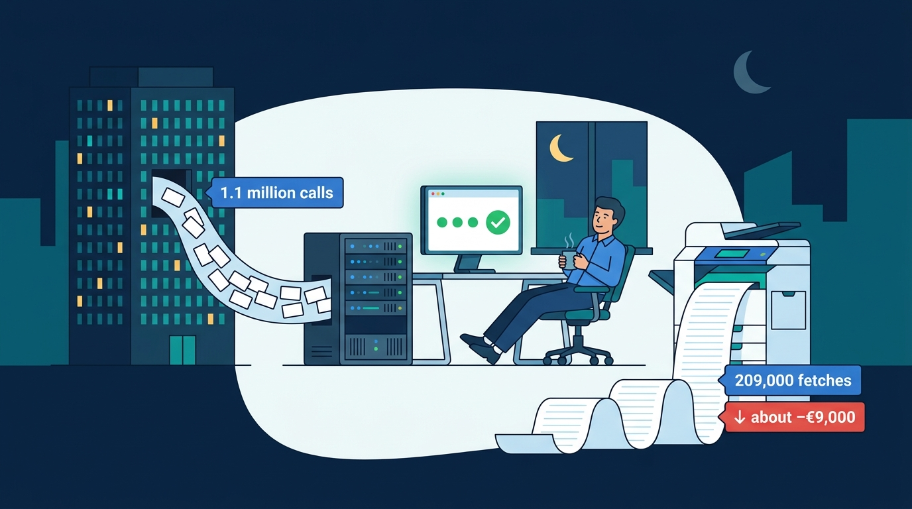
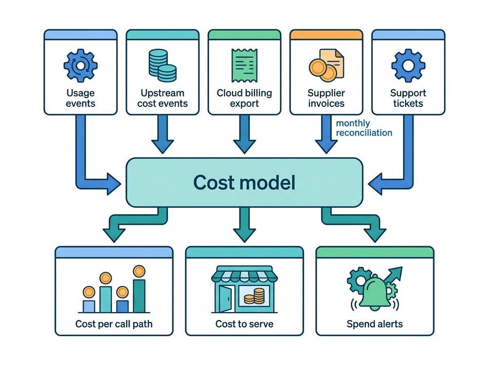
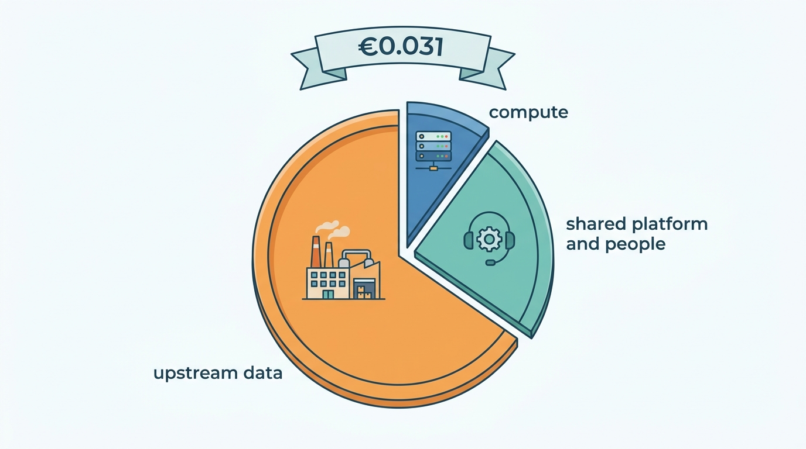

> **IN THIS CHAPTER, YOU WILL:** Name the workload shapes of a vehicle data and dealer SaaS platform and plan capacity for each. You will also take the cost of one lookup, one rooftop, one publish and one report apart into compute, paid upstream data, licenses and people, and build the attribution that keeps those numbers honest.

> **WHY THE BUSINESS CARES:** A data business whose average lookup looks profitable can still lose money on whole classes of calls, customers and batches, and only finds out when the supplier invoice arrives. Private-equity owners and CFOs price, bundle and renew contracts on cost to serve, so a wrong cost model becomes a wrong price list.

> **WHY ARCHITECTS SHOULD CARE:** The decisions that set the cost of a lookup are architectural: what may be cached under which license, where batch traffic queues, which calls coalesce, and which tags travel from the gateway into the meter. Cloud tuning comes later and moves the number much less.

> **KEY POINTS:**
>
> * **Name the workload shapes before you size anything.** The load comes in a handful of predictable shapes: the weekday business hour, the nightly recomputation, the Monday stock edit, the month-end register peak, the consumer spike and the API client's batch burst. Each needs its own lane, admission rule and upstream budget. Averages size nothing.
> * **The cost of a lookup is mostly someone else's invoice.** At Axleby, paid upstream data is about two-thirds of the €0.031 average lookup, and 3% of calls (the build-data cache misses) carry 45% of the cost. The license decides what may be kept and for how long, so caching under the license is the biggest cost lever the architecture has.
> * **Cost per call path, not cost per call.** An average hides a loss-making tail: misses, no-hits, retries and batches. Meter every call with tenant, client, product and upstream tags, reconcile against supplier invoices, and set spend caps that trip before the invoice does.

> **[FAILURE PATTERNS THIS CHAPTER ADDRESSES](where-vehicle-platforms-go-wrong.html):**
>
> * **The Unmetered Call** — when usage is rebuilt from logs at month-end, the upstream cost of a call is invisible too, and nobody can say which client, batch or product loses money.
> * **License Blindness** — the cheapest lookup is a cached one, and caching beyond what the source license allows turns a cost saving into a breach.
> * **Borrowed Uptime** — a batch burst that exhausts a shared upstream quota or rate limit takes interactive dealers down with it.

 
A plate lookup looks like the cheapest thing a vehicle data platform does: a key, a cache, a JSON document, a few milliseconds of compute. Sometimes it is. But the same request can also make the platform buy build data from a specification provider, pay a history source for an odometer trail, wait on a register's rate-limited API, and then return "no hit" to a client who is not charged under the contract. **The marginal cost of a lookup ranges over two orders of magnitude**, and which end a call lands on is decided by the cache, the license and the client's traffic pattern, not by the code path.

The dealer half has the opposite profile. A Lotwise rooftop pays a fixed monthly fee per module, and its cost to serve is spread across a monolith, a syndication queue, an image store, a support desk and the history reports bundled into its plan. Its costs are diffuse rather than spiky. They are hard to see because nobody tags them.

This chapter owns **workload shape**, **cost to serve** and the deep treatment of **cost per lookup**, which [[dealer-and-data-economics]] introduces. It builds on the dependency map of [[reliability-and-dependencies]], uses the meter of [[billing-and-metering]] and the license register of [[data-licensing-and-governance]], and leaves telemetry plumbing to [[observability-and-data-operations]].

## Setting the Scene at Axleby: The Saturday Batch

Axleby, the fictional vehicle data and dealer software group this book follows (see [[meet-axleby]]), had never measured what a lookup cost. It had a cloud bill, a supplier bill and a lookup count, held by three different people.

On **Saturday 15 May 2027**, Rijnstaal Verzekeringen, a fictional insurer and Axleby Data API client, ran a portfolio re-check. In **41 minutes** it sent **1.1 million** plate-to-specification calls to JSON API v1, about **450 calls a second**. That is half again the weekday peak hour of about **310 calls a second**, on a Saturday night when the on-call engineer expected near silence. The API held. Specbook, the specification resolver, did not have a resolved specification for **19%** of the vehicles, because an insurer's portfolio holds older cars, imports and models that dealers rarely look up. So Specbook fetched build data from the commercial build-data provider for about **209,000** vehicles, at an average of **€0.46** a request.

Nobody noticed until the provider's mid-month usage statement reached Lena Vos (Billing and Finance Systems Lead). Lena and Marta Nowak (Head of Platform and SRE) worked out the batch from the logs:

| Item (Rijnstaal batch, 15 May 2027) | Calculation | Amount |
| --- | --- | --- |
| Billable calls | 1.1 million minus about 27,500 no-hits (no-hit-no-fee) | 1,072,500 |
| Revenue | 1,072,500 × €0.09 list price | **€96,525** |
| Build-data fetches | 209,000 × €0.46 | €96,140 |
| Compute on the call path | 1.1 million × about €0.0015 | €1,650 |
| Shared platform and support allocation | 1.1 million × €0.007 | €7,700 |
| **Cost** | | **€105,490** |
| **Result** | | **about −€9,000** |

The batch lost money while every dashboard stayed green. The insurer paid list price, the API met its latency target, and the build-data provider delivered. The loss came from **the gap between a flat per-call price and a cost that depends on whether the platform already knows the car**.

**Figure 1:** *In the Saturday Batch every dashboard stayed green while 209,000 build-data fetches turned €96,525 of revenue into a loss of about €9,000.*

Ines Marchetti (Group Chief Architect) asked Marta and Lena for one number and one picture: the fully loaded cost of an average billable lookup, broken down by call path, for the second quarter of 2027. The number became known inside Axleby as **the €0.031 lookup**. The picture changed the One Dossier priorities more than the number did.

## Concepts: Workload Shape, Unit Cost and Cost to Serve

### Workload shape

A **workload shape** is the profile of one kind of demand over time. It has a rate curve (average, peak and the ratio between them), a trigger (a clock, a calendar event, a client's job, a broadcast), a latency tolerance, and a set of resources it consumes, including **upstream quotas and spend**. Two workloads with the same daily volume can need very different capacity. An evenly spread data feed needs almost none. A batch that arrives in forty minutes needs a lane of its own.

The rule I use: **size from shapes, not from totals.** Axleby's 2.6 million billable lookups a day average about 30 a second. The weekday peak hour runs at about 310 a second, roughly ten times the daily average, because dealers, insurers and lessors work business hours. The Saturday batch ran at fifteen times the average with no warning.

### Unit cost

A **unit cost** is the cost of one unit of a business output: a lookup, a report, a publish, a rooftop-month. The FinOps Foundation separates *resource-efficiency* unit metrics (cost per gigabyte, per vCPU) from *business* unit metrics such as "cost per tenant, cost per transaction, cost to serve". It treats fully loaded costs, which include "costs outside of direct technology use", as a sign of a mature practice ([FinOps Foundation, n.d.](https://www.finops.org/framework/capabilities/unit-economics/)). For a vehicle data platform, a unit cost has four components:

1. **Compute, storage and network** on the call path, including the data stores it reads.
2. **Upstream data**: fees paid per request to build-data providers, history sources, valuation inputs and registers, including fees for requests that return nothing.
3. **Amortized licenses**: fixed fees for bulk datasets and register access, spread over the units they serve.
4. **Shared platform and people**: gateway, identity, observability, on-call, support and the legacy data center, allocated by a stated rule.

The cheapest of these, compute, is the one teams measure first.

### Cost per lookup and cost to serve

**Cost per lookup** is the fully loaded unit cost of one billable data call, reported as an average and, more usefully, **per call path**. A call path is the route a call actually takes: a cache hit, a build-data miss, a paid history source, a no-hit. **Cost to serve** is the fully loaded cost of one customer over a period: a rooftop-month, an API client's year, a dealer group's contract. Microsoft gives the two reasons to measure per-tenant consumption: to know "the actual cost to serve each tenant" and "the amount to charge the tenant" ([Microsoft Learn, 2024](https://learn.microsoft.com/en-us/azure/architecture/guide/multitenant/considerations/measure-consumption)). The two measurements share their tags and must not share a store, as the architecture section explains.

### Pass-through cost

A **pass-through cost** is an upstream fee that the platform passes on to the client explicitly, as a surcharge or a separate line, instead of absorbing it in a blended price. Register fees on a transaction are a common example. Axleby Trade charges €6.50 plus the register's own fee for a registration in a new name. Whether build data or paid history should be passed through is a pricing decision with architectural consequences: a pass-through needs a meter that knows, per call, which upstream was paid.

## The Workload Shapes of a Vehicle Platform

Axleby's platform carries seven distinct shapes. The volumes come from the scenario ledger. The ratios marked *(assumption)* are illustrative planning figures, not Axleby facts.

| Workload shape | Trigger | Axleby volume | Peak profile | Latency tolerance | Upstream exposure |
| --- | --- | --- | --- | --- | --- |
| **Interactive lookups** (dealer screens, partner software) | Business hours | 2.6 million billable lookups a day | Weekday peak hour about 310 calls/s, ~10× the daily average | Sub-second | Build data on miss; history sources; register APIs |
| **API client batch bursts** | Client's job scheduler | Rijnstaal: 1.1 million calls in 41 minutes | 450 calls/s, unannounced | Minutes to hours, if the client is told | High: older and rarer vehicles miss the cache |
| **Nightly recomputation** | Clock | Pricing signals for about 350,000 Lotwise stock vehicles | A 01:00–05:00 window *(assumption)* | Done before dealers open | Low: internal market data |
| **Monday-morning stock edits** | Week start | 352,000 stock vehicles; 1.4 million channel operations a day | About 3× the hourly average, 08:00–11:00 Monday *(assumption)* | Minutes (publish lag) | Portal rate limits |
| **Month-end register peaks** | Calendar, sales targets | 1.25 million register transactions a year | About 4× the daily average at month- and quarter-end | Same day | Register transaction channel |
| **Consumer spikes** | Media coverage, weekends, attacks | Odolo: about 2.1 million free checks a month | Enumeration in August 2027: about 9 million requests in 6 days, ~20× normal | Seconds | Register mirror (cheap); paid sources on full reports |
| **Market-data ingestion** | Harvest and partner feeds | About 2.3 million adverts a day | Spread over the day; reprocessing runs are large *(assumption)* | Hours | Partner feed limits |

Three observations shape the rest of this chapter.

**First, only two shapes are expensive per unit.** Interactive lookups and batch bursts reach paid upstreams. Nightly recomputation, stock edits and market-data ingestion cost compute and storage, which scale cheaply. Registration peaks cost register fees, but those are passed through. So capacity planning for the cheap shapes is ordinary engineering. **Capacity planning for the expensive shapes is a commercial question:** how much upstream spend can this traffic trigger, and who pays for it?

**Second, the shapes collide.** The nightly valuation run finishes about when Monday stock edits begin, so a slow night makes Monday morning worse. Month-end register peaks fall on the same days that dealers push stock and appraisals to meet targets. A batch client that schedules its job for "quiet" weekend hours can land on Odolo's Sunday-evening consumer traffic *(assumption)*. Microsoft's description of the noisy-neighbor antipattern covers this case: performance also degrades when many small tenants peak at once, and the documented mitigations include throttling, moving non-time-sensitive work off-peak and capping query cost ([Microsoft Learn, 2025](https://learn.microsoft.com/en-us/azure/architecture/antipatterns/noisy-neighbor/noisy-neighbor)).

**Third, upstream limits are shared, platform-wide budgets.** The UK DVSA MOT history API publishes a quota of 500,000 requests a day, an average of 15 requests a second and a burst of 10. A key that exceeds the daily quota is restricted "for 24 hours" ([DVSA, n.d., accessed 2026-10](https://documentation.history.mot.api.gov.uk/mot-history-api/rate-limits/)). A batch client that drains such a quota at 23:00 does not slow itself down. It takes away MOT (roadworthiness test) history from every Showroomly dealer until the next day. That is **Borrowed Uptime** created by a capacity decision, and [[reliability-and-dependencies]] treats it as a dependency budget.

## Architecture: Lanes, Caches and a Cost Meter

### Separate lanes by shape

The core structural decision is to give each expensive shape its own **lane**: a path with its own admission control, queue, concurrency limit and upstream budget. AWS describes the general pattern as rate limiting "to shape unplanned increases in traffic" combined with quotas enforced "at a per-tenant or per-workload granularity", and load shedding as "the act of cheaply rejecting work instead of spending limited resources on it" ([AWS Builders' Library, 2020](https://aws.amazon.com/builders-library/fairness-in-multi-tenant-systems/)).

**Figure 2:** *Interactive and batch traffic share the lookup service but not the queue. Every cache miss goes through one upstream budget broker, which paces requests per source, counts spend per client, and writes cost events next to usage events, so a batch cannot drain the shared quota or spend without a record.*

The **upstream budget broker** is the component most platforms lack. It is a thin service, or a library with shared state, that every call to a paid or quota-limited upstream passes through. It does four things:

- **Paces** requests per upstream with a token bucket sized to the contract or the published limit.
- **Reserves** headroom for interactive traffic, so the batch lane can use only what the interactive lane leaves unused.
- **Counts spend** per client and per product as it happens and enforces **spend caps**. OWASP lists a missing "third-party service providers' spending limit" as a cause of API4:2023, Unrestricted Resource Consumption ([OWASP, 2023](https://owasp.org/API-Security/editions/2023/en/0xa4-unrestricted-resource-consumption/)).
- **Coalesces** concurrent requests for the same vehicle into one upstream purchase.

Placing it in one service, rather than in each adapter, is what makes the numbers trustworthy. An adapter-level counter cannot see the other adapters' spend against the same contract.

### Cache paid data within the license

The cheapest upstream call is the one the platform does not make. But a vehicle data platform cannot cache freely. What it may keep is set by contract. The platform-operations brief puts the line well: separate **"facts we may keep"** (decoded VIN specification, the platform's own derived valuations) from **"facts we rent"** (third-party report content under per-request terms). Contract-limited caching is ordinary in data licensing. Google's Places API terms, a non-automotive example, forbid caching content "beyond the allowed exceptions" while allowing place IDs to be stored indefinitely ([Google, n.d., updated 2026-10](https://developers.google.com/maps/documentation/places/web-service/policies)). No vehicle-data provider's caching clauses are public. What follows treats them as variables a contract sets.

A license-aware cache stores, with every entry, the **source, license, fetch time, permitted retention and permitted purposes**. It enforces retention in the cache layer, not in application code. At Axleby, Charter (the license and purpose register from [[data-licensing-and-governance]]) holds the rules, and Specbook's cache reads them. Three entry types matter for cost:

| Cache entry | Example | Typical constraint | Cost effect |
| --- | --- | --- | --- |
| **Owned or open fact** | Dutch register open data in the register mirror; vPIC decode tables | None beyond the source's terms; NHTSA offers downloadable vPIC databases ([NHTSA, n.d.](https://vpic.nhtsa.dot.gov/api/)) | Lookup cost is compute only |
| **Licensed fact with retention** | Build data per VIN | Contract sets retention (Axleby until 2027: 30 days) and permitted reuse | Each expiry is a repurchase |
| **Rented content** | Third-party history records in a report | Often per-request use only *(assumption: no public clause)* | No reuse; cost is per report |
| **Negative answer** | "Plate not found", "no MOT record" | Short time-to-live (TTL) | Stops repeated no-hits becoming spend |

AWS's caching guidance covers two cost failures that matter here. A **cold cache** after a deployment or a cache-fleet failure sends "a surge of traffic to downstream services", which here means a surge of purchases. And a missing **negative cache**, with "a different TTL than positive cache entries", raises failure rates ([AWS Builders' Library, 2019](https://aws.amazon.com/builders-library/caching-challenges-and-strategies/)). For a paid upstream, a cache-fleet failure is a cost incident as well as a latency incident.

### Meter cost where you meter usage

The usage meter of [[billing-and-metering]] records what a client may be invoiced for. The **cost meter** records what each call cost the platform: which upstream was paid, how much, under which contract. Both meters need the same tags, set at the gateway from the verified credential: tenant, rooftop or client, product, call path and upstream. Both need lossless storage. Microsoft warns that APM tools sample and that "for billing and metering purposes, choose a data store that gives you a high level of accuracy" ([Microsoft Learn, 2024](https://learn.microsoft.com/en-us/azure/architecture/guide/multitenant/considerations/measure-consumption)). Axleby writes cost events into Meterline next to usage events, keyed by the same request id.

**Figure 3:** *The cost model joins five sources on shared tags. Usage and upstream cost events are exact and per request; the cloud bill and people costs are allocated by stated rules; supplier invoices reconcile the broker's counts every month. The outputs are a cost per call path, a cost to serve per customer, and alerts that act before the invoice arrives.*

Cloud costs come from the provider's billing export. The FinOps Foundation's FOCUS specification, "an open specification that normalizes billing datasets across AI, cloud, SaaS, data center, and other technology vendors" ([FinOps Foundation, n.d., accessed 2026-10](https://focus.finops.org/)), gives a common schema, which matters for a group that runs on AWS, Google Cloud, a co-located data center and Snowflake. Allocation of shared costs follows "account structures, tags, labels and derived metadata", with an explicit shared-cost rule and showback or chargeback ([FinOps Foundation, n.d.](https://www.finops.org/framework/capabilities/allocation/)).

**Tags on metrics need care.** Ten thousand tenant ids as a metric label, multiplied by endpoints and status codes, can make the observability bill itself a cost-to-serve problem. OpenTelemetry's guidance shows how seven attributes with thirty values each produce billions of combinations ([OpenTelemetry, n.d.](https://opentelemetry.io/docs/specs/otel/metrics/supplementary-guidelines/)). AutoScout24 reported in September 2024 that its move to Karpenter cut Kubernetes EC2 costs by almost 50%, while its Datadog custom-metrics costs rose ([AutoScout24, 2024](https://tech.autoscout24.com/blog/posts/impact-of-karpenter/)). The rule I use: **tenant and client ids on traces, logs and cost events; only tier and product on metrics.** Per-tenant views come from the event stores, not from metric labels.

### Requirements per interaction

| Interaction | Consistency | Latency | Freshness | Availability |
| --- | --- | --- | --- | --- |
| Interactive plate lookup | Read-your-own-purchase: a fetched spec is visible to the next call | p99 under 800 ms *(assumption)* | Licensed retention, labeled with fetch date | Highest; degrade to cached fact with age label |
| Batch lane lookup | Same results as interactive | Completion within an agreed window, e.g. 6 hours *(assumption)* | As interactive | May pause when the upstream budget is exhausted |
| Upstream spend counter | Exactly once per purchase | Visible within 1 minute *(assumption)* for caps | Real time | Fail closed for batch, open for interactive with alert |
| Cost events in Meterline | Lossless, idempotent on request id | Minutes | Daily cost model | Durable queue; never sampled |
| Nightly pricing signals | Snapshot of the market as of the run | Finished before 06:00 *(assumption)* | Once a day | Retry within the window; flag stale signals |
| Cost reports and unit costs | Reconciled with invoices monthly | Next day | Daily, restated monthly | Internal |

## In Practice: The €0.031 Lookup

### Taking the average apart

Marta's team tagged every billable lookup in April–June 2027 with its call path. Lena's team allocated the AWS and data-center bills, supplier invoices and support costs to those paths. The result is Axleby's fictional cost model for Q2 2027. The per-path shares and unit costs are Axleby illustrations, not documented industry figures:

| Call path | Share of billable lookups | Direct cost per call (compute + upstream) | Contribution to average |
| --- | --- | --- | --- |
| Identity or specification, resolved in Specbook | 46.5% | €0.0015 | €0.0007 |
| Specification with build-data fetch (miss) | **3.0%** | **€0.462** | **€0.0139** |
| Valuation from Vantage | 22% | €0.006 | €0.0013 |
| Register-backed status (inspection, recall, owner count) | 18% | €0.002 | €0.0004 |
| History block with a paid source | 6% | €0.070 | €0.0042 |
| No-hit (any product, not billed) | 4.5% | €0.080 | €0.0036 |
| **Direct average** | 100% | | **€0.0240** |
| Shared platform, Connect XML data center, observability, on-call, support | | | €0.0070 |
| **Fully loaded average** | | | **€0.031** |

Grouped by component, the €0.031 is about **€0.021 of upstream data**, **€0.003 of compute and storage** and **€0.007 of shared platform and people**. At 2.6 million billable lookups a day, the data half spends roughly **€29 million a year** serving lookups, about €20 million of it paid to upstream providers.

**Figure 4:** *About two-thirds of the €0.031 lookup is upstream data and only about a tenth is compute, so the cost lever is the license and the cache, not the cloud bill.*

Four findings came out of the table.

1. **The cloud bill was the wrong denominator.** The first answer anyone had given the board was the AWS bill for JSON API v1 divided by its calls: under half a cent. That number was correct and almost useless. Compute is about a tenth of the cost of a lookup.
2. **Three percent of calls carry 45% of the cost.** A plate-to-specification call that misses Specbook costs €0.462 against a list price of €0.09. Each one loses about €0.37 before overhead. This is "the €46 per hundred" problem from [[specification-and-equipment]], seen from the cost side.
3. **No-hit-no-fee has a cost line.** A no-hit is free for the client but not for Axleby: the build-data provider and some history sources charge for the attempt, so a no-hit costs €0.08 on average and earns nothing. The No-Hit Credit of 2026 ([[billing-and-metering]]) was about revenue. This was the cost side of the same rule.
4. **The misses are not random.** **41%** of build-data fetches were *repurchases*: vehicles whose build data Axleby had bought before, and whose 30-day retention under the build-data license had expired. Another **6%** were *duplicates*: two concurrent requests for the same VIN, usually inside a batch, each buying the same data.

The fourth finding moved the conversation from engineering to procurement. The cache hit rate was capped by a contract clause, not by memory or code.

### What Axleby changed

Ines took four changes to the One Dossier steering group in July 2027. The projected effects below are Axleby planning figures, which means they are assumptions:

| Change | Mechanism | Projected effect on the average |
| --- | --- | --- |
| **Renegotiate build-data retention** | Retain resolved build data per VIN for the life of the vehicle within Axleby products; the provider prices the first fetch higher (about €0.58) | Removes repurchases: about −€0.0034 |
| **Coalesce concurrent fetches** | The upstream budget broker holds one in-flight purchase per VIN and source; other requests wait for it | Removes duplicates: about −€0.0006 |
| **Negative cache and no-hit pre-checks** | Cache "not found" answers for 24 hours *(assumption)*; check the register mirror before paying for a plate that does not exist | Halves paid no-hits: about −€0.0018 |
| **Batch lane with pass-through on misses** | Batch endpoint with a completion window; clients see a quote of the expected misses, and misses above a stated rate carry a surcharge | Protects margin on batches; no change to the average |

Together the first three bring the projected average to about **€0.025 by the end of 2028**. Retiring the Connect XML data center by the end of 2029 removes part of the €0.007 shared cost. The larger effect is on the tail. Under the new terms, a Rijnstaal-style batch would buy build data once per VIN, ever. The client would also see the expected miss surcharge before submitting.

Three objections were raised, and each changed the design. Priya Raman (VP Data and Valuation) asked whether life-of-vehicle retention would leave specification facts stale. It would not: factory build data does not change after production, and corrections arrive as correction events ([[journey-data-correction]]). Femke de Boer (Head of Data Governance and Privacy) required the retained data to stay inside Axleby products, with resale to API clients counted per call. The retention right is therefore a Charter rule, not a cache setting. Tomás Ferreira (Product Director, Lotwise) asked that dealers never see a surcharge. The batch lane is therefore offered to API clients only. Lotwise appraisals stay in the interactive lane and inside the plan.

### Cost to serve a Lotwise rooftop

The same method, applied to a rooftop-month, gives a different picture. The figures are an Axleby model for a typical NL independent with Stock & Pricing, Syndication and Appraise (€417 a month at list). Every line is an assumption except the volumes taken from the ledger:

| Cost line | Basis | Per rooftop per month |
| --- | --- | --- |
| Lotwise Classic compute, MySQL, network | Allocated by active users and requests | €8.40 |
| Lookups at stock-in and appraisal | About 22 stock-ins (1.9 million a year over 7,200 rooftops) and about 60 appraisal lookups × €0.031 | €2.54 |
| History reports in the Appraise bundle | About 17 of 25 used × €0.62 assembly and source cost | €10.54 |
| Syndication through Relay | About 5,900 channel operations (1.4 million a day over 7,200 rooftops) × €0.0006 | €3.54 |
| Images: storage, renditions, CDN, portal transfer | Allocated by photo count | €4.10 |
| Leads intake and routing | About 47 leads × €0.02 | €0.94 |
| Nightly pricing signals | 49 vehicles × 30 nights × €0.0008 | €1.18 |
| Support | About 0.8 tickets × €14 | €11.20 |
| Shared platform, identity, observability, security | Flat allocation | €6.90 |
| **Total** | | **about €49** |

Two lines dominate, and neither is compute: **support** and **bundled data**. That changes where an architect looks. Self-service fixes for the commonest tickets (channel errors, a failed DMS sync, a wrong specification) reduce cost to serve more than any right-sizing of the monolith. And the bundle of 25 reports is a cost commitment that grows with dealer usage, so the meter must see bundled reports as usage with cost, even though they are invoiced at zero.

The model also shows **where the average rooftop is the wrong unit**. A trader or exporter running 400 appraisals a month costs several times the average in lookups and reports. A Velto-sized group with DriveDesk integration, routing rules and a group-wide feed costs more per rooftop in support and integration operations. Microsoft notes that per-tenant cost estimates are reasonable when each tenant uses less than about 2% of a deployment ([Microsoft Learn, 2024](https://learn.microsoft.com/en-us/azure/architecture/guide/multitenant/considerations/measure-consumption)). That fits independents. Large groups and large API clients deserve measured cost, because their contracts are negotiated.

### Cost per publish and per report

**Cost per publish** is the cost of one channel operation (insert, update or delete of an advert on one portal). At Axleby it averages well under a tenth of a cent in compute *(assumption)*, so the unit itself is not the issue. The issue is **amplification**. One price change on a car advertised on 5.3 channels is five or more operations. A portal that cannot fetch images by URL turns each photo change into binary uploads per channel. A retry loop against a failing portal multiplies operations without publishing anything. The cost-relevant metric is **operations per effective change**. [[listing-syndication]] owns the desired-state design that drives it down, and the same design ends the Zombie Listing.

**Cost per report** is dominated by sources. A business history report at €4.95 carries an assembly and source cost of about €0.62 in Axleby's model *(assumption)*: healthy. An Odolo consumer report at €12.95 (VAT included) carries the same data cost plus payment fees, refunds and consumer support *(assumption)*. Its margin depends more on the payment channel and refund rate than on the data.

### Storage growth

Storage grows quietly and compounds. Three classes dominate at Axleby, each with its own growth driver and retention rule:

| Data class | Growth driver | Illustrative growth | Retention driver | Cost lever |
| --- | --- | --- | --- | --- |
| **Vehicle images** | 1.9 million stock-ins a year × about 30 photos × originals and renditions | Roughly 250 TB a year *(assumption: 4.5 MB per photo with renditions)* | Business need: adverts end, dossiers keep a few photos | Tier or delete after sale; keep renditions only where reused |
| **History events** (Tracewell) and the register mirror | New events per VIN; 41 million vehicles | Moderate, steady *(assumption)* | Product value; privacy rules in [[privacy-and-retention]] | Columnar storage; bitemporal compaction |
| **Ledgers and usage events** (valuation ledger, Meterline, access audit) | 2.6 million billable lookups a day plus reports and transactions | Hundreds of GB a year raw, far less compressed *(assumption)* | Dispute windows, fiscal retention, audit | Columnar store; never delete inside retention |

Images are the expensive class, and almost all of their reads happen in the weeks a car is in stock. Average days-to-turn at Axleby is 58. Object-storage tiering fits that pattern: Amazon S3 Intelligent-Tiering moves objects not accessed for 30 consecutive days to an Infrequent Access tier and, after 90 days, to Archive Instant Access, for a small monitoring charge per object, with objects under 128 KB not auto-tiered ([AWS, n.d., accessed 2026-10](https://aws.amazon.com/s3/storage-classes/intelligent-tiering/)). The more valuable decision is a **retention rule** per image class. Sold-car advert photos beyond the dossier's few reference images have no business purpose once the sale is settled, and keeping them is a cost and a privacy exposure, because number plates and people appear in photos.

The ledgers are the opposite case: small, and never to be trimmed for cost. Usage events are the evidence behind an invoice, and [[billing-and-metering]] explains why the aggregate must never be the only record.

## Failure Handling: When Cost and Capacity Go Wrong

Cost failures behave like reliability failures: they are silent, they compound, and they are found late. Axleby now treats a **cost anomaly** as an incident class with an on-call owner.

**Duplicates.** A retried call to a paid upstream can buy the same data twice. The defense is an **idempotent purchase**: the broker keys each purchase on VIN, source and license window. A retry after an ambiguous timeout first asks "did we already buy this?" from the broker's purchase log before calling out. The same discipline the Month-End Register Outage forced on register transactions ([[registration-and-trade-services]]) applies to every paid call.

**Concurrent misses.** Two requests for the same unknown VIN, a few milliseconds apart, are a conflict. Without coalescing, both win and both pay. With coalescing, the second waits on the first's result. The broker needs a timeout on the wait, so one slow purchase does not stall a batch.

**Incomplete records.** A provider can return partial build data, such as engine and body without equipment, and still charge. Specbook stores the partial answer with an "edition unknown" state ([[specification-and-equipment]]) and a retry-after time agreed with the provider. Refetching on every request turns one incomplete record into a stream of paid calls.

**Retry storms.** Retries multiply load, and against a paid upstream they also multiply spend. Google's SRE guidance caps retries at three attempts per request and keeps a per-client retry ratio of about 10% ([Google, 2016](https://sre.google/sre-book/handling-overload/)). For paid upstreams I would set a lower budget and count retries as spend in the broker.

**Partial failures in the meter.** If cost events are lost, the cost model undercounts. The broker's purchase log is reconciled monthly against each supplier's invoice. A gap above an agreed tolerance (0.5% *(assumption)*) opens an investigation, because the gap is either a lost event or a supplier billing error, and both are money.

**Upstream outages and cold caches.** When a provider recovers, every request that failed during the outage comes back at once. When a cache fleet restarts, every hit becomes a miss. Both are **purchase surges**. The broker's token bucket protects the upstream. The spend cap protects the margin. Warming the cache from the purchase log, by replaying recent VINs from stored results rather than buying again, protects both. [[reliability-and-dependencies]] covers the degraded modes: serve the cached fact with its age, queue the batch.

**Runaway clients and attackers.** The Plate Enumeration Attack of August 2027 is a security incident ([[vehicle-platform-security]]) with a cost tail: leaked trial keys on JSON API v1 could trigger paid fetches. Trial credentials get a zero upstream budget: they read owned and open facts only. Spend caps per client trip within minutes, not at the monthly invoice.

## Trade-offs: Paying for Data, Caching It and Pricing It

| Option | How it works | Right when | Costs and risks |
| --- | --- | --- | --- |
| **Fetch per request, short retention** | Buy build data or history per call; keep it for the license window | Low and unpredictable volume; the license is cheap per call | Repurchases; cost tracks traffic; batches lose money at flat prices |
| **Fetch once, retain per VIN** | Negotiate long retention within the platform's own products | High repeat demand for the same vehicles; facts that do not change | Higher first-fetch price; retention must be enforced as a license rule |
| **Prefetch on first registration** | Buy data for new vehicles as the register mirror shows them | Most lookups concern vehicles registered in the platform's markets | Pays for vehicles nobody asks about; imports still miss |
| **Flat-fee or tiered bulk license** | Pay a fixed fee for unlimited or banded use | Volume is high and stable | Commitment risk if volume falls; harder exit |
| **Derive from own catalog** | Infer specification from register type data and the platform's catalog | Facts the register carries well | **Spec Guesswork** where edition and options matter |
| **Blended per-call price** | One list price per call type | Cost per path is predictable and the mix is stable | Batches and rare vehicles erode margin silently |
| **Pass-through or miss surcharge** | Charge misses, or upstream fees, separately | Batch clients; contracts that already price upstream | Complex invoices; a meter that knows paths is required |
| **Batch lane with completion window** | Accept batches on a separate endpoint, paced by budget | Insurers, lessors, fleet enrichment | Clients must accept delay; needs quoting and status |

My recommendation for a platform like Axleby: **retain per VIN where the license can be bought, prefetch only where the register mirror predicts demand, and price batches separately.** It rests on three assumptions: repeat demand for the same vehicles is high, factory build data does not change, and the platform's own products are the main consumers. It does not hold for a pure reseller of third-party reports, whose rented content cannot be retained at any price. Nor does it hold for a market where most lookups concern vehicles the platform never sees twice.

A second trade-off concerns **capacity strategy for the cheap shapes**. The choice is to overprovision for the weekday peak, autoscale, or schedule work around the peaks:

| Strategy | Fits | Watch |
| --- | --- | --- |
| Headroom for the peak hour | Interactive lookups, lead intake | Idle cost at night and weekends |
| Autoscaling on queue depth | Monday edits, syndication, market ingestion | Scale-up lag at the 08:00 edge; cold caches on new nodes |
| Scheduled windows | Nightly signals, reprocessing, insight builds | Window overruns colliding with morning traffic |
| Reserved or committed capacity | Steady base load | Commitments outliving the architecture (Connect XML) |

## Across Markets: What Changes by Country

The method of this chapter is the same in every market. What changes is **where paid data enters, what may be kept, and when the peaks fall**.

| Factor | Netherlands / Belgium | Germany | United Kingdom | United States |
| --- | --- | --- | --- | --- |
| **Register data for lookups** | NL: RDW open data can be mirrored, so status lookups cost compute ([RDW open data, accessed 2026-10](https://opendata.rdw.nl/resource/m9d7-ebf2.json)). BE: register data through a partner *(Axleby: via a partner; fee basis assumed per request)* | No open vehicle-level register data; specification and history come from commercial providers | DVSA MOT history API with a 500,000-a-day quota; DVLA VES API with limits per usage plan and registration closed when accessed ([DVLA, n.d.](https://developer-portal.driver-vehicle-licensing.api.gov.uk/apis/vehicle-enquiry-service/vehicle-enquiry-service-description.html)) | vPIC decoding is free and downloadable; history is licensed per report from commercial providers |
| **Main upstream cost driver** | Build data on misses; register transaction fees (passed through) | Specification and valuation inputs from commercial providers on more calls | Quota rather than fees on public APIs; paid history sources | Per-report history licenses |
| **Caching posture** | Mirror open register data; license build-data retention | Retention set entirely by commercial contracts | Respect per-key quotas; no bulk mirror where terms forbid | Decode tables cached freely; report content rented |
| **Calendar peaks** | Month-end and quarter-end register transactions (Axleby: ~4×); year-end tax changes *(assumption)* | Month- and quarter-end sales targets *(assumption)* | Plate-change months, March and September, are commonly the busiest *(industry practice)* | Month- and quarter-end retail pushes; weekends *(assumption)* |
| **Shared-quota risk** | Low for mirrored data | Contract rate limits per provider | High: one key per company, daily lock-out | Provider rate limits |

**Judgement.** The lanes, the broker, the license-aware cache and the cost model are common platform services. What is market-specific is **configuration**, not code: the upstream catalog with its prices, limits and retention per market, the calendar of peaks that drives capacity schedules, and the pass-through rules per product. Germany is structurally the most expensive market per lookup for a platform without its own register mirror, because more calls reach a paid source. The UK is the most quota-constrained. A group that prices the same API identically in all four markets is cross-subsidizing, and it should decide to do so on purpose.

## The Chief Architect's View

The decisions in this chapter sit between engineering, procurement and pricing, which is why they go unmade. At group scale I would make five of them explicit.

1. **One owner for unit cost.** Cost per lookup and cost to serve need an owner who can change prices, contracts and architecture together. At Axleby that is a standing review of Marta's platform team, Lena's billing team and Priya's data products, reporting to the One Dossier steering group monthly. FinOps practice is a forum, not a dashboard.
2. **Licenses are architecture inputs.** Every new data source passes a cost and retention review before integration: price per request, price per no-hit, retention, permitted reuse and rate limits. A clause like "30 days" belongs in Charter and in the cost model on day one. Procurement and architecture sign the contract together.
3. **Every paid call goes through the broker.** No adapter calls a paid upstream directly. This is the cost equivalent of "every tenant query carries a tenant id", and it should be enforced at review and at the network level.
4. **Price list and cost model move together.** A new product or bundle is not approved without its cost per path and its worst-case client. The "25 reports included" in Lotwise Appraise is a cost commitment. The no-hit-no-fee rule is a cost commitment. Both deserve a number before they reach a contract.
5. **Track unit cost as a fitness function.** Cost per lookup, upstream share, repurchase rate and operations per effective change belong with the platform's other long-term measures ([[evolving-the-vehicle-platform]]). A rising repurchase rate is an early signal of a license or cache regression. A rising support cost per rooftop is an early signal of a workflow problem.

What to watch over years: supplier price changes, which arrive as contract renewals rather than as incidents. Consolidation among build-data and history providers, which weakens negotiating positions. The end of legacy stacks, whose shared cost shrinks only when they are actually switched off. And new data classes, such as connected-vehicle and battery-health data ([[connected-vehicle-data]], [[ev-battery-health]]), which arrive with new per-call fees.

## Questions to Ask

1. What is the fully loaded cost of an average lookup, and what is it for the most expensive call path? Who produced both numbers, and from which sources?
2. Which share of lookups reaches a paid upstream, and what share of total cost do they carry?
3. For every paid source: what may we keep, for how long, for which purposes, and what does a no-hit cost us?
4. What fraction of upstream purchases are repurchases or duplicates?
5. Can one client's batch exhaust a shared upstream quota or rate limit, and what stops it?
6. Where is the spend cap per client and per product, and how quickly does it trip?
7. Do cost events and usage events share a request id and lossless storage, and are they reconciled with supplier invoices?
8. What does it cost to serve our smallest rooftop, our largest group and our largest API client, and which of those is measured rather than estimated?
9. Which workload shapes collide on our busiest day of the year, and has anyone rehearsed that day?
10. What retention rule applies to sold-car images, and who owns it?

Cost per lookup is one of the measures that operators watch. The next page, [[observability-and-data-operations]], shows how the platform sees the rest: publish lag, lead delivery, data quality and the support console that turns a dealer's complaint into a trace.

## Sources and Evidence

*Company, product and investor sources*

- [Impact of Karpenter](https://tech.autoscout24.com/blog/posts/impact-of-karpenter/), AutoScout24 Tech Blog, 2024: almost 50% EC2 cost reduction and rising observability costs.
- [Amazon S3 Intelligent-Tiering](https://aws.amazon.com/s3/storage-classes/intelligent-tiering/), Amazon Web Services, n.d., accessed 2026-10: access-tier thresholds and monitoring charge.
- [Places API policies](https://developers.google.com/maps/documentation/places/web-service/policies), Google, n.d. (updated 2026-10), accessed 2026-10: example of contract-limited caching of licensed data.

*Standards, regulation and official documentation*

- [MOT history API rate limits](https://documentation.history.mot.api.gov.uk/mot-history-api/rate-limits/), Driver and Vehicle Standards Agency, n.d., accessed 2026-10: quota, rate and lock-out rules.
- [Vehicle Enquiry Service API description](https://developer-portal.driver-vehicle-licensing.api.gov.uk/apis/vehicle-enquiry-service/vehicle-enquiry-service-description.html), DVLA, n.d., accessed 2026-10: limits per usage plan, closed registrations.
- [RDW open data: registered vehicles](https://opendata.rdw.nl/resource/m9d7-ebf2.json), RDW, live dataset, accessed 2026-10: Dutch register data available for mirroring.
- [vPIC API](https://vpic.nhtsa.dot.gov/api/), NHTSA, n.d., accessed 2026-10: rate control and downloadable databases.
- [OWASP API4:2023 Unrestricted Resource Consumption](https://owasp.org/API-Security/editions/2023/en/0xa4-unrestricted-resource-consumption/), OWASP, 2023: third-party spending limits.
- [FOCUS specification](https://focus.finops.org/), FinOps Foundation, n.d., accessed 2026-10: normalized billing data across vendors.
- [Metrics supplementary guidelines](https://opentelemetry.io/docs/specs/otel/metrics/supplementary-guidelines/), OpenTelemetry, n.d., accessed 2026-10: cardinality explosion.

*Research and practitioner sources*

- [Unit Economics](https://www.finops.org/framework/capabilities/unit-economics/), FinOps Foundation, n.d., accessed 2026-10: business unit metrics and fully loaded costs.
- [Allocation](https://www.finops.org/framework/capabilities/allocation/), FinOps Foundation, n.d., accessed 2026-10: tags, shared-cost strategy, showback and chargeback.
- [Measure the consumption of each tenant](https://learn.microsoft.com/en-us/azure/architecture/guide/multitenant/considerations/measure-consumption), Microsoft Learn, 2024: cost to serve, estimation threshold, accuracy of billing data.
- [Noisy Neighbor antipattern](https://learn.microsoft.com/en-us/azure/architecture/antipatterns/noisy-neighbor/noisy-neighbor), Microsoft Learn, 2025: simultaneous peaks and resource governance.
- [Fairness in multi-tenant systems](https://aws.amazon.com/builders-library/fairness-in-multi-tenant-systems/), AWS Builders' Library, 2020: rate limits, per-tenant quotas, load shedding.
- [Caching challenges and strategies](https://aws.amazon.com/builders-library/caching-challenges-and-strategies/), AWS Builders' Library, 2019: cold caches, downstream surges, negative caching.
- [Handling Overload](https://sre.google/sre-book/handling-overload/), Google SRE book, 2016: retry budgets and per-client limits.

Axleby is fictional; architectural recommendations, labeled inferences and labeled assumptions are the author's judgement.
