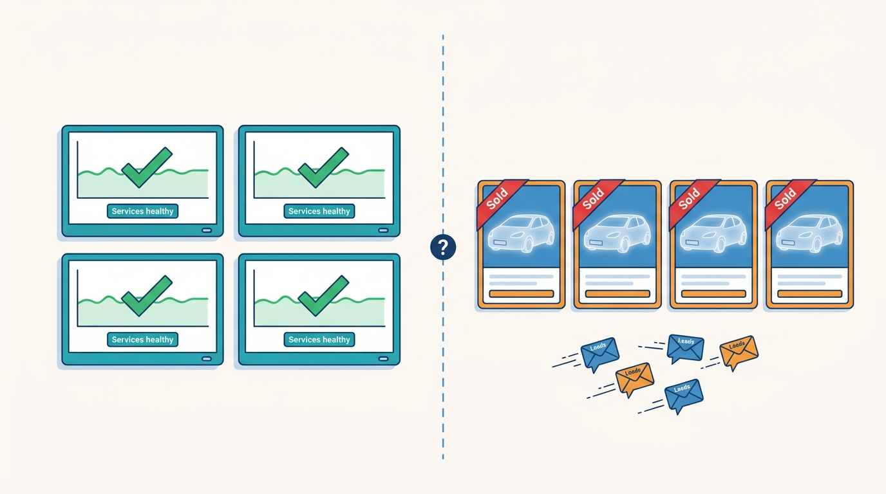
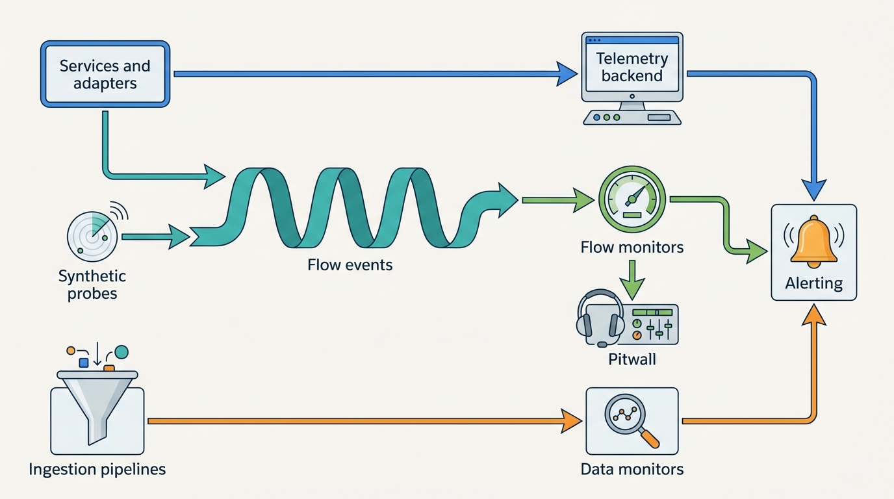
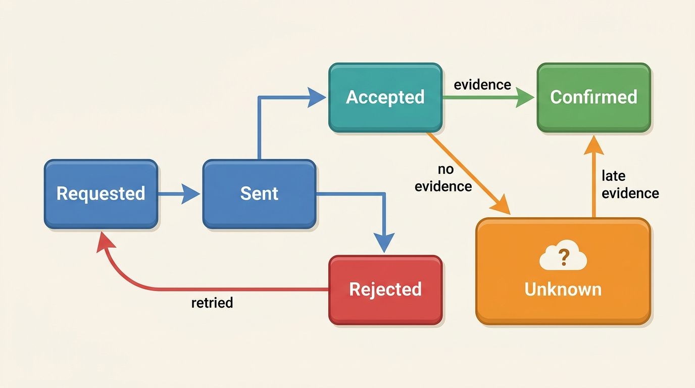
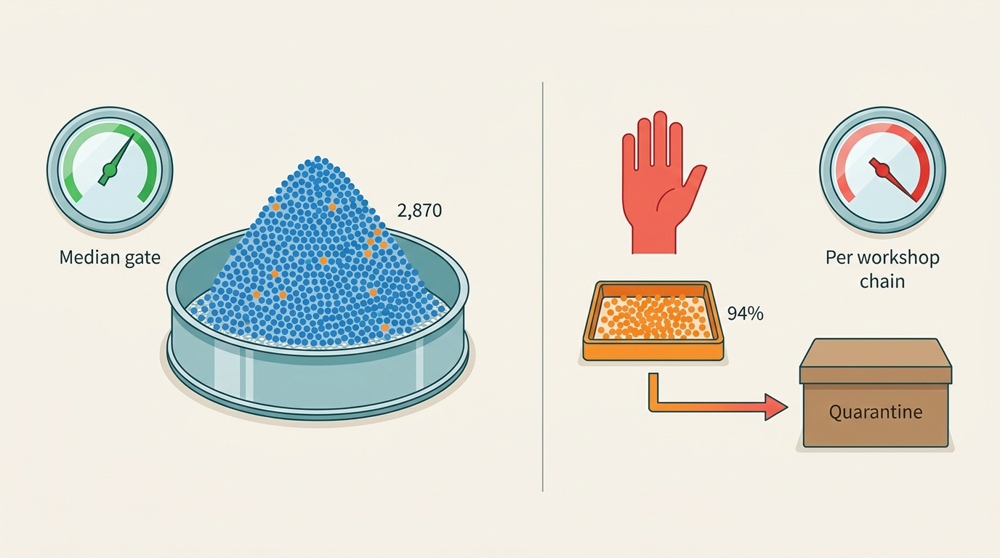

> **IN THIS CHAPTER, YOU WILL:** Design the observability of a platform whose failures are mostly quiet: business-flow monitors such as publish lag, tenant- and channel-aware telemetry, data-quality and freshness monitors on every source, synthetic checks of registers and portals, and a support console that shows a support agent what happened to one car, one advert and one lead.

> **WHY THE BUSINESS CARES:** A dealer who learns from a buyer that a sold car is still advertised, or from a salesperson that leads stopped arriving, stops trusting the software that day. Every incident that a customer reports before the platform notices costs support time, credits and renewals, and for data clients it costs the reputation the data business sells.

> **WHY ARCHITECTS SHOULD CARE:** In this domain the expensive failures return success: an adapter gets a 200 and the portal drops the advert, a CRM queue accepts a lead and discards it, a supplier batch loads cleanly with miles in the kilometer field. Service health dashboards stay green through all of them. Only monitors built on confirmed business outcomes and on the data itself see these failures, and they have to be designed in.

> **KEY POINTS:**
>
> * **Monitor confirmed outcomes, not hops.** Each hop in syndication, lead delivery or registration can report success while the flow fails. Measure each flow end to end, from the dealer's action to the external system's confirmed state: publish lag per advert and channel, leads acknowledged per rooftop, register transactions with a known outcome. Treat "unknown" as a state of its own, never as green.
> * **Data quality is an operational signal with an owner and an alert.** Freshness, volume and distribution monitors on every source catch supplier errors in hours instead of weeks. A batch that fails its contract goes to quarantine before it reaches valuations, reports and adverts, because the cost of a bad fact grows with every place it spreads.
> * **Tenant and channel context belong on every signal, at the right cardinality.** Organization and rooftop identifiers go on traces, logs and flow events; metrics carry only market, product, tier and channel. The support console, the dossier timeline and the access audit are built on the same evidence, so support, engineering and the dealer see one story.

> **[FAILURE PATTERNS THIS CHAPTER ADDRESSES](where-vehicle-platforms-go-wrong.html):**
>
> * **Feed Roulette** — sixty channel adapters without status feedback or per-channel monitoring mean that every channel failure is reported by a dealer, not detected by the platform.
> * **The Leaky Lead** — a lead flow monitored hop by hop reports success at every hop while leads disappear between them.
> * **The Sticky Error** — a supplier error that no data monitor catches reaches valuations, reports and adverts before anyone knows it exists, and every day of late detection widens the correction.

 
A vehicle data and dealer SaaS platform fails in two ways. The first is the familiar one: a service is slow, a database is full, a deployment breaks a page. Standard monitoring catches these. The second is particular to this domain: **the platform keeps running and the facts go wrong**. A sold car stays live on four portals. Leads land in a queue nobody reads. A supplier batch turns 80,000 miles into 80,000 kilometers. Every service is healthy, and a customer discovers the problem first.

The second kind dominates because the platform's value lives at its edges, in systems it does not control: registers, portals, dealer management systems (DMS), customer relationship management (CRM) systems, data suppliers. A request to one of them can succeed technically and fail in business terms. **The platform is only as observable as the outcomes it can confirm at those edges.**

This chapter owns three terms. A **business-flow monitor** measures one end-to-end dealer or client flow against its confirmed outcome. **Publish lag** is the time from a stock change in the dealer system to its confirmed state on a channel. The **support console** is the tool that shows a support agent the evidence about one vehicle, advert, lead or transaction. The chapter builds on [[reliability-and-dependencies]], which defines journey service level objectives (SLOs) and degraded modes, and on [[provenance-and-data-quality]], which defines what a fact must carry. It hands security monitoring to [[vehicle-platform-security]].

## Setting the Scene at Axleby: Green Dashboards, Live Zombie

Axleby, the fictional vehicle data and dealer software group this book follows (see [[meet-axleby]]), ran its 2027 platform on **Datadog** for the AWS services and on Grafana and Prometheus for the legacy estate. Each team had dashboards. None of them shared a tenant tag: a Lotwise customer number in one system, an Axleby Portal account in another, nothing at all in the Relay adapters.

In **February 2027**, Velto Mobility Group sold a 2021 Volkswagen Golf at its Breda rooftop. This was the **Zombie Golf** ([[listing-syndication]] owns the full story). The sold status from DriveDesk, Velto's DMS, matched no Lotwise stock item, because a transfer between rooftops had given the car a new DriveDesk stock number ([[dms-integration]]). When the sold status did reach Lotwise, Relay's delete operations sat in a queue behind failing, retrying updates for the same rooftop. The car stayed live on **4** portals for **4 days**. Buyers sent **37** leads and booked **9** test drives for a car that was already gone. The dealer learned of the problem from buyers, not from Axleby.

At the post-incident review, Marta Nowak (Head of Platform and SRE) showed what monitoring had seen. Every Relay adapter's error rate was under its alert threshold. The RabbitMQ queue depth was normal for the platform as a whole. The DriveDesk adapter had logged the unmatched sold row as a warning, one line among 40,000 that day. Hendrik Maes (Head of Partner Integrations) added that four of the portals involved returned a synchronous 200 on delete but processed deletes asynchronously, with no callback. "Our dashboards measure whether our services are up," he said. "Nothing measures whether the car on the portal is the car in the dealer's stock."

**Figure 1:** *The Zombie Golf: every service dashboard stayed green while a sold car stayed live on 4 portals for 4 days and drew 37 leads.*

Ines Marchetti (Group Chief Architect) wrote the question for the architecture forum: **for each flow a dealer or data client pays for, how long does it take Axleby to know it is broken, and who finds out first?** The forum pulled the 2026 incident log. Of the incidents classed severity 1 or 2, **58%** were first reported by a customer, not by a monitor. No 2026 data incident had been detected by monitoring at all.

The answer took three workstreams through 2027. The **publish-lag dashboard** went live on **7 June 2027**. A tenant-tagging standard came with Axleby ID. The **Pitwall** support console went live in **September 2027**.

## What "Healthy" Means for This Platform

### Three layers of health

Monitoring a vehicle platform means answering three different questions, and each needs different signals.

| Layer | Question | Typical signals | Who notices when it is missing |
| --- | --- | --- | --- |
| **Service health** | Are our components up, fast and not saturated? | Latency, traffic, errors, saturation per service; queue depth; consumer lag | Engineers, within minutes |
| **Flow health** | Do the outcomes dealers and clients pay for actually happen, end to end, in time? | Publish lag, lead acknowledgement, register transaction outcome, report delivery | Dealers and clients, hours or days later |
| **Data health** | Are the facts we hold and sell fresh, complete, plausible and correctly attributed? | Source freshness, batch volume, value distributions, match rates, conflict rates | Consumers and data clients, weeks later |

The Google site reliability engineering (SRE) book frames service monitoring around four "golden signals", latency, traffic, errors and saturation, and states that monitoring "should address two questions: what's broken, and why?" ([Google, 2016](https://sre.google/sre-book/monitoring-distributed-systems/)). The same chapter separates **black-box monitoring**, "testing externally visible behavior as a user would see it", from **white-box monitoring** of internals. A vehicle platform needs more black-box monitoring than most SaaS products, because the behavior that matters is visible only outside its boundary.

**The rule I use: every flow a customer pays for gets a flow monitor, and every source the platform buys or harvests gets a data monitor.** Service monitors are the cause view; flow and data monitors are the symptom view customers experience.

### Business-flow monitors

A **business-flow monitor** follows one unit of business work, such as one advert operation on one channel, one lead or one register transaction, from the event that starts it to the confirmed outcome that ends it. It emits a record for every unit and computes three things from the records:

1. **Completion time** from start to confirmed outcome, as a distribution (median, 95th and 99th percentile, written p50, p95 and p99).
2. **Outcome mix**: confirmed success, confirmed failure, still pending, and **unknown**, meaning the platform cannot tell.
3. **Expected versus observed volume** per tenant and channel, which catches flows that stop without failing.

The third measure matters most for silent failures: a CRM that discards leads produces no errors, only a rooftop whose acknowledgements stop while portal traffic continues.

AutoScout24 described a closely related practice in 2024. It defines SLOs on **Critical User Interactions (CUIs)**, "those essential steps that must work flawlessly for users to achieve their goals", with examples including "Dealer is contacted by a Buyer about a car", and tags SLOs by "cui, journey, team, service, system". The same post lists the failures of its earlier attempt: SLOs "designed with a focus on technical metrics that did not reflect user experience", unclear scope, and SLOs that "did not become part of teams regular routine" ([AutoScout24, 2024](https://tech.autoscout24.com/blog/posts/slos-for-critical-user-interactions/)). The post describes SLO tooling (Terraform and Datadog), not how each CUI is measured; a business-flow monitor is that measurement when the flow crosses into systems the platform does not run.

### Publish lag, defined

**Publish lag** is the time from the moment a stock change is committed in the dealer system of record (Lotwise at Axleby) to the moment the platform has **evidence** that the channel shows the new state. It is measured per advert, per channel and per operation type: insert, update or withdraw.

The definition hinges on the word evidence. Channels give one of four kinds:

| Evidence level | What the channel provides | Example of the mechanism | What publish lag can measure |
| --- | --- | --- | --- |
| **Confirmed state** | A callback or status API reporting the advert's processed state | A portal partner API with stock notifications | True end-to-end lag |
| **Accepted** | A synchronous acknowledgement that the request was received | HTTP 202, or a 200 on an asynchronous pipeline | Lag to acceptance only; the rest is inferred |
| **File delivered** | A feed file was transferred; the portal imports it on its own schedule | Nightly or hourly XML or CSV over SFTP | Lag to transfer only |
| **Read-back** | The platform reads the advert back from the channel and compares it | Sampled lookups through a partner API, where the channel's terms permit them | Real state, on a sample |

Auto Trader UK's partner platform is one documented example of the first level. Its Connect documentation describes stock and deal notifications that are retried after failure at 10 seconds, 30 seconds and 30 minutes, tracked "on a per message basis", with the advice to use the message's time field to decide whether a message "has been superseded" ([Auto Trader UK, n.d., accessed 2026-10](https://developers.autotrader.co.uk/documentation)). Many smaller channels offer only the second or third level.

**Withdraw lag is the number that matters most.** A slow price update costs some leads at the wrong price. A slow withdrawal produces the Zombie Golf: leads and test drives for a car that no longer exists. Axleby set separate targets: **95% of updates confirmed within 15 minutes; 99% of withdrawals confirmed within 10 minutes** of the sold status reaching Lotwise. Where a channel provides only acceptance or file delivery, the target applies to the stage Axleby can see, and the dashboard marks that channel as **partially observed**.

### Data health: freshness, volume, distribution, linkage

Data monitors watch the facts, not the services. Four kinds catch most supplier and pipeline errors in vehicle data:

- **Freshness**: the age of the newest record from a source. Soda's freshness checks, for example, "infer data freshness according to the age of the most recently added row in a table" with warn and fail thresholds ([Soda, n.d., accessed 2026-10](https://docs.soda.io/soda-cl/freshness.html)). Registers sometimes expose this directly: the Netherlands Vehicle Authority (RDW) open-data endpoint returns an `X-SODA2-Truth-Last-Modified` response header ([RDW open data, live, accessed 2026-10](https://opendata.rdw.nl/resource/m9d7-ebf2.json)).
- **Volume**: records per batch or per day against a trailing baseline per source. A portal harvest that drops to 40% of its usual volume usually means the portal changed its format, not that dealers stopped advertising.
- **Distribution**: whether values still look like they did, per segment. Median odometer by vehicle age, share of diesel by registration year, price per kilometer by segment.
- **Linkage**: whether records still resolve to vehicles. The share of harvested adverts matched to a vehicle identification number (VIN), the share of stock-ins that resolve to exactly one edition, the rate of conflicting facts per source ([[ingestion-and-entity-resolution]] owns the matching).

Data contracts are the reference these checks compare against. A data contract "defines the ownership, structure, semantics, quality, and terms of use" of a dataset ([Entropy Data, 2023](https://www.datamesh-manager.com/learn/what-is-a-data-contract)). The Open Data Contract Standard, maintained by the Bitol project under the Linux Foundation, gives the contract a machine-readable form with schema, quality and service-level sections ([Bitol, n.d., accessed 2026-10](https://bitol-io.github.io/open-data-contract-standard/latest/)). **Every external source gets a contract**, stating expected arrival time, volume range, field semantics (miles or kilometers) and plausible value ranges.

## Architecture: Evidence In, Signals Out

The observability architecture has five parts: instrumentation in every service and adapter, a flow-event stream that records business outcomes, data monitors on the ingestion pipelines, a telemetry backend for service signals, and the consumers of all of it: alerts, dashboards, status pages and the support console.

**Figure 2:** *Service telemetry, flow events and data monitors are three separate pipelines because they answer three different questions. Business-flow monitors join flow events with observed external state, and both the support console and the alerting read from them.*

### Instrumentation: traces across backends for frontends, orchestrators and adapters

**OpenTelemetry** (OTel) is the instrumentation standard to use; it graduated in the Cloud Native Computing Foundation on **11 May 2026** ([CNCF, n.d., accessed 2026-10](https://www.cncf.io/projects/opentelemetry/)). Context crosses process boundaries in the W3C Trace Context headers ([W3C, 2021](https://www.w3.org/TR/trace-context/)).

Three places in a vehicle platform need deliberate design:

- **Backends for frontends (BFFs)** start the trace and attach tenant context from the authenticated session: organization, rooftop, user role, product. Downstream services read it from the trace context instead of re-deriving it.
- **Asynchronous hops** break the parent-child chain. A stock change committed in Lotwise Classic becomes a RabbitMQ message, a Relay operation, and five or six adapter calls, minutes apart. OpenTelemetry's answer is the **span link**, which associates spans "implying a causal relationship" when work is queued and runs later ([OpenTelemetry, n.d., accessed 2026-10](https://opentelemetry.io/docs/concepts/signals/traces/)). Every event envelope ([[events-webhooks-and-sync]] uses CloudEvents) carries the originating trace context, so an adapter span links back to the dealer's click.
- **Adapters at the edge** record the request, the external system's response, and the **interpreted outcome**: confirmed, accepted, rejected with reason, or ambiguous. Only the adapter knows that one portal's 200 means "queued" and another's means "live".

**Traces are sampled; flow events are not.** Tail-based sampling keeps the traces that matter at a fraction of the cost, but a flow record is a fact about a customer's car or lead and must exist for every unit. Flow events therefore travel on their own stream, through the same transactional outbox as domain events.

### Tenant context and cardinality

Tenant context has to be on every signal, but not in the same form. OpenTelemetry's metrics guidelines show the trap. Seven attributes with 30 values each produce "21,870,000,000 combinations", a "cardinality explosion" ([OpenTelemetry, n.d., accessed 2026-10](https://opentelemetry.io/docs/specs/otel/metrics/supplementary-guidelines/)). At Axleby, a publish metric labeled by rooftop would carry 7,200 rooftops × 61 channels × 3 operation types × 4 outcomes, or **5.27 million potential time series** for one metric, before the Showroomly estate.

The tagging standard Axleby adopted in 2027:

| Signal | Tenant attributes | Other attributes | Why |
| --- | --- | --- | --- |
| **Metrics** | `market`, `tenant.tier` (independent, group, enterprise, API client) | `product`, `channel`, `operation`, `outcome` | Bounded cardinality: alerting and SLOs run here |
| **Traces and logs** | `org.id`, `rooftop.id`, `client.id` (API clients), `user.role` | `avk` where a vehicle is involved, `advert.id`, `lead.id` | High cardinality is cheap per record; per-tenant views come from queries |
| **Flow events** | `org.id`, `rooftop.id` | `avk`, `channel`, `operation`, timestamps per stage, evidence level | Per-tenant and per-channel monitors and the support console |
| **Never in telemetry** | — | Plates and VINs linked to a private owner, buyer names, e-mail addresses, phone numbers | Personal data; use the Axleby Vehicle Key (AVK) or a token |

Two rules come with it. First, **tenant context is removed at the egress proxy** before calls to registers, suppliers, portals and webhook receivers. OpenTelemetry warns that baggage "can be shared with unintended resources, like third-party APIs" because automatic instrumentation adds it to most outgoing requests ([OpenTelemetry, n.d., accessed 2026-10](https://opentelemetry.io/docs/concepts/signals/baggage/)). A portal has no business learning which dealer group's trace a request belongs to. Second, **the share of untagged telemetry is itself a metric**, reported per service. A tenant tag that is optional decays, as [[tenancy-and-dealer-groups]] argues for tenant identifiers in general.

Tenant tags also make one class of security failure observable. The **Cross-Tenant Lead** (June 2027) showed **112** leads of one Showroomly dealer to users of **3** other dealers for **47 minutes**, because a cache key in the lead-inbox BFF lacked the tenant id. A response-side check that compares the tenant of every returned lead with the session's tenant and counts mismatches costs microseconds; since the counter should always be zero, one increment can page someone, turning a 47-minute exposure into a one-minute alert. It is a tripwire, not a control: the tenancy design must prevent the leak.

### The flow-event model

A business-flow monitor needs a record per unit of work with a timestamp per stage. For syndication, one record per advert operation per channel:

**Figure 3:** *One advert operation on one channel as a flow record. "Unknown" is a state, not a gap: an operation without evidence within its window counts against the SLO and appears on the support console.*

The **Unknown** state is the core of the design. Most monitoring treats the absence of an error as success; here, the absence of evidence after a window (for example 30 minutes for a withdrawal on a channel with callbacks) moves the record to Unknown, which counts against the SLO.

Lead and register flows follow the same model with their own stages. A lead moves through received, normalized, routed, delivered, acknowledged by the receiving system, and first human response. A register transaction moves through queued, submitted, outcome known (success or failure) and **outcome ambiguous**. During the **Month-End Register Outage** of **31 March 2027**, the Dutch register's transaction channel was unavailable to Axleby for **5 hours 40 minutes**, and **3,100** transactions queued. **214** were submitted twice after ambiguous timeouts ([[registration-and-trade-services]] owns the transaction design). An explicit ambiguous state does not prevent a double submission, but it makes the 214 a countable work list from the first minute rather than something reconstructed from logs.

### Requirements per signal

| Signal | Consumer | Detection target | Freshness of signal | Retention | Availability requirement |
| --- | --- | --- | --- | --- | --- |
| Service golden signals | On-call engineers | Minutes | Seconds | 15 months aggregated *(assumption)* | Must survive the platform's own outages: hosted outside the main runtime |
| Publish-lag flow records | Syndication team, Pitwall, dealers (status in Lotwise) | 10 minutes for withdrawals | Under 1 minute | 2 years, matching advert records | Degrades to delayed, never to lost: written through the outbox |
| Lead flow records | Leads team, Pitwall, dealer group managers | 1 hour for a rooftop with stopped acknowledgements | Under 1 minute | Same as the lead record | As above |
| Register transaction outcomes | Axleby Trade operations, Pitwall | Immediate for ambiguous outcomes | Seconds | Same as the transaction record (legal retention) | As above |
| Data monitors | Source owners, data governance | Before the batch is published downstream | Per batch | Profiles 2 years *(assumption)* | Blocking where configured: a failed check holds the batch |
| Synthetic probes | SRE, partner integrations | 5 minutes | Probe interval | 90 days *(assumption)* | Run from outside the main region |
| Access audit | Data governance, security, customers on request | Hours (misuse patterns) | Minutes | Per retention schedule | Append-only, immutable |

Retention for flow records follows the business record they describe, not the telemetry backend's default: a dealer who asks in November why a car stayed online in June deserves an answer. [[privacy-and-retention]] sets the schedule for flow records that contain personal data, such as the lead trail.

## In Practice: The Publish-Lag Dashboard and Its Neighbors

### Building the publish-lag dashboard

Axleby's syndication runs about **1.4 million channel operations a day** across **61** channels, an average of about 16 a second with an average of **5.3** channels per advert. Before June 2027, Relay recorded adapter calls and errors but not outcomes. The dashboard needed three changes:

1. **A flow record per operation**, created when Relay enqueues the operation and carrying the time the stock change was committed in Lotwise, not the time it reached Relay. Lag that starts at the queue hides the queue, and the Zombie Golf's four days were spent mostly before and in Relay's queue.
2. **An evidence classification per channel**, done by Hendrik Maes's team with each channel's documentation. Of the 61 channels, **19** provided confirmed-state callbacks or a status API, **25** accepted requests synchronously but processed them asynchronously, and **17** received scheduled feed files with no status feedback.
3. **Read-back sampling** for the 42 channels without callbacks. Where a channel's partner terms allowed it, Relay read back 1% of each day's withdrawals and 0.2% of updates through the channel's API. Where the terms allowed no read-back, the channel stayed marked as partially observed and Axleby put status feedback into its partner negotiations.

The dashboard shows lag per channel and market, the share of operations in Unknown, and a per-rooftop drill-down that Pitwall reuses. Its first month showed a picture nobody had seen before:

| Measure (June 2027, Axleby illustration) | Updates | Withdrawals |
| --- | --- | --- |
| p50 lag to confirmed or accepted state | 4 minutes | 3 minutes |
| p99 lag | 2 hours 50 minutes | 6 hours 20 minutes |
| Operations still Unknown after 24 hours | 0.31% | 0.12% |
| Channels missing their target | 11 of 61 | 7 of 61 |

The withdrawal p99 of over six hours had one main cause: Relay ordered operations per rooftop, so a run of failing updates for one rooftop delayed its withdrawals, the same mechanism as the Zombie Golf. The fix was in Relay, not in monitoring. Withdrawals got their own priority lane, and operations were ordered per advert instead of per rooftop. The rebuild as desired-state sync with reconciliation is a One Dossier year-2 deliverable ([[listing-syndication]]). By September 2027, withdrawal p99 was **14 minutes**, still outside the 10-minute target on four channels, all file-based.

> **INFERENCE, NOT DOCUMENTED:** No major dealer-software vendor or portal publicly describes how it measures end-to-end publish lag. The evidence levels above follow from published partner documentation, such as Auto Trader UK's per-message notifications, and from how feed-based syndication works. They are a reference design, not a description of any company's system.

### The lead flow: the same blind spot, seven months later

The publish-lag dashboard covered syndication only. In **September 2027** the same blind spot opened in leads. After Velto reorganized its **46** rooftops into **9** regional hubs, routing rules sent the leads of three closed rooftops to an inactive DriveDesk CRM queue. The queue returned success and discarded the leads. **1,460** leads went unworked for **9 days** (the **Lost Leads of Velto**; [[journey-lead-to-dms]] walks the flow). Every hop reported success, which is the textbook **Leaky Lead**.

A lead-flow monitor of the shape above would have caught it on the first day, on two signals. First, the acknowledgement stage: DriveDesk's adapter confirmed delivery but no CRM activity, such as an assignment or a first contact, came back for those rooftops' leads. Second, expected volume: three rooftops that had received leads every day for years received none that reached a salesperson. Axleby built the lead-flow monitor in October 2027 with one rule worth copying. **Any rooftop whose leads go unacknowledged for 4 business hours while portal leads still arrive raises an alert to the leads team and a notice to the dealer group's administrator.** Only the dealer knows whether a reorganization explains the silence.

### Data operations: catching the Odometer Correction on day one

In **May 2027**, Kilometra, a fictional odometer and service-record supplier, delivered a batch that recorded miles as kilometers for **2,870** UK-imported vehicles. It was corrected after **11 days**. By then **6,140** valuations, **412** history reports (**96** to consumers) and **1,180** live adverts carried wrong mileage ([[journey-data-correction]] owns the correction). The batch passed every check Axleby had: schema valid, volume normal, no nulls.

A distribution monitor catches it only if it looks at the right segment. A reading in miles stored as kilometers is 1/1.609, or **0.62**, of its true value, but the wrong readings all came from **one UK workshop chain's** catch-up export, inside a nightly file of about 410,000 readings. After the incident, Axleby's first **batch gate** in front of Tracewell, its history event store, compared the median odometer per age band and origin against the trailing 30 days. A September 2027 replay of the May batch showed that **this gate would not have fired**: 2,870 wrong readings among about 34,000 UK-import records moved no age band's median by more than 5%, because a median is built to ignore a minority. The check that would have fired is **per supplying workshop chain**: in that chain's segment of **3,050** records, **94%** failed the comparison with the vehicles' previous readings ([[ingestion-and-entity-resolution]] owns the check, which runs in the distribution layer of Inlet, the shared ingestion pipeline). The gate as it runs since then:

| Check on each Kilometra batch | Threshold | Action |
| --- | --- | --- |
| Arrival within contract window | 26 hours since last batch | Warn source owner; freshness flag on affected reports |
| Volume against trailing 30 days | ±35% | Hold batch; source owner reviews |
| Median odometer per age band and origin, against trailing 30 days (the first gate; misses errors confined to one chain) | Ratio outside 0.85–1.15 in three or more bands | **Quarantine** batch; no downstream publication |
| **Per workshop chain**: readings lower than the vehicle's previous reading | Above 0.5% of the chain's records *(assumption)* | **Quarantine** that chain's segment; release the rest of the batch |
| Unit field present and from the contract's allowed values | 100% | Reject records without it |

**A distribution check is only as sharp as its segments.** The narrower the segment matches how a source fails (one export, one workshop chain), the smaller the error it can see.

**Figure 4:** *The same 2,870 wrong readings vanish under a median of about 34,000 UK-import records but make up 94% of one workshop chain's segment.*

The gate quarantines rather than drops, the same principle Auto Trader UK described in 2026 for behavioral events that fail validation. Its pipeline writes them to a failed-events table and recovers them later with a pipeline that conforms them to the target schema ([Auto Trader UK Engineering, 2026](https://medium.com/autotrader-engineering/recovering-failed-snowplow-events-using-a-domain-modelled-pyspark-pipeline-752e52e90109)). The Bronze layer keeps the raw batch, and a corrected or released batch is replayed from it ([[provenance-and-data-quality]]).

**The cost of a bad fact grows with every place it spreads**, so detection time is the lever. Axleby's rough arithmetic: at the incident's average rate, each day of late detection added about 560 valuations, 37 reports and 107 adverts to the correction work list. Catching the chain's segment at the gate would have kept all of these at zero.

Other monitors follow the same pattern on Axleby's main sources:

| Source | Freshness | Volume or linkage | Distribution |
| --- | --- | --- | --- |
| Dutch register mirror (about 16 million plates) | Last-modified header and own load time | Daily change count against weekday baseline | Share of plates with an expired periodic inspection (*APK*, the Dutch roadworthiness test), per region |
| Pulse market-data harvest (about 2.3 million adverts a day) | Per portal and market | Adverts per portal against trailing 7 days; VIN match rate against its 61% baseline | Asking-price median per segment |
| Specbook resolution | — | Share of stock-ins that resolve to exactly one edition | Edition mix per make and model |
| DMS stock exports (DriveDesk and others) | Per rooftop: last export time | Stock count change per export | Share of records without VIN |
| Vantage valuations | Model and input dates | Valuations per day | Prediction drift against realized prices ([[valuation-engine]]) |

The last row recalls the **EV Overvaluation** of 2026: Vantage overvalued used battery-electric vehicles (BEVs) by **9.5%** for **14 weeks** before drift monitoring caught it. The operating model, a named owner, a threshold and an alert route, is the same as for any source.

### Synthetic checks of registers and portals

Some dependencies can only be watched from outside. **Synthetic probes** call them on a schedule, as a client would, and record availability and latency independently of real traffic:

- **Register channels.** Turnstile, Axleby's register gateway, already monitors sessions, certificates and quotas ([[reliability-and-dependencies]] covers the session monitor). The probe adds a scheduled information lookup of a fixed test vehicle per channel where the access terms permit it. For the UK, the probe also tracks consumption against published quotas. The Driver and Vehicle Standards Agency (DVSA) history API for the MOT (the UK roadworthiness test) allows 500,000 requests a day per key and restricts a key "for 24 hours" once it exceeds that quota ([DVSA, n.d., accessed 2026-10](https://documentation.history.mot.api.gov.uk/mot-history-api/rate-limits/)), so the quota meter must alert well before the limit.
- **Transaction channels** cannot be probed with real transactions. Their health is read from the flow monitor: queued count, oldest queued age and ambiguous outcomes.
- **Portals.** A probe checks each channel's API endpoints and authentication, and the read-back sampler doubles as a correctness probe. Canary adverts, fake cars on live portals, usually breach portal terms; I do not use them.
- **Axleby's own public surfaces.** The JSON API, Connect XML and Odolo's free check are probed from outside AWS, so a regional or DNS failure is seen the way clients see it.

**Probe traffic is real traffic**: it consumes register quotas and must be excluded from usage metering and market statistics, so probes run under a dedicated internal client identity that Meterline (usage metering) and Pulse ignore ([[billing-and-metering]]).

### Pitwall: what the support agent sees

A dealer phones about a car still on a portal, a missing lead or a stuck registration. Before Pitwall, agents opened five tools and asked engineering for logs. **The support console is the business-flow monitors and the audit trails, filtered to one tenant and one object.** Pitwall, live in September 2027, shows four views:

| View | Built from | What the agent can answer |
| --- | --- | --- |
| **Vehicle dossier timeline** | Dossier events (stock-in, price changes, reports, valuations, register transactions), keyed by AVK | "What happened to this car in our systems, and when?" |
| **Channel status** | Publish-lag flow records with evidence level per channel | "Is this advert live, withdrawn, or unknown on each portal, and since when?" |
| **Lead trail** | Lead flow records | "Where did this lead go, who acknowledged it, and when did a human respond?" |
| **Transaction status** | Register transaction outcomes | "Was this registration submitted, did it succeed, and is the outcome ambiguous?" |

The dossier timeline is the backbone ([[inventory-and-vehicle-dossier]] owns the dossier). It is also the clearest case of **audit trails as an observability source**: events written for the dealer's record, or for compliance, answer most support questions without any telemetry. The register transaction log, Charter's immutable access audit ([[data-licensing-and-governance]]) and Meterline's usage events are three more trails of this kind. Designing them as queryable event streams, not write-only log tables, is the cheapest observability investment on the platform.

Pitwall shows personal data (lead contact details, buyer names on sales documents), so **support access is itself an access to be authorized and audited**. At Axleby, agents see a tenant's data only while that tenant has an open ticket, personal fields stay masked unless the agent records a reason, and every view goes to the access audit, which dealer groups can inspect. Axleby is mostly a processor for its dealers' customer data ([[privacy-and-retention]]), and processor staff access is what a dealer's auditor asks about.

## Incident Management Built on Flows

Incidents in this domain should be declared, graded and communicated in terms of flows and tenants, not services. Axleby's severity scale since mid-2027:

| Severity | Definition | Example |
| --- | --- | --- |
| **SEV1** | A paid flow is broken for a market or more, or a confirmed data exposure | Register transaction channel unavailable at month-end; cross-tenant data shown |
| **SEV2** | A paid flow is broken for a dealer group, a channel or a major API client, or a data defect has reached customers | One portal not accepting withdrawals; a supplier batch with wrong values published |
| **SEV3** | Degraded flow within SLO error budget, or a data defect held at the gate | Elevated publish lag on file-based channels; a quarantined batch |

Three practices follow from grading by flow.

**Alerts group by dependency.** When the Dutch register's transaction channel goes down, every service that touches it alerts; the dependency map from [[reliability-and-dependencies]] collapses them into one incident with a list of affected flows.

**Customer communication comes from the same model.** A status page per product and market, plus an in-app banner in Lotwise and Showroomly, states which flows are affected ("register transactions in the Netherlands are queued; they will be submitted in order when the channel returns"). During the 2024 CDK Global ransomware attack, which disrupted about 15,000 US dealerships ([Help Net Security, 2024](https://www.helpnetsecurity.com/2024/06/20/cdk-cyberattack/)), dealers depended on whatever their vendor and the trade press told them. The **DriveDesk Outage** of November 2027, when **1,900** Lotwise rooftops lost DMS sync for **12 days**, showed the value of a banner that told each affected rooftop which Lotwise functions still worked.

**Regulatory clocks start at detection.** Under the General Data Protection Regulation (GDPR), a personal-data breach must be notified to the supervisory authority "without undue delay and, where feasible, not later than 72 hours after having become aware of it", and a processor must notify the controller without undue delay (Articles 33(1) and 33(2), [Regulation (EU) 2016/679](https://eur-lex.europa.eu/legal-content/EN/TXT/?uri=CELEX:32016R0679)). For Axleby the controller is usually the dealer, so the incident process includes notifying affected dealers with enough detail for their own assessment. The Cross-Tenant Lead went to the UK Information Commissioner's Office (ICO); tenant-tagged lead records are what let an incident team name the exact leads and dealers involved within hours, not days.

## Failure Handling: When the Monitors Themselves Mislead

Observability fails too, and its failures look like health.

- **Duplicate flow events.** The outbox relay delivers at least once, so a flow record can arrive twice. The monitor upserts on operation id and stage, so duplicates do not inflate success rates.
- **Conflicting evidence.** An adapter reports "accepted", and the read-back shows the advert still live a day later. **Read-back wins over acknowledgement**, and conflicts are counted per channel: frequently contradicted acknowledgements mean little.
- **Incomplete records.** A flow record without a start timestamp, or a span without a tenant tag, is not dropped. It is counted in an "incomplete" bucket per producing service with an owner and a target near zero; dropping it would hide exactly the services that need fixing.
- **Retries that mask failure.** An operation that succeeds on its fifth attempt is a success for the dealer and a warning for the platform. Flow records keep the attempt count; a channel drifting from 99% to 80% first-attempt success is usually about to break.
- **Partial failures.** Portals and DMS products often accept a batch and reject some items inside it. Adapters must parse per-item results into per-operation outcomes. A batch-level 200 that hides 40 rejected adverts is the **Feed Roulette** pattern in miniature.
- **Monitoring outage.** If the telemetry backend's intake is delayed, dashboards show calm, not alarm. A **heartbeat** (a synthetic event emitted every minute and expected at the alerting end) pages through a second path when it stops arriving. Flow records live in the platform's own stream and store, so a telemetry vendor outage delays alerts but loses no flow evidence.
- **External outage noise.** During a register or portal outage, flow monitors fill with Unknown and queued records. The incident links them to the dependency, and SLO reporting attributes the error budget to the upstream, so the review distinguishes "fix our code" from "renegotiate the supplier", which is the conversation an error budget should drive.

## Trade-offs

| Decision | Option A | Option B | When A is right | When B is right |
| --- | --- | --- | --- | --- |
| **Per-tenant visibility** | Tenant ids as metric labels | Tenant ids on traces, logs and flow events; metrics by tier | Fewer than a few hundred tenants, or one critical metric | Thousands of rooftops (Axleby: 8,550 across Lotwise and Showroomly) |
| **Telemetry backend** | Hosted vendor (Axleby: Datadog) | Self-hosted open-source stack (Prometheus, Loki, Tempo, Grafana) | Small SRE team; fast start; monitoring must survive own outages | High volumes where vendor pricing dominates; strong platform team; data-residency demands |
| **Flow evidence** | Hop acknowledgements | Confirmed state via callbacks and read-back | Channels with trustworthy synchronous semantics | Asynchronous channels and any withdrawal flow |
| **Flow monitoring method** | Event-based stage tracking | Periodic reconciliation of desired versus actual state | Need for per-unit latency and support detail | Channels with no events at all; catching drift that events miss |
| **Data checks** | Blocking gate (quarantine) | Warn and publish | Sources whose errors spread to paid outputs (history, odometer, register) | Low-impact enrichment where delay costs more than error |
| **Trace sampling** | Head sampling at a fixed rate | Tail sampling keeping errors, slow traces and flagged tenants | Low volume; simplicity | Production at scale; investigations of single tenants |

Two of these deserve a judgement. **Event tracking and reconciliation are complements.** Events give latency and the support trail; reconciliation of desired against actual channel state catches what events miss, such as adverts changed by hand on a portal. Axleby runs both, with nightly reconciliation where read-back is permitted ([[events-webhooks-and-sync]] owns reconciliation jobs).

**Blocking data gates need an escape hatch.** Every blocking check has a named owner who can release a batch with a recorded reason, logged in the source's lineage. A gate nobody can override gets switched off after its first false positive.

On cost, most of an observability bill comes from logs and high-cardinality custom metrics, not from flow records, which are small by comparison: about 1.4 million syndication records and roughly 13,000 lead records a day (Axleby). An illustrative ceiling of 10% of cloud spend *(assumption)*, reviewed quarterly, keeps the bill honest; [[scale-and-cost]] covers the unit economics.

## Across Markets: What Changes by Country

Most of this chapter is market-neutral: telemetry, flow monitors, tagging and data gates work the same way in every country. What changes is which external systems need probing, how much status evidence channels provide, and the rules on breach notification and on monitoring employees.

| Topic | Netherlands / Belgium | Germany | United Kingdom | United States |
| --- | --- | --- | --- | --- |
| **Registers to probe** | NL: RDW information and transaction channels (certificate-based); RDW open data carries a last-modified header. BE: the vehicle registration service (DIV), reached at Axleby through a partner, so health is second-hand | No open vehicle-level register access (Federal Motor Transport Authority, KBA); Axleby's German business is mostly data clients, so no register probes | Driver and Vehicle Licensing Agency (DVLA) Vehicle Enquiry Service and DVSA MOT history APIs with published per-key quotas; quota monitoring is a primary check | Fragmented: state motor vehicle departments, plus the National Motor Vehicle Title Information System (NMVTIS) through approved data providers; probes per provider |
| **Channel evidence** | Typically a mix of portal partner APIs and feed files (industry practice); file-based channels need read-back | Typically partner APIs at the large portals and file feeds at smaller channels (industry practice) | Auto Trader UK publishes per-message notifications with retries (n.d., accessed 2026-10) | Lead delivery commonly by ADF/XML (Auto-lead Data Format) e-mail; acknowledgements need CRM-side signals |
| **Breach and incident notice** | GDPR Art. 33: 72 hours to the authority; processors notify controllers without undue delay | Same GDPR rule | UK GDPR, same 72-hour rule; notification to the ICO | Federal Trade Commission (FTC) Safeguards Rule: dealers notify the FTC within 30 days for events involving at least 500 consumers (in force since May 2024); state breach laws vary |
| **Monitoring of employees** | NL: works council consent for systems "suitable for" observing presence, behavior or performance (Works Councils Act, art. 27(1)(l)) | Works council co-determination for technical systems that monitor employee behavior or performance (Works Constitution Act, §87(1) no. 6) | No equivalent co-determination right; data-protection rules apply | No federal equivalent |
| **Customer audit demands** | Dealer auditors ask about processor access | Same, plus works-council questions about per-salesperson metrics | Similar to EU | Safeguards Rule requires dealers to "monitor and log the activity of authorized users" (16 CFR 314.4(c)(8)); dealers ask vendors for user-activity logs |

The employee-monitoring row matters: a lead-flow monitor that measures response time per salesperson observes employee performance. In the Netherlands the wording of the Works Councils Act ("*gericht zijn op of geschikt zijn voor*", aimed at or suitable for) ([wetten.overheid.nl, accessed 2026-10](https://wetten.overheid.nl/jci1.3:c:BWBR0002747&artikel=27)) and in Germany §87(1) no. 6 of the Works Constitution Act ([gesetze-im-internet.de, accessed 2026-10](https://www.gesetze-im-internet.de/betrvg/__87.html)) can require a dealer's works council to agree before such views are switched on. The platform should therefore ship per-salesperson metrics as a **configurable feature, off by default** for German and Dutch dealer groups, with aggregation to team level as the default view. Pitwall's access logs of Axleby's own agents belong in the same conversation.

In the US, the FTC classes motor vehicle dealers among the non-banking financial institutions covered by the Safeguards Rule ([FTC, 2023](https://www.ftc.gov/news-events/news/press-releases/2023/10/ftc-amends-safeguards-rule-require-non-banking-financial-institutions-report-data-security-breaches)). Its requirement to log authorized users' activity ([eCFR, 16 CFR 314.4](https://www.ecfr.gov/current/title-16/chapter-I/subchapter-C/part-314/section-314.4)) turns the access audit from an internal tool into a product feature dealers ask for in procurement.

**Judgement.** Keep the observability platform, the flow model, the tagging standard and the data-gate framework common. Make three things market-specific: the probe set per register and channel (adapters, owned by the integration teams), the notification runbooks per jurisdiction (owned by data governance), and the defaults for employee-level metrics (a per-market configuration rule set).

## The Chief Architect's View

**Decide what the platform promises to see.** For each paid flow and each paid data source, the decision is the same: what outcome is monitored, with what evidence, at what detection target, owned by whom. I would put this list in front of the architecture forum once a year and treat a paid flow without a flow monitor as an open risk, in the same register as a missing backup.

**Assign ownership where the knowledge is.** The platform team owns the telemetry backend, the tagging standard, the flow-event stream and the alerting. Product teams own their flow monitors and SLOs, because only they know what "confirmed" means for a lead or a publish. Source owners own data contracts and gates, because only they can tell a format change from a market shift. Data governance owns the access audit and the notification runbooks. Support owns Pitwall's requirements, since a support console designed by engineers for engineers fails the support agent.

**Govern the standards, not the dashboards.** The tagging standard, the flow-record schema, the severity scale and the rule that "unknown is not success" are group-wide and versioned. Dashboards are local and disposable. After an acquisition, adopting the standards is a better first step than migrating onto a shared backend. Showroomly adopted the tagging standard in 2027, a year before it moves onto shared leads and syndication.

**Watch three numbers.** The share of SEV1 and SEV2 incidents **first reported by a customer** (Axleby: 58% in 2026; the 2028 target is under 20%). The **median detection time for data defects**, from bad record in to alert (the Odometer Correction took 11 days). The **untagged telemetry share** per service. The first shows whether the platform sees its own failures, the second whether the data business can defend its accuracy; the third predicts both.

**Budget the long term.** Review observability spend as a unit cost per rooftop and per thousand lookups. The larger long-term risk is lost knowledge: as Connect XML and Lotwise Classic retire, lore such as "this warning always precedes a DriveDesk failure" disappears unless it has become a flow monitor first.

## Questions to Ask

1. For each flow a dealer or data client pays for, what is the confirmed outcome, and how long after a failure does the platform know?
2. Which share of incidents in the last year did a customer report before a monitor fired?
3. For each channel and integration, what evidence level do we have: confirmed state, acceptance, file delivery or read-back? Which channels are only partially observed?
4. Does any monitor treat "no error" as success? Where is the Unknown state, and who owns it?
5. Does every external data source have a contract with freshness, volume and distribution checks, and which checks block publication?
6. Where do tenant identifiers appear in metrics, and what is the cardinality of our largest custom metric?
7. Can a support agent answer "what happened to this car, this advert, this lead" from one screen, and is every agent view audited?
8. Which personal data reaches our telemetry, and what strips tenant context before calls to third parties?
9. Which employee-level metrics do we ship, and are they off by default where works councils must agree?
10. If the telemetry vendor stops ingesting, what pages us, and do we lose flow evidence?

The same signals expose the attack surface: enumeration patterns in API traffic, logins outside a dealer's working day, an integrator key used from a new country. [[vehicle-platform-security]] turns them into a threat model and controls.

## Sources and Evidence

### Company, product and investor sources

- [SLOs for Critical User Interactions](https://tech.autoscout24.com/blog/posts/slos-for-critical-user-interactions/), AutoScout24 Tech Blog (A. Carneiro), 2024 — CUI definition and examples, SLO tags, earlier SLO failure modes.
- [Autotrader Connect developer documentation](https://developers.autotrader.co.uk/documentation), Auto Trader UK, n.d., accessed 2026-10 — per-message notifications, retry schedule, superseded-message advice.
- [Recovering failed Snowplow events using a domain-modelled PySpark pipeline](https://medium.com/autotrader-engineering/recovering-failed-snowplow-events-using-a-domain-modelled-pyspark-pipeline-752e52e90109), Auto Trader Engineering, 2026 — quarantine and recovery of events that fail validation.
- [CDK Global cyberattack cripples 15,000 US auto dealerships](https://www.helpnetsecurity.com/2024/06/20/cdk-cyberattack/), Help Net Security (Z. Zorz), 2024 — scale of the June 2024 dealer-software outage.

### Standards, regulation and official documentation

- [Monitoring Distributed Systems](https://sre.google/sre-book/monitoring-distributed-systems/), Google SRE book, 2016 — four golden signals; symptoms versus causes; black-box and white-box monitoring.
- [OpenTelemetry project page](https://www.cncf.io/projects/opentelemetry/), CNCF, n.d., accessed 2026-10 — graduation date.
- [Traces: span links](https://opentelemetry.io/docs/concepts/signals/traces/), OpenTelemetry, n.d., accessed 2026-10 — linking asynchronous work.
- [Baggage](https://opentelemetry.io/docs/concepts/signals/baggage/), OpenTelemetry, n.d., accessed 2026-10 — baggage leaking to third-party APIs.
- [Metrics supplementary guidelines](https://opentelemetry.io/docs/specs/otel/metrics/supplementary-guidelines/), OpenTelemetry, n.d., accessed 2026-10 — cardinality explosion.
- [Trace Context](https://www.w3.org/TR/trace-context/), W3C Recommendation, 2021 — context propagation headers.
- [Open Data Contract Standard](https://bitol-io.github.io/open-data-contract-standard/latest/), Bitol (LF AI & Data), n.d., accessed 2026-10 — machine-readable data contracts.
- [Freshness checks](https://docs.soda.io/soda-cl/freshness.html), Soda, n.d., accessed 2026-10 — freshness check definition.
- [Open Data RDW: Gekentekende voertuigen](https://opendata.rdw.nl/resource/m9d7-ebf2.json), RDW, live, accessed 2026-10 — last-modified header on the register open-data endpoint.
- [MOT history API: rate limits](https://documentation.history.mot.api.gov.uk/mot-history-api/rate-limits/), DVSA, n.d., accessed 2026-10 — daily quota and 24-hour key restriction.
- [Regulation (EU) 2016/679 (GDPR), CELEX 32016R0679](https://eur-lex.europa.eu/legal-content/EN/TXT/?uri=CELEX:32016R0679), European Union, 2016 — Article 33 breach notification.
- [16 CFR 314.4, Standards for Safeguarding Customer Information](https://www.ecfr.gov/current/title-16/chapter-I/subchapter-C/part-314/section-314.4), eCFR, current as accessed 2026-10 — user-activity logging (c)(8) and FTC notification (j).
- [FTC amends Safeguards Rule to require non-banking financial institutions to report data security breaches](https://www.ftc.gov/news-events/news/press-releases/2023/10/ftc-amends-safeguards-rule-require-non-banking-financial-institutions-report-data-security-breaches), FTC, 2023 — motor vehicle dealers in scope; notification requirement.
- [Betriebsverfassungsgesetz §87](https://www.gesetze-im-internet.de/betrvg/__87.html), German Federal Ministry of Justice, accessed 2026-10 — co-determination over monitoring systems.
- [Wet op de ondernemingsraden, art. 27](https://wetten.overheid.nl/jci1.3:c:BWBR0002747&artikel=27), Dutch government, accessed 2026-10 — works council consent for monitoring systems.

### Research and practitioner sources

- [What is a Data Contract?](https://www.datamesh-manager.com/learn/what-is-a-data-contract), Entropy Data (J. Christ), 2023 — data contract definition.

Axleby is fictional; architectural recommendations, labeled inferences and labeled assumptions are the author's judgement.
