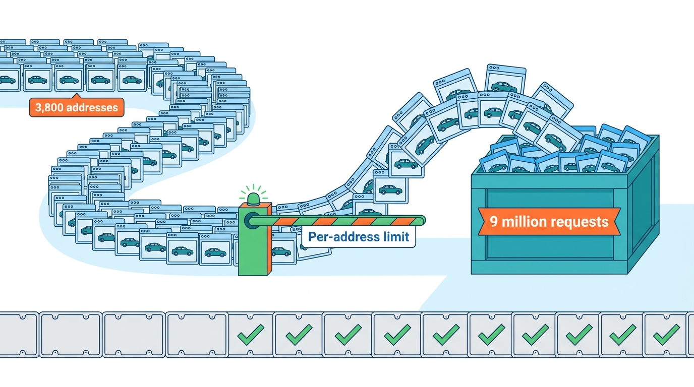
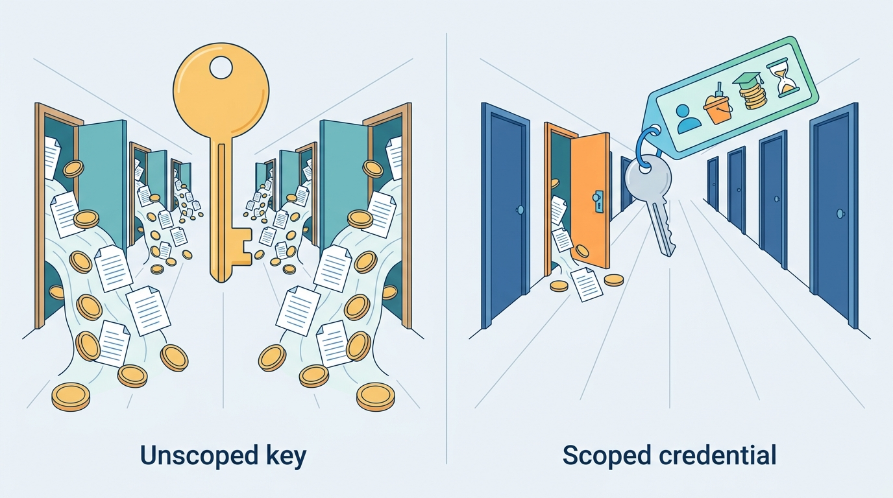
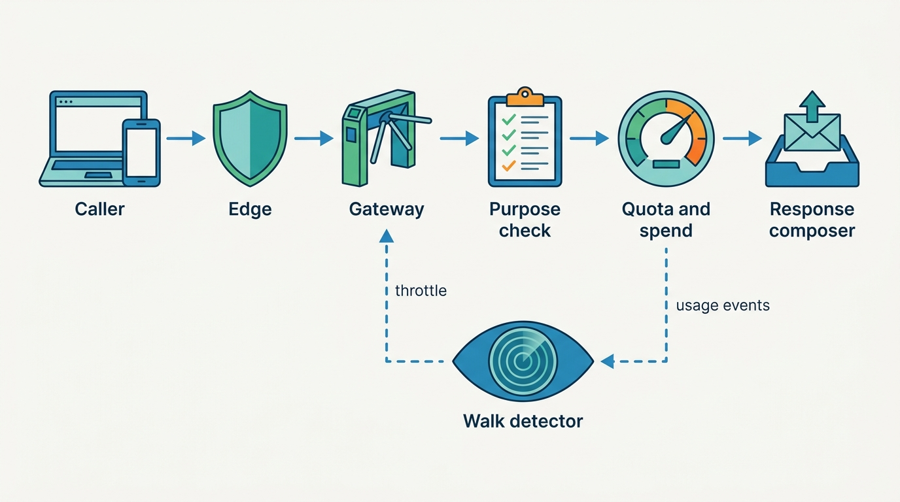
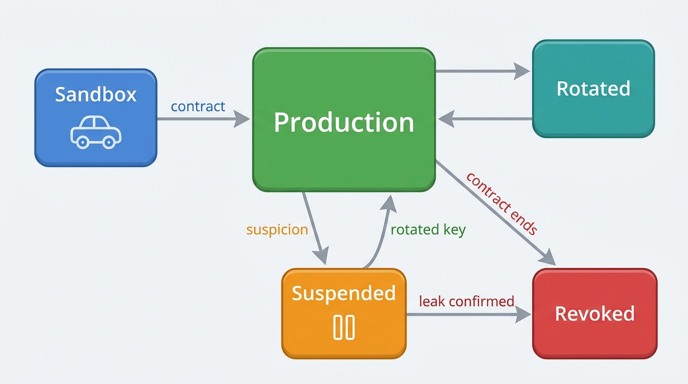
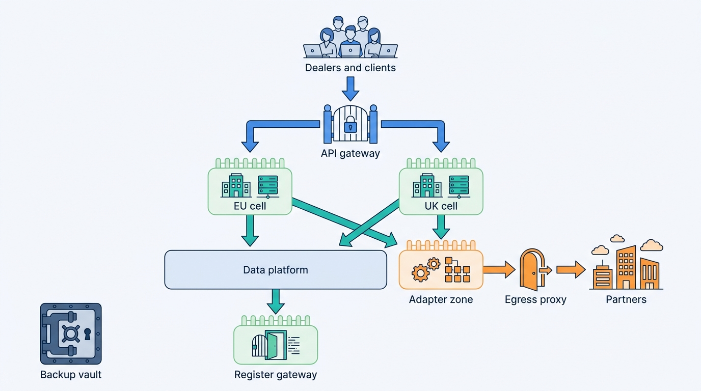

> **IN THIS CHAPTER, YOU WILL:** Build a threat model for a platform that sells vehicle facts by the call and runs the daily work of thousands of dealers, then design its controls: enumeration defense on lookup paths, scoped credentials, protection of dealer logins and high-risk actions, segmentation for blast radius, and backups that are restored, not just taken. You will also see what the FTC Safeguards Rule, ISO/IEC 27001, SOC 2 and NIS2 ask of such a platform.

> **WHY THE BUSINESS CARES:** A scraper that walks the plate space resells the data the business charges for, and runs up the upstream bill while it does. A stolen dealer login can register a car in the wrong name. A ransomware attack on a dealer-software vendor stops thousands of dealers at once, and they remember who stopped them.

> **WHY ARCHITECTS SHOULD CARE:** Most controls in this chapter are architecture, not tooling. Response design, credential scope, quota placement, tenant boundaries, adapter isolation and restore paths are decided when the platform is designed and are expensive to add later.

> **KEY POINTS:**
>
> * **Plates and VINs are not secrets, so every lookup endpoint is a bulk-export interface.** Hiding identifiers fails. Enumeration defense works by making the key space expensive, slow, visible and low-yield to walk: an accountable caller, a quota and a spend cap per caller, minimal responses for anonymous use, detection of walking patterns, and traceable answers.
> * **A credential should say who is calling, what it may reach and how much it may spend.** A scoped credential binds one client, one environment, named products and purposes, rate and spend limits, an expiry and allowed networks. A leaked scoped credential is a small incident. A leaked unscoped key behaves like a trial account with production data.
> * **Design for the compromise you cannot prevent.** Dealer-software vendors concentrate risk: one compromise can stop thousands of businesses, as the June 2024 CDK Global attack showed. Cells, isolated adapters, revocable partner credentials, immutable backups and rehearsed restores decide whether an incident stops one cell or every dealer.

> **[FAILURE PATTERNS THIS CHAPTER ADDRESSES](where-vehicle-platforms-go-wrong.html):**
>
> * **License Blindness** — leaked trial keys returned licensed build data to a scraper, and nobody could say quickly which licensed fields had left, for whom or under which terms.
> * **The Tenant Blur** — shared dealer logins without multi-factor authentication make credential stuffing and insider misuse impossible to attribute, and object identifiers without tenant checks make them easy.
> * **DMS Hostage** — a dealer management system reached through always-on connections and dealer passwords is both a dependency and an attack path; when it is compromised, the integrations around it must be cut cleanly and restored safely.

 
A vehicle data and dealer SaaS platform is attacked for three reasons. Its **data has resale value**: a history signal, a valuation or a decoded equipment list, multiplied by millions of plates, is a product someone else can sell. Its **dealer accounts can act**: they publish adverts, read customers' finance applications, and submit official register transactions. And its **position is central**: thousands of dealers depend on one vendor, so an attacker who stops the vendor gains a hold over all of them.

The defense is not a list of products but a few **architectural commitments**: every caller is accountable and limited; every response gives away no more than the caller paid for and is licensed to receive; every boundary that holds tenant data, partner credentials or the ability to act limits what one compromise can reach; and the platform can be rebuilt from backups it has already restored in a drill.

This chapter owns two terms. **Enumeration defense** is the set of controls that make walking an identifier space (plates, VINs, stock ids, lead ids) expensive, slow, visible and low-yield; a **scoped credential** binds one client, environment, set of purposes and spend limit, and is revocable on its own. Authentication mechanics, single sign-on and relationship-based authorization belong to [[identity-access-and-entitlements]]; tenant isolation layers to [[tenancy-and-dealer-groups]]; license rules to [[data-licensing-and-governance]]; personal-data duties to [[privacy-and-retention]].

## Setting the Scene at Axleby: Nine Million Plates in Six Days

Axleby, the fictional vehicle data and dealer software group this book follows (see [[meet-axleby]]), sells vehicle facts in two ways that matter here. **Odolo**, its consumer app and website, offers a free basic check by plate and a paid full report. **JSON API v1**, the newer data API, sells plate-to-specification, history and valuation calls to API clients. In August 2027 both were walked.

The figures below are Axleby illustrations; the totals (3,800 addresses, about 9 million requests, six days) are the canonical ones from [[meet-axleby]].

| Day | Date (2027) | What happened |
| --- | --- | --- |
| 1 | Thu 12 Aug | Odolo free checks rise from about 70,000 a day to about 1.3 million. Ordinary browsers on residential addresses ask for real Dutch plates; on-call classifies the rise as organic. |
| 1–3 | 12–14 Aug | 17 trial keys call JSON API v1 plate-to-specification at 7 to 9 calls per second in total. Trial keys then had 10 calls/s per key, no daily cap, no expiry and production data. |
| 3 | Sat 14 Aug, 09:40 | An anomaly alert fires on JSON API v1's **no-hit rate**: 38% across the 17 keys, against about 4.5% for normal traffic. A walker hits many unissued combinations. |
| 3 | Sat 14 Aug, 11:05 | All 17 keys revoked. The same plate series turns out to be walked through Odolo, in order. |
| 4 | Sun 15 Aug | Odolo adds a challenge for anonymous sessions that cross a volume threshold, and removes the history teaser. An early warning goes to the national computer security incident response team (CSIRT) within 24 hours. |
| 4–6 | 15–17 Aug | Traffic falls, shifts to slower patterns, and stops on Tuesday 17 August. |

The scraper made about **9 million requests**: about 7.6 million through Odolo's free check and about 1.4 million through JSON API v1. The **3,800 rotating IP addresses** averaged fewer than 400 requests each per day, below any per-address limit that would not also block offices behind shared addresses. Of the trial keys, 14 had leaked through a dealer-website agency's public integration sample and 3 from a used-car comparison startup's Android app package.

The Odolo free check read only Axleby's register mirror, spending no live quota and no paid source ([[registers-and-official-data]]), and returned open register fields anyone can read. But it also returned a **teaser**: "14 history records found, including 2 damage records — buy the full report", and an indicative value band. Those counts and bands were Axleby's own data, derived from Tracewell and Vantage. The trial keys returned plate-to-specification answers, about 860,000 of them with equipment fields from Axleby's commercial build-data license. On misses, they also triggered about 41,000 build-data fetches at about €0.46 each: **about €19,000 of licensed data bought on behalf of an attacker** ([[scale-and-cost]] covers the cost tail).

In October 2027 a plate-check website hosted outside the four markets began showing "damage records found" for Dutch plates. Its counts matched Odolo's mid-August teaser values, including 212 that Tracewell had since corrected. The stale values proved the source; nobody had planned that proof.

Sanne Koster, Axleby's Chief Information Security Officer, summarized the review: **every control worked as configured, and none of them was configured for an attacker who looked like ten thousand customers.** Ines Marchetti, the Group Chief Architect, turned it into the chapter's question: what are the threats to this platform, and which defenses belong in its architecture rather than in its tools?

**Figure 1:** *In August 2027, 3,800 rotating addresses each stayed under every per-address limit while together they made about 9 million requests in six days.*

## Concepts: What Is Being Protected, and From Whom

### Assets

A vehicle platform protects five kinds of asset. Each has a different attacker.

| Asset | Examples at Axleby | Why someone wants it |
| --- | --- | --- |
| **Derived vehicle data** | History signals, damage counts, valuations, decoded editions and equipment | Resale; building a competing check or valuation service |
| **Licensed and official data** | Build data from a commercial provider; register data; workshop odometer readings | Resale without the license; the platform's license is at risk if it leaks |
| **Personal data held for dealers** | Leads, buyer details, finance applications, sales contracts | Fraud, identity theft, extortion |
| **The ability to act** | Publish or withdraw adverts; change prices; submit registration in a new name (*tenaamstellen*) or indemnification (*vrijwaren*) at the Dutch register through Axleby Trade | Fraud; theft of a car's legal identity; sabotage of a competitor |
| **Availability** | Lotwise for 7,200 rooftops; Showroomly for 1,350; the data APIs for 640 clients | Extortion: ransomware works because dealers cannot sell without the system |

The fourth row is specific to this domain and easy to miss. A dealer user who can submit register transactions can, with stolen credentials, move a car's registration. [[identity-access-and-entitlements]] treats the register authority as an authorization input; this chapter treats it as the most valuable thing a dealer login can do.

### Identifiers are not secrets

Plates are photographed in every advert and VINs are stamped on the windscreen; both have structured formats, so their key space can be generated. **No design that relies on identifiers being unknown will hold.** The Open Worldwide Application Security Project (OWASP) puts broken object-level authorization (BOLA) first in its 2023 API Security Top 10, and its own example is automotive: an API takes a VIN from the user and "fails to validate that the VIN represents a vehicle that belongs to the logged in user" ([OWASP, 2023](https://owasp.org/API-Security/editions/2023/en/0xa1-broken-object-level-authorization/)).

There are two different problems here, and they need different controls:

- **Authorization by object**: the caller may reach only objects it has a relationship with (its stock item, its lead). This is BOLA; the control is a check on every access.
- **Licensed lookup of any object**: the caller is *allowed* to ask about any plate, because that is the product. No object check helps; the control is **enumeration defense**.

Dealer-side endpoints (stock, leads, deals) need object checks; data-side endpoints (lookup by plate or VIN) need enumeration defense. Confusing them produces a data API that refuses legitimate lookups or a dealer API that hands out other dealers' leads.

### Enumeration defense

A walker of the plate space should find the walk **accountable** (every request belongs to a party that signed something, or to an anonymous session with little to gain), **expensive** (quotas and spend caps per party), **slow** (rate limits that hold per party, not only per address), **visible** (detectors for sequential series, high no-hit rates and lookups without follow-on purchases) and **low-yield** (anonymous and trial callers get little beyond what is public, and answers are traceable). Transport matters too: the DVLA, the UK's vehicle-licensing agency, takes the registration number in a POST body because it "is deemed sensitive information", which keeps it out of web-server logs ([DVLA, n.d., accessed 2026-10](https://developer-portal.driver-vehicle-licensing.api.gov.uk/apis/vehicle-enquiry-service/vehicle-enquiry-service-description.html)).

### Scoped credentials

A credential that only identifies a caller ("this is client 4711") is not enough. A **scoped credential** binds one **client** and application, so revocation hits one integration; one **environment**, so a sandbox credential never reaches production data; named **products and purposes**, so a leak exposes one product line under one license; **rate, quota and spend limits**, so a leak is bounded in volume and money; a **lifetime**, so forgotten credentials die; and, for production, **network and holder binding** (private-key JWT or mutual TLS), so a copied string is not enough. [[identity-access-and-entitlements]] compares the mechanisms; this chapter is about the scope, because **scope decides what a leak costs**.

**Figure 2:** *Scope decides what a leak costs: a leaked unscoped key opens every product, a leaked scoped credential reaches one client, one environment and a capped spend.*

### The threat model

Axleby's 2027 threat model lists the threats that have a vehicle-platform shape. Generic threats (phishing of staff, unpatched servers) are in it too, but the table shows the ones whose controls are architecture decisions.

| Threat | Entry point | What it reaches | Axleby exposure in mid-2027 | Primary controls | Owner |
| --- | --- | --- | --- | --- | --- |
| **Plate and VIN enumeration** | Odolo free check; trial and leaked API keys | Derived and licensed data; upstream spend | The August attack | Enumeration defense; scoped credentials; spend caps | This chapter; [[consumer-vehicle-checks]] |
| **BOLA in dealer APIs** | Lotwise and Showroomly APIs with sequential ids | Other tenants' stock, leads, deals | Sequential integer ids in Lotwise Classic | Object checks; tenant context; non-guessable ids | [[tenancy-and-dealer-groups]] |
| **Credential stuffing at dealer logins** | Lotwise and Axleby Portal login pages | Leads, finance applications, register transactions | No MFA on Lotwise and Axleby Portal logins; shared logins | MFA; breached-password checks; step-up for high-risk actions | [[identity-access-and-entitlements]] |
| **API key leakage by integrators** | Public repositories, mobile apps, logs | Whatever the key's scope allows | 210 Connect XML clients with passwords; static v1 keys | Scoped credentials; secret scanning; holder binding | This chapter |
| **Ransomware** | Phished staff, exposed admin paths, a compromised partner | Everything the attacker reaches | The DriveDesk Outage (November 2027) at a partner | Segmentation; phishing-resistant MFA; immutable backups; restore drills | This chapter; [[reliability-and-dependencies]] |
| **Supply chain through adapters** | 61 channel adapters, DMS adapters, supplier feeds, webhook URLs | Partner credentials; internal network | Adapters share a runtime and a secrets namespace | Adapter isolation; per-partner credentials; egress control | This chapter; [[dms-integration]] |
| **Insider misuse** | Support staff, engineers, dealer staff | Customer lists, leads, report data | Support access without tickets before Pitwall | Ticket-bound access; masking; access audit | This chapter; [[observability-and-data-operations]] |
| **Register-transaction fraud** | A dealer account with register authority | A car's legal registration | Shared logins submitted 61% of Velto's Q1 transactions | Person-level authority; step-up MFA; anomaly rules | [[registration-and-trade-services]] |

## Architecture: Defense in Layers

### Enumeration defense on the lookup path

Every lookup by plate or VIN passes the same layers, whether it comes from Odolo, Lotwise, a partner's software or a batch file. Each layer rejects a different kind of abuse. The layers are cheap to run in order, because the cheapest checks come first.

**Figure 3:** *Enumeration defense on one lookup path. Each layer rejects a different abuse, cheap checks come first, and a walk detector fed by usage outcomes feeds decisions back to the gateway, so a walker who passes every static limit is still seen and slowed.*

| Layer | What it decides | What it stops | What it cannot stop |
| --- | --- | --- | --- |
| **Edge** (web application firewall, bot management, challenge) | Is this a browser or app session that behaves like one? | Crude bots, known-bad networks, high volume per address | Residential proxies with real browsers; authenticated API clients |
| **Gateway** (scoped credential) | Is the caller known, and is the credential valid for this environment and product? | Unauthenticated calls; sandbox keys on production; expired keys | A valid leaked credential, within its scope |
| **Charter** (purpose check) | Is this product allowed for this client's licensed purpose? | Calls outside the license ([[data-licensing-and-governance]]) | Misuse inside a licensed purpose |
| **Quota and spend meter** | Has this caller exceeded its contract quota or its daily upstream spend? | Bulk extraction beyond contract; cost runaways | Slow extraction within quota |
| **Response composer** | Which fields does this caller's tier receive? | High-value fields reaching anonymous or trial callers | Nothing; it limits the yield |
| **Upstream budget broker** | May this request spend money upstream? | Paid fetches triggered by trial or anonymous traffic ([[scale-and-cost]]) | — |
| **Walk detector** | Does this caller's traffic look like a walk? | Sequential series; no-hit rate far above normal; plate-format coverage; lookups with no follow-on action | Walks spread over many accounts that each look normal |

The **walk detector** consumes the same usage events that Meterline rates ([[billing-and-metering]]), so it sees each call's outcome (hit, partial, no hit) without new instrumentation. Its signals are computed per accountable party and per anonymous session cluster: the **no-hit rate** (about 4.5% for normal traffic, far higher for a walker generating unissued combinations; the signal that worked in August), **series coverage** (a client that asks for 30% of one Dutch plate series in a day is walking it), the **follow-on ratio** (lookups that never lead to an appraisal, stock-in or report), and the **distribution shape** (real lookups follow the car parc, a walk follows the issuing order).

**Anonymous traffic needs a different answer from client traffic.** A walking API client can be throttled, suspended or called; an anonymous Odolo session has nothing to lose, so the answer is **low yield**. After August the free check returns only fields already public in the register's open data, plus "a full report is available", which is true for almost every car and says nothing. Odolo's apps use platform app attestation to tell a genuine install from a script, and web sessions above a volume threshold get a challenge ([[consumer-vehicle-checks]] covers what consumers may see).

**Traceable answers** close the loop. Axleby now seeds **canary vehicles**: synthetic records under plate combinations in valid but unissued series, which no consumer would type and only a walker reaches. If a canary appears on another website, the dataset came from Axleby, and the response log shows which credential or session cluster fetched it.

### Scoped credentials and their lifecycle

After August, every Axleby credential that reaches a data API is a scoped credential, and its lifecycle is explicit.

**Figure 4:** *The lifecycle of a scoped credential. Sandbox credentials reach only test vehicles, production requires recorded purposes, and suspension is a normal, reversible state, so the platform can act on a suspicion within minutes without ending a customer relationship.*

Three rules came from the August review:

1. **Trial is a sandbox, not a discount.** Sandbox credentials return only test vehicles, expire after 30 days and are rate-limited per credential and per source network ([[onboarding-and-configuration]] owns the key lifecycle). A trial that needs real vehicles is a production credential with a small quota, a zero upstream budget and a named contact.
2. **Suspension is cheap and reversible.** The walk detector and the spend cap can suspend a credential automatically. The client's technical contact is told at once, and a rotated credential resumes service, so operators suspend without a meeting.
3. **Leaks are reported to Axleby by the places where they happen.** Axleby's credentials carry a recognizable prefix and checksum. GitHub's secret scanning partner program scans public repositories and npm packages for registered formats and sends matches to the provider, recommending it treat them "as public and compromised" ([GitHub Docs, n.d., accessed 2026-10](https://docs.github.com/en/code-security/secret-scanning/secret-scanning-partnership-program/secret-scanning-partner-program)). Axleby's alert service suspends a reported credential and notifies the client. The 14 keys in the agency's repository had been public for five months.

**Holder binding is the strongest control**, which is why JSON API v2's production default is a private-key JWT. It fails where the client cannot keep a private key, as in a mobile app. **A key inside a mobile app is a public key with a quota**, and should be scoped as one: anonymous-tier fields, app attestation, and a quota that a walk exhausts quickly.

Connect XML, the legacy SOAP interface, sits outside this model until its sunset on 31 December 2029: a username and password in a SOAP header and an IP allow-list per client. OWASP's API9 warns that attackers "get unauthorized access through old API versions or endpoints left running unpatched and using weaker security requirements" ([OWASP, 2023](https://owasp.org/API-Security/editions/2023/en/0xa9-improper-inventory-management/)). The allow-list made Connect XML the harder target in August, but it limits who may connect, not what may be asked. In late 2027 Axleby routed Connect XML usage through Meterline so the same quota, spend and walk-detection layers apply, and froze new Connect XML clients.

### Dealer logins and high-risk actions

Dealer accounts face **credential stuffing**: trying username and password pairs leaked elsewhere. OWASP says an API is vulnerable if it "permits credential stuffing where the attacker uses brute force with a list of valid usernames and passwords" ([OWASP, 2023](https://owasp.org/API-Security/editions/2023/en/0xa2-broken-authentication/)). Dealer staff reuse passwords like everyone else, and in early 2027 neither Lotwise nor Axleby Portal logins had MFA ([[identity-access-and-entitlements]]).

The fix is Axleby ID with MFA, with the old logins retired by mid-2028; until then the old paths get per-account rate limits, breached-password checks and new-country alerts. The more important decision is **step-up authentication for actions, not only sessions**, because some actions are worth more to an attacker than a session:

| Action | Why it is high-risk | Control at Axleby |
| --- | --- | --- |
| Submit a register transaction (*tenaamstellen*, *vrijwaren*) | Moves a car's legal registration | Person-level register authority; MFA at the action; anomaly rules (volume, unusual hours, plates not in stock) |
| Export leads or customer lists | Bulk personal data; the usual act of a departing employee | MFA at the action; export logged and shown to the tenant administrator |
| Read a finance application | Income, identity and bank data | Narrow permission; phishing-resistant MFA for the screen |
| Create an API credential or a webhook URL | Creates a persistent path out of the tenant | MFA; credential scoped to the tenant; webhook URL checked by the egress proxy |

**BOLA on the dealer side** is a matter of discipline in every handler: the object must belong to the caller's tenant and be reachable through the caller's relationships. [[tenancy-and-dealer-groups]] describes the tenant context, the response-side assertion and the leak tests. Two additions belong here. First, Lotwise Classic's sequential integer ids for stock items and leads make walking trivial; new services issue random identifiers, and Lotwise's public URLs and APIs moved to them in 2027, keeping integer ids internal. Random ids do not replace object checks, but they turn a BOLA bug from a walk of every lead into a guess. Second, **object checks must cover export paths** (CSV downloads, report PDFs, signed URLs), where they are most often forgotten.

### Segmentation and blast radius

During a breach, the defense that matters most limits where the attacker goes next. Axleby's segmentation follows its cells and its integration boundary.

**Figure 5:** *Security zones at Axleby in late 2027. Cells hold tenant data and fail independently; adapters run in their own zone with per-partner credentials and reach the outside only through an egress proxy; the register gateway is its own zone; and backups live in a separate account that production credentials cannot delete.*

The rules behind the picture:

- **Cells are security boundaries, not only capacity units.** Each cell has its own deployment credentials, databases and per-tenant data keys wrapped by a cell key ([[tenancy-and-dealer-groups]]). One cell's credentials cannot read or deploy into another, so a partial shutdown is possible: isolate one cell, keep the others selling.
- **The adapter zone holds partner credentials and nothing else.** The 61 channel adapters and the DMS adapters run in their own accounts, with one secret path per partner and per rooftop connection. They take commands from Relay and Hitch and cannot query the dossier or identity graph.
- **All outbound traffic leaves through an egress proxy.** It allow-lists partner hosts per adapter, strips internal context and, as the Standard Webhooks specification recommends for webhook senders, "filters internal IP addresses", because a customer-supplied URL is attacker-controlled input ([Standard Webhooks, n.d., accessed 2026-10](https://github.com/standard-webhooks/standard-webhooks/blob/main/spec/standard-webhooks.md)). OWASP lists server-side request forgery as API7 ([OWASP, 2023](https://owasp.org/API-Security/editions/2023/en/0x11-t10/)).
- **The register gateway is its own zone.** Turnstile holds the certificates and keys that let Axleby act at the Dutch register, and the DVLA key that cannot be replaced while registration is closed ([[registers-and-official-data]]).
- **No flat network from dealers to the platform.** Dealers reach Axleby over the internet with user authentication, never through site-to-site VPNs. Reporting on the CDK attack described dealers connected to CDK data centers through always-on VPNs ([BleepingComputer, 2024](https://www.bleepingcomputer.com/news/security/cdk-global-cyberattack-impacts-thousands-of-us-car-dealerships/)); such links give an attacker a path in both directions.

### Secrets, backups and restore testing

**Secrets** live in one managed secrets service per zone, each with an owner, a rotation date and a last-use date; unused secrets are reviewed after 90 days and ownerless ones revoked.

**Backups** are designed against an attacker who already holds production credentials. The #StopRansomware guide of the US Cybersecurity and Infrastructure Security Agency (CISA) and its partners recommends "offline, encrypted backups of critical data" and regular tests of "the availability and integrity of backups", because "many ransomware variants attempt to find and subsequently delete or encrypt accessible backups"; it also recommends "phishing-resistant MFA for all services" ([CISA et al., 2023](https://www.cisa.gov/stopransomware/ransomware-guide)). Axleby's backups, including infrastructure definitions and deployment images, go to a separate cloud account with object lock that nobody can delete from inside the retention period.

**A backup is a claim until it has been restored.** Marta Nowak's platform team runs a quarterly restore drill into an empty account, rotating through cells, Anchor, Tracewell, the valuation ledger, Lotwise Classic and Connect XML, and measures time to a working, reconciled system against each product's recovery time objective. The first Lotwise Classic drill in 2027 took 31 hours against a 12-hour objective, because the MySQL restore was fast and the search index rebuild was not.

### Requirements per interaction

Security flows have consistency, latency and availability requirements like any other flow. The difference is the **fail mode**: whether the platform answers or refuses when the control itself is unavailable.

| Interaction | Consistency | Latency | Freshness | Availability and fail mode |
| --- | --- | --- | --- | --- |
| Credential validation at the gateway | Strong for revocation | Under 5 ms *(assumption)* | Revocation effective within 60 s | Cached validation for up to 60 s; unknown credentials fail closed |
| Quota and spend check | Bounded overshoot | Under 5 ms *(assumption)* | Counter lag under 1 minute | Fail open for contracted production clients, closed for trial, sandbox and anonymous tiers |
| Step-up MFA for a register transaction | Strong | Seconds | Per action | Fail closed: no submission without the second factor |
| Audit write for access and export | Lossless, ordered per tenant | Asynchronous, under 5 s | — | An action that cannot be logged is refused |
| Restore of one product from backup | Point in time, reconciled | Hours | Recovery point under 1 hour for cells *(assumption)* | Tested quarterly; measured against the product's recovery time objective |

## In Practice: What the Public Record Shows, and What Axleby Changed

### Documented cases

Three parts of the public record are precise enough to design against.

**Plates and VINs as keys to more than data.** In a write-up dated 20 September 2024, the researcher Sam Curry described vulnerabilities, found on 11 June 2024, that allowed "remote control over key functions using only a license plate" of Kia vehicles, executed in about 30 seconds. The proof of concept converted the plate to a VIN through a third-party API, then registered an account on Kia's dealer portal, obtained a dealer access token and used dealer-side endpoints to look up the vehicle by VIN and attach the attacker to it. The issues were fixed, and Kia validated they were never exploited maliciously ([Curry, 2024](https://samcurry.net/hacking-kia)). An earlier write-up, dated 3 January 2023, reported dealer portals at several manufacturers where one could "query any VIN number to retrieve sales documents", and account takeovers keyed by VIN ([Curry, 2023](https://samcurry.net/web-hackers-vs-the-auto-industry)). These are manufacturer systems, but the lesson transfers: **dealer-side endpoints that take a plate or VIN are a favorite path, because dealers are allowed to ask about any car.**

**Resource consumption has a bill attached.** OWASP's API4, unrestricted resource consumption, covers resources "paid for per request" and recommends to "configure spending limits for all service providers/API integrations" ([OWASP, 2023](https://owasp.org/API-Security/editions/2023/en/0xa4-unrestricted-resource-consumption/)): for a platform that buys build data per request, that is the upstream budget broker.

**The DMS as concentration risk.** CDK Global notified dealers on 19 June 2024 that it had shut down systems after a cyberattack, and a second incident followed during recovery; CDK served nearly 15,000 dealer locations ([CyberScoop, June 2024](https://www.cyberscoop.com/cdk-ransomware-car-dealers/)). Security press attributed the attack to the BlackSuit ransomware group; blockchain analysts traced about 387 bitcoin (about $25 million) to a wallet likely controlled by the group, while stressing that this "does not conclusively prove" a payment ([CyberScoop, July 2024](https://cyberscoop.com/cdk-ransom-blacksuit-25-million/)). Impostors posing as CDK support phished dealer credentials during the recovery ([TechTarget, 2024](https://www.techtarget.com/whatis/feature/The-CDK-Global-outage-Explaining-how-it-happened)). [[case-cdk-global]] and [[dms-integration]] read the dealer groups' SEC filings in detail.

> **INFERENCE, NOT DOCUMENTED:** CDK has published no technical post-mortem, so the reason the shutdown was so wide is not public. A provider shuts everything down "as a precaution" when it cannot show that a compromise is confined to part of its estate. Cell boundaries that are also security boundaries are what let a provider isolate part of its fleet instead.

### What Axleby changed after August 2027

| Control | Before August 2027 | After (by December 2027) |
| --- | --- | --- |
| Trial credentials | Production data, 10 calls/s, no daily cap, no expiry | Sandbox only: test vehicles, 30-day expiry; small-quota production trials with zero upstream budget |
| Odolo free check | Open fields plus history and damage counts and a value band | Open fields plus "full report available"; challenge above a volume threshold; app attestation |
| Spend control | Monthly invoice showed upstream cost | Spend caps per credential per day, tripping within minutes ([[scale-and-cost]]) |
| Detection | Request-rate alerts per address and per key | Walk detector on Meterline outcomes: no-hit rate, series coverage, follow-on ratio |

The money cost was small: about €19,000 of build data plus staff time. The license cost was larger. The build-data license forbids redistribution, so Priya Raman informed the provider in writing with the affected answers and the new controls. Femke de Boer, the Data Protection Officer, treated the plate-linked damage counts as personal data under the book's default rule ([[privacy-and-retention]]); with no keeper data returned, she judged the risk to individuals unlikely and recorded the assessment in the breach register without notifying the Dutch authority. Reasonable people could disagree, which is why the reasoning was written down.

## Security for 61 Channel Adapters and the DMS Path

Adapters are the platform's supply chain. Each one holds credentials to someone else's system, parses someone else's data, and calls someone else's endpoint. At Axleby that means 61 syndication channels and about 2,250 connected DMS rooftops ([[dms-integration]]). A compromise in either direction is possible: a compromised partner sends hostile data in, or a compromised adapter uses Axleby's credentials against the partner.

The controls Hendrik Maes's integrations team applied in 2027:

1. **Inventory with owners**: every adapter has an owner, a partner contract, a credential list with scopes, and the rooftops it serves. Before 2027 nobody could produce this list for Relay.
2. **One credential per partner, and per rooftop where the partner allows it**, so one leaked portal credential cannot publish for every dealer. A shared credential is treated as scarce and its use is monitored per dealer.
3. **Inbound data is untrusted input**: schema and size limits, no active content in descriptions, quarantine on anomalies ([[ingestion-and-entity-resolution]]). A portal lead with an HTML payload must not become script in a dealer's inbox.
4. **Pinned, scanned dependencies**, built in a pipeline whose credentials cannot deploy to cells.
5. **A kill switch per adapter.** A partner compromise starts with revoking the adapter's credentials and moving rooftops to degraded mode ([[reliability-and-dependencies]]); resumption needs new credentials issued out of band and a reconciliation before write-back.
6. **Pre-announced contact rules.** During any partner incident Axleby tells dealers how it will and will not contact them, and never asks for credentials by e-mail.

**Unsanctioned access is a security problem as well as a contract problem.** The US litigation over DMS access recorded that independent integrators worked by having dealers hand over their DMS log-in credentials, and that CDK described its move to closed access partly as a response to "well-publicized security breaches" ([Seventh Circuit, *Authenticom v. CDK Global*, 2017](https://www.courtlistener.com/opinion/4440779/authenticom-incorporated-v-reynolds-and-reynolds-company/)). Whatever the competitive motives, a shared dealer password held by a third party is a credential nobody can scope, rotate or attribute. Axleby's rule is that it never holds a dealer's DMS password ([[dms-integration]] covers the authorization register that replaces it).

## Insider Misuse

Insiders have legitimate access, so the controls limit and record it. **Support staff** reach a tenant through Pitwall only with an open ticket from that tenant, see personal fields masked unless they record a reason, and leave every view in Charter's access audit ([[observability-and-data-operations]]). **Engineers** have no standing production access to tenant data; break-glass access is time-limited, approved by a second person and reviewed weekly. **Dealer staff** who export a lead list before joining a competitor meet MFA at the export, a per-person rate limit and an entry in their administrator's audit view.

Monitoring employees is itself regulated. Germany's Works Constitution Act gives works councils co-determination over technical devices designed to monitor employees ([BetrVG §87(1) no. 6](https://www.gesetze-im-internet.de/betrvg/__87.html)), and the Dutch Works Councils Act requires consent for systems suitable for monitoring staff ([WOR art. 27(1)(l)](https://wetten.overheid.nl/BWBR0002747/)). Axleby documents the purpose of each security log and keeps per-person analytics inside the security function.

## Assurance and Regulation

Frameworks reach the architect as **customer requirements** that become features and as **legal duties** that change the incident runbook.

### The FTC Safeguards Rule: what US dealers must demand of vendors

Axleby has no US business, but US dealer-software vendors meet the Federal Trade Commission's (FTC) Safeguards Rule through their customers. The FTC states that dealers that "finance (or facilitate the financing of)" vehicles for consumers, or lease for longer than 90 days, are financial institutions under the rule ([FTC, 2025](https://www.ftc.gov/business-guidance/resources/automobile-dealers-ftcs-safeguards-rule-frequently-asked-questions)). The rule's elements include MFA "for any individual accessing any information system", controls "to monitor and log the activity of authorized users", and oversight of service providers, including "requiring your service providers by contract to implement and maintain such safeguards" ([16 CFR 314.4](https://www.law.cornell.edu/cfr/text/16/314.4)). Without continuous monitoring, covered institutions need annual penetration tests and vulnerability assessments every six months. Since May 2024, a "notification event" involving at least 500 consumers' unencrypted information must be reported to the FTC within 30 days of discovery ([FTC, 2024](https://www.ftc.gov/business-guidance/resources/ftc-safeguards-rule-what-your-business-needs-know)).

For a vendor, **the dealer's compliance evidence comes from the vendor's product**: enforceable MFA, an exportable user-activity log, encryption evidence, penetration-test summaries, safeguard clauses and a breach-notification commitment fast enough for the dealer's 30-day clock. If Axleby entered the US, this evidence pack would be part of the product.

### ISO/IEC 27001 and SOC 2

ISO/IEC 27001 certifies an information security management system: the organization has assessed its risks, chosen controls and runs them under management review. SOC 2, the American Institute of CPAs' attestation, reports on controls "relevant to Security, Availability, Processing Integrity, Confidentiality, or Privacy" ([AICPA, n.d., accessed 2026-10](https://www.aicpa-cima.com/resources/landing/system-and-organization-controls-soc-suite-of-services)); a Type 2 report covers how the controls operated over a period. In practice, European buyers more often ask for ISO 27001 and US dealer groups and lenders for SOC 2 Type 2. In the UK, the government-backed Cyber Essentials scheme covers five basic technical controls, and its site notes that "a growing number of organisations require suppliers to be certified" ([NCSC, n.d., accessed 2026-10](https://www.ncsc.gov.uk/cyberessentials/overview)).

**Certificates prove a process, not a property.** None would have stopped the August walk: the trial keys were issued exactly as the process said. What certification gives the architect is a cadence of access reviews, change records, supplier reviews and restore evidence. Axleby Data and Axleby Trade have held ISO 27001 certification since 2019; Lotwise and Showroomly join its scope in 2028, which is mostly evidence work, not new technology.

### NIS2

The EU's NIS2 Directive (Directive (EU) 2022/2555, applicable through national laws from 18 October 2024) sets risk-management and incident-reporting duties for medium and large entities in listed sectors ([CELEX 32022L2555](http://publications.europa.eu/resource/celex/32022L2555)). Its sectors include cloud computing service providers, whose service models, its recitals say, include "Software as a Service (SaaS)". Whether a vertical dealer-software or data-API provider counts is a legal judgement national authorities may answer differently.

> **INFERENCE, NOT DOCUMENTED:** A large multi-tenant dealer-software vendor, and a DMS vendor more so, should assume it may be in scope: preparing costs mostly the controls in this chapter, and being wrong costs a missed reporting deadline.

Where it applies, NIS2 changes three things for an architect:

- **Measures.** Article 21 includes incident handling, business continuity "such as backup management and disaster recovery", **supply chain security**, vulnerability handling, access control, cryptography and multi-factor authentication where appropriate.
- **Reporting clocks.** Article 23 requires an early warning within 24 hours of becoming aware of a significant incident, an incident notification within 72 hours, and a final report within one month. For cloud computing providers, Commission Implementing Regulation (EU) 2024/2690 counts an incident as significant when, among other criteria, the service "is completely unavailable for more than 30 minutes", or when data is compromised "as a result of a suspectedly malicious action" ([CELEX 32024R2690](http://publications.europa.eu/resource/celex/32024R2690)).
- **Fines.** Maximums of at least €10 million or 2% of worldwide turnover for essential entities, €7 million or 1.4% for important ones.

Axleby's counsel concluded in 2026 that Axleby should register as a cloud computing service provider under the Dutch implementing law, the *Cyberbeveiligingswet* (Cyber Security Act), which entered into force on 15 August 2026 ([NCSC Netherlands, accessed 2026-10](https://www.ncsc.nl/cyberbeveiligingswet)). Sanne Koster's team therefore filed an early warning on Sunday 15 August, on the criterion of data compromised by a suspectedly malicious action, before the scope of the leak was known. **An unnecessary early warning costs an afternoon; a missed one costs a regulatory finding.** Partner contracts now require partners such as DriveDesk to tell Axleby when they file, so Axleby can assess its own position the same day.

## Failure Handling

Security controls fail like any other component. The table lists the failure cases Axleby designs for.

| Failure | Example | Detection | Recovery |
| --- | --- | --- | --- |
| **Distributed walk below every static limit** | August 2027: 3,800 addresses, under 400 requests each per day | Walk detector on outcomes per session cluster and per credential, not per address | Challenge and low-yield responses for anonymous tiers; suspend credentials; canary evidence for follow-up |
| **Conflicting revocation and use** | A key is revoked while 2,000 requests are in flight | Gateway revocation cache under 60 s | In-flight requests complete; usage after the cut-off is not billed and is logged as a security event |
| **Incomplete inventory** | An adapter credential nobody owns; a beta host without rate limits (OWASP API9) | Quarterly inventory reconciliation against the secrets service and DNS | Assign or revoke; retire unlisted hosts |
| **Partial failure of a control** | The walk detector is down for a day | Heartbeat and an alert on missing signals | Static quotas, spend caps and response tiers still apply; the detector backfills from usage events |
| **Partner compromise** | The DriveDesk Outage: ransomware at a DMS vendor | Partner notice; adapter health; anomalous inbound data | Kill switch; credential revocation; degraded mode; out-of-band re-keying; reconciliation before write-back ([[dms-integration]]) |
| **Own compromise in one cell** | Deployment credentials of one cell stolen | Deployment audit; unexpected changes; canary tenants | Isolate the cell; rotate its keys; restore from the vault if integrity is in doubt; other cells keep serving |

## Trade-offs

### How to defend a lookup endpoint

| Option | How it works | Right when | Costs and risks |
| --- | --- | --- | --- |
| **Per-address rate limits only** | Limit requests per IP address at the edge | Small sites; unauthenticated content of low value | Fails against residential proxies; blocks shared offices and mobile networks |
| **Authentication for every lookup** | No anonymous lookups at all | Pure B2B data APIs | Kills consumer acquisition; Odolo's free check exists to sell reports |
| **Tiered responses** | Anonymous callers get public fields; paid or contracted callers get derived and licensed fields | Mixed consumer and business products on one data platform | Product must accept a less attractive free tier; field-level design per tier |
| **Behavioral walk detection** | Score outcomes per caller and per session cluster | Any endpoint with significant volume | Tuning effort; false positives against legitimate batch clients, who need a batch lane |
| **Challenges and app attestation** | Proof of a real browser or genuine app | Consumer traffic | Friction for real users; attackers can pay for solved challenges |
| **Traceable answers (canaries)** | Unique synthetic records reachable only by walking | Data whose resale would harm the business | Must never mislead a real user; needs disciplined handling |

My recommendation for a platform like Axleby's is **tiered responses plus behavioral detection, with challenges as a supplement**: tiering decides what a walk is worth, detection how long it lasts, and per-address limits stay a cheap first filter. For a pure B2B data provider with no consumer product, authentication for every lookup and scoped credentials do most of the work.

## Across Markets: What Changes by Country

The threats are the same everywhere. **What changes is the law that sets reporting clocks, the assurance customers ask for, and how sensitive the plate is.**

| Topic | Netherlands / Belgium | Germany | United Kingdom | United States |
| --- | --- | --- | --- | --- |
| **Cybersecurity law for a SaaS vendor** | NIS2; Dutch *Cyberbeveiligingswet* in force 15 August 2026 ([NCSC, accessed 2026-10](https://www.ncsc.nl/cyberbeveiligingswet)); Belgium's transposition not verified for this chapter | NIS2 through the amended BSI Act; the BSI's page states the statutory registration deadline has passed and directs entities to register ([BSI, accessed 2026-10](https://www.bsi.bund.de/DE/Themen/Regulierte-Wirtschaft/NIS-2-regulierte-Unternehmen/nis-2-regulierte-unternehmen_node.html)) | NIS Regulations 2018; the Cyber Security and Resilience Bill, introduced on 12 November 2025, adds relevant managed service providers ([DSIT, 2025](https://www.gov.uk/government/collections/cyber-security-and-resilience-bill)); its status should be checked | No general federal duty for SaaS vendors; obligations arrive through customers |
| **Incident reporting** | NIS2: 24 h / 72 h / 1 month; GDPR Art. 33: 72 h | Same | UK GDPR: 72 h; NIS Regulations | FTC: 30 days for 500+ consumers; state breach laws |
| **Assurance customers ask for** *(industry practice)* | ISO/IEC 27001 | ISO/IEC 27001; the BSI publishes NIS2 guidance alongside it | ISO/IEC 27001; Cyber Essentials (Plus) in supplier requirements | SOC 2 Type 2 |
| **Plate as sensitive data in APIs** | Register vehicle data is open; keeper data never released for commerce | Keeper data only for legal claims (§ 39 StVG) | ICO treats plates as personal data in most cases; DVLA requires plates in POST bodies | Vehicle data not personal under the Driver's Privacy Protection Act; DMV personal data restricted |

The judgement: **the controls are common; the runbooks and evidence packs are market adapters.** Enumeration defense, scoped credentials, cells, adapter isolation and backups are one design. Reporting clocks, authority contacts and evidence formats are parameters per market in the incident runbook. Two rows change product design. The **US Safeguards Rule** turns MFA reports and activity-log exports into product features. The **German and Dutch works-council rules** (see Insider Misuse) make insider-threat analytics a documented, purpose-bound feature.

## The Chief Architect's View

**What to decide, and who decides.**

- **The response tiers.** A product decision with a security floor set by the Chief Architect and the CISO: anonymous tiers get nothing not already public.
- **The credential policy.** One policy for every product (scope, lifetime, holder binding, sandbox isolation, suspension); products do not issue their own keys.
- **Cells as security boundaries.** The cell map in [[tenancy-and-dealer-groups]] is also the incident-isolation map. Its owner must be able to say within an hour which cell an incident touches and how to cut it off.
- **Restore objectives per product**, approved by the CTO, with drill results reported to the board quarterly.
- **The regulatory position.** Whether the group is in NIS2 scope, and as what, is a legal judgement made once, written down and revisited when products change.

**What to watch.**

- **Walk-detector precision**: confirmed walks against suspensions reversed for legitimate clients.
- **Credential hygiene**: share of production credentials scoped, holder-bound and under a year old.
- **MFA coverage** of users who can submit register transactions, read finance applications or export lists. Anything under 100% is a decision someone signed.
- **Time to revoke**: from leak report to suspension, measured on every report.
- **Restore drill results** per product, and **adapter credentials** with a named owner.

**Long-term considerations.** Agents acting on dealer accounts ([[ai-in-dealer-workflows]]) and webhooks carrying data to customer systems ([[events-webhooks-and-sync]]) will grow the number of non-human callers faster than the number of users. Each should be a scoped credential with a purpose and a spend cap: **every caller, human or machine, accountable and limited by design**.

## Questions to Ask

1. Which of our endpoints accept a plate, VIN or object id, and for each one, is the control an object check or enumeration defense?
2. If a production API credential appears in a public repository tonight, how many minutes until it stops working, and what can it reach until then?
3. Do any trial or sandbox credentials reach production data or trigger paid upstream fetches?
4. Which users can submit register transactions, read finance applications or export customer lists without MFA at that moment?
5. Could we isolate one cell during an incident while the others keep serving, and when did we last practice it?
6. Which adapters hold partner credentials, who owns each one, and can one adapter reach another partner or our core data?
7. When did we last restore each product from backup into an empty account, and how long did it take against the objective?
8. What evidence would a dealer's compliance officer need from us, and can they get it without asking support?

## From Attackers to Data Subjects

Security keeps the wrong people away from the data. It does not answer what the platform may do with the data in the first place: whether a plate is personal data, which lawful basis covers a history report, how long a lead may be kept, and how an erasure request reaches every copy. The August review touched those questions when Femke de Boer had to judge whether a damage count linked to a plate concerned a person. [[privacy-and-retention]] answers them.

## Sources and Evidence

**Company, product and investor sources**

- [CDK ransomware attack disrupts car dealers](https://www.cyberscoop.com/cdk-ransomware-car-dealers/), CyberScoop, 2024: the June 2024 CDK Global shutdown and the nearly 15,000 dealer locations it served.
- [CDK Global paid ransom, blockchain analysis suggests](https://cyberscoop.com/cdk-ransom-blacksuit-25-million/), CyberScoop, 2024: BlackSuit attribution and the traced 387 bitcoin, with the caveat that it does not prove payment.
- [CDK Global cyberattack impacts thousands of US car dealerships](https://www.bleepingcomputer.com/news/security/cdk-global-cyberattack-impacts-thousands-of-us-car-dealerships/), BleepingComputer, 2024: dealers connected to CDK data centers through always-on VPNs.
- [The CDK Global outage: explaining how it happened](https://www.techtarget.com/whatis/feature/The-CDK-Global-outage-Explaining-how-it-happened), TechTarget, 2024: the second incident and phishing by impostors posing as CDK support.
- [Secret scanning partner program](https://docs.github.com/en/code-security/secret-scanning/secret-scanning-partnership-program/secret-scanning-partner-program), GitHub Docs, n.d., accessed 2026-10: scanning of public repositories and npm packages for provider secret formats; treat reported secrets as compromised.

**Standards, regulation and official documentation**

- [OWASP API Security Top 10 (2023)](https://owasp.org/API-Security/editions/2023/en/0x11-t10/), OWASP, 2023: the ten API risks, including API7 server-side request forgery; and the pages on [API1 BOLA](https://owasp.org/API-Security/editions/2023/en/0xa1-broken-object-level-authorization/) (the VIN example), [API2 broken authentication](https://owasp.org/API-Security/editions/2023/en/0xa2-broken-authentication/) (credential stuffing), [API4 unrestricted resource consumption](https://owasp.org/API-Security/editions/2023/en/0xa4-unrestricted-resource-consumption/) (spending limits for paid providers) and [API9 improper inventory management](https://owasp.org/API-Security/editions/2023/en/0xa9-improper-inventory-management/) (old API versions).
- [Vehicle Enquiry Service API description](https://developer-portal.driver-vehicle-licensing.api.gov.uk/apis/vehicle-enquiry-service/vehicle-enquiry-service-description.html), DVLA, n.d., accessed 2026-10: the registration number as sensitive information in a POST body.
- [Standard Webhooks specification](https://github.com/standard-webhooks/standard-webhooks/blob/main/spec/standard-webhooks.md), Standard Webhooks, n.d., accessed 2026-10: egress proxy filtering internal addresses for webhook senders.
- [#StopRansomware Guide](https://www.cisa.gov/stopransomware/ransomware-guide), CISA, MS-ISAC, NSA and FBI, 2023: offline, encrypted, tested backups; phishing-resistant MFA.
- [Automobile Dealers and the FTC's Safeguards Rule: FAQ](https://www.ftc.gov/business-guidance/resources/automobile-dealers-ftcs-safeguards-rule-frequently-asked-questions), US Federal Trade Commission, 2025: which dealers are covered; service-provider oversight.
- [FTC Safeguards Rule: What Your Business Needs to Know](https://www.ftc.gov/business-guidance/resources/ftc-safeguards-rule-what-your-business-needs-know), US Federal Trade Commission, 2024: penetration tests, vulnerability scans, the 500-consumer, 30-day notification rule.
- [16 CFR 314.4](https://www.law.cornell.edu/cfr/text/16/314.4), Legal Information Institute, accessed 2026-10: Safeguards Rule elements (MFA, activity logging, service providers).
- [Directive (EU) 2022/2555 (NIS2)](http://publications.europa.eu/resource/celex/32022L2555), EU, 2022: scope, SaaS in cloud computing, Article 21 measures, Article 23 reporting clocks, fines, application from 18 October 2024.
- [Commission Implementing Regulation (EU) 2024/2690](http://publications.europa.eu/resource/celex/32024R2690), European Commission, 2024: significant-incident criteria for cloud computing service providers.
- [Cyberbeveiligingswet (NIS2)](https://www.ncsc.nl/cyberbeveiligingswet), NCSC Netherlands, accessed 2026-10 (Dutch): Dutch law in force since 15 August 2026, registration duty.
- [NIS-2-regulierte Unternehmen](https://www.bsi.bund.de/DE/Themen/Regulierte-Wirtschaft/NIS-2-regulierte-Unternehmen/nis-2-regulierte-unternehmen_node.html), BSI, accessed 2026-10 (German): registration duty and the expired registration deadline in Germany.
- [Cyber Security and Resilience Bill](https://www.gov.uk/government/collections/cyber-security-and-resilience-bill), UK Department for Science, Innovation and Technology, 2025: introduced 12 November 2025; managed service providers in scope.
- [Cyber Essentials overview](https://www.ncsc.gov.uk/cyberessentials/overview), UK National Cyber Security Centre, n.d., accessed 2026-10: the scheme's five controls and its use in supplier requirements.
- [SOC suite of services](https://www.aicpa-cima.com/resources/landing/system-and-organization-controls-soc-suite-of-services), AICPA, n.d., accessed 2026-10: SOC 2 trust services categories.
- [Authenticom v. Reynolds and Reynolds / CDK Global](https://www.courtlistener.com/opinion/4440779/authenticom-incorporated-v-reynolds-and-reynolds-company/), US Court of Appeals for the Seventh Circuit, 2017: dealer credentials given to integrators; CDK's security rationale for closing access.
- [CDK Global v. Brnovich](https://storage.courtlistener.com/pdf/2021/10/25/cdk_global_llc_v._mark_brnovich.pdf), US Court of Appeals for the Ninth Circuit, 2021: Arizona's dealer data law and its security-standard condition for integrators.
- [BetrVG §87](https://www.gesetze-im-internet.de/betrvg/__87.html), German Works Constitution Act, accessed 2026-10; [Wet op de ondernemingsraden](https://wetten.overheid.nl/BWBR0002747/), Dutch Works Councils Act, accessed 2026-10: works-council rights over employee monitoring.

**Research and practitioner sources**

- [Hacking Kia: Remotely Controlling Cars With Just a License Plate](https://samcurry.net/hacking-kia), Sam Curry, 2024: a plate-to-VIN chain through dealer infrastructure, fixed before publication.
- [Web Hackers vs. The Auto Industry](https://samcurry.net/web-hackers-vs-the-auto-industry), Sam Curry, 2023: dealer portals returning sales documents for any VIN; VIN-keyed account takeovers.

Axleby is fictional; architectural recommendations, labeled inferences and labeled assumptions are the author's judgement.
