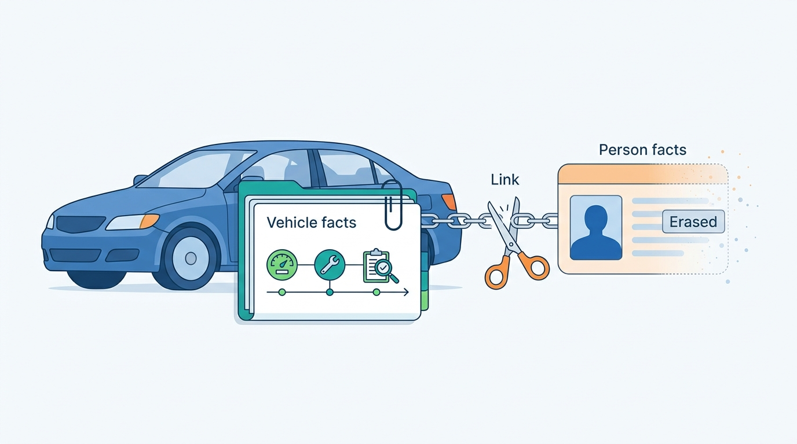
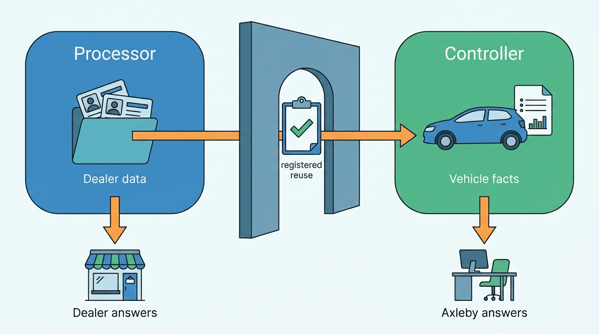
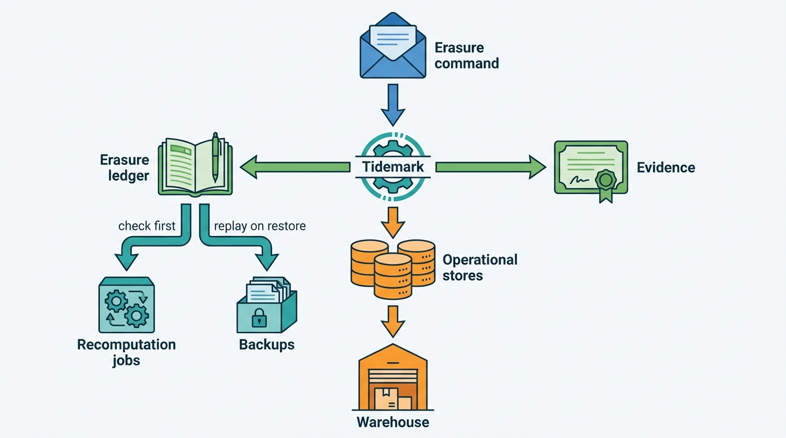
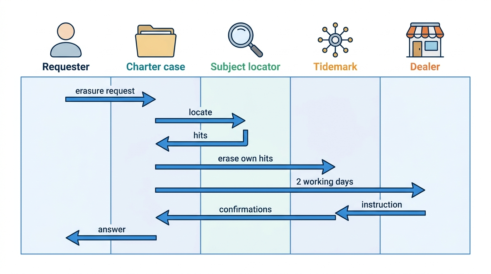
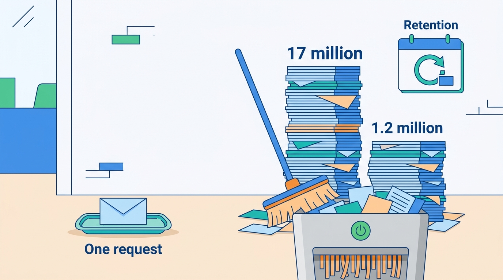

> **IN THIS CHAPTER, YOU WILL:** Decide when plates, VINs and vehicle facts are personal data, map where a vehicle data and dealer software group is controller and where it is processor, and design a retention schedule, an erasure path and a data subject request workflow that reach every derived copy.

> **WHY THE BUSINESS CARES:** Dealers sign processor terms that promise deletion and help with their customers' requests; consumers who buy a history report expect the platform not to hoard what it learned about them. One unanswered request or one warehouse full of six-year-old leads turns into a regulator's letter and a procurement blocker with every large dealer group.

> **WHY ARCHITECTS SHOULD CARE:** Privacy duties are cheap when the data model separates vehicles from people and every store has a retention class, and very expensive when they are retrofitted into monoliths, warehouses and models that copy personal data freely. Erasure is a distributed-systems problem: deletion must propagate, survive restores and win against recomputation.

> **KEY POINTS:**
>
> * **A plate or VIN is personal data for anyone who can link it to a person, and a dealer platform always can.** Treat both as personal by default, keep person fields out of the vehicle stores, and document the narrow components where the default does not apply.
> * **Controller or processor is decided per product and data class, not per company.** Axleby is the dealer's processor for leads, customers and deals, and a controller for history reports, market data, Odolo and its own models; the moment it uses dealer data for its own purposes, it becomes a controller for that use.
> * **Retention and erasure are platform services, not module features.** A retention schedule per data class, an erasure ledger replayed on restore, and a suppression list that recomputation jobs must consult are what make deletion reach the warehouse, the backups and next month's model run.

> **[FAILURE PATTERNS THIS CHAPTER ADDRESSES](where-vehicle-platforms-go-wrong.html):**
>
> * **License Blindness** — personal data, like licensed data, gets copied into warehouses, models and lists beyond the purpose it was collected for, and nobody can prove which use rests on which basis.
> * **The Sticky Error** — an erasure, like a correction, must reach every place the data spread; deleting the source row while copies live on is the same failure in a privacy costume.
> * **The Tenant Blur** — a processor that cannot say which dealer's customer a record belongs to cannot route a request to the right controller.

 
Vehicle data looks impersonal. A VIN describes a car; an odometer reading describes a car; a valuation describes a car. Yet every vehicle has a keeper, and a vehicle data and dealer software platform sits next to the people who buy, sell, drive and finance those vehicles. **The same plate that keys a specification lookup also keys a lead, an appraisal, a sales invoice and a finance application.** Whether a given record is personal data depends on what else its holder can join it to.

This chapter asks how a platform with both halves (vehicle data services and dealer SaaS) should treat personal data. It owns three things in this book: the **controller and processor split** for a vehicle platform, the **retention schedule**, and **erasure propagation**. The license and purpose register, the purpose check on the request path and the access audit belong to [[data-licensing-and-governance]]; breach response after a tenant leak belongs to [[tenancy-and-dealer-groups]]; enumeration defense belongs to [[vehicle-platform-security]]; consent capture on the lead belongs to [[leads-and-crm]]; consent for in-car data belongs to [[connected-vehicle-data]].

Nothing in this chapter is legal advice. It is the architecture that lets lawyers' answers be carried out, at scale, without heroics.

## Setting the Scene at Axleby: One Request, Nine Systems

Axleby, the fictional vehicle data and dealer software group this book follows (see [[meet-axleby]]), received a request through Odolo's privacy form on **Monday 2 August 2027**. The writer, a consumer in Heerenveen whom this chapter calls the requester, asked Axleby to "delete everything you have about me and my cars" and to stop "selling my number plate to car dealers."

Femke de Boer, Head of Data Governance and Privacy and the group's Data Protection Officer (DPO), opened a case. Odolo's account login verified the requester's identity the same day. Finding her data took **six working days**, because Axleby had no way to search across products for a person. Her team searched by e-mail address, phone number, name and the two plates she named, product by product. They found the following.

| System | What it held | Axleby's role |
| --- | --- | --- |
| **Odolo** | Account, a saved "my car" watch on her current plate, **3** paid full reports (2024) with their purchase and payment records, **2** support tickets | Controller |
| **Pulse** (market data) | **2** harvested private-seller adverts for her 2017 Toyota Yaris from early 2024; one had her mobile number in the free-text description | Controller |
| **Lotwise**, Velto Mobility Group's Zwolle rooftop | Appraisal and purchase file for the Yaris (March 2024): her name, address, bank account, a copy of her identity document | Processor for Velto |
| **Lotwise**, Autobedrijf Brandsma | Customer record, **3** portal leads, the deal and sales invoice for a 2021 Kia Niro (April 2024) | Processor for Brandsma |
| **Horizon** (Axleby Insight's trade-in propensity scores) | **14** monthly scores on the Kia's plate back to 2024, computed on the customer list Brandsma uploads and kept without expiry: the match-in redesign approved in March 2027 had not yet enforced its 90-day expiry, which applied only from September 2027 ([[data-products-and-insights]]) | Processor for Brandsma |
| **Snowflake** (Lotwise copy) | Copies of all of the Lotwise records above | Same as the source |
| **Tracewell** (history) | **17** odometer, inspection and ownership-change events on the two cars, with no person fields | Controller |
| **Backups** | All of the above, in 35-day rolling backups | Same as the source |
| **Telemetry** | Nothing: the 2027 tagging standard keeps private plates and contact data out of logs ([[observability-and-data-operations]]) | — |

The answer went out on **Thursday 26 August 2027**, day 24 of the one-month deadline. The search produced three findings that mattered more than the request itself.

- **The warehouse ignored retention.** Lotwise deleted leads after the dealer's retention setting in MySQL, but the nightly copy to Snowflake had never deleted anything. It held about **17 million** lead records older than Lotwise's 24-month default, going back to 2019.
- **Free text defeated minimization.** Pulse's harvester dropped seller contact fields, but not phone numbers typed into advert descriptions. A scan found phone numbers or e-mail addresses in the free text of about **1.2 million** stored private-seller adverts.
- **Deletion would not have stuck.** Deleting the requester's Horizon scores would have done nothing. Brandsma's next monthly upload would have scored her plate again. Only a suppression rule stops a recomputation.

Ines Marchetti, the Group Chief Architect, put the lesson to the architecture board in September: *we had a deletion feature in each product and no erasure capability in the platform.* The retention schedule (approved **14 October 2027**) and the retention service **Tidemark** (live **December 2027**) are the result. The rest of this chapter explains the decisions behind them.

## Concepts: When Vehicle Data Is About a Person

### The identifiability test

The General Data Protection Regulation (GDPR) defines personal data as information relating to an identified or identifiable natural person, directly or indirectly ([Regulation (EU) 2016/679, Art. 4(1)](http://publications.europa.eu/resource/celex/32016R0679)). The Court of Justice of the European Union (CJEU) has applied that test to vehicle identifiers. Its answer is relative: it depends on who holds the data and what means they have.

| Authority and date | Position | What it means for a vehicle platform |
| --- | --- | --- |
| **CJEU, *Breyer* (C-582/14), 19 October 2016** | Data are personal for a holder that has legal means to identify the person with additional data held by someone else ([CELEX 62014CJ0582](http://publications.europa.eu/resource/celex/62014CJ0582)) | The root of the "means reasonably likely to be used" test |
| **CJEU, *Scania* (C-319/22), 9 November 2023** | A vehicle identification number (VIN) is personal data for a person who "may have means enabling him to use it to identify the owner" or user; it is not personal data where the vehicle does not belong to a natural person ([CELEX 62022CJ0319](http://publications.europa.eu/resource/celex/62022CJ0319)) | Fleet and company cars differ from private cars; the holder's means decide |
| **CJEU, *EDPS v SRB* (C-413/23 P), 4 September 2025** | Pseudonymised data are not personal data "in all cases and for every person"; identifiability is assessed per recipient ([CELEX 62023CJ0413](http://publications.europa.eu/resource/celex/62023CJ0413)) | A component without any means of linking may argue otherwise, if documented |
| **UK Information Commissioner's Office (ICO)** | "In most circumstances, a VRM is personal data. However, this can depend on the context" ([ICO ANPR guidance, n.d.](https://ico.org.uk/for-organisations/uk-gdpr-guidance-and-resources/cctv-and-video-surveillance/guidance-on-video-surveillance-including-cctv/additional-considerations-for-technologies-other-than-cctv/automatic-number-plate-recognition-anpr/)); plate and VIN are listed as indirect identifiers ([ICO, n.d.](https://ico.org.uk/for-organisations/uk-gdpr-guidance-and-resources/personal-information-what-is-it/what-is-personal-data/can-we-identify-an-individual-indirectly/)) | The ICO notes this guidance is under review after the Data (Use and Access) Act 2025 |
| **DVLA** (Driver and Vehicle Licensing Agency, UK) | Treats registration number and VIN as sensitive information and requires them in the request body, not the URL, "to reduce the chance of it appearing in web server logs" ([DVLA KADOE API, n.d.](https://developer-portal.driver-vehicle-licensing.api.gov.uk/apis/kadoe/kadoe-description.html)) | A transport rule worth copying for every API |
| **RDW** (Dutch vehicle authority) | Vehicle data "can be viewed for free by everyone"; data about the persons linked to vehicles go only to the holder and parties named in law; "market parties such as garage businesses never receive personal data from the RDW for commercial purposes" (translated) ([RDW privacy statement, n.d.](https://www.rdw.nl/over-rdw/privacy-en-security/privacyverklaring/gegevens-die-de-rdw-registreert)) | The register gives Axleby the vehicle, never the keeper |

No Dutch, Belgian or German court decision squarely settling whether a plate (*kenteken*) is personal data in a commercial vehicle-data context was found for this chapter. A Dutch parking dispute in Wageningen was, as of July 2025, on appeal to the Council of State without a final ruling ([Binnenlands Bestuur, 2025](https://www.binnenlandsbestuur.nl/juridisch/gratis-parkeren-op-kenteken-inbreuk-op-privacy)). The evidence stops there.

**The rule I use: plates and VINs are personal data by default.** Any system that holds or can obtain keeper, customer, lead, finance or location data can link a plate to a person, and every dealer SaaS product can. A pure specification decoder serving an insurer, which never sees a person, can argue that the plate is not personal data in its hands. That argument is written down per component in the processing register, not assumed. In practice the default changes little in the data half and a lot in operations. Plates go in request bodies, never in URLs or logs. Analytics use hashed identifiers. Every store that holds them gets a retention class.

### Vehicle facts, person facts and links

The design that makes the default affordable is a three-way split ([[vehicle-history]] applies it to Tracewell):

- **Vehicle facts**: identity, specification, odometer readings, inspections, damage, registration events, valuations, market observations. Keyed by the Axleby Vehicle Key (AVK, the internal vehicle identifier owned by [[vehicle-identity]]). **No person fields.**
- **Person facts**: names, contact details, identity documents, bank accounts, finance applications, messages. Always owned by a controller: a dealer's tenant or an Axleby product.
- **Links**: "this person was the seller of this vehicle on this date", "this lead was about this stock item". Links live with the person facts, under the same controller and retention class.

A former keeper who asks for erasure is then asking about person facts and links, which can be deleted, and not about the car's odometer history. That history serves later buyers and stays with the car. Whether the remaining vehicle events are still personal data for Axleby is a question the platform must be able to answer per store. The answer is that they *may* be, so they need a lawful basis, a retention period and an objection process. Erasure does not have to reach them.

**Figure 1:** *A former keeper's erasure removes person facts and links; the car's history stays with the car for later buyers.*

### Controller, processor and the line between them

A **controller** decides the purposes and essential means of processing; a **processor** processes on the controller's documented instructions ([GDPR Arts. 4(7), 4(8), 28](http://publications.europa.eu/resource/celex/32016R0679)). The European Data Protection Board (EDPB) adds the rule that matters most for platforms: a processor that "starts to determine its own purposes and means of the processing" will "be considered a controller in respect of that processing" ([EDPB Guidelines 07/2020, v2.1, 2022](https://www.edpb.europa.eu/system/files/2023-10/EDPB_guidelines_202007_controllerprocessor_final_en.pdf); GDPR Art. 28(10)).

A vehicle group is both, product by product and data class by data class.

| Product and data class | Role | Why |
| --- | --- | --- |
| Lotwise and Showroomly: leads, prospects, customers, appraisals' seller details, deals, invoices, finance referrals | **Processor** for the dealer legal entity | The dealer decides why it keeps its customers' data; Axleby runs the software ([[leads-and-crm]], [[deals-and-sales-documents]]) |
| Dealer users' accounts and the security audit | **Controller** for account security; processor for activity data the dealer uses to manage staff | Axleby decides how logins are secured; the dealer decides how it uses activity reports |
| Axleby Data history reports, specification and valuation APIs | **Controller** | Axleby decides what goes into a report and on which basis |
| Pulse market data, Vantage training data | **Controller** | Axleby's own purposes: market statistics and models |
| Odolo consumer accounts, purchases, support | **Controller** | Axleby's own consumer product ([[consumer-vehicle-checks]]) |
| Horizon trade-in scores on a dealer's uploaded list | **Processor** for that dealer | The dealer chooses whom to score and contact |
| Model trained on aggregated outcomes of all dealers' trade-ins | **Controller** | Axleby decides to reuse dealer data for its own model |
| Axleby Trade register transactions | Processor for the dealer's transaction; controller for its own record-keeping toward the register *(judgement)* | The register relationship is Axleby Trade's own |

**Figure 2:** *Axleby holds two roles at once. Data crosses from the processor side to the controller side only through an explicit, documented decision, never by a warehouse join.*

The dangerous arrow is the middle one. Pulse sale detection, Vantage's realized-price back-tests and the trade-in model all improve when they use dealers' stock and sales data. **Every such reuse makes Axleby a controller for that processing.** It needs its own lawful basis and a purpose-compatibility assessment (GDPR Art. 6(4)), a clause in the dealer contract, and the transparency that follows. Axleby's rule since 2027 is that dealer data reaches controller-side stores only through a registered flow in Charter, the license and purpose register ([[data-licensing-and-governance]]). The flow strips person facts and keeps vehicle facts and prices.

### Lawful basis per purpose

| Purpose | Usual basis *(judgement, to be confirmed per market)* | What strengthens it |
| --- | --- | --- |
| Business and consumer history reports | Legitimate interests (Art. 6(1)(f)): buyer protection against fraud, clocking and undisclosed damage | Report about the vehicle, not the person: keeper count, not names; country or region, not addresses; requester with a transaction interest |
| Dealer SaaS processing | The dealer's basis: contract with its buyer, legal obligation for invoices | Processor terms that bind purposes; no reuse without a registered flow |
| Market statistics from adverts | Legitimate interests | Contact fields never stored; free text scrubbed; aggregates published with small-cell suppression |
| Valuation model training | Legitimate interests, compatibility assessment for reused dealer data | No person fields in training data; outcome links by AVK |
| Odolo account and payments | Contract; legal obligation for fiscal records | Short retention for inactive accounts |
| Marketing to consumers | Consent or the existing-customer exception under ePrivacy rules ([[leads-and-crm]]) | Consent stored as data with text version |

The DVLA uses the same public-interest story for its bulk anonymized data: it lets organisations "offer a checking service to those looking to buy a second-hand vehicle" ([DVLA INF266, 2022](https://assets.publishing.service.gov.uk/media/624dabc7e90e0729f6bf8167/inf-266-release-of-information-from-dvlas-registers.pdf)). A history report built on legitimate interests must still answer objections (Art. 21(1)). The platform needs a way to record the balancing for a specific vehicle and person, not only a general assessment.

### Data protection impact assessments

A data protection impact assessment (DPIA) is required where processing is likely to result in a high risk, including large-scale systematic monitoring of public areas ([GDPR Art. 35](http://publications.europa.eu/resource/celex/32016R0679)). At Axleby the DPO keeps DPIAs next to the purpose entries in Charter. Five of them carry most of the risk: history reports (large scale, data not obtained from the person), Pulse harvesting (public adverts with free text), Horizon trade-in scoring (profiling for marketing; its March 2027 DPIA led to the match-in redesign), connected-vehicle ingestion (location and in-car data, [[connected-vehicle-data]]) and Odolo's camera plate scanning, which photographs other people's cars.

## Architecture: Retention and Erasure as Platform Services

### Minimization in the products

The cheapest personal data to protect is the data you never store. Axleby's 2027 rules:

- **Reports describe the car.** Odolo and business reports show the number of previous keepers, ownership-change dates at month precision and the country of earlier registration. They never show names or addresses. Axleby cannot get them anyway: the RDW does not supply them to commercial parties.
- **Harvesting keeps facts, not sellers.** Pulse stores price, mileage, equipment, dates and a seller *type* (private or trade). Since November 2027 a scrubber at ingestion replaces phone numbers, e-mail addresses and URLs in free text with tokens. The original text is kept in the raw landing zone for **30 days** only ([[ingestion-and-entity-resolution]]).
- **Events are thin.** `lead.received` and `deal.signed` carry ids, not contact details, so subscribers fetch personal data through an authorized API call ([[events-webhooks-and-sync]]).
- **Identifiers travel in bodies, not URLs**, following the DVLA practice; telemetry carries tenant ids but never private plates or contact data.

Documented practice points the same way. Autotrader's developer changelog scheduled a breaking change for 30 November 2026 that removes `vehicle.previousOwners` from its Stock and Search APIs in favor of a history field. Its Deals API documentation notes that consumer details can appear masked after a right-to-be-forgotten request ([Autotrader Connect developer documentation, accessed 2026-10](https://developers.autotrader.co.uk/); [[case-auto-trader-uk]]). The documentation does not explain the internals; the contract shape is the evidence.

### The processing register and the retention schedule

Every store, topic, bucket, index and warehouse table registers in Charter with four attributes: the **data class** it holds, the **controller** (an Axleby product or "tenant"), the **purpose** and the **retention rule**. A store without a registration fails the deployment check. GDPR Art. 30 asks for a record of processing activities; this is that record, kept as data and enforced.

A **retention rule** is a period, a trigger and an action. The trigger is a business event, not the row's creation date: "24 months after the lead's last activity", "seven years after the end of the fiscal year of the invoice". The action is one of **delete**, **anonymize** (cut the link to a person, keep the vehicle fact) or **aggregate** (keep only counts). A **legal hold** suspends the rule for named records during a dispute or investigation.

Axleby's retention schedule (approved 14 October 2027; periods are Axleby policy, fiscal periods follow the country rule sets in [[deals-and-sales-documents]]):

| Data class | Controller | Period and trigger | Action at expiry | Driver |
| --- | --- | --- | --- | --- |
| Vehicle facts and history events (no person fields) | Axleby | Life of the vehicle in a covered market, plus 5 years after scrapping or export; shorter where the source license says so | Delete | Buyer protection; license terms in Charter |
| Raw supplier and harvest files | Axleby | 30 days for harvested free text; per license for supplier files | Delete | Replay window ([[ingestion-and-entity-resolution]]) |
| Market observations (Pulse) | Axleby | Facts per vehicle for life of the vehicle; advert text 90 days | Aggregate text away | Market statistics |
| Issued report snapshots | Axleby | 5 years after issue | Delete | Evidence of what was published; correction notices ([[journey-data-correction]]) |
| Valuation ledger | Axleby | 24 months hot, then warehouse for back-testing; person data only by reference | Aggregate after 7 years | Model governance ([[valuation-engine]]) |
| Odolo account | Axleby | 24 months after last login | Delete; purchases keep fiscal fields | Contract ended |
| Odolo and Axleby invoices, usage events | Axleby | Fiscal period per country (NL 7 years) | Delete | Tax law; disputes ([[billing-and-metering]]) |
| Raw lead payloads (ADF e-mails, portal API bodies) | Dealer | 30 days | Delete | Replay and dispute evidence ([[leads-and-crm]]) |
| Leads and prospects | Dealer | Dealer setting: default 24 months after last activity, allowed range 6–60 months | Delete | Dealer's purpose; Baseline setting ([[onboarding-and-configuration]]) |
| Customers with a deal | Dealer | Fiscal period after the deal's fiscal year (NL 7, DE 8 for vouchers, UK 6 years for VAT records) | Delete person fields; anonymize the stock record | Tax law; dealer's legal claims |
| Finance referrals not paid out | Dealer | 6 months | Delete | No contract followed |
| Identity document copies | Dealer | Dealer setting, default 12 months after the deal | Delete | Dealer's legal duties, which the dealer assesses |
| Horizon scores | Dealer | 90 days after computation; void on a new registration of the car (match-in design approved March 2027; expiry enforced since September 2027) | Delete | Scores go stale; data minimization ([[data-products-and-insights]]) |
| Horizon deliveries (score files sent to the dealer) | Dealer | 3 months after delivery | Delete | Marketing campaign window |
| Access audit (Charter) | Axleby | 5 years | Delete | License audits; dealer audits |
| Telemetry and operational logs | Axleby | 30 days | Delete | Operations |
| Support tickets (Pitwall) | Axleby | 24 months after closure | Delete | Service quality |
| Backups | Same as source | 35 days rolling | Overwrite | Recovery |

Two design choices sit inside this table. First, **the dealer owns retention of its customers' data, within bounds the platform enforces**. A dealer can shorten lead retention to six months, but cannot keep leads for ten years, and cannot delete an invoice before the fiscal period ends. The bounds are a product decision: they protect the dealer from its own misconfiguration and Axleby from being an accomplice to it. Second, **anonymize is the default action wherever the vehicle fact has lasting value**. When Velto's appraisal file expires, the seller's name, address and bank account go. The car's mileage, condition notes and purchase price stay in the dossier as vehicle facts ([[inventory-and-vehicle-dossier]]).

### Tidemark, the erasure ledger and the suppression list

Tidemark is the service that executes the schedule and individual erasures.

- **Retention runs.** Each night Tidemark asks every registered store's adapter for records past their trigger date and issues delete, anonymize or aggregate commands. Each adapter implements the command for its technology: SQL deletes in MySQL and PostgreSQL, partition drops in Snowflake, document deletes in the search index, lifecycle rules on S3.
- **The erasure ledger** is an append-only log of every erasure, keyed by a salted hash of the subject key (an e-mail address, phone number, tenant customer id or plate), with the controller, scope, reason and the stores confirmed. It holds no readable personal data, so it can be kept for as long as backups or replays might resurrect what it erased.
- **The suppression list** is the part of the ledger that recomputation jobs must consult before they produce output: Horizon scoring, harvest-to-Pulse matching, marketing audiences. A plate on a dealer's suppression list is skipped in that dealer's next upload. An e-mail address on Odolo's marketing suppression list never re-enters a campaign.
- **Restores replay the ledger.** Any restore from backup, any warehouse rebuild and any replay from the landing zone applies the erasure ledger before the restored data becomes readable. This is how Axleby meets the ICO's expectation that backup data is put "beyond use" until it is overwritten ([ICO, right to erasure, n.d.](https://ico.org.uk/for-organisations/uk-gdpr-guidance-and-resources/individual-rights/individual-rights/right-to-erasure/)).

**Figure 3:** *Erasure is a fan-out with evidence. The ledger is what keeps deleted data deleted after a restore or the next model run.*

### The data subject request workflow

Data subject requests (access, rectification, erasure, restriction, objection, portability) arrive through Odolo, the websites, e-mail, support and dealers. GDPR gives a controller one month to respond, extendable by two further months for complex or numerous requests ([Art. 12(3)](http://publications.europa.eu/resource/celex/32016R0679)). A processor must assist the controller with such requests ([Art. 28(3)(e)](http://publications.europa.eu/resource/celex/32016R0679)). When a controller erases or rectifies data it disclosed to others, it must tell each recipient "unless this proves impossible or involves disproportionate effort" (Art. 19).

Axleby's workflow since December 2027 has five steps:

1. **Intake and verification.** A request is a case in Charter's compliance console. Identity is verified with the strongest proof the channel allows: an Odolo login, or a code sent to the e-mail or phone held in the record. Requests that claim a vehicle need proof of keepership. A plate alone is not proof of anything, and answering an access request about a plate to the wrong person would itself be a breach.
2. **Locate.** A **subject locator** queries an index of hashed contact identifiers that every registered store feeds, so the search takes minutes, not six days. Each hit carries its controller, from the store's registration.
3. **Route by role.** Hits where Axleby is controller go to Femke's team. Hits under a dealer tenant are forwarded to that dealer's privacy contact through Lotwise or Showroomly, with the locator report, within **2 working days** *(Axleby target)*. Axleby does not decide for the dealer. On the dealer's instruction it executes erasure, export or suppression in that tenant.
4. **Execute.** Tidemark runs the erasure or restriction and collects per-store confirmations. Access requests produce an export from the same locator hits.
5. **Notify and answer.** Art. 19 notifications go to recipients of disclosed personal data (for example, a dealer that received a trade-in signal). The answer to the requester lists what was erased, what was kept and why, and which dealers will answer for their own records.

**Figure 4:** *The request workflow splits by controller. Axleby acts on its own data and forwards the rest; the dealer decides for its customers.*

### Requirements per interaction

| Interaction | Consistency | Latency target | Freshness | Availability |
| --- | --- | --- | --- | --- |
| Answer to a data subject request | Complete across registered stores | Legal: one month; Axleby target 20 days | Locator index updated hourly | Business hours; case clock monitored daily |
| Forward to the dealer controller | Exactly once per dealer per case | 2 working days | — | Retried; escalated after 5 working days |
| Erasure in operational stores | Strong: gone before confirmation | 7 days | — | Retries until confirmed |
| Erasure in warehouse, search, caches | Eventual, through `party.erased` | 30 days *(Axleby target)* | — | Consumer lag alarm at 48 hours |
| Suppression check before recomputation | Strong: list read at job start | Synchronous | Current at job start | Job fails closed if the list is unavailable |
| Retention runs | Idempotent | Daily | — | A missed night is caught up the next |
| Restore and replay | Ledger applied before data is readable | Part of the restore | — | No restored store opens without replay |

## In Practice: The Requester's Case, Replayed

Applied to the August 2027 request, the 2028 design gives a different case file. The locator finds the **32** person-linked records in minutes, and the routing produces this outcome.

| Records | Action | Reason |
| --- | --- | --- |
| Odolo account, saved car, 2 support tickets | **Erased** | No reason to keep them |
| 3 report purchases and payment records | **Restricted**: name and e-mail kept in the invoice archive, readable only by finance, until the fiscal period ends | Legal obligation (Art. 17(3)(b)) |
| 3 report snapshots | **Unlinked** from her; kept as evidence of what Axleby published about those cars | Report snapshots are vehicle evidence; without the link they no longer relate to her |
| 2 Pulse adverts | Phone number **redacted**; price, mileage and dates kept as market data | Minimization; the advert facts describe the car |
| Velto appraisal and purchase file | **Forwarded** to Velto, which restricted it under its own fiscal duties | Velto is controller |
| Brandsma customer, 3 leads, deal and invoice | **Forwarded** to Brandsma, which erased the leads and marketing data and kept the deal under fiscal law | Brandsma is controller |
| 14 Horizon scores | **Erased** on Brandsma's instruction; the Kia's plate added to **Brandsma's** suppression list; Art. 19 notice recorded | Objection to direct marketing is absolute (Art. 21(3)) |
| 17 Tracewell events | **Kept** | No person fields; objection answered with the buyer-protection balancing for history data |

Two points in this case are often argued.

**The suppression is per controller, not global.** The requester asked Axleby to stop "selling my number plate to car dealers". Axleby does not sell plates; dealers upload their own customer lists. Another dealer at which she becomes a customer could upload her plate under its own basis, and Axleby, as that dealer's processor, cannot override it. What Axleby can do, and did, is suppress the plate in Odolo marketing and explain to her who the controllers are.

**Keeping the history is a decision, not a default.** She objected under Art. 21(1) to the processing of her former car's history. Axleby kept it, because a later buyer's interest in true odometer readings outweighs a former keeper's interest when no person data is shown. Femke's team recorded that balancing in the case. If the requester had shown that a specific event revealed something about her, such as a workshop visit pinned to her home address, that event would have been anonymized further.

The one-off clean-ups were larger than the case. In **December 2027**, Tidemark's first warehouse run deleted or anonymized the **17 million** stale lead copies in Snowflake. The Pulse scrubber reprocessed the **1.2 million** affected adverts. Those two runs removed more personal data than all individual requests of the year together, which is the usual shape. **Retention does more for privacy than erasure requests do**; requests mainly show where retention was missing.

**Figure 5:** *Retention does more for privacy than erasure requests: the first runs removed 17 million stale lead copies and scrubbed 1.2 million adverts.*

## Failure Handling

| Failure | Example | Detection | Recovery |
| --- | --- | --- | --- |
| **Duplicate identities** | The requester used two e-mail addresses; a lead had a mistyped phone number | Locator matches on several identifiers; low-confidence hits shown, not acted on | Confirm with the requester before erasing a weak match |
| **Duplicate requests** | The same request arrives by form and by e-mail | Case dedup on verified identity | Merge cases; one answer |
| **Conflicting rules** | Erasure requested while an invoice is in its fiscal period, or a record is under legal hold | Tidemark evaluates holds and fiscal rules before deleting | Restrict instead of erase; tell the requester why and until when |
| **Erasure versus correction** | A correction to a vehicle fact arrives for a person-linked record already erased | Ledger lookup in the correction path ([[journey-data-correction]]) | Correct the vehicle fact; do not re-link the person |
| **Incomplete request** | A request names only a plate, with no proof of keepership | Verification step | Ask for proof; answer only about data linked to the verified person |
| **Retries and partial failure** | The Snowflake delete fails for one partition | Per-store confirmations missing past the target | Idempotent retry; case stays open until all stores confirm |
| **Consumer missed the event** | The search index was down when `party.erased` was published | Consumer lag alarm; nightly reconciliation of the index against the ledger | Replay from the ledger |
| **Resurrection** | A restore or a landing-zone replay brings deleted leads back | Restore runbook requires a ledger replay step | No restored store opens until the replay completes |
| **Recomputation** | Next month's Horizon run rescores a suppressed plate | Job reads the suppression list at start; fails closed | Suppressed outputs never leave the job |
| **Dealer does not answer** | A forwarded request sits unanswered at a small dealer | Case clock; reminder at 5 working days | Escalate to the dealer's account owner; document Axleby's assistance |
| **Unregistered store** | A team adds a new cache or bucket with personal data | Deployment check against the processing register; periodic scan for unregistered buckets | Block the deployment; register the store with a retention class |

The **unregistered store** is the failure that undoes all the others. The Snowflake lead copy existed for eight years without anyone deciding its retention. It was not hidden; it was a normal data pipeline. The deployment check exists so that every new copy needs a decision.

## Trade-offs

**How to make data unreadable.**

| Approach | How it works | Strengths | Weaknesses | When I use it |
| --- | --- | --- | --- | --- |
| **Targeted deletion** | Delete or update the rows in each store | Exact; works with retention rules | Must reach every copy; slow in columnar stores and backups | Default for individual erasure and retention runs |
| **Anonymization** | Remove the link to the person, keep the vehicle fact | Keeps value for history, valuation and statistics | Must truly cut the link; free text and rare combinations leak | Expired appraisals, deals after fiscal period, adverts |
| **Restriction** | Keep the data, block all use but the legal one | Meets legal-retention conflicts | Needs access control on the restricted fields | Invoices in fiscal period, legal holds |
| **Crypto-shredding** | Encrypt per key; destroy the key | Reaches backups and copies at once | Per-person keys are hard to manage; useless for data copied in clear | Tenant offboarding with per-tenant keys ([[tenancy-and-dealer-groups]]) |
| **Suppression** | Keep a hashed identifier that blocks future use | Stops recomputation and re-collection | Keeps a minimal record of the person | Objections to marketing; recomputed products |

My recommendation is **targeted deletion plus the ledger for individuals, and crypto-shredding only at tenant scale**. Per-tenant data keys already exist for tenancy reasons, so offboarding a dealer that leaves Axleby (with the EU Data Act's switching and erasure duties, [Regulation (EU) 2023/2854](http://publications.europa.eu/resource/celex/32023R2854)) is a key destruction plus a certificate. Per-person keys would need a key lookup on every read of every lead in every analytics query. I would revisit this only if backups had to be cleaned faster than their rotation allows.

**Central locator versus federated search.**

| Option | Strengths | Weaknesses |
| --- | --- | --- |
| Federated search at request time | No new store of identifiers | Slow; every product must implement search; misses unregistered stores |
| **Central hashed-identifier index** | Minutes per request; one place to test coverage | Is itself a store of personal data (hashed) that needs protection and retention |

Axleby chose the central index. Salted hashes keep it unreadable to anyone without the salt, and its coverage, the share of registered stores feeding it, is a fitness metric. The condition under which I would not build it: a platform with a single product and a single database, where a query is the locator.

**Retention set by the platform versus by the dealer.** Fixed platform periods are simple and auditable but ignore dealers' different purposes. Free dealer settings respect the controller but let dealers keep everything forever. Bounded dealer settings, with defaults, cost a little configuration work and match the legal reality that the dealer decides.

## Across Markets: What Changes by Country

| Topic | Netherlands / Belgium | Germany | United Kingdom | United States |
| --- | --- | --- | --- | --- |
| **Is a plate personal data?** | GDPR and the CJEU's relative test (*Breyer*, *Scania*, *SRB*); no squarely deciding Dutch court ruling found | Same CJEU test | ICO: "in most circumstances" yes; guidance under review after the Data (Use and Access) Act 2025 | No general concept; under the Driver's Privacy Protection Act (DPPA) "personal information" means data identifying an individual and excludes vehicle attributes ([18 U.S.C. § 2725](https://www.law.cornell.edu/uscode/text/18/2725)) |
| **Keeper data from the register** | RDW never supplies personal data for commercial use; Belgian DIV access through a partner *(not researched in depth)* | § 39 StVG: keeper details only to pursue legal claims from road traffic ([StVG § 39](https://www.gesetze-im-internet.de/stvg/__39.html)) | DVLA releases keeper data for "reasonable cause", purpose-bound and audited ([DVLA INF266, 2022](https://assets.publishing.service.gov.uk/media/624dabc7e90e0729f6bf8167/inf-266-release-of-information-from-dvlas-registers.pdf)) | DPPA permissible uses; recipients who resell must keep records of each recipient and purpose for **5 years** ([18 U.S.C. § 2721(c)](https://www.law.cornell.edu/uscode/text/18/2721)) |
| **Regulator** | Autoriteit Persoonsgegevens; Belgian Data Protection Authority | Federal and state data protection authorities | ICO | FTC, state attorneys general, California Privacy Protection Agency |
| **Request deadline** | One month, extendable by two (GDPR Art. 12(3)) | Same | Same under UK GDPR | California: 45 calendar days, extendable by 45 ([California AG, 2026](https://oag.ca.gov/privacy/ccpa)) |
| **Right to delete** | GDPR Art. 17 with Art. 19 recipient notices | Same | UK GDPR, same structure | State laws such as the California Consumer Privacy Act (CCPA, amended by CPRA); no federal right |
| **Fiscal retention of sales records** | NL 7 years; BE set by Belgian VAT law | 8 years for accounting vouchers (§ 147 AO) | 6 years for VAT records | State and lender rules |
| **Transfers out of the market** | EU–US Data Privacy Framework adequacy decision of 10 July 2023, upheld by the General Court on 3 September 2025 ([Curia press release 106/25](https://curia.europa.eu/jcms/upload/docs/application/pdf/2025-09/cp250106en.pdf)); EU adequacy for the UK renewed 19 December 2025 ([European Commission, accessed 2026-10](https://commission.europa.eu/law/law-topic/data-protection/international-dimension-data-protection/adequacy-decisions_en)) | Same | UK rules for transfers to the US and EU | No general transfer restriction; state DMV contracts may restrict |
| **Documented enforcement on vehicle data** | — | — | — | FTC's January 2026 order against GM and OnStar requires affirmative express consent for connected-vehicle data and bans disclosure to consumer reporting agencies for five years ([FTC, 2026](https://www.ftc.gov/node/327916)); a 2026 DPPA class action against Carfax over crash-report data survived a motion to dismiss (widely reported, [Robinson+Cole, 2026](https://www.dataprivacyandsecurityinsider.com/2026/03/carfax-motion-to-dismiss-denied-in-dppa-crash-report-data-sales-case/)) |

**What is common and what is a rule set.** The split of vehicle facts from person facts, the controller map, the processing register, Tidemark, the ledger and the request workflow are platform and do not change by country. Retention periods, request deadlines, regulators and breach clocks are **country rule sets**, loaded per legal entity the same way as tax rules. Axleby's four markets share one regime family: GDPR and UK GDPR differ little for this design. The renewed UK adequacy decision lets Showroomly data in London and Lotwise data in Ireland and Frankfurt move within the group without extra transfer tools. US-headquartered processors such as cloud, observability and payment providers rely on the Data Privacy Framework or standard contractual clauses. The General Court's 2025 judgment confirmed the framework. An appeal to the Court of Justice was reported, and I did not verify its status. **A US entry would not be a new rule set but a new obligation type**: the DPPA's five-year recipient record is a per-disclosure audit that Charter's access audit can hold, but only if DMV-sourced personal data is tagged at ingestion.

## The Chief Architect's View

**What to decide, and who decides.**

- **The default stance on identifiers.** Plates and VINs are personal by default; exceptions per component are written, reviewed by the DPO and kept in the processing register. The Chief Architect owns the technical consequences: bodies not URLs, no identifiers in telemetry, hashed identifiers in analytics.
- **The controller map.** Approved by the DPO and legal, reflected in dealer contracts, and enforced by architecture: dealer data crosses to controller-side stores only through registered flows. Every new data product that reuses dealer data starts with this question.
- **The retention schedule.** The DPO owns the periods; product owners own the implementation in their stores; the Chief Architect owns the rule that **no store exists without a retention class**, checked at deployment.
- **The bounds on dealer settings.** A product decision with legal input: defaults, minimums and maximums per data class and market.

**What to watch.**

- **Registration coverage**: share of stores, topics, buckets and warehouse tables with a retention class, and share feeding the locator. The target is 100%; every gap is a future Snowflake lead copy.
- **Records past retention**: count per store per week. It should sit near zero after the nightly run.
- **Request cycle time** and **processor-forward time**, against the one-month clock and the 2-day target.
- **Erasure propagation lag** to warehouse, search and caches.
- **Suppression hits** in recomputation jobs: evidence that the list works.
- **Personal data found in free text** by sampling: Pulse adverts, lead messages, dossier notes.

**Long-term considerations.** Three pressures will grow. Connected-vehicle data brings location and driving behavior, the most sensitive vehicle data, and purpose-bound erasure under the Data Act ([[connected-vehicle-data]]). AI assistants that read leads and dossiers create new copies in prompts, caches and evaluation sets, and each needs registration ([[ai-in-dealer-workflows]]). And EU law on what counts as personal data may shift toward the recipient-relative view of *EDPS v SRB*. Even then, the split of vehicle facts from person facts will still hold.

## Questions to Ask

1. For each product, are we controller or processor for each data class, and does the dealer contract say the same?
2. Where does dealer data reach a store we use for our own purposes, and which registered flow and lawful basis cover it?
3. Can any store, topic, bucket or warehouse table exist without a retention class, and how would we find one?
4. How long does it take to find every record about one person across all products, and who can run that search?
5. When we delete a person in the source system, what makes the deletion reach the warehouse, the search index, the caches and the backups?
6. Which jobs recompute outputs about people or plates, and do they read a suppression list before producing output?
7. Do any of our reports, APIs or adverts show more about people than the purpose needs: names, addresses, exact dates, free text?
8. Are plates and VINs kept out of URLs, logs and telemetry, and how do we test that?
9. What does a former keeper's erasure request do to the vehicle's history, and where is that balancing recorded?

Privacy closes Part VII's look at running the platform: reliability, cost, observability, security and now the people behind the data. [[part-8]] follows four flows end to end, across every boundary they cross; each must respect a retention class and an erasure path, most visibly [[journey-data-correction]] and [[journey-lead-to-dms]].

## Sources and Evidence

**Company, product and investor sources**

- [Autotrader Connect developer documentation](https://developers.autotrader.co.uk/), Autotrader, n.d., accessed 2026-10. Scheduled removal of `vehicle.previousOwners` on 30 November 2026; masked consumer details in deals after a right-to-be-forgotten request.

**Standards, regulation and official documentation**

- [Regulation (EU) 2016/679 (GDPR), CELEX 32016R0679](http://publications.europa.eu/resource/celex/32016R0679), European Union, 2016. Definitions, lawful bases, request deadlines, erasure, recipient notification, processor duties, records of processing, DPIAs.
- [Judgment C-582/14 *Breyer*](http://publications.europa.eu/resource/celex/62014CJ0582), CJEU, 2016. Identifiability through another party's means.
- [Judgment C-319/22 *Gesamtverband Autoteile-Handel v Scania*](http://publications.europa.eu/resource/celex/62022CJ0319), CJEU, 2023. VIN as personal data when linkable to the owner.
- [Judgment C-413/23 P *EDPS v SRB*](http://publications.europa.eu/resource/celex/62023CJ0413), CJEU, 2025. Identifiability assessed per recipient.
- [Guidelines 07/2020 on the concepts of controller and processor, v2.1](https://www.edpb.europa.eu/system/files/2023-10/EDPB_guidelines_202007_controllerprocessor_final_en.pdf), EDPB, 2021 (minor corrections 2022). A processor that sets its own purposes becomes a controller.
- [Regulation (EU) 2023/2854 (Data Act)](http://publications.europa.eu/resource/celex/32023R2854), European Union, 2023. Switching and erasure at offboarding; purpose-bound erasure for connected data.
- [Right to erasure](https://ico.org.uk/for-organisations/uk-gdpr-guidance-and-resources/individual-rights/individual-rights/right-to-erasure/), ICO, n.d., accessed 2026-10. Telling recipients; backups "beyond use".
- [ANPR guidance](https://ico.org.uk/for-organisations/uk-gdpr-guidance-and-resources/cctv-and-video-surveillance/guidance-on-video-surveillance-including-cctv/additional-considerations-for-technologies-other-than-cctv/automatic-number-plate-recognition-anpr/) and [Can we identify an individual indirectly?](https://ico.org.uk/for-organisations/uk-gdpr-guidance-and-resources/personal-information-what-is-it/what-is-personal-data/can-we-identify-an-individual-indirectly/), ICO, n.d., accessed 2026-10. Plates as personal data in most circumstances.
- [KADOE API description](https://developer-portal.driver-vehicle-licensing.api.gov.uk/apis/kadoe/kadoe-description.html), DVLA, n.d., accessed 2026-10. Plate and VIN in the request body to keep them out of logs.
- [INF266 Release of information from DVLA's registers](https://assets.publishing.service.gov.uk/media/624dabc7e90e0729f6bf8167/inf-266-release-of-information-from-dvlas-registers.pdf), DVLA, 2022 (older than three years). Reasonable cause; bulk anonymised data for vehicle checks.
- [Gegevens die de RDW registreert](https://www.rdw.nl/over-rdw/privacy-en-security/privacyverklaring/gegevens-die-de-rdw-registreert), RDW, n.d., accessed 2026-10. No personal data to market parties for commercial purposes.
- [§ 39 StVG](https://www.gesetze-im-internet.de/stvg/__39.html), German Federal Ministry of Justice, n.d., accessed 2026-10. Keeper information for legal claims.
- [18 U.S.C. § 2721](https://www.law.cornell.edu/uscode/text/18/2721) and [§ 2725](https://www.law.cornell.edu/uscode/text/18/2725), Cornell LII, n.d., accessed 2026-10. DPPA permissible uses, five-year recipient records, definition of personal information.
- [California Consumer Privacy Act](https://oag.ca.gov/privacy/ccpa), California Attorney General, 2026 (page update). Rights to know, delete and correct; 45-day response.
- [FTC finalizes order with GM and OnStar](https://www.ftc.gov/node/327916), FTC, 2026. Express consent for connected-vehicle data; five-year disclosure ban.
- [Adequacy decisions](https://commission.europa.eu/law/law-topic/data-protection/international-dimension-data-protection/adequacy-decisions_en), European Commission, accessed 2026-10. UK renewal of 19 December 2025; EU–US Data Privacy Framework.
- [Press release 106/25, *Latombe v Commission* (T-553/23)](https://curia.europa.eu/jcms/upload/docs/application/pdf/2025-09/cp250106en.pdf), General Court, 2025. Data Privacy Framework upheld.
- [Data (Use and Access) Act 2025](https://www.legislation.gov.uk/ukpga/2025/18/contents/enacted), UK Parliament, 2025. The reason ICO vehicle guidance is under review.

**Research and practitioner sources**

- [Gratis parkeren op kenteken inbreuk op privacy?](https://www.binnenlandsbestuur.nl/juridisch/gratis-parkeren-op-kenteken-inbreuk-op-privacy), Binnenlands Bestuur, 2025. Dutch plate-parking dispute pending appeal.
- [Carfax motion to dismiss denied in DPPA crash report data sales case](https://www.dataprivacyandsecurityinsider.com/2026/03/carfax-motion-to-dismiss-denied-in-dppa-crash-report-data-sales-case/), Robinson+Cole Data Privacy + Security Insider, 2026. DPPA exposure for a US history provider (case ongoing).

Axleby is fictional; architectural recommendations, labeled inferences and labeled assumptions are the author's judgement.
