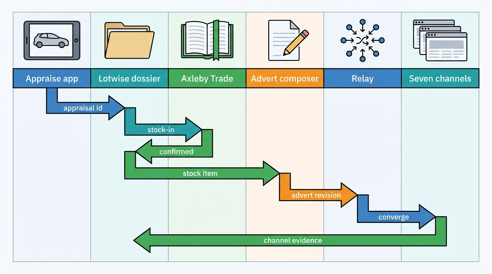
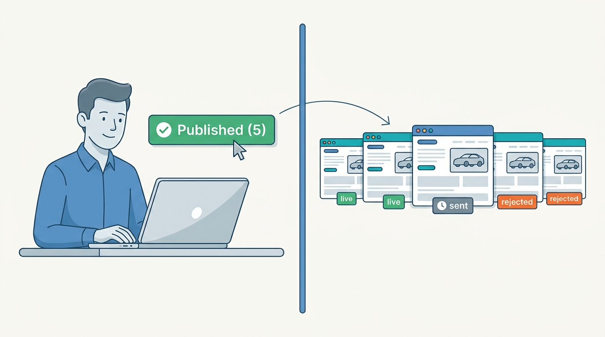
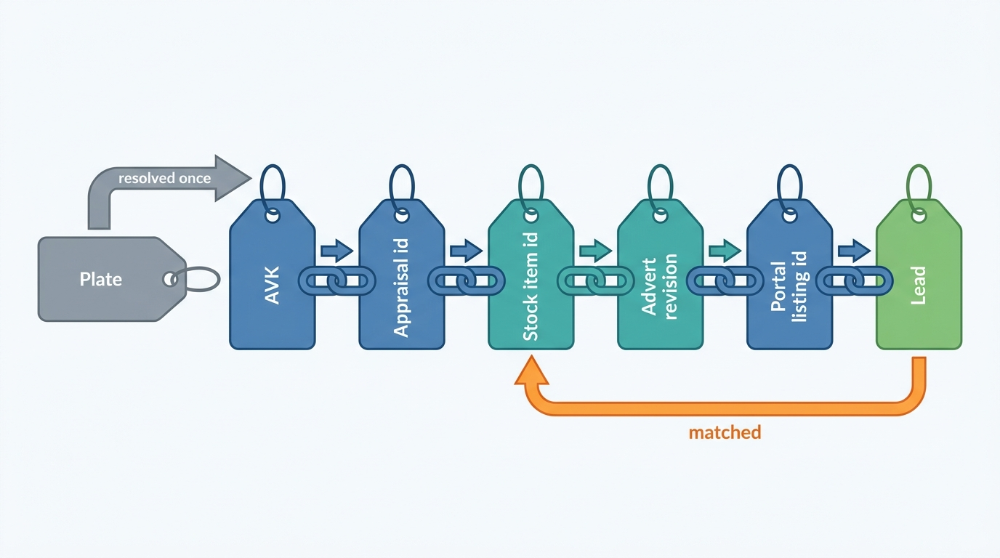
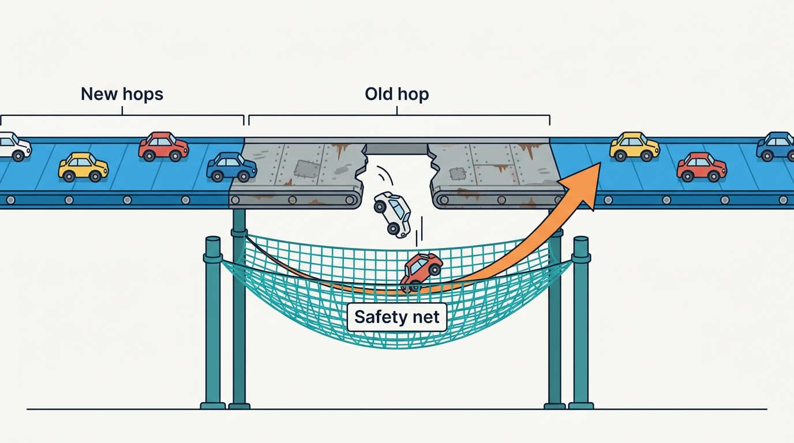
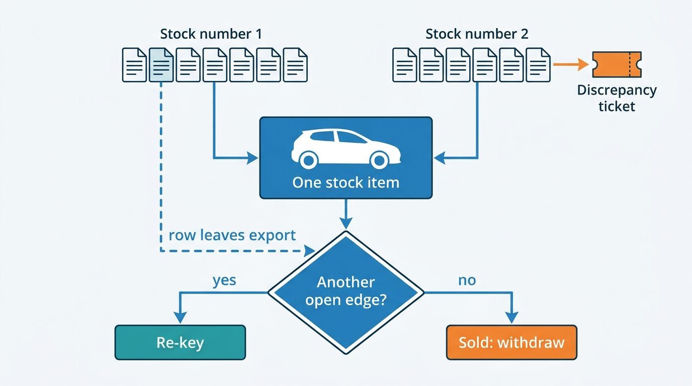

> **IN THIS CHAPTER, YOU WILL:** Follow one trade-in at Autobedrijf Brandsma from the handover on the forecourt to live adverts on seven channels, hop by hop: who owns each step, which identifiers cross which boundary, what each hop must guarantee, and how six failures along the way are detected and repaired.

> **WHY THE BUSINESS CARES:** A used car earns nothing until a buyer can find it, and costs the dealer about €8.8 a day while it waits. The dealer judges the platform by two clocks: how soon a car bought this morning is visible everywhere the dealer pays to advertise, and how soon a car just sold is gone from all of them.

> **WHY ARCHITECTS SHOULD CARE:** The inventory-to-portal journey crosses more contexts than any other dealer flow: appraisal, identity, specification, registers, the dossier, pricing, merchandising, syndication, and sometimes a DMS. Each chapter of Part IV designs one hop well. Only the journey view shows the seams between the hops, where identifiers are re-derived, success is reported without evidence, and an old mechanism still decides the outcome.

> **KEY POINTS:**
>
> * **A journey is only as good as its weakest hop, and the hops modernize at different speeds.** In September 2027 the Golf Variant's appraisal, identity and specification ran on the new designs, but its adverts still left Lotwise through a publish-after-commit message and a command queue. Measure the journey from handover to evidence on the last channel, or the improved hops hide the ones that were not improved.
> * **Mint each identifier once and use it as the next hop's idempotency key.** Appraisal id, stock item, Axleby Vehicle Key (AVK), advert revision, channel listing, portal listing id: each hop keys its work on the identifier the previous hop created. A hop that re-derives identity from a plate or a DMS stock number is where duplicate stock items, twin adverts and unmatched leads begin.
> * **"Published" is a claim; "live" is evidence, per channel.** When Lotwise said the Golf Variant was published on five channels, two had confirmed it, one would take it in the next hourly file and two had rejected it. A journey needs evidence per channel, rejection reasons routed to whoever can fix them (the dealer or the platform), and retries triggered by a fixed mapping as well as by changed content.

> **[FAILURE PATTERNS THIS CHAPTER ADDRESSES](where-vehicle-platforms-go-wrong.html):**
>
> * **The Zombie Listing** — the journey's last hop runs in both directions; a withdrawal racing a price update, or a portal outage during a sale, leaves a sold car live unless every command re-checks the current state when it is sent.
> * **Feed Roulette** — the Golf Variant's first AutoScout24 rejection came from an equipment-code combination that no mapping test covered, and it took a second destination down with it.
> * **The Cloned Identity** — a DMS that sends one car under two stock numbers creates two stock items, two adverts per channel and, when the duplicate is cleaned up, a "sale" that withdraws the real car.

 
Part IV of this book takes the dealer's used-car workflow apart one capability at a time: buying the car ([[vehicle-acquisition]]), keeping its record ([[inventory-and-vehicle-dossier]]), pricing it ([[used-car-pricing]]), making it sellable online ([[merchandising]]) and publishing it ([[listing-syndication]]), with the DMS beside it ([[dms-integration]]). Each chapter draws its boundary, and each boundary is sound. **A car does not experience boundaries. It experiences a sequence of hand-offs**, and the dealer sees one result: the car is on Marktplaats or it is not.

This chapter walks that sequence once, for one car, and asks only what appears between the chapters: **which identifier crosses each boundary, what each hop promises the next, and who notices when a hop says done and is not.** Then it breaks the journey six times.

## Setting the Scene at Axleby: Two Volkswagens, Seven Months Apart

Axleby, the fictional vehicle data and dealer software group this book follows (see [[meet-axleby]]), sells **Lotwise** to **7,200** dealer rooftops in the Netherlands, Belgium and Germany. Lotwise rooftops stock in about **1.9 million** cars a year, and Relay, Axleby's syndication engine, carries about **1.4 million** channel operations a day to **61** channels.

In **February 2027** a sold 2021 Volkswagen Golf at Velto Mobility Group's Breda rooftop stayed live on **4** portals for **4 days**, producing **37** leads and **9** booked test drives: the **Zombie Golf** ([[listing-syndication]] owns the story). Two hops failed. The DMS adapter could not match the sold row after a rooftop transfer had changed the car's stock number, and Relay's delete sat behind updates that could never succeed.

Seven months later, in **September 2027**, Sietse Brandsma took a 2021 Volkswagen Golf Variant in part-exchange at **Autobedrijf Brandsma**, his one-rooftop independent dealership in Leeuwarden with about **55** cars in stock and no DMS. Three Part IV chapters follow pieces of this car: its edition ([[specification-and-equipment]]), its maximum purchase price ([[vehicle-acquisition]]) and its advert ([[merchandising]]). Ines Marchetti, Axleby's Group Chief Architect, chose it for the One Dossier program's first **journey review**: the parts had been redesigned, and she wanted to know whether the whole worked and which hops still ran on the mechanism behind the Zombie Golf.

Her question to Tomás Ferreira (Product Director, Lotwise) and Hendrik Maes (Head of Partner Integrations) was short: **from the moment Sietse took the keys, how long until a buyer could find this car on every channel he pays for, and how would we know?**

## The Journey at a Glance

The journey has nine hops. The first four turn a customer's car into a stock item; the last five turn the stock item into channel listings and keep them true.

| # | Hop | Owner (Axleby) | Input identifier | Identifier minted | Hop done when |
| --- | --- | --- | --- | --- | --- |
| 1 | Identify and check | Anchor and Turnstile (data platform) | Plate | **AVK**, plate assignment as of today | Vehicle resolved at Confirmed tier; live register status read |
| 2 | Resolve specification | Specbook (Priya Raman's team) | AVK | **Specification resolution** with state and version | State is *as-built confirmed*, *edition resolved* or explicitly *edition unknown* |
| 3 | Value, appraise, offer | Lotwise Appraise | AVK, resolution version | **Appraisal id**, valuation id, offer versions | Offer accepted, handover reading inside the offer's limit |
| 4 | Purchase and stock-in | Lotwise dossier; Axleby Trade for the register | Appraisal id | **Stock item id**; register transaction id | Stock item *Purchased*; register stock-in confirmed |
| 5 | Price | Lotwise pricing | Stock item id, valuation id | **Price event** (author, reason, reference) | Asking price accepted at a stock-item version |
| 6 | Compose the advert | Lotwise advert composer | Stock item id, fact versions | **Advert revision** and content hash | Revision passes disclosure rules and is published |
| 7 | Decide channels | Relay publish rules | Advert revision, rooftop rules | **Channel listing key** (stock item + channel) | Desired presence set per channel |
| 8 | Converge each channel | Relay adapters (Hendrik's team) | Channel listing key, creation key | **Portal listing id** | Channel evidence matches the revision |
| 9 | Keep it true | Relay, publish-lag monitor, Pitwall | Portal listing id | Drift and status records | Every change, including withdrawal, reaches every channel within target |

Each hop works on what the previous hop minted, and each has its own definition of done; only hop 8 knows whether a buyer can see anything.

**Figure 1:** *The success path. Every arrow carries the identifier minted by the hop before it. The last return arrow is the one the dealer depends on: channel evidence written back to the advertising track, not the publish click.*

## The Success Path, Hop by Hop

All times and amounts are Axleby illustrations. They agree with the chapters that follow the same car.

### Hops 1–3: from plate to accepted offer (Saturday 11 – Sunday 12 September)

On **Saturday 11 September 2027** a customer buying a 2023 Škoda Kodiaq from Sietse offers his Golf Variant in part-exchange. Sietse scans the plate in Lotwise Appraise. Anchor maps it to a VIN and the car's AVK at the **Confirmed** tier ([[vehicle-identity]]); Turnstile shows the mirrored register facts, and a **live** status call confirms that transfer is possible, because theft and awaiting-inspection status are never mirrored ([[registers-and-official-data]]).

Specbook narrows the car to three editions whose values spread by **€2,900**, above the **€750** appraisal threshold, so it buys the as-built record once, for about **€0.58**: a Style with a panoramic roof and a folding towbar ([[specification-and-equipment]]). Vantage values it at **€23,750** retail; Brandsma's buying policy gives a maximum purchase price of **€19,434**; Sietse's second offer, **€19,250**, valid for seven days or to 61,740 km (500 km beyond the appraisal reading), is accepted on Sunday ([[vehicle-acquisition]]).

What crosses the next boundary is not the car's data but **four references**: appraisal id, AVK, specification resolution version and valuation id ([[inventory-and-vehicle-dossier]]).

### Hop 4: purchase and stock-in (Tuesday 14 September, 09:15–09:34)

The Kodiaq is delivered on **Tuesday 14 September**. At **09:15** Sietse reads **61,302 km** on the Golf's dashboard, 62 km above the appraisal reading and inside the offer's limit, and finds no new damage. The purchase agreement is signed in Lotwise.

At **09:31** the dossier creates the stock item, **keyed by the appraisal id**. That key is the hop's idempotency: the app's retry after a dropped connection on the forecourt returns the existing stock item instead of creating a second one. The stock item carries the purchase price of €19,250, `vatRegime = margin` with the purchase agreement as evidence, the target gross of about €1,752, and the commercial state *In reconditioning*, because the car is on site and the preparation track lists two tires, a service and a bumper touch-up.

At **09:34** Axleby Trade's stock-in to the Dutch register, submitted with the handover reading, is confirmed, and the customer receives the indemnification certificate (*vrijwaringsbewijs*) that releases him from liability for the car ([[registration-and-trade-services]]). Brandsma holds the Dutch register's trade-stock recognition, so the car now sits in trade stock.

The register hop runs before the advert but **does not gate it**: in a register outage the stock-in queues in order while the car continues to the portals ([[vehicle-acquisition]]). Only delivery to a buyer needs the register step.

### Hop 5: price (09:38)

At **09:38** Sietse accepts the pricing module's proposal of **€23,750**, a price position of 100% against Vantage's value. The dossier records one price event with its author, reason code and reference snapshot, conditional on the stock item's version ([[used-car-pricing]]). The asking price is a local decision: it must not wait for Vantage, Relay or any portal, and it did not.

### Hops 6–7: compose and decide channels (09:40–10:22)

At **09:40** the composer opens a draft from referenced facts: edition, engine, first registration, mileage and the register's odometer judgement. An employee shoots the 24 intake photos between 09:55 and 10:14; the claim checker accepts all nine claims in the generated Dutch text, and the Netherlands rule set adds the financing warning and representative example from Merelstad Auto Finance's rate card ([[merchandising]]). At **10:22** Sietse publishes **advert revision 1**, marked "in preparation, available from 17 September", with a listing quality score of 84.

Relay's publish rules, data in Brandsma's rooftop configuration, then decide the desired presence per channel:

| Channel | Kind | Rule for this car on 14 September | Evidence the channel gives |
| --- | --- | --- | --- |
| Lotwise website | Dealer website | All stock from *In reconditioning* on | Reads Lotwise directly: immediate |
| Marktplaats | Portal write API | All stock from *In reconditioning* on | Confirmed by status read |
| AutoScout24 | Portal write API | All stock from *In reconditioning* on | Confirmed by status read |
| AutoTrack | Reached via AutoScout24 | Follows AutoScout24 | Through AutoScout24's channel flags only |
| A regional portal in the north | Hourly file feed | All stock from *In reconditioning* on | None: file delivered, not processed |
| Google vehicle ads | Ad catalog | Only *Ready* with the retail photo set | Merchant Center diagnostics, hours later |
| A dealer-association used-car portal | Portal write API | Only *Ready*, with warranty | Accepts, processes later, no callback |

Five channels become *desired present* at 10:22. The two catalogs wait for the car to be ready, by Sietse's own rule: he pays per click on Google and wants retail photos there, and the association portal lists only cars ready for delivery. Google's guidelines also forbid "Coming Soon" placeholders and require the landing page to show the car's price, VIN and mileage ([Google Merchant Center Help, n.d.](https://support.google.com/merchants/answer/11192663)), so the **website listing is a prerequisite for the Google listing**: an ordering rule between two channels, invisible from inside either adapter.

AutoTrack is a destination without an adapter. Since AutoScout24 took over AutoTrack and Gaspedaal.nl, reported by Emerce on 28 November 2025 ([Emerce, 2025](https://www.emerce.nl/nieuws/autotrack-gaspedaalnl-onderdeel-autoscout24)), AutoScout24's API offers an `AutoTrack` channel id for a listing "published on AutoTrack in the Netherlands and displayed on both platforms" ([AutoScout24 Listing Creation API, data models, n.d.](https://listing-creation.api.autoscout24.com/docs)). Relay models it as a channel listing **reached via** AutoScout24: one call converges two destinations, and one rejection fails both.

### Hop 8: converge each channel (10:22–13:19)

What Sietse's screen said at 10:23, and what the channels said, differed:

| Time | Lotwise showed | Evidence per channel |
| --- | --- | --- |
| 10:22 | "Publishing to 5 channels" | Website live (direct read) |
| 10:23 | "Published (5)" until summer 2027; since then per-channel status | Marktplaats accepted; AutoScout24 returned HTTP 400; AutoTrack therefore not live |
| 10:27 | Marktplaats "live" | Marktplaats status read confirms the listing |
| 11:00 | Regional portal "sent" | Car included in the hourly file; transfer succeeded; no processing status exists |
| 11:48 | First lead | A Marktplaats enquiry reaches Switchboard and Brandsma's inbox ([[leads-and-crm]]) |
| 13:19 | AutoScout24 and AutoTrack "live" | After a mapping fix; failure case 3 below |

Merchandising's figure for this car is that it was **online 42 minutes** after the draft opened, against the 2026 average of seven days ([[merchandising]]). That is true of the website and Marktplaats. From handover, the first channel showed the car after **67 minutes**, the last of the morning's five confirmed after **4 hours 4 minutes**, and the file feed never confirms anything. **Each of these numbers answers a different question, and the journey needs all of them.**

**Figure 2:** *"Published" is a claim and "live" is evidence: behind Lotwise's "Published (5)" two channels had confirmed the Golf Variant, one would take it in the next hourly file and two had rejected it.*

### Hop 9: keep it true (17 September – 4 October)

On **Friday 17 September** the preparation track reaches *done* at 11:40 and the car becomes *Ready*. Merchandising swaps in the 24 retail photos (score 93) as a new revision, and Relay's rules turn the two catalogs *desired present*; failure case 4 covers the photo upload that went wrong. Google's diagnostics approved the offer the next morning, so the car reached its seventh channel about **four days** after handover, as planned.

On **Monday 4 October**, with Vantage's value down to €23,200 and the car at a price position of 102.4%, Sietse accepts a **€400** reduction to **€23,350**, revision 6 of the advert. The price event fans out to seven channel listings; all converged within 11 minutes, inside the 15-minute target ([[used-car-pricing]]). The car's eventual sale, the withdrawal from all seven channels and the registration in the buyer's name belong to [[journey-sale-to-registration]].

## The Identifier Chain

The journey's integrity rests on one chain of identifiers. Each is minted once, by one owner, and becomes the next hop's idempotency key.

**Figure 3:** *The identifier chain from plate to lead. The plate enters once and is resolved; from then on each hop keys on what the previous hop minted. The chain closes when a portal lead names a portal listing id that maps back to the stock item.*

| Boundary | Identifier that crosses | Why it must not be re-derived |
| --- | --- | --- |
| App → vehicle facts | Plate, once, with the observation date | A plate changes owner over time; resolved once, it becomes an AVK ([[vehicle-identity]]) |
| Appraisal → dossier | Appraisal id + AVK + resolution version + valuation id | A retried hand-off must find the stock item it created; the decision inputs must stay the ones the offer used |
| Dossier → Axleby Trade | Stock item id + AVK + idempotency key from the dealer's click | The register transaction must be provably this car's, and a retry after a timeout must probe, not resubmit |
| Dossier → composer | Stock item id + fact versions | The advert must say which mileage and edition it rendered, so a correction can find it ([[journey-data-correction]]) |
| Composer → Relay | Advert revision + content hash | A content hash equal to the last acknowledged one is a no-op; a retry cannot publish twice |
| Relay → portal | Channel listing key in the portal's external-id field (`offerReferenceId`, `crossReferenceId`, `internalNumber`, `externalStockId`) | The only stable join for reconciliation, migration and duplicate detection ([[listing-syndication]]) |
| Portal → Switchboard | Portal listing id in the lead | The lead must map to the stock item and rooftop without a plate search |

The last row is where the journey meets [[journey-lead-to-dms]]. If a channel listing loses its portal listing id, through a re-creation or a portal-side restore, the next lead for the car arrives unmatched. **A broken identifier at hop 8 surfaces as a lost lead at a hop nobody associates with syndication.**

## Requirements per Hop

The table sets what each hop must guarantee. Targets come from the owning chapters or the ledger; rows marked *(assumption)* are illustrative.

| Hop | Consistency | Latency target | Freshness | Availability | Golf Variant, 2027 |
| --- | --- | --- | --- | --- | --- |
| Identify and check | Confirmed tier for purchase; live status at purchase confirm | p95 under 1 s for the mirror *(assumption)* | Mirror daily; status live | Mirror read if the register is down; purchase confirm waits | 0.3 s |
| Specification | One as-built purchase per VIN, coalesced | Seconds at appraisal *(assumption)* | Stored for the life of the vehicle | *Edition unknown* with candidates if the provider is down | Bought once at appraisal |
| Offer → stock item | Exactly one stock item per appraisal id | Seconds | — | Works without register, DMS and portals | 09:15 → 09:31 (paperwork, not systems) |
| Register stock-in | Exactly once; ordered per vehicle; probe before retry | Seconds; queued in outages | Status shown with age | Queued, never blocking the advert | 3 min after stock item |
| Price | Conditional on stock-item version; one event per change | p95 under 300 ms *(assumption)* | Reference no older than 24 h | Local; must not wait on remote systems | Accepted 09:38 |
| Compose | Revision records input versions | Fact change → revision ≤ 5 min *(assumption)* | Current facts at publish | Composer outage delays, never publishes wrong content | Draft to publish 42 min, mostly photos |
| Decide channels | Desired presence per channel listing | Seconds | Rules re-evaluated on every state change | — | 5 channels at 10:22, 2 more at Ready |
| Converge | One listing per channel; latest content wins | New car p95 under 30 min after desired; updates 95% within 15 min | Evidence per channel | Per channel; one channel's failure blocks no other | 5 min to 2 h 57 min |
| Withdraw | Must converge; no lost withdrawal | 99% within 10 min; alarm at 30 min | Sold-but-live check every 15 min | Highest; reserved budget | (in [[journey-sale-to-registration]]) |

Two properties are only visible end to end. **The only synchronous hops are local ones**: stock item, price and reservation commit inside the dossier, and everything remote follows with a visible status. And **the latency the dealer feels accumulates across hops whose owners each meet their own target**: every hop of the Golf Variant's morning but one was on target, and the journey still took four hours to reach five channels.

## What Was Still Old: The Hops at Different Maturity

Ines's review produced one table that no single chapter contains: the mechanism each hop actually used in September 2027, against the One Dossier target.

| Hop | September 2027 mechanism | Target (2028) | Residual risk in 2027 |
| --- | --- | --- | --- |
| Identity | Anchor, AVK on every new stock item | Same | Backfill residue: 0.7% manual cases |
| Specification | Resolution states, purchase gate, life-of-vehicle retention | Same | 12% of stock-ins *edition unknown* |
| Dossier | Stock state in Lotwise Classic; Dossier service from Q4 2027 | Stock state out of the monolith via the outbox | Transitions commit in the PHP monolith |
| Stock events | RabbitMQ publish after commit (a dual write) | Transactional outbox, entity-keyed topics on MSK | **83 of 152,400** sold transitions in October 2027 never reached Relay ([[events-webhooks-and-sync]]) |
| Syndication | Command queue, ordered per advert, withdrawal priority lane, permanent errors parked | Relay 2: desired state, scheduler keyed by channel listing, reconciler | Priority lane can overtake an update (failure case 5); no continuous reconciliation |
| Safety net | Sold-but-live job every 15 min; publish-lag dashboard | Same, plus nightly reconciliation of every channel listing | The net catches what the pipe drops, a median 34 minutes later |

The 2027 journey worked because its weakest hops had **safety nets**: the sold-but-live job caught all 83 lost sold events, and the publish-lag dashboard measured what the queue could not. **A journey review should list safety nets as load-bearing components**, because removing one during a migration removes a guarantee no hop provides on its own.

**Figure 4:** *A partly modernized journey is safe only because of its safety nets: the sold-but-live job caught all 83 sold events the old publish-after-commit path dropped in October 2027.*

## Failure Cases

Six failures follow, chosen to cover duplicates, incomplete records, permanent errors, partial failures, conflicting updates and an external outage. Three happened to the Golf Variant; three come from other rooftops in the same autumn. All are Axleby illustrations.

### 1. The DMS sends the car twice, under two stock numbers

**What happened.** On **12 October 2027** Velto's Eindhoven rooftop corrected the purchase invoice of a trade-in in DriveDesk, its DMS. DriveDesk canceled the stock unit and booked it again under a **new stock number**, and its stock export carried both rows as *in stock* for 26 hours until the cancellation completed. Before Hitch, Lotwise's adapter matched rows by DriveDesk stock number and would have created a second stock item, a second advert and a second listing on each of the car's channels: the shape of the 418 cars that Velto's Eindhoven region had advertised twice for two days during its 2026 onboarding ([[onboarding-and-configuration]]).

**Detection.** Hitch, Axleby's DMS integration layer ([[dms-integration]]), resolves the second row's VIN to the same AVK. The dossier enforces **one open stock item per tenant and AVK**, so the upsert cannot create a second one. Hitch records the new stock number as a second open edge in its cross-reference map and raises a discrepancy ticket: two open DMS units for one stock item.

**The trap is the clean-up.** When DriveDesk finished the cancellation, the old stock number left the export. In DriveDesk's file, a unit leaving stock looks the same whether it was sold or canceled. Mapped naively, that exit is a sale, and the dossier would have withdrawn the car from all its channels while it was still for sale: a **mass withdrawal of one**, which no truncated-feed guard notices.

**Recovery.** Hitch's rule since October 2027: **the exit of one cross-reference edge while another open edge exists for the same stock item is a re-key, not a sale.** A sale needs a DMS deal reference. The old edge is closed with the reason "superseded", the ticket closes itself, and the adverts never move. *(The rule extends [[dms-integration]]'s time-bounded cross-reference map to concurrent edges.)*

**Figure 5:** *A DMS duplicate is caught at the dossier's uniqueness rule, not at the portal. The dangerous moment is the clean-up: a unit leaving the DMS export is a sale only when it carries a deal and no other open edge points at the same stock item.*

### 2. The specification resolves to two editions

**What happened.** On **21 September 2027** Sietse appraised a 2013 Opel Insignia Sports Tourer. The register narrowed it to two editions whose value spread was **€310**, under the **€750** threshold, so the purchase gate did not buy build data ([[specification-and-equipment]]). Its resolution state was *edition unknown, two candidates*.

**How the uncertainty travels.** The journey view shows one flag crossing four hops, each of which must respect it:

| Hop | What *edition unknown* does |
| --- | --- |
| Valuation and offer | Vantage values the candidate range with a wider interval; the MPP uses the cautious point |
| Pricing | The reference carries `spec_uncertain`, so repricing rules may propose but not apply changes ([[used-car-pricing]]) |
| Advert | The title omits the edition; the equipment list shows only items common to both candidates or confirmed by the dealer's photos |
| Channels | Adapters send model-level values and leave edition fields empty; portals that enrich listings from the plate may add their own edition guess |

**Detection.** The last row is the gap. Marktplaats documents that car adverts with a valid plate "will be enriched with data from a third party partner after posting", with dealer-supplied values taking precedence ([Marktplaats API documentation, n.d.](https://api.marktplaats.nl/docs/v1/advertisement.html)). An edition the platform declined to claim can therefore appear on the portal from someone else's data. Relay's channel profile marks such fields as **portal-derived**, and the publish-lag evidence read flags any edition value on the portal that the advert did not send.

**Recovery.** The dealer resolves the doubt: one question in Lotwise ("Is there an 'Innovation' badge on the tailgate?") with a photo. Sietse answered on 22 September; the state moved to *dealer-confirmed*, and the re-rendered advert converged on all five channels within 12 minutes. **An unresolved fact must travel as a flag, not as a guess**, with a defined behavior at every hop downstream.

### 3. One portal rejects an equipment code

**What happened.** The Golf Variant's AutoScout24 call at **10:23** on 14 September returned HTTP 400. Its equipment list carried AutoScout24's generic automatic climate control and the specific two-zone variant. AutoScout24 documents that a listing may carry only one automatic climate control item, choosing between the zone variants and the generic one ([AutoScout24 data models, n.d.](https://listing-creation.api.autoscout24.com/docs)). A specification-catalog release that morning had split the canonical code into two, and both mapped. The build-time mapping test introduced after the Zombie Golf checked that **every canonical code had a mapping**; it did not check **combinations against a portal's exclusion rules**. That morning **1,140** Lotwise listings on AutoScout24 hit the same error.

**Detection.** Since summer 2027, Relay parks permanent errors instead of requeueing them, and writes the reason to the advert's channel status. That alone turned a Zombie Golf mechanism (a loop blocking a queue) into a contained rejection. Hendrik's team saw the error class spike on the AutoScout24 dashboard within minutes.

**Two new problems.** First, **the reason went to the wrong person**: Lotwise showed Sietse "Rejected on AutoScout24: equipment not accepted", and he called support at 10:40 to ask which option to remove. Nothing in his advert was wrong; the mapping was. Second, **the parked messages had no trigger to retry**. "Retry only when the content changes" is right for a dealer's missing field; here only the mapping had changed.

**Recovery.** The mapping fix shipped at **13:05**, a one-off job re-drove the parked messages, and the Golf Variant and its AutoTrack destination were confirmed at **13:19**. Three changes lasted. **Rejections are classified by owner**: content the dealer controls (a missing Car-Pass link in Belgium) is a dealer action; platform mapping, configuration or adapter faults are an integrations incident, shown to the dealer as "we are fixing this". **Mapping versions are part of the content version**, so a new mapping re-marks every channel listing it affects and a fix converges by itself. And **the mapping test runs portal exclusion rules** on every catalog release. Because AutoTrack is reached via AutoScout24, one rejection took two destinations down, and the status must show both.

### 4. A partial photo upload

**What happened.** At 13:52 on **17 September** the retail set of 24 photos was processed. AutoScout24 treats images as separate resources associated with a listing by id, and "upon a partial failure, the API cancel[s] the whole operation" ([AutoScout24 Listing Creation API, design, n.d.](https://listing-creation.api.autoscout24.com/docs)). The adapter uploaded 19 of 24 images before the portal began timing out; the listing update that referenced all 24 could not be sent.

**What must not happen.** The adapter must not send a listing that references 19 retail photos and drops the rest, nor one that mixes 12 intake and 12 retail photos. Both are partial states the dealer never chose. Merchandising applies the same rule on the phone: a half-uploaded set must never look complete ([[merchandising]]).

**Recovery.** The intake revision stayed live on AutoScout24 and AutoTrack while the other channels converged. The adapter retried the five missing uploads with backoff, skipping the 19 that had arrived by the MD5 AutoScout24 returns, and converged at 14:31. AutoScout24 deletes uploaded images never associated with a listing after one day, so **a retry the next morning must upload again rather than reuse yesterday's image ids**.

For 39 minutes the car showed different photos on different channels. That is acceptable; showing a revision that never existed is not. **Convergence is per channel and per revision, never per field.**

### 5. A price change racing a reservation

**What happened.** On **Saturday 2 October 2027** at 11:02:10, Sietse lowered the price of a 2019 Toyota Yaris hybrid by €300. Thirty seconds later a salesperson took a deposit and marked the car *Reserved*. In the dossier, both writes committed in order, each conditional on the stock item's version, and the reservation set the advertising track to *withdrawn* in the same transaction ([[inventory-and-vehicle-dossier]]).

Downstream, the 2027 Relay received two commands: an update in the normal lane and a withdrawal in the **priority lane**. The priority lane is the summer 2027 fix for the Zombie Golf, and it works: withdrawals no longer wait. But it means a withdrawal can **overtake** an update for the same advert. On most channels that is harmless; an update to a deleted listing fails. On two of Relay's 61 channels, an update for a listing the portal no longer holds is treated as a create *(Axleby illustration)*. The Yaris reappeared on one of them at 11:03 with the new price.

**Detection.** The sold-but-live job, which also covers reserved cars, found it at its 11:15 run and paged the integrations on-call at the 30-minute alarm. Lotwise's channel status showed the car "withdrawn" from that channel: the adapter had a 200 response for the delete and another for the update, and believed both.

**Recovery and fix.** The on-call re-sent the withdrawal at 11:34. The fix, deployed in October, makes every adapter **re-read the advertising track's current desired state at send time** and drop any command that contradicts it. A command queue with a priority lane behaves correctly only if every command is checked against current intent when it is sent, which is desired-state semantics applied one message at a time. Relay 2 makes it structural: the scheduler holds channel-listing keys rather than commands, so there is no stale update left to send ([[listing-syndication]]).

File feeds have their own version of the race: an hourly file rendered from a lagging stock list can miss a reservation and keep the car live for an hour. Axleby now renders files from desired state at send time and sends an out-of-cycle file within 10 minutes of a reservation or sale.

### 6. A portal outage

**What happened.** On **Monday 20 September 2027**, from 08:50 to 12:00, one portal's write API returned errors for Axleby's adapter. *(The incident is fictional, and the book does not name the portal.)* Monday morning is Lotwise's busiest editing window. About **48,000** commands for that channel were waiting by 12:00, about **1,300** of them withdrawals of cars sold or reserved during the morning *(Axleby illustration)*.

**Detection.** The channel's error rate and its synthetic test car alerted within 5 minutes; the on-call paused the channel's consumers at 09:05 so retries would not pile onto the portal's recovery, and grouped the sold-but-live alerts for that channel under the incident.

**What the journey view shows.** Inside syndication the outage was contained: the other 60 channels share no queue with it. The cost moved downstream. Cars sold that morning stayed visible on the affected portal for up to three hours, and buyers kept enquiring about them. **The lead hop pays for the syndication hop's outage.** Switchboard therefore marks a lead that arrives for a stock item that is reserved or sold as such, so the salesperson answers "sold" within minutes instead of booking a test drive ([[leads-and-crm]]).

**Recovery.** Relay drained withdrawals first; the last landed at 12:31, and updates followed under the channel's ramp-up. A command queue replays every change, including updates already superseded; Relay 2's coalescing will send each listing's current state once ([[listing-syndication]]). Affected rooftops saw a banner naming the channel, and Pitwall, the support console, showed agents the per-car status ([[observability-and-data-operations]]).

### The failure cases side by side

| Failure | Kind | Hop where it starts | Hop where it is felt | Detection | Recovery |
| --- | --- | --- | --- | --- | --- |
| DMS sends two stock numbers | Duplicate | DMS adapter | Every channel (twin adverts), then a false sale | One open stock item per tenant and AVK; discrepancy ticket | Second edge on one stock item; exit of a superseded edge is a re-key, not a sale |
| Two candidate editions | Incomplete record | Specification | Valuation, pricing, advert, portal enrichment | Resolution state; evidence read flags portal-derived edition | Flag travels; dealer confirms; one re-render converges all channels |
| Equipment combination rejected | Permanent error | Catalog release | AutoScout24 and AutoTrack | Error class per channel; parked, not requeued | Owner-routed reason; mapping version re-marks listings; exclusion-rule test |
| Partial photo upload | Partial failure | Adapter | One syndicator and its destination | Upload results per image | Keep previous revision live; resume by hash within a day |
| Price racing a reservation | Conflicting updates | Priority lane | One upsert channel | Sold-but-live job | Re-check desired state at send time; out-of-cycle file |
| Portal outage | External outage | Portal | Leads for sold cars | Error rate, synthetic car | Pause, withdrawals first, banner, lead marking |

A seventh failure needs no story: **a create that times out** is retried only after a lookup by the platform's external id, because AutoScout24 documents POST as not idempotent ([[listing-syndication]]). Otherwise the duplicate surfaces weeks later as an orphan listing whose leads match no stock item.

## Trade-offs

| Decision | Option A | Option B | When A is right | When B is right |
| --- | --- | --- | --- | --- |
| **When to advertise** | From intake photos, "available from" date | Only when *Ready*, with retail photos | Margin-scheme stock with holding cost, buyers who accept a date; channels that allow it | Ad catalogs with strict image rules; dealers whose intake photos show damage; association portals that list only deliverable cars |
| **Who coordinates the journey** | One orchestrator that drives every hop as a saga | Each hop reacts to the previous hop's event; a journey monitor measures end to end | Short, transactional flows with one owner (a register transaction) | Long flows across teams and weeks, where each hop has its own owner and failure modes (this journey) |
| **Gate publication on all channels** | Publish nowhere until every chosen channel validates | Publish per channel as each validates | Never for consumer channels; a buyer on Marktplaats should not wait for Google | Default; show per-channel status to the dealer |
| **Who creates the stock item for DMS rooftops** | The DMS row, through the adapter | The Lotwise appraisal, with the DMS row matched to it | When stock arrives without an appraisal (auction lots, transfers) | When the appraisal happened in Lotwise; the appraisal id is the better key |
| **What the dealer sees after Publish** | "Published" | Per-channel evidence: live, accepted, sent, rejected with owner | Never, after the Golf Variant | Always |

On the second row I would choose **choreography with a journey monitor**. Each hop already has an owner, a state machine and a failure model in its own chapter; an orchestrator spanning appraisal to portal would own nothing, know everything and become the monolith the One Dossier program is dismantling. A monitor supplies the missing view of the whole without taking any decision: it follows the stock item id and trace context through every hop and measures time to evidence. The condition under which I would change my mind: a flow with a hard deadline and compensation across hops, such as the registration that follows a sale ([[journey-sale-to-registration]]), where one component must know when to give up.

The first row is a commercial choice that architecture must make cheap. Advertising from intake photos took Lotwise's stock-in-to-first-advert average from 7.0 days to 3.4 days during 2027 ([[merchandising]]), at the price of at least one more revision per car for every channel to converge.

## Metrics That Prove the Journey Works

AutoScout24 described in 2024 how it defines service level objectives on **Critical User Interactions** per journey, with examples such as "Dealer is contacted by a Buyer about a car", tagged by journey and team rather than by service, and how its earlier SLOs failed because they were "designed with a focus on technical metrics that did not reflect user experience" ([AutoScout24, 2024](https://tech.autoscout24.com/blog/posts/slos-for-critical-user-interactions/)). The inventory-to-portal journey needs the same discipline on the dealer software's side, across systems the platform does not run.

| Metric | Definition | Target or 2027 value (Axleby) | What it catches |
| --- | --- | --- | --- |
| **Handover to first live** | Purchase signed → first channel evidence | Median under 2 hours for cars advertised from intake *(assumption)* | Slow capture, slow composing |
| **Desired to evidence, per channel** | Channel listing becomes desired present → channel evidence | p95 under 30 min for API channels *(assumption)*; file feeds at their schedule | Adapter, portal and mapping faults |
| **Stock-in to first advert** | Stock item created → first live advert | 3.4 days average (Q4 2027) | Preparation and photo bottlenecks |
| **Update convergence** | Price or content change → evidence on all channels | 95% within 15 min | Queueing, throttling |
| **Withdrawal convergence** | Reserved, sold or written off → absence on all channels | 99% within 10 min; p99 14 min in September 2027 | The Zombie Listing |
| **Sold-but-live** | Cars reserved or sold more than 30 min ago and live anywhere | Zero | Lost events, races, outages |
| **First-time acceptance** | Share of creates accepted on the first attempt, per channel | Tracked per channel *(assumption: alert below 97%)* | Mapping and validation gaps |
| **Rejections by owner** | Open rejections, split into dealer-owned and platform-owned, by age | Platform-owned older than 4 hours: zero *(assumption)* | Feed Roulette, misrouted reasons |
| **Identifier integrity** | Stock items with AVK; channel listings with portal id; leads matched to a stock item | 100%, 100%, tracked | Broken chain, unmatched leads |

Two rules make the table useful. **Measure every clock from a business event to evidence, never to a send.** And **split each measure by cause**: time spent waiting for a rule (the catalogs waiting for *Ready*) is a dealer decision, while time spent on a rejection is a platform defect. The Golf Variant's four days to its seventh channel were the first kind; its four hours to AutoScout24 were the second.

## What Changes in Another Market

The journey's shape is the same in every market Axleby serves: identify, resolve, appraise, stock, price, compose, decide, converge, keep true. What changes is which hops exist and how the last one behaves.

| Hop | Netherlands / Belgium | Germany | United Kingdom | United States |
| --- | --- | --- | --- | --- |
| Register at stock-in | NL: stock-in to trade stock with an indemnification certificate. BE: register work through a partner | No Axleby register adapter in 2027; stock cars commonly deregistered and re-registered by the buyer *(industry practice)* | Keeper notifies the Driver and Vehicle Licensing Agency (DVLA) of the sale to a trader | Title reassigned to the dealer under state law |
| Specification keys | Register facts, then build data | Manufacturer and type key numbers (*HSN/TSN*) plus build data | Auto Trader derivative taxonomy plus manufacturer factory codes | VIN decoding |
| Market rules at hop 6–8 | BE: Car-Pass mileage link mandatory on AutoScout24 from 1 June 2026 | WLTP fields for near-new cars, enforced by AutoScout24 from 16 September 2026 | Minimum price and no "price on application" on Auto Trader | Federal Trade Commission Buyers Guide on the car; no portal-side validation found |
| Withdrawal | Delete or close date | Delete | Lifecycle states with reservation locks | Absence from the next file |
| Axleby product | Lotwise, Relay | Lotwise (500 rooftops), Relay | Showroomly's own syndication until the One Dossier migration | Not served |

Sources: the portal documentation and changelogs cited in [[listing-syndication]] and [[merchandising]]; the Dutch register's stock-in rule from [RDW, n.d.](https://www.rdw.nl/zakelijke-partners/erkende-bedrijven/bedrijfsvoorraad/voertuig-in-bedrijfsvoorraad-zetten).

Two differences change the journey, not just an adapter. In the **United Kingdom** the last hop runs both ways: a buyer can reserve a car on Auto Trader itself, which then blocks partners from changing the listing's lifecycle state ([Autotrader Connect documentation, n.d.](https://developers.autotrader.co.uk/documentation)), so the journey gains a hop from portal to dossier that withdraws the car everywhere else. In the **United States**, hop 8 has no evidence beyond file delivery, so the journey's metrics end at "sent". Hops 1 to 7 are common; the register hop and the channel profiles are market packs.

## The Chief Architect's View

**Appoint an owner for the journey, not only for the hops.** Every hop of the Golf Variant's journey had an owner who met their target, and the journey still produced four hours of silence on AutoScout24 and a support call about a problem the dealer could not fix. At Axleby, Ines made Tomás Ferreira accountable for the journey's metrics, with Hendrik Maes accountable for hop 8 and the data platform for hops 1–2. The journey owner's tools are the metrics table above and a quarterly journey review that walks one real car.

**Make the identifier chain an architecture rule.** "Each hop keys its work on the identifier the previous hop minted; nothing downstream of the appraisal searches by plate or DMS stock number." It is short enough for the architecture principles and testable in code review: a join on a plate after hop 1 is a defect.

**Keep the safety nets on the books.** The sold-but-live job, the publish-lag dashboard and the per-rooftop DMS reconciliation made a partly modernized journey safe in 2027. They need owners and tests, and the Relay 2 plan must say which component replaces each net before it is switched off.

**Route failures to the party who can act, and review the journey when a hop changes.** A correct error sent to the wrong person costs a support call and a dealer's trust, so every rejection and discrepancy names its owner. And a catalog release broke hop 8, a DMS invoice correction nearly broke hop 9, and a priority lane added to fix one failure created another: changes to one hop should be checked against the journey's failure table.

## Questions to Ask

1. For one car stocked in this morning, can you show the time from handover to evidence on each channel, and which part was a dealer's rule and which a defect?
2. Which identifier does each hop key on? Does any hop after identification search by plate or by DMS stock number?
3. What does the dealer see after pressing Publish: a claim, or per-channel evidence?
4. When a channel rejects a listing, who receives the reason, and when you fix a mapping, what re-sends the listings it rejected?
5. If your DMS adapter sees one car under two stock numbers, how many stock items, adverts and withdrawals follow? What happens when the duplicate disappears?
6. Can a withdrawal overtake an update for the same advert anywhere in your pipeline, and what happens on a channel that treats an update as a create?
7. Which components exist only to catch what the main path drops, and who owns them during a migration?
8. During a portal outage, what do buyers who enquire about sold cars hear, and how soon?

The journey from trade-in to live advert assumes the facts it carries are right. The next journey, [[journey-data-correction]], follows what happens when one of them is not: how a corrected mileage or edition reaches every valuation, report, advert and client that used the wrong one.

## Sources and Evidence

### Company, product and investor sources

- [Listing Creation API documentation: design, data models, workflow, error handling, FAQ and changelog](https://listing-creation.api.autoscout24.com/docs), AutoScout24, n.d. (changelog to 2026-10-19, accessed 2026-10). `AutoTrack` channel ids; equipment exclusion rules; partial failure cancels the whole operation; non-idempotent POST; image MD5 and deletion of unassociated images after one day; Car-Pass and WLTP enforcement dates.
- [SLOs for Critical User Interactions](https://tech.autoscout24.com/blog/posts/slos-for-critical-user-interactions/), AutoScout24 Tech Blog, 2024. SLOs defined per journey and tagged by journey and team; earlier SLOs failed on technical metrics.
- [Marktplaats API 1.0: advertisements](https://api.marktplaats.nl/docs/v1/advertisement.html), Marktplaats B.V., n.d. (© 2023, accessed 2026-10). Asynchronous enrichment of car adverts from the plate; dealer-supplied values take precedence.
- [Vehicle ads attributes](https://support.google.com/merchants/answer/11192663) and [vehicle ads image requirements](https://support.google.com/merchants/answer/11190670), Google Merchant Center Help, n.d. (accessed 2026-10). Landing-page requirements; no "Coming Soon" placeholders.
- [Autotrader Connect developer documentation](https://developers.autotrader.co.uk/documentation), Autotrader UK, n.d. (accessed 2026-10). Lifecycle states and reservation locks on partner updates.

### Standards, regulation and official documentation

- [Voertuig in bedrijfsvoorraad zetten](https://www.rdw.nl/zakelijke-partners/erkende-bedrijven/bedrijfsvoorraad/voertuig-in-bedrijfsvoorraad-zetten), RDW, n.d. (accessed 2026-10). Dutch trade-stock stock-in and the indemnification certificate handed to the seller.

### Research and practitioner sources

- [AutoTrack en Gaspedaal.nl onderdeel van AutoScout24](https://www.emerce.nl/nieuws/autotrack-gaspedaalnl-onderdeel-autoscout24), Emerce, 2025. The Dutch portal consolidation behind the "reached via" channel.
- [[listing-syndication]], [[merchandising]], [[vehicle-acquisition]], [[specification-and-equipment]], [[inventory-and-vehicle-dossier]], [[dms-integration]], [[events-webhooks-and-sync]] (this book). The hop designs this journey walks through.

Axleby is fictional; architectural recommendations, labeled inferences and labeled assumptions are the author's judgement.
