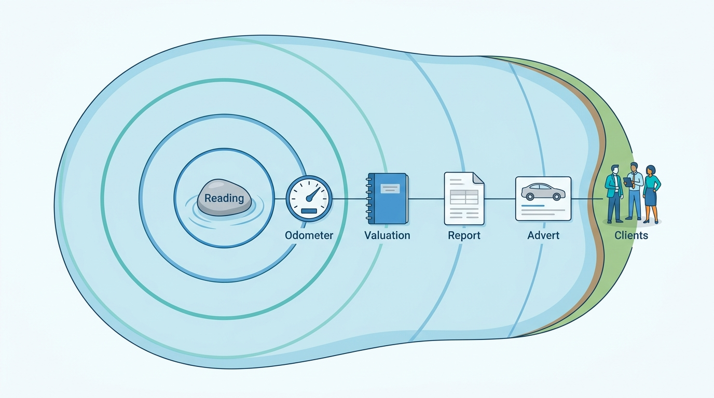
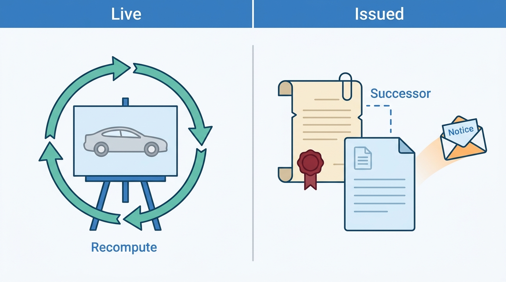
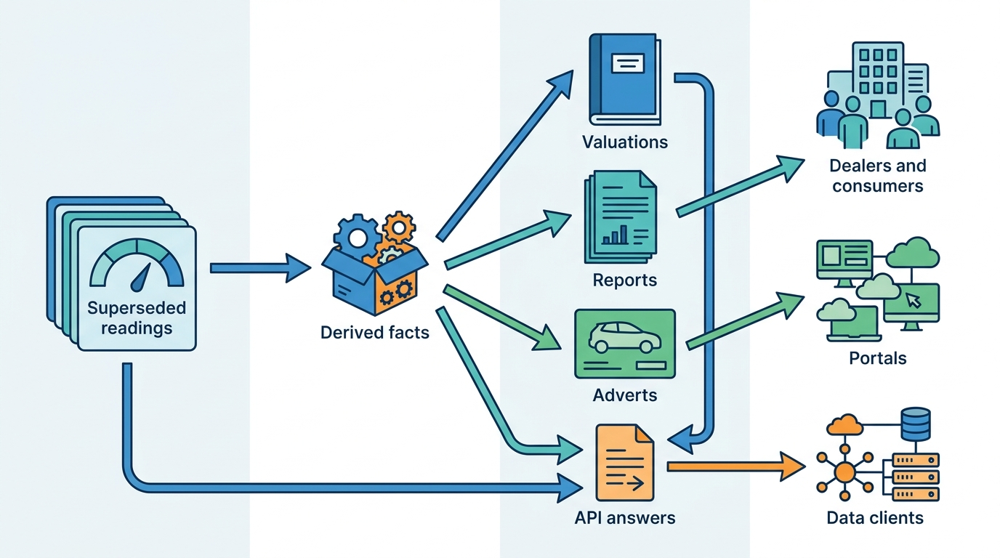
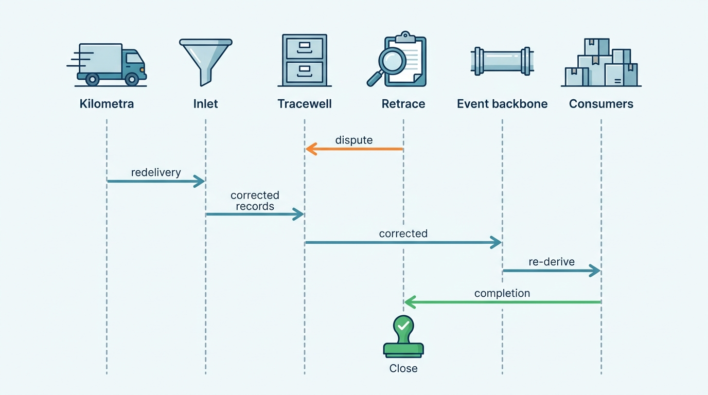

> **IN THIS CHAPTER, YOU WILL:** Walk one supplier correction from detection to closure: containment, the bitemporal correction, the impact graph across valuations, reports, adverts, prices, insight files and API answers, the per-artifact choice between recomputing, superseding and annotating, the notices to dealers, consumers and data clients, the legal and audit trail, and the failure cases that break the path.

> **WHY THE BUSINESS CARES:** A vehicle data business sells accuracy, and it is judged on how it handles the day accuracy fails. An insurer that settled claims on a wrong mileage, a dealer whose car was flagged as clocked, and a consumer who paid for a wrong report each ask what they were told, when, and what has been done about it. A fast, complete and documented answer keeps the client. A slow one loses the client and invites a lawyer.

> **WHY ARCHITECTS SHOULD CARE:** Correcting the source takes a few seconds. Finding everything built on the old value is the expensive part, and a platform can do it only if every consumer recorded which fact version it used, at the time it used it. That decision is made in the valuation ledger, the report store, the advert renderer and the usage meter long before any incident. It cannot be added afterwards.

> **KEY POINTS:**
>
> * **Contain first, correct second.** Mark the suspect fact versions *disputed* within an hour of seeing the pattern, so nothing new is built on them, without waiting for the supplier's corrected file. In May 2027 Axleby waited three days for the redelivery. At the incident's average rate that added about 1,700 valuations to the clean-up.
> * **The impact graph is recorded at the moment of use, never reconstructed afterwards.** Every valuation, report snapshot, advert render, price event and billable API answer stores the fact versions it consumed. A correction then becomes a forward query from the superseded versions to artifacts and recipients. Axleby's 2027 analysis took eleven days by hand. Its 2028 dry run took 38 minutes.
> * **Recompute derived state; never rewrite what was issued; tell only those who received it.** Current values, judgements and live adverts are recomputed. Issued valuations, reports and API answers stay as they were and gain a linked successor. Notices go to the recipients the access audit names. Each notice says what changed, not the corrected value itself, so a correction never hands licensed data to a client that did not buy it.

> **[FAILURE PATTERNS THIS CHAPTER ADDRESSES](where-vehicle-platforms-go-wrong.html):**
>
> * **The Sticky Error** — the Odometer Correction fixed the source in eleven days, but the wrong mileage lived on in issued valuations, consumer reports, advert text and clients' databases for weeks.
> * **Provenance Amnesia** — Tracewell overwrote the wrong readings in place, so the correction erased the evidence needed to find what the error had touched.
> * **License Blindness** — a correction that pushes corrected facts to every client would hand licensed data to clients who never received it; the audience must come from the access audit.

<br>
This chapter starts where the data chapters stop: on the day a stored fact turns out to be wrong. **A vehicle fact spreads by design.** A mileage reading becomes a current odometer, then an odometer judgement, then a valuation, then a purchase offer, an advert price, a history report, an API answer in an insurer's claims system and a row in an importer's monthly insight file. Each copy was correct when it was made, by the rules the platform had then.


**Figure 1:** *A vehicle fact spreads by design: one reading becomes an odometer, a valuation, a report, an advert and a client's copy, and a correction has to reach every ring.*

The question is narrow and hard: **when a supplier corrects a fact, how does the correction reach every place the fact went?** One half of the answer is mechanical: an append-only correction, a correction event and an **impact graph** that turns "what did this touch?" into a query. The other half is a decision per kind of artifact: recompute, supersede, annotate, notify or refund.

This chapter owns the **correction event** and the **impact graph**, and follows the Odometer Correction of May 2027 end to end. It builds on bitemporal facts and the provenance envelope ([[provenance-and-data-quality]]), batch validation and replay ([[ingestion-and-entity-resolution]]), report snapshots and odometer judgements ([[vehicle-history]]), the valuation ledger ([[valuation-engine]]), advert composition ([[merchandising]]), the event backbone and webhooks ([[events-webhooks-and-sync]]), data-quality monitors ([[observability-and-data-operations]]) and rectification under data-protection law ([[privacy-and-retention]]).

## Setting the Scene at Axleby: Eleven Days, Then Eleven More

Axleby, the fictional vehicle data and dealer software group this book follows (see [[meet-axleby]]), loads a nightly file from **Kilometra**, a fictional odometer and service-record supplier. Kilometra aggregates workshop readings, including readings for cars later imported from the UK. The file of 12–13 May 2027 held a catch-up export from one UK workshop chain: **3,050** readings taken between December 2026 and May 2027. The readings were in miles, and the file's `unit` column said `km`. Tracewell, Axleby's history event store, loaded the batch in the night of **13 May 2027**. Its loader checked the schema, upserted each reading and set each vehicle's current odometer to the newest reading by date. For **2,870** UK-imported vehicles the current odometer dropped to about 62% of its true value.

Vantage, the valuation engine, valued the cars too high. Tracewell's old odometer flag saw readings below the previous MOT (the UK's annual roadworthiness test) reading and printed "possible rollback" in history reports. In Lotwise, Axleby's dealer software, the nightly dossier re-sync copied the wrong value into stock records whose mileage the dealer had never confirmed, and from there into adverts.

**Detection came from a customer.** On Wednesday **19 May**, a dealer in Venlo called Lotwise support. A prospective buyer had bought an Odolo report on the dealer's 2018 Volvo XC60, a UK import. Odolo is Axleby's consumer vehicle-check app. The report showed a reading of 61,300 km on 2 February 2027 after an MOT reading of 96,367 km in October 2026, and it said "possible rollback". The dealer had typed 99,120 km at stock-in in March, read from a dashboard that showed miles. Support logged a single-vehicle data issue; two similar tickets and an Odolo complaint followed on 20 May. On Friday **21 May**, the data team of Priya Raman, VP Data and Valuation, saw the pattern. Every affected reading came from one workshop chain and one batch, and each sat at about 1/1.609 of the neighboring readings. Hendrik Maes, Head of Partner Integrations, called Kilometra the same afternoon. Kilometra confirmed the chain's export error and promised a corrected redelivery.

Axleby then made the decision this chapter argues against: **it waited**. Tracewell had no batch reference and no status on its readings, so suppressing "the readings from that batch" meant hand-written SQL against a recorded-date window. The team chose not to risk it. The corrected batch loaded on Monday **24 May** at 02:44, **11 days** after the bad one. The loader overwrote each wrong reading in place.

By then **6,140** issued valuations, **412** history reports (**96** of them sold to consumers through Odolo) and **1,180** live adverts carried the wrong mileage. **Nobody could list them.** Finding them took another eleven days of manual work: joins between the valuation ledger and 30-day API logs, a scan of report snapshots, and Lotwise database queries by vehicle and date window. The dossier re-sync fixed the adverts' structured mileage on 25 May. But **307** adverts also stated the mileage in dealer-written text. A text search found them on 7 June, and **41** were still live with the wrong figure on 14 June ([[merchandising]]). The API clients got an email. In June, **Rijnstaal Verzekeringen**, a fictional insurer that settles total-loss claims with Axleby valuations, wrote to ask what it had been told about each affected car. Answering took six working days ([[provenance-and-data-quality]]).

Ines Marchetti, Group Chief Architect, framed the question for the architecture forum in July 2027: **when any vehicle fact is corrected, how does the platform contain it, find everything built on it, decide what to recompute and whom to tell, and prove afterwards that it did, in hours rather than weeks?** The answer was approved as the **correction journey design record** in August 2027. It introduced **Retrace**, the correction-case and impact service described below. Parts of it ran for real on a second case in October 2027. The whole journey was rehearsed on the event backbone in 2028.

| Date (2027) | Day | What happened | What should have happened |
| --- | --- | --- | --- |
| Thu 13 May, 02:47 | 0 | Bad batch loaded; current odometers drop for 2,870 vehicles | Per-chain distribution check holds the chain's 3,050 records ([[ingestion-and-entity-resolution]]) |
| 13–19 May | 0–6 | About 560 valuations, 37 reports and 107 advert updates a day built on wrong readings | Nothing built: segment quarantined |
| Wed 19 May | 6 | First dealer ticket, handled as a single-vehicle issue | Ticket links to an open quality alert, or opens a pattern search |
| Fri 21 May | 8 | Pattern found; Kilometra confirms | Fact versions marked *disputed* within one hour; correction case opened |
| 21–24 May | 8–11 | Wait for redelivery; error keeps spreading | Contained: new artifacts use the prior reading, marked provisional |
| Mon 24 May, 02:44 | 11 | Corrected batch overwrites wrong readings in place | Corrected versions appended; old versions superseded |
| 24 May – 3 June | 11–21 | Manual impact analysis | Impact query; internal fan-out within one hour |
| 7 and 14 June | 25, 32 | 307 advert texts found; 41 still live | Stale-content scan flags dealer text at fan-out time |
| June | — | Rijnstaal's questions take six working days | Per-client answer list is a by-product of the case |

## Concepts: What a Correction Is and What It Touches

[[provenance-and-data-quality]] distinguishes four kinds of change to a vehicle fact: new observation, late observation, correction and retraction. This journey handles the last two. A **correction** keeps the fact's valid time and replaces its value: the 2 February reading was 98,653 km, not 61,300 km. A **retraction** withdraws a fact with no successor, for example a reading attached to the wrong vehicle. Both close the old fact version in transaction time and leave it readable. The terms this chapter adds:

| Term | Definition |
| --- | --- |
| **Fact version** | One recorded state of one vehicle fact of one Axleby Vehicle Key (AVK, the internal vehicle id), with its own id, valid time, recorded and superseded times, source and status ([[provenance-and-data-quality]]). Artifacts reference versions, never "the fact". |
| **Disputed** | A status on a fact version that is suspected wrong but not yet corrected. Disputed versions are excluded from current values and new derivations. Issued artifacts that used them are not touched yet. |
| **Correction case** | The unit of work and of accountability. It records the cause, the superseded or disputed versions, the decisions per artifact class, the notices sent, the completion of every consumer and the closure. One supplier error is one case, whether it touches 1 vehicle or 3,000. |
| **Correction event** | `vehicle.fact.corrected`: an immutable, per-vehicle event saying that fact versions were superseded or retracted, published by the context that owns the fact. It names the case, the attribute, the old and new version ids and the window in which the old version was served. It is **thin**: no values. |
| **Impact edge** | A record, written by a consumer when it uses a fact version, that links the version to the artifact built on it, and the artifact to its recipient. |
| **Impact graph** | All impact edges taken together. A correction's **impact set** is the forward closure from the superseded versions through derived facts to artifacts and recipients. |
| **Issued artifact** | Anything that left the platform's control or was relied on: a valuation returned to a caller, a report delivered, an API answer, an offer made, a monthly file delivered. Issued artifacts are never edited. |
| **Live artifact** | Something the platform still renders and can change: a current odometer, an advert, a dossier view, a price suggestion. Live artifacts are recomputed. |

This distinction drives every decision in the journey. **A live artifact is wrong until it is recomputed. An issued artifact remains a true record of what was said**, so its remedy is a successor plus a notice, not an edit. Rewriting an issued valuation would destroy the evidence Rijnstaal asked for.


**Figure 2:** *A live artifact is wrong until it is recomputed; an issued artifact stays a true record of what was said and gains a linked successor and a notice instead of an edit.*

## Architecture: Contain, Correct, Trace, Act, Tell, Close

### Components and ownership

The journey crosses eight contexts. Retrace owns none of the facts or artifacts. It owns the case, the impact query and the completion record.

| Component | Owner | Role in the journey |
| --- | --- | --- |
| **Inlet**, ingestion pipeline ([[ingestion-and-entity-resolution]]) | Data platform | Lands the corrected batch; checks `corrects_record_id`; holds segments |
| **Tracewell**, history store ([[vehicle-history]]) | History team | Appends corrected versions, marks superseded or disputed ones; recomputes odometer judgements; emits `vehicle.fact.corrected` through its outbox |
| **Retrace**, correction cases and impact | Data operations (Priya Raman) | Opens cases, runs the impact query, applies the per-class policy, tracks completion and residuals, assembles the audit pack |
| **Vantage** and the valuation ledger ([[valuation-engine]]) | Valuation team | Re-values affected entries as linked successors; reports which ones led to actions |
| **Report store** in Tracewell | History team | Supersedes report snapshots; triggers reissue notices |
| **Lotwise Dossier**, advert composer, pricing ([[inventory-and-vehicle-dossier]], [[merchandising]], [[used-car-pricing]]) | Lotwise | Re-renders adverts, flags dealer text, re-proposes prices, notifies dealers |
| **Public event gateway**, Charter, Meterline ([[events-webhooks-and-sync]], [[data-licensing-and-governance]], [[billing-and-metering]]) | Platform, governance, billing | Computes the external audience from the access audit; sends thin webhooks; credits re-fetches |
| **Pulse** and insight files ([[market-data]], [[data-products-and-insights]]) | Market data | Recomputes affected statistics; restates frozen monthly releases |

### The impact graph

Axleby's impact graph is **federated, not central**. Each owning store keeps its own edges in a shape it already had: the valuation ledger's reading version per entry, report snapshots' event versions, `fact_version` on Meterline usage events and on advert renders (both from October 2027), the reference valuation id on price events, and release id plus recipient per insight-file delivery. Retrace holds one thing centrally: a registry of these **impact adapters**. Each adapter answers "given these fact versions and this time window, which artifacts and recipients?" with the same result shape.


**Figure 3:** *The impact graph of the Odometer Correction. Every arrow is an edge some store recorded when it used the fact; the correction's reach is the forward closure from the superseded versions, and its audience is the last column.*

The query runs in two passes. The first walks derived facts inside the vehicle contexts: survivorship and the odometer judgement say which derived versions changed ([[ingestion-and-entity-resolution]]). The second asks every adapter, in parallel, for artifacts that cite any superseded version, original or derived, **within the served window**. The window runs from the moment the bad version became readable to the moment it stopped being served. For the Odometer Correction that was 13 May, 02:47 to 24 May, 02:44. With containment it would have closed on 21 May.

Two rules keep the query honest. **An adapter that cannot answer reports a gap, never zero**: adverts rendered before October 2027 have no version edges, so their adapter queries by vehicle and date window and labels the answer *approximate*. And **the impact set is a snapshot**, re-run before the case closes, because consumers keep writing during fan-out.

> **INFERENCE, NOT DOCUMENTED:** No vehicle-data company has published how it finds the reports, valuations or client answers affected by a corrected fact. The federated impact graph and correction case here are the author's reference architecture. They apply record-level lineage, an idea that dataset-level standards such as OpenLineage do not cover. OpenLineage models datasets, jobs and runs ([OpenLineage object model, n.d., accessed 2026-10](https://openlineage.io/docs/spec/object-model)). It can say which job read a batch, but not which of 6,140 valuations used which reading.

### The correction event

The event is per vehicle, thin and owned by the context that owns the fact. For the worked Volvo it reads:

```
type: vehicle.fact.corrected          (CloudEvents 1.0; extensions avk, entityversion)
subject: <AVK of the Volvo>
data:
  correction_case: CC-2027-0007
  kind: correction                    (or retraction)
  attribute: odometer.reading
  observed_at: 2027-02-02
  superseded_versions: [k1]
  current_version: k2                 (null for a retraction)
  served_window: 2027-05-13T00:47Z .. 2027-05-24T00:44Z
  reason: source_unit_error
```

Three choices matter. **The event carries version ids, not values**: consumers re-read the fact through the owning API with its license decision, and external subscribers get the same shape, filtered to vehicles they received ([[events-webhooks-and-sync]]). **It carries the served window**, so a consumer can decide for itself whether anything it holds is affected. **It carries the case id**, which links every downstream action back to one accountable record. Disputing a version emits `vehicle.fact.disputed` with the same shape. Lifting the dispute without a correction emits it again with status `active`.

### The success path, step by step

The target journey as the design record specifies it, using the Odometer Correction as the case. Steps 1–3 use Inlet and envelope v1 (2027). Steps 5–9 use the event backbone. Internal topics arrived in Q2 2028; `vehicle.fact.corrected` reached data clients in Q4 2028 ([[events-webhooks-and-sync]]).


**Figure 4:** *The correction journey. Containment happens before the supplier's fix arrives; the correction fans out through the backbone; Retrace tracks the impact set and closes the case only when every consumer has reported and the residual sweep is empty.*

| # | Step | Owner | Identifiers crossing | Consistency | Latency target |
| --- | --- | --- | --- | --- | --- |
| 1 | **Detect**: per-chain semantic failure rate, a dispute from a client, or a support ticket matched to a pattern | Inlet; data operations | `batch_ref`, `workshop_chain_id`, AVK | — | Batch errors: at load. Single disputes: one business day *(assumption)* |
| 2 | **Contain**: mark fact versions *disputed*; derived values fall back to the prior version and are labeled provisional | Tracewell on data operations' decision | Fact version ids | Strong, one transaction per batch | Under 1 hour from decision *(assumption)* |
| 3 | **Open case**: cause, scope, owner, first impact estimate | Retrace | Case id | — | Same hour |
| 4 | **Correct**: supplier redelivers with `corrects_record_id`; Inlet validates and lands | Kilometra; Inlet | Source record ids, new batch ref | Batch-atomic per segment | Notice within 1 business day (contract v2); redelivery as agreed |
| 5 | **Supersede and re-derive**: append versions, recompute survivorship and judgements, emit events | Tracewell | Old and new version ids, AVK | Per-AVK order, at least once | Minutes |
| 6 | **Trace**: impact query over all adapters | Retrace | Version ids, served window | Snapshot, re-run before close | Under 15 minutes for 3,000 vehicles *(assumption)* |
| 7 | **Act**: re-value, supersede reports, re-render adverts, re-propose prices, restate statistics, credit usage | Each owning context | Artifact ids with case id | At least once, idempotent per (case, artifact) | Internal within 1 hour ([[events-webhooks-and-sync]]) |
| 8 | **Tell**: dealers, consumers, data clients, portals | Lotwise, Odolo, gateway | Recipient ids, notification id | At least once, deduplicated per (case, artifact, recipient) | Clients within 24 hours; consumers same day *(assumption)* |
| 9 | **Reconcile and close**: completion per consumer, residual sweep, acknowledgements, audit pack | Retrace | Case id | Complete or explicitly waived | Close within 30 days *(assumption)* |

**Containment pays for itself.** A dispute is cheap to lift if the supplier says the readings were right; waiting has a price that grows by the day. At the incident's average rates, each day added about **560** valuations, **37** reports and **107** advert updates to the work list ([[observability-and-data-operations]]).

Detection itself belongs to the neighbors, with one canonical caveat. The first gate built after the incident compared median readings per age band against the trailing 30 days. The September 2027 replay showed it **would not have fired**: 2,870 wrong readings among about 34,000 UK-import records moved no median by more than 5%. The check that did fire was **per supplying workshop chain**: 94% of the chain's 3,050 records failed the semantic check ([[ingestion-and-entity-resolution]]). A unit error confined to one chain is invisible in aggregate and obvious in its own segment.

### Recompute, supersede, annotate: the policy per artifact class

Most of the design record is this table. It is a policy, signed off by Priya Raman for data, Tomás Ferreira (Product Director, Lotwise) for the dealer product and Femke de Boer (Head of Data Governance and Privacy) for legal wording. Retrace applies it per case and records every deviation.

| Artifact class | Live or issued | Action | Who is told | Odometer Correction |
| --- | --- | --- | --- | --- |
| Current odometer, odometer judgement | Live | Recompute | Nobody directly; events | 2,870 vehicles |
| Restock price-position signals | Live | Recompute next night | Nobody | Not issued valuations; outside the 6,140 |
| Issued valuation | Issued | **Successor valuation** under the original model version, linked; original annotated "input superseded" | Only where it led to an action or left the platform | 6,140 entries |
| Offer, maximum purchase price, purchase | Issued (dealer's decision) | Show the successor beside the original | Dealer | See the worked example |
| Advert price set against the valuation | Live, dealer-owned | **Re-propose**, never change automatically | Dealer | 212 adverts *(Axleby illustration)* |
| Advert structured fields | Live | Re-render; Relay sends updates to portals | Portals through Relay | 1,180 adverts |
| Dealer-written advert text | Live, dealer-owned | Stale-content flag; republication blocked until edited | Dealer | 307 adverts |
| History report | Issued | **Superseding version**, linked; old one retrievable | Holder: dealer or consumer | 412 reports, 96 consumer |
| API answer | Issued, outside the platform | Thin notice; free re-fetch | Data clients that received it | 19 clients, 2,310 lookups |
| Billable usage | Issued | Credit per policy | Finance; client invoice | `data_correction` credit |
| Pulse statistics, daily figures | Live | Recompute affected windows | Nobody | Rebuilt nightly |
| Monthly insight release | Issued | Restatement in next release with delta table | Recipients of the release | Below materiality in May |
| Training snapshot | Internal | Exclude superseded versions from the next retrain | Model card | One weekly retrain affected |

Three of these rows carry the argument.

**Successor, not overwrite, for valuations.** Vantage re-values each affected entry with the **original model version** and the corrected reading. This isolates the effect of the correction from the market's movement since. Re-valuing with today's model would mix two changes and make the difference unexplainable to a dealer or an insurer. The new entry links to the old one. The old entry gains an annotation, and its answer is never changed ([[valuation-engine]]).

**Materiality decides the notice, not the recompute.** Everything affected is recomputed; recomputation is cheap. A notice goes out only where the difference is material and someone relied on the artifact. For valuations the design record sets materiality at a change of more than 2% or €250, whichever is larger *(Axleby illustration)*. A unit error of 1.609 clears that bar for almost every car, so in this case nearly everything was material. Without a threshold, a small correction would flood dealers with notices about €40 differences, and they would learn to ignore them.

**Dealer-owned decisions are proposed, never made.** The platform can show that a price's reference was wrong and propose a new price, but it does not reprice a car on a portal or withdraw a dealer's offer to a private seller.

### Requirements per interaction

| Interaction | Consistency | Latency | Freshness | Availability |
| --- | --- | --- | --- | --- |
| Dispute → current values | Strong per batch; derived values fall back atomically | Under 1 hour | Current | If Tracewell's write path is down, the gateway suppresses the attribute instead |
| Correction → internal consumers | At least once, idempotent per (case, artifact) | Within 1 hour | Follows the source | Consumers replay from topics; a down consumer delays only itself |
| Correction → data clients | Only to recipients in the access audit; thin | Within 24 hours | Feed keeps 30 days | Delivery failure never blocks internal correction |
| Notice → consumers | Once per (case, report, consumer) | Same business day | — | Queued; reissued report available on login |

## In Practice: Public Evidence and the Axleby Worked Example

### What the public record shows

**No vehicle-data company publishes how it propagates corrections.** The public evidence comes from the official odometer registers, which have correction procedures of their own, and from the published contracts of webhook and event systems.

The registers treat correction as **supersession with evidence, by a named party**:

- The Dutch register RDW lets a recognized business correct the **last** reading it registered itself. Older readings are corrected by the RDW on request, with as much evidence as possible: a receipt, workshop history or service booklet. After approval the RDW changes the register within 10 working days ([RDW, *Tellerstand corrigeren*, n.d., accessed 2026-10](https://www.rdw.nl/zakelijke-partners/erkende-bedrijven/tellerstanden/tellerstand-corrigeren)).
- Belgium's Car-Pass lets a garage correct a mistake electronically **once**; a further correction must be validated by a Car-Pass employee ([Car-Pass FAQ, n.d., accessed 2026-10](https://www.car-pass.be/en/faq)).
- For the UK MOT, a mileage mistake reported within 28 days is fixed by the test center after it rechecks the vehicle. Later mistakes need evidence dated within one day of the test, through an online form ([GOV.UK, *Fix mistakes on your MOT record*, n.d., accessed 2026-10](https://www.gov.uk/getting-an-mot/correcting-mot-certificate-mistakes)).
- In the US, a seller who knows the reading is wrong must disclose that "the odometer reading does not reflect the actual mileage, and should not be relied upon" ([49 CFR 580.5(e)(3), via Cornell LII, accessed 2026-10](https://www.law.cornell.edu/cfr/text/49/580.5)). The statement travels with the vehicle's title. It is not a quiet fix.

**The pattern across all four: the wrong value is not erased; a corrected value with a named author and evidence supersedes it.** A history platform that receives these corrections must keep both versions. Otherwise its own report contradicts what the register shows the buyer.

On the notification side, webhook contracts deliver **at least once and unordered**. Stripe recommends **thin** events that the receiver re-fetches ([Stripe, Webhooks, n.d., accessed 2026-10](https://docs.stripe.com/webhooks)). Standard Webhooks tells receivers to use the `webhook-id` as an idempotency key ([Standard Webhooks specification, n.d., accessed 2026-10](https://github.com/standard-webhooks/standard-webhooks/blob/main/spec/standard-webhooks.md)). A correction event built on these contracts must expect duplicates, reordering and receivers that are down for days. The failure cases below are built on those three facts.

### Axleby worked example: one Volvo through the journey

The Venlo dealer's 2018 Volvo XC60 is one of the 2,870 vehicles. Its odometer facts, as Tracewell holds them under envelope v1 (Axleby illustration):

| Version | Observed | Recorded | Value | Source | Status |
| --- | --- | --- | --- | --- | --- |
| m1 | 9 Oct 2026 | 10 Oct 2026 | 96,367 km (59,880 miles, unit `MI`) | MOT file from the Driver and Vehicle Standards Agency (DVSA); official | active |
| k1 | 2 Feb 2027 | 13 May 2027, 02:51 | 61,300 km (as delivered: `61300`, `km`) | Kilometra batch 2027-05-13 | superseded 24 May 2027 |
| k2 | 2 Feb 2027 | 24 May 2027, 02:44 | 98,653 km (61,300 miles) | Kilometra redelivery, corrects k1 | active |
| d1 | 22 Mar 2027 | 22 Mar 2027 | 99,120 km | Lotwise stock-in, dealer-entered | active |

The impact query from k1 over the served window returns (Axleby illustration, consistent with the case totals):

| Artifact | Detail | Action under the policy |
| --- | --- | --- |
| Current odometer | Unchanged at 99,120 km: d1 (22 March) was newer than k1 (2 February) | None. **A newer reading protected the current value**; this car's harm was in its history and judgement |
| Odometer judgement | Old flag: "possible rollback" (k1 below m1) | Recompute: consistent; flag removed |
| Odolo consumer report | Sold 18 May, €12.95, rollback warning | Superseding report emailed; full refund |
| Business report in the dealer's dossier | Viewed 19 May | Superseding version; dossier banner |
| Valuations | None; the dealer had valued the car in March | — |
| API answers | One lookup by a portal-pricing client on 17 May | Thin notice; free re-fetch |

**The Volvo's current value was right and the car was still harmed**, because the error lived in its history. A process that checks only "did the current value change?" misses such cars, which is why the impact query starts from superseded versions.

Across the whole case, the 6,140 valuations split by where they went (Axleby illustration): **1,870** were returned to API clients, inside the 2,310 affected lookups; **3,980** were Lotwise appraisal, dossier and pricing-reference valuations; **290** sat inside history reports. Of the Lotwise valuations, the ledger's outcome links show **74** that led to purchase offers (**29** of them completed purchases) and **212** that served as the reference for advert prices. Those 286 needed a dealer notice. The rest needed a successor and an annotation only. **Outcome links turned a 6,140-row problem into a 286-row conversation with dealers.**

Of the 412 reports, **271** had printed "possible rollback", **64** of them among the 96 consumer reports. For the dealers whose cars were affected, this was the reputational core of the incident: a report bought by their buyer suggested their car had been clocked. The design record therefore treats **any correction that removes a fraud or damage indication** as material whatever its size. The dealer whose stock carried the indication gets a notice and a corrected report free of charge.

### Legal and reputational handling

Three duties shape the notices. Femke de Boer's team owns their wording.

- **Consumers.** A paid history report is digital content. Under the EU Digital Content Directive, a consumer facing a lack of conformity may have it "brought into conformity", receive "a proportionate reduction in the price" or terminate the contract, and conformity must be restored "free of charge" ([Directive (EU) 2019/770, Art. 14, 2019](http://publications.europa.eu/resource/celex/32019L0770)). Axleby went further than the minimum. It reissued all 96 reports **and** refunded all 96 without being asked: under €1,300 in total, less than the cost of handling the complaints. UK consumers buying Odolo UK reports have comparable rights: for non-conforming digital content, the Consumer Rights Act 2015 gives "the right to repair or replacement" and "the right to a price reduction" ([Consumer Rights Act 2015, s. 42](https://www.legislation.gov.uk/ukpga/2015/15/section/42)).
- **Personal data.** This book treats plates and VINs as personal data by default ([[privacy-and-retention]]). The General Data Protection Regulation (GDPR) requires data to be "accurate and, where necessary, kept up to date", with "every reasonable step" taken to rectify inaccurate data "without delay". When data is rectified, the controller must "communicate any rectification … to each recipient to whom the personal data have been disclosed, unless this proves impossible or involves disproportionate effort" ([Regulation (EU) 2016/679, Art. 5(1)(d) and Art. 19, 2016](http://publications.europa.eu/resource/celex/32016R0679)). **The access audit is how Axleby shows it was neither impossible nor disproportionate.** Without the audit, the "disproportionate effort" exception becomes tempting, and it is hard to defend.
- **Data clients.** Axleby's terms with Rijnstaal and other API clients cap liability and describe a correction duty on both sides. Axleby credited all affected calls and gave Rijnstaal per-call evidence. Rijnstaal reviewed its own settlements and found **9** that had used a valuation more than €500 too high ([[provenance-and-data-quality]]). The platform's job is to make that evidence fast and complete. What is owed is a contract question.

Every notice says **what was wrong, what is right now, since when, and what the recipient should do**, and **never blames the supplier**: the report carried Axleby's name. Supplier accountability lives in the contract; Kilometra's v2 of August 2027 added a unit per workshop chain, stable record ids, `corrects_record_id` and a correction notice within one business day.

### The second case: 118 readings on the wrong cars

The September 2027 replay found that the old plate-only matching had attached **118** UK-import readings to a different vehicle that later carried the same retained plate ([[ingestion-and-entity-resolution]]). These were **retractions**: the versions on the wrong cars closed with no successor, and the readings re-attached to the right AVKs as new facts. Run as case CC-2027-0012 in October 2027, before the backbone existed, Retrace's first adapters found **14** reports (5 sold to Odolo UK consumers) and **37** issued valuations in the readings' lifetime (Axleby illustration). Notices went out within two working days. The case also exposed the gap the design record predicted: the advert adapter could answer only by vehicle and date window, and labeled its result approximate.

## Failure Handling

The journey has its own failure modes on top of the neighbors'. The contract names three; the table covers the rest.

### Correction arrives before the original

Inlet receives a record with `corrects_record_id` pointing to a record it has never seen. Kilometra sends a correction for a reading still in a held segment, or delivery files arrive out of sequence. **Detection:** the reference lookup fails. **Recovery:** park the correction as an *orphan* with a 72-hour timer *(assumption)*. When the original arrives, record it and supersede it **in the same transaction**, so it is never current and nothing derives from it. The impact set is then empty, and no case is opened. If the original never arrives, ask the supplier; after confirmation the corrected record becomes a plain observation. **The rule: a fact that was never served needs no correction journey**, which is why "served window" belongs in the event.

### Correction to a fact already overwritten by a newer reading

The Volvo is this case. The corrected reading k1 is no longer current, because a newer reading (d1) took over, so the current value does not change. A process keyed on "current value changed" stops here and misses the history, the judgement, the reports and any valuation issued **before** d1 arrived. **Detection:** none needed; the impact query starts from the superseded version and its served window, not from the current value. **Recovery:** recompute the judgement, which depends on every reading, and trace artifacts as usual. A harder variant is the **chained correction**: a version that was itself a correction gets corrected again. The superseded set is then every version in the chain, and the served windows add up.

### Client ignores the webhook

A data client's endpoint returns `2xx`, but no re-fetch carrying the notification id follows. Or the endpoint fails for 72 hours and the subscription is disabled. Or the client is one of the **210** clients still using only Connect XML, Axleby's legacy SOAP/XML API, which get no events at all. **Detection:** Retrace tracks an acknowledgement per (case, client): a re-fetch with the notification id, or an explicit `POST /v2/corrections/{id}/ack` *(Axleby illustration)*. **Recovery:** after 7 days without acknowledgement *(assumption)* the client's account manager receives the list. XML-only clients get the same list by email from day one. **The platform cannot make a client correct its copy. It can prove it told the client**, and that proof is what Article 19 and the client contract both ask for. Data-client terms from the 2028 renewals add a duty to act on correction notices within a stated time.

| Failure | How it happens | Detection | Recovery |
| --- | --- | --- | --- |
| **Duplicate correction** | Supplier redelivers the redelivery; replay of the case | Idempotency on (source, record id, source version); notices keyed (case, artifact, recipient) | No new versions; no second notice. The 2028 dry run sent 96 consumer emails twice before this key existed |
| **Conflicting corrections** | Two corrections of one record disagree, or the supplier's value contradicts an official reading | Two successors for one version; semantic check against official readings | Version becomes **disputed**; report wording says so; data operations decides with evidence, as the registers do |
| **Incomplete correction** | Supplier corrects part of the batch, or cannot say which records were wrong | Case scope vs corrected count | Uncorrected versions stay disputed and excluded; the case stays open with a named waiver if they never resolve |
| **Partial fan-out failure** | One consumer (Relay, the report store) fails mid-way | Completion per consumer in the case | Consumer replays from its topic offset; case cannot close while any consumer is incomplete |
| **Adapter blind spot** | A store kept no version edges (pre-October 2027 adverts) | Adapter returns *approximate* | Query by vehicle and window; widen the residual sweep for that class |
| **Residual copies** | Dealer text, PDFs, exports, a client's warehouse | Residual sweep: stale-content scan, search for superseded values in text fields | Flag to owner; for live adverts, block republication; record what cannot be reached |
| **Recipient beyond reach** | Car sold; buyer has no relation with Axleby | Outcome link shows sale | Notice to the dealer with the corrected report; the dealer decides whether to tell the buyer |
| **Erasure meets correction** | The person linked to an affected record was erased | Erasure ledger lookup ([[privacy-and-retention]]) | Correct the vehicle fact; never re-link the person to send a notice |
| **Owning store down during fan-out** | Tracewell or Vantage unavailable | Backbone lag; case completion stalls | Events wait on topics; containment already holds; the gateway suppresses disputed attributes in the meantime |

## Trade-offs

**When to contain.**

| Option | Gains | Costs | Right when |
| --- | --- | --- | --- |
| **Dispute on pattern evidence** (recommended) | Stops spread within an hour | Some provisional values; a false alarm must be lifted | A batch-level pattern or an official contradiction exists |
| Wait for supplier confirmation | No false alarms | Error spreads for days; 2027 added three days | Single-vehicle dispute without corroboration |

**How to find the impact.**

| Option | Gains | Costs | Right when |
| --- | --- | --- | --- |
| **Write-time impact edges per store** (recommended) | Exact, fast, owned by each store | Every new consumer must record versions; storage | Facts feed issued, paid or relied-on artifacts |
| Central lineage graph of all artifacts | One place to query | A second copy of every artifact's inputs; owner unclear | Few artifact types, one team |
| Reconstruct from logs after the fact | No upfront cost | Eleven days in 2027; logs expire after 30–90 days | Never as the plan; only as the fallback |

**What to send clients.**

| Option | Gains | Costs | Right when |
| --- | --- | --- | --- |
| **Thin notice, free re-fetch** (recommended) | License-safe; re-fetch is audited and credited | Client must act; two calls | Licensed data; data clients with varied rights |
| Corrected value in the event | One step | Licensed data pushed outside the request path; personal data in logs | Open data only |
| Email to contacts | Works for XML-only clients | No proof of action; does not scale | Legacy clients until Connect XML's sunset |

The recommendation rests on two assumptions. Corrections are rare but large: a few cases a month *(assumption)*, occasionally thousands of vehicles. And issued artifacts carry money and liability. A platform that sells only live dashboards could recompute everything and notify nobody. A platform that sells valuations for settlements cannot.

## Metrics That Prove the Journey Works

| Metric | Definition | 2027 incident | Target *(Axleby illustration)* |
| --- | --- | --- | --- |
| **Detection latency** | Bad version recorded → case opened | 8 days | Batch errors at load; disputes within 1 business day |
| **Containment time** | Case opened → versions disputed | Never contained | Under 1 hour |
| **Exposure** | Artifacts built on the version, per day of exposure | ~560 valuations, 37 reports, 107 adverts a day | Zero for batch errors |
| **Internal fan-out time** | Correction recorded → all internal consumers complete | 11 days, manual | Under 1 hour (dry run: 38 minutes) |
| **Impact completeness** | Residuals found after closure ÷ impact set | 307 advert texts missed; 41 live after three weeks | Zero live residuals at closure |
| **Client acknowledgement** | Notified clients that re-fetched or acknowledged within 7 days | Unknown | 90% *(assumption)*; rest escalated |
| **Consumer reissue time** | Correction → corrected report sent | Weeks | Same business day |
| **Evidence time** | Client asks "what did you tell us?" → per-call answer | 6 working days | Under 1 hour (Nov 2027 re-run: 40 minutes) |

**Evidence time measures whether provenance is real.** If it takes days, the impact graph does not exist, whatever the diagrams say.

## What Changes in Another Market

The journey is the same everywhere; sources of corrections, duties and wording change.

| | Netherlands / Belgium | Germany | United Kingdom | United States |
| --- | --- | --- | --- | --- |
| **Official odometer source corrects itself** | RDW: last reading by the business, older by RDW within 10 working days. Car-Pass: one electronic correction, then staff validation | No buyer-facing registry; corrections reach Axleby only from commercial suppliers | MOT: test center within 28 days; later with evidence via DVSA | Odometer disclosure at transfer; "not actual mileage" stays with the title |
| **How Axleby learns of it** | Changed judgement or reading in register data and the snapshot diff | Supplier redelivery under contract | Changed test record in DVSA daily files *(inference: DVSA does not document how amendments appear)* | Title brand from providers of NMVTIS, the National Motor Vehicle Title Information System |
| **What a correction can do** | Supersede a reading; recompute the judgement beside the register's own | Supersede commercial readings | Supersede; official wins over commercial | **Cannot remove** a title-level odometer brand; history must show both |
| **Duty to tell recipients** | GDPR Art. 19 | GDPR Art. 19 | UK GDPR Art. 19 | No GDPR equivalent; California consumers have a right to correct under the California Consumer Privacy Act (CCPA) |
| **Consumer remedy for a wrong report** | Digital Content Directive, national law | Same Directive | Consumer Rights Act 2015 | State consumer law; providers' buyback guarantees |

**What is common:** the correction case, the event, the impact graph, the per-class policy and the residual sweep. **What is a market rule set:** which sources count as official and therefore win, how a register's own correction is detected, the notice wording and the consumer remedy. The US is the one real exception in kind. **A US title brand is a legal fact, not a data error to correct.** A history platform must show it even when its own readings say the mileage is genuine.

## The Chief Architect's View

**Make correction a product capability with an owner.** At Axleby, Priya Raman's data operations team owns Retrace, the policy table and every case. The architecture forum owns the design record. Femke de Boer owns notice wording and the legal tests. Lena Vos (Billing and Finance Systems Lead) owns the credit policy. Without one owner, each team corrects its own copy and nobody closes the case.

**Put "records its inputs" in the definition of done for every consumer.** A new product that shows a vehicle fact, from an Odolo feature to a dealer-group export, must register an impact adapter before launch. **No adapter, no access to vehicle facts.**

**Render, don't copy.** Every unversioned copy is a future residual, as the 307 advert texts showed ([[merchandising]]).

**Rehearse.** Run a correction game day twice a year on a synthetic case across all adapters, and score detection, containment, fan-out, completeness and evidence time. Axleby's 2028 dry run found two defects that customers would otherwise have found.

**Watch three numbers:** containment time, residuals at closure and evidence time. If any is measured in days, the next correction will cost what the first one did.

## Questions to Ask

1. If a supplier told you now that last night's file was wrong, how long until nothing new is built on it, and who can make that call at 21:00 on a Friday?
2. Can every valuation, report, advert render and billable answer name the fact versions it used? Which store cannot?
3. Does your correction process start from superseded versions, or from changed current values? What does it miss for a car whose newer reading hid the error?
4. Which artifacts do you recompute, which do you supersede, and which do you only annotate? Who signed that policy?
5. When you notify data clients, does the audience come from an access audit, and does the notice carry the corrected value?
6. How do you know a client acted on a correction, and what do your terms oblige them to do?
7. Where can a fact live as free text: advert descriptions, PDFs, emails, exports? How would you find it there?
8. How long would it take to tell an insurer, per call, what you returned, from which source, and what you believe now?
9. When a correction removes a rollback or damage warning, who tells the dealer, and with what document?

This journey followed one fact outward from a supplier's file to every party that received it. The next journey follows a person's enquiry from a portal into a dealer's systems, where the risk is not a wrong fact spreading but a right one getting lost: [[journey-lead-to-dms]].

## Sources and Evidence

**Company, product and investor sources**

- [Webhooks](https://docs.stripe.com/webhooks), Stripe, n.d., accessed 2026-10: at-least-once, unordered delivery; thin events re-fetched by the receiver.
- [Frequently asked questions](https://www.car-pass.be/en/faq), Car-Pass, n.d., accessed 2026-10: garage typing mistakes; one electronic correction, then validation by Car-Pass staff.

**Standards, regulation and official documentation**

- [Consumer Rights Act 2015, section 42](https://www.legislation.gov.uk/ukpga/2015/15/section/42), UK Parliament, 2015: repair or replacement and price reduction for non-conforming digital content.
- [California Consumer Privacy Act](https://oag.ca.gov/privacy/ccpa), California Attorney General, n.d., accessed 2026-10: consumers' right to correct.
- [Regulation (EU) 2016/679 (GDPR)](http://publications.europa.eu/resource/celex/32016R0679), 2016: Art. 5(1)(d) accuracy; Art. 16 rectification; Art. 19 duty to tell recipients of a rectification.
- [Directive (EU) 2019/770 on contracts for the supply of digital content and digital services](http://publications.europa.eu/resource/celex/32019L0770), 2019: Art. 14 remedies, free bringing into conformity, price reduction, termination.
- [Tellerstand corrigeren](https://www.rdw.nl/zakelijke-partners/erkende-bedrijven/tellerstanden/tellerstand-corrigeren), RDW, n.d., accessed 2026-10: correction of the last reading by the business, older readings by RDW with evidence, within 10 working days.
- [Fix mistakes on your MOT record](https://www.gov.uk/getting-an-mot/correcting-mot-certificate-mistakes), GOV.UK / DVSA, n.d., accessed 2026-10: 28-day route through the test center; later corrections with dated evidence.
- [49 CFR 580.5, Disclosure of odometer information](https://www.law.cornell.edu/cfr/text/49/580.5), US Code of Federal Regulations via Cornell LII, accessed 2026-10: "does not reflect the actual mileage" disclosure.
- [Standard Webhooks specification](https://github.com/standard-webhooks/standard-webhooks/blob/main/spec/standard-webhooks.md), Standard Webhooks, n.d., accessed 2026-10: webhook id as idempotency key, retries.
- [OpenLineage object model](https://openlineage.io/docs/spec/object-model), OpenLineage, n.d., accessed 2026-10: dataset, job and run lineage, coarser than record-level impact.

**Research and practitioner sources**

- [Bitemporal History](https://martinfowler.com/articles/bitemporal-history.html), Martin Fowler, 2021: actual time and record time, the basis for keeping superseded versions readable.

Axleby is fictional; architectural recommendations, labeled inferences and labeled assumptions are the author's judgement.
