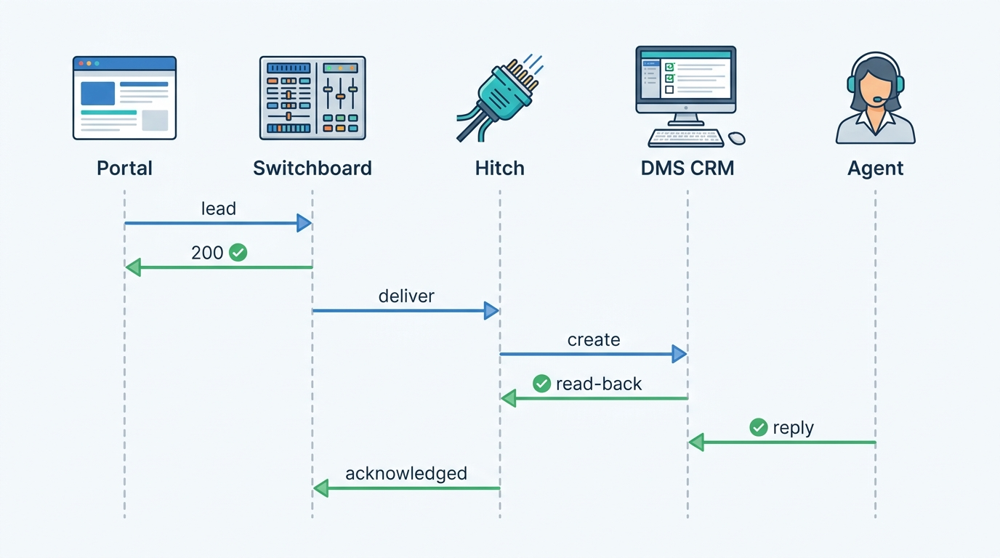
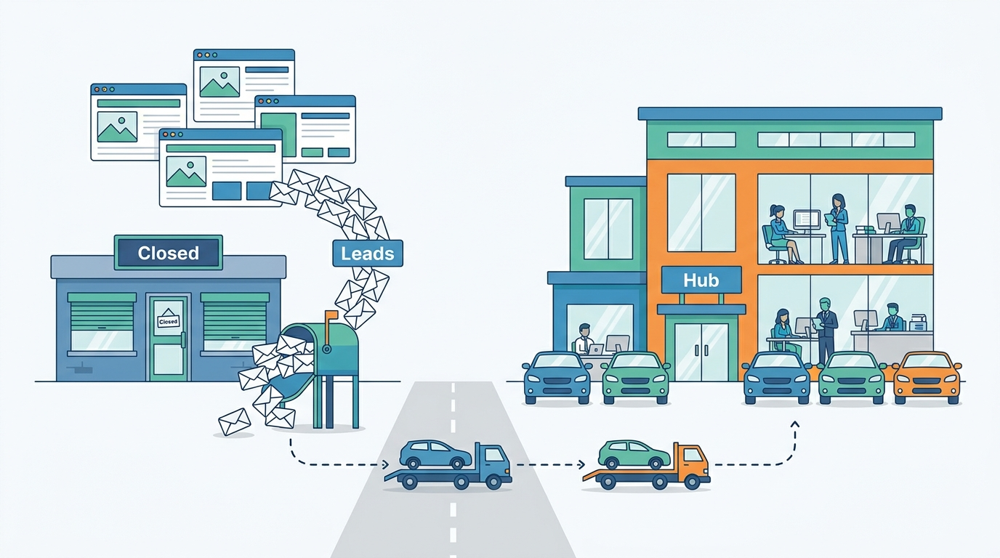
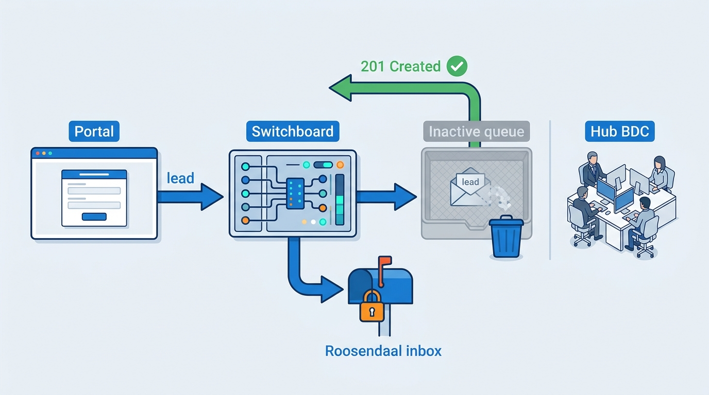
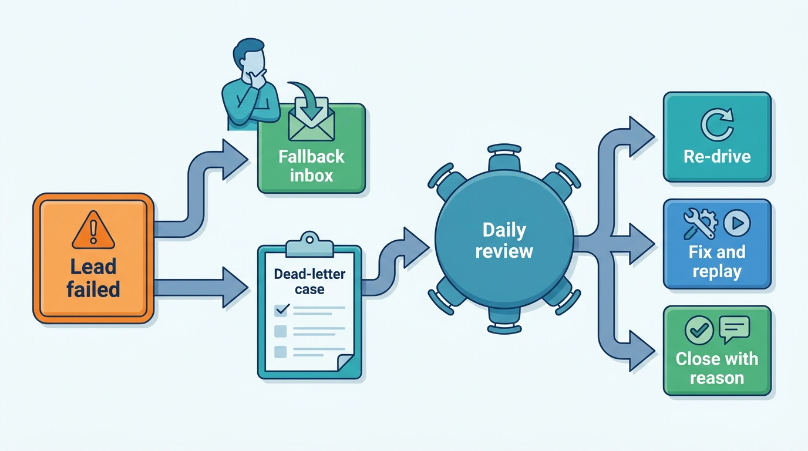

> **IN THIS CHAPTER, YOU WILL:** Follow one buyer's enquiry from a portal through Switchboard's intake, matching, deduplication and routing, into the Lotwise inbox and a DriveDesk CRM queue through Hitch, back out as acknowledgement, a salesperson's reply, a portal status and an attribution record. You will also follow the same path on the days in September 2027 when 1,460 leads disappeared on it.

> **WHY THE BUSINESS CARES:** A dealer group pays portals for every enquiry and measures its sales teams on answering them. When a lead vanishes after the platform reports "delivered", the dealer loses the sale and also stops trusting the platform's numbers. Velto found out from an angry buyer, nine days late.

> **WHY ARCHITECTS SHOULD CARE:** The lead journey crosses nine hops, four owners and two companies' systems. Each hop can return success while the journey fails. Only an end-to-end view can show which hop must prove what, where acknowledgement comes from, and what happens to a lead that nobody can confirm.

> **KEY POINTS:**
>
> * **A lead journey is proven only at its ends.** Each hop must hand on an identifier and a confirmed state, not a status code. The proof that the journey works is a daily comparison of the source's count per rooftop with the leads a person acknowledged, not a dashboard of hop-level success rates.
> * **Acknowledgement is a ladder: accepted, delivered, acknowledged, answered.** A 2xx response is only the first rung. A lead counts as delivered when a read-back shows it in an active queue with an owner, and a rooftop whose leads stop being acknowledged while enquiries keep arriving is an alert. All 1,460 of Velto's lost leads reached the first rung and none reached the second.
> * **No lead leaves the journey silently.** A lead that cannot be routed, delivered or confirmed goes at once to a fallback a person watches and to dead-letter review, where someone finds the cause. Recovery replays from the platform's own lead store and is deduplicated against what the dealer has already done.

> **[FAILURE PATTERNS THIS CHAPTER ADDRESSES](where-vehicle-platforms-go-wrong.html):**
>
> * **The Leaky Lead** — in September 2027 a portal webhook, a routing rule and a CRM API each reported success for leads that no salesperson ever saw.
> * **The Tenant Blur** — a group's reorganization changed rooftops, queues, portal accounts and logins in five systems on different days, and the lead path read each of them at a different version.
> * **Borrowed Uptime** — delivery into a CRM the platform does not run can block a buyer's answer only if the platform lets it. During the DriveDesk Outage it did not.

 
[[leads-and-crm]] defines the lead and designs Switchboard stage by stage. [[dms-integration]] builds Hitch, the layer through which Lotwise writes into dealer management systems (DMS), and [[tenancy-and-dealer-groups]] models the rooftops, hubs and legal entities that routing names. This chapter does not repeat them. It walks **one lead across all of them** and asks what the stage-by-stage views cannot show: who owns each hop, which identifier crosses each boundary, what each hop must confirm before the next one starts, and what the dealer sees when a hop lies.

The journey view matters because **every component in a lead incident usually does what it was designed to do**. The failure sits between the components, in an assumption one of them makes about another. The Lost Leads of Velto, told in full here, had no bug. It had a routing rule that was valid on the day it was saved, a stock record that had not yet caught up with the trucks, a CRM queue that accepted leads after it was switched off, and an inbox nobody could log into.

This chapter owns two terms. **Lead acknowledgement** is the evidence, from the system where people work, that a lead reached a person. **Dead-letter review** is the governed process for every lead that could not be routed, delivered or confirmed.

## Setting the Scene at Axleby: Nine Days of Silence

Axleby, the fictional vehicle data and dealer software group this book follows (see [[meet-axleby]]), routed about **13,000** leads a day through **Switchboard** in 2027. Velto Mobility Group, its largest Benelux dealer group (46 rooftops in the Netherlands and Belgium, 11 franchise brands, DriveDesk as DMS), had its salespeople work leads in DriveDesk's customer relationship management (CRM) module, not in the Lotwise inbox.

On Monday **6 September 2027** Velto switched from brand clusters to **9** regional hubs, each with a business development center (BDC), the team that answers every enquiry first and books appointments. Three rooftops in the province of Noord-Brabant closed: Oosterhout, Roosendaal and Waalwijk (names illustrative). Their stock moved to the new hub Noord-Brabant, run from Breda and Tilburg.

On Wednesday **15 September** at 09:40, a buyer phoned Velto Breda's switchboard. Over eight days he had sent three Marktplaats messages and made two calls about a 2021 Kia Sportage advertised by Velto Roosendaal, and nobody had answered. The hub Noord-Brabant BDC team leader searched DriveDesk for his phone number and found nothing. At 10:20 Velto's CRM administrator opened a ticket with Axleby support.

In **Pitwall**, Axleby's two-week-old support console ([[observability-and-data-operations]]), the buyer's lead trail was green at every step: received, routed, delivered to DriveDesk queue `VEL-CLZ-LEADS`, HTTP 201 Created, 7 September 19:42. By 11:30 the leads team had run the same query for the whole group. Since Monday 6 September at 07:12, **1,460** leads from the three closed rooftops had been delivered to that one queue, the lead queue of Velto's former brand cluster Zuid, and every delivery had returned 201.

At 12:15 Hendrik Maes, Head of Partner Integrations, called Karin Smit, DriveDesk's CTO. Her team confirmed the behavior within the hour. DriveDesk's CRM accepted new leads into a queue that an administrator had set to inactive, showed them in no work list, and deleted them in a nightly housekeeping job. The behavior was described in DriveDesk's administrator guide, not in its partner API reference. Velto's DriveDesk administrator had deactivated all the old cluster queues on Friday 3 September, when the hub queues replaced them.

That is the **Lost Leads of Velto**: **1,460** leads unworked for **9 days**. Ines Marchetti, Group Chief Architect, asked for an unusual post-mortem: not a timeline of the incident but **a walk of one lead through every hop**, with the question each hop should have asked and did not. That walk is this chapter.

## The Journey in One Picture

The journey has nine hops. The figure shows the success path as it runs after the changes of autumn 2027: delivery through Hitch with read-back, a shadow copy in the Lotwise inbox and acknowledgement flowing back.

**Figure 1:** *One portal lead from webhook to reply. Three confirmations come from outside Switchboard: the portal's delivery, DriveDesk's read-back and the agent's activity. In September 2027 the old path had only the first. The 201 Created was treated as the end of the journey.*

Four parties own parts of this path, and the lead crosses a company boundary twice:

| Party | Owns | Does not own |
| --- | --- | --- |
| **Portal** (Marktplaats, AutoScout24, mobile.de) | The buyer's account, the conversation, the delivery contract, its own lead count | Where the lead goes after delivery |
| **Axleby** (Switchboard, Baseline, tenant directory, Hitch) | Intake, matching, routing decisions, delivery and its evidence, the lead store, attribution | The CRM's queues, users and housekeeping |
| **DMS vendor** (DriveDesk) | The CRM record, queues, work lists, its API's semantics | Which queue a lead should go to |
| **Dealer group** (Velto) | Its organization, routing policy, CRM queue setup, the people who answer | The behavior of either vendor's software |

The Lost Leads happened between these rows: Velto changed its organization, DriveDesk applied its queue change, Axleby applied its routing change. **Nobody owned the journey across all four.**

## The Success Path, Hop by Hop

The table is the contract for each hop. "Identifiers crossing" lists what the next hop needs to find the same lead again. If an identifier is missing at a boundary, the lead can be delivered but cannot be traced.

| # | Hop | Owner | Identifiers crossing | Consistency | Latency *(targets are assumptions)* |
| --- | --- | --- | --- | --- | --- |
| H1 | Portal → intake | Switchboard intake (Hendrik Maes's team owns source adapters) | Source event id, source lead id, advert id, `seller.vestiging` | Durable in the raw store before the 200; idempotent on event id | Under 2 s (Marktplaats budget) |
| H2 | Normalize and match | Switchboard | Advert id → channel listing (Relay) → stock item id → AVK; rooftop id; prospect key per legal entity | Reads stock state and directory version; records both | Under 30 s p95 |
| H3 | Deduplicate and link | Switchboard | Switchboard lead id; prospect id; link id | One writer per (legal entity, prospect key) | Same budget as H2 |
| H4 | Route | Switchboard, rules from Baseline | Rule-set version, branch, directory version, target id | Deterministic; stamped on the decision | Under 1 s |
| H5 | Shadow copy | Switchboard → Lotwise inbox | Lead id, rooftop and hub | Exactly once; always written | Under 60 s end to end |
| H6 | Deliver command | Hitch | Idempotency key (lead id + target), DriveDesk queue id | Exactly once at the CRM; no retries outside Hitch | Under 2 min |
| H7 | Receipt and read-back | Hitch | DriveDesk CRM lead id into the cross-reference (xref) map; queue state | Delivered only if the queue is active and in a work list | Seconds after H6 |
| H8 | Human acknowledgement | Dealer's people; signal via Hitch | CRM activity id, user role (not identity by default) | Eventually consistent, ordered per lead | Alert after 4 business hours of silence per rooftop |
| H9 | Outcome and attribution | Switchboard; deal from DriveDesk via Hitch | Deal id, stock item id, prospect id; portal lead id for write-back | At least once, idempotent per (lead, status) | Hours; daily reconciliation |

Five hops deserve more than a table row, because the journey view changes how they look.

**H2: the stock item says where the car is, until a reorganization.** [[leads-and-crm]] makes the stock item, read at routing time, the authority on which rooftop a lead belongs to. This is right on an ordinary day. During a restructuring, the stock item records where the car is *in the books*, and the books follow the trucks with a delay. Velto's three closing rooftop codes were not small sites. About **1,100** cars stood under them on 6 September, including Velto's central used-car stock, which had been advertised under one of the three codes *(Axleby illustration)*. The cars moved to hub Noord-Brabant, but their stock items and adverts stayed under the old rooftop codes and their portal accounts. A stock item moved only when Velto's back office booked the transfer in DriveDesk, which gave the car a new DriveDesk stock number; Hitch's xref map then closed one edge and opened another on the same stock item ([[dms-integration]]). By 15 September most of the cars were still advertised under the three old codes: a hub-sized stock behind three closed rooftops, which is why their leads ran at about 160 a day. **A closed rooftop with stock still booked to it keeps receiving leads.** Routing therefore has to read the rooftop's state as well as the stock item's location.

**Figure 2:** *A closed rooftop with stock still booked to it keeps receiving leads: Velto's cars had moved to hub Noord-Brabant, but their adverts still named the three closed rooftops.*

**H4: the rule was valid when it was saved.** Velto's CRM administrator and a Lotwise implementation consultant wrote rule-set **version 14** in Baseline, the tenant configuration service ([[onboarding-and-configuration]]), in the last week of August. Its group-policy step sent leads for the rooftops in each hub to that hub's BDC queue, and after 19:00 to the group contact center. The three closing rooftops were left out of the hub lists on purpose ("they will not get leads"). Their leads fell through to the rooftop-level rules set up during onboarding in 2026, which sent each rooftop's leads to its brand cluster's queue, `VEL-CLZ-LEADS` for all three. Baseline checked on save that every rooftop id existed and was active, and on 1 September all three were. It could not check the queue id, because it was an opaque string in DriveDesk's namespace. The tenant directory set the three rooftops to *Closing* from 6 September, with no successor, because the successor field was optional at the time. Switchboard did not subscribe to directory changes.

**H5: the fallback belonged to the closed rooftop.** Every Lotwise rooftop has a basic inbox, and in CRM mode Switchboard writes a copy of each lead there. Velto's 1,460 leads were all in Lotwise, in the inboxes of Oosterhout, Roosendaal and Waalwijk. Velto had moved its users' memberships to the hubs on 6 September, so **no one had access to those inboxes**. The fallback existed, but it was attached to the same node that had closed. After the incident, the shadow copy goes to the inbox of the rooftop the lead is *routed to*, and the group's lead administrator can see every rooftop's inbox.

**H6–H7: 201 Created is a transport fact.** The old path was a DriveDesk connector inside Switchboard, built in 2025 on DriveDesk's partner REST API. It posted the lead and marked it *Delivered* on any 2xx. Hitch had replaced the stock path after the Zombie Golf but not yet the lead path. Since **25 October 2027**, DriveDesk lead delivery runs through Hitch as a command with a receipt. After the create call, the adapter reads the CRM record back and checks three things: the record exists, its queue is active, and the queue appears in at least one active user's work list. A lead that fails the read-back is not *Delivered*. It stays in the hub's shadow inbox and goes to dead-letter review.

**H8: the dealer's activity is the only proof a person saw the lead.** Hitch polls DriveDesk's activity feed every 5 minutes *(assumption)* for assignment, status change or contact, and passes them to Switchboard as acknowledgement and first response. Switchboard records the actor's role, not the person, unless the dealer has enabled per-salesperson reporting.

### One lead, two paths

The timeline below replays the buyer's first Marktplaats message from the scene: once as it ran on 7 September, and once as it runs through the design in place from late October. The second column is a replay of the same lead against rule-set version 15 and Hitch, run during the post-mortem. It is not a second real lead.

| Step | 7 September 2027 (old path) | Replay on the October 2027 design |
| --- | --- | --- |
| Buyer sends message | Tue 19:42:10 | 19:42:10 |
| Raw event stored, 200 to Marktplaats | 19:42:11 | 19:42:11 |
| Matched | Stock item booked at Roosendaal; prospect new | Same |
| Routed | v14: Roosendaal in no hub, so rooftop rule → `VEL-CLZ-LEADS` | v15: directory says Roosendaal *Closed*, successor Breda → hub Noord-Brabant; after 19:00 → group contact center queue |
| Shadow copy | Roosendaal inbox (no members) | Hub Noord-Brabant inbox (hub members and group admin) |
| Delivery | POST → 201 at 19:42:14; marked *Delivered* | Hitch command → 201 at 19:42:15; read-back: queue active, 6 agents on shift → *Delivered* 19:42:16 |
| Acknowledged | Never; deleted by housekeeping 8 Sept 02:00 | Assigned to an agent 19:51 *(illustrative)* |
| First human response | 16 Sept 10:12, after redelivery | Reply 19:58 *(illustrative)* |
| Outcome | Test drive 18 Sept; no sale | — |

The old path was not slow; by its own measure it was finished in four seconds. **It lacked a definition of done that required the next party to confirm.**

## Lead Acknowledgement: What Counts as Delivered

**Lead acknowledgement** is evidence, produced by the system where people work, that a lead reached a person. It is not one signal. It is four rungs, each with its own evidence and its own place in the lead lifecycle of [[leads-and-crm]]:

| Rung | Evidence | Produced by | Lifecycle effect | What it proves |
| --- | --- | --- | --- | --- |
| **A0 Accepted** | 2xx from the target's API; SMTP 250 for e-mail | The target's transport | None: the lead stays *Routed* | The target received the bytes |
| **A1 Delivered** | Read-back: record id, queue id, queue active, queue in an active work list | Hitch adapter; Switchboard's own write for the Lotwise inbox | *Delivered* | A person *could* see it |
| **A2 Acknowledged** | Assignment, open, or status change by a user | CRM activity via Hitch; inbox events | Timestamp on the lead | A person *did* see it |
| **A3 Answered** | Outbound message or answered call by a person, not an auto-reply | Inbox, CRM activity, call tracking | *Contacted* | The buyer got an answer |

**Figure 3:** *Acknowledgement is a ladder: a 2xx response reaches only the first rung, and all 1,460 of Velto's lost leads reached it and stopped there.*

Three rules follow.

**Never let A0 stand in for A1.** The old DriveDesk connector, ADF e-mail and many file-based integrations stop at A0. The same is true of Marktplaats's own delivery to Axleby: Marktplaats knows it got a 200, not that a salesperson answered. That is why the portal's lead count is the right check on the platform, and the dealer's activity is the right check on the CRM.

**A target that cannot reach A1 is never the only place a lead lives.** Each delivery target is registered with the highest rung it can prove:

| Target | Highest rung the platform can prove | Consequence |
| --- | --- | --- |
| Lotwise inbox | A3 | System of record for independents such as Autobedrijf Brandsma |
| DriveDesk CRM via Hitch (from 25 Oct 2027) | A3 (read-back plus activity feed) | Shadow copy hidden from salespeople, visible to the group admin |
| Franchise-brand systems via XML files (some of 210 rooftops) | A0 | Lead stays live in the Lotwise inbox until A2 is recorded there |
| ADF e-mail to a US CRM (design only; Axleby has no US customers) | A0, or a bounce | As above; the platform's inbox is the working copy |

**A2 silence is measured per rooftop, not per lead.** One lead without acknowledgement after an hour usually means a busy salesperson. A rooftop whose leads all stop being acknowledged while the portals keep sending them means a broken journey. The lead-flow monitor built in **October 2027** ([[observability-and-data-operations]]) alerts the leads team and the group administrator when a rooftop's leads go unacknowledged for **4 business hours** while portal leads still arrive. On 6 September it would have fired at about 11:15 for Roosendaal.

Read-back costs a second API call per lead, a few thousand calls a day across DriveDesk's 1,900 rooftops: small next to stock polling, and the price of a *Delivered* state that means something.

## The Lost Leads of Velto, Hop by Hop

Every hop on the old path reported success, and the post-mortem table shows why each one was right by its own measure:

| Hop | What it reported | Why that was true | The question it did not ask |
| --- | --- | --- | --- |
| Portal → intake | 200, lead stored | It was stored | — |
| Match | Stock item at Roosendaal | The books said so | Is that rooftop still open? |
| Route | Rule v14, rooftop branch | v14 was valid on 1 September | Is the target still valid today, and does anyone work it? |
| Shadow copy | Written to Roosendaal inbox | It was written | Does anyone have access to this inbox? |
| Deliver | 201 Created | DriveDesk accepted the record | Is the record in a work list? |
| Monitor | Delivery success 99.9% | Hop success was 99.9% | Do this rooftop's leads get acknowledged? |

**Figure 4:** *The old path on 7 September 2027. Every arrow that returns to Switchboard is a success, and the lead still disappears. The two hops that could have caught it, the shadow inbox and DriveDesk's queue, both belonged to the organization Velto had just dismantled.*

### Why nobody noticed for nine days

The lost leads came from three of 46 rooftop codes, about **160 a day** for a hub-sized stock still advertised under codes that the hub teams no longer thought of as theirs. The new hub BDC teams were busy with the 43 remaining rooftops, and on Friday 10 September hub Noord-Brabant's manager put a dip in the weekly report down to the reorganization. **A reorganization is the one week when every anomaly has a plausible explanation.** That is why the lead-flow monitor alerts on silence rather than on a trend.

The 1,460 leads by source *(Axleby illustration)*:

| Source | Leads | Note |
| --- | --- | --- |
| Marktplaats | 690 | Messages, bids and callback requests on adverts under the three rooftops' accounts |
| AutoScout24 | 280 | Same, under the rooftops' dealer ids |
| Regional Dutch portal | 60 | Same |
| Velto website forms | 310 | Vehicle pages of cars still booked at the three rooftops |
| Tracked phone calls (missed) | 120 | Tracking numbers still assigned to the three rooftops; missed calls become callback leads |
| **Total** | **1,460** | |

Every source was attached to the closed rooftops by an identifier that lived in a different system: portal accounts and the Marktplaats `vestiging` field, website pages, call-tracking numbers, DriveDesk queues, Lotwise inboxes. Closing the rooftop in the tenant directory changed none of them. **A rooftop is known in at least seven systems under seven identifiers, and a closure has to reach all of them.**

### Recovery

The leads were gone from DriveDesk but not from Axleby. Switchboard's lead store held every lead and interaction, and the raw store held the original events. Recovery ran on Wednesday afternoon:

1. **13:05 — stop the bleeding.** Rule-set version 15 routed the three rooftops to hub Noord-Brabant's BDC queue, and the directory recorded Breda and Tilburg as successors. The first new lead reached the hub queue at 13:20.
2. **14:00 — deduplicate before redelivering.** Of the 1,460 leads, **188** belonged to prospects with a linked lead through another channel or rooftop that a Velto salesperson had already answered. Those were attached to the answered lead as interactions, not delivered again. Without this step, 188 buyers who were already talking to Velto would have received a second, confused call.
3. **16:00 — redeliver with context.** The remaining **1,272** leads went to the hub queue as one marked batch, each flagged "delayed lead, received 6–15 Sept" with the original message and a suggested apology. **96** concerned cars sold in the meantime and carried similar stock instead. Answering a buyer's own enquiry late needs no new consent.
4. **16–17 September — work the backlog.** The hub BDC and the group contact center made first contact with the late cohort by Friday evening.

*(All figures below are Axleby illustrations.)* After 60 days, **37** of the 1,272 redelivered leads had become sales, **2.9%**. Velto's used-car leads normally convert at about **8%** in that window. The gap is about **65** cars. At an assumed gross profit of €1,400 per used car *(assumption)*, that is roughly **€90,000** of lost profit for Velto, plus nine days of portal fees for enquiries nobody answered. Axleby credited one month of the Website & Leads module for all 46 rooftops (46 × €149 = **€6,854**). The credit was a gesture. The loss was Velto's.

Femke de Boer, Axleby's Data Protection Officer, informed Velto, the controller of its buyers' data, the same day. The General Data Protection Regulation (GDPR) counts accidental "loss" of personal data as a breach (Article 4(12)) and requires a processor to "notify the controller without undue delay" (Article 33(2), [Regulation (EU) 2016/679, 2016](http://publications.europa.eu/resource/celex/32016R0679)). Switchboard still held every lead and no third party had seen them, so Velto's privacy officer judged the event unlikely to result in a risk to the buyers and recorded it in Velto's breach register, as Article 33(5) requires. That judgement was Velto's, not Axleby's.

### What changed, by hop

[[leads-and-crm]] lists the five changes to Switchboard. Seen from the journey, each hop now asks the question it skipped:

| Hop | Question now asked | Mechanism | Live |
| --- | --- | --- | --- |
| Route | Is the target valid today, and does anyone work it? | Subscription to `rooftop.closed` with a mandatory successor; queue ids registered in the integration registry with their DriveDesk state; terminal fallback required | October 2027 |
| Route (change time) | What would this rule set have done last month? | Mandatory 30-day simulation for group changes; a target with leads and no active users blocks activation | October 2027 |
| Shadow copy | Can someone see this inbox? | Copy goes to the routed-to rooftop; group lead administrator sees all | September 2027 (hotfix) |
| Deliver | Is the record in a work list? | Hitch command with read-back | 25 October 2027 |
| Monitor | Are this rooftop's leads acknowledged? | Lead-flow monitor, 4 business hours | October 2027 |
| Journey | Does the portal's count match ours? | Daily per-rooftop reconciliation against portal lead reports where exposed | November 2027 |

DriveDesk changed its side too. Its December 2027 release rejects new records for an inactive queue with an error and exposes an `active` flag on the queue resource *(Axleby illustration)*. Hendrik's team added both behaviors to the partner agreement's interface annex. **The definition of "delivered" is an interface term, and it belongs in the contract.**

## Dead-Letter Review

A **dead-letter review** is the governed handling of every lead that the journey could not route, deliver or confirm. Each case has a reason code, an owner and an age, and each is closed by an explicit decision. It differs from a technical dead-letter queue in one way that matters: **the lead itself is never only in the dead letter.** By the time a case opens, the lead is already in a fallback inbox that a person watches. The case is about the *cause*, so that the next lead does not fail the same way.

**Figure 5:** *Dead-letter review. The buyer's answer never waits for the review, because the lead is already in a watched fallback. The review exists to remove the cause, and every exit is an explicit decision.*

Reason codes, owners and an illustrative December 2027 day (about **13,000** leads):

| Reason code | Example | Owner | Cases per day *(illustrative)* |
| --- | --- | --- | --- |
| Unparseable source event | ADF-style e-mail from a brand system with a malformed body | Source adapter team (Hendrik Maes) | 4 |
| No rooftop match | Lead for an advert id Relay cannot map; website form without a stock reference | Switchboard | 11 |
| Invalid target | Rule names a closed rooftop without a successor, or an inactive queue | Dealer group administrator, via Baseline | 2 |
| Receipt missing | Hitch command without a read-back after 2 minutes | Hitch | 6 |
| Permanent rejection | CRM returns 4xx: unknown queue, field validation | Hitch, then dealer | 3 |
| Consent conflict | Lead carries a marketing scope the target cannot represent | Switchboard (policy) | 1 |
| Rooftop silence | Lead-flow monitor alert: no A2 for 4 business hours with leads arriving | Leads team with the dealer | 0–1 rooftops |

Five rules make the review work rather than become a second place where leads go to die:

1. **Nothing is discarded automatically.** Every case ends with a person's decision and a reason.
2. **Re-drive uses the original idempotency key**, so a case retried twice cannot create two CRM leads.
3. **Age is the alarm.** Cases are reviewed every business day, and a case older than one business day pages the leads team lead. A queue of 40 fresh cases is healthy. A single case nine days old is the Lost Leads of Velto.
4. **Bulk cases for bulk causes.** A rooftop-silence alert opens one case covering all that rooftop's open leads, not hundreds of individual ones.
5. **Trends are reviewed weekly.** A reason code rising across many rooftops usually means a portal or DMS changed its contract; Marktplaats may add properties "even in patch version updates" ([Marktplaats, n.d.](https://api.marktplaats.nl/docs/v2/lms/index.html)).

## Failure Cases

The Lost Leads combined two failures: a closed target and silent acceptance. The journey has to absorb six more. For each, the table gives the hop where the failure occurs, how it is detected and how the journey recovers.

| Failure | Hop | Detection | Recovery |
| --- | --- | --- | --- |
| **Silent acceptance by the CRM** | H6–H7 | Read-back fails (no record, inactive queue, no work list); rooftop silence at H8 | Lead stays in shadow inbox; dead-letter case; re-drive to valid queue |
| **Rooftop closed after restructuring** | H2–H4 | `rooftop.closed` event; rule validation; simulation before activation | Successor routing with an alert; rule marked invalid until fixed |
| **Duplicate lead from two channels** | H3, H6 | Prospect link within the legal entity; xref shows an open CRM lead for the prospect and car | Second lead linked; delivered to the CRM as an activity on the first CRM lead, not as a new lead |
| **Lead for a sold car** | H2 | Stock state Sold or Reserved at match time (from the nightly export in 2027) | Route normally with a "sold" banner and alternatives; raise a channel-state check in Relay |
| **CRM outage** | H6 | Circuit breaker per CRM and rooftop in Hitch | Lotwise inbox becomes the working copy; on recovery, open leads delivered with their Lotwise history, closed ones as history only |
| **Ambiguous timeout** | H6 | Create call times out with no response | Read before retry: search the CRM by Switchboard lead id in its external-reference field |
| **Consent missing or unrepresentable** | H2, H6 | Normalizer finds no consent data; Hitch mapping test finds no consent field at the target | Deliver with marketing blocked by default; set the CRM's no-marketing flag where it exists |
| **Follow-up before its lead** | H1–H3 | Follow-up references an unknown source lead id (Marktplaats does not guarantee order) | Park for 10 minutes *(assumption)*, then create the lead from the follow-up |

Four of these need more than a table row.

**Duplicate lead from two channels.** A buyer writes on Marktplaats about a Volvo XC40 at Velto Tilburg at 10:02 and fills in the form on Velto's website at 10:03. Switchboard links the two leads at level 3 of its deduplication ([[leads-and-crm]]), because each portal claims its lead and attribution needs both touches. The journey question is what reaches DriveDesk. If both are sent as new CRM leads, two BDC agents call the same person. The rule is that **the CRM receives one lead per prospect and car**, and later linked leads arrive as activities on the first CRM lead, using the CRM lead id from Hitch's xref map. Two leads arriving within seconds of each other create a race. Switchboard therefore processes match and link through one writer per (legal entity, prospect key), so the second lead always sees the first. The cost is a few hundred milliseconds of serialization for one prospect. Without it, duplicates appear in the CRM whenever a buyer acts quickly.

**Lead for a sold car.** In 2027 Switchboard learned stock state from Lotwise's nightly stock export ([[events-webhooks-and-sync]]), so a lead for a car sold that morning was routed as if the car were for sale. The salesperson usually saw DriveDesk's sold status. The better signal went unused: a lead for a sold car means a portal still shows the car. The Zombie Golf's **37** leads were 37 such signals ([[listing-syndication]]). Until Switchboard consumes stock events from the backbone in Q2 2028, the 15-minute sold-but-live job in Relay is the real safeguard. A Switchboard check against the nightly state catches only the cases that job missed.

**CRM outage.** During the DriveDesk Outage (9–21 November 2027), Hitch's circuit breaker put all 1,900 DriveDesk rooftops into degraded mode, and about **34,000** leads went to the Lotwise inbox ([[dms-integration]]). Because lead delivery had moved behind Hitch two weeks earlier, the switch was automatic; on the old connector it would have been 34,000 failed POSTs and a manual decision. The harder part was the way back. When write-back resumed rooftop by rooftop from 26 November, Switchboard did not replay 34,000 deliveries. **Leads still open in Lotwise were delivered to DriveDesk with their Lotwise conversation attached and marked "handled in Lotwise since …". Leads already won or lost went across only as history** *(illustrative split: about 11,800 open, about 22,200 history)*. Replaying everything as new would have put 34,000 fresh tasks in front of agents who had already answered most of those buyers. US dealer groups' 2024 filings show why this matters. AutoNation reported that "certain ancillary systems and integrations" came back only by the end of July, weeks after the core DMS ([AutoNation 10-Q, August 2024](https://www.sec.gov/Archives/edgar/data/350698/000035069824000098/an-20240630.htm)). Lead delivery into a DMS-vendor CRM is exactly such an integration.

**Consent missing or unrepresentable.** Portal leads carry the buyer's request to be answered, which needs no separate consent ([[leads-and-crm]] covers the legal analysis per market). Marketing scope arrives only where the source captured it, as on Velto's own website forms. DriveDesk's lead API had no consent field, so on the old path a buyer who had opted out of marketing reached the CRM indistinguishable from one who had opted in. Velto's after-hours contact center then added late enquirers to a DriveDesk newsletter campaign. The journey rule is that **consent travels as data or the default is "no marketing"**. Hitch writes the consent scope and text version into a structured note on the CRM lead, sets DriveDesk's marketing opt-out flag unless the scope explicitly includes marketing, and a mapping test fails the build if a target adapter drops the consent object.

### What the public record shows about these hops

Real lead contracts show the same weak points, though no public source describes the internals of any company's lead pipeline:

- **Unordered delivery at intake.** Marktplaats gives no "guarantees on the specific order you will receive webhook messages in" and expects a response within 2 seconds ([Marktplaats, n.d.](https://api.marktplaats.nl/docs/v2/lms/index.html)).
- **Outcome write-back as a contract.** mobile.de's Lead API (version 2026-06-25) lets the receiver post `IN_PROGRESS`, `SOLD`, `NOT_INTERESTED` or `SPAM` with an optional `occurredAt` "in case of asynchronous communication" ([mobile.de, 2026](https://services.mobile.de/manual/lead-api.html)). It is the only public European contract found that closes the loop at H9.
- **The CRM as part of the DMS.** In the June 2024 CDK Global outage, Sonic Automotive told the SEC that its CRM was among the affected systems ([Sonic Automotive 8-K, July 2024](https://www.sec.gov/Archives/edgar/data/1043509/000104350924000060/sah-20240705.htm)).
- **The journey as the unit of measurement.** In 2024 AutoScout24 described defining service level objectives on critical user interactions, including "Dealer is contacted by a Buyer about a car" ([AutoScout24, 2024](https://tech.autoscout24.com/blog/posts/slos-for-critical-user-interactions/)). That is the journey this chapter walks, measured from the buyer's side.
- **The last hop fails too.** Pied Piper's 2025 study of 4,023 US dealerships found that 19% did not personally respond to a web enquiry within 24 hours ([Auto Remarketing, 2025](https://www.autoremarketing.com/ar/retail/dealerships-responsiveness-to-internet-leads-hits-record-high-again)). The platform cannot fix that, but it can show whether a missing answer was a software failure or a staffing one.

## Trade-offs

| Decision | Option A | Option B | Choose A when | Choose B when |
| --- | --- | --- | --- | --- |
| **Delivery evidence** | Read-back per lead after create | Trust 2xx, rely on activity monitoring | The target has a queryable API and any lead loss is costly (always for paid portal leads) | The target cannot be queried (files, e-mail); then keep the platform inbox as the working copy |
| **Shadow copy in CRM mode** | Always write a copy in the platform inbox | No copy; the CRM is the only store | A fallback must exist during outages and investigations | Never fully; at most hide the copy from salespeople to avoid two systems chasing one buyer |
| **Invalid target at routing time** | Route to successor or fallback and alert | Hold the lead until the rule is fixed | Always: the buyer must be answered today | Never for leads; holding is acceptable only for marketing exports |
| **Late recovery** | Redeliver to the dealer's queue, deduplicated, with context | Hand the dealer a list | The dealer's CRM is where its people work and the batch can be marked | The batch is small and the dealer prefers manual triage |
| **Silence alert** | Per rooftop, 4 business hours | Per lead, minutes | Groups with BDCs and works councils; few false alarms | Single-rooftop dealers who ask for a personal nudge, as an opt-in |
| **After-hours branch** | Platform routes to the group contact center | CRM routes after hours | The group has several CRMs or rooftops on different systems | One CRM per group with its own scheduling |

My recommendation for a group like Velto is A in every row. It rests on one requirement: **the platform must be able to say, at any moment, where every lead is and who has seen it.** A group that runs one CRM with its own routing and monitoring may prefer delivery to a single group queue. Even then, the platform should keep A0 to A2 evidence for its own segment, because the dealer will ask whose fault the next missing lead was.

The shadow copy has a cost too: a second copy of the buyer's data must follow the same retention schedule ([[privacy-and-retention]]). Both costs are small next to nine days of silence.

## Metrics That Prove the Journey Works

Hop metrics say whether components are healthy; journey metrics say whether buyers are answered. Axleby reports these per rooftop and group, monthly to the dealer and daily to the leads team.

| Metric | Definition | Target *(assumption)* | Velto, Dec 2027 *(illustrative)* |
| --- | --- | --- | --- |
| **Source-count match** | Leads per rooftop and source in Switchboard ÷ the portal's own count, where the portal exposes one | ≥ 99.5% daily | 99.7% |
| **Delivered with read-back** | Leads reaching A1 within 2 minutes | ≥ 99% | 99.4% |
| **Fallback share** | Leads that reached a person only through a fallback inbox | Watched for trend; under 1% outside outages | 0.4% |
| **Rooftop silence** | Rooftop-hours with leads arriving and no A2 for 4 business hours | Zero | 0 alerts |
| **Time to first human response** | Median arrival → A3, inside and outside opening hours | Set by the dealer | 31 min inside / 2.1 h outside (contact center) |
| **Duplicate CRM leads** | CRM leads for a prospect and car that already had an open CRM lead | Under 1 per 1,000 | 0.6 per 1,000 |
| **Dead-letter age** | Age of the oldest open case | Under 1 business day | 6 hours |
| **Won with a lead** | Share of retail sales with a linked lead | Tracked; drives attribution | 64% |

Two metrics deserve emphasis. **Source-count match** is the only check made by a party outside the journey. It would have shown Roosendaal's Marktplaats account at about 80 leads and none acknowledged by the third day. **Time to first human response** is split between the platform's segment and the dealer's, so a slow week is attributed to the right party. Velto's median outside opening hours is about 2 hours, against about 14 hours across Lotwise rooftops in 2027 ([[leads-and-crm]]). That comes from the after-hours contact-center branch introduced with the hubs.

## What Changes in Another Market

The journey's shape is the same in every market. What changes is the intake at H1, the acknowledgement rungs a target can reach, and the rules on measuring people.

| Market | What changes in the journey |
| --- | --- |
| **Netherlands / Belgium** | The baseline above: Marktplaats and 2dehands push webhooks, DriveDesk via Hitch. In Belgium, routing adds a language branch (Dutch or French-speaking team). |
| **Germany** | mobile.de leads are pulled with a cursor, so H1 latency is the poll interval, and a lost cursor means replay rather than loss. Outcome write-back to mobile.de is available and off by default. The 140 rooftops on two German DMS products exchange nightly SFTP files, which cannot carry a lead, so the Lotwise inbox is their system of record. Per-salesperson A2/A3 metrics can require works-council agreement under §87(1) no. 6 of the Works Constitution Act ([gesetze-im-internet.de, accessed 2026-10](https://www.gesetze-im-internet.de/betrvg/__87.html)), so Axleby reports them per rooftop by default. |
| **United Kingdom** | Showroomly keeps its own lead inbox until it moves onto shared leads in 2028. Auto Trader's deal-centric APIs make some leads reservations that lock stock, which adds a stock hop between H2 and H4 ([[listing-syndication]]). The soft opt-in under PECR covers "negotiations for the sale" ([PECR reg. 22](https://www.legislation.gov.uk/uksi/2003/2426/regulation/22)). |
| **United States** | Axleby has no US customers. A US journey would run ADF e-mail at both ends, with A0 as the only evidence, so the platform inbox would be the working copy until the CRM's activity is visible. CRMs are often bundled with the DMS. The Telephone Consumer Protection Act rules require prior express written consent for autodialed telemarketing calls and texts to mobile numbers ([47 CFR 64.1200, n.d.](https://www.law.cornell.edu/cfr/text/47/64.1200)), so the consent object gates the after-hours SMS branch. |

The judgement: the journey design, the acknowledgement ladder, dead-letter review and the metrics are common. **Market adapters supply the intake contract and declare the highest rung each target can prove.** A policy pack supplies the consent defaults and which people-level metrics are on by default.

## The Chief Architect's View

**Give the journey an owner.** In September 2027 every hop had an owner and the journey had none. Since then Tomás Ferreira, Product Director of Lotwise, owns the lead journey and its metrics; Hendrik Maes owns the adapters and their read-backs; Marta Nowak's platform team owns the lead-flow monitor. The journey owner chairs the weekly dead-letter trend review, where contract changes by portals and DMS vendors first show up.

**Treat a group reorganization as a change to the platform, not a support task.** Velto will reorganize again, and so will Hartley and every group Axleby onboards. A rooftop is known under at least seven identifiers in seven systems: tenant directory node, Baseline rules, portal accounts and `vestiging` codes, call-tracking numbers, website pages, DMS queues and inbox memberships. Axleby now records the external identifiers in the tenant directory. A `rooftop.closed` event produces a closure work list across all of them, with an owner per line, before the effective date ([[tenancy-and-dealer-groups]]).

**Put the meaning of "delivered" into partner contracts.** For each CRM and DMS vendor, the interface annex states how a created record can be read back, how inactive queues behave, and the error a rejected lead returns. Behavior described in an administrator guide, but not in the API contract, is the source of the next silent failure.

**Measure from the outside in.** The portal's count is the check on the platform, and the dealer's acknowledgement is the check on the CRM. A journey that measures only itself will report 99.9% success through any incident like September's.

## Questions to Ask

1. For each delivery target, what is the highest acknowledgement rung we can prove, and what do we do with leads at targets that stop at A0?
2. When a dealer group closes a rooftop, which of its identifiers (portal accounts, tracking numbers, website pages, CRM queues, inboxes) change automatically, and which depend on someone remembering?
3. Does our routing read the rooftop's state, or only the stock item's location?
4. Where does the fallback copy of a lead live, and can someone actually log in to see it?
5. Which rooftops have leads arriving but none acknowledged in the last four business hours, right now?
6. How old is the oldest open dead-letter case, and who is paged when it passes one business day?
7. After a CRM outage, how do we hand back leads the dealer already handled in our inbox without creating duplicate tasks?
8. Does our partner contract with each CRM vendor define what "delivered" means and how a lead to an inactive queue is rejected?
9. Can we show a dealer, per rooftop and source, the portal's count next to ours for yesterday?

A lead that ends well ends in a signed contract. The next journey, [[journey-sale-to-registration]], starts there: a deal signed in Lotwise, adverts withdrawn everywhere, and a registration transaction with the register that has to succeed even on the last day of the month.

## Sources and Evidence

**Company, product and investor sources**

- [Lead API documentation, version 2026-06-25](https://services.mobile.de/manual/lead-api.html), mobile.de, 2026: cursor pull, lead events, status write-back with `occurredAt`.
- [Schneller zum Abschluss: Plattform-Update Sommer 2026](https://newsroom.mobile.de/plattform-update-sommer-2026/), mobile.de newsroom, 2026: Lead Manager Pro as a central lead pipeline.
- [API solutions for Lead Management Systems](https://api.marktplaats.nl/docs/v2/lms/index.html), Marktplaats B.V., n.d., accessed 2026-10: unordered webhook delivery, 2-second budget, lead identity, `vestiging`, forward-compatible payloads.
- [Sonic Automotive Form 8-K, July 2024](https://www.sec.gov/Archives/edgar/data/1043509/000104350924000060/sah-20240705.htm), Sonic Automotive, 2024: CRM among the systems affected by the CDK outage.
- [AutoNation Form 10-Q for the quarter ended 30 June 2024](https://www.sec.gov/Archives/edgar/data/350698/000035069824000098/an-20240630.htm), AutoNation, 2024: integrations restored by the end of July, after the core DMS.
- [SLOs for Critical User Interactions](https://tech.autoscout24.com/blog/posts/slos-for-critical-user-interactions/), AutoScout24 tech blog, 2024: journey-level objectives including "Dealer is contacted by a Buyer about a car".

**Standards, regulation and official documentation**

- [Auto-lead Data Format (ADF) Version 1.0](https://adfxml.info/adf_spec.pdf), ADF working group, 2000: e-mail transport, bounce as the only error signal.
- [Regulation (EU) 2016/679 (GDPR)](http://publications.europa.eu/resource/celex/32016R0679), EU Publications Office, 2016: Article 4(12) breach definition; Article 33(2) processor notification; Article 33(5) documentation.
- [Betriebsverfassungsgesetz, § 87](https://www.gesetze-im-internet.de/betrvg/__87.html), German Federal Ministry of Justice, n.d., accessed 2026-10: works-council co-determination over technical monitoring of employees.
- [47 CFR 64.1200, delivery restrictions](https://www.law.cornell.edu/cfr/text/47/64.1200), Legal Information Institute, n.d., accessed 2026-10: TCPA consent for autodialed telemarketing calls and texts.
- [Privacy and Electronic Communications (EC Directive) Regulations 2003, regulation 22](https://www.legislation.gov.uk/uksi/2003/2426/regulation/22), legislation.gov.uk, n.d., accessed 2026-10: UK soft opt-in.

**Research and practitioner sources**

- [Dealerships' responsiveness to internet leads hits record high again](https://www.autoremarketing.com/ar/retail/dealerships-responsiveness-to-internet-leads-hits-record-high-again), Auto Remarketing, 2025: Pied Piper 2025 study of 4,023 US dealerships.

Axleby is fictional; architectural recommendations, labeled inferences and labeled assumptions are the author's judgement.
