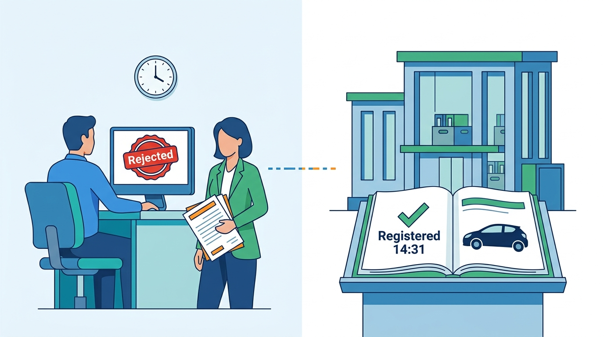
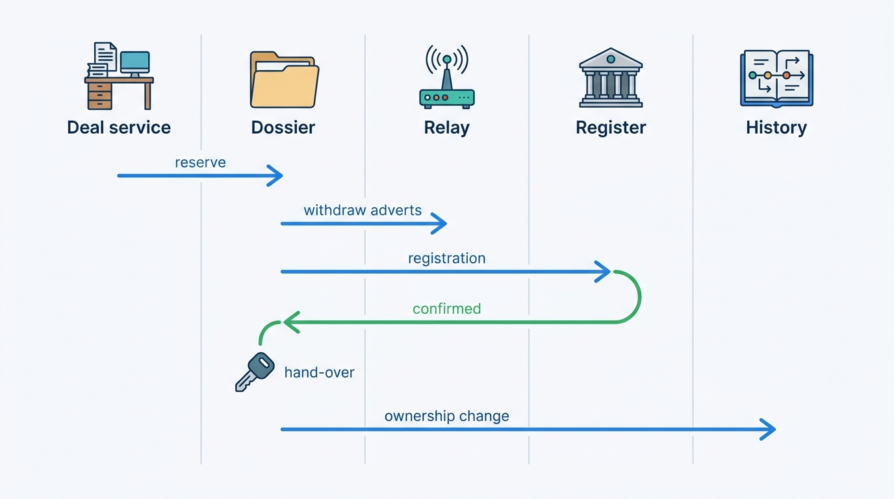
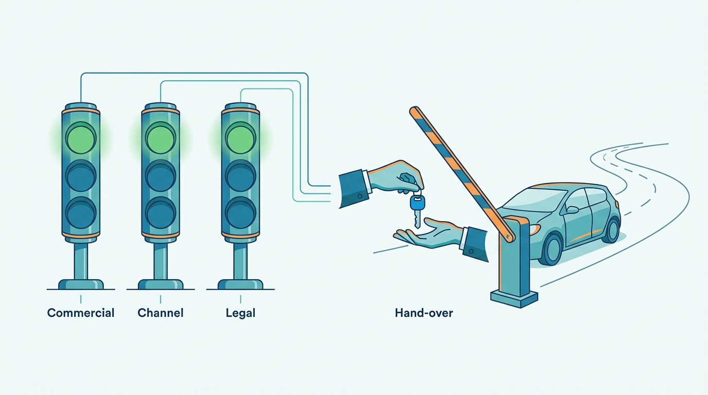
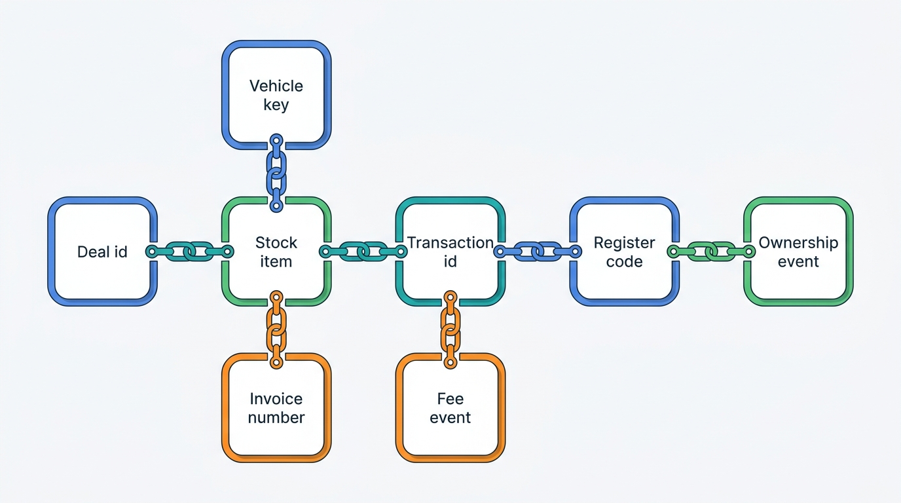
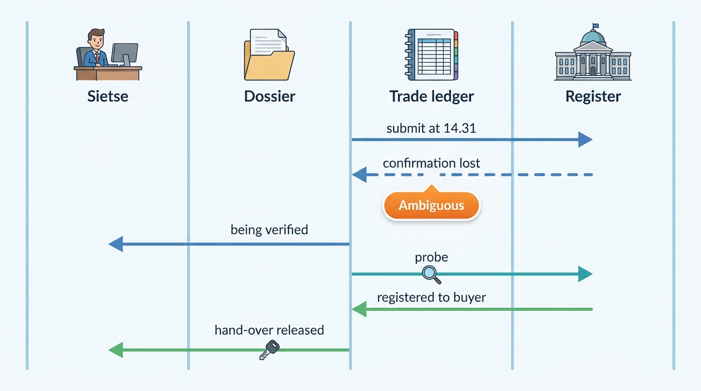

> **IN THIS CHAPTER, YOU WILL:** Walk one used-car sale from signature to new owner through every context it touches: deal, stock item, syndication, lender, register transaction, proof, invoice, accounting export, vehicle history and market data. You will then replay the same journey on the afternoon of the Month-End Register Outage, seen from the showroom.

> **WHY THE BUSINESS CARES:** The sale is where the dealer earns the margin and the platform earns its transaction fees. It is also where a mistake reaches a consumer directly: a buyer sent home without a car, a seller still liable for a car they sold, a registered car still advertised. Month-end is when most of these sales happen and when the platform is most likely to fail.

> **WHY ARCHITECTS SHOULD CARE:** Each hop of this journey has its own owner, identifier and consistency rule, and each was designed well enough on its own. What the chapters on single contexts cannot show is what happens *between* the hops. Three state machines (commercial, channel, legal) must agree at one moment: when the keys change hands.

> **KEY POINTS:**
>
> * **A sale is three state machines, and they agree only at the hand-over.** The deal and stock item say what was agreed, the channel listings say what the market sees, and the register says who is legally responsible for the car. Show all three on one screen, and let the car leave only when the register's evidence says the buyer is the keeper.
> * **One sale case, one key chain, from the signature to the history record.** The deal id, stock item, Axleby Vehicle Key, transaction id, invoice number, fee line and ownership event must link without heuristics. Then a retry, a replay or a correction finds what it must change. On 31 March 2027 the links stopped at the transaction, and 214 acts that the register had completed showed "rejected" in Lotwise.
> * **An outage is a customer-communication problem with an ordering constraint.** The register cannot be worked around, and should not be. The platform's job on the worst afternoon is to keep every hop that does not need the register working and to hold per-vehicle order. It must also tell the dealer, in words the dealer can repeat to the buyer, what is waiting and when it will be known.

> **[FAILURE PATTERNS THIS CHAPTER ADDRESSES](where-vehicle-platforms-go-wrong.html):**
>
> * **Borrowed Uptime** — the hand-over depends on a register channel that the platform cannot replace, and on the quarter's last afternoon an outage there becomes hundreds of postponed deliveries unless every other hop keeps working.
> * **The Zombie Listing** — a sold car must leave every portal at reservation time, not when the register confirms, and at month-end the withdrawals compete with thousands of other stock changes.
> * **The Unmetered Call** — a transaction fee emitted on submission, not on confirmation, turned 214 ambiguous timeouts into double charges on dealers' invoices.

 
Part IV described each step of the used-car workflow from the inside. [[deals-and-sales-documents]] owns the deal and its documents, [[inventory-and-vehicle-dossier]] the stock item and its tracks, [[listing-syndication]] the withdrawal saga, and [[registration-and-trade-services]] the register transaction with its Ambiguous state and per-vehicle queue. [[dms-integration]] covers the case in which a dealer management system (DMS) records the sale instead of Lotwise. This chapter re-teaches none of them. It follows **one car through all of them in order** and asks the questions only the journey view raises. Who owns each hop? Which identifier crosses which boundary? How fresh must each copy be? And what does the dealer see when one hop fails and the others do not?

The failure core is the **Month-End Register Outage** of **31 March 2027**. [[registration-and-trade-services]] tells it as a transaction-design story, and [[reliability-and-dependencies]] as a dependency story. Here it is told **from the showroom**: one buyer waiting for a car, one seller waiting for a release certificate, a dealer looking at a status that is wrong, and a support desk that learned about the outage from its customers.

## Setting the Scene at Axleby: 16:00 in Leeuwarden

Axleby, the fictional vehicle data and dealer software group this book follows (see [[meet-axleby]]), runs Lotwise, the dealer software used by **7,200** rooftops in the Netherlands, Belgium and Germany. In the Netherlands, its business line **Axleby Trade** submits official register transactions. In 2026 it carried **1.25 million** of them, at **€6.50** each plus the register's own fee, with month-end and quarter-end peaks of about **4×** the daily average.

Sietse Brandsma runs **Autobedrijf Brandsma**, an independent dealer in Leeuwarden with about 55 cars in stock. He has used Lotwise since 2014 and added Sales Admin, its sales-documents module, in January 2027. On Saturday 27 March 2027 he sold a 2019 Kia Niro hybrid for **€19,750** to a buyer from Drachten (all figures in this chapter are Axleby illustrations unless sourced). She paid a €500 deposit, financed €10,000 through **Merelstad Auto Finance**, Lotwise's fictional referral lender, and traded in a 2011 Opel Astra at **€1,800**. Collection was booked for **Wednesday 31 March at 16:00**, the last working day of the quarter.

At 14:31 that Wednesday, Sietse issued the invoice and clicked **Register in buyer's name**. At 14:33 the screen showed **Rejected**, with a register error code he did not recognize. Axleby's support line was busy. At 16:00 the buyer arrived in the Astra with her insurance arranged. Sietse told her the register had refused the registration, apologized, and asked her to come back the next day. She drove home in the Astra.

Three things were true at 16:00 that nobody in the showroom knew:

- **The register had registered the Niro in her name at 14:31.** From that moment she, not Brandsma, was the keeper on record, responsible for road tax, insurance and periodic inspection, for a car standing on Brandsma's lot.
- **The "rejection" belonged to a second submission.** Axleby's worker had resent the message after a 30-second timeout. The register refused it because the car was no longer in Brandsma's stock, and the back office recorded that refusal as the outcome.
- **The transaction channel had been slow since 14:20 and had stopped answering at about 15:05.** The banner that told dealers so went up at about 15:20, posted by hand.

**Figure 1:** *At 16:00 the dealer's screen said rejected while the register had named the buyer as keeper since 14:31; the failure lived between the systems.*

On Thursday at 09:40, an Axleby Trade operator working through the list of 214 queried the register, set the Niro's transaction to confirmed and produced the missing proof. Sietse phoned the buyer, and she collected the car at 11:00. The double fee was credited on the April invoice. One of the 214 had been resolved. It took **three people two working days** to finish the rest.

Ines Marchetti, Axleby's Group Chief Architect, noticed in the reconstruction that every system had behaved as designed: the deal was correct, the adverts had come down on Saturday, and the queue had kept order. **The failure lived between the systems.** So her question for the journey review was not "how do we fix the queue", which [[registration-and-trade-services]] answers. It was this: **for one sale, can anyone at Axleby or at the dealer see what each system believes, and can the car leave the lot only when those beliefs agree?**

## The Journey at a Glance

The journey has ten hops and three state machines. The **commercial** state machine is the deal and stock item ([[deals-and-sales-documents]], [[inventory-and-vehicle-dossier]]). The **channel** state machine covers each channel listing ([[listing-syndication]]). The **legal** state machine is the register transaction ([[registration-and-trade-services]]). History and market data sit downstream and read the outcome.

**Figure 2:** *The success path. Signing reserves the car and withdraws it at once; the invoice makes it sold; only the register's confirmation releases the hand-over. History and market data learn the outcome last, and from two sources.*

The table below is the journey's contract: who owns each hop, which identifiers cross the boundary, and what consistency and latency each hop needs. The latencies are Axleby's 2027 targets where the owning chapter sets them, and illustrative assumptions otherwise.

| # | Hop | Owner | Identifiers that cross | Consistency | Latency target |
| --- | --- | --- | --- | --- | --- |
| 1 | Contract signed, stock reserved | Deal service → dossier | Deal id, stock item id and version | Strong, conditional write on the stock item | Under 2 s |
| 2 | Adverts withdrawn | Dossier → Relay | Stock item id, channel listing ids | Must converge; desired state set in the reserve transaction | 99% confirmed within 10 min |
| 3 | Finance approved, payment recorded | Finance referral ↔ lender; deal service | Application id, lender reference, payment ids | Exactly-once effect by idempotency key | Minutes to hours (lender) |
| 4 | Invoice issued, stock sold | Document issuer, deal service → dossier | Invoice number, deal id | Strong; number allocated in the issuing transaction | Under 2 s |
| 5 | Register transaction created | Dossier → Trade orchestrator | Transaction id, idempotency key, AVK, legal entity, mandate id | Idempotent per key; one open act per vehicle and type | Under 500 ms *(assumption)* |
| 6 | Submission and outcome | Queue → Turnstile → register | Transaction id, register transaction code | Register state is the truth; Ambiguous resolved by probe | Bound by the register; 90 s timeout |
| 7 | Proof and register track | Trade ledger → proof store, dossier | Transaction code, proof document hash | Only from Confirmed | Under 1 min *(assumption)* |
| 8 | Hand-over, delivered | Dossier | Stock item id, delivery receipt | Guard: register track Confirmed | Seconds |
| 9 | Fee, accounting export, DMS | Meterline; accounting export; Hitch | Fee event id (= transaction id), invoice number, DMS deal number | One fee per Confirmed act; export idempotent by document number | Same day; nightly |
| 10 | Ownership event, sale detection | Tracewell, Pulse, valuation ledger | AVK, observed or reported flag, deal price link | Deduplicated across sources | Hours (own outcome) to days (open data) |

Two features of this table matter more than any single row.

First, **the legal hop sits in the middle, not at the end**. Hops 1–4 can complete during a register outage, and so can hop 9 in part. Hop 8 must wait for hop 6. A design that puts hand-over before registration, or registration before the invoice, fails in different ways (see Trade-offs). Axleby's order follows the coupling rules in [[deals-and-sales-documents]]: signing reserves, issuing the invoice (or delivery, per dealer setting) sells, and the *stock item sold* event starts the registration.

Second, **the hops run on different clocks**: minutes for withdrawal, hours for finance, seconds for the register on a normal day and an afternoon on a bad one, and days before the open data shows the owner change. A journey that reports "done" at the speed of its fastest hop will lie to someone.

## The Sale Case: Three States and One Key Chain

### Three state machines on one screen

The journey view adds no new aggregate, and it owns no new term. It adds a **read model**: a view, per stock item, that joins the three state machines and the hops between them. At Axleby this view is the dossier timeline in Lotwise and in **Pitwall**, the support console that went live in **September 2027** ([[observability-and-data-operations]]).

| Machine | Owned by | States the dealer sees | Question it answers |
| --- | --- | --- | --- |
| **Commercial** | Deal service and stock item | Signed, finance pending, invoiced; reserved, sold, delivered | What has been agreed and paid? |
| **Channel** | Relay, per channel listing | Live, withdrawing, withdrawn, blocked, locked | What does the market still see? |
| **Legal** | Trade ledger, per register act | Draft, blocked, queued, submitted, ambiguous, confirmed, rejected, manual | Who does the register name, and since when? |

On 31 March the Niro was *invoiced* and *sold* in the commercial machine and *withdrawn* on all channels. In the legal machine it was registered to the buyer in the register's record and rejected in Axleby's ledger. No screen put those facts side by side, and so nobody saw the contradiction until the reconstruction.

The rule I use is that **the dealer screen for a sale shows all three machines and the age of each fact**, in one row. "Sold · withdrawn from 6 of 6 channels · registration waiting for the register since 14:31" is a sentence a dealer can repeat to a buyer. "Rejected" with a code is not.

**Figure 3:** *A sale runs three state machines, and the keys change hands only when the commercial, channel and legal lines all agree.*

### The key chain

Each hop is idempotent on its own key, as the owning chapters require. The journey needs those keys to **link**, so that any later actor (a retry, a support agent, a correction, an auditor) can walk from any one of them to the others without guessing.

**Figure 4:** *The sale case's key chain. Every arrow is a stored reference, not a lookup by plate and date. A fee, a proof or an ownership event can always be traced back to the deal and the click that caused it.*

The Q1 2027 dossier audit found **44%** of register transactions linkable to a stock item only by plate and date heuristics ([[inventory-and-vehicle-dossier]]). The Niro's transaction did not carry the deal id, so on Thursday the operator worked from the plate to the dealer, and from the dealer's phone number to whether a buyer was waiting.

Three rules make the chain hold:

1. **The idempotency key is born at the dealer's action and never re-minted.** The redesign that went live on **14 June 2027** carries one key from the click (or the *stock item sold* event) to the fee line ([[registration-and-trade-services]]). The journey extends it one step back: the key is derived from the deal id and the act type, so a replayed sold event creates no second transaction.
2. **Vehicle identity crosses every boundary as the AVK**, the opaque internal key from [[vehicle-identity]], never as the plate. The queue lane, the history event and the market-data outcome all key on it.
3. **Every downstream record stores the upstream id it came from.** A Meterline fee event carries the transaction id. An ownership event carries the transaction code when Axleby's own act produced it. A valuation-ledger outcome carries the deal id.

## The Success Path, Hop by Hop

The walk-through uses Brandsma's Niro under the design Axleby ran from **June 2027**, with the numbers from the scene. Where March 2027 differed, the difference is stated.

### Hops 1 and 2: signature, reservation, withdrawal

On Saturday the buyer signed the sales contract on a tablet. The deal service asked the dossier to reserve the Niro with the stock item version it had read. This **conditional write** is the deal's only hard dependency on stock ([[deals-and-sales-documents]]), and it must work with every external system down. In the same dossier transaction the advertising track's desired state became *withdrawn* ([[inventory-and-vehicle-dossier]]). Relay then converged each channel listing toward absence, and the Niro left Brandsma's website, Marktplaats, AutoScout24 and two other channels within minutes.

From the journey's point of view, **withdrawal happens at reservation, not at registration or at sale**. A car reserved on Saturday and registered on Wednesday must not collect four days of leads. Sometimes the reservation arrives *from* a channel: Auto Trader's Connect documentation forbids partners to change a listing's lifecycle state once a buyer's reservation deal id is present ([Autotrader Connect, n.d.](https://developers.autotrader.co.uk/documentation)), so the journey then starts at hop 1 from the other side.

At Axleby's targets, 99% of withdrawals should be confirmed within 10 minutes. In June 2027 the 99th percentile was **6 hours 20 minutes**, because withdrawals waited behind failing updates in per-rooftop queues. After a withdrawal priority lane and per-advert ordering, it was **14 minutes** in September. The same reservation should stop Switchboard, the lead-routing service, from routing new leads for the car as if it were available ([[journey-lead-to-dms]]).

### Hop 3: finance and payment

The €10,000 Merelstad application went out with the buyer's consent on Saturday afternoon and was approved on Monday 29 March. The buyer signed the credit agreement in Merelstad's own flow, and the payout was scheduled for after delivery. She paid the balance of **€7,450** (€19,750 − €1,800 trade-in − €500 deposit − €10,000 financing) by bank transfer on Tuesday.

The journey adds one question to [[deals-and-sales-documents]]: **is the money a condition for the register act?** Once the register names the buyer as keeper, the dealer has handed over legal responsibility for a car it may not have been paid for. Axleby's default since June 2027 is a **release rule** per legal entity: the registration is created on *stock item sold* but stays in Draft until the deal's balance due is zero, with an approved financing payout counting as covered. A dealer may change the default; it is configuration in Baseline, the tenant configuration service, not code ([[onboarding-and-configuration]]). The second link is consumer-credit law. Under the second Consumer Credit Directive, a car loan arranged by the dealer is typically a *linked credit agreement*, and the consumer may withdraw from it within 14 calendar days ([Directive (EU) 2023/2225, 2023](http://publications.europa.eu/resource/celex/32023L2225)). That window outlasts registration. Failure case 5 shows what the journey does when it is used.

### Hop 4: invoice and sold

On the morning of 31 March, Sietse issued the invoice from Brandsma's rooftop series in Sales Admin. In the same transaction the Niro moved from *reserved* to *sold*, and the outbox emitted *stock item sold*.

For a DMS-connected dealer such as Velto Mobility Group, the fictional 46-rooftop group on the DriveDesk DMS, hop 4 happens in DriveDesk. The *sold* status reaches the dossier through Hitch, Axleby's DMS integration layer, as an idempotent upsert, after a polling interval of up to 15 minutes ([[dms-integration]]). The dossier accepts the first sold signal from either side and withdraws adverts at once. So **for DMS dealers the sold signal is up to 15 minutes old and may arrive twice**, and the registration's key must come from the DMS deal reference, whether the dealer's click or, later, the signal itself starts it.

### Hop 5: the register transaction is created

Since June 2027, the *stock item sold* event creates the registration in the buyer's name (*tenaamstellen*) for Sales Admin rooftops, keyed by the deal ([[registration-and-trade-services]]). For sales that arrive from a DMS, the dealer still started the registration with a click throughout 2027. [[events-webhooks-and-sync]] counts that click among the eight ways Lotwise Classic told other systems about a sale, and records its failure mode: "the dealer forgets".

The orchestrator validates everything it can before the queue sees the act. The journey contributes one rule about **when** it validates: **at signing, not on hand-over day.** On Saturday the Lotwise screen already checked Brandsma's recognitions, the certificate's expiry, the Niro's register status from the mirror, and the buyer's digital authorization (*machtiging*). The buyer signs this authorization with DigiD, the Dutch government login, and it is valid for three months ([RDW, n.d.](https://www.rdw.nl/zakelijke-partners/bedrijven-met-rdw-erkenning/op-naam-zetten/voertuig-op-naam-van-een-klant-zetten)). A missing authorization found on Saturday costs a phone call. Found at 16:00 on Wednesday, it costs the delivery slot.

A status read on Saturday is four days old by Wednesday, so the orchestrator **re-reads the live status at submission**; in April 2027 Brandsma agreed a trade-in on a 19-day-old cached "transfer possible" flag, and the register refused the stock-in ([[registers-and-official-data]]).

### Hops 6 and 7: submission, outcome, proof

The transaction enters its vehicle lane (keyed by AVK), waits for its turn among Brandsma's and other dealers' acts, and is submitted when Turnstile reports the channel healthy. On a normal afternoon the confirmation returns in seconds with the register's transaction code. The ledger then moves the act to Confirmed, the proof store keeps the confirmation verbatim, and the outbox emits `registration.completed`. The dossier's register track and the deal's documents both consume that event ([[events-webhooks-and-sync]]). The RDW (*Rijksdienst voor het Wegverkeer*, the Dutch vehicle authority) mails the buyer's registration card within five working days ([RDW, n.d.](https://www.rdw.nl/zakelijke-partners/bedrijven-met-rdw-erkenning/op-naam-zetten/voertuig-op-naam-van-een-klant-zetten)).

The trade-in follows the mirror path. When the buyer hands over the Astra, Sietse reads the odometer from the dashboard and submits the stock-in to trade stock with release of the seller (*vrijwaren*). The RDW requires him to print the **release certificate** (*vrijwaringsbewijs*) and give it to her ([RDW, 2026](https://www.rdw.nl/-/media/rdwnl/documenten/bedrijf-met-rdw-erkenning/toezichtbeleid/tbb-en-informatiemap-2026/informatiemap.pdf)). The Niro and the Astra are separate vehicles in separate lanes, so neither waits for the other. **The hand-over needs both.** The buyer should not leave with the Niro while the Astra is still registered to her, or leave the Astra without proof that she is no longer responsible for it.

### Hop 8: the hand-over gate

Delivery is the only hop at which all three machines must agree, and Axleby guards it explicitly. The dossier refuses the *delivered* transition unless:

- the commercial machine says *sold*, with the balance covered;
- the channel machine says *withdrawn* on every channel, or the remaining channels are marked *Blocked* with a reason the dealer has seen;
- the legal machine says *Confirmed* for every register act the delivery depends on, here the Niro's registration and the Astra's stock-in.

[[inventory-and-vehicle-dossier]] names "register or keeper change done where required" as the guard for *delivered*; the journey turns it into a screen. Sietse sees one checklist with three lines, each with its time and source, and a **hand-over document** that the buyer receives with the keys. It states the register transaction code and date for her car and for her trade-in.

There is no override for the legal line in the Netherlands. The register's rules leave no room for one: during a disruption "you can only register the vehicle once the disruption is over" ([RDW, 2026](https://www.rdw.nl/-/media/rdwnl/documenten/bedrijf-met-rdw-erkenning/toezichtbeleid/tbb-en-informatiemap-2026/informatiemap.pdf)). The commercial and channel lines can be overridden by a manager with a recorded reason.

### Hop 9: fee, accounting export, DMS

Two Axleby Trade fees follow, each €6.50 plus the register's fee, emitted to Meterline, Axleby's usage-metering service, **on confirmation only** and keyed on the transaction id ([[billing-and-metering]]). That night, Sales Admin's accounting export sends the invoice, the deposit, the expected Merelstad payout as a receivable and the Astra's purchase to Brandsma's accountant, idempotent by document number. For Velto, the deal lives in DriveDesk, which issues the invoice; Lotwise stores DriveDesk's deal and invoice numbers as references and never generates competing ones ([[dms-integration]]).

The journey check here is a **reconciliation, not a flow**. Every Confirmed register act has exactly one fee line; every fee line has a Confirmed act; every *sold* stock item at a Dutch rooftop has a register act or a recorded reason for not needing one, such as a sale to a trader or an export. The third check catches the forgotten click.

### Hop 10: history and market data

Two downstream consumers learn about the sale, from two sources, at two speeds.

**Vehicle history.** Tracewell, the history event store ([[vehicle-history]]), records an ownership change for the Niro's AVK. Axleby knows of the change within seconds from its own confirmed transaction. The public record shows it later: the Dutch open dataset carries only the date of the latest registration in a holder's name, keyed by plate, and recent changes appear with a delay of a few days ([[registers-and-official-data]]). The two observations describe one event, and Tracewell merges them on AVK, event type and date. The transaction outcome sets the exact date and is flagged *reported*, while the snapshot diff is flagged *observed*. Tracewell stores no person fields, so neither the buyer's nor the dealer's name enters history.

Using the dealer's own transaction as evidence for a history product is a **purpose question**, not a technical one. Axleby carries the act on the dealer's behalf. My recommendation is to use the transaction outcome to *time and confirm* an event that the public record will carry anyway, and to record that purpose in Charter, Axleby's license and purpose register ([[data-licensing-and-governance]]). History reports should not show an ownership change that only the dealer's transaction knows about.

**Market data and valuation.** Pulse, Axleby's market-data lake, saw the Niro's adverts disappear on Saturday. Under its outcome model a disappeared listing is *Gone*, not *Sold* ([[market-data]]). The first-party sale recorded in Sales Admin moves it to *SoldConfirmed*, with price, and the register change confirms it again days later. A first-party sale is ground truth only once it has survived its cancellation window, so Pulse's settled figure, published 21 days later, is the one that counts. The deal price also lands in the Vantage valuation ledger as an outcome link for the valuations issued on this car. That link is the input to the per-segment bias checks that would have caught the EV Overvaluation sooner ([[valuation-engine]]).

## Replaying 31 March 2027 From the Showroom

[[registration-and-trade-services]] owns the outage's mechanics: the channel was unavailable to Axleby from **14:20 to 20:00**. **3,100** transactions queued (1,610 registrations in buyers' names, 1,240 stock-ins with release, 180 export notifications, 70 plate and document requests). **214** were submitted twice, all in the slow first 45 minutes and the first 20 minutes after recovery (131 registrations, 83 stock-ins). The afternoon below adds what dealers and buyers saw. Times after 15:00 follow [[reliability-and-dependencies]].

| Time | Register channel | Axleby's systems | What dealers saw | What buyers and sellers experienced |
| --- | --- | --- | --- | --- |
| 14:20–15:05 | Slow; some messages answered late | 30 s timeout fires on committed acts; blind resubmission; rejection recorded as outcome | "Rejected" with a register code on some sales; normal confirmations on others | Some buyers told "refused" for cars already in their name |
| about 15:05 | Stops answering | Session monitor marks channel down; queue holds in order | Transactions "queued" with no explanation | Waiting at the desk |
| about 15:20 | Down | Banner in Lotwise and status page, posted by hand | Banner: register unavailable, do not resubmit | Dealers begin rescheduling collections |
| 15:20–20:00 | Down | Queue grows to 3,100, first-in first-out across all dealers | No queue position, no estimate | Buyers sent home; sellers leave without release certificates |
| 20:00–20:20 | Back, slowed by full-speed drain | Second window of blind resubmissions | Late confirmations, a few more "rejected" | Most dealers closed |
| Evening | Normal | Queue drains in order | Confirmations overnight | Plates for late registrations made on 1 April |
| 1–2 April | Normal | Three people query the register for each of the 214, correct status, produce proofs, credit fees | Corrected statuses, apologies by phone | Delayed collections; release certificates by post |

The table exposes three failures that only the journey view shows.

**The legal machine contradicted the register, and nothing compared them.** For 131 buyers, the register named them as keeper while Lotwise said "rejected". No check compared the stock item's commercial state (sold, invoiced) with the register track's outcome. A registration "rejected" because "the car is no longer in your stock", for a car the dealer had just sold, is a contradiction a rule could have caught at 14:33.

**The stock-ins left sellers exposed.** Brandsma bought a 2017 Peugeot 208 from a private seller at 15:40. The stock-in queued, the seller left at 16:00 with a printed "submitted" note instead of a release certificate, and the act was confirmed during the evening drain. Sietse posted the certificate on Thursday. Until a stock-in is confirmed, the register still names the seller as keeper, and **the platform's status page is the only place that seller can learn when that changed**. For the 83 double-submitted stock-ins, the register had released the sellers, but they held no proof, because "rejected" acts produce none.

**The FIFO queue drained in submission order, not in the order of who was waiting.** Velto's central desk started a quarter-end batch of about **380** registrations for sales entered in DriveDesk between 14:00 and 15:00, and most of it was still queued when the channel stopped answering. In a single first-in, first-out queue, that batch sat ahead of every single-rooftop dealer whose buyer was standing in the showroom when the channel returned at 20:00. Axleby later estimated, from Sales Admin deals that carried a collection time, that about **430** hand-overs had been booked between 14:20 and 20:00. It could not count the DMS dealers' hand-overs, because their deals carried no collection time in Lotwise.

### The same afternoon under the June 2027 design

The redesign changes each line of the table, and the journey view adds two rules of its own.

**Figure 5:** *The Niro under the June 2027 design. The timeout becomes "being verified", not "rejected". The dealer can tell the buyer something true, and the probe, not a resubmission, turns the ambiguity into a confirmation.*

- **A sold car whose registration is "rejected" for a state reason raises a contradiction alert.** If the register refuses an act because the car is no longer in the dealer's stock, and the dossier says the dealer just sold that car, the outcome is treated as probe evidence and the act goes to *Manual*, never to *Rejected*. This repeats [[registration-and-trade-services]]'s rule that a rejection after a retry is evidence, and it applies it across the boundary to the dossier as well.
- **Lane priority comes from the hand-over, not the click.** Since June 2027 every Sales Admin deal carries a collection time, and DMS-originated sales get one from a field the dealer fills when starting the registration. The queue's per-vehicle lanes are drawn round-robin per legal entity, so Velto's batch shares capacity rather than taking it ([[registration-and-trade-services]]), and lanes with a buyer due within two hours go first. During the paced drain after recovery, the queue revalidates each act before it submits it.

On **30 June 2027**, the next quarter-end, the ledger recorded **41** ambiguous outcomes. All were resolved by probe, and there were no double submissions. No buyer was told "refused" for a car registered in their name.

### Telling the dealer, and the dealer telling the buyer

On 31 March, dealers learned about the outage from their buyers. Daan Visser, Axleby Trade's Product Manager, now owns the communication path as a product feature. The status the dealer sees is driven by the same channel health state as the queue ([[reliability-and-dependencies]]), so the banner, the queue and the status page cannot disagree.

| Platform state | What the dealer's screen says | What Lotwise offers to send the buyer or seller |
| --- | --- | --- |
| Channel slow, act queued | "Waiting for the register; your car is number 3 for your company" | Nothing yet |
| Channel down, act queued | "Register unavailable since 15:05; registrations will be sent in order when it returns" | "The national register is temporarily unavailable. Your registration is ready and will be submitted as soon as it returns. We will confirm by message." |
| Act ambiguous | "Being verified with the register; do not resubmit" | Nothing; the result normally arrives within minutes |
| Confirmed after the buyer left | "Confirmed at 20:41, proof available" | "Your car was registered in your name at 20:41. You can collect it from…" |
| Stock-in queued (seller) | "Release pending; print the receipt" | A receipt with the transaction id and a link to its status, then the release certificate by message or post once confirmed |

Two rules sit under the table. **The platform never tells a buyer that the register refused something it has not refused.** And **the seller of a trade-in is a stakeholder of the journey**, though they are no longer the dealer's customer. They stay liable until the stock-in is confirmed, and they need the proof.

## Failure Cases

The register outage is the core, but the journey fails in other ways that no single chapter sees whole. Each case below lists its detection and recovery.

**1. Ambiguous timeout during a brownout (the core case).** *Detection:* no confirmation within 90 seconds; the session monitor reports the channel slow. *Recovery:* Ambiguous, hold the lane, probe when the information channel answers, and resubmit only on a probe that shows no change. The journey adds the contradiction alert above and the "being verified" status. Hand-over stays blocked until the act is Confirmed, so a buyer is never handed a car on a guess.

**2. Duplicate triggers for one registration.** A dealer clicks twice, a DMS sold signal arrives twice through Hitch's polling overlap, or an outbox relay redelivers *stock item sold*. *Detection:* the same idempotency key, derived from deal (or DMS deal reference) and act type, or the ledger's guard against a second open act of the same type for the same vehicle and legal entity. *Recovery:* return the existing transaction. The journey's contribution is the key's origin: a key minted by the worker, as in March, cannot detect a duplicate that arrived from upstream.

**3. Conflicting state across a group's legal entities.** Velto moves about **9,000** cars a year between rooftops ([[inventory-and-vehicle-dossier]]), and its 46 rooftops belong to **7** legal entities. A car transferred in Lotwise from a rooftop of one entity to a rooftop of another is still in the first entity's trade stock at the register unless a dealer-to-dealer register act moved it. When the second rooftop sells it, the registration in the buyer's name is submitted under an entity that does not hold the car, and the register refuses it on hand-over day. *Detection:* at signing, the orchestrator compares the selling entity with the entity of the car's last confirmed register act in the ledger. Axleby carried that act, so its own ledger knows who holds the car. *Recovery:* the dossier proposes the missing inter-entity act ahead of the registration in the same vehicle lane, so order is preserved. Where the last act was carried by another provider, the check reports "holder unknown" instead of passing silently.

**4. Incomplete records at hand-over.** The buyer's authorization has expired (signed more than three months earlier for a long-awaited import), the trade-in's transfer code is missing, or the odometer reading at stock-in was never entered. *Detection:* validation at signing, repeated before submission; a Blocked act names the missing field. *Recovery:* a task for the salesperson on the deal, with a deadline set from the collection time. The metric that matters is **blocked acts found on hand-over day**, which should trend to zero as validation moves to signing.

**5. Cancellation after registration.** The buyer withdraws from the linked credit agreement within 14 days, cannot pay another way, and the dealer agrees to cancel the sale ([[deals-and-sales-documents]] covers the deal side), or a UK buyer uses the short-term right to reject within 30 days ([Consumer Rights Act 2015, s22](https://www.legislation.gov.uk/ukpga/2015/15/section/22)). The register act cannot be deleted, because it changed who is responsible for the car. *Recovery is a chain of new acts, each owned by its context:* a credit note in Sales Admin, never an edited invoice ([[deals-and-sales-documents]]); the same stock item reopened if the car returns within the window ([[inventory-and-vehicle-dossier]]); a new stock-in from the buyer back into trade stock, with her transfer code, in the same vehicle lane ([[registration-and-trade-services]]); re-advertising through Relay; a second ownership change in Tracewell, not the deletion of the first; and a *Relisted* outcome in Pulse that withdraws the first-party sale from ground truth. *Detection* is the credit note event. The journey check is that each of these steps happened, because nothing else would notice a missing one.

**6. A sold car still live on one channel.** At month-end the Niro's withdrawal confirms on five channels, but a file-feed channel without status still shows it, or a channel holds a lock. *Detection:* the 15-minute sold-but-live job ([[listing-syndication]]) and the hand-over checklist's channel line. *Recovery:* priority withdrawal; if the channel is Blocked, the dealer sees it and the hand-over proceeds with a recorded reason. A buyer's car should not stay in the showroom because a portal is slow, but the dealer must know the advert is still live, because it will draw leads.

**7. A registration in the wrong name.** In March 2027 a Velto registration was submitted to the wrong buyer under the shared login `velto-noord-admin`, and nobody could say who had submitted it ([[identity-access-and-entitlements]]). *Detection:* the buyer, or a contradiction between the deal's buyer and the mandate used. *Recovery:* the register's correction procedure, carried out by people, and recorded as a new act linked to the old one. The journey's prevention is that the mandate is bound to the deal's buyer at signing, and that the act records the person who submitted it, not a shared login.

**8. Downstream double counting.** The ownership change arrives twice: once from Axleby's own transaction and once from the open-data snapshot diff days later. A canceled sale also arrives as a sale and then a relist. *Detection:* Tracewell's deduplication key (AVK, event type, date within a tolerance) and Pulse's outcome states. *Recovery:* one event with two sources, flagged *reported* and *observed*. [[journey-data-correction]] follows what happens when such an event turns out to be wrong.

## Trade-offs

### When to submit the registration

| Trigger | Gains | Costs | Right when |
| --- | --- | --- | --- |
| **At signing** | Earliest legal certainty; longest margin before hand-over | The buyer is keeper of a car they have not paid for or collected; cancellations need a reverse act | Never as the default; perhaps for business buyers who prepay |
| **At invoice (*stock item sold*)**, gated by a release rule on payment | Registration finishes before collection on a normal day; the money rule is explicit | A register outage on hand-over day delays delivery | The default for Sales Admin rooftops (Axleby since June 2027) |
| **At hand-over, with the buyer present** | No act for deals that fall through at the last minute | Every register delay is a delay at the desk; month-end peaks land at the counter | Low volume, or markets where the act is quick and rarely fails |
| **By dealer click** | The dealer decides timing | Forgotten registrations; no link from deal to act | Only as a fallback; measured by sold-but-not-registered |

I would trigger on *stock item sold* with a payment release rule and keep the click as a fallback. The requirement behind this is that **the legal act should finish before the buyer arrives on a normal day, and never before the dealer has the money**.

### What to do when the register is down at hand-over

| Option | What happens | Risk |
| --- | --- | --- |
| **Hold the car; buyer returns** | Hand-over blocked by the legal line; buyer messaged when confirmed | Lost goodwill, a second trip, a car on the lot that may already be the buyer's |
| **Hand over with the act queued** | Buyer drives away; dealer trusts the queue | The car is still in the dealer's trade stock: the buyer drives a car the register does not name them for, and the dealer remains responsible for it. Axleby does not allow it in the Netherlands |
| **Hand over on paper, register later by the buyer** | Dealer issues documents for the buyer to register at a counter, where the market allows | Re-typing, no proof in the dossier, and the act may fail days later |

The platform should make the first option tolerable rather than make the second possible. That means messages, a collection time that moves itself, and a confirmation that reaches the buyer at 20:41.

### Where history learns about the sale

| Source | Speed | Evidence | Right use |
| --- | --- | --- | --- |
| Axleby's own confirmed transaction | Seconds | Register's transaction code | Timing and confirmation of an event the public record will carry; the dealer's own dossier |
| Open-data snapshot diff | Days | Observed change between two snapshots | The public, purpose-free source for history and market statistics |
| First-party sale in Sales Admin | Same day | Dealer's own invoice, with price | Market-data ground truth after the cancellation window, under the dealer contract's terms |

Using all three is right only if Tracewell and Pulse keep one event per sale and record which source said what.

## Metrics That Prove the Journey Works

The owning chapters each measure their hop. The journey needs measures that span hops, because each failure in this chapter happened between two systems.

| Metric | Definition | Axleby target or value |
| --- | --- | --- |
| **Signature to keys** | Contract signed → *delivered*, per rooftop, median and 90th percentile | Reported per rooftop; no group target *(assumption)* |
| **Sold to registered** | *Stock item sold* → register act Confirmed, Dutch rooftops | 95% within 15 minutes on working days *(assumption)* |
| **Sold, not registered** | Sold stock items at Dutch rooftops with no register act and no exemption reason after 2 working days | Alert per rooftop; the forgotten-click detector |
| **Reserved but live** | Reserved or sold cars with a channel listing not Withdrawn | 99% withdrawn within 10 minutes; alarm at 30 |
| **Ambiguous outcomes** | Count per day and time to resolution | 41 on 30 June 2027, all resolved by probe |
| **Contradictions** | Sold car whose register act is Rejected for a state reason | Zero tolerated; each one goes to Manual |
| **Blocked on hand-over day** | Acts Blocked within 24 hours of the collection time | Trend to zero as validation moves to signing |
| **Fee integrity** | Confirmed acts without exactly one fee line, and fee lines without a Confirmed act | Zero before the invoice run |
| **Proof delivered** | Confirmed stock-ins whose release certificate reached the seller the same day | Tracked since June 2027 |
| **History lag** | Confirmed act → ownership event in Tracewell, and → observed in open data | Seconds and days; both published |

The first three belong on Daan Visser's quarter-end dashboard; the rest are reviewed weekly. "Ambiguous outcomes" and "contradictions" are the two that would have turned 31 March from a two-day reconstruction into a work list at 14:33 ([[observability-and-data-operations]]).

## What Changes in Another Market

The journey's shape (reserve, withdraw, finance, invoice, register, hand over, observe) is common. What changes is who performs the legal hop, whether the dealer can see its outcome, and which documents must travel with the car.

| Market | Who performs the legal hop | What the dealer platform can know | Journey-specific difference |
| --- | --- | --- | --- |
| **Netherlands** | The recognized dealer, through a provider or directly | The register's confirmation, synchronously | The hand-over gate on a Confirmed act works as described; no completion during a disruption |
| **Belgium** | Commonly the buyer's insurer or broker requests the registration (not verified from a primary source); Axleby's Belgian acts run through a partner | Often only that the request was made | The seller must give a private buyer a Car-Pass, the odometer-history document; without it the buyer may have the sale annulled ([Car-Pass, n.d.](https://www.car-pass.be/en/faq)). The document belongs on the hand-over checklist |
| **Germany** | Local registration offices; registration services or the buyer; large customers through the KBA's machine interface, whose requests can be *forwarded* or *escalated* for manual handling ([KBA, 2024](https://www.landkreis-eichstaett.de/fileadmin/Dateien/Website/Dateien/SG_52_Verkehrswesen_KFZ/Informationsbroschuere_GKS.pdf)) | Usually nothing, unless the dealer or its service transacts | The legal line is asynchronous: hours or days, with human steps; the hand-over gate becomes "registration documents received" |
| **United Kingdom** | Keeper change notified to the DVLA (Driver and Vehicle Licensing Agency) online by keeper or motor trader | Online confirmation, if the dealer notifies | Vehicle tax does not transfer, and the buyer "must tax a vehicle you've bought before you drive it" ([GOV.UK, n.d.](https://www.gov.uk/sold-bought-vehicle)); the hand-over checklist adds the buyer's tax, and a 30-day right to reject keeps the sale open |
| **United States** | Dealer or service provider at the state DMV (Department of Motor Vehicles); lenders through electronic lien and title where states offer it ([California DMV, n.d.](https://www.dmv.ca.gov/portal/vehicle-industry-services/electronic-lien-and-title-program/)) | Varies by state; title often follows weeks later *(industry practice)* | Odometer disclosure travels on the title ([49 CFR 580.5](https://www.law.cornell.edu/cfr/text/49/580.5)); the lien is part of the legal hop |

**What is common and what is an adapter.** The three-machine read model, the key chain, the release rule, the hand-over checklist, the contradiction check and the journey metrics are platform. The legal line's states, its expected latency, its documents (Car-Pass, V5C, title) and whether the buyer may leave before it completes are a **market rule set**. The Dutch synchronous register is the strictest case and the easiest to observe. In Germany and the US the hop is slower and partly invisible, so the hand-over gate must accept weaker evidence and the journey's metrics must say so.

## The Chief Architect's View

**Give the journey an owner, not only its hops.** Each hop at Axleby has a product owner. On 31 March nobody owned the sale as a whole, and that is why the contradiction between "sold" and "rejected" had no home. Ines Marchetti gave the journey to Tomás Ferreira (Product Director, Lotwise), with Daan Visser owning the legal hop and Hendrik Maes the channel and DMS hops. The journey owner owns the read model, the hand-over checklist, the cross-hop metrics and the quarter-end game day.

**Decide the order once, per market, as configuration.** Reserve at signing, withdraw at reservation, register on sale with a payment release, hand over on Confirmed: these are Axleby's Dutch defaults, held as a market pack in Baseline. A dealer may change the release rule; no dealer may remove the legal line from the hand-over in a market where the register requires it.

**Invest in the links before the speed.** The redesign of June 2027 made the transaction service correct. The journey becomes observable only when every record carries its upstream id: 44% of register transactions linkable only by heuristics in Q1 2027 is the number to drive to zero, and the AVK backfill and Dossier service that complete it in December 2027 matter more to this journey than any latency gain.

**Rehearse the worst afternoon.** A game day before every quarter-end replays 31 March: a slow channel for 45 minutes, an outage, a recovery. The test is not whether the queue survives. It is whether a dealer can tell a buyer the truth at 16:00, and whether a seller gets their release certificate by the next morning ([[reliability-and-dependencies]]).

**Watch the boundary with history and market data.** The sale's outcome is valuable to the data half. Decide in Charter which uses of the dealer's own transactions and sales are allowed, and keep the public record as the source for anything a third party sees.

## Questions to Ask

1. For one sale, can a dealer see the commercial, channel and legal states together, each with its time and source?
2. Can we walk from an invoice number to its register transaction, fee line and ownership event without a plate lookup?
3. Where is the idempotency key for the registration created, and would a replayed *sold* event or a duplicate DMS signal create a second act?
4. What does the platform show a dealer whose register act timed out, and could that wording ever be "rejected" for an act the register completed?
5. Does the hand-over transition check the register's evidence, and is the rule configured per market?
6. Is the registration's release tied to payment, and who decided that rule for each legal entity?
7. When the register is down, in what order will queued acts drain, and does a buyer waiting in a showroom go before a back-office batch?
8. Can a seller who handed in a trade-in during an outage learn when they stopped being responsible for the car?
9. Which acts of a canceled sale must happen (credit note, reverse stock-in, relist, second ownership event), and what checks that each one did?
10. Which downstream products use the dealer's own transactions and sales, under which recorded purpose?

The journey ends when the register names a new keeper, and with it Part VIII's end-to-end walks: from trade-in to advert ([[journey-inventory-to-portal]]), from a wrong fact to its correction ([[journey-data-correction]]), from enquiry to dealer system ([[journey-lead-to-dms]]) and from contract to new owner. Each one exposed a decision that no single team at Axleby could take alone. Who owns the vehicle key, which product owns the sale, what the platform builds and what it buys: those decisions belong to the Chief Architect, and Part IX turns to them ([[part-9]]), starting with [[build-buy-or-partner]].

## Sources and Evidence

**Company, product and investor sources**

- [Autotrader Connect developer documentation](https://developers.autotrader.co.uk/documentation), Autotrader, n.d., accessed 2026-10: stock lifecycle states and the rule that partners may not change the lifecycle state once a reservation deal id is present.
- [Car-Pass: frequently asked questions](https://www.car-pass.be/en/faq), Car-Pass, n.d., accessed 2026-10: the seller's legal duty to give a private buyer a Car-Pass, and the buyer's right to have the sale annulled without one.

**Standards, regulation and official documentation**

- [Informatiemap voor de voertuigbranche](https://www.rdw.nl/-/media/rdwnl/documenten/bedrijf-met-rdw-erkenning/toezichtbeleid/tbb-en-informatiemap-2026/informatiemap.pdf), RDW, 2026: stock-in and release certificate, odometer duty, the rule that a vehicle can be registered only after a disruption ends.
- [Voertuig op naam van een klant zetten](https://www.rdw.nl/zakelijke-partners/bedrijven-met-rdw-erkenning/op-naam-zetten/voertuig-op-naam-van-een-klant-zetten), RDW, n.d., accessed 2026-10: the buyer's digital authorization, its three-month validity and the card mailed within five working days.
- [Directive (EU) 2023/2225 on credit agreements for consumers](http://publications.europa.eu/resource/celex/32023L2225), EU Publications Office, 2023: linked credit agreements and the 14-day right of withdrawal.
- [Consumer Rights Act 2015, section 22](https://www.legislation.gov.uk/ukpga/2015/15/section/22), UK legislation, 2015: the 30-day short-term right to reject.
- [Tell DVLA you've sold, transferred or bought a vehicle](https://www.gov.uk/sold-bought-vehicle), GOV.UK, n.d., accessed 2026-10: keeper notification by keeper or motor trader; tax does not transfer; the buyer must tax before driving.
- [Großkundenschnittstelle: Informationsbroschüre für Zulassungsbehörden](https://www.landkreis-eichstaett.de/fileadmin/Dateien/Website/Dateien/SG_52_Verkehrswesen_KFZ/Informationsbroschuere_GKS.pdf), Kraftfahrt-Bundesamt, 2024: asynchronous request statuses, including forwarded and escalated.
- [Electronic Lien and Title Program](https://www.dmv.ca.gov/portal/vehicle-industry-services/electronic-lien-and-title-program/), California DMV, n.d., accessed 2026-10: electronic titles and liens in one US state.
- [49 CFR 580.5: Disclosure of odometer information](https://www.law.cornell.edu/cfr/text/49/580.5), US Government Publishing Office via Cornell LII, n.d., accessed 2026-10: odometer disclosure on title transfer.

**Research and practitioner sources**

- [Timeouts, retries and backoff with jitter](https://aws.amazon.com/builders-library/timeouts-retries-and-backoff-with-jitter/), Amazon Builders' Library, 2019: retrying at one point in the stack.
- [Designing robust and predictable APIs with idempotency](https://stripe.com/blog/idempotency), Stripe, 2017: client-supplied idempotency keys carried through mutating requests.
- [Pattern: Transactional outbox](https://microservices.io/patterns/data/transactional-outbox.html), Chris Richardson, microservices.io, n.d., accessed 2026-10: publishing state changes atomically and the need for idempotent consumers.

Axleby is fictional; architectural recommendations, labeled inferences and labeled assumptions are the author's judgement.
