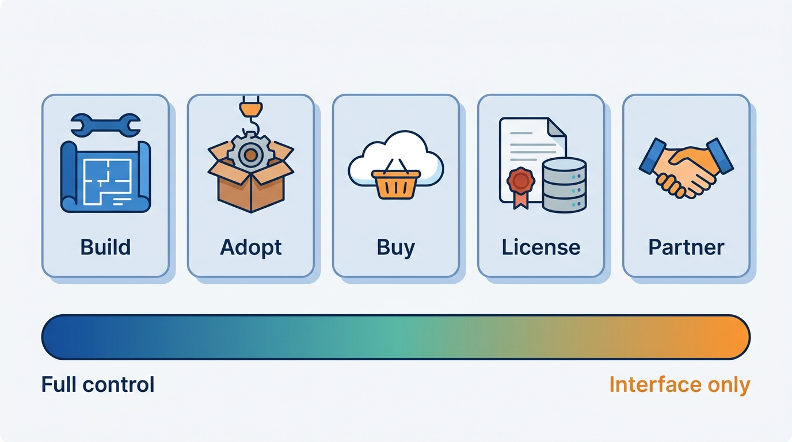
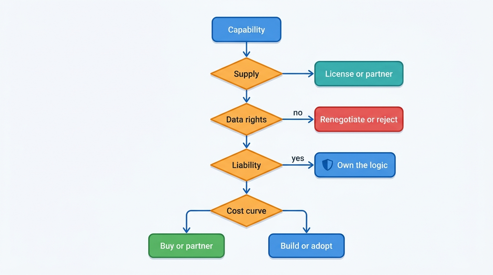
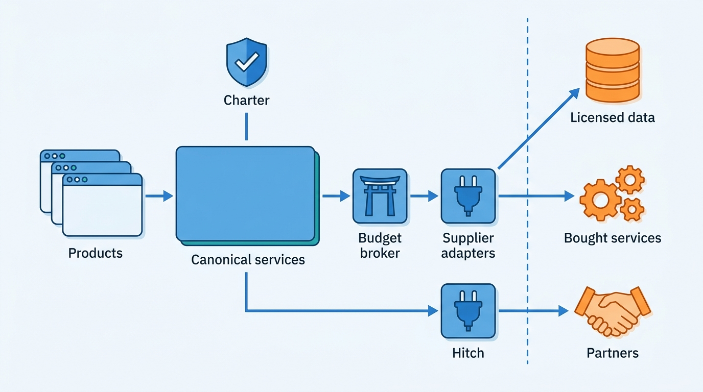
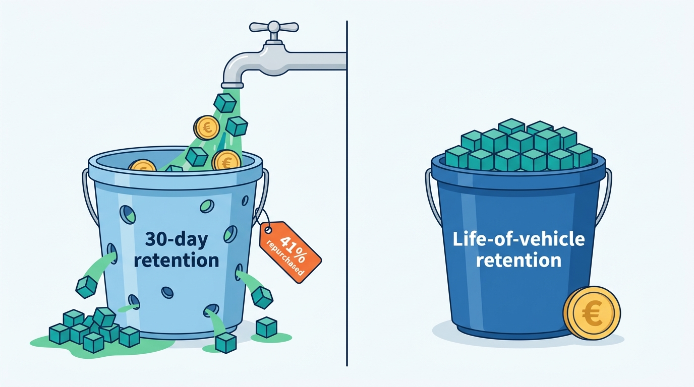

> **IN THIS CHAPTER, YOU WILL:** Learn a decision method for sourcing each capability of a vehicle data and dealer SaaS platform, apply the data-rights test to licensed data, and work through explicit comparisons for build data, history sources, valuation, damage estimation, CRM, billing, identity, DMS, portals and auctions, each tied to stated requirements and labeled assumptions.

> **WHY THE BUSINESS CARES:** Paid upstream data is about two-thirds of a lookup's cost, and every renewal, platform purchase and partnership locks in margin, liability and exit cost for years. A CFO or a private-equity owner sees sourcing as a cost line. The dealer sees it as whether the valuation, the report and the lead still work when a supplier changes its terms.

> **WHY ARCHITECTS SHOULD CARE:** A sourcing choice fixes boundaries that are expensive to move. These are where the canonical model lives, which keys the platform depends on, which outages it inherits and what it may store. A good sourcing decision is an architecture decision record with an exit plan, not a procurement ticket.

> **KEY POINTS:**
>
> * **Decide per capability, against requirements, not by slogan.** "Build what differentiates, buy the rest" is too coarse for this industry. Four gates sort most cases: whether a supplier can do it at all, whether the source passes the data-rights test, whether the capability carries your judgement or liability, and the unit-cost curve at your volume. Write the result down with its assumptions and a review trigger.
> * **Data rights decide more than price.** At Axleby, a 30-day retention clause cost more than the build-data unit price: 41% of 2026 fetches were repurchases. Before any data contract, test what may be stored, for how long, across which products, what may be derived and redistributed, who may train on it, and what survives termination.
> * **Own the seam, rent the commodity.** Buy detection models, build data, connected-car routes and tax engines. Own the canonical model, the evidence, the ground truth, the meter, the consent record and the identity hierarchy, because those are what let you switch suppliers. Partner for workflows another business runs better (DMS, auctions, lending, portals), behind adapters with contracts, read-back and reconciliation.

> **[FAILURE PATTERNS THIS CHAPTER ADDRESSES](where-vehicle-platforms-go-wrong.html):**
>
> * **License Blindness** — data bought without testing its storage, reuse and redistribution rights either costs too much or is used beyond what the contract allows.
> * **Borrowed Uptime** — every bought service and partner adds an outage the platform inherits unless the sourcing decision includes a degraded mode.
> * **DMS Hostage** — partnering for a system of record without sanctioned access, an exit plan and a fallback hands control of the dealer's day to someone else.

 
Every vehicle data and dealer SaaS platform is assembled from things it did not make. **As-built option data exists only in manufacturers' systems.** Registers own registration, portals their audiences, DMS vendors the dealers' ledgers, auction houses their buyers, and even built parts run on someone else's clouds and model platforms. The question is never whether to depend on others. It is **which dependencies to accept, on what terms, and what to keep in your own hands so the dependency stays a choice**.

Generic sourcing frameworks miss what makes this industry different: **the product is largely other people's data**, and its license governs what the platform may store, combine, show and resell. A source can be cheap per call and still wrong because its license forbids the use that makes it valuable, and a supplier's real cost can sit in a retention clause nobody negotiated.

This chapter owns the **sourcing decision** and the **data-rights test**. It draws together sourcing choices that earlier chapters made one at a time: build data in [[specification-and-equipment]], history sources in [[vehicle-history]], valuation in [[valuation-engine]], damage detection in [[condition-and-damage]], CRM delivery in [[leads-and-crm]], DMS access in [[dms-integration]], identity in [[identity-access-and-entitlements]], billing in [[billing-and-metering]] and upstream cost in [[scale-and-cost]]. The next chapter, [[one-platform-from-many-products]], deals with the special case of capabilities that arrived by acquisition.

## Setting the Scene at Axleby: Four Proposals in One Week

Axleby, the fictional vehicle data and dealer software group this book follows (see [[meet-axleby]]), prepares its 2028 budget in October 2027, seven months into **One Dossier**, the €38 million three-year program that is meant to give its products one vehicle key, one account and one meter. In the first week of October, four proposals reached Ines Marchetti, the Group Chief Architect, and Ruben Dekker, the CTO.

1. **The build-data provider's renewal offer.** After the July 2027 renegotiation that allowed life-of-vehicle retention within Axleby products, the commercial build-data provider behind Specbook (Axleby's specification resolver) offered to replace per-request pricing with a flat fee. The fee would be **€6.9 million a year** for three years, unlimited within Axleby products *(Axleby illustration)*.
2. **A proposal from inside.** A group of engineers in Priya Raman's data team argued that Axleby should stop paying for build data and "build its own catalog", using register data, adverts and dealer confirmations.
3. **A white-label CRM offer.** A CRM vendor, unnamed here, offered to embed its product in Lotwise under Axleby's brand, replacing the Lotwise inbox and selling to the 31% of rooftops that are franchised dealers.
4. **A billing platform pitch.** A usage-billing vendor offered to take over rating and invoicing, just as Lena Vos's team began shadow-rating **Meterline**, Axleby's in-house metering service.

Harrowgate Capital, Axleby's majority owner, asked a fifth question that covered the other four. Why does Axleby pay about **€7.8 million a year** for build data and also run its own valuation models? Why does it buy damage detection but build an authorization service? **Is there a rule, or is each decision an accident of who asked first?**

Ines asked each owner for a one-page record per capability: the decision, the requirement that drove it, the assumptions that would reverse it, what Axleby must own to leave the supplier, and the date to look again. The forum reviewed seventeen of them on 21 October 2027. This chapter is the method behind those pages.

## Concepts: Five Ways to Source a Capability

### The sourcing options

A **capability** here is a business ability with an owner and a contract, such as "resolve a VIN to its factory options" or "deliver a lead to the salesperson who will work it" ([[vehicle-capability-map]]). For each, a group has five options, and they differ in where the work, the data and the liability sit.

| Option | What it means | Who holds the data | Who holds the liability toward the customer | Axleby examples |
| --- | --- | --- | --- | --- |
| **Build** | Own team writes and runs it | The platform | The platform | Anchor, Tracewell, Vantage, Switchboard, Meterline, Gatekeeper's model, Charter |
| **Adopt** | Run an open-source product in-house | The platform | The platform | Keycloak for Axleby ID; OpenFGA under Gatekeeper; PostgreSQL |
| **Buy** | Use a vendor's software or SaaS for a function | Often the vendor, as processor | The platform, which cannot pass its customer duties to a processor | Datadog, Snowflake, Vertex AI, a tax-calculation service, a damage-detection API |
| **License** | Pay for data under a contract that limits use | The supplier owns it; the platform holds a licensed copy | Shared: the platform for how it uses the data, the supplier for what it warrants | Build data, catalogs, international damage records, Kilometra readings, repair-cost catalogs |
| **Partner** | Another business performs a service for a shared customer | Each party holds its part | Each party for its own act | DMS vendors, portals, auction houses, Merelstad Auto Finance (the lender), the Belgian registration partner |

**Acquire** is a sixth route, used for Lotwise (2019), Wertlauf (2021) and Showroomly (2023); it turns sourcing into integration ([[one-platform-from-many-products]]).

**Figure 1:** *The five sourcing options differ in where the work, the data and the liability sit, from full control when building to control over the interface only when partnering.*

The distinction between **license** and **partner** matters most. A license gives the platform a copy of someone's data with rules attached; it fails through **use**: storing too long, showing the wrong audience, reselling. A partnership gives it someone who acts (a DMS that books the sale, an auction that sells the car); it fails through **coordination**: the partner says "done" when it is not, as in the Lost Leads of Velto ([[journey-lead-to-dms]]).

### The two terms this chapter owns

- **Sourcing decision.** A recorded choice of one of the options above for one capability, with the requirement that drove it, the assumptions under which it holds, what the platform keeps in-house to make an exit possible, the review trigger, and the decision owner. Its form is an architecture decision record; the [[toolkit]] carries a build/buy/partner decision card.
- **Data-rights test.** The set of questions a licensed data source, or a vendor that receives the platform's data, must answer satisfactorily before it is contracted. It covers storage, scope, derivation, redistribution, training, billing basis, audit, exit and personal data, and it is set out in full below. A source that fails the test is not bought at any price, because the failure shows up later as a breach, a repurchase bill or a product that cannot ship.

## The Decision Method

### Four gates

Sourcing debates go wrong when cost, speed, strategy and risk are argued at once. I separate them into four gates, applied in order.

**Gate 1: Can anyone else do it at all, and can anyone but us?** As-built option data comes only from manufacturers, so it can be licensed, not built. Axleby's Dutch register relationship, held since 1999, is a contractual data-supply and transaction-provider relationship no vendor can sell ([[registers-and-official-data]]). And no supplier has Axleby's identity graph or its dealers' outcomes.

**Gate 2: Does the source pass the data-rights test?** If not, renegotiate or look elsewhere. Price comes later.

**Gate 3: Does the capability carry our judgement or our liability?** If a customer would hold Axleby responsible for the answer (an odometer judgement, a valuation behind a purchase price, a lessee charge, an invoice line), Axleby must be able to explain, correct and re-run it. Bought parts may sit beneath, but **the decision logic, the evidence and the record of what was said stay in-house**. This differs from "differentiation": billing does not win Axleby customers, yet an invoice line is its statement, and the No-Hit Credit cost €186,000 ([[billing-and-metering]]).

**Gate 4: At our volume, which cost curve is lower, and can we run it?** Only now do unit costs, team capacity and time to market decide. Bought services cost per unit; built ones cost a team. The crossover depends on volume, so the gate records the volume assumption.

**Figure 2:** *The four gates in order. Supply constraints come first and data rights second; judgement and liability then decide what must stay in-house, and only the remaining commodity choices are settled on cost.*

### Criteria that follow from the gates

The gates rest on criteria an architect can state as requirements:

| Criterion | Question | Evidence that settles it |
| --- | --- | --- |
| **Supply** | Who can produce this fact or service at all? | Coverage lists; register terms; manufacturer access rules |
| **Data rights** | What may we store, derive, show and resell? | The license, tested clause by clause (below) |
| **Judgement and liability** | Will a customer hold us responsible for the answer? | Contracts, product promises (no-hit-no-fee, guarantees), consumer law |
| **Differentiation** | Do customers choose us for this, measurably? | Win/loss reasons, retention by module, pricing power |
| **Unit cost curve** | Cost per unit at today's and the forecast volume | Supplier price, fixed team cost, crossover volume *(assumption recorded)* |
| **Lock-in and exit** | What does leaving cost, and what must we own to leave? | Key dependence, data return terms, switching rights, integration size |
| **Regulatory duty** | Which duty can we not hand over? | GDPR controller role, register terms, the Digital Operational Resilience Act (DORA) for financial clients, the Data Act |
| **Dependency** | Which journeys stop if it fails? | Dependency tier per journey ([[reliability-and-dependencies]]) |

Two regulatory points deserve a note. Under the GDPR a vendor contract changes who does the work, not who answers for it. And the EU's Digital Operational Resilience Act (Regulation (EU) 2022/2554, applying from 17 January 2025) requires financial entities, such as Axleby's insurer and lessor clients, to put specific terms into contracts with their information and communication technology (ICT) third-party providers, including exit strategies and audit rights ([Regulation (EU) 2022/2554, 2022](http://publications.europa.eu/resource/celex/32022R2554)). A platform selling to insurers inherits those terms and can honor them only if its own supplier contracts carry matching audit and exit terms. **Sourcing terms flow down the chain.**

### The data-rights test

The License Breach of January 2027, when a client resold history data containing a damage-data partner's records to consumers, showed that Axleby had not known which rights it held ([[data-licensing-and-governance]]); the build-data retention clause showed the cost side of the same gap ([[scale-and-cost]]). The test below is what Femke de Boer (Head of Data Governance and Privacy) and Hendrik Maes (Head of Partner Integrations) now apply to every new source and every renewal. Each answer becomes a rule in **Charter**, Axleby's license and purpose register.

| # | Question | Why it matters | Axleby case |
| --- | --- | --- | --- |
| 1 | **Store**: may we keep what we fetch, and for how long? | Retention decides repurchase cost | 30-day build-data retention caused 41% repurchases in 2026 |
| 2 | **Scope**: within one product, the group, or one tenant? | A per-product license forbids the shared dossier | Separate caches per stack bought the same VIN several times |
| 3 | **Derive**: may we compute from it and keep the result, including after termination? | Resolved views, valuations and judgements are derived; losing them on exit is a lock-in | Specbook keeps resolved views with the inputs' license refs |
| 4 | **Redistribute**: to which audiences (business, consumer, the client's own customers), raw or derived? | Display rights differ by audience | The damage partner forbade consumer display by third parties |
| 5 | **Train**: may we train models on it, and may the vendor train on what we send it? | Models outlive contracts; images sent to a vendor are customers' data | Gauge's detection contract forbids vendor training on Axleby images without tenant consent |
| 6 | **Billing basis**: do we pay for hits, partial answers, no-hits and retries? | A no-hit-no-fee promise to clients becomes a loss if the supplier bills no-hits | About 14% of 2026 build-data fetches returned catalog-level data only and were billed |
| 7 | **Evidence**: can we prove use per client and purpose, and may the supplier audit us? | Audits arrive; flow-down terms must be provable | Damage-partner audit, November 2027, answered in two working days from Charter |
| 8 | **Exit**: what must we delete or return at termination, and when? | Determines whether leaving is possible at all | Lineage per fact is what makes a targeted purge possible |
| 9 | **Personal data**: which role does each party have, for which purpose? | A dataset keyed by plate can be personal data | Owner-related fields carry purpose limits in Charter |

The test has one rule beyond its questions: **an unanswered question is a "no"**. "The contract is silent on retention" means the platform does not know whether it may keep the data, and it should behave as if it may not until the clause is written.

## Architecture: Own the Seam, Rent the Commodity

The four gates produce a pattern that repeats across capabilities. The platform owns a **canonical layer**: its own model of the vehicle, the lead, the finding, the usage event and the identity, plus the evidence and decisions recorded in it. Suppliers and partners sit behind **adapters** that translate their models into the canonical one. Two control points govern the boundary. Charter decides what each fact may be used for, and the **upstream budget broker** introduced in [[scale-and-cost]] admits, coalesces and costs every paid call.

**Figure 3:** *What Axleby owns and what it rents. Products talk only to canonical services; every paid call passes the budget broker, every use passes Charter, and suppliers and partners sit behind adapters, so replacing one changes an adapter rather than a product.*

Three properties of this layout are what make a "buy" decision safe.

- **The canonical model is not the supplier's model.** Specbook stores catalog, as-built and register facts as separate sourced layers ([[specification-and-equipment]]), not the provider's version codes as the vehicle's identity. VWE's public API shows the alternative: its XML Interdata service exposes separate schemas for RDW, Autotelex, Jato and SilverDAT data ([VWE API documentation, n.d., accessed 2026-10](https://vwe.nl/api-documentatie/)). That makes license scoping visible, but it shows each licensor's structure to every client and ties clients to that supplier set.
- **Evidence and outcomes stay in-house.** A detection vendor's output enters Gauge as an unconfirmed finding with a model version ([[condition-and-damage]]). Confirmed findings, recon actuals and disputes are Axleby's dataset, so Axleby can measure any vendor and replace it.
- **Every paid call is metered for cost as well as revenue** ([[billing-and-metering]]), so the Gate 4 crossover is a query, not an annual guess.

### What each sourced dependency must deliver

A sourcing decision is incomplete without the requirement the supplier must meet and the behavior when it does not:

| Dependency | Consistency needed | Latency budget | Freshness | When it fails |
| --- | --- | --- | --- | --- |
| Build-data provider | Immutable per VIN; provider corrections versioned | Under 2 s inside an appraisal *(assumption)* | Once per car | Catalog-level answer with candidates; as-built queued ([[specification-and-equipment]]) |
| Damage-history and odometer sources | Append-only events with source refs | Batch (Kilometra ~02:10 CET nightly); live damage calls under 3 s *(assumption)* | Nightly | Stored events with gaps stated; hit class `partial` |
| Detection vendor | Detection stored with model version | Minutes, asynchronous | Per inspection | Inspector's findings stand alone |
| External CRM via Hitch | Exactly-once delivery with owner-and-queue read-back | Minutes *(assumption)* | Per lead | Lotwise inbox as fallback |
| DMS (DriveDesk, others) | Idempotent upserts; nightly reconciliation | 15-minute poll (DriveDesk stock) | Minutes to a day | DMS-absent mode ([[dms-integration]]) |
| Identity (Axleby ID, adopted) | Strong for sessions and revocation | Under 200 ms for token checks *(assumption)* | Immediate on leaver events | Existing sessions continue; new logins fail closed |

## Worked Comparisons: The Data Half

### Build data: license, renegotiate, or build a catalog

**The requirement.** Valuations, adverts (for which the dealer is liable) and BPM (Dutch registration tax, *belasting van personenauto's en motorrijwielen*) calculations need the edition and valuable factory options. The requirement is not "as-built data for every lookup" but **as-built data where the candidates' value spread matters**: the purchase gate's appraisal threshold of €750 ([[specification-and-equipment]]).

**Gate 1 settles most of it.** Only manufacturers know what a car received at the factory. The internal "build our own catalog" proposal described two things. Axleby already builds the **catalog and crosswalk** (version tables mapped to provider, portal and register keys), and that rightly stays in-house as the canonical layer. It cannot build the **as-built layer**: inferring options from adverts and dealer confirmations is Spec Guesswork with extra steps. In the 2026 advert sample, the dealer-selected edition disagreed with the resolved one in 9% of cases.

**Gate 2 was where the money was.** The 2026 spend of about **€13.1 million** on **28.5 million** fetches was driven less by the unit price (about €0.46) than by rights: 30-day retention produced 41% repurchases, and per-stack caches added 6% concurrent duplicates. The July 2027 renegotiation bought **life-of-vehicle retention within Axleby products** at a higher first-fetch price (about **€0.58**). Together with the purchase gate, it brought the run rate to about **13.5 million fetches and €7.8 million a year** by Q4 2027 ([[scale-and-cost]]). **The rights clause saved more than any price negotiation could have.**

**Figure 4:** *Under 30-day retention, 41% of 2026 build-data fetches were repurchases; buying life-of-vehicle retention saved more than any price negotiation could have.*

**Gate 4: the flat-fee offer.** The provider's offer of €6.9 million a year breaks even at about 11.9 million fetches a year (€6.9M ÷ €0.58). Fetch volume should keep falling: every VIN bought once never needs buying again, and in Q4 2027 Specbook already resolved 41% of stock-ins from free sources alone. Lena Vos's model projected about **11 million fetches in 2028** *(assumption)*, about €6.4 million at per-request prices. The flat fee would overpay by about €0.5 million in its first year, more each later year, and remove the incentive that keeps the purchase gate honest.

| Option | 2028 cost *(assumption)* | Rights | Risk | Verdict |
| --- | --- | --- | --- | --- |
| Per request, life-of-vehicle retention (current) | ≈ €6.4M at 11M fetches | Store per VIN within group products | Price rises at renewal | **Keep**, with a price ceiling per year of term |
| Flat fee, three years | €6.9M | Same | Commitment if volume falls; no incentive to gate | Decline |
| Second provider for catalog-only makes | +€0.3–0.6M *(assumption)* | Per provider; crosswalk work doubles for those makes | Integration and crosswalk cost | Pilot for two makes where option value is high |
| Own catalog without as-built | ≈ €0 upstream | Own | Spec Guesswork, misdescription liability | Reject |

Public evidence supports the shape. JATO sells catalog-level (VINView) and installed-at-factory (VINView Pro) specification as separate products, the latter for eight European markets including the Netherlands, Belgium, Germany and the UK ([JATO, n.d., accessed 2026-10](https://www.jato.com/our-solutions/vinview)). DAT Austria's March 2026 guide shows one VIN query returning live manufacturer data for about 40 makes and catalog data for others ([DAT Austria, 2026](https://www.datgroup.com/fileadmin/at/VIN_Abfrage_Infos/Anleitung-VIN-Abfrage-Oesterreich_03-2026.pdf)). VWE passes SilverDAT VIN information to Dutch dealers at **€1.74 per lookup** ([VWE Occasion Manager, n.d., accessed 2026-10](https://vwe.nl/occasion-manager/)). Licensed build data is commonly passed through near cost; **the margin is in the decisions it supports**.

### History sources: license the events, own the judgement

**The requirement.** A history report must be explainable for the life of the vehicle: which events, from which sources, under which rule version, supported each statement ([[vehicle-history]]). Odolo sells reports to consumers, so the wording and any guarantee are Axleby's liability.

| Option | What it buys | Fails which gate | When it is right |
| --- | --- | --- | --- |
| **Resell a provider's finished report** | The provider's events, judgement, wording and guarantee | Gate 3: Axleby cannot explain or correct the judgement; the No-Hit and wording rules are the provider's | A market where Axleby has no own sources and sells few reports |
| **License events, own the event store and judgements** (Axleby's choice) | Raw events under storage rights; Tracewell judges | Needs the data-rights test per source | Axleby's markets, where it holds register data and first-party readings |
| **Build sources** (own network of workshops and insurers) | Direct contributions | Gate 4: years of partner acquisition | Only as a long-term extension of first-party data |

The decisive asset is the combination: register events, licensed commercial events (Kilometra's workshop readings, a damage-data partner's records) and first-party events from Lotwise become one judgement that only Tracewell computes. Carfax shows how far the partner side can go: its May 2026 information statement counted "more than 177,000" data sources at the end of 2025, "more than 92,000" of them dealers and service shops ([Mobility Global, 2026](https://www.sec.gov/Archives/edgar/data/2090312/000110465926066592/tm2528763d9_ex99-1.htm)), a **contributory network** built over four decades in a market without a central history register.

In June 2027 Kilometra quoted **€95,000 a year** for a push feed. Axleby declined, because the Odometer Correction's defect was missing validation, not latency ([[ingestion-and-entity-resolution]]), and renegotiated the **contract** instead: Kilometra contract v2 (August 2027) declares the unit per workshop chain, carries stable record ids and correction references, and commits to correction notices within one business day ([[provenance-and-data-quality]]). **Data-quality duties belong in the license, not only in the pipeline.** The damage-data partner's ban on consumer display by third parties, which the License Breach violated, is now a Charter rule on every response.

### Valuation: own the model, license guides as inputs

**The requirement.** Lotwise needs a suggested maximum purchase price that a dealer can trust and argue with. API clients need typed values with confidence. Tradefloor needs trade values for reserves. Gate 3 is clear: the valuation behind a purchase price is Axleby's statement, and the EV Overvaluation of 2026 cost two dealer groups about **€1.1 million** in overpayment on **610** battery-electric trade-ins ([[valuation-engine]]).

| Option | Annual cost *(assumption)* | Strengths | Weaknesses |
| --- | --- | --- | --- |
| **License guide values for all products** | ≈ €2.3M at an assumed €0.12 per value × 19M issued valuations; no European provider publishes per-call prices | Accepted by lenders and insurers; no model team | Redistribution limits to API clients; no single guide covers Axleby's four markets; drift response is the supplier's |
| **Own models with guides as inputs** (Axleby's choice) | ≈ €1.8M for a Munich model and model-operations team of about 14 *(assumption)* plus compute | Uses Axleby's outcome data; explainable lines; segment circuit breakers | Liability for errors; needs a ledger, back-testing and governance |
| **Integrate a partner's valuations per market** | Per dealer license | Matches dealer expectations where one provider dominates | No control; values not resellable |

Two documented facts weaken the licensed-only option. DAT's 2024 product description for SilverDAT valuateFinance offers valuation in Germany, Austria and other markets, but **not the Netherlands, Belgium or the UK**, and says DAT "does not owe a fully correct valuation" ([DAT, 2024](https://dynamic-www.dat.de/fileadmin/de/download/rechtliches/produktbeschreibung-silverdat-valuatefinance.pdf), translated from German). A licensed guide does not remove the exposure: the dealer's overpayment is the same whoever computed the number. And provider ownership moves: J.D. Power completed its acquisition of Autovista Group, owner of Schwacke and Eurotax, in March 2024 ([CollisionWeek, 2024](https://collisionweek.com/2024/03/04/j-d-power-completes-autovista-group-acquisition/)).

Auto Trader UK shows the build case from a position Axleby does not have: its June 2023 results describe machine-learning valuations "based on c.500,000 [observations] that we see each day" ([Auto Trader Group, 2023](https://plc.autotrader.co.uk/media/3dbbyupi/fy-press-release-fy23-final_no_pw-0106.pdf)). Axleby built Vantage on Wertlauf (acquired 2021) and Pulse, its market data lake. **Owning the model was a bet on owning outcomes**: Lotwise sales, Tradefloor deals and register sale events. The rule: build valuation only where you see outcomes the guide providers do not, and **license or integrate where you do not**. That is why Showroomly integrates Auto Trader valuations for UK dealers who license them, and why Axleby accepts DAT or Schwacke values for German data clients that require them.

### Damage estimation: buy detection, license the catalog, own the findings

**The requirement.** A lessee charge, a trade condition report and a reconditioning estimate must each rest on confirmed findings with evidence that survives a dispute ([[condition-and-damage]]). Fleetmoor Lease alone returns about 14,000 cars a year.

The capability splits into four parts, and each gets a different answer.

| Part | Decision | Reason |
| --- | --- | --- |
| **Image capture and evidence store** | Build (Gauge, Lotwise Inspect) | Evidence is Axleby's and the tenant's; capture rules are per purpose |
| **Damage detection model** | Buy, behind the detection gateway | Fast-moving vendor market; no public dataset large enough to train a competitive model (CarDD has 4,000 images, 2022) |
| **Repair-cost estimate** | License a repair-cost catalog | Manufacturer parts and labor times are only available from catalog providers; insurers and courts accept them |
| **Findings, rubrics, recon estimates and ground truth** | Build | The lessee charge and the trade grade are Axleby's statements; confirmed findings measure any vendor |

Vendor material makes "buy" comfortable and "own the ground truth" necessary. Tractable says "certainty scores accompany every estimate" ([Tractable, n.d., accessed 2026-10](https://tractable.ai/)). DAT announced FastTrackAI detection inside its estimating software from 1 September 2026 ([DAT, n.d., accessed 2026-10](https://www.dat.de/ai-bundle-en/)). Cox Automotive integrated UVeye's drive-through scanning into vAuto in January 2026 ([Cox Automotive, 2026](https://www.coxautoinc.com/press-releases/cox-automotives-vauto-and-uveye-bring-ai-powered-vehicle-inspections-to-market/)). **None of these pages publishes accuracy figures.** In the Handback prototype, Axleby measured its own: 1.4 machine detections per car that the inspector had not recorded, of which 23% were confirmed. That measurement is only possible because the confirmed findings are Axleby's.

Gate 2 applies in reverse here: **the platform sends the vendor its customers' images**. Gauge's detection contract answers the data-rights questions: no retention beyond processing, no vendor training without the tenant's consent, and Axleby's right to keep detections and compare vendors. A vendor that insists on training rights may be cheaper, but it is paid partly in Axleby's customers' data.

## Worked Comparisons: The Workflow Half and the Platform

### CRM: build the inbox and the router, integrate the CRMs

**The requirement.** Every lead must reach a person who will work it, exactly once, with proof, across portals, websites and phone ([[leads-and-crm]]). Independents such as Autobedrijf Brandsma work leads in Lotwise. Franchised groups such as Velto work them in a DMS-vendor or brand CRM.

The white-label CRM offer failed Gate 3 in an unexpected place: it would have replaced **Switchboard's routing**, where the group's organization lives. Since the Lost Leads of Velto, routing rules are validated against the tenant directory and simulated before a reorganization; a white-label CRM would bring its own routing, and two places to change when a rooftop closes.

| Option | Fits | Cost and risk *(assumption where marked)* | Verdict |
| --- | --- | --- | --- |
| **Build a full CRM** | Groups wanting one vendor | A team of 20 or more for years *(assumption)*; competes with brand-mandated CRMs franchised dealers cannot drop | Reject |
| **White-label a CRM vendor inside Lotwise** | Independents wanting more than an inbox | Second routing engine; vendor's data rights over Axleby's leads; revenue share | Decline; revisit only for a vendor that consumes Switchboard routing |
| **Build the inbox and router; deliver to any CRM** (Axleby's choice) | Both segments | Hitch adapters per CRM family; read-back | **Keep** |

Cox Automotive's group bought a CRM, VinSolutions, in 2011 ([Cox Automotive fact sheet, 2018](https://www.coxautoinc.com/wp-content/uploads/2018/08/Cox-Automotive-Corporate-Fact-Sheet-April-2018.pdf)) as part of a US portfolio spanning portal, CRM, DMS and auctions, which Axleby is not building. Portals, meanwhile, are moving into lead handling: mobile.de's summer 2026 update describes a Lead Manager Pro offering "a central pipeline for leads from all channels" ([mobile.de, 2026](https://newsroom.mobile.de/plattform-update-sommer-2026/), translated from German). Axleby's defensible position is consolidation **across** portals, websites and CRMs, a routing capability, so it stays built.

### DMS: partner, never become one by accident

**The requirement.** Stock, customers and sales must flow between Lotwise and the dealer's ledger, and the dealer must keep selling when the DMS is down ([[dms-integration]]). Owning a DMS would remove the partner but add a country-by-country product with accounting, tax and manufacturer certification. The documented record is clear. Cox Automotive owned incadea, a European DMS, for about three years: Dealertrack bought it in January 2015, months before Cox bought Dealertrack, and incadea joined Volaris in December 2018, having changed ownership "at least four times" ([Volaris, 2022](https://www.volarisgroup.com/home/customer-focus-takes-the-driver-s-seat)). CDK Global sold its international DMS business to Francisco Partners in March 2021, where it became Keyloop ([CDK Global 10-K, 2021](https://www.sec.gov/Archives/edgar/data/1609702/000160970221000058/cdk-20210630.htm)). The US record shows the dependency side: the Seventh Circuit's 2017 *Authenticom v. CDK* opinion recited that CDK and Reynolds held over 40% and around 30% of the US DMS market ([Seventh Circuit, 2017](https://caselaw.findlaw.com/court/us-7th-circuit/1879150.html)), and in the June 2024 CDK attack AutoNation ran "through manual and alternative means" ([AutoNation 8-K, 2024](https://www.sec.gov/Archives/edgar/data/350698/000035069824000078/an-20240619.htm)).

Axleby's decision is to **partner with DMS vendors through certified interfaces**, build adapters in Hitch for the DMS families that cover many of its rooftops (DriveDesk, 1,900 rooftops), use file extracts or an aggregator for the long tail, and keep Lotwise Sales Admin for the 3,900 rooftops without a DMS. The DriveDesk Outage of November 2027 tested the "partner" side: Lotwise carried stock, adverts and sales documents for 12 days ([[reliability-and-dependencies]]). **A partnership for a system of record is acceptable only with a degraded mode that is exercised**, which is why the quarterly DMS game day is part of the sourcing decision, not an SRE extra.

### Portals, auctions and lending: partners with contracts as architecture

These are businesses Axleby does not want to run: consumer marketplaces ([[liquidity-and-network-effects]]), physical auctions and consumer credit. The only question is how to partner.

- **Portals.** Relay connects to 61 channels; [[listing-syndication]] keeps adapters in-house for channels carrying more than a few percent of a market's leads and accepts aggregators for the long tail only where read-back and reconciliation survive.
- **Auctions.** Tradefloor hands about 11,500 cars a year to two auction partners ([[b2b-trade-and-remarketing]]); VWE made the same move in 2026: Autorola completed its acquisition of VWE's auction subsidiary ATC on 1 February 2026 ([Journal de l'Automobile, 2026](https://journalauto.com/distribution/autorola-reprend-une-filiale-de-vwe-automotive/)), and VWE's product page still shows auctions "from partner Automotive Trade Center" ([VWE, n.d., accessed 2026-10](https://vwe.nl/occasion-manager/)). The gap Axleby accepts is data: it sees asking prices and register sale events, not hammer prices ([[case-cox-automotive]]). **I would make licensed results data a term of every auction partner contract**, so the valuation side gets what the workflow side gave away.
- **Lending.** Merelstad Auto Finance pays a referral share of about €180 per paid-out contract. Auto Trader's May 2025 results name the bottleneck of a finance platform as "the time taken to secure lender agreement and for them to prioritise and undertake the technical work to integrate" ([Auto Trader Group, 2025](https://plc.autotrader.co.uk/media/umddcnxx/full-year-press-release-fy25.pdf)). A lender integration runs at the lender's pace, so it should be asynchronous, and the German gap (no integrated lender in 2027) is commercial before it is technical.

The common rule: **every partner gets an adapter with a contract profile, idempotent commands, a receipt proving the partner acted, and a reconciliation for what receipts missed.** DriveDesk's inactive CRM queue, which accepted Velto's leads and discarded them, defeats any design that trusts HTTP status codes.

### Billing: build the meter and rating, buy the edges

**The requirement.** Every billable event is classified at the business moment (hit, partial, no-hit, failed), rated by one engine across the group, and kept as raw evidence for seven years. Register transactions are billed only on confirmation, and pooled allowances serve dealer groups ([[billing-and-metering]]).

The usage-billing pitch was evaluated against those requirements, and the billing chapter's recommendation stands: **build Meterline and the rating rules, buy tax calculation, e-invoice delivery through a Peppol access point, payment-provider connections and possibly invoice rendering.** The reasons are Gate 3 (an invoice line is Axleby's statement, and two rating engines produced the No-Hit Credit) and requirements that commodity products express poorly: pass-through register fees, Charter license references, effective-dated group allowances. Lock-in shows in the details: Stripe's billing meters cannot change configuration after creation "aside from the display name", and adjustments cancel only events "sent to Stripe within the last 24 hours" ([Stripe docs, n.d., accessed 2026-10](https://docs.stripe.com/billing/subscriptions/usage-based/meters/configure)). Stripe completed its acquisition of Metronome on 14 January 2026 ([Stripe, 2026](https://stripe.com/newsroom/news/stripe-completes-metronome-acquisition)), so that market is still moving.

| Option | Cost *(assumption)* | Meets requirements? | Reverse when |
| --- | --- | --- | --- |
| Build Meterline and rating; buy edges (Axleby's choice) | Team of four to six engineers ≈ €0.6–0.9M a year plus edge services | Yes, by construction | A product expresses outcome rating, pass-through and pooled allowances natively, exports raw events back, and costs less than the team |
| Buy a usage-billing platform for rating | ≈ €0.25–0.4M a year at about 2.7M events a day, plus integration | Partly: outcome classification still in products; pass-through and register confirmation as custom logic | — |
| Keep each product's billing | No new cost | No: recreates the No-Hit Credit | Never, for a group selling one customer several products |

### Identity: adopt, do not build, and do not rent the hierarchy

**The requirement.** One identity for about **38,000** people who in April 2027 held about 41,000 Lotwise, 9,800 Showroomly and 15,600 Axleby Portal logins. The identity service needs federation per dealer group, System for Cross-domain Identity Management (SCIM) provisioning, MFA, register-agent designation and data residency in the EU. Authorization follows the group, region and rooftop hierarchy ([[identity-access-and-entitlements]]).

| Option | Annual cost *(assumption)* | Fit | Decision |
| --- | --- | --- | --- |
| Build an identity provider | Large; security-critical code | None of the requirements needs it | Reject |
| Hosted customer-identity service (CIAM) | ≈ €0.37M at an assumed €0.80 per monthly active user per month for 38,000 people, rising with dealer staff turnover | Mature federation; Auth0's documentation describes no nesting of organizations, so the hierarchy stays in the application anyway ([Auth0, n.d., accessed 2026-10](https://auth0.com/docs/manage-users/organizations/organizations-overview)) | Viable; rejected on hierarchy, residency and pricing exposure |
| **Adopt Keycloak, self-hosted** (Axleby's choice) | ≈ €0.4M for about 2.5 engineers in Marta Nowak's platform team plus infrastructure | Organizations feature fully supported since Keycloak 26 (October 2024) ([Keycloak, 2024](https://www.keycloak.org/2024/10/keycloak-2600-released)); EU hosting; no per-user price | **Keep** |
| Adopt OpenFGA under Gatekeeper | Platform team time | Relationship-based authorization over the hierarchy | **Keep** |

The costs are close, which is the point. **Price did not decide identity; the hierarchy and register authority did**, and no CIAM product sells either. "Adopt" gives the control of building at a fraction of the effort, at the price of running and upgrading the product.

## In Practice: Axleby's Sourcing Register

The forum of 21 October 2027 approved the register below. Most decisions came from earlier chapters; the forum stated each in the same form. All entries are Axleby illustrations.

| Capability | Decision | Deciding requirement | Key assumption | Owned to keep exit open | Review trigger |
| --- | --- | --- | --- | --- | --- |
| Vehicle identity, specification catalog | Build | VIN-keyed identity; canonical vehicle model | None buyable | — | — |
| Register access (Turnstile) | Build (NL, UK); partner (BE); German registrations via registration-service companies | Register relationship and authority | GKS access economics (open) | Authority register, transaction ledger | German volume decision |
| As-built build data | License, per request with life retention | Edition where spread ≥ €750 | 2028 fetches ≈ 11M *(assumption)* | Resolved views with license refs | Renewal; volume below 9M |
| History events | License sources; build Tracewell | Explainable judgement for vehicle life | Storage rights per source | Event store, rule versions | Source terms change |
| Market data (Pulse) | Build; license portal feeds | Outcome-linked market statistics | No portal group above 25% without contract | Observation store with rights tags | Portal consolidation |
| Valuation (Vantage) | Build; guides as licensed inputs | Typed values with confidence and drift control | Outcome data per segment suffices | Ledger and back-tests | Outcome-link rate falls |
| Damage detection; repair-cost catalog | Buy detection behind gateway; license catalog | Second opinion with confidence | No vendor training on images | Confirmed findings | Confirmation rate per vendor |
| Battery health measurement | Buy (two test vendors) | Verified certificates | — | Observation model ([[ev-battery-health]]) | Battery passport rules |
| Connected-car routes | Buy routes | Data Act third-party access | Routes consolidate | Mandate consent grants, canonical signals ([[connected-vehicle-data]]) | Route pricing |
| Lead routing, inbox and CRM | Build routing and inbox; integrate CRMs | One routing truth; franchised groups keep brand CRMs | — | Switchboard; inbox as fallback | A vendor consuming Switchboard routing |
| DMS | Partner through certified interfaces | Dealer's ledger stays with the DMS | Degraded mode exercised quarterly | Hitch xref map | DMS terms or outage |
| Portals | Partner; own adapters for large channels | Read-back and reconciliation | — | Desired-state store | Channel share below threshold |
| Auctions | Partner hand-off | No compounds or auctioneers | Results data licensable | Sale-right register | Partner terms |
| Consumer lending | Partner (Merelstad, NL/BE) | Licensed lender holds credit risk | — | Referral records | German lender |
| Metering and rating | Build | One rating engine | — | Raw usage events | A product meeting all rating requirements |
| Tax, e-invoicing, payments | Buy | Market rules tracked by specialists | — | Invoice ledger | Mandate changes |
| Identity and authorization | Adopt Keycloak and OpenFGA | Hierarchy, residency, authority | Team can run upgrades | Tenant directory, Gatekeeper model | Major version strain |

Read across the rows, the register shows the rule Harrowgate asked for. **Axleby builds where it holds judgement, evidence or a customer-facing promise, adopts where control matters but the software is generic, licenses where only suppliers hold the facts, buys where specialists track rules or models faster, and partners for businesses it does not want to run.** The €7.8 million build-data bill and the in-house Vantage are consistent: one is Gate 1, the other Gate 3.

The four October proposals ended as follows. The flat fee was declined in favor of a per-request price with a ceiling. The internal catalog proposal was folded into Specbook's existing catalog work, with a two-make pilot of a second build-data provider. The white-label CRM was declined. The billing pitch was declined for rating, and the vendor was invited to bid for invoice rendering, one of the edges.

## Failure Handling: When a Sourcing Decision Goes Wrong

Sourced capabilities fail through contracts, owners and markets as well as outages:

| Failure | Detection | Recovery |
| --- | --- | --- |
| **Supplier outage** | Adapter error rates; journey SLOs with upstream failures attributed ([[reliability-and-dependencies]]) | Degraded answer defined in the sourcing record (catalog-level spec, stored history events, inbox fallback, DMS-absent mode) |
| **Price rise at renewal** | Renewal calendar 12 months ahead; cost per path in Meterline | Second-source pilot started before renewal; exit cost known from the record |
| **Supplier acquired, possibly by a competitor** | Watch list of suppliers' ownership | Review data rights clause "change of control"; Autotelex data sits inside VWE's API while Autotelex also competes with VWE, and the ATC sale turned a VWE subsidiary into a partner |
| **License terms tightened or terminated** | Charter rule change; supplier notice | Purge by lineage: every fact carries its license ref, so the affected facts and derived outputs are findable; re-derive from other sources |
| **Duplicate or concurrent purchases** | Purchases per distinct VIN above 1.0; reconciliation against supplier statements | Single-flight broker; duplicates claimed as credits ([[scale-and-cost]]) |
| **Billed for incomplete answers** | Result class per paid call (as-built, catalog-only, no hit, error) | Coverage check before buying; contract clause on catalog-only billing |
| **Partner reports success but does not act** | Read-back of owner and queue; reconciliation | Fallback channel; incident with partner; contract remedy |
| **Vendor quality drifts** (detection, catalog) | Confirmation and rejection rates on own ground truth | Route by confidence; switch vendor at the gateway |

The termination row tests the architecture most: the platform must find every fact from that source and every view, valuation input and report that used it. **Without per-fact lineage, the only safe answer to a termination is to delete everything near it**, so provenance ([[provenance-and-data-quality]]) is a precondition for buying data at all. Exit also has a regulatory ally: the EU Data Act gives customers of data processing services, including software as a service per its recital 81, switching rights with no switching charges from 12 January 2027 ([Regulation (EU) 2023/2854, 2023](http://publications.europa.eu/resource/celex/32023R2854)). That helps Axleby leave a bought SaaS, and lets its own dealers leave Lotwise on the same terms ([[dms-integration]]).

## Trade-offs

The sourcing options compared on the criteria that decide them:

| Criterion | Build | Adopt (open source) | Buy (software or service) | License (data) | Partner |
| --- | --- | --- | --- | --- | --- |
| Control of logic and evidence | Full | Full | Low | Over use, not content | Over the interface only |
| Fixed cost | High | Medium | Low | Low to medium | Integration per partner |
| Marginal cost | Low | Low | Per unit or seat | Per call or license | Fees or revenue share |
| Time to first value | Slow | Medium | Fast | Fast once contracted | Partner's pace |
| Exit cost | Low (it is yours) | Low | Medium to high | Depends on derivation rights | Depends on contract and data return |
| Dependency risk | Own outages | Own outages, upstream security fixes | Vendor outages | Supplier outages and terms | Partner outages and terms |
| Right when | Judgement, evidence, promises, the canonical model | Generic but critical, needs control or residency | Commodity or specialist rules and models | Only suppliers hold the facts | Another business runs the workflow better |

Three trade-offs need judgement beyond the table.

**Speed against seam.** The temptation is to buy the canonical layer along with the function: the CRM's lead model, the provider's vehicle codes. That saves months and costs years. I accept a supplier's model inside an adapter, never as the platform's model.

**One supplier against several.** Several suppliers improve coverage and negotiating position and double the crosswalk, contract and monitoring work. The rule Specbook uses generalizes: **one primary supplier per market and capability, a second only where the first is weak and the value at stake is high.**

**Build now against build later.** A bought capability can come in-house after the Gate 4 crossover only if the platform owned the evidence from the start: Gauge could one day replace its detection vendor because it kept the confirmed findings.

My recommendation for a group like Axleby is the register above, resting on three assumptions: Axleby sees enough outcomes to own valuation, its volumes make retention rights worth more than a flat fee, and its customers are groups whose hierarchy no identity product models. **It does not hold for a single-product vendor.** A one-market dealer-software company without a data business should license valuations, resell history reports and buy identity as a service: for it, Gate 3 never fires.

## Across Markets: What Changes by Country

The architecture stays the same across markets; the supplier set does not.

| Capability | Netherlands / Belgium | Germany | United Kingdom | United States |
| --- | --- | --- | --- | --- |
| Register data | NL: open data mirrored for free; transaction access by register relationship. BE: through a partner | Central register not open; registration-service companies; KBA large-customer interface (GKS) for high volumes | DVSA MOT API with quota; DVLA VES closed to new registrations (as of Oct 2026) | State agencies; NMVTIS title data via approved providers |
| Build data | Pan-European providers (JATO lists NL and BE) | DAT live manufacturer data for about 40 makes | JATO; Auto Trader factory-fitted data for some makes | VIN decoding free (vPIC); build-data APIs |
| Valuation reference | Autotelex (NL), Indicata, pan-European providers | DAT, Schwacke (J.D. Power) | Auto Trader, Cap HPI | KBB, Black Book, J.D. Power, Manheim MMR |
| History | Register-based (NL), Car-Pass mileage (BE) plus licensed damage data | Commercial providers | DVSA MOT history plus commercial providers | Contributory networks (Carfax) |
| DMS landscape | Specialist Benelux vendors; brand-certified | Several German DMS products | Keyloop, Pinewood and others | Concentrated (CDK, Reynolds, Tekion) |
| Axleby posture | Build most of the data half; partner for DMS and auctions | Data business from Wertlauf; license spec; accept DAT/Schwacke where clients require | Showroomly integrates portal valuations; Odolo UK on register and licensed sources | Not an Axleby market |

**What is common:** the four gates, the data-rights test, the canonical layer, the broker, Charter and Meterline. **What is a market rule set:** the supplier routing per capability and country, each supplier's license rules in Charter, and the price book's pass-through lines. **What can be a different decision per market:** valuation (build in the Benelux and Germany, integrate in the UK), register access (build, partner or service company) and the second build-data supplier. In the UK, where one portal sees most retail adverts and sells its own valuations, Gate 3 fires for the portal, not for Axleby.

## The Chief Architect's View

**Make the sourcing register an architecture artifact.** One decision record per capability, reviewed when its trigger fires and yearly before the budget, kept beside the capability map. A capability without one has dependencies nobody chose.

**Who decides.** The Group Chief Architect owns the method and the canonical layer, with a veto on any contract that fails the data-rights test. The capability owner proposes; procurement and finance negotiate with architecture in the room, because **a retention clause is an architecture decision**; Femke de Boer owns the data-rights answers; the CTO settles disputes above an agreed spend; the board sees the register.

**Govern the seam, not the supplier.** Rules that held Axleby's choices together: no product calls a paid supplier directly; no supplier model becomes a platform key; every partner adapter has a contract profile, a receipt and a reconciliation; every bought service has a degraded mode named in its record.

**What to watch.**

- **Upstream cost share** per product and market, and **supplier concentration**: suppliers whose loss would stop a tier-1 journey.
- **Exit readiness**: for each top-ten supplier, the time to switch, tested by a drill or a second-source pilot at least once per contract term.
- **Repurchase rate**: paid fetches per distinct vehicle; a rise means a cache, license or broker regression.
- **Vendor quality on own ground truth**: confirmation rates for detection, catalog-only rates for build data, read-back failures for partners.

**Long-term considerations.** Supplier markets consolidate: Autovista under J.D. Power since 2024, AutoTrack and Gaspedaal under AutoScout24 since the takeover announced in November 2025 ([AutoRAI, 2025](https://autorai.nl/autoscout24-neemt-autotrack-en-gaspedaal-over/)), ATC under Autorola since 2026. Axleby's own shape will change too: Carfax's 2026 separation from S&P Global and VWE's sale of its auction business ([[case-vwe]]) show that contracts binding "the group" need terms for divestment. And AI vendors will offer to take over capabilities whole. The gates apply unchanged: an agent that sets prices for a dealer carries Axleby's liability, so the model may be bought but the permissions, evidence and record stay in-house ([[ai-in-dealer-workflows]]).

## Questions to Ask

1. For each capability, which of the four gates decided its sourcing, and is that written down with the assumption that would reverse it?
2. Which of our data contracts have unanswered data-rights questions, and are we behaving as if the answer were "no"?
3. What does each paid source bill for a no-hit, a partial answer and a retry, and how does that match what we promise our clients?
4. Which supplier's model has leaked into our keys, schemas or client contracts?
5. If our largest data supplier terminated tomorrow, could we find every fact and derived output that came from it?
6. Which partner integrations trust a success response without reading back that the partner acted?
7. What is the degraded mode for each bought service and partner on a tier-1 journey, and when was it last exercised?
8. Where do we send customers' data to a vendor, and what may the vendor do with it?
9. Which suppliers share an owner, and which of them also compete with us?

The sourcing register settles what Axleby makes and what it rents. Most of what it makes, though, arrived by acquisition with its own logins, keys and invoices. [[one-platform-from-many-products]] turns to integrating that acquired portfolio into one platform without stopping it.

## Sources and Evidence

### Company, product and investor sources

- [Full-year results FY2023](https://plc.autotrader.co.uk/media/3dbbyupi/fy-press-release-fy23-final_no_pw-0106.pdf) — Auto Trader Group plc, 2023 — machine-learning valuations from c.500,000 daily observations.
- [Full-year results FY2025](https://plc.autotrader.co.uk/media/umddcnxx/full-year-press-release-fy25.pdf) — Auto Trader Group plc, 2025 — lender integration as the finance platform's bottleneck.
- [Information statement (Exhibit 99.1)](https://www.sec.gov/Archives/edgar/data/2090312/000110465926066592/tm2528763d9_ex99-1.htm) — Mobility Global Inc., 2026 — Carfax's 177,000 data sources, 92,000 of them dealers and service shops.
- [Form 10-K for fiscal 2021](https://www.sec.gov/Archives/edgar/data/1609702/000160970221000058/cdk-20210630.htm) — CDK Global, 2021 — sale of CDK International to Francisco Partners (March 2021); evidence over five years old.
- [Corporate fact sheet](https://www.coxautoinc.com/wp-content/uploads/2018/08/Cox-Automotive-Corporate-Fact-Sheet-April-2018.pdf) — Cox Automotive, 2018 — acquisitions including VinSolutions (2011); evidence eight years old.
- [Customer focus takes the driver's seat](https://www.volarisgroup.com/home/customer-focus-takes-the-driver-s-seat) — Volaris Group, 2022 — incadea joined Volaris in December 2018 after several ownership changes.
- [Cox Automotive's vAuto and UVeye bring AI-powered vehicle inspections to market](https://www.coxautoinc.com/press-releases/cox-automotives-vauto-and-uveye-bring-ai-powered-vehicle-inspections-to-market/) — Cox Automotive, 2026 — drive-through inspection bought in and integrated into appraisal.
- [Form 8-K](https://www.sec.gov/Archives/edgar/data/350698/000035069824000078/an-20240619.htm) — AutoNation, 2024 — operation by manual means during the CDK outage.
- [VINView](https://www.jato.com/our-solutions/vinview) — JATO Dynamics, n.d., accessed 2026-10 — catalog-level and installed-at-factory specification as separate products.
- [VIN-Abfrage Österreich guide](https://www.datgroup.com/fileadmin/at/VIN_Abfrage_Infos/Anleitung-VIN-Abfrage-Oesterreich_03-2026.pdf) — DAT Austria, 2026 — live manufacturer data for about 40 makes, catalog data for others.
- [Produktbeschreibung SilverDAT valuateFinance](https://dynamic-www.dat.de/fileadmin/de/download/rechtliches/produktbeschreibung-silverdat-valuatefinance.pdf) — DAT, 2024 — countries covered; "does not owe a fully correct valuation".
- [DAT AI Bundle](https://www.dat.de/ai-bundle-en/) — DAT, n.d., accessed 2026-10 — FastTrackAI damage detection from 1 September 2026.
- [Tractable](https://tractable.ai/) — Tractable, n.d., accessed 2026-10 — certainty scores on AI damage estimates (vendor claims).
- [API documentatie](https://vwe.nl/api-documentatie/) — VWE Automotive, n.d., accessed 2026-10 — per-licensor XML schemas (RDW, Autotelex, Jato, SilverDAT).
- [Occasion Manager](https://vwe.nl/occasion-manager/) — VWE Automotive, n.d., accessed 2026-10 — SilverDAT VIN data at €1.74 per lookup; auctions from partner ATC.
- [Autorola reprend une filiale de VWE Automotive](https://journalauto.com/distribution/autorola-reprend-une-filiale-de-vwe-automotive/) — Journal de l'Automobile, 2026 — ATC sold to Autorola, completed 1 February 2026.
- [J.D. Power completes Autovista Group acquisition](https://collisionweek.com/2024/03/04/j-d-power-completes-autovista-group-acquisition/) — CollisionWeek, 2024 — consolidation among valuation providers.
- [AutoScout24 neemt AutoTrack en Gaspedaal over](https://autorai.nl/autoscout24-neemt-autotrack-en-gaspedaal-over/) — AutoRAI, 2025 — portal consolidation in the Netherlands.
- [Platform update summer 2026](https://newsroom.mobile.de/plattform-update-sommer-2026/) — mobile.de, 2026 — Lead Manager Pro as a central lead pipeline.
- [Keycloak 26.0.0 released](https://www.keycloak.org/2024/10/keycloak-2600-released) — Keycloak, 2024 — organizations fully supported.
- [Organizations overview](https://auth0.com/docs/manage-users/organizations/organizations-overview) — Auth0, n.d., accessed 2026-10 — organizations without described nesting.
- [Configure meters](https://docs.stripe.com/billing/subscriptions/usage-based/meters/configure) — Stripe, n.d., accessed 2026-10 — immutable meter configuration; 24-hour adjustment window.
- [Stripe completes Metronome acquisition](https://stripe.com/newsroom/news/stripe-completes-metronome-acquisition) — Stripe, 2026 — usage-billing market consolidation.

### Standards, regulation and official documentation

- [Regulation (EU) 2022/2554 (DORA)](http://publications.europa.eu/resource/celex/32022R2554) — European Union, 2022 — ICT third-party contract terms for financial entities, applying from 17 January 2025.
- [Regulation (EU) 2023/2854 (Data Act)](http://publications.europa.eu/resource/celex/32023R2854) — European Union, 2023 — switching rights for data processing services; no switching charges from 12 January 2027.
- [Authenticom, Inc. v. CDK Global, LLC](https://caselaw.findlaw.com/court/us-7th-circuit/1879150.html) — US Court of Appeals for the Seventh Circuit, 2017 — US DMS market shares and third-party access dispute.

### Research and practitioner sources

- [CarDD: A New Dataset for Vision-based Car Damage Detection](https://arxiv.org/abs/2211.00945) — Wang et al., 2022 — the small size of public damage datasets.

Axleby is fictional; architectural recommendations, labeled inferences and labeled assumptions are the author's judgement.
