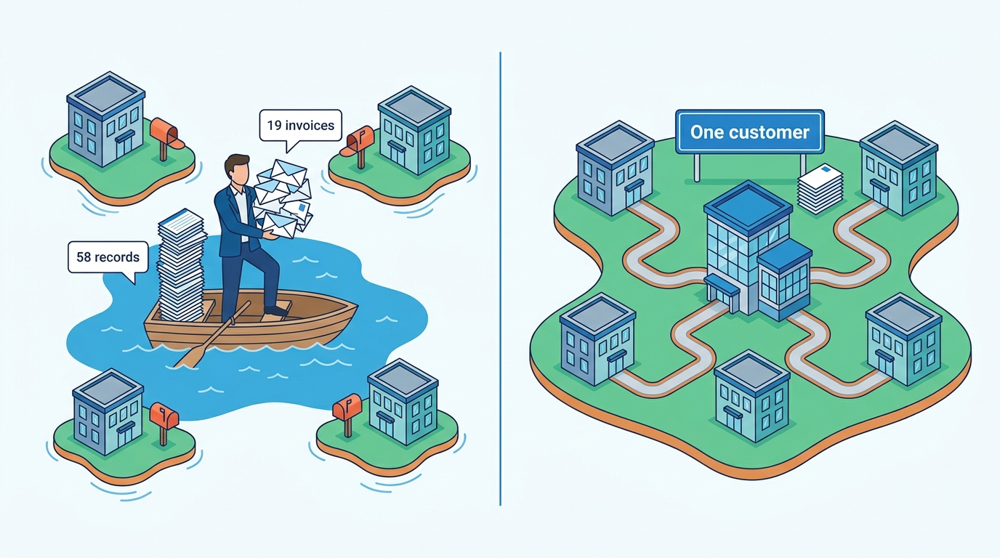
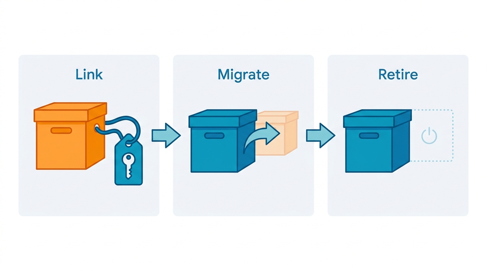
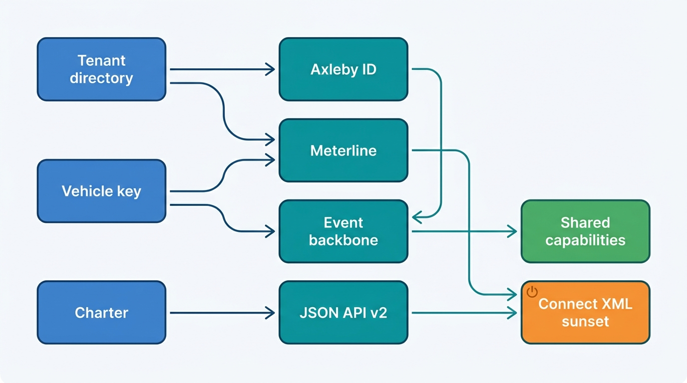

> **IN THIS CHAPTER, YOU WILL:** Compare the ways an acquired portfolio can be integrated, decide what to unify first and in which order, map people, customers and vehicles across products without merging the wrong ones, set customer-visible milestones, and read Axleby's capability map v2 and its integration contract for future acquisitions.

> **WHY THE BUSINESS CARES:** A group bought for its combined customer base earns its price only when a dealer group sees one supplier: one login, one invoice per legal entity, one dossier per car. Until then, cross-sell stalls, every price change is implemented several times, and the group cannot answer what one customer spends with it.

> **WHY ARCHITECTS SHOULD CARE:** Portfolio integration is where the Chief Architect's decisions are most expensive to reverse. The shared kernel becomes every product's dependency and every product's single point of failure, and the order of migrations decides whether the program removes measured failures each quarter or runs two estates for years.

> **KEY POINTS:**
>
> * **Share the kernel, not the products.** Four questions must have one answer across the group before anything else is worth sharing: who the customer and the person are, which car it is, what was used, and whether it was allowed. Identity and tenant directory, vehicle key, meter and license check come first; brands, screens and release cadences stay with the products.
> * **Sequence by dependency, and make every step visible to a customer.** Each kernel element moves through link, migrate and retire, and a retirement date is the only milestone that stops double running. Plan quarters so that each one removes a measured failure and gives a dealer something they can see, or the product directors will stop funding the program by the second year.
> * **Turn integration into a map and a contract, not a project.** A capability map that records which tier owns each capability and which product has adopted it shows where the group is. An integration contract with 90-day and 12-month obligations turns the next acquisition into a checklist rather than a new program. The same contract makes any brand separable if the group ever sells it.

> **[FAILURE PATTERNS THIS CHAPTER ADDRESSES](where-vehicle-platforms-go-wrong.html):**
>
> * **The Acquisition Archipelago** — Axleby entered 2027 with five products, three login systems, two vehicle keys and three business billing systems, so Velto Mobility Group appeared as 58 customer records and received 19 invoices a month.
> * **The Cloned Identity** — Lotwise Classic keyed cars by stock id and plate, Connect XML by plate and Anchor by the Axleby Vehicle Key, so the same car could not be followed from appraisal to report to registration.
> * **The Tenant Blur** — joining customer records across acquired products by name or VAT number merges different legal entities into one tenant, which is a data breach waiting for a reorganization.

 
Every group built by acquisition reaches the same meeting. The deals are closed, the products are profitable, and the board asks why customers still experience five companies. The engineering answer is usually a list of migrations. **The business answer is narrower: the customer wants one login, one dossier per car and one invoice per legal entity, and the group wants to see one customer.** Everything else in the integration plan is a means to those ends.

The hard part is that none of the products can stop. A dealer appraises cars on Tuesday morning whatever the program plan says, an insurer's claims system calls the valuation API every few seconds, and the month-end register peak arrives on schedule. **Portfolio integration** in this chapter means the deliberate, sequenced work of making acquired products share identity, data, metering and contracts, while each keeps serving its customers, until the group can retire what it no longer needs.

This chapter owns two terms: **portfolio integration** and **capability map v2**, Axleby's December 2027 revision of the map that [[vehicle-capability-map]] introduced. It draws on the chapters that build each shared element: [[identity-access-and-entitlements]] and [[tenancy-and-dealer-groups]] for one account, [[vehicle-identity]] for one vehicle key, [[billing-and-metering]] for one meter, [[data-licensing-and-governance]] for one license check and [[events-webhooks-and-sync]] for one event backbone. It decides their order. [[build-buy-or-partner]] decides which of them to build at all, and [[modernizing-the-platform]] covers the strangler mechanics of retiring Lotwise Classic and Connect XML.

## Setting the Scene at Axleby: Fifty-Eight Records, Nineteen Invoices

Axleby, the fictional vehicle data and dealer software group this book follows (see [[meet-axleby]]), approved the **One Dossier** program in **March 2027**: **€38 million** over **2027–2029**, proposed by Ruben Dekker (CTO) and Ines Marchetti (Group Chief Architect). Year 1 promised "one dossier, one account". On **Thursday 9 December 2027** the board held the Year 1 checkpoint. Anouk Willems (CEO) opened it with a letter rather than a slide.

The letter came from Mirjam Kuipers, group used-car director of **Velto Mobility Group** (**46** rooftops in the Netherlands and Belgium, **7** legal entities). She thanked Axleby for running Velto's stock, adverts and sales documents during the **DriveDesk Outage**, the twelve days in November 2027 when Velto's dealer management system (DMS) was offline after a ransomware attack ([[dms-integration]]). Then she listed what had not changed. Her staff now signed in once, through Velto's own Microsoft Entra ID, since the identity migration of July to September. But Velto still received **19 Axleby invoices a month**: one from Lotwise per legal entity (7), one from Axleby Data per legal entity (7), and one from Axleby Trade for each Dutch legal entity (5). The allowance of history reports in Lotwise Appraise was pooled across the group, but Axleby Data's portal reports were billed separately and nobody could tell her which rooftop had ordered them.

**Figure 1:** *Before One Dossier, Velto appeared to Axleby as 58 customer records and received 19 invoices a month; the goal is one customer with one invoice per legal entity.*

Lena Vos (Billing and Finance Systems Lead) had already counted why. In June 2027 their team ran a **customer census** across Axleby's three business billing systems: the Connect XML monthly invoice run (Axleby Data usage and Axleby Trade fees), Lotwise Classic subscription billing and Showroomly's SaaS billing tool (Odolo's consumer accounts and Axleby Trade's card-paid webshop were out of scope). All figures are Axleby illustrations.

| Census finding (June 2027) | Value |
| --- | --- |
| Business account records in the three billing systems | about **18,900** |
| Legal entities they resolved to (the 12,400 business customers) | **12,400** |
| Legal entities with records in two or more systems | about **3,700** |
| Records matched automatically by company registration number or VAT number | about **17,600** |
| Records needing manual review (no registry number, conflicting numbers) | about **1,300**, belonging to about **610** legal entities |
| Wrong merges found in the first dry run | **14** pairs of different legal entities joined by a shared VAT number |
| Velto's records | **58**: 46 Lotwise rooftop accounts, 7 Axleby Data accounts, 5 Axleby Trade accounts |

The 14 wrong merges mattered more than the 3,700 duplicates. Each was a pair of companies filing under one VAT number as a Dutch VAT group (*fiscale eenheid*, a fiscal unity in which several legal entities file one VAT return), often two dealer companies with a common owner but separate customers, staff and register recognitions. Merged into one tenant, either company's users would have seen the other's leads, stock and register transactions. **The census had nearly built the Cross-Tenant Lead into the customer model** ([[tenancy-and-dealer-groups]]).

Harrowgate Capital, Axleby's majority owner, asked what integrating the *next* acquisition would cost, and whether One Dossier would have to be rerun for every purchase. Tomás Ferreira (Product Director, Lotwise) and Callum Reid (Engineering Lead, Showroomly) asked which of their products' capabilities would become shared, and when.

Ines framed the forum's question for December: **what must be shared, in what order, and how will we know at any moment how far each product has come, so that the next acquisition joins a platform rather than starting another program?**

## Concepts: Kernel, Integration Depth and the Three Mappings

### Portfolio integration and its depths

Integration is not one decision; it is a depth chosen per capability. Five depths are useful, from shallow to deep.

| Depth | What is shared | What the customer notices | Example |
| --- | --- | --- | --- |
| **Front door** | Brand, navigation, a portal or menu that links products | One website and one support number; still several logins and invoices | A group portal with links to each product |
| **Linked identity** | Authentication; a central login linked to per-product accounts | One sign-in; permissions and records still per product | Cox Automotive's Bridge ID (rollout 2020–2021) |
| **Shared kernel** | One identity and tenant directory, one vehicle key, one meter, one license check, consumed by every product | One login, one customer, one invoice per legal entity, one dossier per car | Axleby's One Dossier Year 1 |
| **Shared capabilities** | Whole business capabilities used by several products: lead routing, syndication, configuration, register transactions | One behavior across products; brand-specific screens | Showroomly moving onto Switchboard and Relay 2 |
| **Replatformed** | One product absorbs another's customers; the other is retired | A migration, then one product | Lotwise absorbing Axleby's earlier dealer portal in 2019 |

**The shared kernel** is the smallest set of capabilities whose answers every product must take from one place: **who** (person, organization, legal entity, rooftop), **which car** (the vehicle key), **what was used** (the usage event) and **whether it was allowed** (entitlement, authority and license). Without the kernel, deeper sharing has nothing to join on: a shared lead service cannot route a lead to a rooftop the products identify differently, and a shared dossier cannot show a history report keyed by a plate that has since moved to another car.

### Link, migrate, retire

Each kernel element moves through three states per product, and the states are what the program measures.

- **Link.** The product keeps its own record but stores the kernel's key beside it: a Lotwise login linked to an Axleby ID person, a stock item linked to an AVK (Axleby Vehicle Key, Anchor's opaque vehicle identifier), a billing account linked to a tenant-directory legal entity. Linking is cheap and reversible, and it produces the cross-reference map every later step needs.
- **Migrate.** The kernel becomes the source of truth and the product reads from it. Usage is rated by Meterline rather than the product's own invoice code; sign-in goes through Axleby ID; the product's local copy becomes a cache or disappears.
- **Retire.** The product's own mechanism is switched off and deleted: the Lotwise password table, the plate cache, the stored procedure that billed reports.

A program that measures only "linked" reports progress for years while every product runs two mechanisms. **The retirement date is the milestone that matters**: only retirement ends double running and the drift between the two.

**Figure 2:** *Each kernel element moves through link, migrate and retire in every product, and only retirement ends double running.*

### The three mappings

Integration needs three cross-reference maps, each with its own matching evidence and its own failure.

| Mapping | From | To | Strong evidence | The expensive mistake |
| --- | --- | --- | --- | --- |
| **People** | Product logins | Axleby ID persons in an organization | Customer identity provider (IdP) with SCIM provisioning, verified e-mail | A shared login mapped to one person, so register transactions are misattributed |
| **Customers** | Product account and billing records | Tenant-directory organization, legal entity, rooftop | Company registration number, DMS site code, portal account id, direct-debit mandate | Two legal entities merged because they share a VAT number or a trading name |
| **Vehicles** | Stock ids, plates, report and transaction references | AVK in Anchor | VIN confirmed by the register; plate as of the observation date | A plate-keyed fact attached to the wrong car |

The maps share three rules. **A link carries its evidence, method and date**, so a wrong link can be found and reversed. **Links are time-bounded** where the world changes: a rooftop moves between legal entities, a plate moves between cars. **Merging is a separate, reviewed act** from linking, and only strong evidence merges automatically. These are the same rules [[vehicle-identity]] applies to vehicles (auto-merge only on Confirmed evidence) and [[tenancy-and-dealer-groups]] applies to the tenant directory (external identifiers as attributes with sources), applied to the whole portfolio.

## Architecture: What to Unify First

### The dependency order

The kernel elements depend on each other, and the shared capabilities depend on the kernel. Drawn as dependencies, the order is not a matter of taste.

**Figure 3:** *The kernel first, shared capabilities second, retirements last. Meterline needs both the customer and the vehicle key; the event backbone carries both in its envelope; Connect XML can be retired only when the new API and the new meter both exist.*

Four dependencies drive Axleby's sequence.

1. **The meter needs the customer and the car.** A usage event names a billing account, which is a legal entity in the tenant directory, and a vehicle, which is an AVK. The No-Hit Credit's re-open rule ("re-opening a report the same billing account bought for the same vehicle within 30 days is free") cannot be computed across products until both keys are shared ([[billing-and-metering]]).
2. **Events need the kernel in their envelope.** The One Dossier event backbone, approved on **14 December 2027**, carries `tenantid`, `rooftopid` and `avk` as CloudEvents extensions ([[events-webhooks-and-sync]]). Publishing events before the keys exist publishes three vocabularies for the same customer and the same car.
3. **Shared capabilities need events.** Showroomly can move onto Switchboard and Relay 2 only when stock and lead changes flow as events keyed by AVK and rooftop; otherwise each shared service builds a private synchronization path; the November 2027 sold audit found one sold event reaching eight consumers through six such mechanisms.
4. **Retirements need a replacement for every caller.** Connect XML cannot be switched off while it runs the usage invoice, and its 210 XML-only clients cannot move until JSON API v2 serves what they call ([[vehicle-data-apis]]).

### Why not start with the workflow

Product directors usually argue the other way: start with what customers see. Tomás Ferreira's first proposal in March 2027 was to put the Axleby Data portal's report screens inside Lotwise in six months. Ines's objection was not that the idea was wrong, but that without the kernel it would embed a third copy of the plate-keyed report lookup in Lotwise, priced by the Connect XML stored procedure, and checked against no license. **A front-end integration built before the kernel creates the next thing to migrate.** The compromise became the Lotwise Dossier: the screens Tomás wanted, built on AVK, Meterline and Charter, shipped in the fourth quarter of 2027 rather than the third.

The rule I use is simple. **Before any cross-product feature ships, ask which customer, which car, which meter and which license it uses.** If any answer is "the product's own", the feature waits or the kernel element is pulled forward.

### What stays with the products

The kernel is deliberately small. These stay with the brands, and the capability map says so explicitly.

| Stays with the product | Why |
| --- | --- |
| **Brand, screens and workflow** | Lotwise's independents and Showroomly's UK groups work differently; one screen for both would serve neither ([[tenancy-and-dealer-groups]]) |
| **Release cadence** | Lotwise ships monthly; the data APIs change in April and October releases with notice ([[vehicle-data-apis]]) |
| **External API contracts** | Data clients pin dated versions; a dealer product's internal changes must not reach them |
| **Market-specific rules** | UK registration, VAT and portal integrations differ from Dutch ones; they live in market packs and adapters ([[onboarding-and-configuration]]) |
| **Consumer identity** | Odolo's consumers are not business users, have different consent and retention, and stay in their own account store |

### Requirements per kernel interaction

Sharing the kernel turns every product into its dependant. The requirements are therefore set per interaction, not per service.

| Interaction | Consistency | Latency target *(assumption)* | Freshness | Availability and degraded mode |
| --- | --- | --- | --- | --- |
| Sign-in and token refresh (Axleby ID) | Strong for credentials and disablement | p99 under 500 ms | Disablement within one token lifetime (10 min) | Existing sessions continue during an outage; new sign-ins fail |
| Authorization check (Gatekeeper) | Read-your-writes after membership changes | p99 under 20 ms | Cached view decisions up to 30 s | Views served from cache; writes, exports and register transactions fail closed |
| Resolve plate or VIN to AVK (Anchor) | Linearizable per vehicle for merges and splits | p99 under 50 ms | Register changes within minutes | Workflow continues with a provisional link, resolved later; no paid history on unresolved cars |
| Usage event (Meterline) | Exactly-once effect through idempotent event ids | Asynchronous, through outbox | Rated within 48 h late-event cut-off | Product outboxes hold 72 h of peak usage |
| License decision (Charter) | Strong for the rule version used | p99 under 10 ms, embedded | Rule changes within minutes | No license class, no serve |
| Customer lookup (tenant directory) | Versioned, effective-dated | p99 under 20 ms | Lifecycle events within seconds | Read replicas; structural changes queue |

**The kernel's availability budget must be tighter than any product's**, because every product's availability now includes it. That is Borrowed Uptime from inside the group ([[reliability-and-dependencies]]): an Axleby ID outage that blocks sign-in blocks Lotwise, the Axleby Data portal and Axleby Trade at once, which three separate login systems never did.

## Data Migration and Identity Mapping in Practice

### Customers: the census and the link

The June 2027 census used the evidence order that Ines's team wrote into the customer-mapping rule. A record linked automatically to a legal entity only on a **company registration number** (the Dutch KvK number, the Belgian enterprise number, the German commercial register entry, the UK Companies House number). A VAT number, a direct-debit mandate's IBAN, a DMS site code or a portal account id were **corroborating** evidence: they could confirm a link but not create a merge. Names and addresses only proposed candidates for review.

The 14 wrong merges of the dry run all came from treating a shared VAT number as identity. After the rule changed, the census linked about 17,600 records automatically and sent about 1,300 to a review queue that Lena's team and customer operations cleared over the summer. By **mid-December 2027**, about **2,950** of the 3,700 multi-record legal entities had one organization in the tenant directory with every product record linked to it. The remainder were mostly UK Showroomly accounts with trading names that did not match Companies House, which Callum Reid's team scheduled for the Showroomly identity migrations of 2028.

**Linking is not merging the products' data.** A linked Lotwise account keeps its own rows; the link lets Meterline rate its usage on the right billing account and lets the tenant directory show Velto as one organization with 7 legal entities and 46 rooftops. The products' records become caches of the directory over time, one product at a time.

### People: linking first, federating where groups allow

The identity side is told in [[identity-access-and-entitlements]]. In April 2027 Axleby counted about **66,400** active business logins (41,000 Lotwise, 9,800 Showroomly, 15,600 Axleby Portal) behind about **38,000** people. Velto federated its Entra ID between July and September 2027 (about 1,340 logins became **905** persons); Hartley Motor Group, the first Showroomly customer to move, matched **571** of about 640 staff accounts automatically in the fourth quarter. For everyone else, Axleby ID offered **link at next sign-in**: the product asks the user to create or confirm an Axleby ID and links the legacy login. By mid-December 2027 about **18,000** of the 66,400 legacy logins had been linked, about 27%. The target is unchanged: Lotwise and Axleby Portal logins retired by mid-2028, Showroomly's by the end of 2028 *(Axleby plan)*.

Shared logins cannot be linked, because there is no one person to link them to. Velto's **322** central-desk logins became seven people only because Velto's administrators decided who those people were; Axleby could not infer it.

### Vehicles: the AVK backfill

The vehicle side is told in [[vehicle-identity]] and [[inventory-and-vehicle-dossier]]. Lotwise's **352,000** live stock items were re-keyed to AVKs from May 2027: **97.2%** automatically, **2.1%** by asking the dealer to confirm a VIN at the next touch of the car, **0.7%** by manual review. From **December 2027** no Lotwise stock item exists without an AVK. Axleby Trade had keyed register transactions by AVK since the transaction-ledger redesign of June 2027. Connect XML remains plate-keyed; rather than re-key a system with a sunset date, Axleby is turning it into a facade over the JSON API v2 response composer from the second quarter of 2028, so plate-keyed requests resolve through Anchor without Connect XML keeping its own vehicle tables.

### The integration scorecard, December 2027

Ines's office published one table for the board checkpoint: per product, the state of each kernel element. All entries are Axleby illustrations.

| Kernel element | Lotwise | Showroomly (UK) | Axleby Data (portal and APIs) | Axleby Trade | Odolo |
| --- | --- | --- | --- | --- | --- |
| **People** (Axleby ID) | Linking open; Velto federated | Hartley pilot only | Portal linking open; JSON API v2 clients on OAuth | Through Axleby Portal linking | Out of scope (consumers) |
| **Customers** (tenant directory) | All rooftops linked | Linked where Companies House matched | Linked | Linked | Business referral partners only |
| **Vehicle key** (AVK) | Retired plate key: every stock item has an AVK | Own stock id plus plate (2028) | JSON API on AVK; Connect XML plate-keyed until facade | AVK per transaction since June 2027 | Paid reports on AVK; free check reads the plate mirror |
| **Meter** (Meterline) | Shadow-rated since October 2027 | Not started (SaaS billing tool; last in order) | Shadow-rated since October 2027 | Fees on register confirmation since June 2027 | Not started |
| **License check** (Charter) | Through the Tracewell assembler | Not applicable to its own data | Every external call since December 2027 | Not applicable | Through the Tracewell assembler |
| **Events** (backbone) | Outbox from the first quarter of 2028 | 2028–29 | No events from Connect XML | 2028 | 2028 |

The scorecard showed what the board needed to hear: **the vehicle key and the license check were done, the customer and the people were linked but not migrated, and the meter was a quarter behind.** Meterline's cut-over criterion, two consecutive months in which every difference above €1 per account is classified and every Meterline error fixed, was not met in October, when the shadow run found re-open differences on 11% of Lotwise invoices. Velto's one invoice per legal entity therefore moved from the January to the spring 2028 invoice runs.

## Capability Map v2 (December 2027)

Capability map v1 of March 2027 ([[vehicle-capability-map]]) answered "what do we do, what do we do twice, and what do we do better than anyone": **6 domains, 39 capabilities**, each with an investment class, a condition, a scope and a market flag. It was set for revision by the end of the year. **Capability map v2**, adopted by the architecture forum on **Thursday 16 December 2027**, answers the integration question instead: **who owns each capability, at which tier, and how far has each product adopted it?** All figures are Axleby illustrations.

### What changed from v1

v2 keeps the 6 domains and v1's numbering, and makes four kinds of change.

- **Two capabilities added.** **A13 Upstream data sourcing and cost control** (supplier contracts, the build-data budget broker and cost per lookup) became a capability after the Saturday Batch of May 2027 showed that one client's batch could cost more in build-data fees than it earned ([[scale-and-cost]]). **F7 Consent and data rights** (Mandate, the registry of vehicle-level consent grants) was built for the Fleetmoor connected-car pilot, but register-transaction customer authorizations and Data Act requests need the same lifecycle, so v2 makes it shared rather than part of connected-vehicle data ([[connected-vehicle-data]]).
- **One capability merged.** **D2 File enrichment** folded into **D1 Vehicle data APIs**: JSON API v2's batch lane (`/v2/lookup-jobs`) serves enrichment files through the same composer, license check and meter as single lookups, so a separate capability would have meant a separate meter.
- **One scope change.** **A9 Condition and damage estimation** moved from workflow half to shared, because Gauge's findings now feed Vantage's valuations and Tradefloor's buyer claims as well as Lotwise ([[condition-and-damage]]).
- **Three capabilities drawn at level 3**, as v1 anticipated, where parts differ in class or owner: **A1 Register access** (open-data plate lookup, commodity; validated mirror, differentiating; live status calls, differentiating); **A8 Vehicle valuation** (models and segment monitoring, differentiating; serving and valuation ledger, parity); **F2 Authorization and entitlements** (relationships in Gatekeeper, entitlements derived from contracts, register authority), each part with its own owner.

v2 also adds two columns. **Tier** says who owns the capability: **K** for the kernel (tier 0, platform-owned, every product must use it), **S** for a shared platform capability (one platform owner, consumed through a versioned contract), **H** for a capability owned by one half or one product. **Adoption** records, per product, whether each K and S capability is linked, migrated or retired, which is the scorecard above in map form.

| Attribute | v1 (March 2027, of 39) | v2 (December 2027, of 40) |
| --- | --- | --- |
| Investment class | 13 differentiating, 21 parity, 5 commodity | **13 differentiating, 23 parity, 4 commodity** |
| Condition | 6 green, 20 amber, 8 red, 5 grey | **12 green, 25 amber, 2 red, 1 grey** (not offered) |
| Scope | 18 shared, 6 data half, 14 workflow half, 1 not offered | **21 shared, 5 data half, 13 workflow half, 1 not offered** |
| Tier | not recorded | **5 kernel, 16 shared platform, 18 half- or product-owned**; E2, not offered, carries no tier |
| Market-specific | 18 | **20** (A13 and F7 added) |
| Implemented more than once | 9 | **8** (register data now one mirror); target **1** by end of 2029 |
| Capabilities needed but without an owner | 4 | **0** |
| Level-3 capabilities drawn | 0 | **8**, under 3 capabilities |

The **five kernel capabilities** are A2 vehicle identity resolution, F1 accounts, organizations and tenancy, F2 authorization and entitlements, F4 usage metering and billing and F5 data licensing and purpose governance. The tier counts sum to 39 because E2 consumer travel documents, the one capability Axleby does not offer, has no owner and therefore no tier. The kernel capabilities are the "who, which car, what was used, whether allowed" of this chapter, owned in Marta Nowak's platform organization (A2 with Priya Raman's data team), and they are the only capabilities whose adoption is compulsory for every product, including any future acquisition.

### Where the condition moved

Seven of v1's eight red capabilities turned amber or green during 2027, which is One Dossier's Year 1 in one line. **Data licensing** went from red to green when every external data API call passed through Charter in December. **Valuation, the vehicle dossier, listing syndication, DMS integration, vehicle data APIs and accounts** moved to amber: each fix is in place, but each still runs a second mechanism (Connect XML, Relay's RabbitMQ queue, legacy logins) until a retirement date. **Usage metering stays red**, because the shadow run had not met its cut-over criterion and Velto's single invoice slipped. **B2B trade exchange became red**: the Twice-Sold Returns of June 2027, when 17 of Fleetmoor's cars were sold twice through Tradefloor and an auction partner, has an approved fix (the sale-right register) that was not yet live ([[b2b-trade-and-remarketing]]). Four of v1's grey capabilities (provenance, battery health, connected-vehicle data, events) gained an owner and a first implementation.

**Figure 4:** *Capability map v2 by tier: five kernel capabilities that every product must use, sixteen shared platform capabilities consumed through versioned contracts, and eighteen capabilities left with a half or a product. Brands differ in the bottom tier only.*

### The integration contract

The map's most consequential addition is not a capability but a rule. With v2, the board approved an **acquisition integration contract**: the obligations any product joining Axleby, by acquisition or by internal build, must meet, with clocks that start at closing.

| By | Obligation | Kernel or shared capability |
| --- | --- | --- |
| **Day 0** | Inventory: logins, customer records, vehicle keys, billing paths, data sources and their licenses, event and integration paths, security baseline; placed on the capability map | All |
| **Day 90** | Customers linked to the tenant directory; usage events emitted to Meterline in shadow; every external release of vehicle data checked by Charter; telemetry tagged with organization, rooftop and client ids | F1, F4, F5, F6 |
| **Month 12** | Users sign in through Axleby ID; every vehicle record published to other products carries an AVK; Meterline rates the product's usage; no new tenant-conditional code | F1, F2, A2, F4, F3 |
| **Month 24** | Shared capabilities adopted where the map marks the product's own version as a duplicate; own copies retired on a dated plan | Tier S, duplicated tier H |
| **Always** | The brand, its screens and its market rules may stay; separability kept (per-brand data partitions, billing entities and tenant export) | — |

Exceptions go to the Group Chief Architect's exception register with an end date, as tenant-specific code does ([[onboarding-and-configuration]]). Measured against the contract, Showroomly, acquired in **2023**, would have been due on everything up to month 24 by the end of 2025; in December 2027 it met the day-90 obligations only in part (telemetry tags and some customer links) and the month-12 obligations only for Hartley. **That gap, not any single system, is what the Acquisition Archipelago costs**, and it is the number Ines gave Harrowgate's deal team for the next acquisition.

## Customer-Visible Milestones

Tomás Ferreira's condition for supporting One Dossier was that dealers would see something every quarter. Ines accepted it as a design constraint, not a concession: **a milestone a customer can see is also a milestone a customer can report as broken**, which is the cheapest test of whether the kernel works.

| Quarter | What a customer sees | Kernel element it proves |
| --- | --- | --- |
| Q3 2027 | Velto staff sign in with their own Entra ID; shared logins gone | People, customers |
| Q4 2027 | Lotwise Dossier shows history reports, valuation, condition and register transactions for one car | Vehicle key, license check |
| Q4 2027 | JSON API v2 portal live; data clients see per-block outcome and license status | License check, vehicle key |
| Q1–Q2 2028 *(plan)* | One invoice per legal entity, rooftop list and pooled allowance for group contracts, starting with API clients | Meter, customers |
| Q3 2028 *(plan)* | Webhooks for dealer groups replace Velto's 30-minute diff script | Events |
| 2028 *(plan)* | Showroomly customers sign in with Axleby ID; Hartley's leads routed by Switchboard | People, shared capabilities |
| 2028–29 *(plan)* | Showroomly adverts published by Relay 2 and composed by the shared advert composer | Shared capabilities |
| 31 Dec 2029 *(plan)* | Connect XML switched off | Retirement |

When the invoice milestone slipped, Lena Vos wrote to the 40 largest group customers in December rather than letting them discover it in January. **A slipped milestone announced early costs a letter; one discovered on an invoice costs a renewal conversation.**

## In Practice: What the Public Record Shows

No company in this field has published its portfolio integration in enough detail to copy. Several have published enough to show the shape, and two have published the reverse: separation.

**Cox Automotive integrated in layers over about eight years.** Its dated record runs from the 2018 "all in" announcement on AWS ([Amazon, 2018](https://press.aboutamazon.com/2018/4/cox-automotive-goes-all-in-on-aws)), through Well-Architected scorecards over more than 200 platforms in 2019 ([Classmethod session report, 2019](https://dev.classmethod.jp/articles/reinvent-2019-coxautomotive-well-architected-results/)), Bridge ID single sign-on, whose rollout text refers to the end of 2020 and the beginning of 2021, and which links "a single solution account from each of these solutions" to one login ([Cox Automotive, n.d., accessed 2026-10](https://www.coxautoinc.com/bridgeid/)), to a federated API graph in which the existing VIN decoder returns a vehicle ID that joins valuations ([Apollo GraphQL, n.d., accessed 2026-10](https://apollographql.com/customers/cox-automotive); vendor-authored). In October 2026 Cox still marketed "one less system to log into" when embedding its newly acquired Fullpath customer data platform into VinSolutions ([Cox Automotive, 2026](https://www.coxautoinc.com/wp-content/uploads/2026/10/PRESS-RELEASE_VinSolutionsFPCDP.pdf)). [[case-cox-automotive]] reads this record in full.

> **INFERENCE, NOT DOCUMENTED:** Cox's sequence starts with infrastructure and governance and reaches identity third, and its linking model suggests that roles and dealer-entity mapping stayed in each product. Cox has not published its tenancy or authorization model, so this is a reading of public pages, not a description of Cox's systems. The Fullpath announcement suggests each acquisition still needs its own "no extra login" work.

**CDK Global separated its international business in 2021.** CDK completed the sale of CDK International to Francisco Partners on **1 March 2021** and afterwards reported a single operating segment ([CDK Global Form 10-K, 2021](https://www.sec.gov/Archives/edgar/data/1609702/000160970221000058/cdk-20210630.htm)). The business was relaunched as **Keyloop**, serving about 16,000 dealer sites in more than 90 countries, for $1.45 billion ([Keyloop, 2021](https://kyodonewsprwire.jp/release/202103021693)). [[case-cdk-global]] covers the case; the point here is that a portfolio's integration must be undoable along brand or market lines.

**Mobility Global's 2026 carve-out shows what separation costs when services are shared.** In its information statement of May 2026, Mobility Global (Carfax's parent after its separation from S&P Global, completed on 1 July 2026, as of 2026) said S&P Global "currently performs many important corporate functions for us, including executive management, finance, legal, information technology, human resources and other shared services", that these would continue under a transition services agreement "generally for a period of up to 18 months", and that it "will need to duplicate information technology infrastructure" ([Mobility Global Information Statement, 2026](https://www.sec.gov/Archives/edgar/data/2090312/000110465926066592/tm2528763d9_ex99-1.htm)). **Every service a group shares is a service a carve-out must duplicate**, which is an argument for designing shared kernels with per-brand separability, not against sharing.

**VWE kept an acquisition's brand and contracts, and turned a sold subsidiary into a partner.** When VWE acquired XRAY Automotive in April 2026, it said XRAY keeps its name, office, customer agreements and terms "for now" ([VWE, 2026](https://vwe.nl/nieuws/vwe-automotive-neemt-xray-automotive-over-en-versterkt-dienstverlening-in-bpm-en-waardebepaling/), in Dutch). In February 2026 Autorola completed its purchase of VWE's subsidiary Automotive Trade Center, which continues as an independent auction platform ([Journal de l'Automobile, 2026](https://journalauto.com/distribution/autorola-reprend-une-filiale-de-vwe-automotive/), in French); VWE's Occasion Manager page still offered auctions from "partner Automotive Trade Center" in October 2026 ([VWE, n.d., accessed 2026-10](https://vwe.nl/occasion-manager/), in Dutch; author's translation). [[case-vwe]] reads VWE's record.

> **INFERENCE, NOT DOCUMENTED:** Keeping a new brand's terms and front end while integrating behind it, and handing a divested business back as a partner integration, are both consistent with the "shared kernel, separate surfaces" pattern. VWE has not published how it integrates acquired products.

**Auto Trader folded an acquired business into its platform's reporting.** Auto Trader's results of May 2026 said that from its 2027 financial year Autorama, its leasing marketplace, would be reported in one segment with Autotrader because "more than half of all leasing transactions" were delivered through the Autotrader platform ([Auto Trader Group, 2026](https://plc.autotrader.co.uk/media/usjleen0/full-year-press-release-fy26.pdf)). [[case-auto-trader-uk]] covers the wider record. The signal for an architect is the measure: integration was declared when the acquired business's transactions ran mostly on the acquirer's platform, not when a migration project closed.

**The public evidence stops at the layer order and the separation costs.** No source shows how these groups mapped customers across products or sequenced metering; that part of this chapter is reference architecture and Axleby illustration.

## Failure Handling

Integration programs fail in ways that are specific to running two estates at once.

**Duplicates: the customer that appears twice, the car that appears twice.** The census found 3,700 legal entities with several records; the AVK backfill found AVKs with two open stock items, mostly Velto's internal transfers modeled as sales. **Detection** is a standing duplicate report per mapping (the duplicate-tenant backlog of [[tenancy-and-dealer-groups]] is one); **recovery** is a reviewed merge with a tombstone that redirects the old key, never a delete.

**Wrong merges: the Tenant Blur by data migration.** Two companies merged by a shared VAT number, or two cars merged by a plate, expose data across a boundary. Axleby's rules: automatic merges only on strong evidence; every merge publishes an event that products must honor; every merge can be split; a dry run with leak tests before any bulk merge. After the census, Ines added a check to the tenant directory's merge path: two legal entities with different register recognitions or different DMS site codes cannot be merged without a second reviewer.

**Conflicting updates during dual running.** While a product and the kernel both hold a record, someone changes both. The rule is **one system of record per element per tenant at any moment**, recorded in the tenant directory as a per-tenant flag ("Meterline rates Velto's usage from 1 February 2028"). Before the flag flips, the kernel shadows; after, the product's copy is read-only. A two-way synchronization between a product and the kernel is forbidden, because it has no answer when both sides change.

**Incomplete records.** Accounts without a registration number, logins without a person, stock items without a VIN. Each mapping has a "not yet resolvable" state with a named owner and a clock, rather than a forced guess. The 0.7% of stock items in manual review and the 610 legal entities in the census review queue were reported weekly until they were closed.

**Retries and partial failures in migration jobs.** A tenant half migrated is worse than one not migrated. Migration jobs are idempotent per tenant and per element, write a checkpoint, and run through Runway's per-rooftop state machine ([[onboarding-and-configuration]]), so a failed Hartley rooftop can be retried without touching the 27 that finished. Every cut-over has a written rollback that has been rehearsed on a copy, and a point after which rollback is no longer offered.

**Outages of the shared kernel.** The new single points of failure are Axleby ID, Gatekeeper, Anchor, Meterline and Charter. Each has a degraded mode written down before the first product depends on it: sessions continue and new sign-ins fail; cached view decisions for up to 30 seconds while writes fail closed; provisional vehicle links; outboxes that buffer 72 hours of usage; no license class, no serve. Marta Nowak's team runs the kernel as tier 0 in the dependency map, with game days that switch off one kernel element per quarter for a sample of tenants.

**The integration tax on product roadmaps.** The failure nobody reports as an incident is a product team that stops shipping features because every quarter is a migration. Axleby budgets it explicitly: in 2027 about a quarter of Lotwise engineering capacity went to One Dossier work *(assumption)*, agreed in the portfolio plan rather than taken from the roadmap by stealth.

## Trade-offs

### How deep to integrate

| Option | What it fixes | What it leaves | Cost and risk | When it is right |
| --- | --- | --- | --- | --- |
| **Front door only** | One brand and entry point | Logins, customers, keys, invoices, data | Low; fast | A holding structure that may sell brands; products with no shared customers |
| **Linked identity** (Cox's documented first step) | Sign-in | Permissions, customer records, keys, meters | Low to medium; months | First year after an acquisition; many products that must keep shipping |
| **Shared kernel** (Axleby Year 1) | Customer, person, vehicle key, meter, license | Workflows and screens | Medium; one to two years; kernel becomes tier 0 | Products sell to the same customers and about the same cars |
| **Shared kernel plus shared capabilities** (Axleby Years 2–3) | Duplicate lead, syndication and configuration engines | Brand surfaces, market rules | Medium to high; years | Capabilities behave the same across markets apart from configuration |
| **Full replatforming** onto one product | Everything, eventually | Nothing; the other product is retired | High; customer migration risk and churn | Products overlap almost entirely in market and function, and the absorbing product already serves the market |

Axleby chose the shared kernel for every product and shared capabilities for leads, syndication, configuration and register transactions. It rejected replatforming Showroomly onto Lotwise because Lotwise has no UK market pack, UK groups such as Hartley run different workflows and UK portal integrations, and a forced migration of 1,350 rooftops would have cost more in churn than the duplicated screens cost in engineering *(Axleby judgement)*. The condition under which this would flip: if Showroomly and Lotwise converge on the shared composer, leads and syndication by 2029, the remaining Showroomly code is screens and UK rules, and replatforming becomes a front-end decision.

### Sequence: kernel first or features first

Kernel first costs a quarter or two of visible progress and buys features that do not need to be rebuilt. Features first wins early credibility and creates a third copy of whatever the kernel would have shared. The middle path is the one Axleby took: **build the feature the business wants, but only on the kernel**, and accept that it ships a quarter later.

## The Chief Architect's View

**Decide the kernel in writing, and keep it small.** Who, which car, what was used, whether it was allowed. Each kernel element has one owner in the platform organization, an availability target above any product's and a degraded mode. Anything a product team proposes to add to the kernel comes to the architecture forum; most proposals belong in a shared capability instead, which can be adopted product by product.

**Publish the scorecard every quarter.** One table, kernel elements by product, in three states: linked, migrated, retired. It replaces status reports that say "on track" and makes the long tail visible. The Acquisition Archipelago's measures sit beside it: logins per person, records per legal entity, invoices per legal entity, vehicle keys per product.

**Date the retirements, and defend them.** The Connect XML sunset (31 December 2029), the Lotwise and Axleby Portal login retirement (mid-2028) and Showroomly's (end of 2028) are the dates that end double running. A retirement that slips without a decision record is the program failing quietly.

**Write the integration contract before the next acquisition, not after.** Its test, which I would put to any deal team before signing: **how many of the contract's obligations does the target already meet, and what does each missing one cost?** That number belongs in the deal model alongside revenue synergies.

**Keep every brand separable.** The carve-out records show that every shared service becomes something a buyer must duplicate. Axleby's kernel keeps per-brand data partitions, per-brand billing entities and exportable tenant directories, so that a brand could leave with its customers, keys and history. Separability is also what keeps a shared kernel honest: if a brand cannot be separated, its data is probably being used beyond what its contracts allow ([[data-licensing-and-governance]]).

**Who decides.** The board approves the program and its retirement dates. The CTO owns sequence and budget. The Group Chief Architect owns the kernel definition, the capability map, the integration contract and its exception register. Product directors own their products' adoption order within the dated plan and decide which of their capabilities become shared candidates. Finance owns the billing cut-over criterion with the billing team.

**What to watch.** Duplicate-tenant backlog and unresolved mappings, per product; share of legacy logins linked and retired; Meterline shadow differences by class; kernel availability and degraded-mode minutes; the share of engineering capacity spent on integration per product; customer-visible milestones met, missed and announced.

## Questions to Ask

1. Which four questions does every one of our products answer from its own data today: who the customer is, which car, what was used, whether it was allowed?
2. For our largest group customer, how many customer records, logins and invoices do we hold, and who could produce those numbers in a day?
3. What evidence do we accept to merge two customer records, and have we tested it against companies that share a VAT number or a trading name?
4. For each kernel element and each product, is it linked, migrated or retired, and what is the date of the next retirement?
5. Which cross-product features shipped in the last year built their own customer, vehicle or meter lookup?
6. What happens to every product if the shared identity service is down for an hour on the last working day of the quarter?
7. Which customer-visible milestone is next, and who tells customers if it slips?
8. Could we sell one of our brands next year? What would the buyer have to duplicate, and what data could they not take?
9. If we bought a product tomorrow, which obligations of an integration contract would it meet on day one, and what would the rest cost?

## From One Platform to One Organization

A shared kernel and a capability map with owners are an organizational decision as much as a technical one: someone must own the tenant directory, the vehicle key and the meter for every product, and product teams must accept that some of what they built becomes someone else's. The next chapter, [[organizing-engineering]], turns Axleby's capability map v2 into teams, ownership of adapters and on-call for the dependencies the kernel now concentrates.

## Sources and Evidence

### Company, product and investor sources

- [Cox Automotive Goes All-In on AWS](https://press.aboutamazon.com/2018/4/cox-automotive-goes-all-in-on-aws), Amazon, 2018. Cox's infrastructure consolidation as the first documented integration layer.
- [Bridge ID](https://www.coxautoinc.com/bridgeid/), Cox Automotive, n.d., accessed 2026-10. Account-linking single sign-on and its 2020–2021 rollout.
- [Cox Automotive customer story](https://apollographql.com/customers/cox-automotive), Apollo GraphQL, n.d., accessed 2026-10. VIN decoder brought into a federated graph returning a vehicle ID; vendor-authored.
- [Cox Automotive's VinSolutions Embeds Fullpath's AI-Powered Customer Data Platform](https://www.coxautoinc.com/wp-content/uploads/2026/10/PRESS-RELEASE_VinSolutionsFPCDP.pdf), Cox Automotive, 2026. "One less system to log into" for an acquisition in 2026.
- [CDK Global Form 10-K for fiscal 2021](https://www.sec.gov/Archives/edgar/data/1609702/000160970221000058/cdk-20210630.htm), CDK Global / SEC, 2021. Sale of CDK International on 1 March 2021 and single operating segment afterwards.
- [International Business of CDK Global Becomes Keyloop](https://kyodonewsprwire.jp/release/202103021693), Keyloop via PR Newswire, 2021. Keyloop's scale and sale price.
- [Mobility Global Information Statement (Exhibit 99.1)](https://www.sec.gov/Archives/edgar/data/2090312/000110465926066592/tm2528763d9_ex99-1.htm), Mobility Global / SEC, 2026. Shared corporate and IT services, transition services for up to 18 months, duplicated IT infrastructure.
- [VWE Automotive neemt XRAY Automotive over](https://vwe.nl/nieuws/vwe-automotive-neemt-xray-automotive-over-en-versterkt-dienstverlening-in-bpm-en-waardebepaling/), VWE Automotive, 2026. Acquired business keeps its name, office, agreements and terms "for now".
- [Autorola reprend une filiale de VWE Automotive](https://journalauto.com/distribution/autorola-reprend-une-filiale-de-vwe-automotive/), Journal de l'Automobile, 2026. Sale of Automotive Trade Center to Autorola.
- [Occasion Manager](https://vwe.nl/occasion-manager/), VWE Automotive, n.d., accessed 2026-10. Divested auction platform shown as a partner.
- [Autotrader Group plc full-year results FY2026](https://plc.autotrader.co.uk/media/usjleen0/full-year-press-release-fy26.pdf), Auto Trader Group, 2026. Autorama reported with Autotrader from FY2027 because most leasing transactions run on the platform.

### Standards, regulation and official documentation

- [CloudEvents specification 1.0](https://github.com/cloudevents/spec/blob/v1.0.2/cloudevents/spec.md), Cloud Native Computing Foundation, 2022. Event envelope whose extensions carry the kernel keys (see [[events-webhooks-and-sync]]).
- [System for Cross-domain Identity Management: Protocol (RFC 7644)](https://datatracker.ietf.org/doc/html/rfc7644), IETF, 2015. Provisioning protocol behind group federation (see [[identity-access-and-entitlements]]).

### Research and practitioner sources

- [re:Invent 2019 ARC212-R session report: Cox Automotive Well-Architected results on 200+ platforms](https://dev.classmethod.jp/articles/reinvent-2019-coxautomotive-well-architected-results/), Classmethod (DevelopersIO), 2019. Portfolio scorecard before shared services; third-party report.
- [Cox Automotive's journey from API silos to a unified API strategy](https://2024.platformcon.com/talks/cox-automotives-journey-from-api-silos-to-a-unified-api-strategy), PlatformCon / B. McNichols, 2024. API unification across acquired brands.
- [StranglerFigApplication](https://martinfowler.com/bliki/StranglerFigApplication.html), Martin Fowler, 2004 (updated 2024). Incremental replacement pattern behind link, migrate, retire.

Axleby is fictional; architectural recommendations, labeled inferences and labeled assumptions are the author's judgement.
