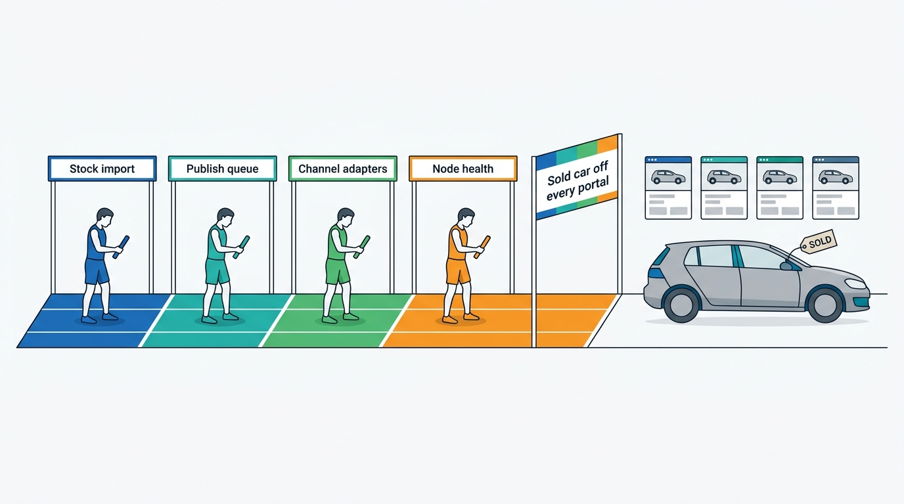
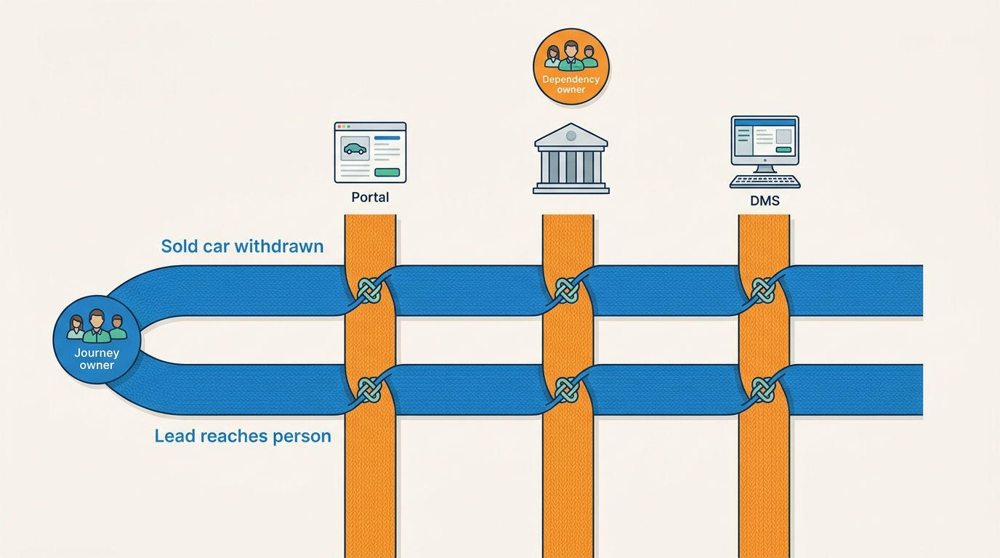
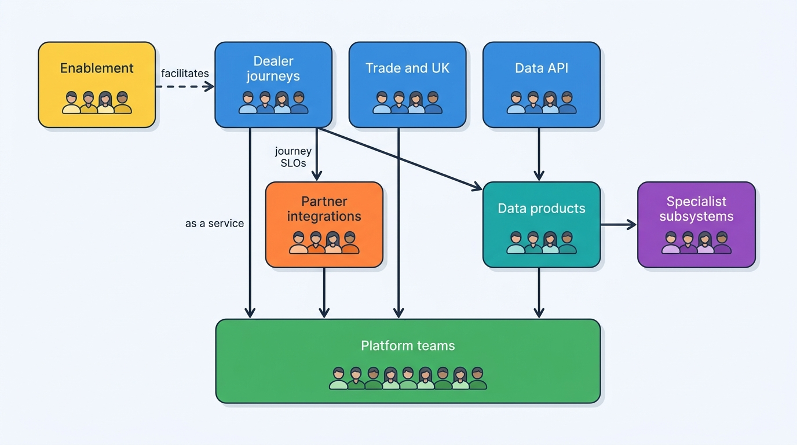
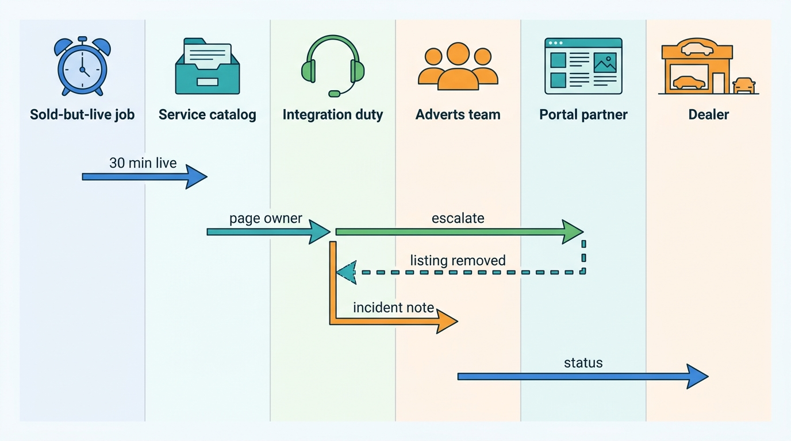
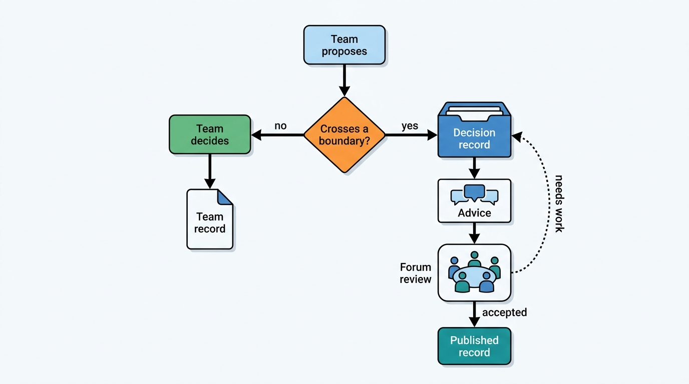

> **IN THIS CHAPTER, YOU WILL:** Design the engineering organization of a group that sells vehicle data and dealer software: which teams own which journeys, domains, platforms and adapters, who is paged when a portal, register or dealer management system fails, how architecture decisions are made and recorded, and how teams from acquired companies in several countries become one organization.

> **WHY THE BUSINESS CARES:** A dealer does not care which team owns the portal adapter, but they notice when a sold car stays advertised over a weekend because three teams each owned one hop and nobody owned the outcome. A CEO who bought three companies wants one product roadmap. An organization shaped by acquisition history ships acquisition-shaped software.

> **WHY ARCHITECTS SHOULD CARE:** The architecture in the earlier chapters (one vehicle key, one dossier, one account, desired-state syndication, an integration layer for dealer management systems) only holds if each part has one team that owns it, is paged for it and can say no. Team boundaries become interface boundaries whether you plan them or not, so the team design has to be part of the architecture.

> **KEY POINTS:**
>
> * **Organize around journeys and vehicle domains, not around acquired brands.** A brand-shaped organization reproduces the brands in the software: three logins, two vehicle keys, two metering rules. Stream-aligned teams own dealer and data-client journeys end to end; data-product and complicated-subsystem teams own identity, specification, history, market data and valuation; platform teams own what every product would otherwise rebuild.
> * **An adapter has two owners: one for the partner, one for the outcome.** The integration team owns the adapter, the partner relationship and the dependency's health. The stream-aligned team owns the journey outcome and its service-level objective. Alerts go to whichever team the failure is attributed to, and every external dependency has one named owner.
> * **Govern decisions and standards, not org charts.** Most decisions stay with teams under an advice process. Cross-boundary decisions (vehicle key, tenant model, event catalog, field ownership, public contracts) go to an architecture forum as decision records. A quarterly ownership scorecard shows which components have no owner, no on-call rotation or no objective, before a dealer finds out.

> **[FAILURE PATTERNS THIS CHAPTER ADDRESSES](where-vehicle-platforms-go-wrong.html):**
>
> * **The Acquisition Archipelago** — when each acquired company stays a team with its own stack, logins and vehicle key, the organization keeps the islands in place long after the integration program has declared them joined.
> * **Feed Roulette** — 61 channel adapters run as a side job of one overloaded team have no contracts, status monitoring or owner for each partner, so dealers find every format change first.
> * **Borrowed Uptime** — when no team owns an external dependency, its outages reach dealers through whichever team happens to be paged, and nobody negotiates its terms, degraded mode or escalation path.

 
This chapter assigns the book's boxes and arrows to people. **Every box needs one owning team, and every arrow that crosses a team boundary needs a contract, a monitor and a named escalation path.** 
A group that sells both vehicle data and dealer software has an unusual organizational problem. It runs two kinds of business on shared assets: per-call data products, sold to insurers, lessors and software vendors, and per-rooftop workflow products, sold to dealers. It depends on dozens of external parties it does not control: registers, portals, dealer management systems (DMS), build-data providers and history suppliers. And it was usually assembled by acquisition, so its teams arrive with their own stacks, cultures and customers.

The chapter applies the **Team Topologies** vocabulary to the shapes of this domain: who owns the vehicle key and the 61 portal adapters, who is paged when the Dutch register's transaction channel stops answering at month-end, and what happens to the engineers in Leeds when their product moves onto shared services.

## Setting the Scene: The Weekend Nobody Owned

Axleby, the fictional vehicle data and dealer software group this book follows (see [[meet-axleby]]), had about **300 engineers** in 2026, spread over five hubs: **Utrecht** (Axleby Data, Axleby Trade and the group platform), **Ghent** (Lotwise), **Munich** (Wertlauf, valuation and market data), **Leeds** (Showroomly) and **Kraków** (shared platform and site reliability engineering, SRE, opened 2024). The hubs mirrored the acquisitions: Lotwise in 2019, Wertlauf in 2021, Showroomly in 2023. Most teams were named after the product they had come with.

The **Zombie Golf** of February 2027 ([[listing-syndication]]) showed what that structure did to a single dealer outcome. Velto Mobility Group sold a 2021 Volkswagen Golf at its Breda rooftop on Thursday 11 February. The car stayed live on **4** portals for **4 days** and produced **37** leads and **9** booked test drives. Each hop had an owner:

- The DriveDesk stock file import that should have carried the sold status was maintained by the Lotwise core team in Ghent, which also owned Lotwise Classic.
- Relay's publish queue lived inside Lotwise Classic, so the Lotwise core team owned it too.
- The 61 channel adapters belonged to Hendrik Maes's partner integrations team, also in Ghent.
- The Kraków SRE rotation watched RabbitMQ node health, not queue depth per rooftop and channel.

**Nobody owned "a sold car disappears from every portal."** Over the weekend, the only rotation awake was watching the wrong signal. The Breda sales manager escalated on Monday at 10:40; the deletes landed at 15:30, and most of that gap went to working out which team owned which hop.

**Figure 1:** *In the Zombie Golf every hop had an owner but nobody owned the outcome, so a sold car stayed live on 4 portals for 4 days.*

Ines Marchetti, Group Chief Architect, put the question to the architecture forum in April 2027, a month after the board approved the One Dossier program: **if One Dossier is the target architecture, which organization would build it, run it and keep it from drifting back?** Ruben Dekker (CTO) asked for evidence first. Marta Nowak's platform team ran an **ownership census** that month. All figures below are Axleby illustrations:

| Finding (April 2027) | Value |
| --- | --- |
| Teams | **38**, of which 31 named after a product or brand |
| Deployable services, scheduled jobs, adapters and stored-procedure jobs in the inventory | **438** |
| Items without an owning team | **57**, including 14 stored-procedure jobs in the Connect XML invoice run, the Lotwise plate cache loader of the Three Copies review ([[registers-and-official-data]]) and a customer-specific sync script built for Velto |
| External dependencies with a named owning team | **31** of the 75 in the dependency map ([[reliability-and-dependencies]]) |
| Severity 1 and 2 (SEV1/SEV2) incidents in 2026 | **74**; **58%** first reported by a customer ([[observability-and-data-operations]]) |
| Incidents that needed three or more teams | **29** of 74; median **70 minutes** before the team that made the fix was engaged |
| 24/7 on-call rotations | **1** (Kraków SRE, infrastructure only) |

Other problems traced back to team boundaries. The **No-Hit Credit** of 2026 ([[billing-and-metering]]) happened because the Connect XML team and the JSON API team implemented the no-hit-no-fee rule separately; Axleby credited **€186,000** to **41** clients. The **three login systems** ([[identity-access-and-entitlements]]) were the three organizations that had built them.

## Concepts: Ownership, Team Types and Interaction Modes

### Conway's law and the inverse maneuver

In April 1968 Melvin Conway wrote in *Datamation* that organizations which design systems "are constrained to produce designs which are copies of the communication structures of these organizations" ([Conway, 1968](https://www.melconway.com/Home/Committees_Paper.html)). The practical consequence, the **inverse Conway maneuver**, is to design team boundaries to match the architecture you want, because otherwise the architecture ends up matching the teams.

### The four team types

**Team Topologies** (Matthew Skelton and Manuel Pais, IT Revolution, 2019) names four team types and three interaction modes. The definitions below are quoted from the authors' key-concepts page ([Team Topologies, n.d., accessed 2026-10](https://teamtopologies.com/key-concepts)) and mapped to this domain:

| Team type | Definition | In a vehicle data and dealer SaaS (software as a service) group |
| --- | --- | --- |
| **Stream-aligned** | "Aligned to a flow of work from (usually) a segment of the business domain" | A dealer journey (appraise, stock, price, advertise, lead, sell, register) or a data-client journey (integrate, call, reconcile an invoice) |
| **Platform** | "A grouping of other team types that provide a compelling internal product to accelerate delivery by Stream-aligned teams" | Runtime, event backbone, identity and tenancy, configuration, metering, ingestion, register gateway |
| **Complicated subsystem** | "Where significant mathematics/calculation/technical expertise is needed" | Vehicle identity resolution, valuation models |
| **Enabling** | "Helps a Stream-aligned team to overcome obstacles. Also detects missing capabilities." | Moving an acquired product onto shared identity, events or integration contracts; adopting data contracts |

The three interaction modes are **collaboration** ("working together for a defined period of time to discover new things"), **X-as-a-Service** ("one team provides and one team consumes something 'as a Service'") and **facilitation** ("one team helps and mentors another team"). The same page names **cognitive load** as the constraint: "Each new tool, responsibility or domain your team is given taxes their mental bandwidth."

This book adds one type the vocabulary leaves implicit. A **data-product team** is a stream-aligned team whose stream is a vehicle-data domain (specification, history, market data) and whose customers are internal products and external data clients. Zhamak Dehghani's 2019 data-mesh article describes domain teams treating "data assets as their products", with a data product owner who "makes decisions around the vision and the roadmap" ([Dehghani, 2019](https://martinfowler.com/articles/data-monolith-to-mesh.html)). In a group that *sells* data, the data product is also a revenue line.

### What "owns" means

In this chapter, **a team owns a thing** when it has all five of the following:

1. **Change authority.** It decides what changes and when, and it reviews changes made by others.
2. **Run responsibility.** Its rotation is paged first, and it holds the runbook.
3. **An objective.** It publishes a service-level objective (SLO) or a data-quality target, and it reports against it.
4. **The external relationship.** Where the thing depends on a partner, it holds the contact, the escalation path and the technical side of the contract.
5. **The decision records.** It keeps the record of why the thing is built the way it is.

A thing with two owning teams has none. A person is never the owner; people leave, teams do not.

### Journey owner and dependency owner

Two ownership roles matter more in this domain than in most SaaS businesses. The **journey owner** is the stream-aligned team that owns a dealer or data-client outcome end to end ("a sold car is withdrawn from every channel within 30 minutes", "a lead reaches a person who acknowledges it"). The **dependency owner** is the team that owns one external party: a portal, a register channel, a dealer management system (DMS) family, a data supplier. One journey crosses several dependencies; one dependency serves several journeys. **This chapter's organizational design is mostly about making that matrix explicit.**

**Figure 2:** *One journey crosses several external dependencies and one dependency serves several journeys; the design names a journey owner for each row and a dependency owner for each column.*

## Architecture: The 2027 Organization Design

Ines and Ruben started from the capability map v1 ([[vehicle-capability-map]]) and the bounded contexts ([[vehicle-bounded-contexts]]), not from the org chart, and asked of each context: is it a journey, a domain, a platform or a specialist subsystem? Only then did they ask which hub had the people.

### The team map

The design record, approved by Ruben Dekker in **June 2027**, groups about 300 engineers into seven groups. Head counts are Axleby illustrations and include engineering managers:

| Group | Team type | Teams (owned systems) | Engineers | Main hubs |
| --- | --- | --- | --- | --- |
| **Dealer journeys** (product: Tomás Ferreira) | Stream-aligned | Appraise and Acquisition; Stock and Dossier (Dossier service, Lotwise Classic stock); Pricing; Adverts and Merchandising (owns the publish and withdraw outcome); Leads and Websites (Switchboard, inbox, dealer websites); Sales Admin and Deals; Lotwise Classic stewardship (temporary) | **70** | Ghent, Utrecht |
| **Trade** (product: Daan Visser) | Stream-aligned | Registration and Trade Services (Axleby Trade back office, transaction ledger); Tradefloor and Remarketing | **18** | Utrecht |
| **UK dealer products** (lead: Callum Reid) | Stream-aligned | Showroomly Websites and Leads; Showroomly Stock and UK Channels | **20** | Leeds |
| **Data clients and consumers** | Stream-aligned | Data API and Developer Experience (JSON API v1 and v2, Connect XML until sunset); Odolo | **22** | Utrecht |
| **Vehicle data products** (VP: Priya Raman) | Data-product and complicated subsystem | Identity Resolution (Anchor, complicated subsystem); Specification (Specbook); History (Tracewell); Market Data (Pulse); Valuation Models (Vantage, complicated subsystem); Condition and Battery (Gauge, battery-health service); Connected Data (Mandate, Signalyard) | **56** | Utrecht, Munich |
| **Partner integrations** (head: Hendrik Maes) | Platform plus adapter teams, one enabling team | Channel Adapters Benelux; Channel Adapters Germany and Feeds; DMS Integration (Hitch); Supplier Feeds; Integration Enablement (enabling) | **30** | Ghent, Kraków |
| **Platform** (head: Marta Nowak) | Platform | Runtime and Delivery; SRE and Observability; Event Backbone; Data Platform (Inlet, warehouses); Register Gateway (Turnstile); Identity and Tenancy (Axleby ID, Gatekeeper, tenant directory); Configuration and Onboarding (Baseline, Runway); Metering and Billing (Meterline, lead: Lena Vos); Governance Engineering (Charter, with Femke de Boer); Security Engineering | **74** | Kraków, Utrecht |
| **Architecture office** (Ines Marchetti) | Staff and principal engineers | Catalog stewardship, decision records, cross-cutting reviews | **10** | Utrecht, Ghent |

By hub, the design left about **115** engineers in Utrecht, **85** in Ghent, **55** in Kraków, **25** in Munich and **20** in Leeds.

Three choices in the table carry most of the design.

**The dealer journey teams own outcomes, not systems.** Adverts and Merchandising owns "a stock change reaches every channel" and "a sold car leaves every channel", with the publish-lag targets from [[observability-and-data-operations]] as its SLOs, although Relay's adapters belong to Hendrik's group. The Leads and Websites team owns "a lead reaches a person", although the DriveDesk lead adapter sits behind Hitch. That separation is deliberate: the journey team sets the bar, and the dependency owner meets it for its partner.

**Identity resolution and valuation are complicated subsystems; specification, history and market data are data products.** Anchor and Vantage need specialist knowledge (matching and merge rules; models, drift monitoring and back-testing) that stream-aligned teams cannot carry alongside their own work. Specbook, Tracewell and Pulse are products with external buyers: they need product managers, price lists and roadmaps as well as engineers. Anchor keeps its veto from [[vehicle-identity]]: no product stores a plate or vehicle identification number (VIN) as a key without its approval.

**Platform teams are product teams with internal customers.** Each publishes what it offers (the event catalog and delivery contract, Axleby ID's onboarding guide, Meterline's usage-event schema), its SLOs and its roadmap, and stream-aligned teams consume them **X-as-a-Service**. Collaboration mode is time-boxed and written down, for example the Event Backbone team working with Stock and Dossier on the Lotwise Classic outbox in Q1 2028 ([[events-webhooks-and-sync]]).

**Figure 3:** *Axleby's 2027 team topology. Stream-aligned teams own dealer and data-client journeys and consume platforms and data products as services. Specialist teams sit behind the data products. The integration teams meet the journey teams' objectives for each partner, and one enabling team moves acquired products onto shared contracts.*

### Adapters as products

Syndication, DMS integration and data supply each run dozens of adapters to parties Axleby does not control. Who owns them is the most contested question in an organization like this, and the four common answers differ sharply:

| Model | How it works | Strength | Failure mode | When it fits |
| --- | --- | --- | --- | --- |
| **One central integration team owns all adapters** | Every portal, DMS and supplier adapter in one team | Deep partner knowledge; one place for partner contacts | Cognitive overload; adapters become a side job; the team is far from the dealer outcome (**Feed Roulette**) | Fewer than about 15 adapters *(assumption)* |
| **Each stream-aligned team owns the adapters it uses** | Adverts team owns portal adapters; Leads team owns customer relationship management (CRM) adapters | Close to the outcome | Each team rebuilds retries, mapping and reconciliation; partners face several contacts; the Lost Leads of Velto path | A single product with few partners |
| **Integration platform plus adapter teams by partner family** (recommended) | A platform team owns the framework (desired-state interface, xref map, contract tests, changelog watcher); adapter teams own families of partners; journey teams own outcomes | Shared mechanics; bounded load per team; one owner per partner | Needs clear attribution between adapter failures and upstream failures | Dozens of adapters across several products |
| **Buy the tail from an aggregator** | An aggregator or channel manager connects the long tail | Removes low-volume adapters | Borrowed Uptime on the aggregator; less status feedback | Partners with little traffic and frequent changes ([[build-buy-or-partner]]) |

Axleby's design takes the third model and keeps the fourth for the long tail. The numbers explain the split. In early 2027 one team of about fourteen engineers looked after **61** channel adapters, the Relay workers and the supplier feeds. The channels differ in what they can confirm: **19** give confirmed-state callbacks or a status API, **25** accept requests synchronously and process them later, and **17** are file feeds without status ([[observability-and-data-operations]]). Each kind needs different reconciliation, and every portal publishes its own changelog.

From September 2027 the channel adapters were split between two teams by market cluster. **Channel Adapters Benelux** covers the Dutch and Belgian portals, aggregators and Google's vehicle ads feed. **Channel Adapters Germany and Feeds** covers the German portals and the file-feed channels. UK channels stay with Showroomly in Leeds until Relay 2 carries them in 2028. **DMS Integration** owns Hitch and its adapters for DriveDesk, the two German DMS products and the franchise-brand systems (2,250 connected rooftops, [[dms-integration]]). **Supplier Feeds** owns the source adapters into Inlet and the supplier quarantine.

Every adapter has an **adapter record** in the service catalog. Its fields are the ones [[listing-syndication]] and [[dms-integration]] argue for, assigned to people:

| Field | Owned by | Example (Marktplaats adapter) |
| --- | --- | --- |
| Owning team and on-call rotation | Partner integrations | Channel Adapters Benelux; integration duty rotation |
| Partner contact and escalation path | Partner integrations (Hendrik Maes) | Named partner manager; status page; support contract terms |
| Journey SLOs it contributes to | Journey team | Adverts and Merchandising: 99% of withdrawals within 10 minutes |
| Evidence level and reconciler | Adapter team | Confirmed-state API; nightly listing reconciliation |
| Changelog watcher and contract tests | Adapter team | Weekly changelog check; build-time mapping test for canonical equipment codes |
| Commercial status, cost and health | Product (Tomás Ferreira), from integration's twice-yearly report | Supported channel; operations per day, errors, engineering hours |

The **build-time mapping test** that fails when a canonical equipment code has no mapping for a channel was the direct fix for the Zombie Golf's trigger. It belongs to the adapter team, which knows the channel's codes; the withdrawal SLO belongs to Adverts and Merchandising, which knows what a late withdrawal costs a dealer.

### Requirements for ownership and response

Ownership has latency and availability requirements, just as systems do. These are Axleby's 2027 targets; the response times are illustrative *(assumption)* except where the ledger sets them:

| Ownership interaction | Requirement | Target | Why |
| --- | --- | --- | --- |
| Alert to the owning team | Routing by catalog | No triage hop for tier-1 alerts | The 2026 median of 70 minutes to engage the right team |
| Sold-but-live alarm | 24/7 response | Alarm at 30 minutes ([[listing-syndication]]); acknowledged within 30 minutes *(assumption)* | Weekend withdrawals are tier 1 |
| Lead-flow monitor | Business hours plus group admin | Alert after 4 business hours of unacknowledged leads ([[observability-and-data-operations]]) | Lead loss shows up only over hours |
| Register channel at month-end | Extended watch | Register watch on the last three working days of each month and quarter until 22:00 *(assumption)* | Month-end peaks at 4× the daily average |
| Supplier batch failure | No night page; blocking gate | Batch quarantined before Tracewell; reviewed from 08:00 | The gate prevents harm; a person need not act at 03:00 |
| Decision record for a cross-boundary change | Before merge | Forum decision recorded before the first production change | Field ownership, keys and contracts are hard to reverse |

## In Practice

### On-call for external dependencies

Axleby's dependency map lists **75** external dependencies: 61 portal channels, 5 register channels, 3 DMS families, the build-data provider, Kilometra and two other history suppliers, Vertex AI and Odolo's payment service provider ([[reliability-and-dependencies]]). In April 2027, 31 had an owning team. By December 2027 all 75 had one.

The design rests on three rules.

**Rule 1: page the team that can act, and attribute before you page.** Alert routing uses the same upstream attribution as the journey SLOs ([[reliability-and-dependencies]]). A withdrawal stuck because a portal returns errors pages the dependency owner. A withdrawal stuck because the stock state never reached Relay pages the journey team's systems. When attribution is unclear, the alert goes to the journey owner, who holds the outcome.

**Rule 2: few 24/7 rotations, each large enough to be humane.** The Google SRE book argues that at most 25% of an engineer's time should go to on-call, that two incidents per 12-hour shift is the maximum sustainable load, and that a single-site rotation needs at least eight engineers or six per site for a dual-site rotation ([Google, 2016](https://sre.google/sre-book/being-on-call/)). Axleby cannot staff 35 teams for 24/7 on those terms. All five hubs sit in two neighboring time zones, so follow-the-sun is not an option. The 2027 design has:

| Rotation | Coverage | Who | Pages at night for |
| --- | --- | --- | --- |
| **Platform SRE** | 24/7, dual-site | Kraków and Utrecht platform engineers, about 14 in the rotation | Infrastructure, data API availability, Odolo checkout, security events; acts as incident commander for SEV1 |
| **Integration duty** | 24/7 | Channel, DMS and Switchboard delivery engineers from Ghent and Kraków, about 12 in the rotation | Tier-1 alarms only: sold-but-live, withdrawal lag, Hitch write-back failures for sold status |
| **Register watch** | Register channel hours, extended at month-end and quarter-end | Register Gateway and Registration and Trade Services | Turnstile circuit opening, ambiguous outcomes above threshold |
| **Team rotations** | Business hours | Every other team, including data products and valuation | None; SRE runs documented degraded modes overnight |

 Business hours work when the design makes failures safe to leave until morning. A Kilometra batch that fails Inlet's gate waits in quarantine ([[ingestion-and-entity-resolution]]). A Vantage segment that drifts is switched to `watch` or `restricted` as a product decision by Priya Raman's and Tomás Ferreira's teams, not by an on-call engineer ([[valuation-engine]]). **The rule I use: a page at night is justified only if the harm grows faster than the morning can fix it** (a sold car live on portals, a dealer unable to register a sale at month-end, a data client's production traffic failing), and only if the paged person can do something about it.

**Rule 3: the dependency owner talks to the partner; the journey owner talks to the customer.** During the Month-End Register Outage on 31 March 2027, Daan Visser posted the dealer banner by hand about 15:20, an hour after the first errors ([[reliability-and-dependencies]]). In the 2027 incident roles, the Register Gateway team owns the channel's status and the conversation with the register; Registration and Trade Services owns the banner, the queue's visible state and the dealer communication.

**Figure 4:** *Routing a tier-1 alarm. The service catalog maps the failing channel to its dependency owner, which acts and talks to the partner; the journey owner keeps the dealer informed and owns the objective.*

Working-time law shapes these rotations. In *Matzak* (C-518/15, 21 February 2018), the Court of Justice of the European Union held that stand-by time at home with an obligation to respond within eight minutes counted as working time ([CELEX 62015CJ0518](http://publications.europa.eu/resource/celex/62015CJ0518)). In *Radiotelevizija Slovenija* (C-344/19, 9 March 2021) it held that stand-by time is working time in full only when its constraints very significantly limit the worker's free time, judged on all the facts, including the response window and how often the worker is called ([CELEX 62019CJ0344](http://publications.europa.eu/resource/celex/62019CJ0344)). Axleby therefore sets a 30-minute acknowledgement window for night pages, counts every page as worked time and pays a stand-by allowance.

### The DriveDesk Outage as the first test

The new structure took effect in stages: the dealer journey teams, the split channel adapter teams and integration duty on **1 September 2027**; data-product managers and the platform product model in **January 2028**; Showroomly's move onto shared identity, leads and syndication through **2028**. The **DriveDesk Outage** of November 2027 ([[dms-integration]]) tested the first stage. DriveDesk was offline from Tuesday 9 November to Sunday 21 November, and **1,900** Lotwise rooftops lost DMS sync.

| Role | Team | What it did |
| --- | --- | --- |
| Dependency owner | DMS Integration (Hitch) | Liaison with DriveDesk's CTO, Karin Smit; froze write-back; rotated credentials when the partner API reopened on 24 November; ran per-rooftop reconciliation before releasing write-back from 26 November |
| Journey owner: stock and dossier | Stock and Dossier | Switched DriveDesk rooftops into DMS-absent mode; about **16,000** stock-ins recorded in Lotwise |
| Journey owner: sales documents | Sales Admin and Deals | Activated the dormant fallback invoice series ([[deals-and-sales-documents]]); about **19,000** sales recorded |
| Journey owner: leads | Leads and Websites | Delivered about **34,000** leads to the Lotwise inbox instead of DriveDesk CRM |
| Incident command | Platform SRE | SEV1 command for the first 48 hours, then daily coordination |
| Clean-up | DMS Integration with support | **2,140** discrepancy tickets; about **3,900** queued commands expired by design |

The quarterly DMS game days run since June 2027 meant each team had rehearsed its part. More teams were involved than in the Zombie Golf, but **every one of them knew its role before the first call**. The organization did not shorten DriveDesk's outage; it made the 12 days a planned degraded mode rather than an improvisation.

The Lost Leads of Velto two months earlier ([[journey-lead-to-dms]]) showed the transition's weak point. In September 2027 the lead write-back to DriveDesk CRM still ran on the old path, maintained by the Leads team as a side job, without read-back. **1,460** leads went unworked for **9 days** while every hop reported success. The fix had an organizational half: the lead delivery adapter moved behind Hitch with owner-and-queue read-back, and the Leads and Websites team built the lead-flow monitor in October 2027 as owner of the "lead reaches a person" outcome ([[leads-and-crm]]).

### Documented examples from other companies

Public material on how automotive software groups organize engineering is thin, old or vendor-authored. Four sources help.

**Cox Automotive, 2019: governance by scorecard at 350 teams.** At AWS re:Invent 2019, Cox Automotive's architecture leaders described 27 brands, over 2,000 engineers and 350 engineering teams. They ran AWS Well-Architected reviews on more than 200 platforms, rated each green, yellow or red, rolled the results into a balanced scorecard and ran a quarterly improvement cycle in which engineers did the work as part of their normal jobs ([Classmethod session report, 2019](https://dev.classmethod.jp/articles/reinvent-2019-coxautomotive-well-architected-results/); a third-party report). The evidence is seven years old. The pattern, **a uniform per-platform scorecard that steers hundreds of teams without centralizing them**, is the one Axleby copies at a smaller scale.

**Cox Automotive, 2024: from API silos to a unified strategy.** At PlatformCon 2024, Cox said it "grew through acquisitions" while customers expected the brands to work together, and described a product-driven platform effort with governance changes and federated GraphQL ([PlatformCon, 2024](https://2024.platformcon.com/talks/cox-automotives-journey-from-api-silos-to-a-unified-api-strategy)). Apollo's vendor-authored customer story calls Cox Automotive Data Services "a center of excellence" managing APIs after "15 companies over 15 years" ([Apollo GraphQL, n.d., accessed 2026-10](https://apollographql.com/customers/cox-automotive)). [[case-cox-automotive]] covers the sequence.

> **INFERENCE, NOT DOCUMENTED:** Cox has not published its team structure. A data-services center of excellence beside brand teams suggests brand-aligned product teams plus a central platform for shared vehicle data; that is a reading of public talks, not a description of Cox's organization.

**Auto Trader UK: a small delivery-platform team.** Istio's undated case study describes Auto Trader's delivery-platform team of ten serving more than 200 developers and 200 to 250 deployments a day, with about 400 microservices ([Istio, n.d., accessed 2026-10](https://istio.io/v1.10/about/case-studies/autotrader)). The numbers probably date from 2019–2021. They support a ratio worth testing: **a platform team that hides runtime complexity can be small relative to the engineers it serves**, provided its product is narrow and well bounded ([[case-auto-trader-uk]]).

**AutoScout24, 2024: SLOs tagged by team and journey.** AutoScout24 defines SLOs on "Critical User Interactions" such as "Dealer is contacted by a Buyer about a car" and tags them by journey, team, service and system; among earlier failures it lists SLOs with little product-manager involvement ([AutoScout24, 2024](https://tech.autoscout24.com/blog/posts/slos-for-critical-user-interactions/)). **Tagging every objective with an owning team** makes journey ownership measurable.

### Architecture governance: the advice process and the forum

Axleby's architecture forum appears in almost every chapter of this book, deciding the vehicle key, the tenancy model, the field-ownership table and the event catalog. Its operating model follows the **advice process** described by Andrew Harmel-Law in December 2021: one rule, "anyone can make an architectural decision", provided they seek advice from those affected and those with expertise. Four supporting elements make it work: decision records, an architecture advisory forum, team-sourced principles and a local technology radar ([Harmel-Law, 2021](https://martinfowler.com/articles/scaling-architecture-conversationally.html)). Decision records follow Michael Nygard's 2011 format (title, context, decision, status, consequences) for decisions that affect "the structure, non-functional characteristics, dependencies, interfaces, or construction techniques" ([Nygard, 2011](https://www.cognitect.com/blog/2011/11/15/documenting-architecture-decisions)).

The advice process alone does not tell a team which decisions are its own. Axleby's design record adds a **decision-rights table**:

| Decision | Decides | Must seek advice from | Recorded where |
| --- | --- | --- | --- |
| Internal design of an owned service | Owning team | Teams that consume its interface | Team decision record |
| New public API field, event type or webhook | Owning team, after forum review | Data API team, Event Backbone, Charter | Forum decision record; event catalog |
| Anything that stores a plate or VIN as a key | Identity Resolution team (veto) | Consuming team | Forum decision record |
| Field ownership between Lotwise and a DMS | Forum, with product director and head of partner integrations | Dealer journey teams, DMS Integration | Forum decision record ([[dms-integration]]) |
| Tenant model, isolation tier, cell assignment | Forum | Identity and Tenancy, Security, Platform SRE | Forum decision record ([[tenancy-and-dealer-groups]]) |
| A tenant-specific code path | Group Chief Architect (exception register) | Configuration and Onboarding | Exception register ([[onboarding-and-configuration]]) |
| New data source or license change | Data product owner with data governance | Charter, Supplier Feeds, finance | Charter register; forum record if cross-product |
| Segment restriction of valuations | Valuation product owner and Lotwise product director | Valuation Models team | Vantage change log ([[valuation-engine]]) |

**Figure 5:** *Axleby's decision path. Most decisions stay with the owning team after advice; decisions that cross a boundary or change a shared standard become forum records before the first production change.*

The forum meets weekly; anyone may attend. Ines chairs it without a general veto. In 2027 it produced about **60** decision records *(Axleby illustration)*, including the identity, ingestion, tenancy, event backbone and billing records that earlier chapters cite.

### The ownership scorecard

Cox's 2019 scorecard and AutoScout24's tagged SLOs point to the same mechanism: measure ownership hygiene per team, publish it, and improve it quarterly. Axleby's **ownership scorecard** started in Q4 2027 and rates each team green, yellow or red on six checks:

| Check | Green when |
| --- | --- |
| Catalog completeness | Every deployable unit, adapter, data product and event type the team owns is in the catalog with a rotation and runbook |
| Objectives | Each owned journey or data product has an SLO or data-quality target with a current report |
| Dependencies | Each external dependency the team owns has a partner path, a probe and a degraded mode |
| Shared standards | No new plate-keyed vehicle reference; tenant id on every query path; tagging standard, Meterline and Charter in the path |
| Decision records | Cross-boundary changes in the quarter have forum records |
| On-call load | Pages per shift and out-of-hours hours within the rotation's budget |

In the first quarter, **9** of 35 teams were red on at least one check, mostly catalog completeness and dependencies *(Axleby illustration)*. The scorecard does not rank teams; it goes to the CTO's quarterly review as a list of risks with owners.

### Product management for data products

The vehicle data products group got product managers in January 2028, one each for Specbook, Tracewell, Pulse and Vantage, plus one for the Data API. Before that, Priya Raman made product decisions for all of them, and engineers made the rest implicitly. A data product manager at Axleby owns:

- **The promise.** Coverage, accuracy, freshness and the wording of uncertainty per market ([[provenance-and-data-quality]]).
- **The terms.** With Femke de Boer's governance team, the license conditions under which the product may be served, cached and combined ([[data-licensing-and-governance]]).
- **The price and the cost.** With Lena Vos's billing team and the scale-and-cost review, the stock-keeping unit (SKU) on the price list, no-hit rules and the fully loaded cost per call ([[scale-and-cost]]).
- **The arbitration between internal and external customers.** About **70%** of billable lookups come from Axleby's own products at internal transfer prices; external clients pay for the rest. Lotwise wants new fields quickly; insurers want a stable contract until 2032. The product manager decides what is public, what stays internal and when a change is breaking ([[data-products-and-insights]]).

Without that role, the loudest internal team sets the roadmap of a product external clients pay for.

### Integrating acquired teams across countries

Lotwise (Ghent, 2019), Wertlauf (Munich, 2021) and Showroomly (Leeds, 2023) arrived with their own stacks and customers. The 2027 design applied four rules.

**Keep the people, change the boundaries.** No hub was closed and nobody was asked to relocate. Teams got new missions defined by journeys and domains, and kept their colleagues. Munich became the home of valuation models and market data rather than "the Wertlauf team".

**Give every hub something shared to own.** A hub that only maintains an acquired product becomes the legacy team, and its best engineers leave. Munich owns two group capabilities. Kraków owns most of the platform. Leeds owns the UK market rule sets and UK channel adapters, and from 2028 it will own them inside shared Relay 2 rather than inside Showroomly. Ghent owns the dealer journeys and the partner integrations.

**Move products onto shared contracts before moving people onto shared code.** In the Hartley migration of Q4 2027 ([[onboarding-and-configuration]]), Callum Reid's team, with Integration Enablement in facilitation mode for twelve weeks, moved Hartley Motor Group's **640** staff accounts to Axleby ID and turned Showroomly's **14** Hartley-specific code paths into settings, product features, a webhook and one deletion. The Leeds engineers learned the shared contracts on their own product.

**Use one working language for decisions.** Decision records, the catalog and incident channels are in English; local languages stay where customers need them.

Cox's integration layers appear one to two years apart with more than 2,000 engineers ([[case-cox-automotive]]). Axleby's 2027–2029 program with 300 engineers aims to move faster than that documented sequence; the organization design is one reason it might work, because teams that would otherwise defend separate stacks are given shared ones to own.

## Failure Handling: How Ownership Breaks

Organizations fail like data does: orphans, duplicates, conflicts and silent overload.

**Orphaned components after a reorganization.** *Detection:* the catalog checks owning teams against the HR system's team list weekly. *Recovery:* the group head assigns an owner within five working days; until then the component is frozen except for security fixes. Axleby's census found 57 orphans; the weekly check found 6 more after the September 2027 changes *(Axleby illustration)*.

**Duplicate ownership.** Two teams own the same rule, as the Connect XML and JSON API teams owned the no-hit rule. *Prevention:* the catalog allows one owning team per item, and rules that must be identical across products (metering, license checks, identity resolution) live in one service, not in shared documentation. *Recovery:* the forum assigns one owner and records it.

**Conflicting decisions between teams.** Pricing wants a new price event field; the Event Backbone team wants the event thin. *Recovery:* if the teams cannot agree within two forum cycles, the group heads decide, and the record states who decided and why.

**On-call overload.** A rotation paged more than twice per shift starts silencing alerts. *Detection:* pages per shift, reported monthly at team level under the works-council agreements discussed below. *Recovery:* the excess pages become engineering work for the owning team, with priority over features, following the Google SRE practice of returning operational overload to the development team ([Google, 2016](https://sre.google/sre-book/being-on-call/)).

**External outages that outlast one shift.** *Recovery:* the incident commander hands over every 12 hours, the partner liaison stays one named person for the whole incident, and the incident log carries state between shifts.

**Hub concentration.** If all knowledge of a tier-1 capability sits in one hub, a local event removes it. *Recovery:* a second hub holds at least two engineers who have run that capability's runbook in a game day.

## Trade-offs: Organizing by Brand, Layer, Journey or Domain

| Model | Strength | Weakness | When it is right |
| --- | --- | --- | --- |
| **By acquired brand or product** | Fast after an acquisition; customer continuity; clear revenue accountability | Reproduces the brands in the architecture: separate logins, keys, metering (**The Acquisition Archipelago**) | The first 12–24 months after an acquisition *(assumption)*, or when the group intends to keep the products separate or sell them |
| **By technical layer** (front end, back end, data, operations) | Deep specialist skills; easy hiring | Every feature crosses three or four teams; nobody owns an outcome | Rarely; only for very small organizations |
| **By journey and domain** (recommended) | Owners for outcomes and for data domains; shared platforms; fewer hand-offs | Needs strong platform products and clear interaction modes; acquired teams must change mission | A group that has decided to become one platform, with enough engineers to staff platform teams (roughly 150 or more *(assumption)*) |
| **Matrix** (brand product lines plus functional platform group) | Keeps commercial lines; builds shared services | Two reporting lines; priorities fought out between them | A transition state lasting a defined period, with a date for leaving it |

Axleby's 2027 design is a deliberate transition: journey and domain teams, a UK group that keeps its product identity until 2028, and a platform group serving both. The recommendation rests on three requirements. The board has decided on one platform (One Dossier). The group has enough engineers to staff about ten platform teams without starving products. And the main business risks (sold cars live, lost leads, wrong facts spreading) are journey outcomes that cross today's products. **If the group intended to sell Showroomly within two years, I would keep Leeds as a brand-aligned team and integrate it only at the identity and metering layers.**

## Across Markets: What Changes by Country

Organization design is mostly common across markets. Two things vary: where the platform's **market rules** live, and the **employment rules** that govern on-call and the measurement of engineers.

| Concern | Netherlands / Belgium | Germany | United Kingdom | United States |
| --- | --- | --- | --- | --- |
| **Market rules the teams own** | Register transactions (registration in a new name, *tenaamstellen*, and indemnification, *vrijwaren*), the Dutch registration tax (BPM), Belgium's Car-Pass mileage certificate; owned by Trade and the Register Gateway team | No register adapter at Axleby in 2027; German portals and DMS families; Wertlauf's data clients | Driver and Vehicle Licensing Agency (DVLA) and Driver and Vehicle Standards Agency (DVSA) access, UK portals; owned in Leeds | Not an Axleby market; DMS access programs and state data laws would need their own owners ([[dms-integration]]) |
| **On-call as working time** | EU Working Time Directive as interpreted in *Matzak* (2018) and C-344/19 (2021); Belgian implementing rules not verified here | Same EU case law | [Working Time Regulations 1998](https://www.legislation.gov.uk/uksi/1998/1833), which implemented the EU directive; post-Brexit treatment of the EU case law not verified here | Fair Labor Standards Act: on call is working time if the employee "cannot use the time effectively for his own purposes" ([29 CFR 785.17](https://www.law.cornell.edu/cfr/text/29/785.17)) |
| **Co-determination over schedules and monitoring** | Dutch works council consent for systems suitable for monitoring staff ([WOR art. 27](https://wetten.overheid.nl/BWBR0002747/)) | Works council co-determination over working-hours schedules and over "technical devices designed to monitor the behaviour or performance of the employees" ([BetrVG §87(1) nos. 2 and 6](https://www.gesetze-im-internet.de/englisch_betrvg/englisch_betrvg.html)) | No equivalent statutory veto | No equivalent |

Axleby's fifth hub, Kraków, sits under Polish law. Article 151⁵ of the Polish Labour Code treats on-call duty (*dyżur*) separately: only time actually worked counts as working time, duty must not cut into the daily and weekly rest periods, and duty at home is not compensated unless work is performed ([Kodeks pracy art. 151⁵, lexlege.pl, version of June 2026](https://lexlege.pl/kp/art-151-5/)). Polish commentators argue that this conflicts with the EU case law. Axleby applies one group policy in every hub (stand-by allowance, pages counted as worked time, 30-minute acknowledgement) rather than the lowest local standard.

**Judgement.** The team topology, the ownership model, the decision-rights table and the scorecard are common. Market rules belong to the team that owns the market's adapter or rule set: Trade and the Register Gateway team for the Netherlands and Belgium, Leeds for the UK. On-call policy and engineer metrics need one group policy agreed with each works council, and the default should be team-level, not person-level, measurement. A US entry would need new dependency owners for DMS programs and state data rules, not a new organizational model.

## The Chief Architect's View

**Draw the team map from the architecture, then test it against incidents.** I would replay the last year's ten worst incidents against any proposed design and ask, for each, which team would have been paged, which would have fixed it, and how many hand-offs there would have been. If the Zombie Golf still needs four teams and a Monday escalation, the design is wrong. Axleby's replay of 2026 incidents brought the share needing three or more teams from 29 of 74 down to an estimated 11 *(Axleby illustration)*.

**Make ownership a data structure.** The service catalog, with one owning team per component, adapter, data product, event type and external dependency, is the most important organizational artifact. Alerts, scorecards, access reviews and cost allocation read from it; ownership kept in slides is stale within weeks.

**Fund adapters and platforms as products.** Report an adapter team's cost and health per partner, and a platform team's adoption and SLOs, like product metrics. A channel that needs a dozen changes a year for little traffic goes to an aggregator or is retired ([[listing-syndication]]).

**Keep the architecture office small and the forum open.** The office keeps the catalog, the shared kernel and the decision records coherent; it does not design every service. A central group that approves every change becomes the bottleneck the advice process was meant to remove.

**Decide who may say no.** Identity Resolution may refuse a plate key, Governance Engineering a data call without a license check, the Group Chief Architect a tenant-specific code path, Billing a billable event outside Meterline. Those vetoes are few and written down; any other veto should become advice.

**Watch four numbers.** Tier-1 incidents needing three or more teams; catalog items and dependencies with a complete ownership record; out-of-hours pages per engineer per rotation; and SEV1/SEV2 incidents first reported by a customer (Axleby: 58% in 2026, target under 20% by 2028). The first two show whether ownership works, the third whether people can sustain it, the fourth whether customers notice.

**Plan the next reorganization.** Teams will change again as Connect XML and Lotwise Classic retire; the Classic stewardship team has a sunset date in its charter. Every reorganization should start and end with the catalog.

## Questions to Ask

1. For each tier-1 dealer and data-client journey, which single team owns the outcome, and which team is paged first when it fails at 02:00 on a Saturday?
2. Does every external dependency (each portal, register channel, DMS family, data supplier) have exactly one owning team, a partner escalation path, a probe and a degraded mode?
3. Which rules must behave identically across products (metering, license checks, vehicle identity, tenant isolation), and does each live in one service owned by one team?
4. How many adapters does each integration team own, of what evidence levels, and what share of its time goes to partner changes rather than improvements?
5. Who decides the roadmap of each data product when internal products and external data clients want different things, and is that person a product manager or the loudest team?
6. Which decisions may a team make alone, which need advice, which need a forum record, and who holds the few vetoes?
7. Are your on-call rotations large enough by the standards you would defend to a works council and a court, and do they page only for harm that grows faster than the morning can fix?
8. Does every hub own at least one shared capability, or is one hub becoming the legacy team for an acquired product?

## Hand-off

An organization designed this way can carry a long migration, because each retiring system has an owner. The next chapter, [[modernizing-the-platform]], takes up that migration: how Axleby retires Connect XML and reduces Lotwise Classic to a shell while dealers and API clients keep working.

## Sources and Evidence

### Company, product and investor sources

- [Cox Automotive AWS Well-Architected results on 200+ platforms (re:Invent 2019 ARC212-R session report)](https://dev.classmethod.jp/articles/reinvent-2019-coxautomotive-well-architected-results/), Classmethod (DevelopersIO), 2019. 27 brands, 2,000+ engineers, 350 teams, per-platform scorecard and quarterly cycle; third-party report.
- [Cox Automotive's journey from API silos to a unified API strategy](https://2024.platformcon.com/talks/cox-automotives-journey-from-api-silos-to-a-unified-api-strategy), PlatformCon, B. McNichols, 2024. Acquisition-driven API silos, product-driven platform, governance changes.
- [Cox Automotive customer story](https://apollographql.com/customers/cox-automotive), Apollo GraphQL, n.d., accessed 2026-10. Data-services center of excellence; "15 companies over 15 years"; vendor-authored.
- [Auto Trader case study](https://istio.io/v1.10/about/case-studies/autotrader), Istio, n.d., accessed 2026-10. Delivery-platform team of ten serving 200+ developers; probably 2019–2021.
- [SLOs for Critical User Interactions](https://tech.autoscout24.com/blog/posts/slos-for-critical-user-interactions/), AutoScout24 Tech Blog, 2024. Journey SLOs tagged by team; earlier failure modes.

### Standards, regulation and official documentation

- [Judgment in Case C-518/15, Matzak](http://publications.europa.eu/resource/celex/62015CJ0518), Court of Justice of the European Union, 2018. Stand-by at home with an eight-minute response obligation is working time.
- [Judgment in Case C-344/19, Radiotelevizija Slovenija](http://publications.europa.eu/resource/celex/62019CJ0344), Court of Justice of the European Union, 2021. Overall assessment of stand-by constraints.
- [29 CFR 785.17 On-call time](https://www.law.cornell.edu/cfr/text/29/785.17), US Code of Federal Regulations (via Cornell LII), accessed 2026-10. US on-call working-time test.
- [Works Constitution Act (Betriebsverfassungsgesetz), English translation](https://www.gesetze-im-internet.de/englisch_betrvg/englisch_betrvg.html), German Federal Ministry of Justice, accessed 2026-10. §87(1) nos. 2 and 6.
- [Wet op de ondernemingsraden](https://wetten.overheid.nl/BWBR0002747/), Dutch government, accessed 2026-10. Article 27 works-council consent.
- [Kodeks pracy, art. 151⁵](https://lexlege.pl/kp/art-151-5/), lexlege.pl (unofficial consolidated text), version of June 2026, accessed 2026-10. Polish on-call duty rules.

### Research and practitioner sources

- [How Do Committees Invent?](https://www.melconway.com/Home/Committees_Paper.html), M. Conway, *Datamation*, 1968. Conway's law.
- [Team Topologies key concepts](https://teamtopologies.com/key-concepts), M. Skelton and M. Pais, n.d., accessed 2026-10 (book: IT Revolution, 2019). Team types, interaction modes, cognitive load.
- [How to Move Beyond a Monolithic Data Lake to a Distributed Data Mesh](https://martinfowler.com/articles/data-monolith-to-mesh.html), Z. Dehghani, martinfowler.com, 2019. Data as a product; data product owner.
- [Scaling the Practice of Architecture, Conversationally](https://martinfowler.com/articles/scaling-architecture-conversationally.html), A. Harmel-Law, martinfowler.com, 2021. Advice process, decision records, advisory forum.
- [Documenting Architecture Decisions](https://www.cognitect.com/blog/2011/11/15/documenting-architecture-decisions), M. Nygard, Cognitect, 2011. Decision record format and scope.
- [Being On-Call](https://sre.google/sre-book/being-on-call/), Google, *Site Reliability Engineering*, 2016. On-call time cap, incidents per shift, minimum rotation size.

Axleby is fictional; architectural recommendations, labeled inferences and labeled assumptions are the author's judgement.
