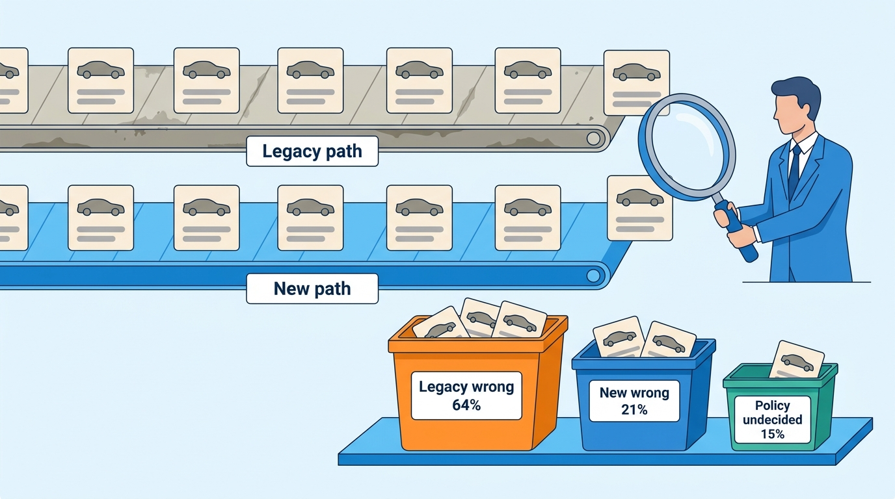
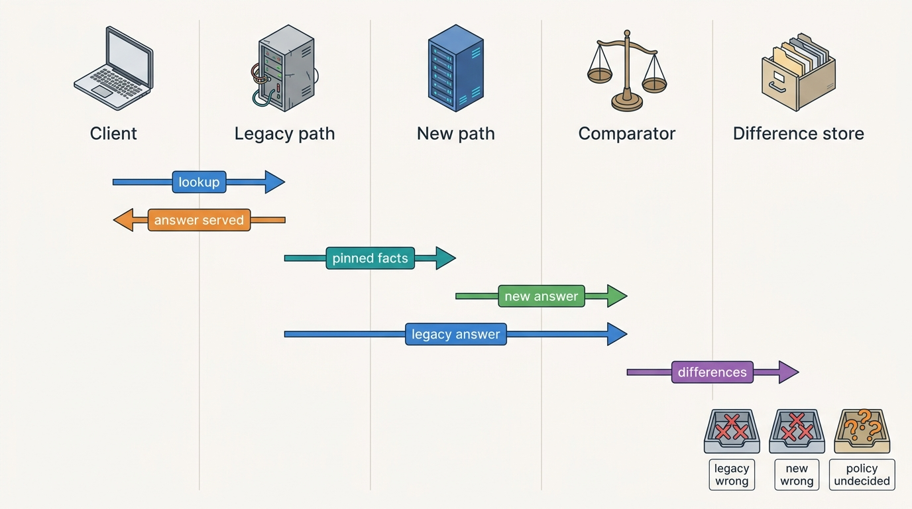
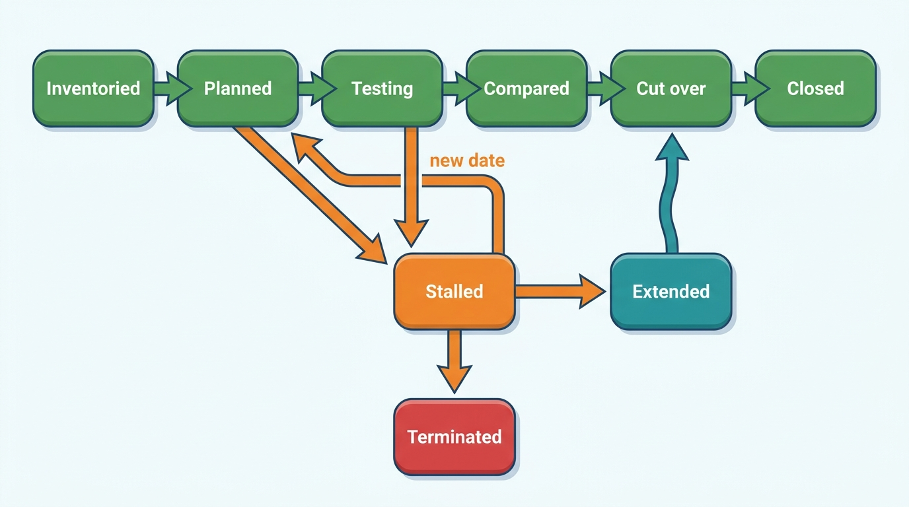
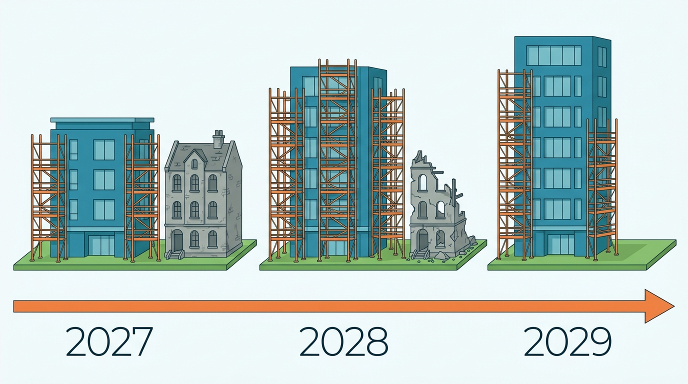

> **IN THIS CHAPTER, YOU WILL:** Plan the retirement of a legacy SOAP/XML data API and the strangling of a dealer-software monolith: seams and transitional architecture, change data capture versus dual writes, the per-rooftop writer flip, parallel runs for valuations, reports and invoices, the client sunset policy for external API clients, cohort rollout, progress metrics and the documented migrations of automotive companies.

> **WHY THE BUSINESS CARES:** A dealer whose stock screen stops for an afternoon loses sales, and an insurer whose claims integration breaks moves its spend to a competitor. Modernization is paid for by the same customers it can hurt, so it has to keep the old system's promises while it removes the old system.

> **WHY ARCHITECTS SHOULD CARE:** Most of a group's architecture budget for a decade goes into moving from what it has to what it drew. The hard parts are not the target design but the in-between states: two systems claiming the same record, a facade that has to reproduce old quirks, and clients the provider cannot force to change.

> **KEY POINTS:**
>
> * **Move systems of record one at a time, and never let two systems write the same record.** Change data capture keeps a new read model in step with the monolith. Ownership then switches per rooftop in one recorded step, and a temporary back-sync keeps the remaining legacy modules working. Dual writes from application code are how the old platform lost 83 sold events a month.
> * **A parallel run is an audit of the old system as much as a test of the new one.** Run both paths on the same pinned inputs (same fact versions, same model version, no second upstream purchase) and serve only one. Then classify every difference as legacy wrong, new wrong or policy undecided. At Axleby most differences turned out to be legacy errors that nobody had seen.
> * **A sunset is a commercial program with an engineering tail.** Inventory every client per operation, segment them, give each a named owner and a dated path. Use contract freezes, brownouts and paid extensions as levers, and set the switch-off from per-client usage evidence. Count progress by what has been switched off, not by what has been built.

> **[FAILURE PATTERNS THIS CHAPTER ADDRESSES](where-vehicle-platforms-go-wrong.html):**
>
> * **The Acquisition Archipelago** — two API stacks, two meters and a monolith that still owns the stock record keep the merged group running two products in one brand until something is actually switched off.
> * **Customization Creep** — 57 client response profiles in Connect XML and private sync scripts around Lotwise Classic are the customizations a migration either ends or carries forward forever.
> * **The Unmetered Call** — while two stacks and two invoice runs coexist, the same lookup can be classified and billed two ways; the migration is where one meter becomes the only meter.

 
Every platform in this book was drawn as a target. None of them starts there. A vehicle data and dealer software group usually has **at least one legacy interface that its best clients depend on and one monolith that owns the records every new service needs**. Both earn money every day. Neither can be stopped for a rewrite.

The usual mistake is to treat modernization as a build project. The build goes to plan; the migration fails, because **the old system's behavior is the real contract**, including the parts nobody wrote down: an element name a client's parser expects, a stored procedure a dealer's month-end depends on, an edition string derived from a model name.

This chapter owns two terms: the **parallel run (vehicle)** and the **client sunset policy**. It builds on [[vehicle-data-apis]] for the JSON API v2 contract, the contract registry and the Connect XML facade; on [[events-webhooks-and-sync]] for the outbox and the event backbone; on [[inventory-and-vehicle-dossier]] for the dossier that leaves the monolith; and on [[billing-and-metering]] for Meterline's shadow rating. Portfolio integration across acquired products belongs to [[one-platform-from-many-products]], and team ownership of the moves to [[organizing-engineering]].

## Setting the Scene at Axleby: The Parallel Run That Audited the Past

Axleby, the fictional vehicle data and dealer software group this book follows (see [[meet-axleby]]), started 2027 with two legacy systems that the One Dossier program had promised to retire by the end of 2029.

- **Connect XML**: a SOAP/XML API and report back end built in 2006 on .NET Framework and SQL Server, in a colocated data center in Utrecht. In 2026 it carried **38%** of the 2.6 million billable lookups a day, about 988,000 calls. **210** of Axleby's **640** API client organizations used nothing else. It also ran the monthly usage invoice in stored procedures. Its sunset was announced for **31 December 2029**.
- **Lotwise Classic**: a PHP/Symfony monolith on MySQL from 2009, moved to AWS eu-west-1 in 2020. It owns stock, the dossier, adverts, sales administration and Lotwise users, and hosts Relay's RabbitMQ publish queue. It is to be reduced to a dossier-UI shell by the end of 2029.

The first real move came in the summer. Lotwise Appraise, the trade-in module, had always fetched register data, specification and a trade valuation through Connect XML. In May 2027 the team decided to move it to the response composer behind JSON API v2 ([[vehicle-data-apis]]). Priya Raman (VP Data and Valuation) insisted on a **parallel run** first. For four weeks, from 21 June to 18 July 2027, every appraisal was served from Connect XML as before, and the same request was sent in the background through the new path. The two answers were compared field by field.

The run compared about **208,000** appraisals (Axleby illustration). The trade valuation differed by more than €100 or 1% on **9.1%** of them. The team classified each difference:

| Class | Share of differences | Main causes |
| --- | --- | --- |
| **Legacy wrong** | 64% | Connect XML sent Vantage an edition string derived from the register's model name, so the car landed in the wrong valuation segment; its own nightly register tables were days stale on 6 of the 28 nights |
| **New wrong** | 21% | The composer dropped dealer-entered options for two makes; imported cars took the Dutch registration date instead of first registration abroad, so they looked younger |
| **Policy undecided** | 15% | Nobody had decided whether a damage record in the history should lower the trade value automatically, or how mileage was rounded |

**Figure 1:** *Axleby's appraisal parallel run audited the past as much as the new code: 64% of the differences were legacy errors, 21% new-path defects and 15% questions nobody had decided.*

The new path's defects were fixed in two weeks. The legacy errors were not fixed in Connect XML; they ended at cut-over, on **6 September 2027**, after two weeks without an unexplained difference. The policy questions went to Tomás Ferreira (Product Director, Lotwise) as written decisions.

One finding was specific to vehicle data. In its first three days, the shadow path resolved specification independently and **bought build data again**: about 11,400 extra build-data fetches at the average €0.46, roughly €5,200, for answers nobody was shown. From day four, the shadow path read the facts the served path had already fetched. That rule, **the shadow never buys**, became part of the method.

In November 2027 Ines Marchetti (Group Chief Architect) took stock with Ruben Dekker (CTO). Twenty-five months remained, and the run had shown that a careful move takes a quarter. Connect XML still carried about **27%** of billable calls; Lotwise Classic still committed every stock transition, held 41,000 logins and billed every Lotwise subscription. How could Axleby finish on time without breaking dealers or clients? The **retirement plan** was approved on **20 December 2027**. This chapter follows it.

## Concepts: Seams, Transitional Architecture, Parallel Runs and Sunsets

**Strangler fig.** Martin Fowler's name, revised in August 2024, for "a gradual process of modernization" that "begins with small additions, often new features, that are built on top of, yet separate to the legacy code base", so that the business gets value from new components before the old system is gone ([Fowler, 2024](https://martinfowler.com/bliki/StranglerFigApplication.html)). The opposite is the big-bang rewrite with a single cut-over.

**Seam.** A place where traffic or data can be redirected without changing the code on either side: a gateway route, a login front door, a message queue, a database log, a per-rooftop setting. Choosing seams is most of the design work, because a module without a seam can only be moved by editing the monolith.

**Transitional architecture.** "Software elements installed to ease the displacement of a legacy system", in the catalog *Patterns of Legacy Displacement* by Ian Cartwright, Rob Horn and James Lewis, first published in July 2021 and revised in March 2024 ([Cartwright, Horn and Lewis, 2024](https://martinfowler.com/articles/patterns-legacy-displacement/)). The same catalog names **Legacy Mimic** ("new system interacts with legacy system in such a way that the old system is not aware of any changes") and **Event Interception** ("intercept any updates to system state and route some of them to a new component"). Transitional components are meant to be deleted. **The rule I use is that each one gets an owner and an end date when it is created.**

**System-of-record switch (writer flip).** The moment one record set stops being written by the old system and starts being written by the new one. In a dealer platform the natural unit is the **rooftop** (one physical dealership location, the usual tenancy and billing unit): all of a rooftop's stock items move together, so that no car has two writers.

**Parallel run (vehicle).** This chapter's term. A parallel run sends the same real request through the old and the new path and serves the old answer. It compares the two answers under declared rules and classifies every difference before the new path takes over. It differs from a generic parallel run in three ways:

- **inputs are pinned**: both paths see the same fact versions, the same valuation model version and the same upstream data, bought once;
- **comparison rules are per output kind**: exact for identity and register fields, a tolerance band for valuations, set comparison by event id for history reports;
- **side effects are never doubled**: register transactions, channel publications, lead deliveries, invoices and consumer payments are produced by one path only.

GitHub's Scientist library, described in February 2016, is the best-known public example of the mechanism: "both code paths are run", "the results of both the control and candidate are compared", and "the result of the control code is returned" ([GitHub, 2016](https://github.blog/developer-skills/application-development/scientist/)). GitHub used it during a multi-year rewrite of its permission code.

**Expand, migrate, contract.** Danilo Sato's 2014 "three distinct phases" for changing an interface ([Sato, 2014](https://martinfowler.com/bliki/ParallelChange.html)). Every move below follows it; the contract phase is the one that gets skipped.

**Client sunset policy.** This chapter's second term. It is the published, contract-backed set of rules by which a provider ends an interface that external clients depend on. It covers the notice ladder, the freeze, the migration paths per client segment, the evidence that decides a switch-off, the levers (brownouts, prices, extensions) and the exceptions process. [[vehicle-data-apis]] owns the version lifecycle *inside* a live API (dated versions, 12-month field notice). The sunset policy governs ending a whole interface generation.

| Technique | What runs | Who sees the new result | Right for |
| --- | --- | --- | --- |
| **Parallel run** | Both paths on the same request | Nobody until cut-over | Read-only answers: lookups, valuations, reports, specification |
| **Shadow mode** | New path computes without acting | Internal reviewers | Invoices, pricing proposals, routing decisions |
| **Dry run** | New path prepares; old path acts | Internal reviewers | Register transactions, channel publications |
| **Canary** | New path serves a small cohort | That cohort | After a clean parallel run, for latency and load |
| **Writer flip** | One path writes, per rooftop | Everyone in the cohort | Moving a system of record |

## Architecture: Seams, Facades and the Writer Flip

### The two retirements are different problems

Connect XML is an **interface problem**. Its data already exists in better form in Anchor (identity), Specbook (specification), Tracewell (history) and Vantage (valuation). From Q2 2028 a facade serves its SOAP operations from the new response composer ([[vehicle-data-apis]]); what remains is commercial and organizational: moving 210 clients and an invoice run.

Lotwise Classic is a **system-of-record problem**. It owns stock state, and every module in it reads that state from its own MySQL tables. Moving a module means moving the data it owns while dealers keep selling cars, and moving it in an order that leaves no module reading data nobody writes any more.

### Seams in Lotwise Classic

The retirement plan listed every capability in Lotwise Classic with its seam, its new home and the condition under which the old code could be deleted (Axleby plan, fictional; "done" items are 2027 facts):

| Capability | Seam | New home | Move method | Target | Delete the old code when |
| --- | --- | --- | --- | --- | --- |
| Logins and users | Login front door | Axleby ID and Gatekeeper ([[identity-access-and-entitlements]]) | Federation, then per-tenant login switch | Mid-2028 | Last Lotwise login retired |
| Dossier timeline and documents | Module actions | Dossier service ([[inventory-and-vehicle-dossier]]) | New writes only; history backfilled | Q4 2027 (done) | Backfill verified |
| Appraisal lookups | Connect XML call | Response composer | Parallel run | September 2027 (done) | Done |
| Syndication queue | RabbitMQ | Relay 2 ([[listing-syndication]]) | Bridge from topics, then desired-state store | 2028 | Bridge consumer removed |
| Stock item state | MySQL tables | Dossier service | Change data capture (CDC) read model, per-rooftop writer flip, back-sync | 2028 | No rooftop on Classic writer; back-sync consumers gone |
| Pricing changes | Price screens and Thursday batch | Pricing service on the backbone ([[used-car-pricing]]) | Events from the stock item | 2028 | Batch job deleted |
| Advert editor | Editor screens | Shared advert composer ([[merchandising]]) | Screen by screen | 2028–29 | Editor routes return 410 |
| Subscription billing | Monthly run | Rating engine behind Meterline ([[billing-and-metering]]) | Shadow rating, two clean months | 2029 | Legacy run disabled |
| Sales administration and invoices | Legal entity | Sales service | Per legal entity at a quarter start | 2029 | All entities moved |

Two orderings in that table are deliberate. **Identity comes first**, because every later move needs to know which person and which tenant acted. **Sales administration comes last**, because invoices carry legally sequential numbers per legal entity ([[deals-and-sales-documents]]). A legal entity's invoicing moves at the start of a quarter, and the new service continues the same number series. The old module is closed for that entity at the same moment, so no number can be issued twice.

### Data migration: dual writes or change data capture

Stock state is where the Lotwise move is most likely to go wrong. Three methods were on the table.

| Method | How it works | Strength | Weakness | Verdict for stock state |
| --- | --- | --- | --- | --- |
| **Dual writes from application code** | Classic code writes MySQL, then calls the new service | No new infrastructure | Lost or reordered writes on crashes and deploys; two writers disagree silently | Rejected: the same pattern lost 83 sold events in October 2027 ([[events-webhooks-and-sync]]) |
| **Change data capture (CDC) into a read model, then a writer flip** | Debezium reads Classic's MySQL binary log into the new service's read model; ownership switches per rooftop | No Classic code changes before the flip; the read model can be compared nightly; rollback per rooftop | Read model is shaped by legacy columns until the flip; binlog retention and schema changes must be managed | **Chosen** |
| **Outbox events only** | Classic emits domain events from its outbox; the new service builds state from them | Clean contract | Needs every state change in Classic to emit a complete event first; history before the outbox is missing | Used for consumers, not for the migration itself |

The chosen method uses table-level change data capture *only as a migration tool*, as [[events-webhooks-and-sync]] requires. Debezium's MySQL connector feeds a private migration topic. The Dossier service consumes it into a read model of stock items. No other team may consume that topic.

Before a rooftop's flip, the read model is compared nightly with Classic's tables by checksum per rooftop. At the flip, the rooftop's stock items become writable only in the Dossier service. A **back-sync consumer**, a Legacy Mimic in the catalog's terms, writes the new state back into Classic's tables from the Dossier service's outbox events. Classic's sales administration and advert editor keep reading tables that still look current. The back-sync is the transitional component with the clearest end date: it is deleted when the last module that reads those tables has moved.

**Figure 2:** *The writer flip for stock state. Before a rooftop flips, CDC keeps a read model in step and checksums prove it. After the flip, the Dossier service is the only writer for that rooftop, and a transitional back-sync keeps the legacy tables current for modules that have not moved yet. No rooftop ever has two writers.*

The **ownership router** is a per-rooftop setting in Baseline, the tenant configuration service ([[onboarding-and-configuration]]), with a version number. Classic checks it in the same transaction as every stock write. A write for a flipped rooftop is rejected, not applied, even if a stale screen or a DMS (dealer management system) import tries it. The version works as a **fencing token**: a flip back to Classic (the rollback) increments it, and the back-sync drops events stamped with an older version.

### Requirements per interaction

| Interaction | Consistency | Latency | Freshness | Availability |
| --- | --- | --- | --- | --- |
| Stock write after the flip | Strong within the Dossier service; one writer per rooftop | Interactive, under 300 ms *(assumption)* | Current | As the Dossier service; Classic cannot take over silently |
| CDC into the read model | Per-row order; complete for flipped and unflipped rooftops | Seconds | Median lag under 5 s *(assumption)*; alert at 5 min | Lag tolerated; binlog retention above the longest tolerated stall |
| Back-sync into Classic | Eventually consistent; ordered per stock item; versioned | Seconds to minutes | Legacy screens may lag by up to 1 min *(assumption)* | A stalled back-sync blocks no dealer; it freezes legacy screens for flipped rooftops |
| Connect XML facade | Same facts as JSON for the same request | As the composer | Per block, as in v2 | As the composer; the SQL Server path is not a fallback |
| Parallel-run comparison | Same pinned inputs on both paths | Asynchronous; the served path never waits | Comparison within 1 h *(assumption)* | Shadow failures never affect the served answer |

## Parallel Runs for Vehicle Data

### What to compare and how

The appraisal run gave the method its rules. Each output kind has its own comparison, because "the same" means different things for a register field, a valuation and a history report.

| Output | Comparison rule | Tolerance | Typical legacy-wrong finding |
| --- | --- | --- | --- |
| Identity (vehicle identification number or VIN, Axleby Vehicle Key or AVK, plate assignment) | Exact | None | Plate-keyed answers attached to the wrong car after a plate moved ([[vehicle-identity]]) |
| Register fields | Exact, against the same mirror version | None | Stale copies (the Three Copies review, [[registers-and-official-data]]) |
| Specification | Exact on resolution state and edition; set comparison on equipment codes | Code-list mapping table | Edition guessed from a model name (**Spec Guesswork**) |
| Valuation | Numeric, same model version and inputs | €100 or 1%, whichever is larger *(Axleby rule)* | Wrong segment from a wrong edition; stale mileage |
| History report | Set comparison by event id; wording by rule version | None on events; wording diff reviewed | Events merged from another car; missing correction |
| Invoice line | Per account, per stock-keeping unit (SKU), per period | €1 per account *(Axleby rule, from [[billing-and-metering]])* | Re-opens billed as new reports |

**Pin the inputs, or you compare time instead of code.** A valuation computed at 10:00 and another at 10:03 can differ because a register update or a new model version landed in between. Both paths must read the same fact versions and call the same Vantage model version. In practice that means the served path records the versions it used, and the shadow path replays them.

**The shadow never buys.** Paid upstream data (build data per VIN, history from suppliers, register lookups with per-call fees) is fetched once, by the served path, and handed to the shadow path. A shadow that refetches doubles the most expensive line in the cost of a lookup ([[scale-and-cost]]). It may also break the supplier's license terms on purpose and retention ([[data-licensing-and-governance]]).

**Shadow results are invisible and unbilled.** The shadow path emits no Meterline events, or emits them tagged `shadow` so the rating engine ignores them. Charter's access audit records the shadow call as internal use, so that a licensor's audit does not find "two deliveries".

**Figure 3:** *A parallel run for a vehicle lookup. The client receives the legacy answer without waiting. The new path runs on the facts and model version the legacy path recorded, so it buys nothing upstream, and every difference lands in a store where it is classified before cut-over.*

### Classify every difference

The three classes used at Axleby are the same ones Lena Vos (Billing and Finance Systems Lead) used for Meterline's shadow rating in October 2027 ([[billing-and-metering]]):

- **Legacy wrong**: the new answer is right. The fix is the cut-over itself. Clients who received wrong answers may need to be told, which is a decision for the product owner, not the migration team.
- **New wrong**: fix the new path and rerun the affected sample.
- **Policy undecided**: no written rule existed. Each item becomes a documented rule with an owner. **This is the most valuable output of the run.** It turns behavior hidden in stored procedures into product decisions.

**Exit criteria are written before the run starts.** For the appraisal move: every difference above tolerance classified, every "new wrong" fixed, and two consecutive weeks without an unclassified difference. For Meterline: two consecutive clean months. A run without written exit criteria tends to end when the project runs out of patience.

### What cannot be run twice

**A registration in a buyer's name (*tenaamstellen*) submitted twice is an incident, not a test**: the Month-End Register Outage's 214 double submissions came from a blind retry, but a careless migration would have the same effect ([[registration-and-trade-services]]). The same holds for a channel insert, a lead delivered to a CRM (customer relationship management system), an invoice, a direct debit or an Odolo payment.

For these, Axleby uses a **dry run**: the new path builds and validates the request and records what it *would* send; the old path sends; a comparator matches the two. Relay 2 starts in observe-only mode in 2028, computing the desired state per channel listing and comparing it with the old queue's output and the channels' reported state without sending anything ([[listing-syndication]]).

## Retiring Connect XML: The Client Sunset Policy

### Inventory before policy

Folio, the API contract registry, recorded per-client usage of every Connect XML operation and response profile from mid-2027 ([[vehicle-data-apis]]). By October 2027 the inventory gave the shape of the problem (Axleby illustration):

| Measure | 2026 | October 2027 |
| --- | --- | --- |
| Connect XML calls per day | about 988,000 (38%) | about 701,000 (27%) |
| from Axleby's own products | about 610,000 | about 330,000 (Appraise moved) |
| from external clients | about 378,000 | about 371,000 |
| of which from the 210 XML-only clients | | about 236,000 |
| of which from 95 clients using both stacks | | about 135,000 |

Two facts shaped the plan. **Axleby's own products were the largest Connect XML client.** The Axleby Portal screens, the Axleby Trade back office and Lotwise Classic's stock-in and advert-editor lookups still called it, and they could be moved on Axleby's own schedule. The external clients, by contrast, were concentrated in a few large accounts and a long tail:

| Segment | Clients | Share of XML-only calls | API revenue per year | Migration path |
| --- | --- | --- | --- | --- |
| **Large direct clients** (insurers, lessors, portals) | 14 | 58% | about €6.1M | Named engineer on each side; joint plan; v2 sandbox; parallel calls compared field by field |
| **Software vendors** embedding Connect XML in products sold to garages, fleets and dealers | 31 | 27% | about €3.4M | Vendor release plus their customers' upgrades; the longest tail |
| **Small direct clients** (dealers' own tools, traders, consultants) | 165 | 15% | about €1.7M | v2 starter kit, file enrichment or portal screens; some will not migrate |
| **Total** | **210** | 100% | **about €11.2M** | |

At an average effective price of about €0.13 a call, the 236,000 daily calls of XML-only clients are worth about €11 million a year, close to a third of Axleby Data's €38 million APIs and licenses line. **A sunset that loses a fifth of the long tail is a commercial loss; a sunset that loses one of the 14 large clients is a board-level event.**

The inventory also showed that **41** of the 57 legacy response profiles were still called, and that **23** of the clients still on Charter's provisional "legacy" license grant were small XML clients ([[data-licensing-and-governance]]). A client that has not re-signed its license terms is also unlikely to have budget for a re-integration.

### The policy

The retirement plan turned the inventory into a published policy. Its elements, with Axleby's choices:

| Element | Axleby's rule (fictional) | Why |
| --- | --- | --- |
| **Announcement** | March 2027, with the date 31 December 2029 | 33 months covers at least two annual budget cycles of an insurer's IT department |
| **Contract freeze** | From 1 January 2028: no new operations, fields or profiles; new blocks only in v2 | Stops Customization Creep from growing the thing being retired |
| **Internal callers first** | All Axleby products off Connect XML before the facade goes live in Q2 2028 | The provider controls them; they were 62% of 2026 XML traffic |
| **Facade** | Q2 2028: SOAP served from the composer; SQL Server stops serving lookups | One truth and one meter while clients move ([[vehicle-data-apis]]) |
| **Named owner per client** | Every XML-only client has an Axleby owner (account manager for the commercial plan, engineer for the 14 large ones) | A list without names does not get worked through |
| **Migration support** | Free v2 sandbox and comparison tool that replays a client's last 30 days of XML requests against v2 and shows field differences | The client sees its own differences before it writes code |
| **Signals** | `Deprecation` and `Sunset` headers on every SOAP response from 2028; monthly usage reports per client; account-manager contact at 12, 6 and 3 months | SOAP clients rarely log HTTP headers, so people carry the message |
| **Brownouts** | Scheduled failures in 2029: 1 hour on 11 September, 4 hours on 16 October, 24 hours from 13 November; dates published 90 days ahead | Finds forgotten integrations whose owners have left |
| **Price** | From 1 July 2029, XML calls are rated at v2 prices plus 20% | Makes the last six months cost more for the client than migrating |
| **Extension** | Paid extended support until 30 June 2030 at most, only with a signed migration plan and a test date | Prevents an open-ended second life |
| **Switch-off evidence** | Per client: no calls for 30 days, or written confirmation; per operation: zero calls for 60 days | Usage data, not the calendar, closes each line |

The brownout follows a documented precedent. When GitHub removed password authentication from its API, it published brownouts on 30 September and 28 October 2020: "during a brownout, password authentication will temporarily fail", in order to "trigger alerts (assuming there are any) on our customers' services". Removal followed on 13 November 2020 ([GitHub, 2020](https://developer.github.com/changes/2020-02-14-deprecating-password-auth)). A vehicle data provider needs more lead time than GitHub gave, because its clients' integrations sit in quarterly release trains. The mechanism is the same.

The price lever is a judgement with a failure mode: a surcharge without a working migration path reads as punishment and ends in a contract dispute. Axleby applies it only to clients who have had the replay tool and a named engineer for at least a year.

### Each client's path

**Figure 4:** *Every XML-only client moves through the same states in Folio, each with an owner and a date. "Stalled" is the state the program reviews every month; "Terminated" is a commercial decision taken by name, not a default.*

The software vendors are the hardest segment: a garage-software vendor needs its own release and then an upgrade at each of its customers, two release trains Axleby does not control. Axleby gives them a **compatibility client library** that speaks v2 but exposes the old XML-shaped objects to the vendor's code, tracks their end customers by the client reference element Connect XML already carries, and assigned the 31 vendors' owners first.

## In Practice: Documented Migrations and Axleby's Plan

### What the public record shows

No automotive company has published how it retired an API generation client by client. The public record covers infrastructure moves and monolith decomposition, and it is old and often vendor-authored.

- **Cox Automotive** announced in April 2018 that it was going "all in" on AWS, migrating most of its brands and closing more than 40 data centers, and "modernising monoliths" with containers, functions and Aurora ([Amazon, 2018](https://press.aboutamazon.com/2018/4/cox-automotive-goes-all-in-on-aws)). A 2019 re:Invent session reported a starting estate of 27 brands and 53 data centers, governed through per-platform Well-Architected scorecards ([Classmethod session report, 2019](https://dev.classmethod.jp/articles/reinvent-2019-coxautomotive-well-architected-results/)). The sources are eight years old, and none says how far the migration got ([[case-cox-automotive]]).
- **Auto Trader UK** decided in 2018 to move to public cloud, chose Google Cloud and ran about a third of its services there by early 2019 ([Google Cloud, 2019](https://cloud.google.com/blog/products/application-development/how-the-uks-largest-automotive-marketplace-is-innovating-with-istio-on-google-kubernetes-engine)). Its own results statement of June 2023 called it "a multi-year migration of our applications to the cloud", and its FY2024 results said it had "completed our full transition" ([[case-auto-trader-uk]]). From decision to completion took about five years, in a company with one product family.
- **Carfax** moved its blog to AWS in 2017, then its home page, used-car listings and research pages, first splitting traffic 50/50 with on-premises, according to a June 2023 vendor post ([Solo.io, 2023](https://solo.io/blog/monolith-microservices-collaboration-solo-aws)). Consumer pages moved first; job postings in 2026 still mention migrating legacy on-premises data systems (widely reported, not read directly). **The data core moves last** is a recurring shape.
- **CarGurus** decided in early 2019 to decompose its monolith and adopted the strangler fig in the second half of that year. Neither of its first two breakouts achieved true isolation, and "the speed at which we could move was simply not fast enough". It mandated JSON for new messages and used dual serialization, "two copies of the message", for messages with many legacy consumers (Frank Fodera, [CarGurus, 2023](https://cargurus.dev/2023/02/27/decomposition-journey-at-cargurus-from-monolith-to-microservices/)).
- **CDK Global**'s Fortellis site, read in October 2026, links to migration guides from the older Partner Program for software vendors and dealers. As [[case-cdk-global]] notes, no public source gives the timetable, terms or progress. It is the closest automotive example of an interface owner moving integrators to a new contract, seen only from the outside.

Two non-automotive sources document the mechanics. Stripe's February 2017 post migrated "hundreds of millions of Subscriptions objects" in four steps (dual writing, switching reads, switching writes, removing old data), with Scientist comparing reads before the switch ([Stripe, 2017](https://stripe.com/blog/online-migrations)). Stripe controlled both writers in one codebase; Lotwise Classic is a separate monolith, hence CDC and a writer flip. And the *Patterns of Legacy Displacement* catalog names the desire for **Feature Parity** as "a third key factor in several of the failures" it studied, because agreeing the "as is" functionality led to "big bang" cut-overs ([Cartwright, Horn and Lewis, 2024](https://martinfowler.com/articles/patterns-legacy-displacement/)). A parallel run checks parity on real traffic instead of specifying it up front.

### Axleby: the 2028 writer flip, cohort by cohort

The stock-state move is planned as follows (Axleby plan, fictional). The Lotwise Classic outbox and the event backbone go live in Q1 2028 ([[events-webhooks-and-sync]]). The CDC read model runs from February 2028 and is compared nightly for all **7,200** rooftops and about **352,000** stock items. Rooftops then flip in waves:

| Wave | Rooftops | Who | Planned | Gate to start the next wave |
| --- | --- | --- | --- | --- |
| 0 | 60 | NL independents who volunteered, including Autobedrijf Brandsma (about 55 cars) | June 2028 | 30 days: read-model mismatches under 0.01% of stock items; no sold-but-live alert caused by the flip; support tickets per rooftop at baseline |
| 1 | 46 | Velto Mobility Group (DriveDesk DMS, group pricing desk) | July 2028 | DMS sync through Hitch unchanged ([[dms-integration]]); Thursday pricing run complete on the new path |
| 2 | 500 | German rooftops | September 2028 | As wave 0, plus German DMS file imports routed by owner |
| 3 | about 1,590 | Remaining Belgian rooftops | October 2028 | As wave 0 |
| 4 | about 5,000 | Remaining Dutch rooftops, in four batches | November 2028 – February 2029 | No batch in the last three working days of a month |

Velto goes early because it is the hardest case: about 9,000 internal transfers a year, a DMS feeding stock and a pricing desk changing about 800 prices a week. If the flip works for Velto, the independents are routine; if it fails, it fails for one customer with a named account team and a written rollback.

**Freeze windows** come from the operating calendar, not from the engineering plan. No flips take place in the last three working days of a month, when register transactions run at about four times the daily average ([[registration-and-trade-services]]). None take place on a group's pricing day. None take place while any DMS family is degraded: the DriveDesk Outage of November 2027 would have stopped wave 1 had it happened in 2028.

**Rollback is per rooftop and time-boxed.** While the back-sync keeps Classic's tables current, a rooftop can be flipped back by incrementing its owner version. Once the back-sync is removed, rollback is impossible. The plan names that moment explicitly: **the point of no return is a decision taken by the forum, not a side effect of a cleanup ticket**.

### Measuring progress by what is switched off

Building new components is easy to count and says little about progress. The retirement plan's progress measures are all about switching things off:

| Measure | December 2027 | Target end 2028 | Target end 2029 |
| --- | --- | --- | --- |
| Connect XML share of billable calls | 27% | under 10% (facade) | 0% |
| XML-only clients remaining | 210 | under 90 | 0, or named extensions |
| Live Connect XML response profiles | 41 | under 15 | 0 |
| Rooftops whose stock state is written by Lotwise Classic | 7,200 | under 5,000 | 0 |
| Lotwise Classic logins | about 41,000 | 0 (mid-2028) | 0 |
| Invoice runs producing invoices of record | 3 | 2 | 1 |
| Transitional components live (each with owner and end date) | 4 | 9 *(peak)* | 2 *(back-sync for sales administration, XML facade until extensions end)* |
| SQL Server instances in the Utrecht data center | 6 | 2 (invoice run) | 0 (colocation exit by 30 June 2029) |

The count of transitional components rises before it falls, and that is expected. **The plan fails if the 2029 column is reached with the transitional components still running and nobody owning their removal.**

**Figure 5:** *Progress is counted by what is switched off: transitional components rise from 4 to a peak of 9 before falling to 2, while the legacy systems they protect are removed.*

## Failure Handling

| Failure | Example at Axleby | Detection | Recovery |
| --- | --- | --- | --- |
| **Two writers for one record** | A stale Lotwise screen or a DMS stock import writes to Classic after the rooftop flipped | Classic rejects writes whose owner version is not current; rejected-write counter per rooftop | The write is retried against the Dossier service by the router; the import adapter in Hitch routes by owner |
| **CDC gap or lag** | Debezium connector stalls past binlog retention during a Classic schema change | Age of the newest applied binlog position; nightly checksum per rooftop | Re-snapshot the affected rooftops; schema changes in Classic reviewed by the migration team until the last flip |
| **Conflicting updates across the flip** | A price change queued in Classic before the flip lands after it | Owner version in the event; Dossier service rejects events stamped with an older version | Dealer sees the change as "not applied" in the timeline and repeats it |
| **Incomplete legacy records** | Stock items without an AVK (0.7% before the backfill) or without reconditioning cost | Migration validation per field | Migrate as explicit `unknown`, never as a default value; the Margin-Scheme Error came from a default ([[deals-and-sales-documents]]) |
| **Duplicate requests through the facade** | An XML client retries a timed-out call without a new reference | Facade derives the request reference from the client reference element | One Meterline event per reference; the No-Hit Credit's retry billing cannot recur |
| **Partial answers the old format cannot express** | A history block is partial because a damage source timed out; Connect XML had no partial state | Facade mapping in Folio's frozen serializations | An optional status element added under the freeze's exception rule, announced as a behavior change; the client can still ignore it |
| **External outage during a cut-over** | The register's transaction channel or a DMS fails during a wave | Journey service-level objectives ([[reliability-and-dependencies]]) | Freeze windows; waves pause automatically when a tier-1 dependency is degraded |
| **Shadow path leaks** | Shadow valuations billed, shown or logged as deliveries | Meterline events tagged `shadow`; Charter audit category | Shadow results never written to the valuation ledger of record |

## Trade-offs

### How to replace a live platform

| Approach | What it means | Strength | Weakness | Right when |
| --- | --- | --- | --- | --- |
| **Big-bang rewrite** | Build the replacement to feature parity, switch everyone at once | One cut-over; no transitional code | Parity is unknowable in advance; the cut-over risk is the whole business | Small systems with few users and a tolerable outage |
| **Lift and shift** | Move the same code to new infrastructure | Fast; removes a data center | Changes nothing about ownership or coupling (Lotwise Classic moved to AWS in 2020 and stayed a monolith) | A data center exit is the only goal |
| **Strangler with writer flips** (Axleby, Lotwise) | Move one system of record at a time behind seams | Value early; rollback per unit; differences found on real traffic | Years of transitional architecture; needs discipline to finish | The system of record is live, large and owned by one team |
| **Facade and freeze** (Axleby, Connect XML) | Serve the old interface from the new core; stop changing it | One truth immediately; clients move on their own schedule | Frozen quirks must be reproduced; the facade itself needs a sunset | Many external clients the provider cannot force |

### How to end an external interface

| Approach | Strength | Weakness | Right when |
| --- | --- | --- | --- |
| **Keep it forever behind a facade** | No client lost | Old credentials, no new blocks, a permanent second contract | A few high-value clients and a cheap facade |
| **Sunset with policy** (Axleby) | Predictable for clients; evidence decides each switch-off | Expensive in account management; some long-tail churn | Hundreds of clients and a contract that permits notice |
| **Hard cut-off** | Short | Breaks clients on the provider's schedule; disputes | Few clients, or a security reason that overrides the commercial one |

My recommendation follows from three requirements: no record with two writers, one meter for every call, and migration on clients' schedules within a fixed end. Strangling Lotwise Classic and putting Connect XML behind a facade meets all three. The condition that would change it: with 20 XML-only clients instead of 210, a hard cut-off with a year's notice would be cheaper than a facade, the replay tool and 31 vendor plans.

## Across Markets: What Changes by Country

| Aspect | Netherlands / Belgium | Germany | United Kingdom | United States |
| --- | --- | --- | --- | --- |
| **Legacy API client base** | Most of Connect XML's 210 XML-only clients; garage-software vendors with SOAP integrations | Wertlauf's data clients, served from Vantage's API rather than Connect XML (Axleby illustration) | Showroomly has no legacy data API; its migration is identity and syndication | Axleby not present; CDK's Partner Program and Fortellis show an interface owner moving integrators (no public timetable) |
| **Register operations during a cut-over** | Dutch register transactions are certificate-based and cannot be submitted twice; dry run only. Belgian registrations go through a partner | No register adapter at Axleby in 2027 | DVLA's vehicle enquiry API is closed to new registrations (as of October 2026), so a new path cannot get its own key; shadow calls share the one key and the DVSA MOT history quota of 500,000 requests a day | State DMV access differs by state; no Axleby exposure |
| **Invoicing cut-over constraints** | Belgium: structured B2B e-invoices (Peppol-based) mandatory since 1 January 2026, so the new invoice service must issue them from day one; Netherlands: no domestic B2B mandate found ([[billing-and-metering]]) | E-invoice issuing required from 2027 above €800,000 turnover and from 2028 for all, so the rating and invoicing move must handle EN 16931 | Bacs Direct Debit mandates move with the account, not the system | Not applicable to Axleby |
| **Public migration evidence** | None found for Dutch or Belgian vendors | Kleinanzeigen (Adevinta) described a Debezium-to-Kafka migration pipeline at 3,000 events per second (January 2025) | Auto Trader's 2018–2024 cloud move | Cox (2018 AWS), Carfax (2017 onward), CarGurus (2019 onward) |

The judgement: **the method is common; the calendar is local.** Seams, the writer flip, parallel-run rules, the sunset policy and the progress measures are one design for all markets. What changes by country is the set of dates and constraints the plan must respect. These include register channels that cannot run twice (the Netherlands), a single key that cannot be duplicated (the United Kingdom), and e-invoicing obligations that the new billing path must meet on its first day (Belgium now, Germany from 2027–2028). Each belongs in a market rule set the wave planner reads, not in the migration code.

## The Chief Architect's View

**Decide the sunset date at board level, and the switch-off per client from evidence.** The 31 December 2029 date is a commercial commitment that the CEO and the commercial director own with the CTO. Each client's switch-off is a decision the program takes from Folio's usage data. Mixing the two produces either a date nobody believes or switch-offs nobody can justify.

**Keep a register of transitional architecture.** Every bridge, back-sync, facade and migration topic gets an entry with an owner, a purpose, an end date and the condition for deletion. At Axleby the register is reviewed monthly in the architecture forum. The RabbitMQ bridge and the absence of events from Connect XML ([[events-webhooks-and-sync]]) are in it with dates.

**No new features in legacy, with a written exception process.** The Connect XML freeze and the rule that new Lotwise capabilities are built outside Classic stop the target from moving. Exceptions (the partial-status element, a legal change in sales administration) are approved by the Group Chief Architect and logged.

**Fund the contract phase.** Programs pay for building and migrating, then run out of money for deleting. Axleby's €38 million One Dossier budget carries a separate line for removals (the back-sync, the facade, the SQL Server instances, the colocation exit). A strangler that never removes anything only adds a second system.

**Give migrations owners, not projects.** Moving a system of record is done by the team that will own it afterwards. The Dossier service team flips the rooftops; the API platform team owns the client migrations, with account managers ([[organizing-engineering]]). A separate migration team leaves the new owner with transitional code it did not write.

**Watch these numbers:** share of calls on Connect XML and XML-only clients by segment; stalled clients; read-model mismatch rate and rejected-write count per wave; unclassified parallel-run differences; transitional components past their end date; and revenue from clients still on legacy contracts, which tells the board what the end date puts at risk.

## Questions to Ask

1. For each module of the monolith, what is the seam that lets us move it without editing the monolith, and which module has none?
2. Can any record have two writers at any point in our plan? What rejects the second write?
3. In our parallel runs, are both paths reading the same fact versions and model version, and does the shadow path buy anything upstream?
4. Which of our operations cannot be run twice, and how do we validate their new path without executing it?
5. Who classifies parallel-run differences, and where do "policy undecided" items go?
6. Can we name every client of the interface we plan to retire, its volume, its revenue, its owner and its target date?
7. What levers will we use on the last 10% of clients, and has legal confirmed our contracts allow them?
8. What is the point of no return for each move, and who decides to pass it?
9. Which transitional components exist today, and which have passed their end date?

Modernization decides whether the platform can absorb what comes next. The next page in reading order, [[ai-in-dealer-workflows]], looks at the most pressing new demand: AI assistants and agents acting on dealer accounts, and the permissions, evaluation and governance they need on top of the platform this chapter finishes building.

## Sources and Evidence

### Company, product and investor sources

- [Cox Automotive goes all-in on AWS](https://press.aboutamazon.com/2018/4/cox-automotive-goes-all-in-on-aws), Amazon, 2018: Cox's migration of most brands, closure of 40+ data centers, modernizing monoliths.
- [re:Invent 2019 session report: Cox Automotive AWS Well-Architected results on 200+ platforms](https://dev.classmethod.jp/articles/reinvent-2019-coxautomotive-well-architected-results/), Classmethod, 2019: Cox's starting estate (27 brands, 53 data centers) and scorecard governance.
- [How the UK's largest automotive marketplace is innovating with Istio on Google Kubernetes Engine](https://cloud.google.com/blog/products/application-development/how-the-uks-largest-automotive-marketplace-is-innovating-with-istio-on-google-kubernetes-engine), Google Cloud, 2019: Auto Trader's 2018 cloud decision and progress by early 2019.
- Auto Trader Group results announcements, June 2023 and FY2024 (May 2024), via [[case-auto-trader-uk]]: "multi-year migration" completed; "completed our full transition".
- [Monolith to microservices: CARFAX, Solo and AWS](https://solo.io/blog/monolith-microservices-collaboration-solo-aws), Solo.io, 2023: Carfax's page-by-page move to AWS from 2017 with split traffic (vendor post).
- [Decomposition Journey at CarGurus: From Monolith to Microservices](https://cargurus.dev/2023/02/27/decomposition-journey-at-cargurus-from-monolith-to-microservices/), Frank Fodera, CarGurus, 2023: strangler fig from 2019, slow first breakouts, JSON messages and dual serialization.
- [Fortellis](https://fortellis.io/), CDK Global, n.d., accessed 2026-10, via [[case-cdk-global]]: links to Partner Program migration guides.
- [Make data migration easy with Debezium and Apache Kafka](https://adevinta.com/techblog/make-data-migration-easy-with-debezium-and-apache-kafka/), Adevinta Tech Blog, 2025: Kleinanzeigen's CDC migration pipeline at 3,000 events per second.
- [Deprecating password authentication](https://developer.github.com/changes/2020-02-14-deprecating-password-auth), GitHub, 2020: scheduled brownouts before removal.
- [Scientist: Measure Twice, Cut Over Once](https://github.blog/developer-skills/application-development/scientist/), Jesse Toth, GitHub, 2016: running old and new code paths, comparing results, returning the control result.
- [Online migrations at scale](https://stripe.com/blog/online-migrations), Jacqueline Xu, Stripe, 2017: dual writing, read switch with Scientist, write switch, removal.

### Standards, regulation and official documentation

- [RFC 8594 The Sunset HTTP Header Field](https://www.rfc-editor.org/rfc/rfc8594.txt), IETF, 2019, and [RFC 9745 The Deprecation HTTP Response Header Field](https://www.rfc-editor.org/rfc/rfc9745.txt), IETF, 2025: deprecation and sunset signalling.
- [Debezium outbox event router](https://debezium.io/documentation/reference/stable/transformations/outbox-event-router.html), Debezium, n.d., accessed 2026-10: outbox relay and keys, via [[events-webhooks-and-sync]].
- DVSA MOT history API rate limits and DVLA vehicle enquiry API status, via [[vehicle-data-apis]] and [[registers-and-official-data]]: quota and closed registration as of October 2026.
- Belgian and German e-invoicing obligations, via [[billing-and-metering]] (FPS Finance, n.d.; IHK Stuttgart, n.d.; KPMG, 2024).

### Research and practitioner sources

- [Strangler Fig](https://martinfowler.com/bliki/StranglerFigApplication.html), Martin Fowler, 2024: gradual modernization and transitional architecture.
- [Patterns of Legacy Displacement](https://martinfowler.com/articles/patterns-legacy-displacement/), Ian Cartwright, Rob Horn and James Lewis, 2021, revised 2024: Transitional Architecture, Legacy Mimic, Event Interception, the Feature Parity trap.
- [Parallel Change](https://martinfowler.com/bliki/ParallelChange.html), Danilo Sato, 2014: expand, migrate, contract.

Axleby is fictional; architectural recommendations, labeled inferences and labeled assumptions are the author's judgement.
