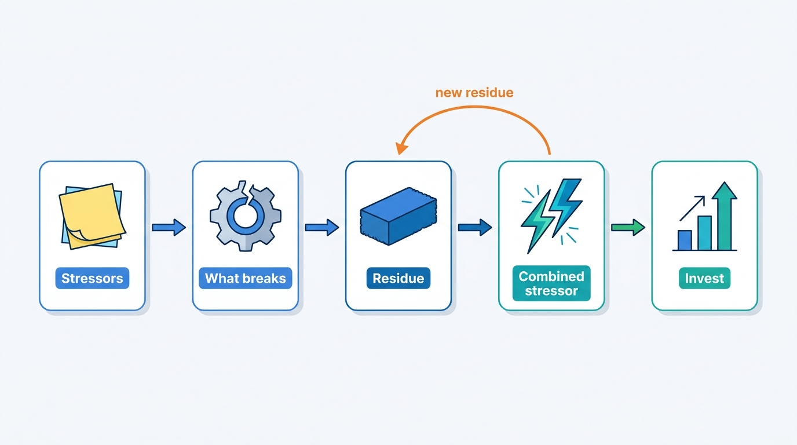
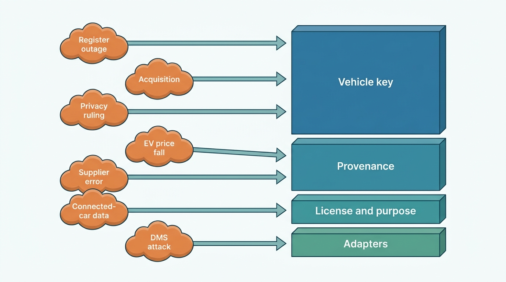
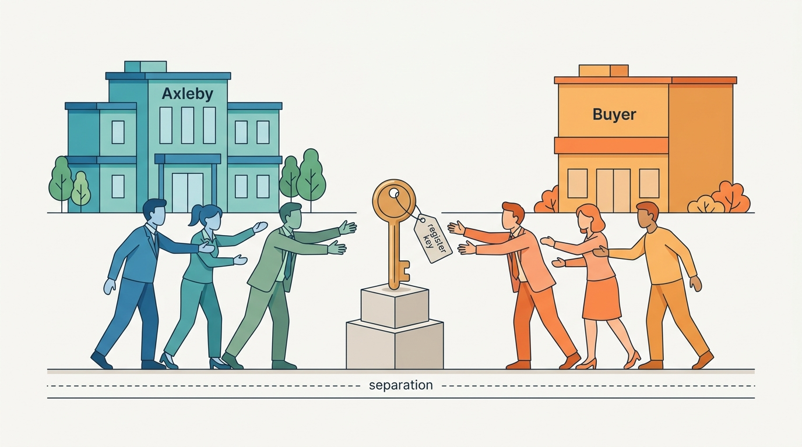
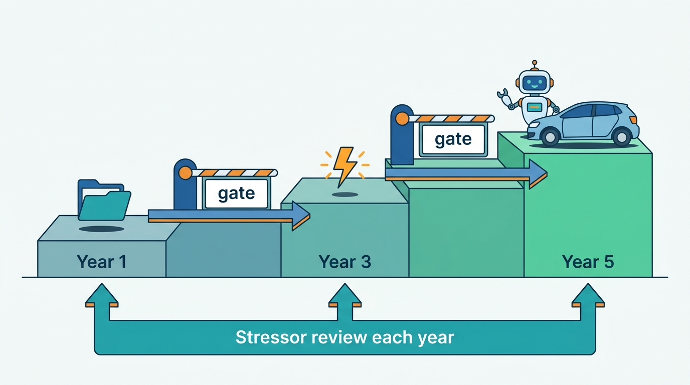
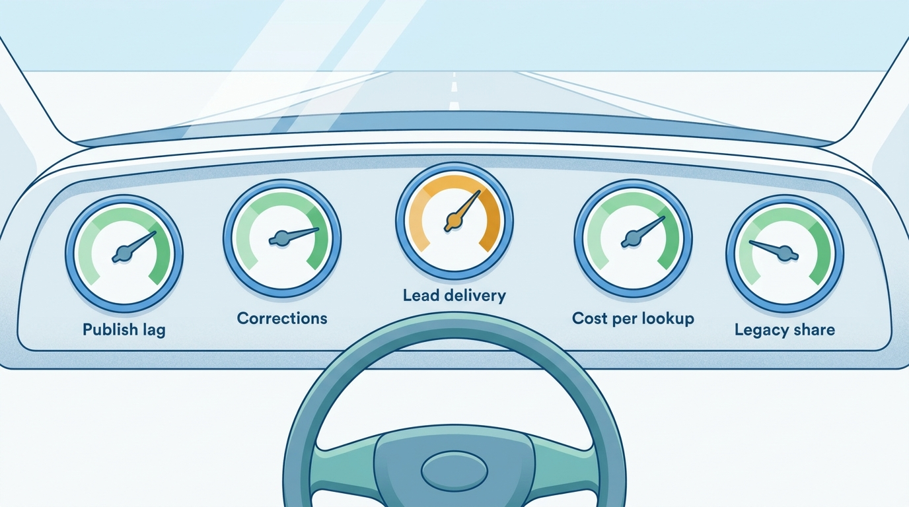

> **IN THIS CHAPTER, YOU WILL:** Restate the book's argument on one page, run a stressor analysis on a vehicle data and dealer software group, find the structures that survive most stressors, price the options worth keeping open, lay out a Year 1, Year 3 and Year 5 path, and define the fitness functions that tell a group every quarter whether its platform still works.

> **WHY THE BUSINESS CARES:** Over ten years the group will almost certainly see a portal merger, a price shock in one segment, a privacy ruling, a register reform, a supplier repricing its data and a change of owner. The platform decides whether each one costs a configuration change or a rewrite, and whether a board can answer "what does this program still buy us if the plan is wrong?"

> **WHY ARCHITECTS SHOULD CARE:** Every system in this book will be replaced within a decade: Connect XML, Lotwise Classic, probably the models, the cloud contracts and some of the adapters. What a Chief Architect can make durable is a small set of keys, contracts, records and measures. Choosing them, and proving every quarter that they still hold, is the long-term job.

> **KEY POINTS:**
>
> * **Design against stressors, not toward a target state.** List what could happen to the group (a portal merger, the EV price fall, a privacy ruling, a register reform, a lost data source, a DMS attack, connected-car data, a sale of one brand), record what the business would do and what would break, and add the structure that would survive. At Axleby, 16 stressors resolved to nine residues, and four of them (the vehicle key, provenance, license and purpose as data, and the usage event) carried most of the weight.
> * **Buy options when the premium is small and the trigger is observable.** A second build-data supplier behind Specbook's interface, per-tenant keys that let a brand leave, a pack identifier for the battery passport and an adapter slot for a German register interface each cost weeks now and save quarters later. Write down the trigger that exercises each option; an option nobody watches is just unused code.
> * **Steer by fitness functions, not program milestones.** Twelve measured properties (identity merge precision, correction propagation time, publish lag, lead delivery, segment valuation bias, cost per lookup, register outcome certainty, license coverage, customer-detected incidents, time to first advert, time to separate a brand, legacy share) say whether facts about each car still travel correctly. Each has an owner, a baseline from 2027 and the failure pattern it guards against.

> **[FAILURE PATTERNS THIS CHAPTER ADDRESSES](where-vehicle-platforms-go-wrong.html):**
>
> * **The Acquisition Archipelago** — a decade of buying and selling brands adds islands faster than a program can join them, unless identity, billing, data and licenses are both shared and separable.
> * **Borrowed Uptime** — most stressors in this chapter arrive through a dependency (a register, a portal, a DMS, a data supplier), so a platform that calls them synchronously inherits every shock at once.
> * **License Blindness** — privacy rulings, Data Act obligations and supplier repricing all change what may be kept and shown; without license and purpose as data, each change becomes an audit of everything.

 
This book has followed Axleby, the fictional vehicle data and dealer software group of [[meet-axleby]], through one year: a cloned plate, a sold Golf live on four portals, a quarter-end register outage, miles recorded as kilometers, a cross-tenant lead leak, 1,460 lost leads and a DMS vendor offline for twelve days. Each chapter treated one of those as a design problem. This chapter asks the question that sits above all of them: **what will the next ten years do to this platform, and what should stay true while they do it?**

The documented record of the vehicle-data industry argues against long plans. Between 2021 and 2026 **CDK Global sold its international business, which became Keyloop, and was taken private; AutoScout24 took over AutoTrack and Gaspedaal; Carfax left S&P Global inside Mobility Global; VWE sold its auction business to Autorola, bought XRAY and signed a sale to a new owner**; used-car prices rose by a third and fell again; used EVs lost a fifth of their value in a year; and the EU Data Act gave car users a right to send vehicle data to third parties. None of the companies involved had that decade in its plan.

So this chapter restates the book's argument, applies **stressor analysis** (a practical form of Barry O'Reilly's residuality theory) to find the structures that survive an unknown future, and defines the **fitness functions** that show whether they still hold. It closes Part IX ([[part-9]]), building on [[build-buy-or-partner]], [[one-platform-from-many-products]], [[organizing-engineering]], [[modernizing-the-platform]] and [[ai-in-dealer-workflows]].

## Setting the Scene at Axleby: The Board's Two Questions

On **Thursday 4 November 2027**, eight months into One Dossier, Axleby's board reviewed the program's first year. The numbers were good: Axleby ID was live for Velto Mobility Group, Meterline was shadow-rating invoices, Charter sat in the request path of nearly every external data call, and no Lotwise stock item would be created without an Axleby Vehicle Key (AVK) from December. At the end of the meeting, Harrowgate Capital's operating partner asked two questions, and Anouk Willems (CEO) gave them to Ines Marchetti (Group Chief Architect) for the December board.

*One Dossier costs €38 million to the end of 2029. If the next five years look like the last five, with a portal merger, a price collapse in one segment and a DMS vendor taken out by ransomware, which part of that €38 million still pays off? And if we decided to sell Showroomly in 2030, what would the shared platform you are building cost us to separate?*

The first stressor on Ines's draft list arrived five days later. On **Tuesday 9 November** DriveDesk was hit by ransomware and went offline for twelve days. Lotwise carried **1,900** DriveDesk rooftops through the outage in its DMS-absent mode: about 16,000 stock-ins, 19,000 sales and 34,000 leads, then 2,140 discrepancy tickets in reconciliation and about 3,900 queued commands that expired by design ([[dms-integration]]). It worked because three things existed that had not existed in February: Hitch's per-rooftop degraded mode, the Sales Admin fallback invoice series and the dossier as a stock book. None had been built for ransomware. Hitch was built after the Zombie Golf, the fallback series for VAT correctness and the dossier for re-typed plates.

That observation became the method. Ines, Marta Nowak (Head of Platform and SRE) and Hendrik Maes (Head of Partner Integrations) ran three workshops with Priya Raman, Tomás Ferreira, Femke de Boer, Lena Vos and Daan Visser. They did not try to predict the decade; they asked which One Dossier structures would survive the most unrelated shocks, and which shocks nothing in the plan survived. The answer went to the board on **Thursday 16 December 2027**.

## The Argument in One Page

This book's argument fits in four sentences.

1. **A vehicle data and dealer SaaS platform sells decisions about one physical car**: what it is, what happened to it, what it is worth, what to pay, what to ask, where to advertise it and who now owns it.
2. **Every decision is only as good as the identity, provenance and freshness of the facts beneath it**, so the architecture is judged by how reliably facts travel from registers, manufacturers, workshops and portals into one vehicle record, from there into valuations, adverts, leads, contracts and register transactions, and back out, corrected, when a fact was wrong.
3. **The two halves share what describes the car and the customer**: the vehicle key, the dossier, accounts and entitlements, the meter, license rules and events. They do not share release cadence, customer-facing workflow or the API contracts external data clients build on.
4. **Every external party is a dependency with its own clock**: registers, portals, DMS vendors and data suppliers go down, change terms and change owners, so the platform degrades honestly, reconciles afterwards and never lets one of them stop the dealer.

Each part contributed durable structures to that argument. The table is the book on one page, and the list of what this chapter protects.

| Part | What it argued | The structure it leaves | Where |
| --- | --- | --- | --- |
| I Market | Two halves need each other; shared facts, accounts and meters, separate cadences | Capability map and bounded contexts with named sources of truth | [[vehicle-capability-map]], [[vehicle-bounded-contexts]] |
| II Vehicle | A plate is not a car; facts are sourced, dated and correctable | AVK in Anchor; provenance envelope; bitemporal facts; versioned survivorship | [[vehicle-identity]], [[provenance-and-data-quality]] |
| III Value | A valuation is an evidenced answer with a confidence and a segment status | Valuation ledger with outcome links; per-segment drift gates | [[valuation-engine]] |
| IV Dealer | A stock item is a stay; adverts are renderings; withdrawal is a saga; leads are delivered when a person sees them | Dossier state machine; desired-state syndication; lead read-back; register transaction ledger | [[inventory-and-vehicle-dossier]], [[listing-syndication]] |
| V SaaS | The tenant is the contracting organization; five gates decide an action; license terms are rules | Tenant directory; Axleby ID and Gatekeeper; Baseline; Meterline; Charter | [[tenancy-and-dealer-groups]], [[data-licensing-and-governance]] |
| VI Distribution | Sell category blocks; publish business facts; every push needs a pull | Response composer and contract registry; event backbone with reconciliation | [[vehicle-data-apis]], [[events-webhooks-and-sync]] |
| VII Operations | Measure journeys; reads degrade to labeled copies, legal writes to honest queues | Journey SLOs, dependency budgets, flow monitors, retention service | [[reliability-and-dependencies]], [[observability-and-data-operations]] |
| VIII Journeys | A flow is only as good as its weakest hop and its recovery | End-to-end key chains and recovery paths | [[journey-data-correction]], [[journey-sale-to-registration]] |

## Concepts: Stressors, Residues, Options and Fitness Functions

### Why a target state fails here

A target-state architecture is a useful picture and a poor plan in this industry, for three reasons.

- **The facts depend on parties the platform does not control.** A register can close a channel, a portal can be bought by a competitor, and a DMS vendor can change its access terms, as CDK did in 2015 ([[case-cdk-global]]). A target state drawn around today's suppliers is out of date when one of them changes owner.
- **Regulation arrives on fixed dates with uncertain scope.** The EU Data Act has applied since 12 September 2025, its access-by-design duty reaches cars placed on the market after 12 September 2026, and its unfair-terms rules reach older long-term contracts on 12 September 2027 ([Regulation (EU) 2023/2854, 2023](http://publications.europa.eu/resource/celex/32023R2854)). The battery passport starts on 18 February 2027 ([Regulation (EU) 2023/1542, 2023](http://publications.europa.eu/resource/celex/32023R1542)). A proposed directive would replace the EU's registration-document rules with digital certificates and cross-border register access (COM(2025) 179, not adopted as of October 2026). Each one adds a structure no 2020 target state contained.
- **Prices move by segment, not on average.** The Manheim Used Vehicle Value Index reached a record 236.2 in December 2021, up 46.6% in a year ([Cox Automotive, January 2022](https://www.coxautoinc.com/news/manheim-forecast/)). Two years later UK used EVs were down 22.7% year on year against 3.8% for petrol ([Auto Trader, January 2024](https://plc.autotrader.co.uk/news-views/press-releases/retail-price-index-december-2023/)). A plan that assumes a stable market will be wrong in some segment almost every year.

The alternative is not to stop planning. It is to plan for **properties that must hold in many futures**, and to treat each system as replaceable.

### Stressors, attractors and residues

**Residuality theory** was developed by Barry M. O'Reilly in articles from 2020 and in his book *Residues: Time, Change, and Uncertainty in Software Architecture* (Leanpub, 2024). I use a simplified, practical form of it; readers who want the theory should read O'Reilly.

- A **stressor** is anything that could happen to the business or its environment: a law, a competitor's move, a supplier's failure, a price shock, a sale. It is deliberately not limited to likely events or technical risks.
- An **attractor** is the state the business is pushed into when the stressor hits: how dealers, partners and the market will actually behave. When a DMS goes dark, dealers keep selling on paper or in whatever tool still works. When a portal raises prices, dealers advertise fewer cars on it.
- A **residue** is what remains of the architecture after the stressor, and the structural change that would let the platform survive it.
- The **naive architecture** works under normal conditions; the **residual architecture** is the naive design plus the residues that survive the stressors considered.

The Productscape domain model from which this book started (a research map, not a description of any company's systems; see [[domain-coverage]]) contains this exercise. Its naive architecture reads: "Each product calls the RDW and partner sources directly, keeps its own customer accounts and price lists, and hard-codes BPM rules and portal feeds." Its residual architecture reads: "A cached RDW register and transaction retry queue, a shared specification/history/valuation core, a portal-neutral publish queue, versioned BPM rules, shared identity and billing across brands, and a licence register enforced at every data interface." That sentence is a fair summary of Parts II to VII, reached from the other direction.

I define **stressor analysis** for this book as the practice of listing stressors for a vehicle data and dealer software group, recording for each the attractor, what breaks in the current platform and the residue that would survive it, and then counting which residues serve the most stressors. Those residues deserve the most care, the best owners and the slowest change.

### Options

Some residues are too expensive to build before the stressor is visible. For those, the useful move is an **option**: a small structure built now that makes a later change cheap, with a written **trigger** that says when to exercise it. A second supplier's contract tests behind an adapter interface is an option; a full second supplier integration is an exercise. An option without a trigger and an owner is speculative generality, and it rots.

### Fitness functions

A **fitness function**, from evolutionary architecture, is an objective, preferably automated check that an architecture still has a property it was designed to have. Neal Ford, Rebecca Parsons, Patrick Kua and Pramod Sadalage introduced the term in *Building Evolutionary Architectures* (2017; second edition 2022). Auto Trader's engineers described in 2026 how they run ArchUnit tests in the build to enforce architectural boundaries, a code-level example ([Auto Trader Engineering, 2026](https://medium.com/autotrader-engineering/why-you-should-be-testing-your-architecture-ca8eefb74165)).

A **vehicle-platform fitness function**, as this book uses the term, measures whether facts about cars still travel correctly: "a sold car disappears from every channel that confirms state within 10 minutes for 99% of withdrawals", or "a corrected fact reaches every internal consumer within one hour". It differs from a business KPI in having an architectural owner and an architectural remedy, and from a service-level objective in measuring the whole flow rather than one service.

## Stressor Analysis for a Vehicle Data and Dealer Software Group

### The method

The workshop's value comes from the breadth of its stressors and the honesty of its "what breaks" column. Architects left alone list mostly technical risks, so Ines asked for stressors from six families and gave each family to someone outside engineering to draft first.

**Figure 1:** *Stressor analysis as Axleby ran it. The combined stressor is the test: if the platform survives it by composing residues it already has, the decomposition holds; if not, the loop adds a residue.*

| Family | Drafted by | Examples for a vehicle data and dealer software group |
| --- | --- | --- |
| **Registers and regulation** | Daan Visser, Femke de Boer | Register outage or new terms; registration reform; privacy rulings; Data Act duties; tax rule changes |
| **Market and prices** | Priya Raman | Segment price collapse; market-wide spike; free data commoditizing basic lookups |
| **Channels and partners** | Hendrik Maes | Portal consolidation; DMS concentration, attack or terms change; auction partner change |
| **Data supply** | Priya Raman, Marta Nowak | A licensed source withdrawn or repriced; a supplier error; new connected-car data |
| **Ownership and capital** | Lena Vos | An acquisition to integrate; a brand to sell; a change of owner |
| **Technology and adversaries** | Marta Nowak | AI agents between dealer and buyer; scraping; ransomware on Axleby itself |

### The stressor table

The digest's seven stressors were the starting point: register unavailable or terms changed, free open data commoditizing plate lookups, portal consolidation, BPM rule changes, the EV shift, buy-and-build acquisitions, and a privacy challenge to owner-related scoring. The workshop kept all seven, sharpened them with dated evidence and added nine more. The table shows sixteen. "What breaks" describes Axleby's platform before One Dossier; the residue column names what survives.

| # | Stressor | Public evidence (dated) | Attractor | What broke or would break at Axleby | Residue |
| --- | --- | --- | --- | --- | --- |
| S1 | **Register channel unavailable, or new provider terms** | The Dutch register forbids completing a registration during a disruption ([[registration-and-trade-services]]); DVLA's enquiry API closed to new registrations (October 2026) | Dealers keep handing over cars and expect proof later | 214 double submissions after ambiguous timeouts (31 March 2027); three stale copies of register data | Register gateway with mirror, live checks, transaction ledger with Ambiguous state, per-vehicle queues (Turnstile) |
| S2 | **Free open data and AI apps commoditize basic plate lookups** | RDW open data is CC0, 16.87 million rows (October 2026) | Clients stop paying for register fields | Connect XML prices raw register categories | Value priced on derived judgements and workflow; license classes that distinguish open from derived (Charter) |
| S3 | **A consolidated portal group bundles its own dealer tools or restricts feeds** | AutoScout24 took over AutoTrack and Gaspedaal (November 2025); Bundeskartellamt cleared mobile.de's purchase of Carwow (October 2026); Auto Trader's Deal Builder protest (November 2025) | Dealers multi-home, cut stock on expensive portals; portals push their own tools | Relay keyed commands by (rooftop, channel); Pulse leaned on harvested adverts | Desired-state syndication with per-channel rules; Pulse source policy (no portal group above 25% of a market without a contract) |
| S4 | **Tax rules change sharply** (BPM, VAT regimes, e-invoicing) | EU VAT in the Digital Age: cross-border digital reporting from 1 July 2030 | Calculators wrong overnight; corrections from tax authorities | Margin-Scheme Error: 1,240 cars wrongly invoiced (2026–27) | Versioned, dated rule sets; VAT regime as a stock fact with evidence |
| S5 | **Used EVs become a large share and fall in value** | UK used EVs −22.7% YoY, December 2023; Hertz's $245m EV depreciation (January 2024) | Buyers distrust used EVs; lessors' reserves miss | EV Overvaluation: +9.5% bias for 14 weeks, about €1.1M overpaid | Per-segment drift gates and segment status in Vantage; battery observations with method and verification |
| S6 | **A market-wide price spike or collapse** | MUVVI record 236.2, +46.6% YoY (December 2021) | Every valuation and maximum purchase price moves at once | Equal-weight 12-month training | Recency weighting, daily segment corrections, valuation ledger with outcome links |
| S7 | **Buy-and-build: an acquired product to integrate** | VWE bought XRAY and kept its brand (April 2026) | Each brand keeps its own accounts, billing and data | Five products, three logins, two vehicle keys | One identity, one vehicle key, one meter, one license check; brands on the surface |
| S8 | **A brand or unit is sold** | VWE sold ATC to Autorola (February 2026); Carfax spun off in Mobility Global (1 July 2026) | Transitional service agreements; customers expect no break | No way to count what Showroomly shares | Separability: per-tenant keys, product-scoped data, per-brand contract and credential inventory |
| S9 | **A privacy ruling restricts owner-related scoring or plate data** | CJEU *Scania* (2023): a VIN is personal data for those who can link it; *EDPS v SRB* (2025): identifiability per recipient; FTC's GM order (January 2026) | Lead lists and enrichment must stop or change | Horizon scored any Dutch plate until the March 2027 DPIA | Purpose register and match-in scoring; person fields out of vehicle stores; retention service (Tidemark) |
| S10 | **A licensed data source is withdrawn, acquired or repriced** | Ownership churn among suppliers: Carfax (2026), J.D. Power's purchase of Autovista (announced 2023) | Products lose a category or margin overnight | Build-data license allowed only 30 days' retention; 41% of fetches were repurchases | Specbook behind a purchase gate and budget broker; license terms as data; a fallback source per critical fact |
| S11 | **A supplier sends wrong data** | (Axleby) Kilometra batch, May 2027 | Wrong facts spread for days | 6,140 valuations, 412 reports and 1,180 adverts carried wrong mileage | Inlet's quarantine and per-segment checks; bitemporal facts; correction events and impact graph |
| S12 | **A DMS vendor is attacked, consolidated or closes access** | CDK Global outage, June 2024: core DMS back after about 7–11 days, integrations by end of July; CDK's 2015 lock-out | Dealers sell on paper, sever connections on purpose | DriveDesk sold rows unmatched (Zombie Golf); lead write-back to inactive queues | Hitch: one adapter per DMS family, xref map, receipts, nightly reconciliation, per-rooftop degraded mode |
| S13 | **Connected-car data becomes available by right** | Data Act applies from 12 September 2025; COM(2025) 179's companion proposal would require manufacturers to transmit odometer data | Lessors and dealers ask for odometer and battery data per VIN | No consent model, no purpose-scoped store before 2027 | Mandate (consent grants per vehicle) and Signalyard; promotion into history by rule |
| S14 | **Register reform: digital certificates, cross-border access, a new interface** | COM(2025) 179 (proposed April 2025); Germany's GKS large-customer interface (from September 2023) | New flows for imports and exports; new competitors in register services | Turnstile is Dutch-shaped; no German adapter | Register as an adapter per country behind one transaction model |
| S15 | **AI agents stand between buyer and dealer** | Auto Trader's FY2026 report lists agentic AI disintermediating marketplaces as a risk and describes a ChatGPT app via the Model Context Protocol (May 2026) | Agents query stock, prices and history on the buyer's behalf | APIs designed for screens; scraping of the free check | Category-block APIs with outcomes and license blocks; scoped credentials; agent permission model |
| S16 | **Customers can leave cheaply** | Data Act switching rules for data processing services: no switching charges from 12 January 2027 (scope for SaaS is my reading); Arizona's dealer-data statute (upheld 2021) | Groups demand exports and short notice periods | Lotwise data exportable only by support ticket | Export path per tenant as a product; configuration not forks |

Three judgements came before any counting. **The 2027 incidents were all on the list** (the DriveDesk Outage is S12, the EV Overvaluation S5, the Odometer Correction S11), so the list is not speculative. **S8 and S16 were the only stressors nothing in One Dossier's original plan addressed**: the program was designed to join brands and keep customers, not to let either leave, as VWE's sale of ATC reminds ([[case-vwe]]). The finding is why the acquisition integration contract adopted with capability map v2 in December 2027 requires every brand to stay separable ([[one-platform-from-many-products]]). And **S2 and S3 change the business, not only the platform**, so Tomás Ferreira, not Ines, owns their residues.

### Counting residues

The workshop then counted which residues the sixteen stressors rely on. Many stressors need several residues; the count is the number of stressors that would hurt badly without each one.

| Residue | Axleby structure | Stressors relying on it | Count | Status December 2027 |
| --- | --- | --- | --- | --- |
| **R1 One vehicle key** | AVK in Anchor, time-bounded plates, merge and split events | S1, S5, S7, S8, S10, S11, S13, S14 | 8 | Every new stock item carries an AVK; Pulse match 64% |
| **R2 Provenance and bitemporal facts** | Envelope v1, Inlet, Tracewell events | S5, S9, S10, S11, S13, S14 | 6 | Live July 2027; older facts marked reconstructed |
| **R3 License and purpose as data** | Charter, Mandate | S2, S8, S9, S10, S13, S15 | 6 | Every external data call through Charter |
| **R4 Usage event with outcome and cost** | Meterline | S2, S3, S7, S8, S10, S15 | 6 | Shadow-rating since October 2027 |
| **R5 Business events plus reconciliation** | Event backbone, Relay 2 desired state, nightly reconciliations | S3, S11, S12, S15 | 4 | Design approved 14 December 2027 |
| **R6 Adapters with degraded modes** | Turnstile, Relay adapters, Hitch, Signalyard, Specbook broker | S1, S3, S10, S12, S13, S14 | 6 | Hitch proven in November; Relay 2 in 2028 |
| **R7 Tenant directory and one identity** | Axleby ID, Gatekeeper, tenant directory, Baseline | S7, S8, S12, S16 | 4 | Velto live; Hartley pilot |
| **R8 Versioned rules and models** | Vantage segment status, Baseline market packs, tax rule sets | S4, S5, S6, S9 | 4 | Segment status live 2027 |
| **R9 Separability** | Per-tenant keys, UK cell, product-scoped stores, contract inventory | S8, S16 | 2 | Partly by accident (UK cell, KMS keys) |

**Figure 2:** *Unrelated stressors converge on a few residues. The vehicle key, provenance, license and purpose as data, and the usage event serve most of the sixteen stressors, so they are where long-term investment and the slowest change belong (edges simplified).*

The count gave Ines her answer to the board's first question. **Four residues (R1 to R4) serve between six and eight stressors each, and they are exactly One Dossier's Year 1 deliverables.** If the plan is wrong in any of the ways the workshop could imagine, those €14 million or so of Year 1 spend (an estimate the board accepted as the share of the €38 million spent on identity, metering, licensing and the vehicle key) keep paying. The four residues map closely onto the kernel tier of capability map v2: the vehicle key (A2), metering (F4) and licensing (F5) are kernel capabilities, while provenance (A6) is a shared platform capability and the kernel's remaining two members, accounts and authorization (F1, F2), form R7 ([[one-platform-from-many-products]]). The Year 2–3 items depend more on the future: Relay 2 pays off under S3 and S12, the pricing automation only if the market stays readable by Vantage, and Showroomly's migration onto shared services pays off under S7 and costs money under S8.

### The combined stressor: selling Showroomly to a portal group

A combined stressor tests the decomposition. If the platform survives two or three shocks together by composing residues it already has, the decomposition is probably right. If it needs a new residue, the loop goes round again.

The workshop's combined case was the board's second question, made harder: **in spring 2030 Axleby sells Showroomly to a UK portal group (S8), the buyer restricts third-party feeds for rival dealer tools (S3), and Hartley Motor Group asks for its data and a 30-day exit (S16).** By then, on the plan, Showroomly would run on Axleby ID, shared leads (Switchboard) and shared syndication (Relay 2).

| Need | Residue used | Works? | Finding |
| --- | --- | --- | --- |
| Hand over Showroomly's tenants and users | R7: tenants and organizations in Axleby ID; Hartley federates with Entra ID and SCIM | Yes | Export organizations and re-point federation; users keep their own identity provider |
| Hand over its data without Lotwise data | R9: UK cell in eu-west-2, per-tenant keys | Mostly | Showroomly data sits in the UK cell; but leads and syndication state would sit in shared Switchboard and Relay stores keyed by tenant, so extraction is a query plus a key re-wrap, not a cell move |
| Bill the buyer for transitional services | R4: Meterline usage events per product and tenant | Yes | Transitional service agreement priced from metered usage, not estimates |
| Decide which data the buyer may keep | R3: Charter license classes and recipient audit | Yes | Tenant-owned data goes; supplier-retainable data needs the supplier's consent; derived data needs a decision |
| Keep UK register access for both parties | R6: Turnstile | **No** | Turnstile's single DVLA Vehicle Enquiry Service key is the one Showroomly held before 2023, and that service is closed to new registrations. Whoever keeps the key keeps the access; the other party may get none |
| Keep Hartley's adverts live during separation | R5, R6: Relay 2 desired state | Yes | Desired state per channel listing is exportable and re-convergeable by the buyer's syndication |
| Honor Hartley's exit | R7, R9 | Partly | No tenant export product exists in 2027 |

Two gaps became work. A **credential and contract inventory per brand** (who holds which register key, portal account, data license and supplier contract, and whether it transfers) joined R9 under Hendrik Maes. A **tenant export** became a Year 3 deliverable under Tomás Ferreira, because one export serves a carve-out, a departing customer and the Data Act's switching rules. Neither is expensive; both would be very expensive to discover during a sale.

**Figure 3:** *The combined stressor found a gap no single stressor showed: Turnstile holds one DVLA key, so in a Showroomly sale whoever keeps the key keeps UK register access.*

## Optionality: What to Keep Open and What to Close

Residues that serve many stressors are investments. Residues that serve one stressor, which may never come, are candidates for options. The board accepted seven, each with a premium measured in weeks and a trigger someone watches.

| Option | Premium now | Stressor hedged | Trigger to exercise | Owner |
| --- | --- | --- | --- | --- |
| Second build-data supplier behind Specbook's resolver interface: contract tests, catalog mapping for one candidate | About 6 engineer-weeks *(assumption)* | S10 | Price rise above 20% at renewal, or the incumbent bought by a competitor | Priya Raman |
| German register adapter slot in Turnstile's transaction model (GKS correlation ids, multi-hop statuses), no adapter | 3 weeks of design *(assumption)* | S14 | Axleby Trade enters Germany, or GKS share passes 25% of German registrations | Daan Visser |
| Digital registration certificate as an evidence type in the dossier | 2 weeks *(assumption)* | S14 | Adoption of COM(2025) 179 | Daan Visser |
| Battery pack identifier with an ISO/IEC 15459 passport id field | Done in the battery-health service | S5, S13 | First lease returns with passports, around 2030 ([[ev-battery-health]]) | Priya Raman |
| Brand-scoped contract and credential inventory; tenant export | 8 weeks *(assumption)* | S8, S16 | Any sale discussion, or the first exit request under the switching rules | Hendrik Maes, Tomás Ferreira |
| Agent-facing tool definitions over JSON API v2 blocks, behind the same scoped credentials, as the November 2027 external-agent policy prescribes ([[ai-in-dealer-workflows]]) | 4 weeks *(assumption)* | S15 | Two or more large clients asking for agent access | Ruben Dekker |
| A second auction partner adapter on the sale-right register | Adapter contract only | S3, S8 | Kavelstad changes owner or terms | Daan Visser |

The board also closed options on purpose. **Axleby will not build a DMS**: every DMS vendor would become a competitor ([[dms-integration]]). **It will not own auctions**: wholesale prices are valuable ([[case-cox-automotive]]), but buying an auction house is a capital decision, not an architecture option. **It will not enter the US before 2030**: title, NMVTIS (the National Motor Vehicle Title Information System) and a concentrated DMS market need a different data spine. A platform that keeps every door open spends its budget on doors.

## The Year 1, Year 3 and Year 5 Path

The Productscape model frames a dealer's strategy as three horizons: one dossier and one flow, then market-driven pricing, then an assisted used-car business; and a software vendor's as reliable legacy APIs, then developer-first APIs with webhooks, then an embedded data utility. Axleby adopted the shape, not the content. The path below is stated as **exit criteria in fitness-function terms**, not as features, so a slipped feature cannot be reported as progress.

**Figure 4:** *The path as gates, not feature lists. Each horizon opens only when the fitness functions of the previous one hold, and the stressor review each year can reorder what is inside a horizon without moving the gates.*

| Horizon | What the dealer and the data client get | What must exist underneath | Exit criteria |
| --- | --- | --- | --- |
| **Year 1 (2027–28): one dossier, one account** | One login per person; history, valuation, condition and register transactions in the Lotwise Dossier; one invoice that explains each line | Axleby ID and Gatekeeper; AVK as the only vehicle key; Meterline; Charter in every data path; Inlet and the provenance envelope | No stock item without AVK; Meterline two consecutive clean months and cut over; 100% of external data calls through Charter; Lotwise and Axleby Portal logins retired by mid-2028 |
| **Year 3 (2029–30): market-driven automation and event APIs** | Automatic in-band repricing behind guardrails; digital lessor returns (Handback); JSON API v2 webhooks (live from Q3 2028) and `vehicle.fact.corrected`; Showroomly on shared identity, leads and syndication | Event backbone with outbox; Relay 2 desired state and reconciliation; Vantage segment status in every automated decision; tenant export | Correction propagation under 1 hour internal; 99% of withdrawals within 10 minutes; Connect XML at zero calls on 31 December 2029, apart from paid extensions that end by 30 June 2030 ([[modernizing-the-platform]]); Lotwise Classic a dossier-UI shell |
| **Year 5 (2031–32): assisted used-car business and embedded data utility** | Buy recommendations from trade stock and predicted stand-time per car; self-balancing group stock; components embedded in partners' software; consented connected and battery data per VIN; cross-border categories for Belgium and Germany | Agent permission model; Mandate at scale; passport identifiers; market adapters for a second register | Every automated recommendation has an evidence trail and an owner; segment bias detected within 4 weeks; time to separate a brand under 6 months |

**Year 5 is a direction, not a commitment**; its content depends on S5, S13 and S15. **Year 3 waits for Year 1's gates**: repricing on a dossier without AVKs, or webhooks before events carry entity versions, would automate the Cloned Identity and the Sticky Error. **Retirements are dated and public**: a Connect XML sunset that can slip keeps 210 XML-only clients from moving ([[vehicle-data-apis]], [[modernizing-the-platform]]).

## Fitness Functions: The Vehicle Platform Scorecard

To know each quarter whether the residues still hold, Ines proposed twelve fitness functions. Most already existed in earlier chapters; the change was one page, one group owner each, and reporting them to the board instead of milestones.

| # | Fitness function | Measure | 2027 baseline (Axleby) | Target | Owner | Guards against |
| --- | --- | --- | --- | --- | --- | --- |
| F1 | **Identity merge precision** | Share of automatic merges confirmed correct in a monthly audited sample; paid reports on Confirmed or Corroborated identity | Tracewell re-key found 18,400 events with a VIN disagreeing with the plate (2026); AVK backfill 97.2% automatic | ≥99.9% precision; 100% of paid reports *(assumption)* | Priya Raman | The Cloned Identity |
| F2 | **Correction propagation time** | Correction accepted → last internal consumer acknowledges; → external clients notified | 11 days to correct (May 2027); 41 adverts still wrong three weeks later; 38 minutes in the 2028 dry run | p95 under 1 hour internal and webhook; text-bearing adverts flagged within 24 h *(assumption)* | Marta Nowak | The Sticky Error |
| F3 | **Publish and withdrawal lag** | Stock change → evidence of state on the channel | Withdrawal p99 6 h 20 min (June 2027) → 14 min (September) | 95% of updates in 15 min; 99% of withdrawals in 10 min | Hendrik Maes | The Zombie Listing |
| F4 | **Lead delivery** | Leads with read-back at a person-visible destination; rooftops with leads unacknowledged over 4 business hours | 1,460 leads unworked for 9 days (September 2027) | 99.9% read-back within 15 min; no rooftop dark for a business day *(assumption)* | Tomás Ferreira | The Leaky Lead |
| F5 | **Segment valuation bias** | Signed bias per segment against realized sales; weeks to detect a 4-point bias | 14 weeks (2026); week 5 in the April 2027 replay | Detection within 4 weeks; no global metric as the gate *(assumption)* | Priya Raman | The Confident Valuation |
| F6 | **Cost per lookup** | Fully loaded cost per billable lookup; call paths with negative margin | €0.031 (Q2 2027); Saturday Batch about −€9,000 | €0.025 by end 2028; no negative call path longer than one billing month | Lena Vos, Marta Nowak | The Unmetered Call |
| F7 | **Register outcome certainty** | Double submissions; ambiguous outcomes resolved by probe | 214 double submissions (31 March 2027); 41 ambiguous, all resolved (30 June 2027) | Zero double submissions; 100% resolved by probe within the working day | Daan Visser | Borrowed Uptime |
| F8 | **License coverage** | External data calls decided by Charter; facts without license class | Every external call through Charter (December 2027); 3.8% of Tracewell events withheld at go-live | 100%; withheld share falling | Femke de Boer | License Blindness |
| F9 | **Customer-detected incidents** | SEV1/SEV2 incidents first reported by a customer | 58% (2026) | Under 20% (2028) | Marta Nowak | Feed Roulette |
| F10 | **Time to first advert** | Onboarding contract → first live advert per rooftop after a group's first | Median 11 days (Velto's last 18 rooftops) | Under 10 working days | Tomás Ferreira | Customization Creep |
| F11 | **Time to separate a brand** | Rehearsed extraction of one brand's tenants, data, credentials and contracts | Not measurable in 2027; Belgian purge rehearsal in Pulse took 31 hours | Under 6 months, rehearsed yearly *(assumption)* | Ines Marchetti | The Acquisition Archipelago |
| F12 | **Legacy share** | Share of API calls on Connect XML; tenant-conditional code paths | 38% of calls; 14 Hartley-specific paths in Showroomly | 0% on 31 December 2029 (paid extensions end by 30 June 2030); no unregistered conditional paths | Ruben Dekker | The Tenant Blur, Customization Creep |

**Automated where possible, drilled where not.** F2, F3, F4, F7, F8 and F12 run continuously from flow events and the build. F1 and F5 need a monthly sample or realized sales, which arrive a stock turn late, so their leading indicators (Pulse segment signals, asking-price movement) go on the same dashboard. F11 cannot be measured without a rehearsal; Axleby runs one each year on a small product or a large tenant. A DMS game day ([[reliability-and-dependencies]]) is the same kind of fitness function for S12.

**Twelve is a ceiling**: a scorecard of fifty measures has no owners, and the board learns to read only the colors. **A fitness function that never fails is miscalibrated or unmeasured.** The DriveDesk Outage pushed F4 into degraded for twelve days: leads stayed visible in the Lotwise inbox but not in the CRM. That was the design. Ines reported it as a passed stress test, with the reconciliation numbers, rather than as a red cell.

**Figure 5:** *Fitness functions are the platform's dashboard: each gauge says whether facts about cars still travel correctly, and one that went amber for twelve days in the DriveDesk Outage was a passed stress test, not a red cell.*

## Failure Handling Over a Decade

The failure modes of long-term architecture are slower than an outage, and they hide in governance.

| Failure | How it shows | Detection | Recovery |
| --- | --- | --- | --- |
| **The stressor list goes stale** | Written once, admired, filed | No stressor added or retired in a year; an incident that matches no stressor | Yearly review starting from the year's incidents and counterparties' ownership changes ([[vehicle-data-ecosystem]]) |
| **Residues erode under delivery pressure** | A plate-keyed cache "for speed"; a product reading Tracewell without Charter; an adapter without a contract test | Build-time rules (no vehicle record without an AVK, no data-serving service without Charter's library), checked like ArchUnit tests | Block the change, or register an exception with an expiry date approved by the Group Chief Architect |
| **Options are bought and never watched** | Contract tests stop running; a trigger passes unnoticed | A quarterly line per option in the board pack | Exercise it or delete it |
| **Fitness functions become targets** | Publish lag counted only on channels that confirm state; after-hours leads excluded | Definitions versioned and reviewed by the owner of the failure pattern, not of the number | Restate history under the corrected definition, as Pulse did when only 68% of de-listings proved to be sales ([[market-data]]) |
| **The program outlives its purpose** | Year 3 gates met, budget renewed anyway | Gate status against budget | Dissolve the program into platform teams' roadmaps ([[organizing-engineering]]) |
| **A combined shock arrives before the residue** | Some will | Journey SLOs go degraded across several dependencies | The residue of last resort: labeled copies for reads, visible queues for legal writes, built beforehand |

## Trade-offs

| Choice | Option A | Option B | When A is right | When B is right | Axleby's choice |
| --- | --- | --- | --- | --- | --- |
| Planning | Target-state roadmap with dated features | Stressor-driven residues and gated horizons | Small product, stable suppliers, one market | Many external dependencies, several markets, changing ownership | B, with a target picture for communication only |
| Where to invest first | Customer-visible features | Residues that serve many stressors | When the platform is young and has no customers to lose | When the group already sells to thousands of businesses | B in Year 1, A once gates hold |
| Options | Build for every foreseeable stressor now | Small options with written triggers | Stressor very likely and cheap to address | Uncertain stressor, expensive residue | B, with seven named options |
| Sharing | Maximize shared services | Share the spines, keep brands separable | Group will only buy | Group will buy and sell | B: shared and separable (R9) |
| Governance | Program milestones | Fitness functions with owners | Early in a program, for funding | From the first year, for steering | Both until Year 1 gates, then fitness functions only |

The recommendation rests on three conditions that hold for Axleby and for most groups in this industry: the group depends on parties it does not control, it sells in more than one market, and its owner is a fund with a finite holding period. Where none of them holds, for example a single-market data provider owned by its founders with one register as its only source, a lighter version is enough: a short stressor list, three or four fitness functions and no options table.

## Where the Stressors Land, by Market

Part IX has no required market section, but the stressors do not land evenly, and a group that plans for one market's stressors will be surprised in another.

| Stressor | Netherlands / Belgium | Germany | United Kingdom | United States |
| --- | --- | --- | --- | --- |
| Register change (S1, S14) | Strong open register; transaction access through recognized companies; Belgium's register reached through a partner | Federated registration offices; GKS interface since 2023, small share of transactions | DVLA enquiry API closed to new registrations; DVSA MOT data with change feed | No national register; state DMVs, NMVTIS title brands, DPPA limits |
| Portal consolidation (S3) | AutoScout24 holds AutoTrack and Gaspedaal (2025); Marktplaats and 2dehands share one API | mobile.de and AutoScout24 separate, with export between them; mobile.de's Carwow purchase cleared (October 2026) | One dominant portal that also sells data and software | Cox owns Autotrader.com and vAuto; feeds mostly files |
| DMS concentration (S12) | Many local systems; OEM-approved DMSs for franchised dealers | OEM-shaped, brand-captive DMSs | Keyloop, Pinewood for groups | CDK and Reynolds concentrated; state dealer-data statutes |
| Privacy and data rights (S9, S13) | GDPR and Data Act | GDPR and Data Act; narrow keeper access (§ 39 StVG) | UK GDPR; no Data Act | Sectoral: DPPA, FTC Safeguards Rule, FTC's GM order, state laws |
| EV and battery rules (S5) | Battery Regulation access since August 2024; passport from February 2027 | Same | Not mandated | EPA battery monitor from model year 2027 (status subject to change) |

The common part is the residues: every market needs R1 to R4. The market-specific part is which adapters and rule sets carry the most risk. In the Netherlands it is the register gateway; in the UK the portal and the closed DVLA channel; in Germany the DMS and register long tail; in the US, if Axleby ever goes there, the DMS gatekeepers and the absence of a register.

## The Chief Architect's View

The decisions in this chapter are not one-off. They are the standing agenda of the architecture function for a decade.

- **Own the stressor list and run it yearly.** The Group Chief Architect owns it; each family has a business owner who drafts it. Start each review from the year's incidents and from ownership changes among the top twenty counterparties. Retire stressors that no longer apply, and say why.
- **Protect the residues as products.** R1 to R4 have named owners, the slowest change process in the group and build-time rules that stop erosion. A change to the AVK, the provenance envelope, Charter's license classes or Meterline's event schema goes to the architecture advice forum, not to a team backlog ([[organizing-engineering]]).
- **Report fitness functions to the board, not milestones**, and keep the option register short and watched: delete any option whose trigger cannot be observed.
- **Design for leaving as well as joining.** Every integration decision asks: what would it take to undo this for one brand or one tenant? The answer goes into the decision record. At Axleby this question found the DVLA key.
- **Decide what not to become.** Not a DMS, not an auction house, not a US title business before 2030. Write these down; they save more engineering than any framework.

What to watch: incidents that match no stressor; residue exceptions that are not expiring; fitness functions that have not failed in a year; options whose triggers nobody has checked; and the share of One Dossier spend still waiting for a Year 1 gate.

## Questions to Ask

1. Which ten things could happen to our group in the next five years that are outside engineering's control, and which of our structures would survive each one?
2. Which three or four structures serve the most of those stressors, who owns them, and what stops a team from eroding them under deadline pressure?
3. If we sold one brand next year, who holds its register credentials, portal accounts and data licenses, and are they transferable?
4. Can a departing customer export its data without a support ticket, and does the same export serve a carve-out?
5. Which external party, if bought by a competitor tomorrow, would remove a product category, and what is our fallback source or option?
6. How long does a corrected vehicle fact take to reach every consumer, including clients' caches and the text of live adverts?
7. Which of our valuation segments could be 10% wrong today without any metric we watch moving?
8. What have we decided not to become, and is it written down?

## From Argument to Evidence

Every chapter of this book argued from a fictional group because a fictional group can show its incidents, numbers and mistakes. The argument must also survive contact with real companies, whose records are partial and dated. Part X ([[part-10]]) tests it against four of them. [[case-cox-automotive]] shows portfolio integration as layers that took eight years, and what a group gains from data on both sides of the transaction. [[case-cdk-global]] shows a system of record as gatekeeper and as single point of failure, the real form of stressor S12. [[case-auto-trader-uk]] shows a portal climbing a dependency ladder from taxonomy to valuations to workflow, and the dealer protest when a bundled feature moved control of stock. [[case-vwe]] shows a register-connected data company becoming a dealer platform while buying, selling and changing owner. Read them with this chapter's stressor table open: each case is a decade of stressors that someone did or did not plan for. The tour starts with the introduction to Part X, [[part-10]].

## Sources and Evidence

### Company, product and investor sources

- [Retail Price Index, December 2023](https://plc.autotrader.co.uk/news-views/press-releases/retail-price-index-december-2023/) — Auto Trader Group, 2024. UK used EVs −22.7% year on year vs petrol −3.8%.
- [Full-year results FY2026](https://plc.autotrader.co.uk/media/usjleen0/full-year-press-release-fy26.pdf) — Auto Trader Group, May 2026. Deal Builder response; ChatGPT app via MCP; agentic AI as a principal risk.
- [Why you should be testing your architecture](https://medium.com/autotrader-engineering/why-you-should-be-testing-your-architecture-ca8eefb74165) — Auto Trader Engineering, 2026. ArchUnit tests as build-time architecture checks.
- [Manheim Used Vehicle Value Index forecast](https://www.coxautoinc.com/news/manheim-forecast/) — Cox Automotive, January 2022. Record 236.2, +46.6% year on year, December 2021.
- [Hertz Form 8-K](https://www.sec.gov/Archives/edgar/data/1657853/000165785324000010/htz-20240111.htm) — Hertz Global Holdings, January 2024. About 20,000 EVs to sell; about $245 million incremental depreciation.
- SEC filings on the June 2024 CDK outage: [AutoNation 10-Q](https://www.sec.gov/Archives/edgar/data/350698/000035069824000098/an-20240630.htm), August 2024; [Sonic Automotive 8-K](https://www.sec.gov/Archives/edgar/data/1043509/000104350924000060/sah-20240705.htm), July 2024. Core DMS restored late June; integrations by end of July; validation before resumption.
- [AutoTrack en Gaspedaal.nl onderdeel van AutoScout24](https://www.emerce.nl/nieuws/autotrack-gaspedaalnl-onderdeel-autoscout24) — Emerce (trade press), November 2025. Dutch portal consolidation.
- [Autorola reprend une filiale de VWE Automotive](https://journalauto.com/distribution/autorola-reprend-une-filiale-de-vwe-automotive/) — Journal de l'Automobile, February 2026. ATC sold to Autorola.
- [VWE Automotive neemt XRAY Automotive over](https://vwe.nl/nieuws/vwe-automotive-neemt-xray-automotive-over-en-versterkt-dienstverlening-in-bpm-en-waardebepaling/) — VWE Automotive, April 2026. Acquisition kept under its own brand.
- [Mobility Global 8-K exhibit](https://www.sec.gov/Archives/edgar/data/0000064040/000110465926057215/tm2613574d1_ex99-1.htm) — S&P Global / Mobility Global, 2026. Carfax's separation from S&P Global (completed 1 July 2026).
- [Hundreds of car dealers claim they have cancelled Auto Trader packages](https://cardealermagazine.co.uk/hundreds-of-car-dealers-claim-they-have-cancelled-auto-trader-packages-as-part-of-mass-protest/320149) — Car Dealer Magazine (trade press), November 2025. The dealer protest.

### Standards, regulation and official documentation

- [Regulation (EU) 2023/2854 (Data Act)](http://publications.europa.eu/resource/celex/32023R2854) — EU, 2023. Application dates (Art. 50), third-party access (Arts. 5–6), switching rules and charges.
- [Commission guidance on vehicle data, C/2025/5026](http://publications.europa.eu/resource/celex/52025XC05026) — European Commission, 2025. Odometer and fault codes as in-scope data.
- [Regulation (EU) 2023/1542 (Battery Regulation)](http://publications.europa.eu/resource/celex/32023R1542) — EU, 2023. BMS state-of-health access from 18 August 2024; battery passport from 18 February 2027.
- [Vehicle registration and roadworthiness package, EPRS briefing](https://www.europarl.europa.eu/RegData/etudes/BRIE/2026/782608/EPRS_BRI(2026)782608_EN.pdf) — European Parliamentary Research Service, January 2026. COM(2025) 179: digital certificates, MOVE-HUB, connected-vehicle odometer transmission (proposal).
- [Judgment in C-319/22, *Scania*](http://publications.europa.eu/resource/celex/62022CJ0319) — CJEU, 2023. A VIN is personal data for those with means to link it to a person.
- [Judgment in C-413/23 P, *EDPS v SRB*](http://publications.europa.eu/resource/celex/62023CJ0413) — CJEU, 2025. Identifiability assessed per recipient.
- [FTC finalizes order with GM and OnStar](https://www.ftc.gov/node/327916) — US Federal Trade Commission, January 2026. Consent for connected-vehicle data; five-year ban on disclosure to consumer reporting agencies.
- [Bundeskartellamt clears mobile.de's acquisition of Carwow](https://www.bundeskartellamt.de/SharedDocs/Meldung/DE/Pressemitteilungen/2026/10_08_2026_mobile_carwow.html) — Bundeskartellamt, October 2026. Dealer multi-homing recorded by a regulator.
- [Open Data RDW: Gekentekende voertuigen](https://opendata.rdw.nl/d/m9d7-ebf2) — RDW, n.d., accessed 2026-10. CC0 register dataset, 16.87 million rows.
- [VAT in the Digital Age](https://taxation-customs.ec.europa.eu/taxation/vat/vat-digital-age-vida_en) — European Commission, n.d., accessed 2026-10. Cross-border digital reporting from 1 July 2030.
- [*CDK Global v. Brnovich*](https://storage.courtlistener.com/pdf/2021/10/25/cdk_global_llc_v._mark_brnovich.pdf) — US Court of Appeals, Ninth Circuit, 2021. Arizona's dealer-data statute upheld.

### Research and practitioner sources

- [Residues: Time, Change, and Uncertainty in Software Architecture](https://leanpub.com/residuality) — Barry M. O'Reilly, Leanpub, 2024. Stressors, residues, attractors and stressor analysis.
- [Building Evolutionary Architectures, 2nd edition](https://www.thoughtworks.com/insights/books/building-evolutionaryarchitectures-second-edition) — Neal Ford, Rebecca Parsons, Patrick Kua and Pramod Sadalage, O'Reilly Media, 2022 (first edition 2017). Fitness functions for architectural governance.
- Productscape vehicle data and dealer SaaS domain model (author's sibling repository, 2026), summarized in this book's research digest: naive and residual architectures, the seven residuality stressors, and the persona Year 1/3/5 horizons. A research map, not a description of any company's systems.

Axleby is fictional; architectural recommendations, labeled inferences and labeled assumptions are the author's judgement.
