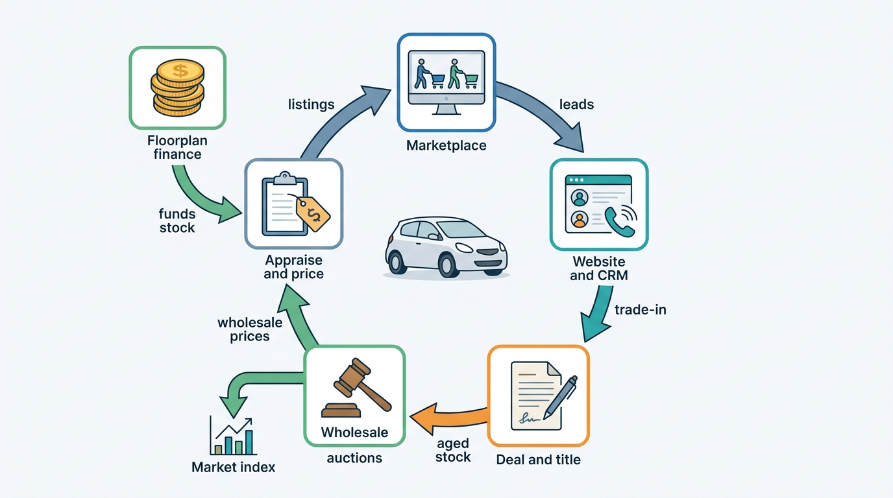
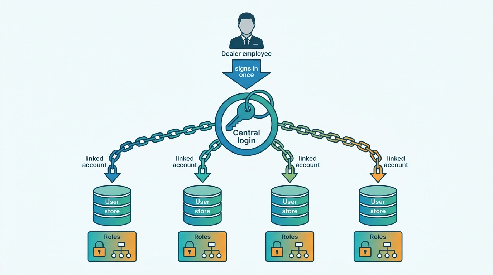
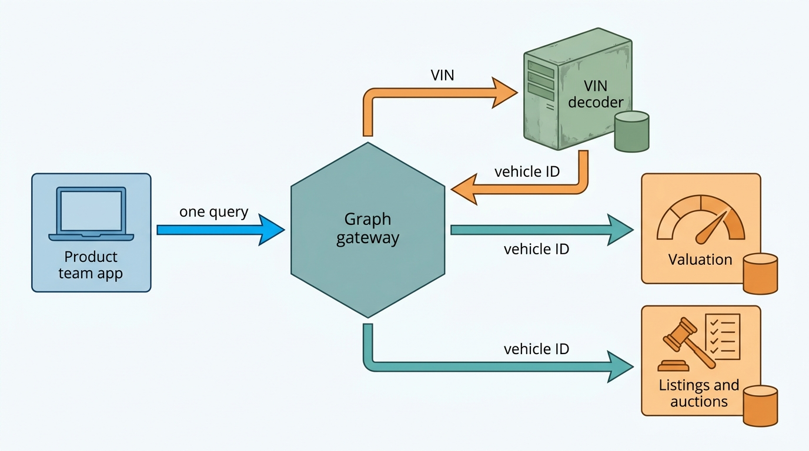
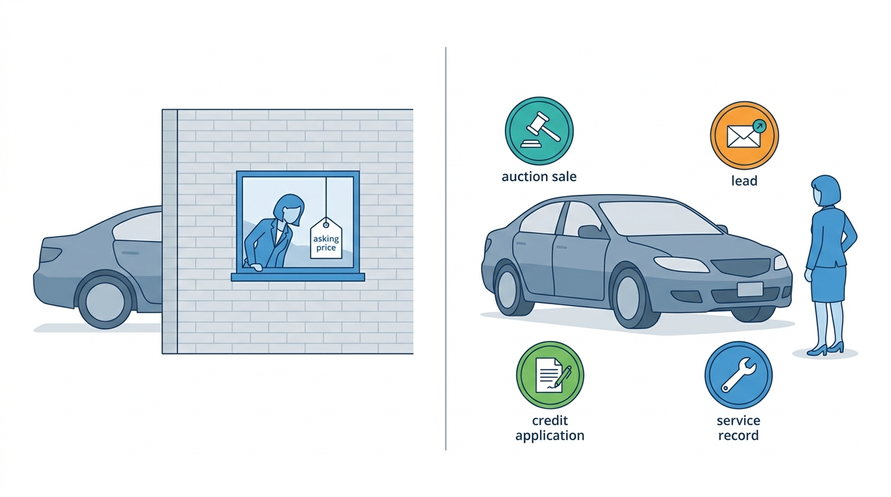
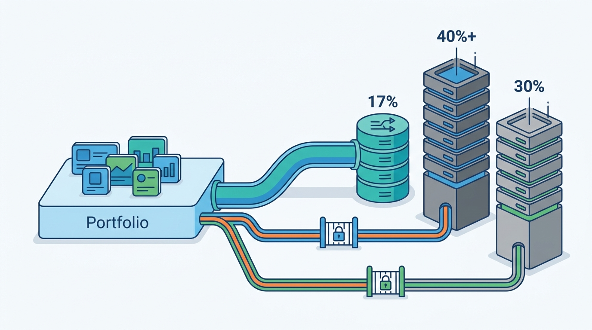
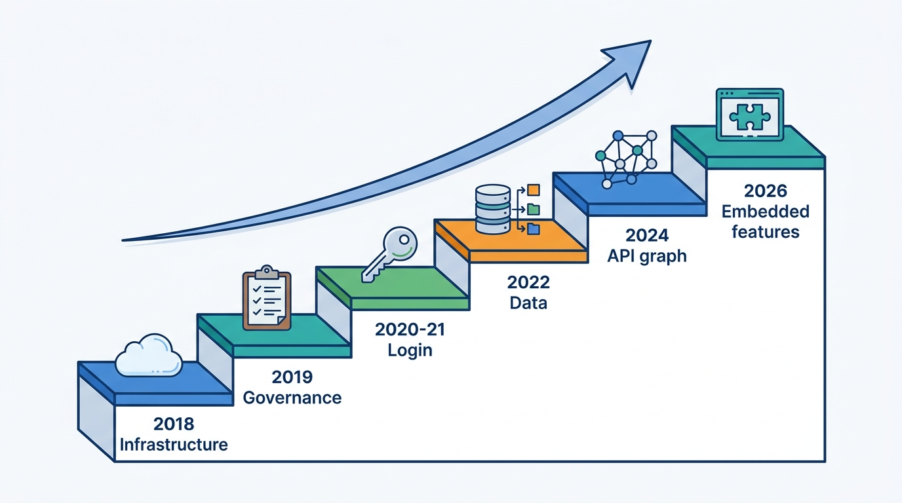

> **IN THIS CHAPTER, YOU WILL:** Read Cox Automotive's public record (company releases, conference talks, vendor case studies, a published index methodology and court filings) as an architecture case. You will separate what Cox documented, with dates, from the author's interpretation, see where the evidence stops, and compare the case with the book's patterns and Axleby's choices.

> **WHY THE BUSINESS CARES:** Cox is what a vehicle data and dealer software group looks like when acquisitions run for two decades: a portal, a valuation brand, auctions, inventory tools, a CRM, a DMS, floorplan finance and transport under one owner. Its record shows what such a group can sell that a single-product competitor cannot, and how long it takes before customers experience the brands as one company.

> **WHY ARCHITECTS SHOULD CARE:** Few acquired portfolios have described their own integration in public, in dated steps. Cox has: a cloud migration (2018), platform scorecards (2019), single sign-on (2020–2021), a unified data brand (2022), a federated API graph (2024) and a customer data platform embedded into its CRM (2026). The order of those steps, and what each one left untouched, is the lesson.

> **KEY POINTS:**
>
> * **Portfolio integration comes in layers, and each layer takes years.** Cox's dated record runs infrastructure (AWS, 2018), governance (Well-Architected scorecards over 200+ platforms, 2019), identity (Bridge ID, 2020–2021), data (DRiVEQ, 2022), APIs (federated GraphQL, 2024) and embedded cross-product features (Fullpath inside VinSolutions, 2026). That is eight years for six layers, in a group with more than 2,000 engineers in 2019.
> * **Cox unified by linking and federating, not by replacing.** Bridge ID links one account per product to a central login; the federated graph wraps the existing VIN decoder rather than rewriting it. That keeps acquired products running, but the public record shows no shared tenancy or authorization model underneath, and "no extra login" was still a product headline in October 2026.
> * **Data on both sides of the transaction is the durable advantage; a minority system of record is not.** Cox sees wholesale auction prices, retail adverts, leads, credit applications and valuation requests, and it publishes the methodology of the Manheim index it sells. Yet its products depended on rival dealer management systems (DMS) for dealer data: Cox sued CDK Global in 2017 and settled in 2019, and it owned and then sold the European DMS incadea within about three years.

> **[FAILURE PATTERNS THIS CHAPTER ADDRESSES](where-vehicle-platforms-go-wrong.html):**
>
> * **The Acquisition Archipelago** — Cox grew from more than 20 brands, each with its own users, data and APIs, and its public record is a decade-long effort to make them behave as one.
> * **DMS Hostage** — although Cox owned Dealertrack, about 17% of the US DMS market in 2017, its other products depended on access to CDK and Reynolds systems, which led to litigation.
> * **The Confident Valuation** — the Manheim Used Vehicle Value Index is the clearest public counter-example: a defined sample, documented outlier and mileage rules, seasonal adjustment and a published rebase.

 
Cox Automotive describes itself as "the world's largest automotive services and technology provider", a claim from its own October 2026 press boilerplate. In the same text it reports "29,000+ employees on four continents" and brands that include Autotrader, Kelley Blue Book, Manheim, vAuto, Dealertrack, NextGear Capital, CentralDispatch and Cox Fleet. **No other company in this book's field assembled so many parts of the used-car value chain under one owner**, and few have said as much in public about how they tried to make the parts work together.

This chapter asks three questions of that record. *In what order does an acquired portfolio become a platform, and how long does each step take? What does unification look like when the products cannot be rewritten: one login, one vehicle key, one data layer? And where should a portfolio group own the system of record, and where should it integrate with someone else's?* The third question links this case to the next one, [[case-cdk-global]], which looks at the same market from the DMS vendor's side.

The chapter is part of [[part-10]]. Axleby, the fictional vehicle data and dealer software group this book follows ([[meet-axleby]]), appears only in the final comparison. Axleby was also assembled by acquisition, but it is not a disguised Cox: it is pan-European, has about 300 engineers against the more than 2,000 Cox reported in 2019, and none of its products, numbers or incidents are Cox's.

## How to Read This Case

Part X cases follow stricter evidence rules than Parts I–IX. A **documented fact** carries its source and publication year in the sentence. **The author's interpretation** is marked "my reading" or sits in the Chief Architect's view. A **reference-architecture inference** sits in a callout labeled `INFERENCE, NOT DOCUMENTED`. Undated web pages are cited as "read October 2026" and treated as current but changeable.

**Much of the best evidence is old, and much of it is written by vendors.** Cox's AWS announcement is from 2018 and its Well-Architected talk from 2019. The API and data-platform evidence comes from Apollo GraphQL, Amazon Web Services (AWS) and Databricks customer stories, which are partly marketing; their numbers are the vendors' numbers. This book found no Cox engineering blog. A 2018 source is cited as a 2018 source, not as a description of today.

**Ownership names need care.** The UK's Autotrader is Auto Trader Group plc, a separate listed company and the subject of [[case-auto-trader-uk]]; Cox's Autotrader is the US marketplace. Kelley Blue Book (KBB) is a US consumer valuation brand.

**The case is strongest on sequence and weakest on internals.** It shows *what* Cox unified and *when*. It does not show how products share tenancy, how dealer entities map across brands, or how the data platform enforces licenses. "Where the Public Evidence Stops" lists those gaps.

## Timeline: Cox Automotive in Dated Events

Dates are those of the cited publications. Product names, headcounts and the European brand list are volatile as of October 2026.

| Date | Event | Source type |
| --- | --- | --- |
| 1968 | Cox Enterprises acquires Manheim (auctions) | Cox fact sheet, 2018 |
| 2010 | AutoTrader.com acquires Kelley Blue Book, vAuto and HomeNet Automotive | Cox fact sheet, 2018 |
| 21 Aug 2014 | Cox Automotive formed as a division of Cox Enterprises, grouping 20+ brands in five areas; Xtime acquired the same year | Cox release, 2014 |
| Oct 2015 | Cox closes the purchase of Dealertrack, with Dealer.com, for about $4 billion | Press, 2015 |
| 2016 | "Concentrated migration to the cloud" on AWS begins | AWS case study, c. 2021 |
| Apr 2018 | Cox announces it is going "all in" on AWS and closing 40+ data centers | Amazon release, 2018 |
| Dec 2017 – Jul 2019 | Cox sues CDK Global over DMS data access (filed 11 Dec 2017); settles 10 Jul 2019 | CDK 10-Q, 2021 |
| Dec 2018 | incadea joins Volaris after Cox separates and sells it | Volaris, 2022 |
| Dec 2019 | re:Invent talk: Well-Architected reviews across 200+ platforms, 350 teams | Session report, 2019 |
| 2020–2021 | Bridge ID single sign-on rolled out to Cox users | Cox Bridge ID page, read 2026 |
| Jun 2021 | Manheim Deutschland buys pkwNOW, a German dealer-to-dealer auction | Law firm release, 2021 |
| Feb 2022 | DRiVEQ launched: "unified data streams from across all of our businesses" | Cox release, 2022 |
| Jan 2023 | Manheim index rebased to January 1997 = 100 | Manheim methodology, 2023 |
| Jun 2024 | PlatformCon talk: "from API silos to a unified API strategy" | Conference listing, 2024 |
| Dec 2024 | AWS describes the Cox Automotive Data Marketplace on S3 | AWS blog, 2024 |
| 1 Jan 2025 | Manheim Express starts a B2B platform for cross-border used-car exports in the EU | Trade press, 2025 |
| 23 Apr 2026 | Agreement to acquire Fullpath, a customer data platform | Cox release, 2026 |
| 8 Oct 2026 | Fullpath's CDP embedded in VinSolutions CRM for mutual clients | Cox release, 2026 |

## The Portfolio: What Each Product Owns

When Cox Enterprises formed Cox Automotive on 21 August 2014, its release grouped more than 20 brands into five areas: Auctions and Wholesale Services, Financial Services, Media, Software and International. Sandy Schwartz, the new president, said "the automotive space is not one where any of us can go it alone". The 2015 Dealertrack purchase, about $4 billion in cash and the largest deal in Cox's history at the time, added a DMS, a finance-and-insurance (F&I) credit-application network, registration and titling services, and Dealer.com websites.

The table maps the portfolio to the book's capabilities. A **DMS** is the dealer's operational system of record for deals, accounting, parts and service ([[dms-integration]]). **F&I** is the dealer's finance and insurance desk, where credit applications and contracts are prepared. **Floorplan finance** is credit that funds a dealer's stock.

| Domain | Cox brands (US unless noted) | What the product owns | Book chapter |
| --- | --- | --- | --- |
| Consumer marketplace and media | Autotrader, Kelley Blue Book | Shopper traffic, listings, leads, consumer valuations | [[consumer-vehicle-checks]], [[leads-and-crm]] |
| Valuation and pricing data | Kelley Blue Book, Manheim Market Report, vAuto | Retail and wholesale values, pricing guidance | [[valuation-engine]], [[used-car-pricing]] |
| Wholesale and auctions | Manheim; Dealer Auction (UK); Manheim Express (continental Europe) | Physical and digital auctions, condition reports | [[b2b-trade-and-remarketing]] |
| Inventory and merchandising | vAuto, HomeNet | Appraisal, stocking, pricing, listing syndication | [[inventory-and-vehicle-dossier]], [[listing-syndication]] |
| Websites and marketing | Dealer.com, Fullpath | Dealer websites, ad targeting, customer data platform | [[merchandising]] |
| CRM | VinSolutions | Leads, sales pipeline, customer records | [[leads-and-crm]] |
| DMS and F&I | Dealertrack DMS, Dealertrack F&I | Accounting, deals, credit applications, registration | [[deals-and-sales-documents]], [[registration-and-trade-services]] |
| Service | Xtime | Service scheduling | — |
| Floorplan finance | NextGear Capital (US, UK, Ireland) | Stock funding | — |
| Transport | CentralDispatch; Movex (UK) | Vehicle transport marketplaces | — |

Cox's 2018 fact sheet gives the scale behind the brands at that date: more than 34,000 employees, 40,000 dealer clients, 139 Manheim auction sites, more than $58 billion in used-vehicle transaction value through Manheim, 50 million financed titles managed by Dealertrack, more than 7,000 US vAuto dealer clients, and a claim that Autotrader and KBB "reach 73 percent of all car shoppers". In April 2026 Cox cited "40,000+ existing dealer relationships". These figures are Cox's own and eight years apart; the brief behind this chapter found no source explaining the fall in headcount from 34,000+ to 29,000+.

**My reading is that the portfolio's value lies in the hand-offs between products, not in any single product.** The figure traces the used-car cycle through Cox brands. Each arrow is a data flow that a single-product competitor must buy from someone else or do without.

**Figure 1:** *The used-car cycle across Cox brands. The products are documented; the flows between them are the author's reading of how a full-stack portfolio could connect, not a description of Cox's integrations.*

> **INFERENCE, NOT DOCUMENTED:** Whether these hand-offs run through shared services, a shared data lake or point-to-point integrations between products is not publicly documented, except for the API and data-platform work described below. A reference architecture for this portfolio would need three shared things: a vehicle identity every product resolves to, a dealer and user identity so a dealer is one customer rather than ten, and a data layer so a signal from one product (a lead, a trade-in appraisal, an auction sale) can be used in another. The rest of the public record shows Cox working on roughly those three, in roughly that order, but never says how far each one reaches.

## Infrastructure and Governance First (2016–2019)

Cox's first documented platform move was not a shared product service. It was shared infrastructure and shared measurement.

**The cloud migration.** AWS's undated case study (about 2021) says Cox began a "concentrated migration to the cloud" on AWS in 2016. In an April 2018 release, Amazon announced that Cox was going "all in" on AWS: migrating most of its 20+ brands, including Autotrader, Dealer.com, Dealertrack, KBB, Manheim, vAuto and Xtime; closing more than 40 data centers; modernizing monoliths with Amazon ECS, AWS Lambda and Amazon Aurora; testing EKS and Fargate; and building a company-wide data lake on Amazon S3. The release is eight years old. This book found no source saying how far the migration got, or where the Dealertrack DMS runs today.

**Governance by scorecard.** At AWS re:Invent in December 2019 (session ARC212-R), Cox's VP of Architecture Chris Dillon and Director of Engineering Operations Gene Mahon described the starting position in a third-party session report: 27 brands, 53 data centers, 30 locations, more than 2,000 engineers and 350 engineering teams. Cox ran a Well-Architected review for each platform, rated each green, yellow or red, and rolled the results into a balanced scorecard. Findings from the Security and Reliability pillars became a "tech risk" score; the other pillars became an engineering-maturity score. Improvement ran as a quarterly cycle, and engineers did the work as part of their normal jobs, not in a separate program.

**Two clouds, not one.** A 2021 talk described Cox Automotive UK moving its data platform from manually deployed Hadoop clusters to Azure Databricks. So the UK data platform ran on Azure while the US group had announced AWS. My reading: in a group that grows by acquisition, a second cloud is normal, and data sharing has to be designed across it rather than assumed away.

**Why this order makes sense.** The re:Invent scorecard is, in effect, a portfolio inventory with a risk rating per platform: it answered "which of our 200+ platforms would hurt us first?" before anyone asked "which should share a login?" I would make the same move at smaller scale ([[one-platform-from-many-products]] develops it for Axleby).

## One Login, Many Accounts: Bridge ID (2020–2021)

Cox's public identity story is **Bridge ID**, its single sign-on (SSO). The Bridge ID page (read October 2026) says it "lets you break free of endless logging in and out of unconnected systems". It lists the supported products as Autotrader, Dealer.com, Dealertrack F&I and DMS, HomeNet, KBB Instant Cash Offer, vAuto, VinSolutions and Xtime. Its rollout text, still on the page in 2026, refers to 2020 and 2021: "In 2021, Bridge ID will be rolled out to all Cox Automotive users." Dealertrack quick-reference guides from 2020 describe an earlier phase that covered vAuto, Dealer.com and a Dealertrack product.

**The design is visible in the FAQ.** A user "can attach a single solution account from each of these solutions to your Bridge ID account", and needs "your username and password for each solution you would like to attach". If an account is linked to the wrong Bridge ID, the user must contact "the technical support team for the Cox Automotive solution" to relink it. The Bridge ID page itself does not mention multi-factor authentication or federation. A separate, undated **Bridge Federation** page (read October 2026) offers federation to "Dealerships and Lender Partners with their own Identity Provider": they must "Adopt OIDC [Open ID Connect] as the protocol for authenticating Bridge users" and "Ensure all employees whose authentication will be federated are already Bridge Users", and enrollment starts with a request form. Federation therefore sits on top of the linked Bridge accounts; it does not replace the per-product link. [[identity-access-and-entitlements]] cites the same two pages.

**Figure 2:** *Bridge ID as documented: one central login linked to one account per product. Authentication is shared; whether roles and dealer-entity mapping are shared is not documented, and the per-product relink process suggests they stay in each product.*

**My reading is that Bridge ID is the cheapest correct first step, and that its limits are exactly the ones the FAQ reveals.** Linking accounts lets a dealer employee move between products without signing in again. It does not create a shared answer to "which rooftops may this person see, in which products, with which role?" Each product still owns its users, roles and mapping from users to dealers. A wrong link is fixed by product support, one product at a time.

The book separates two layers of identity that Bridge ID shows can be built at different times:

| Layer | What it answers | What Bridge ID shows | What a portfolio needs eventually |
| --- | --- | --- | --- |
| **Platform identity** | Who is this person? Credentials, multi-factor authentication, federation, deprovisioning | Built and retrofitted over existing products, 2020–2021 | One login for every product, with federation to dealer groups' own identity providers |
| **Tenancy and authorization** | Which dealer group, rooftops, products and roles does this person have? | Not documented; relinking per product suggests it stays local | One organization model (group → rooftop → user → role) that every product consumes ([[tenancy-and-dealer-groups]]) |

**Five years after the rollout, "one login" is still a headline.** Cox's 8 October 2026 release on embedding Fullpath's customer data platform into VinSolutions lists "One less system to log into" as the first benefit. It concerns a newly acquired product, so it is not evidence that Bridge ID failed; it is evidence that each acquisition restarts the identity work.

> **INFERENCE, NOT DOCUMENTED:** A plausible reason for the linking model is cost and risk. Replacing the user stores of eight products means migrating every user, every role and every integration that authenticates against them, at once or product by product, while the products keep shipping. Linking moves authentication to the center and leaves authorization where it was. The price is that dealer-group administration (who may see which rooftop in which product) stays fragmented until a shared tenancy model exists. Nothing in the public record says whether Cox has built one.

Cox's record also shows the consumer as a separate identity problem. An AWS Database Blog post from September 2020 describes Cox's Consumer Insights team choosing, in October 2019, an identity graph on Amazon Neptune for "householding and lead mapping" across business units, with "approximately 0.5 billion edges and 0.4 billion vertices". The 2026 Fullpath purchase continues that line. A portfolio group resolves three kinds of identity (vehicle, dealer and user, shopper), each with its own key, matching rules and, in Europe, lawful basis under the General Data Protection Regulation (GDPR) ([[privacy-and-retention]]).

## The Shared Kernel: VIN Decode, Federated APIs and the Data Marketplace

If identity of people is the first shared thing, identity of vehicles is the second. A **vehicle identification number (VIN)** is the 17-character identifier assigned at manufacture ([[vehicle-identity]]). **VIN decoding** turns it into make, model, year, engine and, with build data, trim and options ([[specification-and-equipment]]).

**From API silos to a graph.** At PlatformCon in June 2024, Brendan McNichols, Senior Director of Architecture, presented "Cox Automotive's journey from API silos to a unified API strategy". The talk listing says Cox "grew through acquisitions" while customers expect the brands to work together, and that the platform team set out to turn separate endpoints into a composable API platform. It framed the work as product-driven rather than technology-driven, with changes to governance, and used Apollo Federated GraphQL. **GraphQL federation** composes the schemas of many services into one graph that clients query through a single gateway, while each service keeps its own data.

**The VIN decoder as a joined service.** Apollo's customer story (undated, read October 2026) describes Cox Automotive Data Services (CADS), "a center of excellence" managing hundreds of APIs for Autotrader, KBB, Manheim and vAuto, with API complexity from "15 companies over 15 years". Its VIN decoder was a REST API with complex business logic that sat outside the federated graph. Apollo Connectors brought it into the graph without a rewrite, so that teams could decode a VIN, get a vehicle ID and join valuations in one query. Apollo reports 2 days to integrate, about six engineer-years avoided, 99.95% uptime and 80% less troubleshooting time. These are a vendor's numbers in a vendor's story.

**Figure 3:** *The documented pattern: an existing VIN decoder wrapped into a federated graph so that one query resolves a VIN to a vehicle ID and joins valuations. Each service keeps its own storage; the graph shares the key, not the database.*

**My reading: the VIN decoder is the shared kernel of a vehicle-data portfolio, and Cox's story treats it that way.** The important output is not the decoded attributes but the **vehicle ID**, a key that other services accept. Once valuation, listing and auction services join on that key, a client can combine them without knowing which acquired company built each one. That is the same move the book makes with Axleby's Anchor and its Axleby Vehicle Key (AVK), and it rests on the same precondition: every product must resolve to the shared key, not keep its own.

**The data marketplace.** An AWS Storage Blog post from December 2024 says Cox "builds data products from their S3 aggregated data", used "from analytics to powering vehicle valuations in Kelley Blue Book or Autotrader", and that internal builders "can get petabytes of data from the Cox Automotive Data Marketplace". A Databricks customer story (undated, seen as a search summary) reports that Cox's enterprise data services team runs about 300 orchestration jobs, about 120 of them scheduled, and uses Unity Catalog and Delta Sharing for governance and sharing. Both are vendor-authored.

> **INFERENCE, NOT DOCUMENTED:** A federated graph and a data marketplace are complementary. The graph serves request-time joins for applications (decode this VIN, value this car now); the marketplace serves bulk history for analytics and model training. What neither shows publicly is how licenses and purposes are enforced when one brand's data is used by another, for example whether a dealer's CRM data may train a consumer valuation model ([[data-licensing-and-governance]]).

**What federation does not fix.** Federation joins services at query time; it does not reconcile what they mean. If two acquired products define "vehicle in stock" or "dealer" differently, a federated graph exposes both definitions side by side. My reading is that this is why the PlatformCon talk emphasizes governance and product framing over technology: the graph is the cheap part, and agreeing on the shared types is the expensive part ([[vehicle-bounded-contexts]]).

## Data as a Product: DRiVEQ and the Manheim Index

**Seeing both sides of the transaction.** In February 2022 Cox launched **DRiVEQ** as the brand for its data intelligence. Chief Product Officer Marianne Johnson said: "Through DRiVEQ, we've unified data streams from across all of our businesses into a single platform." The launch listed annual scale: about 2.3 billion online visits, 80 million leads, 27 million vehicle sales, 48 million credit applications, 4.4 million trade-in requests, 18 billion vehicle valuation requests, 30 million in-market VINs, more than 100 million service records and 3.5 million condition reports. The DRiVEQ brand does not appear in the 2026 Cox releases read for this chapter, but the "2.3 billion online interactions a year" figure is still in Cox's October 2026 boilerplate.

**My reading is that this list, not any single product, is Cox's moat.** It spans wholesale outcomes (auction sales, condition reports), retail intent (visits, leads, trade-in requests), financing (credit applications) and after-sale behavior (service records). A competitor with one product sees one or two of these. A valuation trained on wholesale and retail signals can be checked against what cars actually sold for, which is the full-stack version of the book's argument in [[market-data]]: valuation quality depends on observing transactions, not only asking prices.

**Figure 4:** *A single-product rival sees one or two signals about a car; a portfolio spanning wholesale, retail, finance and service sees the outcome as well as the asking price.*

**An index with a published method.** The **Manheim Used Vehicle Value Index (MUVVI)** is a monthly measure of US wholesale used-vehicle prices. Manheim's summary methodology, published in January 2023, documents it:

| Element | Documented rule (Manheim, 2023) | Why it matters architecturally |
| --- | --- | --- |
| Sample | "All Manheim U.S. sales that fall into one of the 20 market classes"; heavy trucks, motorcycles and similar excluded | The population is defined, so changes in coverage are visible |
| Outliers | A sale is an outlier when "both price *and* mileage are outside of 2.6 standard deviations" for its model year, make and body | Outlier handling is a published rule, not a hidden judgement |
| Mileage | Per-market-class linear regression of price on miles, from the current month; adjusts for the gap to the class's 24-month average mileage | Separates a change in prices from a change in the cars being sold |
| Weighting | A 24-month rolling average of sales by market class (originally fixed 1998 weights) | Mix shifts do not move the index by themselves |
| Seasonality | "The current iteration of Census X methodology" | Month-to-month changes are comparable |
| Rebase | From January 2023, base January 1997 = 100 instead of January 1995; percent changes since January 2015 unchanged | A methodology change is published, and comparability is preserved |

Cox's May 2020 release describes the index as the industry's only seasonally adjusted measure of used-vehicle values adjusted for mix and mileage, with full monthly data "released the fifth business day of the month". That release put April 2020 at 125.8, down 11.41% month on month, on the old base: the early-pandemic shock, measured and published within a week of the month's end.

**Why this is the counter-example to the Confident Valuation.** The failure pattern is a valuation without stated confidence, comparables or back-testing that stays trusted after the market moves ([[valuation-engine]]). The MUVVI is an index, not a per-car valuation, but its discipline transfers. A rebase that keeps historical percent changes intact is a **backward-compatible restatement**, the property any versioned data product needs ([[data-products-and-insights]]).

**What the public record does not show** is how KBB, vAuto or the Manheim Market Report compute per-vehicle values, how they are back-tested, or how quickly they react to a shock like the 2020 fall. The index methodology is published; the per-car models are not.

## Downstream of a Rival's System of Record: Dealertrack, CDK and Reynolds

Cox owns a DMS, but not the dominant one. The Seventh Circuit's November 2017 opinion in *Authenticom v. CDK Global* recorded US DMS shares at that time as CDK over 40%, Reynolds and Reynolds around 30% and Dealertrack roughly 17%. Those are 2017 figures recited by a court, not current market data.

That position put Cox on both sides of the DMS data-access dispute. **Dealer data access** here means reading and writing a dealer's stock, deals, customers and service records held in the DMS, which products such as inventory tools, CRMs and service schedulers need. Cox was a DMS vendor through Dealertrack and one of the largest buyers of DMS data access for vAuto, VinSolutions, Xtime and Dealer.com, most of whose dealer customers ran CDK or Reynolds.

CDK Global's quarterly report filed in February 2021 records the litigation. The cases were consolidated in the Northern District of Illinois; plaintiffs included Authenticom, Motor Vehicle Software Corporation, a putative dealership class, a putative vendor class led by AutoLoop, and **Cox Automotive and multiple subsidiaries**, who filed on 11 December 2017. The allegations concerned "anti-competitive agreements" between CDK and Reynolds "relating to the manner in which the defendants control access to, and allow integration with, their respective Dealer Management System". CDK settled with Cox on 10 July 2019 for a one-time cash payment; the amount was not disclosed. The court record and the wider dispute belong to [[case-cdk-global]]; this chapter takes only Cox's side of it.

**My reading is that this is the clearest public example of DMS Hostage at portfolio scale.** A group with 40,000 dealer clients (2018), its own DMS and dozens of products could not choose the system of record for most of its customers. Owning a minority DMS did not remove the dependency; it added a conflict of interest, because Cox's products had to integrate with rivals' systems while Dealertrack competed with them.

**Figure 5:** *Owning a DMS at about 17% of the US market did not remove the dependency: most of the portfolio's dealer customers ran CDK or Reynolds, so its products still needed their access.*

**The European DMS exit points the same way.** Dealertrack bought more than 99% of incadea, a European DMS provider, in January 2015, months before Cox bought Dealertrack. Trade press reported in 2017 that Cox launched incadea in the UK under its Retail Solutions group, alongside Modix and Xtime. Cox then separated and sold incadea, which joined Volaris, part of Constellation Software, in December 2018. Volaris's 2022 account says incadea had changed ownership "at least four times". So Cox held a European DMS for about three years and exited.

> **INFERENCE, NOT DOCUMENTED:** Cox has not published its reasons for selling incadea. A plausible reading, consistent with the book's argument in [[dms-integration]] and [[build-buy-or-partner]], is that a European DMS is a country-by-country product (accounting rules, tax, original-equipment-manufacturer (OEM) certification per brand and country, registration interfaces) that shares little code or data with remarketing, digital retail or valuation. It adds a large, slow-moving product to a portfolio without supplying the cross-product data the rest of the group needs. Integrating with DMS vendors through sanctioned interfaces is usually cheaper than owning one, unless the DMS is the core business.

## Europe: Remarketing, Retail Software and No Dealer Platform in the Low Countries

Cox's European footprint is real but narrow, and it is shaped by remarketing (B2B selling of used vehicles from lessors, fleets, manufacturers and dealers) rather than dealer workflow software.

**What Cox runs in Europe (as of October 2026).** Cox Automotive Europe's website (read October 2026, © 2026 Cox Automotive UK Limited) describes "2,000+ team members" with a head office in Leeds and lists these brands: Codeweavers (digital retail and finance tools for manufacturers, retailers and lenders), Dealer Auction (UK digital remarketing), eVA Valuations & Appraisals, EV Battery Solutions (battery lifecycle services for manufacturers and fleets), Manheim (auction, inspection and vehicle services, including in Spain and Portugal), Manheim Express (dealer-to-dealer digital auctions in continental Europe), Movex (UK vehicle transport), NextGear Capital (stock funding in the UK and Ireland) and RMS Automotive (remarketing software for large fleet operators).

| Business | What the public record says | Date of evidence |
| --- | --- | --- |
| **eVA** | "eVA blends Cox Automotive's vast wholesale data sets with trusted retail sources to deliver accurate, real-time valuations"; 10m+ valuations to date, 950+ dealerships, 10 integration partners; listing to Manheim and Dealer Auction "in just a few clicks" | Product page, read 2026-10 |
| **Manheim Express** | Digital dealer-to-dealer auctions in continental Europe; 500+ vendors across Germany, 400+ cars listed per week | Product page, read 2026-10 |
| **Manheim Express export platform** | From 1 January 2025, a B2B platform for cross-border used-car exports within the EU covering purchasing, documents and logistics, focused on used electric vehicles | AUTOHAUS, 2025 |
| **pkwNOW** | German dealer-to-dealer auction founded 2015 with about 350 dealers, bought by Manheim Deutschland GmbH in June 2021; Cox then aimed at 100,000 vehicle sales a year in Europe by 2023 | GÖRG, 2021 |
| **Codeweavers** | UK e-commerce and finance software, acquired about 2020 alongside Modix, Cox's digital marketing and retail business | International Fleet World, c. 2020 |
| **incadea** | European DMS; owned via Dealertrack 2015–2018, then sold | Volaris, 2022 |

The 2026 European site does not list Modix, Xtime or pkwNOW by name. This book found no source on what became of them, so it makes no claim either way.

**What this means for the book's four markets.** In the **United Kingdom** Cox is a significant remarketing, valuation, finance and transport player, but the consumer portal is Auto Trader Group's, not Cox's. In **Germany** its documented presence is dealer-to-dealer auctions (Manheim Express, pkwNOW). In the **Netherlands and Belgium** this book found no verified Cox dealer software, data or portal business. In the **United States** Cox spans the whole cycle in Figure 1.

**My reading: Cox's Europe is the remarketing half of its US model, without the portal, the CRM or the DMS.** That matches the book's view in [[vehicle-data-ecosystem]]: in Europe, portals, valuation data and DMS sit with different owners in each country, and no group spans them as Cox does in the US. The eVA product does show the US logic transferring: a valuation that blends the group's own wholesale data with retail signals and hands off to its own auctions.

## Reading the Sequence: Six Layers in Eight Years

Put in order, the dated record describes a sequence. My reading is that the order is not accidental: each layer makes the next one cheaper.

**Figure 6:** *Cox's documented integration layers, dated by their public sources. Each took one to two years to appear in public, and the dates mark announcements, not completion.*

| Layer | What it shares | What it leaves per product | Evidence |
| --- | --- | --- | --- |
| Infrastructure | Cloud provider, data center exit, operations skills | Databases, accounts, release cadence | Amazon, 2018 |
| Governance | A risk and maturity score per platform, a quarterly improvement cycle | Architecture choices inside each platform | re:Invent report, 2019 |
| Identity | Authentication | Users, roles, dealer mapping (as far as public) | Bridge ID page, read 2026 |
| Data | A data lake and data marketplace; a data brand | Operational stores | Cox, 2022; AWS, 2024 |
| APIs | A federated graph and a shared vehicle key | Service storage and logic | PlatformCon, 2024; Apollo, n.d. |
| Embedded features | One product's capability inside another's screen | The acquired product's back end | Cox, 2026 |

**The sequence is slow even with large resources.** Cox had more than 2,000 engineers in 2019, and the layers appear one to two years apart. A program that promises to unify identity, vehicle key, data and APIs for an acquired estate in 18 months is moving faster than the best-documented real case.

**Every layer is additive, and each needs more agreement than the last.** Moving to one cloud needs no agreement about meaning; a login needs agreement on who a person is; a data platform on what a lead, a sale and a vehicle are; embedded features need one product to trust another's data in front of a customer. None of the layers replaces a product, which is the right default for a portfolio that must keep selling everything. The cost the record does not show is that per-product stores remain, so tenancy, consent and license rules must be enforced in many places.

## Trade-offs the Case Illustrates

| Choice | What Cox's record shows | When it is right | When it fails |
| --- | --- | --- | --- |
| **Buy breadth across the value chain** | 20+ brands from portal to floorplan finance; data no single-product rival has | The group can turn hand-offs into shared data and cross-sell | Integration lags acquisitions, and customers see ten vendors under one logo |
| **Link identities rather than replace user stores** | Bridge ID: one account per product attached to a central login | Many products must keep shipping; authentication is the urgent pain | Dealer-group administration stays fragmented; each acquisition restarts the work |
| **Federate APIs over existing services** | Apollo Federation; VIN decoder wrapped, not rewritten | Services work and the problem is composition, not correctness | Two products mean different things by the same type; the graph exposes the conflict |
| **Publish the methodology of a data product** | MUVVI sample, outlier, mileage, weighting and rebase rules | The product is sold as a market reference and must be trusted by rivals | Per-car models stay unpublished, so the discipline does not reach the decisions dealers act on |
| **Own a DMS** | Dealertrack at about 17% (2017); incadea owned and sold within three years | The DMS is the core business, or market share makes it the system of record | Minority share leaves the rest of the portfolio dependent on rivals' access terms |
| **Integrate with rivals' systems of record, and litigate when access closes** | Cox sued CDK in 2017 and settled in 2019 | Access is a right the dealer can grant and the courts or regulators protect | Access depends on the rival's goodwill and pricing |

## Failure Modes the Record Exposes

1. **Identity unification that stops at authentication.** A linked login leaves roles and rooftop mapping in each product, so a dealer group that reorganizes rooftops changes permissions product by product. The public record does not show this solved.
2. **Every acquisition restarts integration.** Without an integration contract that new brands must adopt, Fullpath in 2026 needed the same "no extra login" work as the brands before it.
3. **Dependency on a rival's system of record.** Cox's CRM, inventory and service products depended on DMS access controlled by competitors, and settling that took Cox from 2017 to 2019.

## Where the Public Evidence Stops

No public source found for this book answers these questions.

| Question | What is public | What is not |
| --- | --- | --- |
| How far did the AWS migration get? | The 2018 "all in" release; the 2016 start; a UK data platform on Azure (2021) | Completion, current footprint, where the Dealertrack DMS runs |
| Does Bridge ID share roles and dealer entities? | One account per product linked to a central login; per-product relinking; OIDC federation for dealers with their own identity provider | A shared tenancy or authorization model across products |
| How are acquired products' data joined? | A data marketplace on S3 (2024); Databricks jobs and catalog (vendor story) | How licenses, consent and purpose are enforced across brands |
| How is the vehicle key shared? | VIN decode returns a vehicle ID joinable with valuations (Apollo story) | Whether every product resolves to that ID, and how conflicts are resolved |
| How are per-car valuations built and tested? | The MUVVI methodology (2023) | KBB, vAuto and Manheim Market Report model methods, back-testing and drift handling |
| What is the current European portfolio? | The 2026 Cox Automotive Europe brand list | What became of Modix, Xtime and pkwNOW; any Netherlands or Belgium business |
| Why was incadea sold? | Ownership dates (2015–2018) | Cox's reasons |
| Why did headcount fall from 34,000+ (2018) to 29,000+ (2026)? | The two figures | Any explanation |

## The Chief Architect's View

Cox's record gives me five decision rules for a group built by acquisition.

**Measure the estate before sharing anything.** Cox's scorecard over 200+ platforms came before its shared login and its graph. I would make a per-product risk and maturity rating the first deliverable of any integration program, reviewed quarterly, with the work done by product teams in their normal roadmap, as Cox described in 2019.

**Build the two identity layers on purpose, and in order.** A linked login is a good first step. I would ship it with a written plan for the second layer: one organization model (group, rooftop, user, role) that every product consumes, with a date. The test I would apply: when a dealer group closes a rooftop, how many products must an administrator touch?

**Make the vehicle key the shared kernel, and require it.** The documented VIN-to-vehicle-ID-to-valuation query is the pattern. The rule I use: a product that does not resolve to the shared vehicle key cannot publish vehicle facts to other products. Federation joins services; it does not oblige them to agree, so the obligation must be a governance rule, not a technology choice.

**Own data on both sides of the transaction; integrate with systems of record you cannot dominate.** Cox's strongest asset is the combination of wholesale, retail, lead and credit signals. Its weakest position was dependence on rivals' DMS access. I would buy products that add observed transactions to the group's data, and integrate through sanctioned interfaces with DMS vendors rather than buy a minority DMS.

**Publish the method of anything sold as a reference.** The MUVVI's published sample, outlier rules and rebase are what make it quotable by competitors and regulators. I would require a methodology page and a change log for every index, valuation product and market report the group sells, and keep restatements backward-compatible.

## Comparing the Case to the Book's Patterns and to Axleby

Cox's record supports most of the book's patterns and qualifies one.

| Book pattern or claim | Cox's record | Verdict |
| --- | --- | --- |
| An acquired estate needs one identity and tenancy model ([[identity-access-and-entitlements]], [[tenancy-and-dealer-groups]]) | Bridge ID unified login, with OIDC federation for dealers' own identity providers; no public shared tenancy model; "no extra login" still sold in 2026 | Supported: the missing second layer is the visible cost |
| The vehicle key is the shared kernel ([[vehicle-identity]]) | VIN decode returns a vehicle ID that joins valuations in one query | Supported |
| Integrate an acquired portfolio by strangling and wrapping, not rewriting ([[modernizing-the-platform]]) | Federated graph over existing services; decoder wrapped "without a rewrite" | Strongly supported |
| Valuations and indices need stated method, normalization and change control ([[valuation-engine]], [[market-data]]) | MUVVI methodology with outlier, mileage, weighting, seasonality and rebase rules | Strongly supported for the index; per-car models not public |
| Integrate with DMS vendors rather than own one ([[dms-integration]]) | Dealertrack at a minority share; litigation over rivals' access; incadea sold within three years | Supported |
| One platform from many products in a few years ([[one-platform-from-many-products]]) | Six layers over about eight years at more than 2,000 engineers | Qualified: the real case is slower than most integration plans assume |

Axleby's choices sit close to Cox's documented practice in places and diverge deliberately in others. All Axleby facts below are fictional.

| Axleby choice (2027) | Cox parallel | What the case suggests |
| --- | --- | --- |
| **Axleby ID** (Keycloak with organizations) and **Gatekeeper** (OpenFGA-based authorization) ship together in Year 1 of One Dossier, replacing three login systems | Bridge ID links accounts; shared authorization not documented | Axleby builds the second identity layer at the same time as the first. That is harder in Year 1 but avoids repeating the work for each later acquisition |
| **Anchor** and the **AVK** become the only vehicle key across products in Year 1 | VIN decode returns a vehicle ID in the federated graph | Same kernel. Axleby goes further by making the key mandatory, which Cox's public record does not show |
| **One Dossier**: a three-year program (2027–2029, €38 million) with about 300 engineers | Six layers over eight years with more than 2,000 engineers | Axleby is attempting identity, vehicle key, metering and licensing in Year 1 alone, faster than the best-documented real case. Ines Marchetti's plan needs an explicit fallback if Year 1 slips |
| **Tradefloor** hands B2B deals to auction partners; Axleby owns no auctions | Manheim, Dealer Auction and Manheim Express own wholesale outcomes and feed eVA valuations | Axleby's Vantage sees asking prices and register sale events, but not hammer prices. Partner auction results under license would close part of the gap |
| Integrates with **DriveDesk** (1,900 Lotwise rooftops) and other DMS products through adapters; owns no DMS | Owned Dealertrack; litigated over CDK access; sold incadea | Supports Axleby's choice. The DriveDesk Outage (November 2027, 12 days) shows the dependency still needs a fallback ([[case-cdk-global]]) |
| **Charter** puts license and purpose checks in the request path of every data API (2027) | Data marketplace and catalog; cross-brand license enforcement not public | Charter answers a question Cox's record leaves open. A group whose brands share data needs it before the data marketplace, not after |
| **Showroomly** (UK, acquired 2023) keeps its own users and leads until Years 2–3 | Each acquisition restarts integration (Fullpath, 2026) | Axleby should write an acquisition integration contract (identity, vehicle key, metering, licensing) that any future purchase adopts in its first year |

**The sharpest lesson for Axleby is about data, not software.** Cox's advantage is that it observes wholesale and retail outcomes for the same cars. Axleby's Pulse harvests or receives about 2.3 million adverts a day and matched 61% of them to a VIN-keyed vehicle in 2026, but those are asking prices. The EV Overvaluation of 2026, when Vantage overvalued used battery-electric vehicles by 9.5% for 14 weeks, is the kind of error transaction data catches sooner. [[build-buy-or-partner]] weighs whether Axleby should buy, license or partner for wholesale outcomes; this case is the strongest public evidence that it matters.

## Questions to Ask

1. Do we have a measured inventory of every product platform we own, with a risk and maturity rating reviewed on a fixed cycle? Who owns the scorecard?
2. When a dealer group closes or reorganizes rooftops, how many products must an administrator change, and how long does it take?
3. Is there a single vehicle key that every product must resolve to before it shares vehicle facts? Which products still keep their own?
4. Does our API layer share types, or only a gateway? Which types do two of our products define differently today?
5. Which of our data products (indices, valuations, market reports) has a published methodology and change log? Which restatements broke historical comparisons?
6. Which customer-facing workflows depend on another vendor's system of record, and on what contractual or legal basis do we have access? What happens if the terms change?
7. When we acquire the next product, what must it adopt in its first year (identity, organization model, vehicle key, metering, license checks), and is that written down?
8. For every dataset shared between our brands, can we show the license and purpose that allows the use?

Cox shows a portfolio group trying to make many products behave as one, while depending on dealer management systems it does not control. The next case, [[case-cdk-global]], follows the vendor at the other end of that dependency: a DMS that became a platform, a gatekeeper and, in June 2024, a single point of failure for about 15,000 dealerships.

## Sources and Evidence

### Company, product and investor sources

- [Cox Enterprises Announces Formation of Cox Automotive](https://www.coxautoinc.com/press-releases/cox-enterprises-announces-formation-cox-automotive/), Cox Automotive, 2014. Formation date, five business areas, 20+ brands, Schwartz quote.
- [Cox Automotive Corporate Fact Sheet (April 2018)](https://www.coxautoinc.com/wp-content/uploads/2018/08/Cox-Automotive-Corporate-Fact-Sheet-April-2018.pdf), Cox Automotive, 2018. Acquisition timeline and 2018 scale figures.
- [Dealertrack Technologies Form 10-Q (Q2 2015)](https://www.sec.gov/Archives/edgar/data/0001333513/000114420415047853/v417547_10q.htm), Dealertrack / SEC, 2015. Merger agreement with Cox; incadea acquisition.
- [Bridge ID](https://www.coxautoinc.com/bridgeid/), Cox Automotive, n.d., accessed 2026-10. Supported products, account-linking model, rollout text, relinking via product support.
- [Bridge Federation Single Sign On](https://www.coxautoinc.com/bridge/federation/), Cox Automotive, n.d., accessed 2026-10. OIDC federation for dealerships and lender partners with their own identity provider; users must already be Bridge users.
- [Cox Automotive Goes All-In on AWS](https://press.aboutamazon.com/2018/4/cox-automotive-goes-all-in-on-aws), Amazon, 2018. Migration scope, 40+ data centers, services used.
- [Cox Automotive case study](https://aws.amazon.com/solutions/case-studies/cox-automotive-case-study/), AWS, n.d. (c. 2021), accessed 2026-10. Migration begun in 2016; vendor-authored.
- [Cox Automotive scales digital personalization using an identity graph powered by Amazon Neptune](https://aws.amazon.com/blogs/database/cox-automotive-scales-digital-personalization-using-an-identity-graph-powered-by-amazon-neptune/), AWS Database Blog, 2020. Consumer householding graph, 2019 choice, graph size.
- [Adapting to change with data patterns on AWS: the curate cloud data pattern](https://aws.amazon.com/blogs/storage/adapting-to-change-with-data-patterns-on-aws-the-curate-cloud-data-pattern/), AWS Storage Blog, 2024. Cox Automotive Data Marketplace on S3; vendor-authored.
- [Cox Automotive customer story](https://apollographql.com/customers/cox-automotive), Apollo GraphQL, n.d., accessed 2026-10. CADS, VIN decoder brought into the federated graph, claimed results; vendor-authored.
- [Cox Automotive Lakeflow Jobs customer story](https://www.databricks.com/customers/coxautomotive/lakeflow-jobs), Databricks, n.d. (search summary). About 300 orchestration jobs, Unity Catalog, Delta Sharing; vendor-authored.
- [Cox Automotive Introduces DRiVEQ](https://www.coxautoinc.com/news/driveq-launch), Cox Automotive, 2022. Data unification statement and annual data scale.
- [Summary Methodology for the Manheim Used Vehicle Value Index](https://site.manheim.com/wp-content/uploads/sites/2/2023/07/Used-Vehicle-Summary-Methodology.pdf), Manheim / Cox Automotive, 2023. Sample, outlier, mileage, weighting, seasonal adjustment and rebase rules.
- [Manheim Used Vehicle Value Index (April 2020)](https://www.coxautoinc.com/market-insights/muvvi/), Cox Automotive, 2020. Publication schedule; April 2020 reading.
- [Cox Automotive to Acquire Fullpath](https://www.coxautoinc.com/press-releases/cox-automotive-to-acquire-fullpath-bringing-ai-native-data-and-marketing-infrastructure-to-the-industrys-largest-dealer-network/), Cox Automotive, 2026. Agreement date, 40,000+ dealer relationships, CDP role.
- [Cox Automotive's VinSolutions Embeds Fullpath's AI-Powered Customer Data Platform](https://www.coxautoinc.com/wp-content/uploads/2026/10/PRESS-RELEASE_VinSolutionsFPCDP.pdf), Cox Automotive, 2026. "One less system to log into"; 2026 boilerplate (29,000+ employees, brands, 2.3 billion interactions).
- [Cox Automotive Europe](https://www.coxautoinc.eu/), Cox Automotive UK Limited, n.d., accessed 2026-10. European brand list, 2,000+ team members, countries.
- [eVA Valuations & Appraisals](https://www.coxautoinc.eu/our-products/eva-valuations-appraisals/) and [Manheim Express](https://www.coxautoinc.eu/our-products/manheim-express/), Cox Automotive UK Limited, n.d., accessed 2026-10. eVA data blend and figures; Manheim Express scope and figures.
- [Customer Focus Takes the Driver's Seat](https://www.volarisgroup.com/home/customer-focus-takes-the-driver-s-seat), Volaris Group, 2022. incadea joining Volaris in December 2018.
- [CDK Global Form 10-Q (quarter to 31 December 2020)](https://www.sec.gov/Archives/edgar/data/1609702/000160970221000005/cdk-20201231.htm), CDK Global / SEC, 2021. MDL parties, Cox filing date and settlement date.

### Standards, regulation and official documentation

- [Authenticom, Inc. v. CDK Global, LLC, Nos. 17-2540 and 17-2541](https://caselaw.findlaw.com/court/us-7th-circuit/1879150.html), US Court of Appeals for the Seventh Circuit, 2017. 2017 DMS market shares as recited by the court.

### Research and practitioner sources

- [re:Invent 2019 ARC212-R session report: Cox Automotive Well-Architected results on 200+ platforms](https://dev.classmethod.jp/articles/reinvent-2019-coxautomotive-well-architected-results/), Classmethod (DevelopersIO), 2019. 27 brands, 53 data centers, 2,000+ engineers, 350 teams, scorecard and quarterly cycle; third-party report in Japanese.
- [Cox Automotive's journey from API silos to a unified API strategy](https://2024.platformcon.com/talks/cox-automotives-journey-from-api-silos-to-a-unified-api-strategy), PlatformCon / B. McNichols, 2024. API unification across acquired brands; Apollo Federation.
- [DataOps Unleashed: The Evolution of a Data Platform](https://www.brighttalk.com/webcast/17674/482367), BrightTALK, 2021. Cox Automotive UK data platform moved to Azure Databricks.
- [Cox Automotive closes $4 billion Dealertrack acquisition](https://ajc.com/2015/10/01/cox-automotive-closes-4-billlion-dealertrack-acquisitition), Atlanta Journal-Constitution, 2015. Deal size and closing.
- [Cox Automotive launches open platform incadea DMS in the UK](https://www.am-online.com/news/supplier-news/2017/04/10/cox-automotive-launches-open-platform-incadea-dms-in-the-uk), AM Online, 2017. incadea UK launch (not fetched; widely reported).
- [Cox Automotive expands digital retail services in Europe via acquisition](https://internationalfleetworld.com/cox-automotive-expands-digital-retail-services-in-europe-via-acquisition), International Fleet World, c. 2020. Codeweavers acquisition.
- [GÖRG berät Cox Automotive bei Übernahme von pkwNOW](https://www.goerg.de/de/aktuelles/veroeffentlichungen/30-07-2021/goerg-beraet-cox-automotive-bei-uebernahme-von-pkwnow), GÖRG, 2021. pkwNOW purchase, ManEx, European volume target.
- [Gebrauchtwagenhandel in der EU wächst: Manheim Express startet B2B-Plattform](https://www.autohaus.de/nachrichten/gw-trends/gebrauchtwagenhandel-in-der-eu-waechst-manheim-express-startet-b2b-plattform-3614199), AUTOHAUS, 2025. Cross-border export platform from 1 January 2025.

Axleby is fictional; architectural recommendations, labeled inferences and labeled assumptions are the author's judgement.
