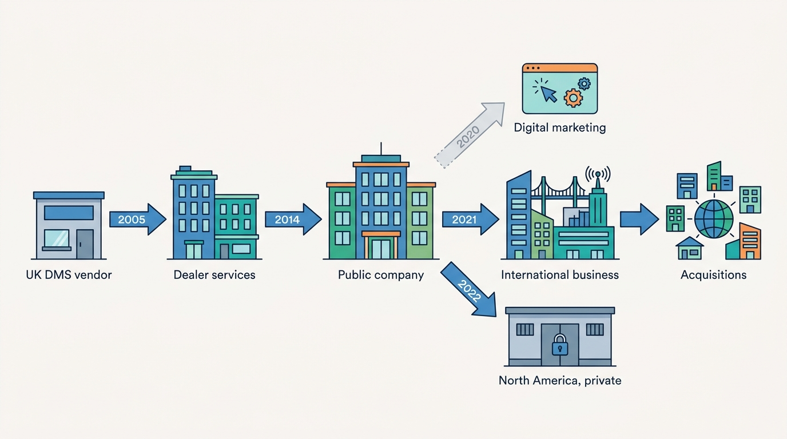
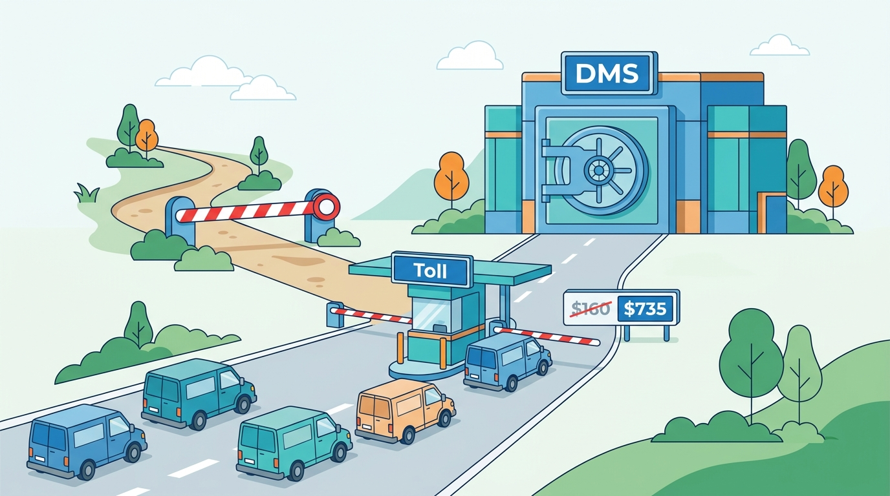
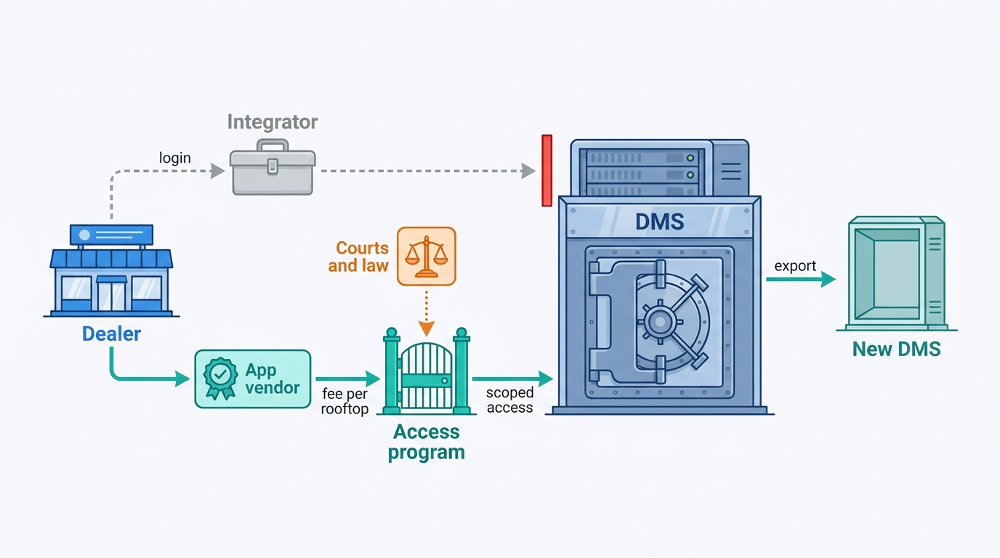
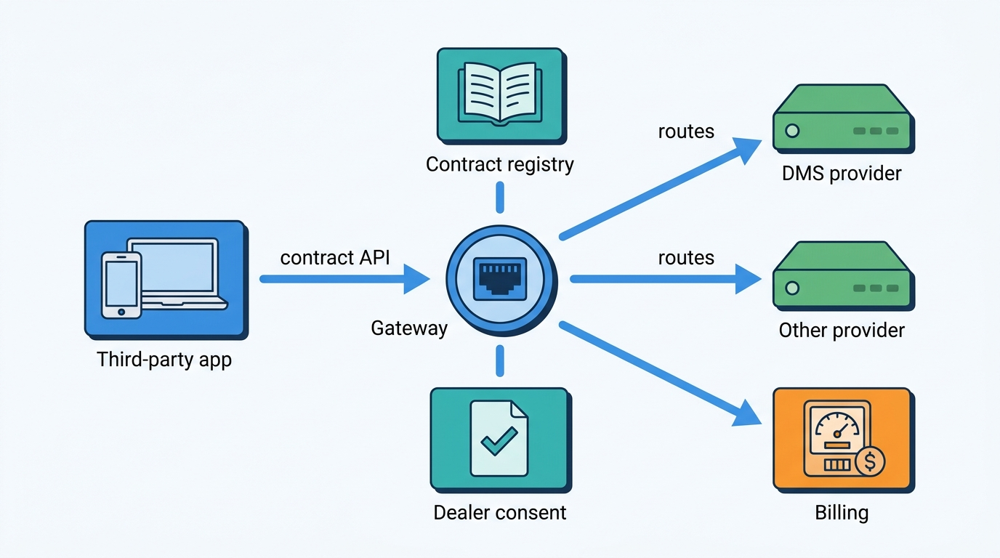
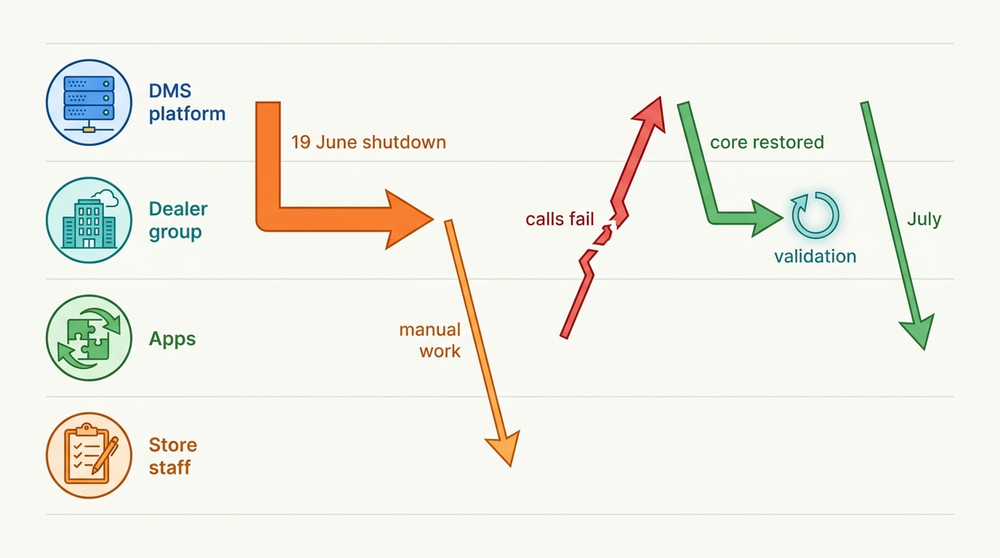
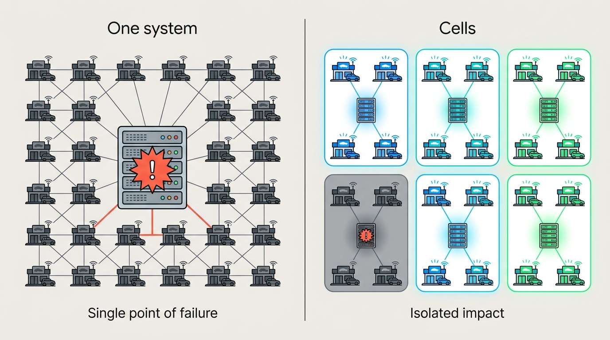

> **IN THIS CHAPTER, YOU WILL:** Read CDK Global's public record (its filings as a public company, two appellate opinions, an FTC challenge, its Fortellis platform documentation and its dealer customers' 2024 securities filings) as an architecture case. You will also follow Keyloop, the former CDK International, as the European branch of the same lineage, separate what is documented from the author's interpretation, and compare the case with the book's patterns and Axleby's choices.

> **WHY THE BUSINESS CARES:** In June 2024 one vendor's incident stopped the normal working of about 15,000 North American dealerships for one to two weeks, and dealer groups reported the cost in their quarterly results. Every dealer SaaS company integrates with a DMS it does not control, and every data company that becomes a system of record for its clients will be asked the same questions CDK was asked about access, fees and switching.

> **WHY ARCHITECTS SHOULD CARE:** No other dealer-software company has a public record this detailed about how access to a system of record is granted, priced, contested and restored after failure. It shows which integration designs survive litigation, regulation and a two-week outage, and which ones the dealer pays for.

> **KEY POINTS:**
>
> * **Access terms to a system of record are architecture, and courts and legislators now review them.** CDK closed its DMS to independent data integrators in 2015 and routed access through its own certified program. The result was a decade of antitrust litigation, a $100 million dealer-class settlement (2024), an Arizona statute that requires DMS vendors to offer a "standardized framework" for dealer-authorized access through an open API (upheld in 2021), and a 2024 suit by a rival DMS vendor over data transfers.
> * **A certified API marketplace separates the contract from the provider, but it is only credible with published terms.** Fortellis, which CDK launched in 2018, defines API contracts that any provider can implement and routes calls to the provider the user chooses. In Europe, Keyloop's Open Platform offers one interface across its DMS products, with endpoints that vary by DMS. No current fee schedule was found for either, and the market's trust follows the terms, not the technology.
> * **Concentration turns one incident into an industry outage, and integrations recover last.** In June 2024 core DMS functions came back at large dealer groups after about 7 to 11 days, while integrations for ordering, scheduling, payment and reporting took until the end of July. A platform that depends on a DMS needs a degraded mode measured in weeks, validation before it resynchronizes, and tolerance for the dealer cutting the connection on purpose.

> **[FAILURE PATTERNS THIS CHAPTER ADDRESSES](where-vehicle-platforms-go-wrong.html):**
>
> * **DMS Hostage** — CDK's record is the reference case: integrators whose products depended on scraping a closed DMS, dealers who could not take their data elsewhere easily, and vendors who saw integration prices rise severalfold after access was restricted.
> * **Borrowed Uptime** — in 2024, every dealer tool that called the CDK DMS synchronously stopped with it, and dealer groups ran on paper and workarounds for one to two weeks.
> * **Feed Roulette** — the 2015 lock-out and the Partner Program migration show what happens to integrators whose adapters run without a contract the system owner honors: breakage is discovered by the dealer.

 
CDK Global sells the **dealer management system (DMS)**, the enterprise resource planning (ERP) system of a car dealership: the system of record for its deals, accounting, parts, service, vehicle inventory and customers ([[dms-integration]] owns the term). In 2017 a US appeals court recorded that CDK held more than 40% of the US DMS market and Reynolds and Reynolds about 30%. That position makes CDK three things at once. It is a **platform** on which hundreds of third-party applications depend. It is a **gatekeeper** that decides which of those applications may read and write dealer data, on what terms. And, as June 2024 showed, it is a **single point of failure** for an industry.

This chapter asks three questions of CDK's public record. *How should the owner of a system of record grant access to the data in it, and what happens when it restricts that access? What does it take to turn a closed integration program into a marketplace that competitors trust? And what does a two-week outage of a system of record do to the applications around it?* A fourth question runs underneath: what the European branch, sold in 2021 and now called **Keyloop**, shows about how the same product line looks in more fragmented, manufacturer-shaped markets.

Axleby, the fictional vehicle data and dealer software group this book follows ([[meet-axleby]]), appears only in the final comparison. Axleby does not run a DMS. It sits on the other side of the gate, as a dealer SaaS vendor whose Lotwise product integrates with DMS products, and its own data APIs make it a smaller gatekeeper for 640 API clients. Both positions get a lesson.

## How to Read This Case

Part X cases follow stricter rules than the rest of the book. A **documented fact** carries its source and publication year in the sentence. **My interpretation** is marked as such or sits in the Chief Architect's view. A **reference-architecture inference** sits in a callout labeled `INFERENCE, NOT DOCUMENTED`. Undated web pages are cited as "read October 2026".

**The evidence falls into three periods, and they must not be read as one.** The public-company period (2014–2022) produced annual reports, quarterly reports and the antitrust record; CDK's last annual report covers the year to June 2021. Since Brookfield took CDK private in July 2022, CDK files no annual reports, so the record after 2022 comes from its customers' securities filings, court documents, press and its own product pages. The litigation record dates from 2017 to 2025 and describes business practices, not systems.

**The case is strongest on access, terms and the 2024 outage, and weakest on internals.** No public source found for this book describes CDK's hosting architecture, how its DMS is deployed per dealer, the attack vector in 2024 or what changed afterward. Keyloop's record is thinner still: press releases, its own site and a developer portal. "Where the Public Evidence Stops" lists the gaps.

## Timeline: CDK and Keyloop in Dated Events

Dates are those of the cited filings, opinions and releases. Litigation and product names are volatile as of October 2026.

| Date | Event | Source type |
| --- | --- | --- |
| 2005 | ADP acquires Kerridge, a UK DMS vendor; it becomes part of ADP Dealer Services | Encyclopedia; Keyloop site |
| 30 Sep 2014 | CDK Global begins operating as an independent public company, spun off from ADP | CDK 10-K, 2021 |
| 2015 | CDK moves from permitting to blocking independent data integrators; signs three agreements with Reynolds | Seventh Circuit opinion, 2017 |
| 1 May 2017 | Authenticom, an independent integrator, sues CDK and Reynolds | CDK 10-Q, 2021 |
| 6 Nov 2017 | Seventh Circuit vacates the injunction that had ordered access for Authenticom | Opinion, 2017 |
| Mar 2018 | Fortellis launches as CDK's API platform and marketplace | Equifax release, 2018 |
| 20 Mar 2018 | FTC challenges CDK's purchase of Auto/Mate, a smaller DMS vendor; the deal is abandoned | FTC release, 2018 |
| 2019 | Arizona enacts its dealer data law | Ninth Circuit opinion, 2021 |
| 20 Oct 2020 | CDK settles with Authenticom; one-time cash payment | CDK 10-Q, 2021 |
| 1 Mar 2021 | CDK International sold to Francisco Partners for $1.45 billion; renamed Keyloop | CDK 10-K, 2021; Keyloop release, 2021 |
| 25 Oct 2021 | Ninth Circuit affirms the denial of an injunction against Arizona's law | Opinion, 2021 |
| Mar 2021–Feb 2022 | Keyloop makes six acquisitions (RAPID RTC, enquiryMAX, MotorDocs, FISC, SilverBullet, SERTI) | Keyloop releases, 2021–2022 |
| 6 Jul 2022 | Brookfield Business Partners completes the purchase of CDK; enterprise value about $8.3 billion | Press, 2022 |
| Jan 2023 | Fortellis adds asynchronous APIs and a new API pricing model | CDK release, 2023 |
| 2 May 2024 | Keyloop completes its purchase of Automotive Transformation Group (ATG) | Keyloop release, 2024 |
| 19 Jun 2024 | Ransomware attack; CDK shuts down most systems | Dealer-group 8-Ks, 2024 |
| Aug 2024 | CDK agrees a $100 million settlement with the dealer class | Trade press, 2024 |
| Oct 2024 | Court orders CDK to transfer four Asbury dealerships' data to Tekion | Trade press, 2024 |
| 10 Dec 2024 | Tekion, a cloud DMS vendor, files an antitrust suit against CDK | Trade press, 2024 |
| 5 Oct 2026 | Sudhakar Ramakrishna succeeds Brian MacDonald as CEO (announced 27 August 2026) | Trade press, 2026 |

## What CDK Sells and Why Its Position Is Structural

### The DMS as system of record and OEM channel

In its 2021 annual report, its last as a public company, CDK described its DMS products as facilitating "the sale of new and used vehicles, consumer financing, repair and maintenance services, and vehicle and parts inventory management", plus "company-wide accounting, financial reporting, cash flow management, and payroll services". The Ninth Circuit, in 2021, was blunter: "The core of a DMS is a database containing information about a dealer's customers, vehicles, accounting, parts, and services. Some of that data, such as customers' social-security numbers and credit history, is highly sensitive."

Two facts make the DMS hard to replace. The first is that **it is also the manufacturer's channel**. CDK's 2021 report said its DMSs "are typically integrated with OEM data processing systems" (OEM: original equipment manufacturer, the carmaker) for ordering vehicles and parts, warranties and recalls, and the FTC's 2018 complaint explained that this is why DMS vendors need manufacturer certifications. A franchised dealer cannot swap its DMS the way it swaps a website provider.

The second is that **every other dealer application needs the DMS's data**. In the Ninth Circuit's words, "those third-party applications must be able to access the data stored in a dealer's DMS". Pricing tools need stock and cost, customer relationship management (CRM) systems need customers and deals, service marketing needs repair orders. Whoever controls that access controls the market for those applications.

### Scale and the layers around the DMS

CDK's 2021 annual report put revenue for the year to June 2021 at $1,673.2 million and described "nearly 15,000 retail locations in North America". Security press used the same order of magnitude in 2024. The report named the products in layers, summarized below.

| Layer | Product, as named publicly by 2021 | Role |
| --- | --- | --- |
| System of record | CDK DMS, "hosted enterprise resource planning applications" delivered as SaaS | Accounting, deals, parts, service, inventory, customers |
| Layered applications | Vehicle Sales, Fixed Operations, CRM including Elead, Document Management, Telephony | Workflows on DMS data |
| Digital retail | Roadster (acquired June 2021) | Online car buying |
| Third-party access | Partner Program, the successor of Third Party Access (3PA) | Certified vendor access to the DMS |
| API platform | Fortellis | API directory, marketplace and routing |
| Data | Neuron, "intelligent data platform" | No technical description found |

**The market is concentrated in a way Europe's is not.** The Seventh Circuit recorded US shares of more than 40% for CDK, about 30% for Reynolds and about 17% for Dealertrack, Cox Automotive's DMS ([[case-cox-automotive]]), at the time of the 2017 case. In 2021 the Ninth Circuit said CDK and Reynolds "control a substantial majority of the DMS market". Those are court recitals, not current market data; Tekion has since taken share, and no current audited figure was found.

**Figure 1:** *One product line, two companies since 2021: the North American DMS business stayed CDK Global and went private in 2022, while the international business, with its Kerridge roots, became Keyloop. A European reference to "CDK" before 2021 usually means today's Keyloop.*

## The Gatekeeper Years: From Open Access to Certified Interfaces

### What changed in 2015

The facts of the access dispute come from the Seventh Circuit's November 2017 opinion in *Authenticom v. CDK Global*. Independent integrators such as Authenticom worked by credential sharing: "An interested dealer would provide its log-in credentials to the integrator, which would then be able to pull data from the dealer's management system and provide it to an app vendor." Reynolds had long forbidden this in its licenses. CDK had permitted it and ran its own integrator subsidiaries, Digital Motorworks and IntegraLink.

In 2015 CDK switched from open to closed. The court recorded two reasons: a response to "well-publicized security breaches", and apparently "a desire to squeeze more value out of its internal integration program, 3PA". In the same year CDK and Reynolds signed three agreements. Under the Data Exchange Agreement, CDK agreed to wind down its integrator subsidiaries over five years, and each company agreed not to help anyone else access the other's system without permission. The court noted that "nothing in any of the three agreements required either CDK or Reynolds to block third-party access to its own data management system."

The opinion also recorded the price effect, as contested evidence at the injunction stage. One vendor paid independent integrators "$30 to $35 per month, per dealer" in 2011, when Reynolds charged $247 for similar services, which later rose to "$893". AutoLoop, a software vendor, said CDK charged it "$160 per month" before the 2015 agreement and "$735 per month for the identical service" after. The court added: "App vendors pass along these bloated fees to dealers."

| | Credential-based ("hostile") access | Certified interface |
| --- | --- | --- |
| Mechanism | Dealer gives its login to an integrator, which scrapes screens or pulls reports | Vendor-issued credentials and a documented interface |
| Who consents | The dealer | The dealer and the DMS vendor |
| License position | Breaches the license of a closed DMS | Contracted |
| Price (court record, to 2017) | $30–35 per dealer per month (2011) | $247 rising to $893 (Reynolds); $160 rising to $735 (CDK), per vendor per dealer per month |
| How it fails | Silent breakage when screens or reports change; blocked accounts; legal exposure | Scope and rate limits, certification delays, fees, vendor's discretion |
| Security story | Shared logins with broad access | Scoped credentials and an audit trail |

Both sides could claim to be right. Credential sharing is a poor security design. Certified access is the better design, but in this record it came with prices that rose severalfold and with the system owner deciding who may compete with its own applications. **The architecture question and the competition question are the same question here.**

**Figure 2:** *After 2015 the certified gate was the only sanctioned road to dealer data, and AutoLoop told the court its monthly charge for the same service rose from $160 to $735.*

### What the courts and the FTC did

The litigation record, summarized from the court opinions and CDK's own filings:

- **The injunction and its reversal (2017).** A Wisconsin district court ordered CDK and Reynolds in July 2017 to let Authenticom keep using dealer credentials. The Seventh Circuit vacated that order on 6 November 2017: the remedy for an unlawful agreement is to set the agreement aside, not to force a firm to deal with a rival. The court expressly did not decide the merits.
- **The consolidated litigation (2017–2025).** The cases were consolidated in Illinois. Plaintiffs included Authenticom, Motor Vehicle Software Corporation, Cox Automotive (December 2017), AutoLoop for a vendor class and a dealer class. CDK's filings record settlements with Cox (July 2019), Motor Vehicle Software Corporation (October 2019) and Authenticom (October 2020), all for undisclosed one-time payments, an antitrust provision of $90.0 million in fiscal 2019 and a further $12.0 million in fiscal 2021. In August 2024 CDK agreed to pay the dealer class $100 million without admitting fault, as trade press reported in 2024. The vendor class was certified against CDK in July 2024; its outcome was not verified for this book.
- **The FTC and Auto/Mate (2018).** On 20 March 2018 the Federal Trade Commission challenged CDK's purchase of Auto/Mate, a smaller DMS vendor that had won business with lower prices, flexible contracts and "modest fees to integrate third-party applications". The parties abandoned the deal. **Integration fees were part of what the regulator valued in the competitor.**

### Arizona writes the access rule into law

In 2019 the Arizona legislature unanimously passed a statute, described by the Ninth Circuit as enacted "to ensure that dealers retain control over their data" (Ariz. Rev. Stat. §§ 28-4651 to -4655). Its two central provisions read like an integration specification:

- DMS providers may not "take any action by contract, technical means or otherwise to prohibit or limit a dealer's ability to protect, store, copy, share or use" the dealer's data; may not charge "beyond any direct costs incurred" for access; and may not prohibit a dealer-authorized integrator that complies with industry security standards "from integrating into the dealer's data system".
- Providers must "adopt and make available a standardized framework for the exchange, integration and sharing of data" with authorized integrators, using an "open application programming interface" unless an API is "not the reasonable commercial or technical standard for secure data integration".

CDK and Reynolds challenged the law. On 25 October 2021 the Ninth Circuit affirmed the denial of a preliminary injunction, holding among other things that dealer data "consists of facts about dealers' customers and business operations" and that copyright "protects expression, not facts". The Arizona Attorney General's office reported that the vendors later dismissed their cases and that Montana and Oregon passed similar laws; this book did not verify the later statutes.

### Switching: the dispute moves from reading data to taking it away

The newest strand concerns not access by applications but the dealer's ability to leave. In October 2024 a court ordered CDK to transfer four Asbury Automotive dealerships' data to Tekion, after CDK had refused, as CBT News reported in December 2024. On 10 December 2024 Tekion filed a federal antitrust suit against CDK, accusing it, in the trade press's paraphrase, of "holding clients' data hostage" and "blocking data transfer to other platforms". Tekion's own announcement sought an injunction to facilitate data transfer "within 10 days of a dealership's request". The suit's status as of October 2026 was not verified for this book.

**Figure 3:** *Two paths to the same data. After 2015 the credential path was blocked and the certified path became the only sanctioned one; courts, the FTC and a state legislature then turned its terms, fees and the exit path into matters of public review.*

**My reading: the record turns three design properties of an access program into legal exposure.** These are who decides which applications may connect, what access costs relative to its direct cost, and how fast a dealer can take its data to a competitor. A system of record that controls all three for a concentrated market will eventually have them decided by someone else.

## Fortellis: Turning the Gate Into a Marketplace

CDK launched **Fortellis** in March 2018, with a Developer Network and a Marketplace connecting software developers, manufacturers and dealers; Equifax was among the first publishers of APIs. At the January 2019 NADA show CDK said it would charge no fees to join, publish APIs or market products, but would charge "a nominal transaction fee". That is seven-year-old pricing; the fee model has changed since, and no current schedule was found.

The design idea is written down in Fortellis's own documentation, read in October 2026. APIs "define the contract through which apps will be able to interface with Fortellis". "A single provider can implement several APIs, and each API can have any number of providers available." When an app calls an API, "Fortellis routes this call through to the appropriate provider". Providers supply "security information so Fortellis can attach appropriate security tokens", Fortellis verifies that providers implement the APIs they claim, and users choose which provider fulfils each API.

**Figure 4:** *Fortellis as documented: the contract is separate from the provider. The platform owns the contract, the routing, the token and the billing, and supply can in principle come from any system that implements the contract.*

In 2021 CDK's annual report described Fortellis as allowing CDK "and third parties to develop adaptive and interchangeable application programming interfaces". In January 2023 CDK announced asynchronous APIs "designed to meet needs for fast data updates, record synchronization and event-triggered workflows" and a new pricing model, as reported in its press release. The Fortellis home page, read in October 2026, claims "135+ published APIs", "425+" marketplace apps, "82K+ dealer integrations" and "6.7B+ API transactions per year", and links to "CDK Global Partner Program Migration" guides for software vendors and dealers. The page does not state a sunset date for the Partner Program.

> **INFERENCE, NOT DOCUMENTED:** The migration links suggest that CDK is moving integrations from its older Partner Program onto Fortellis contracts. If so, every certified vendor faces a forced migration of its adapter, with a period in which both paths run. No public source gives the timetable, the terms or the share of traffic already moved, and no source shows non-CDK DMS vendors implementing Fortellis contracts in production.

**My reading: Fortellis is the right architecture with a credibility problem that architecture cannot solve.** Separating contract from provider is what turns a vendor API into a marketplace: a contract registry with versions, provider certification, per-dealer subscription and consent, routing, and metering. The record in the previous section is why the market reads it skeptically. A marketplace run by the dominant provider is judged by its terms: whether fees are published, whether the owner's own applications use the same contracts at the same price, and whether a dealer can switch providers through it. The public record answers none of these.

## Narrowing to the Core, and the European Branch

### Divest everything except the system of record

Between 2020 and 2022 CDK narrowed. It sold its digital marketing business to Sincro in April 2020 and CDK International to Francisco Partners on 1 March 2021, booking a pre-tax gain of $965.6 million and moving to a single operating segment. It bought Roadster in June 2021 to let dealers "sell new and used vehicles completely online". In July 2022 Brookfield Business Partners completed its purchase at $54.87 per share, an enterprise value of about $8.3 billion, as widely reported in 2022.

**My reading: the DMS was the asset; everything else was negotiable.** CDK kept the system of record, the access program and the API platform, and bought the online-retail layer that sits directly on the deal. That is a coherent strategy for a system-of-record vendor. It also concentrates the company's value, and its customers' risk, in one system.

### Keyloop: the same lineage in fragmented markets

Keyloop's own site, read in October 2026, says it was founded as Kerridge in Hungerford, England, operated as ADP Dealer Services and CDK Global as it expanded across Europe, the Middle East, Africa and Asia, and was bought by Francisco Partners in 2021. At the sale, in a March 2021 release, Keyloop described itself as serving about 16,000 dealer sites in more than 90 countries, headquartered in the UK, with Tom Kilroy as chief executive.

Keyloop then bought, rather than divested. Its releases record RAPID RTC (lead management, Canada) and enquiryMAX (showroom software, UK) in March 2021, MotorDocs and FISC (UK) in 2021, SilverBullet (online retail, UK) in December 2021, SERTI (a Canadian DMS with more than 1,000 dealers) in February 2022, and Automotive Transformation Group (ATG, omnichannel retail) in May 2024. The SERTI release (2022) gave about 18,000 dealer sites in 100 countries; the ATG completion release (May 2024) gave more than 18,000 retailers and 80 OEMs in more than 90 countries. The 2026 site organizes the portfolio around a "Fusion Automotive Retail Platform" with sales, acquisition, vehicle and service hubs, and lists the Keyloop DMS and VEGA under "Operate".

Keyloop's access story is also programmatic. Its developer portal, read in October 2026 (copyright 2022), describes an **Open Platform** as "a single interface to dealer management systems across Europe, the Middle East, Africa and Asia". It warns that not all endpoints "are available or relevant for every dealer management system", lists API products by version, and refers partners to a security review process. A 2021 Keyloop advertisement feature in AM, a UK trade publication, said its partner program dated from 2018 and had 110 signed partners, 58 of them certified. No fee schedule was found.

> **INFERENCE, NOT DOCUMENTED:** "A single interface to dealer management systems", with endpoint availability that varies by DMS, reads as a facade over several DMS products that Keyloop inherited or bought, each with its own data model. That is the same shape this book recommends to dealer SaaS vendors for the opposite direction: one canonical contract, adapters per system behind it, and an explicit capability matrix. The portal does not describe the implementation.

Two documented facts show how different the European position is. In June 2024 Group 1 Automotive told the SEC that its UK dealerships "do not use CDK's dealers' systems and are therefore not impacted"; US dealer groups run different DMS products on each side of the Atlantic. And no report found for this book described any effect of CDK's 2024 incident on Keyloop customers, which is consistent with two companies that have been separate since 2021.

**What changes by market.** The table summarizes the DMS landscape a vendor like Keyloop competes in, and that a dealer SaaS vendor integrates with. Its sources are the DMS research brief behind [[dms-integration]]; vendor claims are as of 2026.

| | Netherlands / Belgium | Germany | United Kingdom | United States |
| --- | --- | --- | --- | --- |
| DMS market shape | Long tail of local vendors (Autoflex claims 2,400+ Dutch car businesses) plus brand-approved DMSs for franchised dealers | Most OEM-shaped: brand-affiliated systems such as CROSS (VW Group); Loco-Soft and incadea across brands | Independent vendors (Keyloop, Pinewood) compete for large groups | Concentrated: CDK, Reynolds, Dealertrack, Tekion |
| Where access is decided | Contract and the General Data Protection Regulation (GDPR); the EU Data Act's switching rules plausibly cover SaaS DMSs | As NL/BE, plus OEM certification | Contract and UK GDPR; the EU Data Act does not apply | Antitrust litigation and state dealer-data laws (Arizona, upheld 2021) |
| Concentration risk | Per vendor, narrower | Brand-wide where one DMS dominates a brand network | Per large vendor | Industry-wide (2024) |

The EU **Data Act** (Regulation (EU) 2023/2854, applicable from 12 September 2025) gives customers of "data processing services" a right to switch provider, with a transition period of at most 30 days after notice in the normal case and **no switching charges from 12 January 2027**. Whether a given SaaS DMS is in scope is a legal question; my judgement is that most are. In Europe, then, the switching question that Tekion is litigating in the US is being answered by regulation, and it applies to every dealer SaaS vendor too, not only to DMS vendors.

## June 2024: When the System of Record Went Dark

### What the filings show

CDK notified its dealer customers on 19 June 2024 that it had shut down systems in response to a cyber incident. Security press attributed the attack to the BlackSuit ransomware group. CyberScoop reported on 12 July 2024 that about 15,000 dealerships were affected, that at least six publicly traded dealer groups had reported impacts to the SEC, and that TRM Labs traced about 387 bitcoin (about $25 million) received on 21 June by a wallet likely controlled by BlackSuit, which "does not conclusively prove" a payment; CDK and Brookfield declined to comment. Press reported a second incident during recovery and phishing by people posing as CDK support. CDK has published no post-incident report.

The best evidence comes from the dealer groups' own filings, because securities law forced them to describe the effect:

| Dealer group | Filing | What it reported |
| --- | --- | --- |
| AutoNation | 8-Ks of 24 June and 15 July 2024 | DMS supports "sales, service, inventory, customer relationship management, and accounting functions"; stores stayed open "through manual and alternative means"; by 15 July DMS and core functions restored, but integrations that automate "ordering, scheduling, payment, and reporting" still limited, with restoration expected by end of July; the 15 July 8-K estimated the Q2 2024 earnings impact at "approximately $1.50 per share" before potential recoveries |
| Sonic Automotive | 8-K of 5 July 2024 | DMS, CRM and sales, inventory and accounting systems disrupted; resumed DMS transactions on 30 June after "internal risk assessments and data validation procedures"; CRM and "some third-party applications" still offline |
| Lithia Motors | 8-K of 24 June 2024 | Activated incident response and severed "business service connections between the Company's systems and CDK's"; CDK platform down "for a two-week period" (10-Q, August 2024) |
| Group 1 Automotive | 8-K of 24 June; 10-Q of 24 July 2024 | Core DMS restored 26 June "subject to certain modified procedures"; $5.9 million one-time compensation for field staff; UK dealerships unaffected |

Anderson Economic Group, a consultancy, estimated direct dealer losses in the order of $1 billion over the first three weeks, in successive 2024 estimates that are widely reported but not filings. Breach notifications to US state regulators reported small numbers of individuals. **On the public record, the damage was to availability, not mass theft of consumer data.**

### The recovery order

Reconciling the filings: core DMS functions were unavailable to large dealer groups for about 7 to 11 days, from 19 June to between 26 and 30 June, depending on when each group resumed after its own validation. Integrations and ancillary systems took up to about six weeks. CDK said on 12 July that all major applications were available.

**Figure 5:** *The documented recovery order: the system of record came back first, dealers validated before they resumed, and integrations followed weeks later. For an application vendor, the outage lasted until the last step, not until the DMS was back.*

> **INFERENCE, NOT DOCUMENTED:** The breadth of the outage and the decision to shut down "most systems" are consistent with a shared hosted environment in which many dealers' instances and the access programs depend on common infrastructure, identity and network paths. They are equally consistent with many per-dealer instances managed through common tooling. CDK has not described its hosting model, its blast-radius boundaries or what it changed afterward, and either reading is a reference-architecture inference.

**My reading: three lessons in the filings matter more than the attack itself.** First, **integrations are part of recovery, not an afterthought**: AutoNation's ordering and payment integrations returned about a month after the core. Second, **the customer will cut the connection on purpose**: Lithia severed its links before it knew the scope, and an integration must survive that and resume cleanly. Third, **dealers validated before they resynchronized**: Sonic resumed only after data validation, which means a dependent application needs a reconciliation step it can run on demand, not only a replay queue.

## Where the Public Evidence Stops

No public source found for this book answers these questions.

| Question | What is public | What is not |
| --- | --- | --- |
| How is the CDK DMS hosted? | "Hosted enterprise resource planning applications" delivered as SaaS (2021); "Cloud Connect" installations | Shared or per-dealer instances, regions, isolation boundaries, any cloud move after 2022 |
| What happened technically in 2024? | Dates, attribution by press, customer impact, restoration milestones | Initial access vector, scope of encryption, recovery architecture, changes made |
| What does access cost today? | 2011–2017 prices in the court record; "nominal transaction fee" (2019); a new pricing model (2023) | A current fee schedule for the Partner Program or Fortellis |
| Do other DMS vendors implement Fortellis contracts? | The multi-provider design in Fortellis's documentation | Production adoption by non-CDK DMS vendors |
| When does the Partner Program end? | Migration guides linked from Fortellis (2026) | Sunset date, terms, share of integrations moved |
| How does Keyloop's Open Platform work? | One interface; endpoints vary by DMS; security review | Architecture, event support, fees, adoption |
| How did the litigation end? | Settlements to 2024; Asbury order (2024); Tekion suit filed (2024) | Outcome of the vendor class and of Tekion's suit, as of October 2026 |

## Trade-offs the Case Illustrates

| Choice | What CDK's record shows | When it is right | When it fails |
| --- | --- | --- | --- |
| **Close the system of record to credential-based access** | Lock-out in 2015; security argument accepted as real by the court record; litigation for a decade | Shared logins are a genuine security risk and a sanctioned path exists at cost-based terms | The sanctioned path is priced at what the market will bear in a concentrated market |
| **Run a certified access program** | 3PA, then the Partner Program; certification and fees per vendor per dealer | Many vendors of uneven quality write into the system of record | Certification becomes a way to decide who may compete with the owner's own applications |
| **Turn the program into a contract-first marketplace** | Fortellis: contracts, multiple providers, routing, tokens, metering | The owner wants other systems to supply the same contracts and can show neutral terms | The owner is the only provider in practice and the terms stay private |
| **Divest everything except the system of record** | Digital marketing (2020) and international (2021) sold; online retail bought (2021) | The system of record is the defensible asset and the capital is better spent near it | Value and customer risk concentrate in one system |
| **Run one hosted system for a large share of a market** | About 15,000 dealers affected in 2024 | Operations at scale are cheaper and more consistent than thousands of on-premises installs | Blast radius is not bounded, so one incident is an industry outage |

## Failure Modes the Record Exposes

1. **The product built on someone else's goodwill.** Vendors that depended on credential-based access lost it in 2015 and paid severalfold more for the sanctioned path ([[dms-integration]]).
2. **Integration fees as a competitive lever.** The FTC counted Auto/Mate's "modest fees" as competition; fees far above cost, or different for the owner's own applications, attract courts and legislators.
3. **Exit as the last lock.** The Asbury order and Tekion's suit concern taking the data to a new DMS. A system of record without a complete, documented bulk export invites the same dispute.
4. **Recovery that ends at the core.** The dealer's effective outage was set by the slowest integration, and impostors posing as support used the recovery window for phishing ([[vehicle-platform-security]]).

## The Chief Architect's View

CDK's record gives me four decision rules, from both sides of the gate.

**If you integrate with a system of record you do not control, never let a core workflow depend on unsanctioned access.** Use the vendor's certified interface for anything a dealer relies on daily, accept its fees as a cost of goods, and treat credential-based access, where a vendor permits it at all, as a documented, dealer-authorized and time-boxed fallback. Record each dealer's authorization as data: who authorized which integration, for which rooftops, which scopes, under which contract and until when. That record is evidence in a dispute and a GDPR artifact.

**Design for a degraded mode measured in weeks, and reconcile before you resume.** The 2024 filings set the planning number: core back in one to two weeks, integrations in up to six. Keep a local copy of the stock, customers and documents your product needs, queue write-backs with expiry, show "pending in DMS" honestly ([[reliability-and-dependencies]]). Before replaying queued writes, compare counts, checksums and last-modified watermarks per rooftop, and raise discrepancies as tickets rather than overwriting ([[events-webhooks-and-sync]]).

**If you are the system of record, publish the terms before someone else writes them.** Arizona's statute is the clearest specification of what a regulator wants: a standardized framework, an open API, cost-based fees and no blocking of compliant, dealer-authorized integrators. I would offer that by design: a contract-first API with a public registry, published fees, the same contracts and prices for the owner's own applications, a consent registry the customer controls, and a complete bulk export with a published turnaround. In the EU the Data Act's switching rules point the same way.

**Bound the blast radius of anything a market depends on.** A hosted system of record for thousands of businesses needs cells: groups of tenants with separate infrastructure, credentials and recovery, so one compromise takes down a cell, not the market ([[tenancy-and-dealer-groups]]). The cost is real; the 2024 record prices the alternative.

**Figure 6:** *Cells bound the blast radius: in one hosted system a single compromise darkened about 15,000 dealerships, where separated cells would lose one group of tenants.*

## Comparing the Case to the Book's Patterns and to Axleby

CDK's record supports most of the book's DMS and reliability patterns and sharpens two of them.

| Book pattern or claim | CDK's record | Verdict |
| --- | --- | --- |
| Integrate with the DMS through certified interfaces behind an anti-corruption layer, one adapter per DMS family ([[dms-integration]]) | 2015 lock-out; price rises on the sanctioned path; Keyloop's capability matrix per DMS | Strongly supported; budget the fees |
| DMS Hostage: critical workflows depend on brittle or unsanctioned DMS access | Credential-based integrators cut off in 2015; switching contested in 2024 | Strongly supported, from both the integrator's and the dealer's side |
| Borrowed Uptime: synchronous calls to external systems multiply outages ([[reliability-and-dependencies]]) | 7 to 11 days for the core, up to six weeks for integrations (2024) | Strongly supported; the degraded mode must last weeks |
| Contract-first APIs with a registry, versioning and metering ([[vehicle-data-apis]]) | Fortellis's contract-provider separation | Supported as design; credibility depends on terms, which the book had underweighted |
| Record consent and license per party and purpose ([[data-licensing-and-governance]]) | Arizona's dealer-authorized access; the Asbury transfer order | Supported, and extended: consent must also cover exit |

Axleby's choices meet CDK's record from both sides. All Axleby facts below are fictional.

| Axleby situation (2027) | CDK parallel | What the case suggests |
| --- | --- | --- |
| Lotwise depends on **DriveDesk** for **1,900** rooftops; in the **DriveDesk Outage** (November 2027) DriveDesk was offline for **12 days** and Lotwise served as the fallback for stock, adverts and sales documents | 2024: core back in 7–11 days, integrations in up to six weeks | Twelve days is inside the documented range. Lotwise's fallback must also cover the weeks after DriveDesk returns, while the adapter reconciles 1,900 rooftops |
| The **Zombie Golf** (February 2027): a sold status from DriveDesk failed to sync and a Golf stayed live on **4** portals for **4 days** | Dealers resumed only after validating their data | A per-rooftop reconciliation of stock status against the DMS would have caught the missing sold event within a day; it is the same control Sonic used after the outage |
| The **Lost Leads of Velto** (September 2027): an inactive DriveDesk CRM queue returned success and discarded **1,460** leads | Lithia severed connections deliberately; integrations must tolerate disconnection | An acknowledgement from a DMS or CRM is not proof of delivery. Switchboard needs end-to-end receipts and dead-letter review ([[journey-lead-to-dms]]) |
| Axleby integrates DriveDesk, two German DMS products and several franchise-brand systems, mostly by files | Keyloop's one interface over many DMS products, with endpoints that vary by DMS | Axleby should keep a published capability matrix per DMS family so product managers and dealers can see what each adapter supports |
| Axleby Data is a system of record for **640** API clients; Connect XML, with **210** XML-only clients, is to be retired on **31 December 2029** | The Partner Program migration to Fortellis | Axleby is a gatekeeper too. Its sunset needs published dates, terms and a migration path, and its JSON API v2 contracts should be the same for Lotwise as for outside software vendors ([[modernizing-the-platform]]) |

**The sharpest lesson for Axleby concerns Velto Mobility Group.** Velto's **46** rooftops in the Netherlands and Belgium run DriveDesk, and three of the year's recurring incidents ran through that one dependency: the Zombie Golf, the Lost Leads and the DriveDesk Outage. CDK's record says the answer is not to replace the DMS. Cox Automotive bought a European DMS and sold it within about three years ([[case-cox-automotive]]). The answer is to treat DriveDesk as Lotwise's most important external dependency: certified access only, per-rooftop consent and scope records, a reconciliation job that runs nightly and on demand, a degraded mode designed for weeks, and an exit path for dealers that Axleby itself would accept as fair if it were the DMS. [[dms-integration]] makes those decisions; this case is the strongest public evidence for them.

## Questions to Ask

1. Which of our core dealer workflows depend on access to a DMS that its vendor has not sanctioned in writing? What happens to them if that access is blocked tomorrow?
2. For each DMS we integrate with, what do we pay per rooftop, what scopes do we have, and when does certification expire? Who owns that list?
3. Do we store each dealer's authorization for each integration as data, with rooftops, scopes, contract and expiry, and can we produce it in a dispute?
4. If our largest DMS partner is offline for two weeks, and its integrations for six, which of our features keep working, and for how long have we tested that?
5. Can we reconcile stock, deals and customers per rooftop against a DMS on demand, before we replay queued writes?
6. Where are we the system of record for someone else: API clients, dealers, data clients? Are our access terms, fees and export path published, and are they the same for our own products?
7. How long does a complete export of one dealer's data take, in what format, and at what charge? Would we accept that answer if we were the customer leaving?
8. What is the blast radius of our worst plausible incident: one tenant, one cell, one market, or every customer?

CDK's record shows a system-of-record vendor whose strength, controlling the dealer's data, became its legal and operational exposure. The next case, [[case-auto-trader-uk]], follows a company that began on the other side, as the consumer portal, and moved into data and software for the same retailers.

## Sources and Evidence

### Company, product and investor sources

- [CDK Global Form 10-K for fiscal year 2021](https://www.sec.gov/Archives/edgar/data/1609702/000160970221000058/cdk-20210630.htm), CDK Global (SEC EDGAR), 2021: spin-off date, product layers, Partner Program and Fortellis descriptions, Neuron, revenue, divestitures, Roadster, antitrust provisions, OEM integration.
- [CDK Global Form 10-Q for the quarter to 31 December 2020](https://www.sec.gov/Archives/edgar/data/1609702/000160970221000005/cdk-20201231.htm), CDK Global (SEC EDGAR), 2021: litigation parties, filing dates and settlements.
- [Fortellis home page](https://fortellis.io/), CDK Global, n.d. (read October 2026): platform scale claims and Partner Program migration links.
- [How Fortellis works](https://fortellis.io/node/91), CDK Global, n.d. (read October 2026): contracts, multiple providers, routing and tokens.
- [Equifax among inaugural developers in Fortellis](https://investor.equifax.com/news-events/press-releases/detail/204/equifax-among-inaugural-developers-in-fortellis-automotive), Equifax, 2018: Fortellis launch in March 2018.
- [CDK Global unveils technology updates at NADA Show](https://www.autoremarketing.com/ar/technology/cdk-global-unveils-technology-updates-nada-show), Auto Remarketing, 2019: Fortellis Marketplace fee model.
- [CDK Global introduces new modern API tools at NADA 2023](https://www.businesswire.com/news/home/20230123005590/en/CDK-Global-Introduces-New-Modern-Application-Programming-Interface-Tools-for-Developers-at-NADA-2023), CDK Global (Business Wire), 2023: asynchronous APIs and a new pricing model (widely reported; page not fetched).
- [International business of CDK Global becomes Keyloop](https://kyodonewsprwire.jp/release/202103021693), Keyloop (PR Newswire), 2021: sale price, dealer sites, countries, CEO.
- [Keyloop acquires leading DMS provider SERTI](https://prnewswire.co.uk/news-releases/keyloop-acquires-leading-dms-provider-serti-to-offer-full-service-automotive-digital-solutions-across-canada-816542499.html), Keyloop (PR Newswire), 2022: sixth acquisition, 18,000 dealer sites in 100 countries.
- [Keyloop completes the acquisition of Automotive Transformation Group](https://www.silicon.co.uk/press-release/keyloop-completes-the-acquisition-of-automotive-transformation-group-atg), Keyloop (Business Wire, via Silicon UK), 2024: ATG completion, 18,000+ retailers, 80 OEMs.
- [About Keyloop](https://keyloop.com/about-us), Keyloop, n.d. (read October 2026): Kerridge origin, history, acquisitions, product organization.
- [Keyloop developer portal](https://developer.keyloop.io/), Keyloop, n.d. (copyright 2022; read October 2026): Open Platform description and per-DMS endpoint availability.
- [Keyloop reaches 50+ certified partners in its global partner programme](https://am-online.com/news/latest-news/2021/04/13/keyloop-reaches-50-certified-partners-in-its-global-partner-programme-ad-feature), AM (Keyloop advertisement feature), 2021: partner program start and counts (widely reported; advertisement content).
- [AutoNation Form 8-K, 24 June 2024](https://www.sec.gov/Archives/edgar/data/350698/000035069824000078/an-20240619.htm) and [Form 8-K, 15 July 2024](https://www.sec.gov/Archives/edgar/data/350698/000035069824000085/an-20240715.htm), AutoNation (SEC EDGAR), 2024: DMS scope, manual operation, restoration order, estimated per-share impact.
- [Sonic Automotive Form 8-K, 5 July 2024](https://www.sec.gov/Archives/edgar/data/1043509/000104350924000060/sah-20240705.htm), Sonic Automotive (SEC EDGAR), 2024: affected systems, validation before resumption.
- [Lithia Motors Form 8-K, 24 June 2024](https://www.sec.gov/Archives/edgar/data/1023128/000102312824000079/lad-20240619.htm) and [Form 10-Q, August 2024](https://www.sec.gov/Archives/edgar/data/1023128/000102312824000104/lad-20240630.htm), Lithia Motors (SEC EDGAR), 2024: severed connections, two-week outage.
- [Group 1 Automotive Form 8-K, 24 June 2024](https://www.sec.gov/Archives/edgar/data/1031203/000103120324000048/gpi-20240619.htm) and [Form 10-Q, July 2024](https://www.sec.gov/Archives/edgar/data/1031203/000103120324000058/gpi-20240630.htm), Group 1 Automotive (SEC EDGAR), 2024: restoration date, staff compensation, UK unaffected.

### Standards, regulation and official documentation

- [Authenticom, Inc. v. CDK Global, LLC, Nos. 17-2540 and 17-2541](https://www.courtlistener.com/opinion/4440779/authenticom-incorporated-v-reynolds-and-reynolds-company/), US Court of Appeals for the Seventh Circuit, 2017: market shares, the 2015 agreements, integrator practice, prices, holding.
- [CDK Global LLC v. Brnovich, No. 20-16469](https://cdn.ca9.uscourts.gov/datastore/opinions/2021/10/25/20-16469.pdf), US Court of Appeals for the Ninth Circuit, 2021: DMS description, the Arizona Dealer Law's provisions, holding.
- [FTC challenges CDK Global's proposed acquisition of competitor Auto/Mate](https://www.ftc.gov/news-events/news/press-releases/2018/03/ftc-challenges-cdk-global-incs-proposed-acquisition-competitor-automate-inc), US Federal Trade Commission, 2018: integration fees as competition, abandoned deal.
- [Regulation (EU) 2023/2854 (Data Act)](http://publications.europa.eu/resource/celex/32023R2854), EU Publications Office (CELEX 32023R2854), 2023: switching between data processing services, transition period, switching charges abolished from 12 January 2027.

### Research and practitioner sources

- [Wallets tied to CDK ransom group received $25 million](https://cyberscoop.com/?p=81004), CyberScoop (A. Vicens), 2024: scale, attribution, traced payment, restoration statement.
- [CDK agrees to $100M settlement in dealership class action antitrust suit](https://www.repairerdrivennews.com/2024/08/21/cdk-agrees-to-100m-settlement-in-dealership-class-action-anti-trust-suit/), Repairer Driven News, 2024: dealer-class settlement, vendor-class certification.
- [Tekion slams CDK with a federal antitrust lawsuit](https://www.cbtnews.com/tekion-slams-cdk-with-a-federal-antitrust-lawsuit-citing-anticompetitive-practices-in-dms-market/), CBT News, 2024: Tekion suit and the Asbury transfer order.
- [Tekion files lawsuit against CDK Global's anticompetitive practices](https://www.businesswire.com/news/home/20241210707655/en/Tekion-Files-Lawsuit-Against-CDK-Globals-Anticompetitive-Practices), Tekion (Business Wire), 2024: relief sought (widely reported; page not fetched).
- [The CDK Global outage explained](https://www.techtarget.com/whatis/feature/The-CDK-Global-outage-Explaining-how-it-happened), TechTarget, 2024: second incident and phishing during recovery (widely reported).
- [Dealer losses due to CDK cyberattack](https://www.andersoneconomicgroup.com/dealer-losses-due-to-cdk-cyberattack-reach-1-02-billion/), Anderson Economic Group, 2024: dealer loss estimate (widely reported; consultancy estimate).
- [Attorney General Mark Brnovich's office obtains victory in defense of Arizona's data law](https://www.azag.gov/press-release/attorney-general-mark-brnovichs-office-obtains-victory-defense-arizonas-data), Arizona Attorney General, 2021–22: dismissal of the vendors' cases, similar laws in Montana and Oregon (widely reported; not fetched).
- [CDK Global](https://en.wikipedia.org/wiki/CDK_Global), Wikipedia, 2026: Kerridge acquisition, Brookfield terms (encyclopedia; secondary).
- [CDK Global names Sudhakar Ramakrishna CEO](https://www.cbtnews.com/cdk-global-names-sudhakar-ramakrishna-ceo/), CBT News, 2026: CEO succession effective 5 October 2026.

Axleby is fictional; architectural recommendations, labeled inferences and labeled assumptions are the author's judgement.
