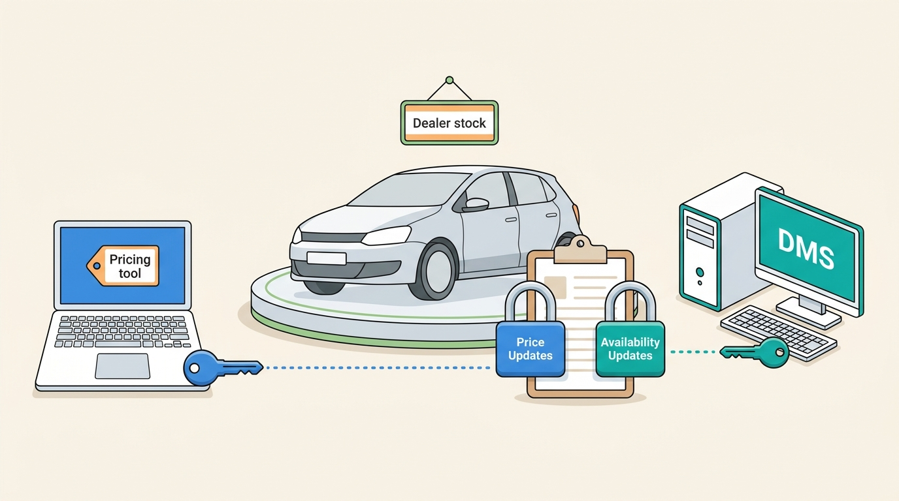
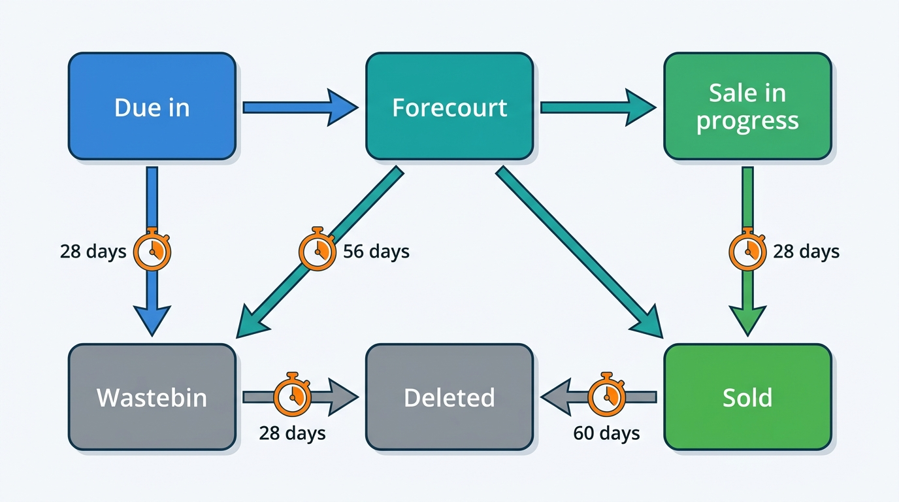

> **IN THIS CHAPTER, YOU WILL:** Read Auto Trader's public record (annual results from 2023 to 2026, its Connect developer documentation, engineering posts and trade-press reports) as the case of a marketplace that became a data and software supplier to UK car retailers. You will separate what Auto Trader documented, with dates, from the author's interpretation, and compare the case with the book's patterns and Axleby's choices.

> **WHY THE BUSINESS CARES:** Auto Trader charges about 14,000 retailer forecourts an average of £2,995 a month, and it has grown that figure for years by bundling data products (valuations, stock tools, AI listing content, an online deal flow) into the advertising package. Every vehicle-data or dealer-software business in the UK either competes with that bundle or integrates with it.

> **WHY ARCHITECTS SHOULD CARE:** Auto Trader publishes the contract of its retailer platform in unusual detail: capabilities granted per advertiser, stock lifecycle states with automatic expiry, a taxonomy key that valuations depend on, and a dated changelog of breaking changes. It also documents what happened when a bundled feature changed dealers' workflow without dealer-level control.

> **KEY POINTS:**
>
> * **The modules form a dependency ladder, and the taxonomy is the bottom rung.** Retail Essentials (taxonomy and stock sync, April 2022) came before Valuations (April 2023), Trended Valuations (April 2024), Co-Driver (2025) and Deal Builder in every package (2025). In the Connect API a valuation needs Auto Trader's derivative identifier and AI descriptions need specification fields, so each rung consumes the data of the one below.
> * **The partner API is the distribution channel, and its contract carries the business model.** Calls rose to 155 million a month from 220+ technology partners in the year to March 2026. The API grants capabilities per advertiser according to the retailer's subscription, expires stale stock automatically, and announces breaking changes in a dated changelog. Entitlements, lifecycle and change policy are parts of the product, not middleware.
> * **A bundled feature that moves control of a dealer's stock is a commercial change, not a release.** Deal Builder put reservations on retailers' cars by default. After the November 2025 dealer protest, Auto Trader paused auto-rollout and added "request a reservation", and the Deals API gained a `Requested` reservation state. Workflow features need per-retailer rollout, consent states and reversibility designed in before launch.

> **[FAILURE PATTERNS THIS CHAPTER ADDRESSES](where-vehicle-platforms-go-wrong.html):**
>
> * **Spec Guesswork** — Auto Trader's valuations, price flags and AI descriptions all key off a derivative identifier from its own taxonomy, the documented counter-example to valuing a car from its model name.
> * **The Zombie Listing** — the Stock API's lifecycle states expire unedited stock on fixed timers and refuse to mark a car sold while a deal is attached, two explicit rules against stale and conflicting stock.
> * **Feed Roulette** — more than 220 partners integrate through one published contract with capabilities, per-channel publish status and 30-day notice of breaking changes; the changelog shows what that discipline costs.

 
Most of this book's chapters treat the portal as a channel: a destination that Lotwise and Showroomly push adverts to and pull leads from ([[listing-syndication]], [[leads-and-crm]]). Auto Trader UK is the case where **the channel became the dealer's data and software supplier.** It started as a classified-advertising magazine and has been listed in London since 2015. By the year to March 2026 it sold valuations, vehicle checks, stock management, AI listing tools and an online deal flow to retailers, and opened all of them to third-party software through a public API.

The case matters to a Chief Architect for a reason beyond the UK. **It is the clearest documented example of a company that sells vehicle data and dealer workflow from one platform,** which is the combination Axleby, the fictional vehicle data and dealer software group this book follows ([[meet-axleby]]), is trying to build. Auto Trader got there from the opposite side: it had the audience and the advert data first, and built the data products and the workflow on top.

This chapter asks three questions of the public record. *In what order did the data and software products arrive, and what does each depend on? What does the published partner contract reveal about how the platform is run? And what did the Deal Builder dispute of November 2025 show about default-on workflow software?* It reads Auto Trader not as a marketplace but as a **retailer platform**, with the dealer and the dealer's software vendor as the customers.

## How to Read This Case

Part X cases follow stricter rules than Parts I–IX (see [[part-10]]). A **documented fact** carries its source and publication year in the sentence. **The author's interpretation** is marked "my reading" or sits in the Chief Architect's view. A **reference-architecture inference** sits in a callout labeled `INFERENCE, NOT DOCUMENTED`. Axleby appears only in the final comparison and is not a disguised Auto Trader.

**The evidence comes in three registers of very different age.** The annual results (2023 to 2026) are audited or regulated disclosures and the strongest source for products, dates and numbers. The Connect developer documentation is undated but carries a changelog running into September 2026; it is cited as "read October 2026" and treated as current but changeable. The infrastructure evidence (Google Kubernetes Engine and the Istio service mesh) dates from about 2019 and is vendor-authored, so it describes a platform of seven years ago, not today's.

**Naming.** The company styled itself "Auto Trader Group plc" in its May 2025 results and "Autotrader Group plc" in its May 2026 results, and its product is now "Autotrader Connect". This chapter uses "Auto Trader" for the company and quotes each source's spelling. Its financial year ends on 31 March: "FY2026" is the year to March 2026.

## Timeline: Auto Trader as a Retailer Platform

| Date | Event | Source |
| --- | --- | --- |
| c. 2019 | About one third of services on Google Cloud; back end on GKE with Istio; about 400 microservices | Google Cloud blog, February 2019; Istio case study, undated |
| Apr 2022 | Retail Essentials, "the first module of our Auto Trader Connect platform" | FY2023 results, June 2023 |
| Summer 2022 | Deal Builder trialed with "a handful of retailers" | FY2023 results, June 2023 |
| Apr 2023 | Valuations module: "specification adjusted valuations" in Retailer Portal and by API | FY2023 results, June 2023 |
| Jan 2024 | Deal Builder monetization trial at a 0.25% transaction fee | FY2024 results, May 2024 |
| Apr 2024 | Trended Valuations and enhanced Retail Check | FY2025 results, May 2025 |
| FY2024 | Full transition to public cloud reported complete; 65,000 software releases in the year | FY2024 results, May 2024 |
| Feb 2025 | Co-Driver APIs in production; VIN lookup added for selected manufacturers | Developer changelog, read 2026 |
| 1 Apr 2025 | Co-Driver included in retailer packages | FY2025 and FY2026 results |
| May 2025 | Deal Builder becomes part of the core advertising package, no longer charged per transaction | FY2025 results, May 2025 |
| 12 Nov 2025 | Dealer protest day against the Deal Builder rollout | Car Dealer Magazine, November 2025 |
| 19 Nov 2025 | Integrations API introduced; deal creation by API | Developer changelog, read 2026 |
| 16 Jan 2026 | `reservation` object added to the Deals API | Developer changelog, read 2026 |
| Jan 2026 | Buying Signals (lead-intent model) launched | FY2026 results, May 2026 |
| 28 May 2026 | Breaking change: deal notification type split; stock reservation fields removed | Developer changelog, read 2026 |
| 30 Nov 2026 | Scheduled breaking change: `vehicle.previousOwners` removed from Stock and Search | Developer changelog, read 2026 |

## The Business Underneath: One Price Per Forecourt

Auto Trader's FY2026 results, published 21 May 2026, report group revenue of £624.3 million, group operating profit of £392.7 million and a 70% operating margin in the Autotrader segment. Retailer revenue was £501.1 million. The unit that matters is **average revenue per retailer (ARPR)**, the monthly revenue per retailer forecourt, a forecourt being one advertising location, close to what this book calls a rooftop.

| | FY2023 | FY2024 | FY2025 | FY2026 |
| --- | --- | --- | --- | --- |
| Average retailer forecourts | 13,913 | 13,783 | 14,013 | 13,942 |
| ARPR (£ per month) | 2,437 | 2,721 | 2,854 | 2,995 |
| Technology partners integrated | 90+ | not stated | 120+ | 220+ |
| API and data-service calls | not stated | 22.1m per week | 91m per month | 155m per month |
| Deal Builder retailers at year end | trial | c.1,100 | c.2,000 | 6,700+ |

*Sources: Auto Trader full-year results, June 2023, May 2024, May 2025 and May 2026. FY2024 reported calls per week and FY2025 switched to per month, so the two are not directly comparable.*

Auto Trader explains ARPR growth with three levers: **price** (the annual 1 April pricing and product event), **stock** (the number of paid cars advertised) and **product** (packages and modules sold on top). For this book one property matters. **Auto Trader puts its data products inside the advertising package rather than selling them per call or per module.** Valuations, Co-Driver and Deal Builder arrived as package contents on an April pricing event, and the FY2026 results credit "the inclusion of Co-Driver within retailer packages" with most of that year's product-lever growth.

That is a different commercial model from the one [[dealer-and-data-economics]] describes for most continental vendors, which sell modules per rooftop plus per-report and per-lookup fees. **Bundling removes per-feature billing and creates a different obligation: every bundled feature is on for every retailer, so the platform must manage what each retailer receives by configuration and capability, not by invoice line.** The Connect API shows how that is done, and Deal Builder shows what happens when it is not enough.

## A Capability Ladder: What Each Product Depends On

Auto Trader's results date each retailer product to the pricing event that introduced it. Read in order, they form a ladder in which each rung consumes the previous one's data.

| Rung | Launched | What Auto Trader says it does | What it consumes |
| --- | --- | --- | --- |
| **Retail Essentials** | April 2022 | "Uses our proprietary taxonomy data to ensure that vehicles are well described" and "enables real-time stock management … on Auto Trader and all other digital channels" (FY2023) | Vehicle lookup by registration; dealer stock from dealer software |
| **Valuations** | April 2023 | "Specification adjusted valuations", based on "c.500,000 obervations [sic] that we see each day" (FY2023); "specification and condition adjusted" (FY2024) | Taxonomy derivative; advert and price observations |
| **Trended Valuations, enhanced Retail Check** | April 2024 | Forward-looking retail values; over 70% of retailers used trended valuations each month in FY2025 | Valuations plus time series of the same observations |
| **Co-Driver** | FY2025; in packages from 1 April 2025 | "An umbrella brand for a range of AI-enabled products": image ordering, generated descriptions, vehicle highlights | Specification, features, images, history fields of the stock record |
| **Deal Builder** | Trial 2022; core package from May 2025 | Buyers value a part-exchange, apply for finance and reserve a car | Stock, valuations (part-exchange), lender integrations |
| **Buying Signals** | January 2026 | A model "trained on verified but anonymised sales transactions and consumer interactions" that flags high-intent leads | Deals, enquiries, browsing events |

*Sources: Auto Trader full-year results, 2023–2026.*

**Figure 1:** *Auto Trader's retailer products as a dependency ladder, read from the dated results: nothing above the stock record works unless the car is first described in the taxonomy, and the valuation and intent models feed on the marketplace's own observations.*

**My reading** is that the order was not accidental. A valuation adjusted for specification needs to know the specification, so the taxonomy had to come first. An AI-written description is only as good as the specification and feature fields it is given. A deal with a part-exchange needs a valuation of the buyer's car. A lead-intent model needs deals and enquiries to learn from. This is the same ladder [[vehicle-capability-map]] draws for a vehicle platform in general: **identity and specification at the bottom, the dossier above it, then value, then workflow and automation.** Auto Trader is evidence that the ladder is climbed in order, one pricing event at a time.

The developer documentation confirms the dependency at field level. The Stock API documentation says "Setting the derivativeId will also enable valuation data to be generated" and "Features affect the Autotrader valuations and price indicator flag." The Co-Driver description endpoint requires `derivativeId`, `firstRegistrationDate` and, for electric cars, `batteryRangeMiles`, and recommends mileage, previous owners, service history and features "for a better result." **The derivative identifier is the key that every higher rung joins on.** That is the documented antidote to **Spec Guesswork**: the platform does not value or describe a car it has not first placed in its own taxonomy ([[specification-and-equipment]]).

## The Connect API as a Data Product

### What the platform exposes

The developer portal, read in October 2026, lists fifteen production APIs: Vehicles (lookup by registration or VIN), Taxonomy, Stock, Images, Co-Driver, Search, Valuations, Vehicle Metrics, Future Valuations, Historic Valuations, Deals, Messages, Part Exchange, Delivery and Calls. Advertisers, Integrations and Finance are in beta. Auto Trader's FY2026 results say the APIs "power manufacturer and retailer websites, business intelligence tools, point-of-sale systems and third-party applications." The retailer platform page says access is usually "through a technology partner, who usually manages the integration", or direct.

Grouped by what they do for a dealer, they map onto this book's contexts almost one to one.

| Group | Auto Trader APIs | This book's context |
| --- | --- | --- |
| Identify and describe | Vehicles, Taxonomy, Images | [[vehicle-identity]], [[specification-and-equipment]], [[merchandising]] |
| Value and judge | Valuations, Future, Historic, Vehicle Metrics | [[valuation-engine]], [[market-data]], [[used-car-pricing]] |
| Stock and publish | Stock, Search | [[inventory-and-vehicle-dossier]], [[listing-syndication]] |
| Assist | Co-Driver | [[ai-in-dealer-workflows]] |
| Sell | Deals, Messages, Part Exchange, Finance, Delivery, Calls | [[leads-and-crm]], [[deals-and-sales-documents]] |
| Govern the integration | Advertisers, Integrations | [[identity-access-and-entitlements]], [[vehicle-data-apis]] |

### Entitlements live in the API contract

The most instructive part of the contract is how it decides what a partner may do. The documentation describes **advertiser capabilities**, which define which Connect features a partner may use on a given advertiser's behalf and which "depend on advertiser subscriptions." Stock writes are split into three capabilities: "Stock Updates", "Availability Updates" (reservation status and lifecycle state) and "Price Updates". Co-Driver has separate "Co-Driver Images" and "Co-Driver Descriptions" capabilities. The Integrations API, introduced on 19 November 2025, shows a partner which integrations and capabilities it holds, and since June 2026 also carries each partner's notification configuration: a URL, a `rateLimit` and an `enabled` flag per notification type.

**My reading** is that this is a relationship-based entitlement model exposed to partners: *partner P may perform action A on advertiser R's stock because R's package includes feature F and R has authorized P.* It is the shape [[identity-access-and-entitlements]] recommends, and it is the reason a bundled business can still differentiate packages. Splitting "Availability Updates" from "Price Updates" also matters: a pricing tool can be allowed to change prices without being able to mark a car sold, and a DMS integration can mark a car sold without touching its price.

**Figure 2:** *Splitting stock writes by consequence lets a dealer give a pricing tool the price key without the power to mark a car sold, and give its DMS the availability key without the power to change the price.*

Authentication is simple and strict: a key and secret buy a bearer token that expires after 15 minutes, credentials unused for 90 days are removed, and a separate sandbox host keeps testing off production quotas.

### The stock record has a lifecycle with timers

The Stock API documents six lifecycle states and the automatic transitions between them.

**Figure 3:** *The Connect stock lifecycle as documented (October 2026). The timed transitions are documented; the dealer-set transitions are simplified. Stock that nobody touches drifts toward deletion on fixed timers, so a forgotten car cannot stay advertised forever.*

Three further rules are documented. Stock in `SOLD`, `WASTEBIN` or `DELETED` cannot be published, and its adverts must first be set to `NOT_PUBLISHED`. A car cannot be set to `SOLD` or `DELETED` while a deal is attached. And each channel has its own publish flag under `retailAdverts` (`autotraderAdvert`, `advertiserAdvert` for the dealer's own website, `locatorAdvert`, `exportAdvert`, `profileAdvert`), plus `dealerAuctionAdvert` for trade, each with its own status. The Auto Trader advert status can come back `CAPPED` (the retailer's contract limit is reached) or `REJECTED` (a rule breach, with the reason in a message field).

**My reading** is that the stock record is a **desired-state record with per-channel status**, the design [[listing-syndication]] argues for: the dealer's software says which channels a car should be on, and the platform reports, per channel, whether it is. `CAPPED` turns the commercial contract (how many cars the package pays for) into a state the dealer's software can see, which is the stock lever of the business model made visible in the API. The timers are a blunt but effective defense against **The Zombie Listing**: a car sold in a dealer management system (DMS) that never sends the update will still leave the forecourt state eventually. Blunt, because 56 days is a long time for a sold car to stay live; the timers are a backstop, not a substitute for the sold event.

### The change policy and its costs

The documentation states that breaking changes are announced at least 30 days ahead, and lists what counts as breaking (removing properties or services, adding mandatory parameters, moving errors between status classes, adding validation errors, changing the authentication model) and what does not (new endpoints, optional parameters, new properties), which clients must tolerate without notice. The changelog shows the policy at work.

| Date (changelog) | Change | What it tells an architect |
| --- | --- | --- |
| 20–21 Mar 2025 | Removal of an `expires` field from authentication responses; rolled back the next day and rescheduled for 31 March | Even a field removal announced in advance breaks someone; a rollback path is part of the policy |
| 14 Apr 2025 | `clientId` removed from stock notifications; `changedFields` added | Notifications say what changed, so partners can avoid re-reading the whole record |
| 28 May 2026 | Deal notification type `DEAL` split into `DEAL_CREATE` and `DEAL_UPDATE`; `consumerReservationFeeStatus` and `stock.reservationStatus` removed | A product redesign (reservations) surfaced as a breaking API change six months later |
| 30 Nov 2026 | `vehicle.previousOwners` removed from Stock, Search and notifications in favor of `history.previousOwners`; failed vehicle lookups return 200 with empty results instead of 404 | Data moves to the context that owns it; error semantics are part of the contract |

*Source: Autotrader Connect developer documentation, changelog read October 2026.*

**My reading** is that 30 days is short for an ecosystem in which, by the platform page's own account, a technology partner "usually manages the integration". A change reaches a retailer only when its partner ships, so a 30-day window works only if Auto Trader can see which partners still use the old field. Nothing public describes whether it can. [[vehicle-data-apis]] treats per-client usage visibility as a precondition for any sunset policy, and Axleby's plan to retire its XML API in 2029 rests on it.

> **INFERENCE, NOT DOCUMENTED:** a partner platform of this shape usually needs a capability registry (advertiser, partner, package feature), a gateway that checks capabilities per request, a usage log per partner and field for deprecation tracking, and a notification service with per-subscriber rate limits and replay. Auto Trader documents the capabilities, the rate-limit setting and `changedFields`; how it implements the rest, including retry and signature behavior for notifications, is not in the documentation read for this book.

### Requirements, by interaction

The documentation states few latency or freshness numbers; the right-hand columns are the author's illustrative targets, not Auto Trader's.

| Interaction | Documented behavior | Consistency need | Illustrative freshness target *(assumption)* |
| --- | --- | --- | --- |
| Vehicle lookup at appraisal | Synchronous lookup by registration or VIN, with optional valuation, metrics and features | Read-only; may be cached briefly | Sub-second response |
| Price change from a pricing tool | "Price Updates" capability; per-channel status returned | Last writer wins per field; must reach the advert quickly | Live within minutes |
| Car sold in the DMS | "Availability Updates"; cannot sell while a deal is attached | Must not conflict with an open deal | Withdrawn within minutes; timers as backstop |
| Deal or reservation event | Deal notifications, `DEAL_CREATE` and `DEAL_UPDATE` | Exactly one deal per reservation; dealer must see it | Seconds to minutes |
| Trended valuation for stock | 30-, 60- and 90-day retail forecasts on the stock record | Eventually consistent | Daily |

## Valuations From One Market's Observations

Auto Trader's valuations rest on what its marketplace observes. The FY2023 results describe machine-learning valuations "based on c.500,000 obervations [sic] that we see each day"; the FY2026 results describe consumer-facing "specification adjusted valuations underpinning our price flags", and independent valuations for a private sale, a part-exchange, a sale to a retailer or a retailer auction. The developer documentation, read October 2026, shows four value types on a vehicle lookup (`retail`, `trade`, `partExchange` and `private`), the first three with amounts excluding VAT and a no-VAT variant for commercial vehicles; a lookup requires `odometerReadingMiles`. Stock records can carry a market average and an adjusted value, and trended values at 30, 60 and 90 days. Future and historic valuations exist as separate APIs. Vehicle Metrics adds a Retail Rating, days-to-sell adjusted for price, and a `confidenceOfSale` that takes `daysInStock` and `targetDaysToSell` as inputs.

**My reading** is that Auto Trader sells **a family of related values, each tied to a decision**: what to pay at part-exchange, what to ask on the forecourt, what the car will be worth in 60 days, and how likely it is to sell in the dealer's target time. That matches the value types [[valuation-engine]] defines, and it puts the dealer's own target (days to sell) into the request.

**The data moat follows the market's structure.** One dominant portal sees most UK retail adverts, so its own observations can carry a retail valuation. Auto Trader's FY2026 results argue the point itself: its models depend on "deep technical integrations including vehicle checks, integrated retailer finance offers, and integrations with manufacturer production systems, all of which … are generally specific to the UK." In the Netherlands and Germany, adverts are spread across several portals, so valuation providers aggregate across portals and countries ([[market-data]]).

The public record is thin where a valuation architect would look first. Auto Trader's help center (article of January 2024, updated August 2026) reports forecast accuracy of 99%, 97% and 95% at one, three and six months, but measured **against its own later valuation, not against sale prices**, and without defining the metric ([[valuation-engine]]). No source read for this book publishes error against realized sales, confidence intervals or drift monitoring, and the LISTED case notes that a price flag that feeds ranking and dealer pricing becomes a control loop on the market it measures. **A valuation sold to 14,000 retailers who price against it, and shown to buyers as a price flag, shapes the prices it later learns from.** The Chief Architect's view returns to what that implies.

## Co-Driver: AI That Writes Into the Stock Record

Auto Trader's FY2025 results introduced Co-Driver as "an umbrella brand for a range of AI-enabled products": Smart Image Management, AI Generated Descriptions and Vehicle Highlights. From the 1 April 2025 pricing event it was in every retailer package. The FY2026 results report that 86% of retailers had used a Co-Driver tool since launch, 1.9 million descriptions had been generated, 700,000 smart image re-orders, and 66% of retailers used it in the last 30 days; "anecdotally", listing time fell from 28 minutes to 5 across more than 340,000 vehicles uploaded a month.

The API shows how the AI is placed in the workflow. The description endpoint returns generated text; **to keep it, the client writes it to the stock record through the Stock API.** The image endpoint returns the images in a recommended order with classification tags and marks missing images with a null identifier; the client then applies the order through the Stock API. Highlights, at most three per car, are derived from specification and features and can be matched to feature ratings for rarity and value.

**My reading** is that this is a deliberate control boundary: the model proposes and the retailer, or the retailer's software, commits. The dealer remains the author of the advert, which keeps responsibility for what the advert claims where it already sits. That is the pattern [[ai-in-dealer-workflows]] recommends for agents acting on dealer accounts: proposals as data, writes through the same permissioned API as human edits, and separate capabilities for each AI function. It also explains why Co-Driver could ship as a bundle addition with little reported friction. **It saved retailers time on work they already did, inside a record they already controlled.**

The FY2026 results also mention an AI platform, more than 50 proprietary AI and machine-learning models, and a ChatGPT app integration via the Model Context Protocol (MCP). Nothing public describes how Co-Driver's outputs are evaluated or how wrong claims in generated descriptions are caught.

## Deal Builder: Workflow Software on the Dealer's Stock

### What Deal Builder is, as documented

Deal Builder lets a buyer value a part-exchange, apply for finance and reserve a car online (FY2025 results). Auto Trader reports its growth: about 1,100 retailers and 16,000 deals in FY2024; about 2,000 retailers, 84,000 vehicles and 49,000 deals in FY2025; and more than 6,700 retailers, 175,000 vehicles and 137,000 deals with a full reservation in FY2026, with deals converting "at double the rate into sales" (FY2025). The FY2026 results add that Auto Trader had "started onboarding some of our largest customers with custom integrations."

The Deals API, read October 2026, describes the deal as an aggregate with components. A deal links by identifier to `messages`, `financeApplication`, `partExchange`, `calls` and `delivery`. It has two status fields, `advertiserDealStatus` and `consumerDealStatus`, each "In progress", "Cancelled" or "Completed"; a cancellation needs a reason from a fixed list (Different Vehicle, Unaffordable, Not Interested, Went Elsewhere, Not Available, Condition, Poor Customer Service, Other). The price is recorded at creation as supplied price, admin fee and total. A `reservation` has a status of `Reserved`, `Requested` or null, a fee of £99 or null, and a fee status of `Held` or `Refunded`. Consumer details can appear masked after a right-to-be-forgotten request.

**My reading** is that two status fields, one per party, are the most important modeling choice here. The dealer and the buyer can each end the deal, for different recorded reasons, and neither side's view overwrites the other's. That is the shape [[deals-and-sales-documents]] recommends for a deal that spans a marketplace and a dealer's own systems, and the fixed reason list turns lost deals into data a model can learn from, as Buying Signals does.

**Figure 4:** *How a Deal Builder deal plausibly reaches a dealer's systems through a partner integration. The notification types, statuses and components are documented; the DMS steps are a reference-architecture inference, not Auto Trader's documented flow.*

### Finance: the bottleneck is the partner, not the platform

The FY2025 results describe building "a robust, scalable automotive finance platform" that supports "two-way full real-time finance applications and approval with an e-signature." They name the constraint precisely: "the time taken to secure lender agreement and for them to prioritise and undertake the technical work to integrate." **My reading** is that this is the dealer-software lesson of [[dms-integration]] in another form. When the critical step depends on a third party's integration roadmap, the platform's own throughput does not set the pace, and the design should treat each lender as an asynchronous, partner-paced adapter with its own onboarding state.

### November 2025: when a default changes the dealer's workflow

In May 2025 Auto Trader made Deal Builder "part of our core advertising proposition" that "will no longer be monetised per transaction" (FY2025 results). The rollout to every retailer followed. Car Dealer Magazine reported on 13 November 2025 that dealers protested the mandatory rollout, the £99 buyer-paid reservation, changes to contact buttons and a requirement that buyers create an account before an enquiry. The protest day was 12 November 2025. Auto Trader said cancellations were "less than 100", the organizers' group had more than 3,300 members, and the shares fell 14.6% over five days, as reported. Auto Trader denied that reserved cars were taken off sale: they showed "reservation in progress", and either side could cancel.

Auto Trader's own account, in the FY2026 results of May 2026, is specific. Its response included "pausing auto-rollout; holding open listening sessions; establishing customer advisory groups; and introducing 'request a reservation'." Average forecourts were 236 (1.7%) lower in the second half. The stock lever turned negative because "from November 2025, prompted by the speed and nature of our Deal Builder product and reflecting more difficult trading conditions, a number of retailers reduced the number of vehicles advertised." The stock lever reduced ARPR by £48 in FY2026, and the FY2027 outlook expects it to stay negative, improving to minus £30–40.

The API record shows the same change from the integration side. The `reservation` object was added to the Deals API on 16 January 2026, with `Requested` as a status alongside `Reserved`. On 28 May 2026 the stock-level `reservationStatus` and `consumerReservationFeeStatus` fields were removed and the deal notification type was split.

**My reading** is that the dispute was less about a feature than about **who controls the availability of the dealer's stock.** A reservation is a state on a car that the dealer owns, sells in other channels and records in its own DMS. Under auto-rollout, the platform could put that state on the car without the dealer's assent, and every partner integration and DMS then had to cope with a state its dealer had not asked for. `Requested` is a consent state: the buyer asks, the dealer decides. Four architectural lessons follow, and they apply to any group that bundles workflow into a subscription.

| Lesson | What the record shows | Design consequence |
| --- | --- | --- |
| Rollout is a commercial act | Auto-rollout was paused after the protest | Per-retailer rollout cohorts, opt-in or opt-out, and a kill switch per account and per feature ([[onboarding-and-configuration]]) |
| A state the platform sets on dealer stock needs dealer assent | `Requested` added beside `Reserved` | Model consent as a state in the deal or stock lifecycle, not as a setting |
| Partners carry the change | Reservation fields moved and removed in the API months after the product change | Ship the contract with the feature; give partners the states before retailers see them |
| The customer's counter-move is cheaper than churn | Retailers cut advertised stock rather than leaving | Measure feature adoption and paid stock per retailer together; a fall in stock is the early signal |

**Figure 5:** *The dispute was about who controls the availability of the dealer's stock: a platform-set Reserved state took that decision from the dealer, and the Requested state returned it.*

**Deal Builder is dealer software delivered by a marketplace.** Valuations and Co-Driver added information to a workflow the dealer already ran; Deal Builder changed the workflow, which is why the bundling model that worked for the first two met resistance on the third.

## The Platform Underneath

The infrastructure evidence is old and vendor-authored. Google Cloud's February 2019 blog reports that Auto Trader chose Google Cloud in 2018 and by early 2019 ran about a third of its services there, on GKE with Istio, starting from "two large data centers, a private cloud, and older infrastructure" (Google customer story, undated). Istio's undated case study reports about 400 microservices, over 30,000 requests a second, and a delivery-platform team of ten serving over 200 developers who made 200–250 deployments a day. Auto Trader's own results report the move to public cloud complete and 65,000 releases in FY2024, and, in FY2026, "a modern cloud-based delivery and data platform based largely on open-source technologies", with other costs up 13%, "mainly driven by higher cloud infrastructure expenditure and property costs."

The 2026 engineering blog fills in the data platform. Behavioral events are collected with Snowplow, validated against schemas and loaded into a Delta table on Google Cloud Storage, with failed events kept in a separate table for recovery (June 2026). The company is moving from batch processing with dbt and Spark toward streaming; one rule set that defines valid, non-bot traffic is generated as two semantically identical views for BigQuery and Spark (July 2026). A rule-based customer data platform from 2021 is being replaced by Python models in Spark Structured Streaming, at a scale of "1 million visitors generate 7 million ad views and submit 6,600 leads" a day (August 2026).

**My reading** is that two practices transfer: a small central delivery-platform team serving hundreds of developers ([[organizing-engineering]]), and **one definition of a governance rule compiled into every engine that needs it**, so batch and streaming agree on which events count, as billing must agree on which calls count ([[billing-and-metering]]).

## Failure Modes the Record Exposes

1. **Stale stock that nobody closes.** The lifecycle timers bound the damage at 28 to 60 days: a backstop, not freshness.
2. **A deal that conflicts with a sale.** Forbidding `SOLD` while a deal is attached prevents a reserved car being sold elsewhere silently, but a dealer who sold the car on the forecourt must first cancel the deal, with a reason, before the stock record can follow.
3. **Breaking changes that reach retailers through partners.** The March 2025 authentication change was rolled back within a day; the May 2026 reservation changes broke any partner reading the removed fields. With 220+ partners, every breaking change is a fleet migration.
4. **Default-on workflow without dealer control, and third-party pace.** The Deal Builder protest and the negative stock lever are the documented costs of the first; lender integration work, named as the finance bottleneck, is the second. Privacy rules also reach the contract: previous owners moved to the history context and consumer details are masked after an erasure request ([[privacy-and-retention]]).

## Trade-offs the Case Illustrates

| Choice | Auto Trader's record | When it is right | When it fails |
| --- | --- | --- | --- |
| **Bundle data products into the advertising package** | Valuations, Co-Driver and Deal Builder added through April pricing events | One dominant channel; products add information to the dealer's existing workflow | The product changes the workflow or shifts control of stock; dealers cut paid stock |
| **Build valuations from the marketplace's own observations** | c.500,000 observations a day (2023); price flags on the consumer site | The portal sees most of the market's retail adverts | The market is split across portals; the model shapes the prices it learns from |
| **Publish a partner API with per-advertiser capabilities** | 15 production APIs; capabilities tied to subscriptions; 220+ partners | Most dealers integrate through vendors; packages must differ | Capabilities diverge from what billing and the UI believe |
| **Expire stale stock on timers** | Documented lifecycle timers | Partners and DMS links are unreliable about sold events | Timers are mistaken for freshness; a sold car stays live for weeks |
| **AI proposes, client commits** | Co-Driver returns text and image order; the client writes them | Responsibility for advert content stays with the dealer | Partners write AI output unreviewed, and the boundary exists only on paper |
| **30-day notice for breaking changes** | Documented policy and changelog | Few, active, well-staffed partners | A long tail of partners ships slowly and retailers discover the break |

## What Changes Outside the UK

Auto Trader's model depends on the UK market's structure. The comparison below uses the case brief's evidence and labels judgement.

| Dimension | Netherlands / Belgium | Germany | United Kingdom | United States |
| --- | --- | --- | --- | --- |
| Portal structure | Consolidating: AutoScout24 bought AutoTrack and Gaspedaal.nl (November 2025); dealers multi-home across many channels through syndication | mobile.de and AutoScout24 compete | One dominant marketplace, by its own account 11 times its nearest competitor by time on site (FY2026) | Several marketplaces (Cars.com, CarGurus, Autotrader under Cox Automotive) |
| Who sells valuations | Data specialists (VWE, Autotelex, Indicata) *(judgement)* | DAT and Schwacke dominate *(judgement)* | The marketplace itself | Separate brands (KBB, Black Book, J.D. Power) *(judgement)* |
| Data moat | Register access and aggregated adverts across portals | Build data and valuation history | One portal's own adverts and buyer behavior | Contributory history networks, auction data |
| Power over dealer workflow | Low for any single portal *(judgement)* | Shared between two portals *(judgement)* | High: one portal can push a workflow change to most dealers | Spread across marketplaces and DMS vendors |

**My judgement:** the parts of Auto Trader's design that travel are the **contract mechanics**: taxonomy-keyed stock, per-advertiser capabilities, lifecycle states with per-channel status, AI that proposes rather than commits, and a dated change policy. The parts that do not travel are the **economics**: valuations built from one portal's adverts, and a bundle that dealers accept because they cannot advertise without it. In the Netherlands and Belgium the workflow is split between register-connected data providers, several portals and dealer software, so a platform must earn its place module by module.

## Where the Public Evidence Stops

| Question | What is public | What is not |
| --- | --- | --- |
| How accurate are the valuations? | Value types, observation volume (2023), trended and future values; forecast accuracy of 99/97/95% at 1/3/6 months against Auto Trader's own later valuation (2024, updated 2026) | Error against realized sales, the accuracy metric's definition, confidence intervals, drift monitoring, retraining cadence |
| How are notifications delivered? | Types, `changedFields`, per-type rate limit and enabled flag | Retries, ordering, signatures, replay window |
| How are capabilities enforced? | Capabilities per advertiser, dependent on subscription; Integrations API | Where checks run; how they stay in step with billing |
| How do partners migrate? | 30-day notice; dated changelog; one rollback | Per-partner usage tracking; how many partners missed a change |
| How was Deal Builder rolled out? | Auto-rollout paused; advisory groups; "request a reservation" | Cohort design, opt-out mechanics, rollout tooling |
| What runs the platform today? | Cloud complete; open-source delivery and data platform; AI platform | Current service count, traffic, cluster topology (the best numbers are from about 2019) |
| How is Co-Driver evaluated? | Usage figures; API boundary | Evaluation method, error handling for wrong claims, model providers |

## The Chief Architect's View

Auto Trader's record gives me five decision rules.

**Climb the ladder in order, and make each rung's key explicit.** Taxonomy and stock first, then value, then AI and transactions. I would not sell a valuation or let a model write an advert for a car that is not resolved to a specification key, and I would make that key mandatory in the API rather than optional.

**Put entitlements in the contract, not just in the UI.** Capabilities per partner, per customer and per action are what let a bundled or modular business differentiate packages and let dealers grant a pricing tool less power than a DMS. I would split stock writes by consequence, as Auto Trader does with availability and price, and make the capability set visible to partners.

**Treat a state the platform sets on a customer's asset as a commercial change.** Reservations, holds, price flags that move search position, automatic withdrawals: each changes who controls the dealer's stock. I would design these with a consent state, per-customer rollout and a reversible path before launch, and give the decision to product and commercial leadership together, not to a release train.

**Budget for the change policy as a running cost.** Auto Trader's record shows a changelog, a notice period and a rollback. I would add per-partner usage tracking for every deprecated field, so evidence, not policy, sets the notice period.

**Govern valuations that the market prices against.** When thousands of dealers price from the same model and buyers see its flags, the model is part of the market. I would keep a valuation ledger with inputs and model version for every value served, back-test against realized sales, and publish confidence with the value ([[valuation-engine]]). Auto Trader's published accuracy compares forecasts with its own later valuations, not with realized sales, so the public record does not show whether it does this; any group that copies its valuation strategy should.

## Comparing the Case to the Book's Patterns and to Axleby

| Book pattern or claim | Auto Trader's record | Verdict |
| --- | --- | --- |
| Specification key before valuation and content, against Spec Guesswork ([[specification-and-equipment]]) | `derivativeId` required for valuations and AI descriptions | Strongly supported |
| Desired-state syndication with per-channel status, against The Zombie Listing ([[listing-syndication]]) | Per-channel publish flags with status; `CAPPED`, `REJECTED`; lifecycle timers | Supported; timers are a backstop, not reconciliation |
| Contracted partner integrations with status feedback, against Feed Roulette ([[vehicle-data-apis]]) | Published contract, capabilities, notice period, changelog | Supported; per-partner migration tracking is not public |
| Relationship-based entitlements across products ([[identity-access-and-entitlements]]) | Advertiser capabilities tied to subscriptions | Supported |
| AI proposes, humans or permissioned clients commit ([[ai-in-dealer-workflows]]) | Co-Driver output written back by the client | Supported |
| Valuation confidence and back-testing, against The Confident Valuation ([[valuation-engine]]) | Value types and `confidenceOfSale` are public; forecast accuracy is published only against Auto Trader's own later valuation | Not evidenced either way |
| Configuration and rollout controls per customer, against Customization Creep ([[onboarding-and-configuration]]) | Auto-rollout paused; custom integrations for the largest customers | Supported by the cost of their absence; custom integrations are a risk to watch |

Axleby, the fictional group, sits on both sides of Auto Trader. Its UK product **Showroomly** (1,350 rooftops, £325 per rooftop per month in 2027) is one of the many dealer-software vendors that integrate with UK portals on dealers' behalf, so Auto Trader's contract changes reach Showroomly's customers, among them Dave Hartley's 28-rooftop Hartley Motor Group, only when Showroomly's Leeds team ships them. In the Netherlands, Belgium and Germany, Axleby is closer to the platform role: **Lotwise** and **Axleby Data** sell the stock record, the valuation (Vantage) and the data API that other software depends on. All Axleby facts below are fictional. Axleby's legacy *Connect XML* API has no relation to Autotrader Connect.

| Axleby choice (2027) | Auto Trader parallel | What the case suggests |
| --- | --- | --- |
| Lotwise sells modules per rooftop (Stock & Pricing €189, Syndication €129 a month) rather than one bundle | Data products bundled into the advertising package | Without a dominant channel, modules are the realistic model; Axleby still needs capability checks per module, which Gatekeeper provides |
| Anchor and the AVK as the only vehicle key across products | `derivativeId` as the join key for value and content | The same principle at two levels: Axleby keys the car by identity, Auto Trader the specification by taxonomy. Axleby needs both ([[vehicle-identity]], [[specification-and-equipment]]) |
| Relay rebuilt as desired-state sync with reconciliation, after the Zombie Golf (February 2027: 4 portals, 4 days, 37 leads) | Per-channel publish status and lifecycle timers | Reconciliation is the primary defense; timers like Auto Trader's are a cheap second line Relay should also have |
| JSON API v2 with webhooks; Connect XML sunset on 31 December 2029 with 210 XML-only clients | 30-day breaking-change notice, dated changelog, `changedFields` in notifications | Axleby's longer sunset window fits a long tail of clients; it must track field use per client to know when it is safe |
| Vantage with a valuation ledger and drift monitoring, after the EV Overvaluation (2026: 9.5% for 14 weeks) | Valuations, trended values and confidence of sale; accuracy published only against its own later valuation | Axleby's ledger and back-testing are the governance the public record does not show at Auto Trader |

**The sharpest lesson for Axleby concerns its next workflow feature.** The One Dossier program adds automated pricing signals and digital returns for lessors, both of which act on a dealer's or a lessor's stock. Deal Builder shows that a feature which changes who controls stock needs, before launch, a consent state in the lifecycle, rollout by cohort with an opt-out, and the API contract published to partners such as DriveDesk ahead of the dealer-facing release. Ines Marchetti's architecture forum should treat each of those as an acceptance criterion, not a follow-up.

## Questions to Ask

1. Which of our products can be used on a car that is not yet resolved to a specification key? Should any of them be?
2. Can a partner see, through the API, exactly which capabilities it holds for each customer, and do those capabilities come from the same source as billing?
3. Are our stock writes split by consequence (price, availability, content), so that a pricing tool cannot mark a car sold?
4. What is the longest a sold car can stay advertised if every sync fails? Is there a backstop timer, and is it ever mistaken for freshness?
5. For each deprecated field in our APIs, do we know which clients still read it this week?
6. Which features set a state on a customer's stock or leads without the customer's explicit assent? Who decides whether they roll out by default?
7. Can we roll out, pause and reverse a workflow feature per rooftop and per dealer group, without a release?
8. Do our AI features write directly to customer records, or return proposals that the customer's own permissions commit?
9. If thousands of dealers price against our valuation, how do we detect that the model is learning from prices it shaped?

Auto Trader shows a marketplace that grew into its retailers' data and software supplier because it already owned their most important channel. The next case, [[case-vwe]], follows the path from the other end: a Dutch company whose position rested on access to the vehicle register and that built dealer software, syndication and valuations on top of it.

## Sources and Evidence

### Company, product and investor sources

- [Full year results for the year ended 31 March 2026](https://plc.autotrader.co.uk/media/usjleen0/full-year-press-release-fy26.pdf) — Autotrader Group plc, 2026. Revenue, ARPR and levers, forecourts, partners, API calls, Co-Driver and Deal Builder figures, Deal Builder response, Buying Signals, AI platform, data platform statement, risk register.
- [Full year results for the year ended 31 March 2025](https://plc.autotrader.co.uk/media/umddcnxx/full-year-press-release-fy25.pdf) — Auto Trader Group plc, 2025. Co-Driver launch, Deal Builder into core package, trended valuations usage, finance platform and lender bottleneck.
- [Full year results for the year ended 31 March 2024 (RNS)](https://data.fca.org.uk/artefacts/NSM/RNS/5202834.html) — Auto Trader Group plc via FCA National Storage Mechanism, 2024. Cloud transition complete, 65,000 releases, Deal Builder fee trial, API calls per week, condition-adjusted valuations.
- [Full year results for the year ended 31 March 2023](https://plc.autotrader.co.uk/media/3dbbyupi/fy-press-release-fy23-final_no_pw-0106.pdf) — Auto Trader Group plc, 2023. Retail Essentials and Valuations modules, 500,000 daily observations, Deal Builder trial, 90+ partners.
- [Autotrader Connect developer documentation](https://developers.autotrader.co.uk/) — Autotrader, n.d., accessed 2026-10. API inventory, authentication, capabilities, stock lifecycle and publish flags, valuations and metrics fields, Co-Driver and Deals APIs, breaking-change policy and changelog.
- [Help center article on future valuation accuracy](https://help.autotrader.co.uk/hc/en-gb/articles/16450896474141) — Autotrader help center, 2024 (updated 2026), via the valuation research brief (not fetched: the page refused automated access in October 2026). Forecast accuracy at 1, 3 and 6 months against Auto Trader's own later valuation.
- [Autotrader Connect](https://www.autotrader.co.uk/partners/retailer/platform/autotrader-connect) — Autotrader, n.d., accessed 2026-10. Connect products and partner-managed access.
- [Recovering failed Snowplow events using a domain-modelled PySpark pipeline](https://medium.com/autotrader-engineering/recovering-failed-snowplow-events-using-a-domain-modelled-pyspark-pipeline-752e52e90109) — Autotrader Engineering, 2026. Event collection and failed-event recovery.
- [Unifying SQL transformation logic with a custom semantic model](https://medium.com/autotrader-engineering/unifying-sql-transformation-logic-with-a-custom-semantic-model-ec570a2c741d) — Autotrader Engineering, 2026. Batch-to-streaming move; one rule set, two views.
- [Real-time personalisation on Autotrader](https://medium.com/autotrader-engineering/real-time-personalisation-on-autotrader-50d0cda4b778) — Autotrader Engineering, 2026. Streaming personalization and daily scale.
- [How buyers are affected by an AI-driven product: Price Indicator](https://engineering.autotrader.co.uk/2019/03/06/exploring-data-impact-on-consumers-and-retailers.html) — Auto Trader Engineering, 2019. Price Indicator and daily price changes (seen as a search summary only).
- [How the UK's largest automotive marketplace is innovating with Istio on Google Kubernetes Engine](https://cloud.google.com/blog/products/application-development/how-the-uks-largest-automotive-marketplace-is-innovating-with-istio-on-google-kubernetes-engine) — Google Cloud Blog, 2019. Cloud decision, GKE and Istio.
- [Auto Trader UK customer story](https://cloud.google.com/customers/auto-trader-uk/) — Google Cloud, n.d., accessed 2026-10. Starting estate, Istio adoption, deployment times.
- [AutoTrader UK case study](https://istio.io/v1.10/about/case-studies/autotrader) — Istio, n.d., accessed 2026-10. Microservice count, request rate, delivery-platform team.

### Standards, regulation and official documentation

- [Autotrader Connect developer documentation: breaking-change policy and changelog](https://developers.autotrader.co.uk/) — Autotrader, n.d., accessed 2026-10. Definition of breaking and non-breaking changes; dated entries from February 2025 to November 2026.

### Research and practitioner sources

- [Hundreds of car dealers claim they have cancelled Auto Trader packages as part of mass protest](https://cardealermagazine.co.uk/hundreds-of-car-dealers-claim-they-have-cancelled-auto-trader-packages-as-part-of-mass-protest/320149) — Car Dealer Magazine, 2025. Protest date, dealer complaints, cancellation claims, share-price fall, reservation behavior.
- [AutoScout24 neemt AutoTrack en Gaspedaal over](https://autorai.nl/autoscout24-neemt-autotrack-en-gaspedaal-over/) — AutoRAI, 2025. Dutch portal consolidation for the market comparison.

Axleby is fictional; architectural recommendations, labeled inferences and labeled assumptions are the author's judgement.
