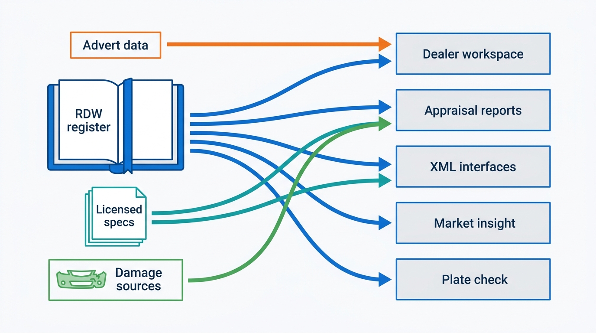
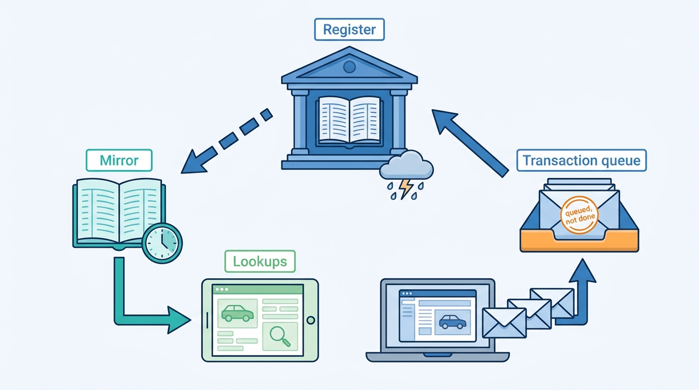
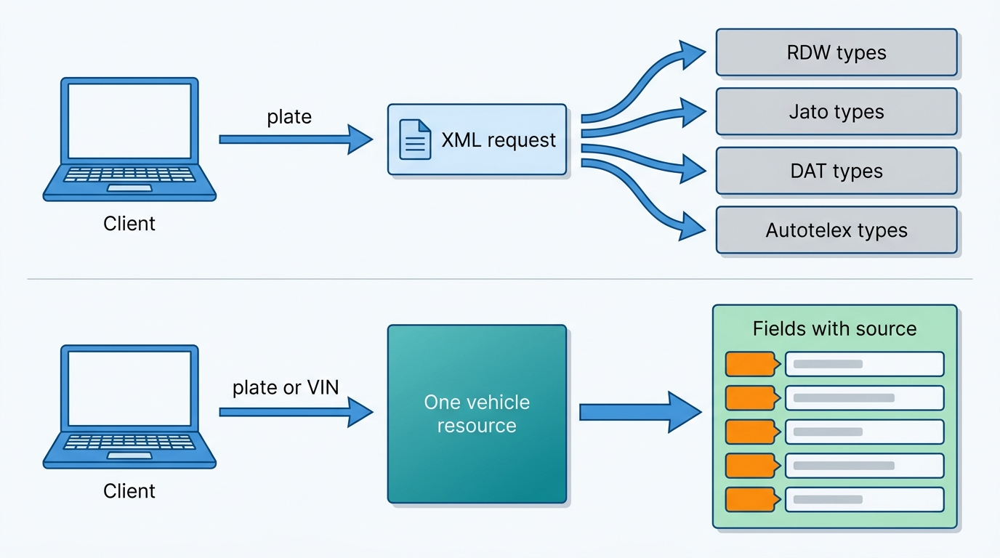
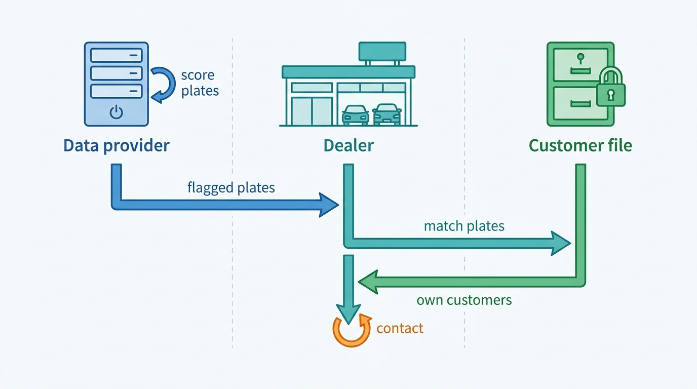
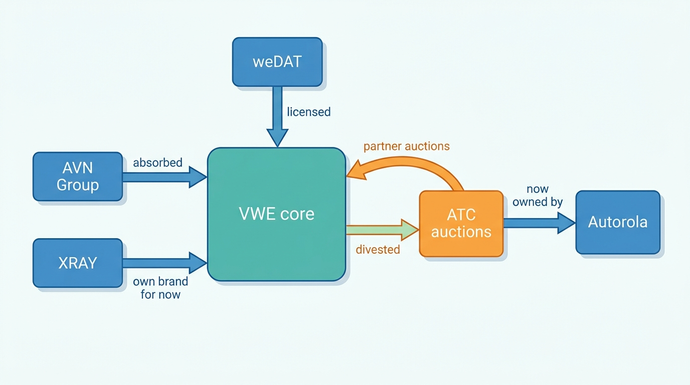
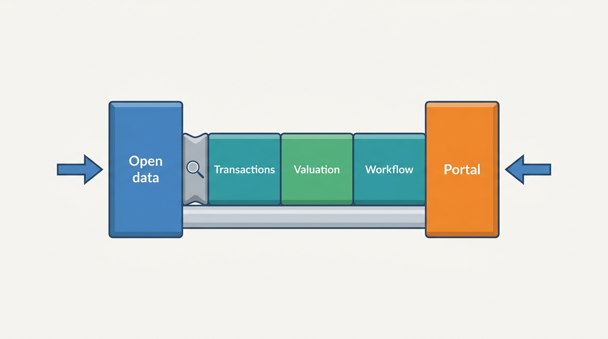

> **IN THIS CHAPTER, YOU WILL:** Read VWE Automotive's public record (its product, pricing and API pages, its news releases from 2022 to 2026, a 2022 competition-authority decision and the 2026 announcements of its new majority owner) as an architecture case. You will separate what VWE has documented, with dates, from the author's interpretation, see how little the public record says about internals, and compare the case with the book's patterns and with Axleby.

> **WHY THE BUSINESS CARES:** VWE is a small company (about 150 full-time staff, per its 2026 acquirer) that sells register transactions, vehicle data, valuations, damage history, advert syndication and a dealer workspace to more than 10,000 Dutch business customers. It shows how far a register-access business can grow into dealer software, and what an investor's buy-and-build plan asks of the platform underneath.

> **WHY ARCHITECTS SHOULD CARE:** The Netherlands is the clearest strong-register market in this book. VWE's documented products show which workflows a direct register connection makes possible, which licensed sources sit beside it, and how those sources show through in a public XML interface. Its acquisitions and divestment show integration problems every group in this market will face.

> **KEY POINTS:**
>
> * **In a strong-register market, the register connection is both the moat and the main dependency.** VWE calls itself the largest officially recognized information provider of the Dutch vehicle register, RDW. Transactions, plate-keyed status checks, register-based market statistics and its ownership-change lead model all rest on that connection, so register terms and register availability are its first architectural stressor.
> * **Licensed sources show through in the interface.** VWE's public API page (read October 2026) documents XML interfaces with a separate schema per data source (RDW, VWE, Autotelex, Jato, SilverDAT and others) and no authentication, versioning or webhook documentation. Per-source schemas make license scoping simple and push harmonization onto every integrator.
> * **Buying, selling and partnering turn internal systems into contracts.** Between 2022 and 2026 VWE bought AVN Group and XRAY Automotive, sold its auction subsidiary ATC to Autorola, launched a damage platform with DAT Nederland, and signed a majority sale to Main Capital Partners (closing unconfirmed as of 22 October 2026). Each move needs separable identities, billing and partner contracts.

> **[FAILURE PATTERNS THIS CHAPTER ADDRESSES](where-vehicle-platforms-go-wrong.html):**
>
> * **Borrowed Uptime** — almost every documented VWE product depends on one register; the public record does not say how products behave when that channel is unavailable.
> * **License Blindness** — VWE resells data from at least four licensed sources through one API and several products, and charges some of it per lookup; the purpose and license rules behind that are not public, and they are the hard part.
> * **The Acquisition Archipelago** — XRAY kept its name, terms and customer agreements "for now" (2026), and a sold subsidiary still appears inside a VWE product as a partner; both are the conditions under which archipelagos form.

 
VWE Automotive is a Dutch company based in Heerhugowaard that sells vehicle data, register transactions and dealer software. On its homepage (read October 2026) it calls itself "the number one in the Netherlands for vehicle data" with **"a direct connection to the RDW"**, the Netherlands Vehicle Authority that keeps the Dutch vehicle register. Its product pages describe a dealer workspace, a stock and pricing module, an appraisal app, damage-history reports, market-insight dashboards, an XML data interface, a consumer plate-check app and a webshop for trade materials. Its 2026 news releases describe a new majority owner and an acquisition strategy.

This case is different from the other three in [[part-10]]. Cox Automotive, CDK Global and Auto Trader file annual reports, publish developer portals and, in two cases, engineering blogs. **VWE publishes no revenue, no volumes, no engineering material and no architecture documentation.** What it does publish is product pages, prices, an API page, news releases and a handful of third-party documents. The case is therefore mostly about what a public product surface reveals about a platform, and about how far an architect may reason from it before the reasoning becomes invention.

There is one more reason for care. **This book's research started from a public-source domain model of VWE**, a capability map the author built in a separate modeling workspace from VWE's public pages. That model is the author's research map: its capability blocks, data stores and dependencies were inferred from product behavior, not taken from VWE documentation. Nothing in this chapter presents that model's structure as VWE's internal architecture. The reference page [[domain-coverage]] explains how the model was used. Axleby, the fictional vehicle data and dealer software group this book follows ([[meet-axleby]]), appears only in the final comparison, and the comparison explains why Axleby is not a disguised VWE.

## How to Read This Case

Part X cases follow stricter rules than Parts I–IX. A **documented fact** carries its source and publication year in the sentence. VWE's product pages are undated; they are cited as "read October 2026" and treated as current but changeable. **The author's interpretation** is marked "my reading" or sits in the Chief Architect's view. A **reference-architecture inference** sits in a callout labeled `INFERENCE, NOT DOCUMENTED`.

Four limits shape everything below.

1. **The record is a sales surface.** Product pages describe what customers can buy, not how it is built. Where a page names a data source (SilverDAT, Jato, Autotelex, RDW), that is documented. Where this chapter discusses how sources are combined, it is inference.
2. **The record contradicts itself in small ways.** Customer counts (10,000+ or 11,000+), channel counts (100+ or 150+) and the founding year (1993, "30 years" or "over 40 years") differ between pages. The chapter reports both values and does not choose.
3. **The ownership story is unfinished.** Main Capital Partners' acquisition of a majority stake was signed on 10 August 2026 and announced on 9 September 2026, with closing expected in October 2026 subject to approval by the Dutch competition authority. No completion notice had been published by 22 October 2026, the date of this chapter.
4. **Prices and product names are volatile.** Every price below is a list price read in October 2026, excluding VAT where the page says so, and may already have changed.

## Timeline: VWE in Dated Events

| Date | Event | Source type |
| --- | --- | --- |
| 1993 | Founding year as given by Main Capital Partners and William Blair (VWE's own pages say "30 years" and, in 2022, "over 40 years") | Investor releases, 2026; VWE release, 2022 |
| 31 Aug 2022 | NewPort Capital takes a stake in VWE Groep B.V.; the founder reinvests and joins the supervisory board | VWE release, 2022 |
| 19 Sep 2022 | The Netherlands Authority for Consumers and Markets (ACM) clears NewPort's acquisition (case ACM/22/179803), finding that "sufficient competition remains" | ACM decision, 2022 |
| 6 Oct 2022 | VWE acquires AVN Group (AutoVeiling.nl, AutoInspectie.nl, AVN Remarketing) | VWE release, 2022 |
| 1 Oct 2025 | Financial Lease Partner becomes VWE's financing partner; dealer commission €150 per lease contract | VWE release, published 24 Sep 2025 |
| 1 Feb 2026 | Autorola completes its acquisition of Automotive Trade Center (ATC), a VWE subsidiary | Trade press, 5 Feb 2026 |
| 30 Apr 2026 | VWE acquires XRAY Automotive (registration-tax calculations, valuations, a remarketing platform); XRAY keeps its name "for now" | VWE release, 2026 |
| 10 Aug 2026 | Main Capital transaction signed | William Blair, 2026 |
| 9 Sep 2026 | Main Capital Partners announces it will acquire a majority stake from NewPort; management unchanged | Main Capital and VWE releases, 2026 |
| 13 Oct 2026 | VWE and DAT Nederland launch weDAT, an AI-assisted damage-calculation platform and successor to SilverDAT Calculate | VWE release, 2026 |
| Oct 2026 (expected) | Closing of the Main Capital transaction, subject to ACM approval: **not confirmed as of 22 Oct 2026** | Main Capital release, 2026 |

## What VWE Says It Is

The company describes itself in three overlapping ways, and the differences matter for reading the rest of the record.

**A register-access business.** VWE's "About" page (read October 2026) calls it the **"largest officially recognized RDW provider"** and says it "once started as a car dealership". The ACM's 2022 decision describes VWE as offering data and data-driven services in the Dutch automotive market, acting as "an information and application provider for the RDW", and providing import and export services. An RDW-recognized provider is a company authorized to connect to the register and offer register information and transactions to the trade; the Dutch trade does most of its official paperwork through such providers rather than at a counter. [[registers-and-official-data]] explains the Dutch access model.

**A data and SaaS platform.** VWE's September 2026 release frames it as a platform for the used-car market built on direct RDW access and more than 30 years of vehicle and transaction data, and lists Autoveiling Nederland, Cargo International and XRAY as acquisitions that extended it into import, export and valuation. William Blair, the seller's adviser, described VWE in 2026 as providing "data and insight products to insurers, financial institutions, and leasing companies" as well as the Finnik consumer app.

**A mid-sized company with a broad customer base.** Main Capital's 2026 release gives about 150 full-time employees and more than 10,000 customers, mainly in the Netherlands, including franchised and independent dealers, lessors, insurers, workshops and fleet operators. VWE's own release of the same day says more than 11,000 customers.

My reading: the three descriptions are layers of one business. The register connection came first; data products and licensed specifications were added; dealer workflow was built on top. **The order matters architecturally, because the oldest layer is the one everything else depends on.** It also frames a ratio worth noticing: about 150 people serve more than 10,000 business customers across transactions, data, valuation, syndication, appraisal, insight and a consumer app. That suggests products that are thin over a few shared capabilities, resold partner products, or both; the public record does not say which.

## The Register as Foundation

The Dutch register is unusually useful to the trade. It holds, per plate, the vehicle's technical data, its status (exported, scrapped, awaiting inspection), its periodic roadworthiness test (*APK*, *Algemene Periodieke Keuring*) history, a national odometer check (*NAP*, *Nationale AutoPas*), and the register transactions dealers need: registration in a new name (*tenaamstellen*), indemnification on sale into the trade (*vrijwaren*, which ends the seller's liability for tax, insurance and fines), and stock-register actions. [[registers-and-official-data]] owns these terms.

VWE's public pages tie a striking share of its products to that register:

| Product (as named publicly) | What the page says it does | Register dependency, as documented |
| --- | --- | --- |
| **MijnVWE** dealer platform | Dealer workspace: stock, advertising to "ruim 150 verkoopkanalen" (more than 150 sales channels), sales, financing referral, register transactions | Register transactions (*vrijwaren*, *tenaamstellen*, plates, deregistration) from the workspace |
| **Finnik Zakelijk** appraisal | Plate or VIN lookup with warnings for damage, recalls, "awaiting inspection" (*WOK*, *Wachten Op Keuring*) status and registration tax; register status; odometer history; price history; comparable foreign prices | Register status and odometer readings combined with other sources |
| **Schadeverleden** damage history | International damage database plus Dutch indicators (insurance claims, *WOK* status, registration-tax changes) | Dutch indicators include register-derived flags |
| **Marktinzicht** market insight | "Based on official RDW registers": fleet, new and used sales, inspections, export, scrapping, import; reports, a dashboard or a one-off file | Built on register statistics |
| **Change-of-ownership lead generator** | A machine-learning model scores plates likely to change owner within one to two months | Plate-keyed; the page does not name its input sources |
| **Finnik** consumer app | Free basic check and a paid full report by plate | Plate-keyed lookups |

All rows: VWE product pages, read October 2026.

**Figure 1** draws only what the public pages state: named sources on the left, named product surfaces on the right. It is not an internal component diagram.

**Figure 1:** *VWE's documented sources and product surfaces, read October 2026. Every edge is stated on a public page; the register feeds every surface, which is why it is both the moat and the dependency.*

What the record does **not** say is how VWE reaches the register: whether products call it live, read a mirror, or both; how transactions are queued when the channel is slow; how certificates and sessions are managed. The Productscape model behind this book's research assumed a cached register and a transaction retry queue, but that was the author's assumption about how such a business would sensibly work, not a VWE statement.

> **INFERENCE, NOT DOCUMENTED:** A register-access business of this shape would plausibly keep a local mirror of register vehicle data, refreshed from the register's information channel, for lookups and statistics, and call the transaction channel directly for *tenaamstellen* and *vrijwaren*, with a queue that preserves order and handles ambiguous timeouts. The requirements below are the author's reference requirements for such a design, not VWE's.

| Interaction (reference design) | Consistency | Freshness | Latency | Availability |
| --- | --- | --- | --- | --- |
| Plate lookup for appraisal or advert | Read from mirror; show observation time | Hours acceptable for technical data; status flags same day *(assumption)* | Under 1 s *(assumption)* | Must survive a register outage |
| Register transaction (*tenaamstellen*) | Exactly-once effect at the register; idempotent submission | Real time | Seconds; queued when slow | Degrades to "queued, not done", never "done" |
| Register-based market statistics | Periodic snapshot | Monthly or weekly | Batch | Not on the request path |
| Ownership-change lead scores | Batch model output | Monthly *(assumption)* | Batch | Not on the request path |

The table shows the design point the case illustrates: **a register-access business should split register reads (which can be mirrored and served stale with a label) from register writes (which cannot be faked and must be queued honestly)**. [[registration-and-trade-services]] and [[reliability-and-dependencies]] develop that split.

**Figure 2:** *A register-access business can serve reads from a mirror labeled with its observation time, but register writes cannot be faked and must wait honestly in a queue.*

## The Product Surface: From Lookup to Dealer Workspace

VWE's dealer offer reads as a stack built upward from the lookup.

**Occasion Manager** (product page, read October 2026) is the stock and pricing module. It combines a dealer's own stock with market data: a stock list with purchase and sale price, days in stock and market position; a signal list for asking prices out of line with the market and for days-in-stock thresholds; purchase advice from sales volume, average days in stock and export figures; and maximum-bid advice for auctions. The page names its data sources as VWE vehicle data, Dutch and international advert data, recent sales, lease-inflow statistics and export statistics. It also still shows "auctions from partner Automotive Trade Center", the subsidiary VWE sold in February 2026.

**Finnik Zakelijk** (read October 2026) is the appraisal app: plate or VIN lookup including foreign vehicles, damage and recall warnings, register status, odometer history combining official readings with maintenance and international damage records, manufacturer maintenance history, factory options via a SilverDAT VIN lookup, and the remaining registration tax (*BPM*, *Belasting van personenauto's en motorrijwielen*) on imports. [[used-car-pricing]] and [[vehicle-acquisition]] own these workflows in general.

**MijnVWE** (read October 2026) is the workspace that holds the modules together, with advertising to more than 150 channels (the homepage says "more than 100 platforms"), register transactions, damage history, maintenance, battery State of Health (SoH) certificates and, since 2026, weDAT damage calculation.

**Vehicle characteristics** (English product page, read October 2026) is the data-enrichment product: lookups by plate or chassis number returning edition name, first registration, country of origin, owner history, odometer checks, standard and optional equipment, consumption and environmental data, photos and factory specifications from SilverDAT VIN, delivered through an API "per registration plate" or by enriching a customer's own plate list.

The prices published on those pages (read October 2026, ⚠ volatile) show the commercial shape:

| Item | Published price | Charging basis |
| --- | --- | --- |
| Occasion Manager with the entry workspace tier | €74.95 per month | Subscription |
| Occasion Manager for dealer holdings | €250 per month, €395 setup, €69.95 per extra branch (page layout ambiguous) | Subscription per group, plus per branch |
| Finnik Zakelijk | €9.95 per month, introductory | Subscription |
| International damage report | €9.95 per report; no charge if no damage is found | Per lookup, outcome-dependent |
| SilverDAT VIN information | €1.74 per lookup | Per lookup, licensed source |
| Maintenance history and schedule | €6.99 | Per lookup |
| Finnik full consumer report | 4.99 (currency not shown; presumably euro) | Per consumer purchase |
| Financing referral (Financial Lease Partner, from 1 Oct 2025) | Dealer receives €150 per lease contract, "double the previous standard" | Commission paid to the dealer |

My reading: **this is three revenue mechanics on one customer.** Monthly module subscriptions per company and per branch; per-lookup fees, some conditional on the result ("no damage found, no charge") and some passing through a licensor's cost (SilverDAT VIN); and a referral flow where money moves the other way, to the dealer. Each needs a different kind of record. A subscription needs an entitlement per branch. A conditional lookup fee needs the outcome stored with the usage event, because the invoice depends on what was found. A pass-through fee needs the licensor's charge reconciled against the customer's. [[billing-and-metering]] treats this mixture in depth; the No-Hit Credit, Axleby's fictional incident, shows what happens when two interfaces implement the conditional rule differently.

> **INFERENCE, NOT DOCUMENTED:** For a product surface priced this way, the platform needs one usage record per billable lookup carrying customer, branch, product, source, outcome (hit, no-hit, no-damage) and licensor cost, written at the moment of the lookup rather than reconstructed later. Whether VWE meters this way is not public.

## The Data Interfaces: What the API Page Shows

VWE's public API documentation page (read October 2026) is the most technically specific document in the record. It describes two interfaces.

- **Interdata** is an XML interface for using vehicle data in a customer's own application: an XML request, often keyed by plate, and an XML response. It ships with Dutch and English PDF manuals and XML Schema Definitions (XSDs) grouped by data domain: general message types, Autotelex, Audacon/Headline, environmental data, road tax, RDW, VWE, Jato and SilverDAT VIN (`AtdDataTypes.xsd`, `JatoDataTypes.xsd`, `DatDataTypes.xsd`, `RdwDataTypes.xsd` and so on).
- **XMLmode** lets garage-software vendors integrate VWE services as web services configured per integrator. It has a message-structure reference, a handbook and a master-data spreadsheet, and the page recommends the SoapUI tool for testing message traffic.

The page documents **no authentication scheme, endpoints, versioning policy, rate limits, sandbox, JSON or REST interface, or webhooks**.

**There is a public-record discrepancy here.** The English "Vehicle characteristics" product page (read October 2026) says VWE "offers a registration plate API" that returns data as JSON per plate, and offers a demo environment. The API documentation page lists no JSON interface. Both can be true (a JSON product may be documented privately on request), but **the public developer documentation is XML-only**. This chapter therefore says "publicly documented interfaces are XML" and no more.

Compare Auto Trader UK, whose Connect developer documentation publishes REST APIs, short-lived bearer tokens, a sandbox, webhooks and a dated changelog ([[case-auto-trader-uk]]). The difference is not only technology age. Auto Trader's API is a distribution channel to more than 220 integrated technology partners (its FY2026 results, 2026); VWE's interfaces serve a national base of garage-software vendors, lessors and insurers who have integrated XML for years, and for whom stability is worth more than modern conventions.

The per-source schema split is the architecturally interesting part. **Figure 3** contrasts it with the harmonized alternative.

**Figure 3:** *Per-source schemas (top, as documented on VWE's API page) put each licensor's structure in front of the client; a harmonized resource (bottom, the book's reference design) puts one vehicle model in front and keeps the source as provenance on each field.*

| Approach | What it makes easy | What it makes hard |
| --- | --- | --- |
| **Per-source schemas** (VWE's documented interface) | License scoping: a client gets the domains it pays for; each licensor's data stays recognizable; adding a source adds a schema without touching others | Every integrator harmonizes edition names, equipment codes and conflicting values; a source change is a client change; provenance is implicit in the schema, not explicit per field |
| **Harmonized vehicle resource** (book's reference design) | One model for clients; conflicts resolved once; provenance per field; license enforced as field filtering | The provider must own the harmonization, keep source lineage per field, and enforce licenses at field level rather than at schema level |

> **INFERENCE, NOT DOCUMENTED:** Exposing licensors' structures is a rational choice for a provider whose sources license data for resale on condition that it stays attributable, and whose clients already map those sources. A modernization path that would not break the installed base is a harmonized JSON resource with license-scoped fields alongside the XML interfaces, not instead of them. Nothing public says whether VWE plans this.

[[vehicle-data-apis]] owns API design for data clients; [[specification-and-equipment]] owns harmonizing build data from several providers; [[data-licensing-and-governance]] owns license enforcement.

## The Ownership-Change Lead Generator: A Privacy Seam

One VWE product deserves a closer look because its public description contains a design decision. The change-of-ownership lead generator page (read October 2026) says a machine-learning model scores **plates** that are likely to change owner within one to two months. The dealer then matches flagged plates against its own customer file to find the personal details. The page does not name the model's input sources.

**Figure 4:** *The split described on VWE's lead-generator page: the provider outputs plate-level scores; personal data stays in the dealer's own customer file.*

My reading: **the split keeps owner identity out of the provider's output**, which matters because register data about owners is personal data under the EU General Data Protection Regulation (GDPR) and register access in the Netherlands is purpose-bound. The dealer contacts people who are already its customers, under its own legal basis. It is a pattern worth copying. It is not a full answer: a plate-level score about a privately owned car can still be personal data, because the dealer can link it to a person, so purpose limitation, retention and audit still apply on both sides. The page does not say how VWE handles those. [[privacy-and-retention]] and [[data-products-and-insights]] treat the design in general.

## Portfolio Moves: Buy, Sell, Partner

VWE's portfolio changed four times in four years, and each change has an integration shape.

| Move (date, source) | What happened | Integration shape (my reading) |
| --- | --- | --- |
| **AVN Group** acquired (6 Oct 2022, VWE release) | AutoVeiling.nl, AutoInspectie.nl, AVN Remarketing; VWE called the companies "mainly complementary" and focused on bringing together supply and demand for used vehicles "especially internationally" | Adds a trading and inspection business with its own customers and listings |
| **ATC** sold to Autorola (completed 1 Feb 2026, Journal de l'Automobile, 2026) | ATC offered around 40,000 inspected vehicles at any time to just over 8,000 selling and 7,000 buying professionals; it continues as an independent auction platform | An internal marketplace becomes an external partner; Occasion Manager still lists "auctions from partner Automotive Trade Center" |
| **XRAY Automotive** acquired (30 Apr 2026, VWE release) | Registration-tax calculations, valuations and the XBS remarketing platform; XRAY keeps its name, office, customer agreements and terms "for now" | A second valuation and tax capability beside VWE's own, deliberately not yet merged |
| **weDAT** launched with **DAT Nederland** (13 Oct 2026, VWE release) | AI-assisted damage recognition from photos and repair calculation, successor to SilverDAT Calculate; the release describes DAT Nederland as part of VWE and the Dutch representative of the German DAT Group; existing users get a migration plan | A licensed partner platform delivered under a joint brand, with a customer migration from the previous product |

**Figure 5** shows the direction of these moves.

**Figure 5:** *VWE's documented portfolio moves, 2022–2026. A divested marketplace stays visible in the product as a partner, so what was an internal dependency becomes an external contract.*

My reading of the pattern: **VWE sold the part that runs two-sided trading and bought the part that computes tax and value.** That is a move toward data and workflow and away from operating a marketplace, and it fits the book's argument in [[b2b-trade-and-remarketing]] that a data-and-software group can hand auctions to a partner if the hand-off is a contract with status feedback. The ATC case also shows the cost: after a divestment, every screen, data feed and invoice line that used to be internal needs a partner agreement, an interface with an owner on both sides, and a plan for what happens if the partner changes terms. Autorola also owns the Indicata pricing-analytics business (Indicata company page, read October 2026), so the former subsidiary now sits in a group that competes with VWE in pricing data.

> **INFERENCE, NOT DOCUMENTED:** For a portfolio that grows by acquisition and shrinks by divestment, the parts worth integrating first are those that make a unit separable: one customer identity, one entitlement model, one usage and billing record, and one vehicle key. A brand kept "for now" (XRAY) can stay on its own surface while those spines are shared. Whether VWE has shared accounts, billing or a vehicle key across MijnVWE, Finnik, XRAY and the data interfaces is not public.

## Ownership and the Pending Deal

The ownership record is short and dated.

- **2022.** NewPort Capital took a stake in VWE Groep B.V. (VWE release, 31 August 2022); the ACM cleared the concentration on 19 September 2022, finding that "sufficient competition remains" (ACM decision ACM/22/179803, published 21 September 2022).
- **2026.** Main Capital Partners announced on 9 September 2026 that it will acquire a **majority stake** from NewPort, with management unchanged. William Blair dated the signing to 10 August 2026 and listed the deal as pending. VWE's release said closing was expected "in the course of October". Main Capital's release said closing is "subject to customary closing conditions, including approval from the" ACM. **As of 22 October 2026, no completion announcement and no ACM decision on this transaction had been found** (a VWE news-page check and a web search on that date). Stake size and price are not disclosed.

Main Capital's stated plan (2026) is to "accelerate organic growth, develop AI-enabled, data-driven solutions, and pursue a targeted international buy-and-build approach". The architectural meaning of each phrase, in my reading:

| Stated intent | What it asks of the platform |
| --- | --- |
| Accelerate organic growth | More modules sold into the same customers: entitlements per branch and module, self-service onboarding, cross-sell from shared data |
| AI-enabled, data-driven solutions | Training data with provenance and license rights for model use, not only for display; model governance for valuations and lead scores ([[ai-in-dealer-workflows]]) |
| International buy-and-build | A second register and a second market model; acquired products joined by identity, billing and vehicle key ([[one-platform-from-many-products]]) |

The third row is the hardest for a business whose oldest layer is one national register. **A register-keyed product line does not travel.** Plates, register statuses, *APK*, *NAP*, *BPM* and the Dutch transaction set have no direct equivalent in Germany or the United Kingdom, and the US has no single register at all. International expansion therefore means either acquiring businesses that already hold the local register and data relationships, or building a market-adapter layer that VWE's documented products do not yet show. [[multi-country-platforms]] in the LISTED book covers the general problem.

## The Dutch Market Around VWE

VWE competes with, buys from and sells to the same companies. The table summarizes verified public pages; "not evident" means not found on the pages read, not confirmed absent.

| Player (source, date) | Relationship to VWE | Overlap |
| --- | --- | --- |
| **Autotelex** (homepage, read Oct 2026) | Rival and supplier: Autotelex data is inside VWE's Interdata (`AtdDataTypes.xsd`) | Selling and trade values, residuals, advertising system, trade-in tools, registration-tax calculator, an API |
| **AutoScout24** with AutoTrack and Gaspedaal.nl (AutoRAI, 25 Nov 2025) | Channel and potential tool competitor: took over AutoTrack and Gaspedaal.nl; AutoTrack dealers move to AutoScout24's platform; 43,000+ connected dealers across 18 countries | Price evaluation and dealer tools on the portal side |
| **Autorola / Indicata** (Indicata page, read Oct 2026; trade press, Feb 2026) | Owner of ATC, now a VWE partner; pricing-analytics competitor | Pricing analytics, B2B auctions |
| **carVertical** (own help pages, read Oct 2026, widely reported) | Consumer and trade history competitor | VIN-based cross-border history reports |
| **RDW Open Data** (RDW open-data portal, n.d.) | Free substitute for basic register lookups | Plate-level technical data under an open license |

My reading: **free register open data and a consolidating portal squeeze the two ends of VWE's offer.** Basic plate lookups are commoditized by the register's own open data, so value moves to what open data does not provide: transactions, history from licensed and international sources, valuation, and workflow. At the other end, AutoScout24's purchase of the two largest Dutch car portals concentrates the most important syndication channels and the market's advert data in one group that also sells dealer tools. A dealer platform that depends on portal advert data for pricing should keep that data independent of any single portal. [[listing-syndication]] and [[market-data]] develop both points.

**Figure 6:** *Free register open data and a consolidating portal squeeze both ends of the offer, so value moves to what neither provides: transactions, valuation and workflow.*

## What Would Change Outside the Netherlands

The case is Dutch, and its central feature, a register that the trade can transact with through recognized providers, is not universal.

| Market | Closest equivalent of VWE's foundation | What the data moat rests on instead |
| --- | --- | --- |
| **Belgium** | The vehicle register DIV, with access through intermediaries; odometer readings held by the non-profit Car-Pass | Register access plus a separate odometer source |
| **Germany** | No comparable open register access for the trade; registration through local authorities | Build and valuation data (DAT, Schwacke) and portal advert data |
| **United Kingdom** | DVSA inspection (MOT) history through a public API with bulk files and daily changes; DVLA's vehicle enquiry API, closed to new registrations as of October 2026 | The dominant portal's own advert and buyer observations ([[case-auto-trader-uk]]) |
| **United States** | No single register; state DMVs, a federal title-information system | A contributory history network built from many reporting sources |

**The data moat follows the market's structure.** In the Netherlands it rewards whoever holds the register connection; in the UK the dominant portal built valuations from its own adverts; in the US history came from a contributory network. A group operating in all four, as Axleby does, cannot copy one market's moat into the others, which is why [[registers-and-official-data]] argues for a register adapter per market behind one vehicle record.

## Trade-offs the Case Illustrates

| Choice | What VWE's record shows | When it is right | When it fails |
| --- | --- | --- | --- |
| **Build products on one national register** | Transactions, status, statistics and lead scores all tied to RDW | The register is rich, trusted and transactable; one market | Expansion abroad; register terms change; register outage on a busy day |
| **Expose licensors' schemas directly** | Per-source XSDs for RDW, Jato, DAT, Autotelex and others | Licenses require attribution; clients already map these sources | Clients need one vehicle model; a licensor changes its format |
| **Keep the XML interface stable** | XML and SoapUI-tested web services; no public versioning | Installed base of long-lived integrations | Newer clients expect JSON, tokens, sandboxes and events |
| **Mix subscriptions, conditional lookups and pass-through fees** | €74.95 modules, €9.95 no-damage-no-charge reports, €1.74 SilverDAT lookups | Dealers want low entry cost and to pay for what they use | Usage is not metered with its outcome; invoices cannot be explained |
| **Output plate scores, not owners** | Lead generator returns flagged plates; dealer joins its own customers | Owner data is personal and register access is purpose-bound | Scores are treated as anonymous and leave purpose limits |
| **Divest the marketplace, keep it as a partner** | ATC sold, still shown as partner auctions | The group's strength is data and workflow, not liquidity | The partner changes terms or joins a competitor group |
| **Keep acquired brands separate "for now"** | XRAY keeps name, terms and agreements | Early after a deal, to protect customers | "For now" becomes permanent; customers re-type plates across brands |

## Failure Modes the Record Exposes

These are risks the public record makes visible, not failures VWE is known to have had. No public incident is attributed to VWE in the sources read.

1. **One dependency under every product.** The documented product surface rests on the register. If the transaction channel is unavailable on a month-end Saturday, workspace, appraisal and transaction products are affected at once, unless reads are mirrored and writes queued honestly. The public record does not describe VWE's degradation behavior.
2. **Two products describing the same capability.** Occasion Manager offers purchase advice and auction maximum bids; XRAY brings its own valuations; Autotelex values sit inside the API. Without one valuation record, a dealer can receive different numbers for one car from one vendor. [[valuation-engine]] treats this as a governance question.
3. **Partner residue after divestment.** A sold subsidiary shown as a partner inside the product needs a contract for status, availability and data use. Without it, a partner outage or a changed term shows up as a broken screen.
4. **Public counts that disagree.** "More than 150" and "more than 100" channels, 10,000+ and 11,000+ customers: harmless on a marketing page, but a symptom of facts that are not generated from one source. In a data business, the same habit applied to product data becomes [[provenance-and-data-quality]] debt.

## Where the Public Evidence Stops

| Question | What is public | What is not |
| --- | --- | --- |
| How does VWE reach the register? | "Direct connection"; largest recognized provider | Mirror or live calls; transaction queueing; certificate and session handling; outage behavior |
| How are sources combined? | Named sources per product; per-source XSDs | Matching, conflict resolution, provenance per field, a shared vehicle key |
| What does the JSON API look like? | A product page mentions a JSON plate API and a demo environment | Any public documentation, authentication, versioning or events |
| How is usage metered and billed? | Prices, including conditional and pass-through fees | Metering, rating, how no-hit and no-damage rules are recorded |
| How are licenses and purposes enforced? | Products reselling licensed data | License terms, purpose checks, audit |
| How are acquired products integrated? | XRAY kept separate "for now"; ATC now a partner | Shared accounts, billing, data or vehicle key across brands |
| What feeds the lead model? | Plate-level scores; dealer joins its own data | Input sources, model governance, retention |
| How big is the business? | About 150 FTE; 10,000+ or 11,000+ customers | Revenue, volumes, API calls, uptime |
| Has Main Capital's acquisition closed? | Signed 10 Aug 2026; announced 9 Sep 2026; expected October | Completion, ACM clearance, stake size and price, as of 22 Oct 2026 |

## The Chief Architect's View

VWE's record gives me four decision rules for any group whose oldest asset is a register connection.

**Treat the register connection as the most valuable and the most dangerous component.** Everything depends on it, so I would design it as a gateway with a mirrored read path, an ordered and idempotent write path, explicit freshness labels and a published status, and I would hold its provider-compliance obligations as encoded rules rather than tribal knowledge. The gateway owner sits at architecture-board level, because a change in the register's terms is a change to every product.

**Keep licensed sources visible as provenance, not as schema.** VWE's per-source XSDs keep sources attributable, which licenses demand. I would keep that attribution on every field and put one vehicle model in front of clients, so that a licensor changing its format is an internal adapter change, not a client release.

**Integrate the spines before the brands.** A buy-and-build owner will bring more brands. Identity, entitlements, usage and billing, and the vehicle key should be shared before any surface is merged; brands such as XRAY can stay on their own front ends for years if those spines are shared.

**Contract the hand-offs you used to own.** Every divestment leaves a partner inside the product. I would give each one a written interface, an owner on both sides, status feedback and an exit plan, before the deal closes.

## Comparing the Case to the Book's Patterns and to Axleby

VWE's record supports the book's patterns where it is specific and is silent where they matter most.

| Book pattern or claim | VWE's public record | Verdict |
| --- | --- | --- |
| Register gateway with mirrored reads and queued writes avoids Borrowed Uptime ([[reliability-and-dependencies]]) | Register under almost every product; no public description of access or degradation | Dependency confirmed; mitigation not documented |
| Provenance per field, license enforced in the request path ([[data-licensing-and-governance]]) | Per-source schemas; several licensed sources resold | Attribution supported at schema level; enforcement not public |
| Usage metering with outcome-dependent rating ([[billing-and-metering]]) | Conditional "no damage, no charge" and pass-through per-lookup fees | Need strongly illustrated; implementation not public |
| Owner data stays with the party that has the legal basis ([[privacy-and-retention]]) | Lead generator outputs plates; dealer joins its own customers | Supported by a documented design |
| Auctions can be a partner hand-off with contract and status ([[b2b-trade-and-remarketing]]) | ATC sold, kept as partner in the product | Supported; contract terms not public |
| Share identity, billing and vehicle key before merging brands ([[one-platform-from-many-products]]) | XRAY kept separate "for now"; buy-and-build stated as strategy | The pressure is documented; the integration is not |

**Axleby is not a disguised VWE.** Readers who know the Dutch market will notice that Axleby Data, like VWE, holds a contractual data-supply and transaction-provider relationship with the Dutch register (what this book calls an *authorized information provider*, a book term defined in [[registers-and-official-data]], not an official RDW title), sells register transactions to the trade, runs an older XML interface beside a newer API, and has been majority-owned by a private-equity fund since 2022. Those are features of the Dutch market, not of one company: the trade does its register paperwork through recognized providers, garage software has integrated with data vendors over XML for years, and private-equity ownership is ordinary for mid-sized software groups. The differences are deliberate and large.

| Dimension | VWE (public record, 2026) | Axleby (fictional, ledger) |
| --- | --- | --- |
| Footprint | Mainly the Netherlands; headquarters Heerhugowaard | Netherlands, Belgium, Germany, United Kingdom; Utrecht with hubs in Ghent, Munich, Leeds and Kraków |
| Size | About 150 FTE; 10,000+ or 11,000+ customers; no revenue published | About 1,150 employees, 300 engineers; €214 million revenue; 12,400 business customers |
| How it was assembled | Register provider that grew products; AVN and XRAY bought, ATC sold | A data company that bought a Belgian dealer-SaaS vendor (Lotwise, 2019), a German valuation firm (Wertlauf, 2021) and a UK dealer-website vendor (Showroomly, 2023) |
| Dealer workflow | One workspace with modules | Two dealer products in two markets (Lotwise, Showroomly), with three login systems in 2027 |
| Auctions | Sold to a competitor's group, kept as partner | Never owned; Tradefloor exchange hands off to auction partners |
| API | Publicly documented XML only; JSON mentioned on one product page | Connect XML (38% of calls, 210 XML-only clients) beside JSON API v1; Connect XML sunset announced for 31 Dec 2029 |
| Incidents | None public in the sources read | Eleven fictional incidents, from the Cloned Plate to the Plate Enumeration Attack |

No Axleby system, number, product name, person or incident is drawn from VWE, and nothing in Axleby's systems landscape describes how VWE is built.

Where the case does inform Axleby, the comparison is useful:

| Axleby choice (2027, fictional) | VWE parallel (public) | What the case suggests |
| --- | --- | --- |
| **Turnstile** register gateway with a transaction retry queue; after the Month-End Register Outage (31 March 2027: 5 hours 40 minutes, 3,100 queued, 214 submitted twice) it adds idempotency keys | Register under every product; degradation not described | The case shows how much depends on that gateway; Axleby's double submissions show that a retry queue without idempotency is not enough |
| **Charter** license and purpose register in the request path of every data API, built after the License Breach (January 2027) | Several licensed sources resold, attributable by schema | Schema-level attribution answers "where did this come from" but not "may this client use it for this purpose"; Charter answers the second |
| **Meterline** records every billable event with its outcome, after the No-Hit Credit (€186,000 to 41 clients) | Conditional and pass-through per-lookup prices | The same pricing shape; Axleby's credit is what happens when two interfaces rate one rule differently |
| **One Dossier**, Year 1: Axleby ID, Gatekeeper, Anchor as the only vehicle key, Meterline; €38 million over 2027–2029 | Buy-and-build stated; XRAY kept separate "for now" | Integrate the spines first and leave brands on their surfaces; the case adds that divestment needs the same separability in reverse |
| **JSON API v2** with webhooks beside Connect XML until 2029 | XML documented; JSON mentioned but undocumented publicly | Publish the new contract fully, with versioning and events, and keep the old one stable until the installed base moves |

**The sharpest lesson for Axleby concerns divestment, which its plan does not cover.** Axleby's One Dossier program is designed for joining products. VWE's sale of ATC, while ATC stays visible in VWE's product, shows that a group must also be able to take a unit out, with its customers, data and contracts, and keep the service running across the new boundary. The spines that make integration possible (one identity, one usage record, one vehicle key, license rules as data) are the same spines that make a clean separation possible. [[build-buy-or-partner]] and [[evolving-the-vehicle-platform]] treat both directions.

## Questions to Ask

1. Which of our products stop if the register's transaction channel is unavailable for a day, and which keep working from a mirror with a freshness label?
2. Is every register write idempotent, ordered and honest about its state ("queued", not "done") during an outage?
3. Does our API expose our licensors' structures or one vehicle model? Who pays the cost of harmonization: us once, or every client?
4. For every field we return, can we name the source, observation date and license, and does the license allow this client's purpose?
5. Is every billable lookup recorded at the time of the call with its outcome and its licensor cost, or reconstructed at month-end?
6. Which of our data products output something a client can link to a person, and who holds the legal basis for that link?
7. If we sold one business unit tomorrow, could we separate its customers, entitlements, usage and data without breaking the products that stay?
8. Which former internal systems are now partners inside our products, and does each have a contract with status feedback and an exit plan?
9. Do our public pages, API documentation and contracts agree with each other on counts, interfaces and prices? If not, which source is the truth?

VWE shows a register-access business growing into a dealer platform under a buy-and-build owner, and leaves most of its architecture unstated. That closes [[part-10]]. The reference page [[domain-coverage]] follows: it maps the research model this book started from, including the public-source model of VWE, to the chapters that cover each capability, and records what the book added and left out.

## Sources and Evidence

### Company, product and investor sources

- [VWE homepage](https://vwe.nl/), VWE Automotive, n.d., accessed 2026-10 — "number one in the Netherlands for vehicle data", more than 10,000 customers, direct RDW connection, "more than 100 platforms", "30 years".
- [Over VWE](https://vwe.nl/over-vwe/), VWE Automotive, n.d., accessed 2026-10 — "largest officially recognized RDW provider"; origin as a car dealership.
- [MijnVWE](https://vwe.nl/mijnvwe/), VWE Automotive, n.d., accessed 2026-10 — dealer workspace, more than 150 sales channels, register transactions, damage, maintenance, battery SoH.
- [Occasion Manager](https://vwe.nl/occasion-manager/), VWE Automotive, n.d., accessed 2026-10 — stock and signal lists, purchase and bid advice, data sources, ATC partner auctions, prices.
- [Finnik Zakelijk Taxeren](https://vwe.nl/finnik-zakelijk-taxeren/), VWE Automotive, n.d., accessed 2026-10 — appraisal contents, SilverDAT VIN and maintenance prices.
- [Schadeverleden](https://vwe.nl/schadeverleden), VWE Automotive, n.d., accessed 2026-10 — international damage report, Dutch indicators, no-damage-no-charge pricing.
- [Marktinzicht](https://vwe.nl/marktinzicht/), VWE Automotive, n.d., accessed 2026-10 — register-based market statistics and delivery forms.
- [De VWE Change of Ownership Lead Generator](https://vwe.nl/de-vwe-change-of-ownership-lead-generator/), VWE Automotive, n.d., accessed 2026-10 — plate-level ownership-change scores; dealer-side matching.
- [API-documentatie](https://vwe.nl/api-documentatie/), VWE Automotive, n.d., accessed 2026-10 — Interdata and XMLmode, per-source XSDs, SoapUI; absence of authentication, versioning and webhook documentation.
- [Vehicle characteristics](https://vwe.nl/en/data-services/vehicle-characteristics), VWE Automotive, n.d., accessed 2026-10 — plate or chassis lookups, SilverDAT VIN, JSON plate API mention, demo environment.
- [Particulier](https://vwe.nl/particulier), VWE Automotive, n.d., accessed 2026-10 — Finnik consumer report price.
- [VWE krijgt nieuwe aandeelhouder: Main Capital Partners neemt belang over van NewPort Capital](https://vwe.nl/nieuws/vwe-krijgt-nieuwe-aandeelhouder-main-capital-partners-neemt-belang-over-van-newport-capital/), VWE Automotive, 2026 — 11,000+ customers, expected October closing, acquisitions listed.
- [Main Capital Partners acquires a majority stake in VWE Automotive](https://main.nl/?p=15293), Main Capital Partners, 2026 — majority stake, about 150 FTE, 1993 founding, closing conditions including ACM approval, stated strategy.
- [VWE Automotive and Main Capital Partners transaction](https://www.williamblair.com/News/VWE-Automotive-and-Main-Capital-Partners-Transaction), William Blair, 2026 — signing date, pending status, customer segments.
- [VWE Automotive neemt XRAY Automotive over](https://vwe.nl/nieuws/vwe-automotive-neemt-xray-automotive-over-en-versterkt-dienstverlening-in-bpm-en-waardebepaling/), VWE Automotive, 2026 — XRAY capabilities; name, terms and agreements kept "for now".
- [VWE en DAT Nederland lanceren weDAT](https://vwe.nl/nieuws/vwe-en-dat-nederland-lanceren-wedat-platform-voor-schadecalculatie/), VWE Automotive, 2026 — weDAT as successor to SilverDAT Calculate; DAT Nederland described as part of VWE; migration plan for users.
- [VWE kiest Financial Lease Partner als nieuwe financieringspartner](https://vwe.nl/nieuws/vwe-kiest-financial-lease-partner-als-nieuwe-financieringspartner/), VWE Automotive, 2025 — financing referral from 1 October 2025; €150 dealer commission.
- [VWE Automotive acquires AVN Group](https://vwe.nl/en/news/vwe-automotive-acquires-avn-group/), VWE Automotive, 2022 — AVN acquisition and rationale.
- [VWE Automotive and NewPort Capital are entering into a collaboration](https://vwe.nl/en/news/vwe-automotive-and-newport-capital-are-entering-into-a-collaboration/), VWE Automotive, 2022 — NewPort stake; "over 40 years".
- [Autorola reprend une filiale de VWE Automotive](https://journalauto.com/distribution/autorola-reprend-une-filiale-de-vwe-automotive/), Journal de l'Automobile (G. Raffin), 2026 — ATC sale completed 1 February 2026; ATC volumes.
- [Indicata — company](https://indicata.com/company/), Indicata / Autorola Group, n.d., accessed 2026-10 — Autorola group and pricing-analytics products.
- [Autotelex homepage](https://www.autotelex.nl/), Autotelex, n.d., accessed 2026-10 — rival product range.
- [Full year results, year ended 31 March 2026](https://plc.autotrader.co.uk/media/usjleen0/full-year-press-release-fy26.pdf), Autotrader Group plc, 2026 — 220+ integrated technology partners, for the API contrast.
- [Autotrader Connect developer documentation](https://developers.autotrader.co.uk/), Autotrader, n.d., accessed 2026-10 — REST, tokens, sandbox, webhooks, changelog, for the API contrast.

### Standards, regulation and official documentation

- [NewPort Capital mag VWE overnemen (ACM/22/179803)](https://www.acm.nl/nl/publicaties/newport-capital-mag-vwe-overnemen-concentratiebesluit), Autoriteit Consument & Markt, 2022 — 2022 clearance; VWE's description as an RDW information and application provider.
- [Open Data RDW: Gekentekende voertuigen](https://opendata.rdw.nl/d/m9d7-ebf2), RDW, n.d., accessed 2026-10 — free register dataset as a substitute for basic lookups.

### Research and practitioner sources

- [AutoScout24 neemt AutoTrack en Gaspedaal over](https://autorai.nl/autoscout24-neemt-autotrack-en-gaspedaal-over/), AutoRAI, 2025 — portal consolidation in the Netherlands; 43,000+ connected dealers.
- [Main Capital strikes deal for majority stake in VWE Automotive](https://www.pehub.com/main-capital-strikes-deal-for-majority-stake-in-vwe-automotive/), PE Hub, 2026 — independent report of the announcement; no closing reported.
- [How the carVertical service works (NL help)](https://www.carvertical.com/nl/help/be-over-de-service/hoe-werk-de-carvertical-service), carVertical, n.d. — VIN-based cross-border history competitor (company's own description, widely reported).
- Productscape domain model "Vehicle Data and Dealer SaaS Platform", the author's own research map built from VWE's public pages, 2026 — used only as the starting map for this book's research; its structure is not presented as VWE's architecture.

Axleby is fictional; architectural recommendations, labeled inferences and labeled assumptions are the author's judgement.
