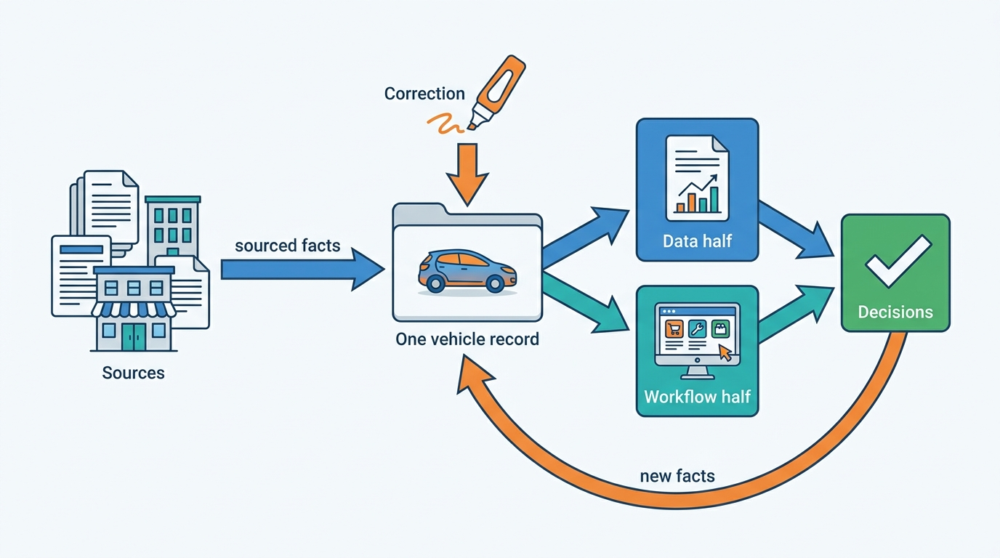
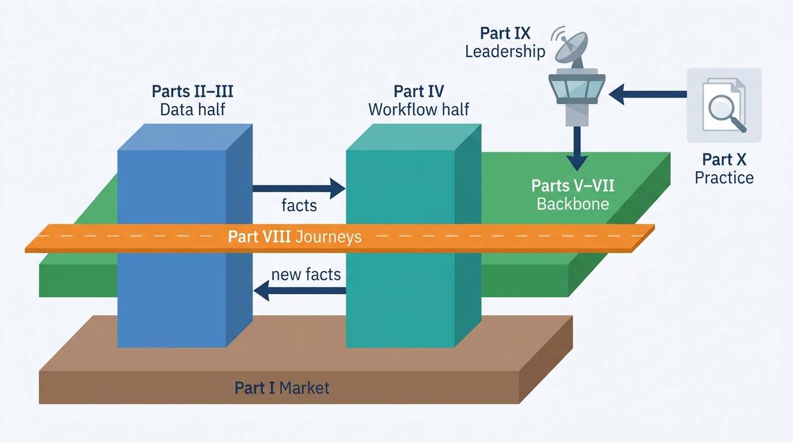

> **IN THIS SECTION, YOU WILL:** Learn what this book argues, who it is for and how its ten parts are organized; find the chapter for the decision in front of you; see how it compares the data half with the workflow half, and five markets with each other; and learn to tell the six kinds of statement apart.

> **WHY THE BUSINESS CARES:** The business earns its money on decisions other people make with its facts: a dealer's buying price, an asking price, an insurer's acceptance, a lessor's reserve. It loses money and trust every time a fact belongs to the wrong car, has no known source, is out of date or stays wrong after a correction.

> **WHY ARCHITECTS SHOULD CARE:** The facts about one car cross registers, manufacturers, insurers, workshops, portals, dealer management systems and dozens of the platform's own products. The Chief Architect is one of the few people who sees all of them, and must decide what a data business and a software business under one roof should share.

> **KEY POINTS:**
>
> * **The platform sells decisions about one physical car.** What it is, what happened to it, what it is worth, what to pay, what to ask, where to advertise it and who now owns it. Judge the architecture by how reliably the facts beneath those decisions travel: keyed to the right car, carrying their source, date and license, fresh enough for the decision, and corrected everywhere they spread.
> * **Two halves need each other and pull apart, and five markets differ in the same places.** Vehicle data services sell facts by the call; dealer SaaS sells workflow by the rooftop. Share the vehicle key, the dossier, accounts, meters, licenses and events; keep release cadence, workflows and external contracts apart. Markets change registers, sources and rules, so keep one core and write a market adapter or rule set for each difference.
> * **Ten parts form a learning path, and a routing table lets you start with the decision on your desk.** Every statement says what kind of statement it is: dated documented fact, industry practice, labeled inference, the author's recommendation, labeled assumption, or an illustration from Axleby, the fictional group the book follows.

 
On a Saturday morning, a buyer sits at the desk of an independent used-car dealer with three pieces of paper in front of him. The portal advert he answered shows a 2022 plug-in hybrid estate in the higher trim, at €27,950. The consumer history report he bought the night before, by plate, says **"no damage recorded"**. The dealer's own screen shows the same car at €26,450, in the lower trim, with a repaired rear quarter panel photographed at appraisal. The buyer asks a simple question: **which of these is true?**

**Figure 1:** *The buyer's Saturday question: an advert, a history report and the dealer's screen describe one car three ways, and no team owns the answer.*

On Monday every team can show that its system worked. The portal displayed the last feed it received, two price changes old because an update had failed silently. The history report was correct about the sources it checked; the repair was paid privately and never reached an insurer. The valuation was right for the edition the appraiser picked from a drop-down list, which was the wrong one. Nobody owns the buyer's question, because it is about **one physical car and the facts different systems hold about it**.

The reasons are architectural. The specification was never resolved from the VIN (vehicle identification number), so the edition was a guess. The report did not say which sources it had checked, so "no damage recorded" read as "no damage". The advert held a copy of the price, and nothing compared what the portal showed with what the dealer intended. **The buyer's question is an architecture question**: an identity never resolved, a provenance never shown, a copy never reconciled.

This book is about answering that kind of question, and about designing vehicle data and dealer software platforms where it is asked less often.

## Who This Book Is For

The book is written for people who are accountable for how the systems of a vehicle data or dealer software business fit together:

- **Chief and enterprise architects** of vehicle-data companies, dealer-software vendors and groups that run both.
- **Principal and staff engineers, and data, valuation, integration and platform-engineering leads**, who own one step of a car's journey and need to understand the steps on either side of it.
- **Product and engineering directors** of portals, lessors, insurers, remarketing businesses and dealer groups that build their own tooling.

The book takes the perspective of **a Chief Architect of a group that sells both vehicle data and dealer software**. Most of the reasoning applies to a company that sells only one; the trade-offs are drawn at group scale, where keying a car two ways becomes visible.

**What it assumes.** Architecture literacy: you know what an API, an event stream, a cache, a data warehouse and a cloud region are, and you have made and defended architecture decisions. The book does not explain them.

**What it does not assume.** Automotive retail, register, valuation and regulatory vocabulary. Rooftops, days-to-turn, maximum purchase price, the margin scheme, registration in a new name (*tenaamstellen*), the dealer management system (DMS), the Dutch national odometer registry (NAP), state of health (SoH) for batteries and the EU Data Act are each defined where they first matter, in the chapter that owns them.

## The Argument: Decisions About One Car

A vehicle data and dealer SaaS platform sells **decisions about one physical car**. Seven questions recur, in roughly the order a car meets them in a dealer's hands:

| Decision | The question | The facts it rests on | Where the book answers it |
| --- | --- | --- | --- |
| **Identify** | What is this car, exactly? | VIN, plate assignments, edition and factory options | [[vehicle-identity]], [[specification-and-equipment]] |
| **Check** | What happened to it? | Damage, odometer readings, title brands, inspections, ownership changes | [[vehicle-history]], [[registers-and-official-data]] |
| **Value** | What is it worth? | Comparable market evidence, condition, battery health, the valuation model's confidence | [[market-data]], [[valuation-engine]], [[condition-and-damage]], [[ev-battery-health]] |
| **Buy** | What should the dealer pay? | Value range, reconditioning cost, holding cost, target margin, VAT regime | [[vehicle-acquisition]] |
| **Price** | What should the dealer ask? | Price position against the market, stand-time, demand | [[used-car-pricing]] |
| **Advertise** | Where, and with what words and pictures? | The dossier, the resolved specification, the price, channel rules | [[merchandising]], [[listing-syndication]] |
| **Transfer** | Who owns it now? | The deal, the registration transaction, proof from the register | [[deals-and-sales-documents]], [[registration-and-trade-services]] |

Each decision is **only as good as the facts beneath it**, and four properties make a fact fit to decide on:

1. **It belongs to the right car**: keyed to the physical vehicle, not to a plate that moves between cars or a stock number that changes when a car moves rooftop.
2. **Its source is known**: who said it, when, under which license and with what confidence.
3. **It is fresh enough for the decision**: a register status for a sale must be live; a specification decoded last year is still good.
4. **It is corrected everywhere it spread**: a supplier's fix reaches every valuation, report, advert and client copy built on the wrong value.

The book's central claim follows: **the architecture is judged by how reliably those facts travel**: from registers, manufacturers, insurers, workshops and portals into one vehicle record; from that record into valuations, adverts, leads, contracts and official transactions; and back out, corrected, when a fact turns out to be wrong.

**Figure 2:** *Facts flow into one vehicle record and out into decisions made by both halves; the decisions produce new facts, and a correction must travel the same paths back.*

The chapters work on one property or one decision at a time. The last chapter of Part IX, [[evolving-the-vehicle-platform]], draws them into twelve **fitness functions** a group can measure every quarter, among them identity merge precision, correction propagation time, publish and withdrawal lag, lead delivery, segment valuation bias, cost per lookup and register outcome certainty.

## Two Halves That Need Each Other

**Vehicle data services**, the data half, sell authoritative facts and derived judgements (identity, specification, history, condition, valuation, market insight) by the call, the report, the file and the license. Their hard problems are **identity, provenance, licensing, freshness and accuracy**. One wrong fact in the data half is sold thousands of times.

**Dealer SaaS**, the workflow half, sells software that dealers use to buy, stock, price, advertise, sell and register cars, usually by the **rooftop** (one physical dealership location) and the month. Its customers range from one-person lots to groups with a hundred rooftops. Its hard problems are **workflow fit, tenancy, integration and distribution**: syndicating stock to dozens of portals, routing leads into customer relationship management (CRM) systems and DMS products the platform does not control, and billing a mix of subscriptions and per-lookup fees. One broken hop in the workflow half stops a dealer.

The halves need each other. [[vehicle-data-ecosystem]] shows that **data is what makes dealer software worth paying for, and dealer software is how data reaches the people who decide**, producing new data with every appraisal, advert and sale; Auto Trader UK bundles valuations into retailer packages, and Cox Automotive estimates US retail sales from its inventory software's stock observations. [[dealer-and-data-economics]] turns that into requirements: a dealer's thin gross shrinks every day a car stands, and a data provider earns cents on calls whose upstream cost may exceed the price.

The halves also pull apart: the data half needs external contracts that clients rely on for years, while the workflow half ships dealer-facing changes every week. The book's working rule, argued in [[vehicle-capability-map]], [[vehicle-bounded-contexts]] and [[one-platform-from-many-products]], is **share the car, the customer and the meter; keep the release cadence, the workflow and the external contract**:

| | Share across both halves | Keep separate per half or product |
| --- | --- | --- |
| **What** | Vehicle identity and the vehicle key; the vehicle dossier and its facts; accounts, tenants and entitlements; usage metering; the license and purpose register; the domain-event backbone | Release cadence; customer-facing workflows and screens; API contracts for external data clients; channel and supplier adapters as owned products |
| **Why** | Same meaning in both halves; built twice, each one produces a failure pattern (two keys clone cars, two meters disagree) | They change at different speeds; sharing them couples a weekly dealer release to a five-year client contract |
| **Where it is argued** | [[vehicle-identity]], [[inventory-and-vehicle-dossier]], [[identity-access-and-entitlements]], [[billing-and-metering]], [[data-licensing-and-governance]], [[events-webhooks-and-sync]] | [[vehicle-data-apis]], [[listing-syndication]], [[dms-integration]], [[modernizing-the-platform]] |

A group that treats the halves as unrelated businesses pays twice for identity, accounts, meters and licenses, and its dealers type the same plate into three screens.

## Five Markets, One Core

**Registers, privacy positions, valuation providers, portals and DMS markets differ by country**, and the differences reach deep into the design. The book compares four columns: **the Netherlands and Belgium, Germany, the United Kingdom and the United States**. [[vehicle-data-ecosystem]] describes each market's shape:

| Market | The shape that matters for architecture |
| --- | --- |
| **Netherlands / Belgium** | The Netherlands has an open, plate-keyed register (the RDW, *Rijksdienst voor het Wegverkeer*) with open data, a transaction channel for providers the book calls authorized information providers ([[registers-and-official-data]] defines the term; it is not RDW's own title); data vendors there also sell dealer software. Belgium has a separate register and a mandatory mileage certificate (Car-Pass). |
| **Germany** | A closed register at the Federal Motor Transport Authority (KBA), so no national mirror; two incumbent valuation and specification houses; DMS markets shaped by manufacturers. |
| **United Kingdom** | One dominant portal that also sells data and software to retailers; open roadworthiness-test (MOT) history; a register, the Driver and Vehicle Licensing Agency (DVLA), with scarce live lookups. |
| **United States** | No national vehicle register; history built by contributory networks and state title systems; a concentrated DMS market and the Driver's Privacy Protection Act on register data. |

Every chapter in Parts II to VII has a section titled **"Across Markets: What Changes by Country"**: a comparison table with those four columns, and a judgement on what stays common and what becomes a **market adapter**, a **rule set** or, rarely, a **separate product**. Where the markets are genuinely the same for a topic, the chapter says so in a paragraph rather than inventing differences.

The comparison rule the chapters keep arriving at is **one core, many adapters**. The identity graph is the same everywhere; plate normalization and cache lifetimes are per market ([[vehicle-identity]]). The register gateway's credential, answer-class and audit model is common, but the Netherlands supports a full mirror and a synchronous transaction relay, the UK a mirror of inspection data, and Germany no mirror at all ([[registers-and-official-data]]). The meter and rating engine are common; price books, tax calculation, invoice channels and collection connectors are adapters ([[billing-and-metering]]). Retention periods and breach clocks are country rule sets loaded per legal entity ([[privacy-and-retention]]). A market difference that seems to demand a fork of the core is a signal to look for the missing adapter.

The book's fictional group has no US customers. **The US column describes what a group entering that market would meet**, and it is there because US precedent (DMS access disputes, title brands, privacy law) shapes the whole industry.

## How the Book Is Organized

The book opens with three preface pages, follows the car through seven parts, walks four end-to-end journeys in Part VIII, turns to the Chief Architect's agenda in Part IX, tests the patterns against public cases in Part X and ends with reference material. Each part's argument fits in a sentence:

| Section | The part's argument | Chapters |
| --- | --- | --- |
| **Preface** | What the book is for, how vehicle platforms fail, and which group the examples follow | This page, [[where-vehicle-platforms-go-wrong]], [[meet-axleby]] |
| **[[part-1]]** MARKET | **Nobody sees the whole car**; the economics of dealers, data and software become latency, freshness, accuracy and metering requirements; map capabilities, share the key-carrying ones first, and draw boundaries where words change meaning | 1–4: ecosystem, economics, capability map, bounded contexts and sources of truth |
| **[[part-2]]** VEHICLE | **Key the car, not the plate, and keep every fact with its source**; the golden record is a view | 5–10: identity, registers, specification, history, ingestion, provenance |
| **[[part-3]]** VALUE | **A value is a typed, evidenced answer with a confidence, not a number**; de-listings, inspections, battery readings and connected-car data are evidence with a method, a source and rights, not facts | 11–15: market data, valuation, condition, battery health, connected cars |
| **[[part-4]]** DEALER | **Every dealer action is a decision with a record**, and every hop to a portal, CRM, register or DMS must be confirmed, not assumed | 16–25: buying, stock, pricing, adverts, syndication, leads, deals, registration, DMS, B2B trade |
| **[[part-5]]** SAAS | **The tenant, the entitlement, the meter and the license are the commercial backbone**, shared by both halves and enforced on every request | 26–30: tenancy, identity, onboarding, billing, licensing |
| **[[part-6]]** DISTRIBUTION | **Sell blocks with outcomes, publish facts as events, and back every push with a pull**; aggregation is not anonymization, and a free check must yield nothing worth reselling | 31–34: APIs, events, data products, consumer checks |
| **[[part-7]]** OPERATIONS | **The platform's availability is borrowed from registers, suppliers, portals and DMS vendors**, so design around budgets, labeled copies and honest queues | 35–39: reliability, cost, observability, security, privacy |
| **[[part-8]]** JOURNEYS | **Flows fail between systems, not inside them** | 40–43: inventory to portal, data correction, lead to DMS, sale to registration |
| **[[part-9]]** LEADERSHIP | **The Chief Architect decides what to share, buy, reorganize and retire**, and in what order | 44–49: sourcing, portfolio integration, organization, modernization, AI, evolution |
| **[[part-10]]** PRACTICE | **The public record is richest on contracts, access and outages and silent on engines** | 50–53: Cox Automotive, CDK Global, Auto Trader UK, VWE |
| **Reference** | The coverage map, templates, definitions and sources | [[domain-coverage]], [[toolkit]], [[glossary]], [[bibliography]] |

**Figure 3:** *Parts II and III build the data half and Part IV the workflow half; Parts V to VII are the shared backbone that lets both halves run as one platform; Part VIII crosses every boundary; Part IX decides how the whole changes, and Part X tests it against the public record.*

Part I is the one part not to skip: later chapters justify their targets by pointing back to it. Each chapter follows the same shape: opening callouts with three key points and the failure patterns it addresses; an Axleby scene that poses the question; concepts, architecture, documented practice and a worked example; failure handling, trade-offs and the "Across Markets" comparison; the Chief Architect's view; questions for a design review; and Sources and Evidence.

### The JOURNEYS part

Dealers do not experience contexts; they experience flows, and **flows fail between systems, not inside them**. Part VIII follows four flows end to end:

- [[journey-inventory-to-portal]]: a trade-in through identity, appraisal, stock-in and pricing to an advert on seven channels, reconciled against what each portal shows.
- [[journey-data-correction]]: a supplier's wrong odometer batch, and how the correction reaches every valuation, report, advert and API client that used it.
- [[journey-lead-to-dms]]: a portal enquiry through deduplication, routing and a CRM adapter to a salesperson who acknowledges it, and its outcome back to attribution and, where the portal accepts it, to the portal.
- [[journey-sale-to-registration]]: a signed contract through withdrawn adverts, payment and a register transaction to delivery and the history event that records the new owner.

Each journey has a sequence diagram, an owner and a consistency and latency requirement per hop, at least four failure cases with detection and recovery, the metrics that prove it works, and a short section on what changes in another market.

## Start With the Decision in Front of You

The parts are a learning sequence for a first reading. If a decision is already waiting, find the row that matches it, read the chapter in the **Start with** column, and follow the **Then** column in order if you need more. Return to Part I whenever a term or a number is unfamiliar.

| Your immediate need | Start with | Then |
| --- | --- | --- |
| The board asks whether the data business and the acquired dealer-software products should run on one platform | [[one-platform-from-many-products]] | [[vehicle-capability-map]], [[vehicle-bounded-contexts]], [[case-cox-automotive]] |
| A history report mixed two cars, or the same car appears as several records across products | [[vehicle-identity]] | [[ingestion-and-entity-resolution]], [[vehicle-history]], [[provenance-and-data-quality]] |
| Valuations, adverts and reports disagree about a car's edition and options, and the build-data invoice keeps growing | [[specification-and-equipment]] | [[valuation-engine]], [[merchandising]], [[scale-and-cost]] |
| A supplier sent a wrong batch, and the fix must reach every report, valuation, advert and client copy | [[journey-data-correction]] | [[provenance-and-data-quality]], [[events-webhooks-and-sync]], [[observability-and-data-operations]] |
| Valuations drifted after the market moved, and dealers or a lessor say the numbers are wrong | [[valuation-engine]] | [[market-data]], [[ev-battery-health]], [[used-car-pricing]] |
| Appraisers keep buying cars at prices the market does not support | [[vehicle-acquisition]] | [[valuation-engine]], [[condition-and-damage]], [[inventory-and-vehicle-dossier]] |
| Sold cars stay live on portals, or a portal's format change is discovered by a dealer | [[listing-syndication]] | [[journey-inventory-to-portal]], [[events-webhooks-and-sync]], [[observability-and-data-operations]] |
| Leads disappear between portals, inboxes, CRMs and the DMS, and every hop reports success | [[leads-and-crm]] | [[journey-lead-to-dms]], [[dms-integration]], [[tenancy-and-dealer-groups]] |
| A DMS vendor changes its access terms, or goes offline for weeks | [[dms-integration]] | [[reliability-and-dependencies]], [[case-cdk-global]], [[inventory-and-vehicle-dossier]] |
| The register's transaction channel failed at month-end, and some registrations were submitted twice | [[registration-and-trade-services]] | [[reliability-and-dependencies]], [[journey-sale-to-registration]], [[registers-and-official-data]] |
| A large dealer group wants single sign-on, group dashboards, its own isolation and a few special fields | [[tenancy-and-dealer-groups]] | [[identity-access-and-entitlements]], [[onboarding-and-configuration]], [[billing-and-metering]] |
| API clients dispute invoices, no-hit rules differ by product, or a batch client costs more than it pays | [[billing-and-metering]] | [[vehicle-data-apis]], [[scale-and-cost]], [[dealer-and-data-economics]] |
| A client resold data, or a supplier asks what was done with its data and for whom | [[data-licensing-and-governance]] | [[provenance-and-data-quality]], [[vehicle-data-apis]], [[privacy-and-retention]] |
| A legacy XML API and a dealer monolith must be retired while hundreds of clients and dealers depend on them | [[modernizing-the-platform]] | [[vehicle-data-apis]], [[events-webhooks-and-sync]], [[case-auto-trader-uk]] |
| A scraper walks the free plate check, or leaked API keys turn up in a public sample | [[vehicle-platform-security]] | [[consumer-vehicle-checks]], [[identity-access-and-entitlements]], [[scale-and-cost]] |
| A consumer asks for everything about her and her cars to be deleted, or a regulator asks who scores owners' plates | [[privacy-and-retention]] | [[data-products-and-insights]], [[connected-vehicle-data]], [[data-licensing-and-governance]] |
| Dealers want AI agents to screen stock or make offers on their behalf | [[ai-in-dealer-workflows]] | [[identity-access-and-entitlements]], [[valuation-engine]], [[b2b-trade-and-remarketing]] |

Two rows start somewhere unexpected, on purpose. The overpaying row starts with acquisition, because the maximum purchase price is where a valuation's uncertainty becomes money. The build-data row starts with specification, because the cheapest paid lookup is the one the resolver decides not to buy.

## How to Read the Evidence

**Company-aware but company-neutral.** The book draws on the public record of Cox Automotive, CDK Global, Reynolds and Reynolds, Tekion, Keyloop, Auto Trader UK, Carfax, DAT, Autovista, VWE, mobile.de, AutoScout24 and others; on standards such as ISO 3779 for the VIN; and on regulation from the GDPR and the EU Data Act to the US Driver's Privacy Protection Act.

**Six kinds of statement.** Architecture writing becomes unreliable when facts, habits, guesses, opinions, examples and estimates blur into one voice, so every chapter keeps them apart:

| Kind of statement | What it is | How to recognize it |
| --- | --- | --- |
| **Documented fact** | A company's public statement, a filing, a regulation, a standard, a date, an official statistic | Linked inline, with the **year of publication** in the sentence, and listed in Sources and Evidence. Regulations cite the official text and dates of application. |
| **Industry practice** | What vehicle-data and dealer-software businesses commonly do | Phrased as "commonly" or "a typical pattern is", with no invented percentages. |
| **Reference-architecture inference** | How a system like this is plausibly built, reasoned from engineering principles | When it concerns a real company, it is labeled **INFERENCE, NOT DOCUMENTED**. |
| **Recommendation** | My judgement as a Chief Architect | First person ("I would"), with the reasoning and the conditions under which it does not hold. Argue with it. |
| **Illustration** | An example set at Axleby | Labeled fictional in each chapter; its numbers agree across the book. |
| **Labeled assumption** | An illustrative volume, latency target or cost that is neither documented nor an Axleby fact | Marked "assume…" in the text or *(assumption)* in a table. Follow the reasoning; do not use it as a benchmark. |

Two distinctions are easy to lose. An Axleby figure, such as the €0.031 average cost of a lookup, is an illustration, not a benchmark. And a recommendation that sounds like a fact, such as "a de-listing is evidence of a sale, not a sale", is still a recommendation, with reasoning and exceptions.

**Why claims carry dates.** Companies' statements about their own products change fast. In its [full-year results for the year to March 2025](https://plc.autotrader.co.uk/media/umddcnxx/full-year-press-release-fy25.pdf) (May 2025), Auto Trader Group said its Deal Builder product would become "part of our core advertising proposition" and would "no longer be monetised per transaction". A year later, its [results for the year to March 2026](https://plc.autotrader.co.uk/media/usjleen0/full-year-press-release-fy26.pdf) (May 2026) described the response to a November 2025 dealer protest: "pausing auto-rollout", holding listening sessions and "introducing 'request a reservation'". Both were true when written; a chapter citing only the first, undated, would miss the most instructive consequence ([[case-auto-trader-uk]]).

Regulation moves on a published timetable, and the book is set in 2027, so dates decide what applies. The EU Data Act's rules on sharing a connected car's data with a third party at the user's request have applied since 12 September 2025, while its access-by-design duty covers only products placed on the market after 12 September 2026 ([Regulation (EU) 2023/2854](http://publications.europa.eu/resource/celex/32023R2854), Art. 50). The EU battery passport applies to batteries placed on the market from 18 February 2027 ([Regulation (EU) 2023/1542](http://publications.europa.eu/resource/celex/32023R1542), Art. 77), so it reaches used-car lots only as those cars come back from lease ([[ev-battery-health]], [[connected-vehicle-data]]). Ownership moves too: Keyloop was CDK Global's international business, Carfax moved with S&P Global Mobility into Mobility Global Inc., spun off from S&P Global and trading since 1 July 2026, and VWE sold its auction subsidiary ATC to Autorola in 2026. So every company and regulatory claim carries its date, evidence older than about three years is flagged, and renamed companies are given their former names once.

**As of October 2026.** Facts were checked against public sources in October 2026 unless a chapter says otherwise; check the source before relying on a date-sensitive statement.

## What the Book Draws On

The book uses three kinds of material, and no other.

- **A domain model, used as a research map.** The book started from a Productscape domain model in my sibling repository that describes one real Dutch company, VWE Automotive, from public sources only: 28 product bricks (named business capabilities), 140 modules, 29 data assets, personas and stressors. Its notes say that brick internals were **inferred from product behavior, not from VWE's architecture documentation**, and that its metrics are modeled seed values. The book uses it for vocabulary, actors, workflows, capabilities and stressors, and **never presents the model's bricks, modules, metrics or structure as facts about VWE or any company.** VWE appears only as a public case study, [[case-vwe]], built from dated public sources; the running example is fictional, not a disguised VWE. [[domain-coverage]] maps every brick to chapters and lists the capabilities the book added because the model lacks them or treats them thinly, from DMS and CRM integration to events, onboarding, observability and connected-vehicle data.
- **The public record of the named companies**: filings, engineering posts, talks and developer documentation, each cited with its publication year.
- **Standards, regulation and research**: ISO standards, EU and national legal texts, register and regulator documentation, and published research.

**No internal material.** Nothing here comes from confidential documents or inside knowledge of any company. Where a chapter needs a situation the public record cannot supply, it uses Axleby.

## Axleby and the Toolkit

**Axleby Group is fictional.** It is a privately held vehicle-data and dealer-software group headquartered in Utrecht, with **€214 million of revenue in 2026**, assembled from a register-data business and the companies it bought. **Axleby Data** sells identity, specification, history, valuation and market data by the call, the report and the license to 640 API clients; **Wertlauf** in Munich supplies the valuation models; **Lotwise** sells dealer software to 7,200 rooftops in the Netherlands, Belgium and Germany, and **Showroomly** to 1,350 in the UK; **Axleby Trade** handles register transactions and a B2B trade exchange; **Odolo** sells consumer vehicle checks. Beneath them sit five products with three login systems and two vehicle keys, and two API stacks with two metering rules. In March 2027 its board approves **One Dossier**, a €38 million program (2027–2029) that makes one vehicle key, one login, one meter and one license check the foundation, then rebuilds syndication on events and retires the legacy XML API by the end of 2029. [[meet-axleby]] introduces its systems, people and the eleven recurring incidents the chapters reuse, from the Cloned Plate and the Zombie Golf to the €186,000 No-Hit Credit. Axleby is a composite of patterns, not a disguise for any company. When Ines Marchetti, its Group Chief Architect, decides, ask what the equivalent would be in your platform.

The **[[toolkit]]** collects the book's templates, from the capability map and the provenance envelope card to the channel adapter contract and the architecture decision record; start with the one that changes this week's decision. The [[glossary]] defines the book's terms, including Dutch and German register terms, and names the chapter that owns each one.

## What the Book Leaves to Others

Three neighboring subjects appear only where they touch the architecture:

- **The DMS's own domains**: dealer accounting, parts, workshop and service management. The DMS is a system the platform integrates with and survives without ([[dms-integration]]), not one it builds.
- **Lending and insurance**: credit decisions, regulated consumer-credit contracts and claims handling. The platform refers financing to lenders who own the decision ([[deals-and-sales-documents]]) and treats insurers as data sources and clients.
- **New-car sales and manufacturer ordering.** Manufacturers appear as sources of build data, connected-car data and franchise requirements, not as a retail flow the book designs.

## The Failure Patterns

Vehicle platforms rarely fail through one bad decision. They sell the wrong car at the wrong price through recurring patterns that each looked reasonable when chosen. The next page, [[where-vehicle-platforms-go-wrong]], names fifteen of them in four families:

- **Vehicle facts**: **The Cloned Identity**, **Spec Guesswork**, **Provenance Amnesia**, **The Sticky Error** and **The Confident Valuation**.
- **Dealer workflow**: **The Zombie Listing**, **Feed Roulette**, **The Leaky Lead** and **DMS Hostage**.
- **Commercial**: **The Tenant Blur**, **The Unmetered Call** and **License Blindness**.
- **Platform**: **Borrowed Uptime**, **The Acquisition Archipelago** and **Customization Creep**.

Each comes with its warning signs, mechanism, cost, the half it hits hardest and the chapters that address it. The patterns travel in chains that usually start with a missing key, contract or owner. The buyer at the dealer's desk met three at once: **Spec Guesswork** in the guessed edition, **Provenance Amnesia** in a report that did not say what it had checked, and **Feed Roulette** in a portal update that failed without anyone noticing. Every chapter opens by naming the patterns it works on.

## A Living Journal

This book is a living journal, and a work in progress, that I revise as I learn more through [my work](https://obren.io). Every chapter has a "View spec" link in its byline that opens the specification it was written against, including its open questions. Read the book as current thinking with its limits stated, not as a finished text.

I developed the book through AI-mediated authoring: I set the concept, the structure, the chapter contracts and the arguments; AI tools supported research against public sources, drafting from those contracts, consistency checks across chapters and editing; I reviewed and decided. The specs and the scripts used to build this site are in the [book's GitHub repository](https://github.com/zeljkoobrenovic/spec-driven-journals). The content, its judgements and its errors are my responsibility.

## Where to Go Next

If you read in order, turn next to [[where-vehicle-platforms-go-wrong]]. Then read [[meet-axleby]], so that every chapter's opening scene lands in a group you know, and begin Part I with [[vehicle-data-ecosystem]]. Either way, keep the buyer at the dealer's desk in mind: which of the three papers is true, and who could have told him? Every chapter is part of the answer, and part of the design of a platform whose facts about a car can be trusted.

## Sources and Evidence

*Company, product and investor sources*

- [Full year results for the year ended 31 March 2025](https://plc.autotrader.co.uk/media/umddcnxx/full-year-press-release-fy25.pdf), Auto Trader Group plc, 2025: Deal Builder made part of the core advertising package and no longer charged per transaction.
- [Full year results for the year ended 31 March 2026](https://plc.autotrader.co.uk/media/usjleen0/full-year-press-release-fy26.pdf), Autotrader Group plc, 2026: the response to the November 2025 dealer protest, including pausing auto-rollout and introducing "request a reservation".

*Standards, regulation and official documentation*

- [Regulation (EU) 2023/2854 (Data Act)](http://publications.europa.eu/resource/celex/32023R2854), European Parliament and Council, 2023: Article 50 dates of application (12 September 2025; access by design for products placed on the market after 12 September 2026).
- [Regulation (EU) 2023/1542 concerning batteries and waste batteries](http://publications.europa.eu/resource/celex/32023R1542), European Parliament and Council, 2023: Article 77, the battery passport from 18 February 2027.

*Research and practitioner sources*

- Productscape vehicle-data-and-dealer-saas-platform domain model (author's sibling repository, 2026): the research map the book started from, built from public sources and mapped in [[domain-coverage]]. Not a description of VWE's or any company's systems.

Company, regulatory and research sources for each topic are listed in the chapter that owns the topic and collected in the [[bibliography]]. Axleby is fictional; architectural recommendations, labeled inferences and labeled assumptions are the author's judgement.
