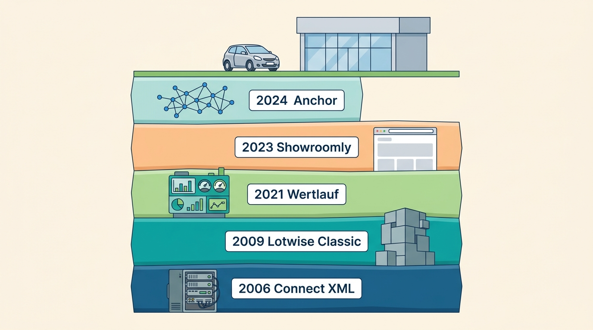
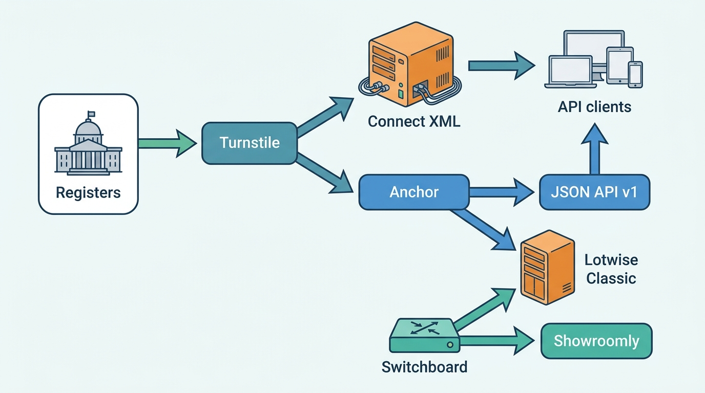
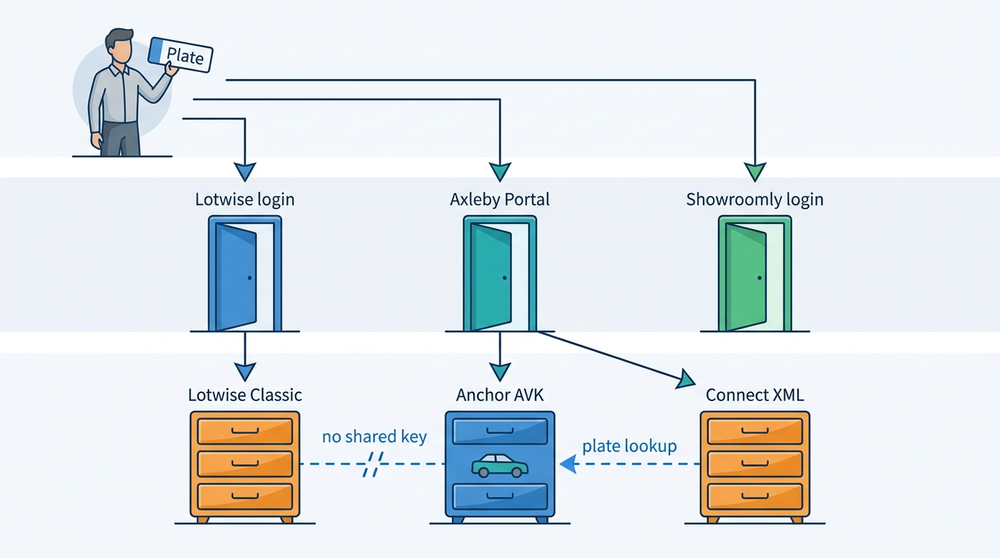

> **IN THIS SECTION, YOU WILL:** Meet Axleby Group, the fictional vehicle data and dealer software group this book follows: its history, brands, prices, customers, volumes, systems and people, the eleven incidents every chapter shares, and the One Dossier program that sets out to turn five products into one platform.

> **WHY THE BUSINESS CARES:** Axleby earns €214 million a year from two different ways of selling the same knowledge about cars: facts and valuations by the call, and workflow software by the rooftop. Its owners want both halves to grow, and its dealers want to type a plate once.

> **WHY ARCHITECTS SHOULD CARE:** Axleby's difficulty is not scale; it is that the facts about one car are keyed, stored, billed and licensed differently in each product it bought. The Chief Architect's job is to decide what the two halves share, and in what order to make them share it, without stopping a business that runs every day.

> **KEY POINTS:**
>
> * **Axleby is a fictional composite, not a disguised company.** It borrows common industry patterns so the book can show real tensions with consistent numbers. It is not VWE, Autotelex, Cox Automotive, CDK Global, Auto Trader, DAT or Carfax; every name, price, figure and incident here is invented.
> * **One group, two halves that need each other.** Axleby Data and Wertlauf sell identity, specification, history and valuation by the call and the report; Lotwise and Showroomly sell workflow to 8,550 rooftops by the month. The data is the feature that makes the software worth paying for, and the software is the channel that sells the data.
> * **One Dossier shares the vehicle, the account and the meter first.** The €38 million program (2027–2029) makes the Axleby Vehicle Key the only vehicle key, Axleby ID the only login, Meterline the only meter and Charter the license check on every data call, before it rebuilds syndication on events and retires Connect XML by 31 December 2029.

> **[FAILURE PATTERNS THIS SECTION ADDRESSES](where-vehicle-platforms-go-wrong.html):**
>
> * **The Acquisition Archipelago** — five products with three login systems and two vehicle keys, so a dealer re-types the same plate into three screens to see one car.
> * **The Cloned Identity** — Lotwise Classic keys a car by its own stock id plus plate and Connect XML keys it by plate, while Anchor keys it by VIN; the Cloned Plate shows what plate keys do.
> * **The Unmetered Call** — two API stacks implemented no-hit-no-fee differently, and the No-Hit Credit cost €186,000.

 
This book tests its argument against **one fictional group, detailed enough to be realistic and consistent enough to be followed across seventy pages.** A toy example is too simple to show why the hard decisions are hard; a real company's internals cannot be verified. This page is the group's reference. The failure patterns of [[where-vehicle-platforms-go-wrong]] appear here as Axleby's 2027 problems, and every chapter opens with a scene whose people, systems and numbers come from this page.

**Axleby Group is fictional.** It is a composite of *patterns* common in the industry: a register-data business that grew a report and API trade, a dealer-software company bought to give the data a workflow, a valuation specialist bought for its models, a UK business bought for a new market, a consumer app on the same data, and private-equity owners. It is **not a portrait of any real company**, and **none of its product names, prices, volumes or incidents belongs to one.** Real registers (RDW, DIV, KBA, DVLA, DVSA) appear as the public bodies they are; Axleby's dealings with them are invented, and no incident is attributed to a real register. Real suppliers (AWS, Snowflake, Keycloak, OpenFGA, Datadog) are named; Axleby's use of them is invented. Real companies appear under their own names, with dated sources, and never as Axleby.

## The Group at a Glance

**Axleby Group B.V.** is a privately held vehicle-data and dealer-software group headquartered in **Utrecht, the Netherlands**. Since **2022** it has been majority owned by **Harrowgate Capital**, a fictional private-equity fund; founders and management hold the rest.

| Measure (fiscal 2026 = calendar 2026) | Value |
| --- | --- |
| Revenue | **€214 million** |
| Adjusted EBITDA | about **€61 million** |
| Employees | about **1,150**, of whom about **420** in product and technology, including about **300 engineers** |
| Engineering hubs | **Utrecht** (Axleby Data, Axleby Trade, group platform), **Ghent** (Lotwise), **Munich** (Wertlauf, valuation and market data), **Leeds** (Showroomly), **Kraków** (shared platform and site reliability engineering, SRE, opened 2024) |
| Business customers | **12,400** legal entities in four markets |
| Rooftops on dealer software | **8,550** (7,200 on Lotwise, 1,350 on Showroomly) |

A **rooftop** is one physical dealership location, the usual unit of tenancy and billing in dealer software ([[tenancy-and-dealer-groups]] owns the term). A **dealer group** owns two or more rooftops.

The adjusted EBITDA margin of about 29% explains much of this page: a private-equity owner funds platform work it can see in retention, price and cost to serve ([[dealer-and-data-economics]]).

## How Axleby Came to Be

Axleby's history is fictional, but its shape follows the industry's, whose documented history is in [[vehicle-data-ecosystem]].

| Year | Event |
| --- | --- |
| **1996** | Axleby is founded in Utrecht to resell Dutch register data to insurers and leasing companies. |
| **1999** | Axleby signs its data-supply and transaction-provider agreement with the Dutch register, becoming what this book calls an authorized information provider ([[registers-and-official-data]]). |
| **2004** | Axleby Trade starts as a business line: register transactions for the Dutch trade, then documents, plates and registration-tax calculations. |
| **2006** | **Connect XML**, a SOAP/XML API and report back end, goes live in a co-located Utrecht data center. |
| **2009** | **Lotwise** is founded in Ghent; its monolith, now **Lotwise Classic**, dates from that year. |
| **2014–15** | **Showroomly** is founded in Leeds (2014) and **Wertlauf** in Munich (2015). |
| **2018** | **Odolo**, the consumer vehicle-check app, launches. |
| **2019** | Axleby acquires Lotwise and merges it with its own dealer portal. |
| **2020** | Lotwise Classic moves to **AWS eu-west-1**. |
| **2021** | Axleby acquires Wertlauf; its models later become group valuation (**Vantage**). |
| **2022** | **Harrowgate Capital** becomes majority owner; **JSON API v1** launches. |
| **2023** | Axleby acquires **Showroomly**. |
| **2024** | **Anchor** (identity graph) and **Switchboard** (lead router) are built; the Kraków hub opens. |
| **2025** | Showroomly moves from Heroku to **AWS eu-west-2**. |
| **2026** | **Ines Marchetti** joins as Group Chief Architect. |
| **January 2027** | The License Breach; **Charter** is built during 2027. |
| **March 2027** | The board approves the **One Dossier** program; capability map v1 is presented. |
| **June 2027** | The register transaction redesign goes live (14 June) after the Month-End Register Outage. |
| **October 2027** | JSON API v2 lookups and the developer portal go live. |
| **November 2027** | The DriveDesk Outage: twelve days without the DMS at 1,900 rooftops. |
| **December 2027** | Capability map v2 is adopted; the event backbone design record is approved; Connect XML's retirement plan is approved. |
| **31 December 2029** | Announced sunset of Connect XML. |

Each phase left a layer: a 2006 API that still runs the invoice, a 2009 monolith that still owns the stock book, a valuation stack on another cloud, a UK product on its own framework, and an identity graph only some products use.

**Figure 1:** *Each phase of Axleby's history left a layer that still runs: a 2006 API, a 2009 monolith, an acquired valuation stack, a UK product, and an identity graph only some products use.*

## A Data Business and a Software Business

Axleby's brands fall into the book's two halves. **Vehicle data services** (the data half) sell identity, specification, history, valuation and market data as APIs, reports, files and dashboards. **Dealer SaaS** (the workflow half) sells the software dealers use to buy, stock, price, advertise, sell and register cars. Axleby Trade sits between: a transaction service for dealers, built on the data half's register access.

| Brand | What it is | Founded / joined | Business model | 2026 revenue |
| --- | --- | --- | --- | --- |
| **Axleby Data** | Vehicle data services: identity, specification, history reports, valuations, market data, file enrichment, insight dashboards and data APIs. Authorized information provider (a book term; see [[registers-and-official-data]]) for the Dutch register since **1999** | Founded **1996**, Utrecht | Per-call API fees, per-report fees, annual licenses, insight subscriptions | **€71M**: APIs and licenses €38M, business history reports €17M, insight and enrichment €16M |
| **Lotwise** | Dealer SaaS for NL, BE and DE: appraisal, stock and dossier, pricing, adverts and syndication, websites and leads, sales administration, financing referral | Founded **2009**, Ghent; acquired **2019** | Monthly module subscriptions per rooftop (about half of revenue), plus group add-ons and extra seats, implementation and DMS-integration fees, financing-referral commissions and data usage beyond module allowances; about **€1,110** per rooftop a month on average. Register transactions are invoiced by Axleby Trade | **€96M** |
| **Showroomly** | UK dealer websites, lead management and syndication | Founded **2014**, Leeds; acquired **2023** | Monthly subscriptions per rooftop | **€12M** |
| **Axleby Trade** | Dutch register transactions (registration in a new name, indemnification, stock-register actions), import and export documents, registration-tax calculations, plates and trade materials, and **Tradefloor**, a business-to-business (B2B) trade exchange with hand-off to auction partners | Business line since **2004** | Per-transaction and per-document fees, webshop sales, Tradefloor success fees | **€27M** |
| **Odolo** | Consumer vehicle-check app and website (NL, BE, UK): free basic check by plate, paid full report | Launched **2018** | Per-report consumer payments; referral fees | **€8M** |
| **Wertlauf** | Valuation and market-data business in Germany; its models power group valuation (**Vantage**) | Founded **2015**, Munich; acquired **2021** | Reported inside Axleby Data | (inside Axleby Data) |

The five revenue lines add up to €214 million: Lotwise about 45%, Axleby Data 33%, Axleby Trade 13%, Showroomly 6% and Odolo 4%.

Three Dutch terms recur: **registration in a new name** (*tenaamstellen*) records a new keeper; **indemnification** (*vrijwaren*) records that a trader holds the car, releasing the previous keeper; **BPM** (*belasting van personenauto's en motorrijwielen*) is the registration tax an importer pays before a car gets a Dutch plate. [[registration-and-trade-services]] owns all three.

### Illustrative prices

Every price below is a fictional 2027 list price. Business prices exclude VAT; Odolo's consumer prices include it, as consumer price rules require. The chapters use these figures when they work out an invoice, a margin or a cost per call.

| Item | Price |
| --- | --- |
| Lotwise Stock & Pricing module | €189 per rooftop per month |
| Lotwise Syndication module (unlimited channels) | €129 per rooftop per month |
| Lotwise Website & Leads | €149 per rooftop per month |
| Lotwise Sales Admin | €59 per rooftop per month |
| Lotwise Appraise (includes 25 history reports a month) | €99 per rooftop per month |
| Business history report (beyond the bundle) | €4.95 |
| Valuation API call | €0.18, with volume tiers down to €0.06 |
| Plate-to-specification API call | €0.09; **no-hit-no-fee** applies to history and specification calls |
| Register transaction (registration in a new name) via Axleby Trade | €6.50 plus the register's own fee |
| Odolo full consumer report | €12.95 (NL, BE); £11.99 (UK) |
| Showroomly website + leads (UK) | £325 per rooftop per month |

**No-hit-no-fee** means a lookup that finds no record is not billed; [[billing-and-metering]] owns the rule and shows why it is harder to implement than to state.

Four features of the portfolio recur through the book.

- **The data half sells by the unit, the workflow half by the month.** A rooftop on all five Lotwise modules pays €625 a month at list price; an API client pays per call, and a lookup that finds nothing must cost nothing. A dealer group is often both, paying subscriptions and €4.95 for each report beyond its bundle, so the two models need one meter ([[billing-and-metering]]).
- **Some data costs Axleby money on every call.** Specbook fetches licensed build data per VIN at an average of **€0.46 a request**, five times the €0.09 list price of a plate-to-specification call. Inside Axleby this is **"the €46 per hundred" problem**, and it decides caching, bundling and when a specification is good enough ([[specification-and-equipment]]).
- **Axleby Trade turns data access into legal acts.** Its transactions change who keeps a car, must be correct, ordered and provable, and peak at month-end and quarter-end ([[registration-and-trade-services]]).
- **Odolo sells to consumers on the same data dealers buy**, which creates a conflict of interest when a consumer checks a Lotwise dealer's car, and opens the door scrapers use ([[consumer-vehicle-checks]]).

## Markets and Customers

Axleby sells in four markets. The Netherlands is home and the largest; Belgium follows Lotwise's Ghent roots; Germany is mostly Wertlauf's data clients; the United Kingdom is Showroomly.

| Market (2026) | Business customers | Dealer rooftops | Main brands |
| --- | --- | --- | --- |
| Netherlands | **6,900** | **5,100** on Lotwise | Axleby Data, Lotwise, Axleby Trade, Odolo |
| Belgium | **2,100** | **1,600** on Lotwise | Lotwise, Axleby Data, Odolo |
| Germany | **1,900**, mostly data clients of Wertlauf and Axleby Data | **500** on Lotwise | Wertlauf (inside Axleby Data), Lotwise |
| United Kingdom | **1,500** | **1,350** on Showroomly | Showroomly, Odolo |
| **Total** | **12,400** | **8,550** | |

Four facts about the customers recur.

- **Most rooftops belong to groups.** **410** dealer groups own two or more rooftops, and **58%** of Lotwise rooftops belong to one, so a tenant model built for one dealer with one login does not survive ([[tenancy-and-dealer-groups]]).
- **Most Lotwise rooftops are independents.** Independent used-car dealers are **62%**, franchised dealers (who sell new cars for a manufacturer, usually on its approved dealer management system, DMS) **31%**, and lessors' remarketing desks, traders and exporters **7%**.
- **API clients are a business of their own.** **640** organizations (software vendors, lessors, insurers, portals, fleet managers) call the data APIs; **210** still use only Connect XML, each a migration Axleby cannot do for them ([[modernizing-the-platform]]).
- **DriveDesk is a concentration.** **1,900** Lotwise rooftops run DriveDesk, a fictional DMS, behind an adapter Axleby does not control ([[dms-integration]]).

## Volumes Every Design Is Sized Against

2026 figures, rounded and illustrative.

| Metric | Value |
| --- | --- |
| Vehicle identity graph (Anchor) | **41 million** vehicles, VIN-keyed, across NL, BE, DE and UK; **58 million** plate assignments |
| Dutch register mirror | about **16 million** plates, current and historical |
| Billable API lookups | **2.6 million a day** on average, about 70% from Axleby's own products and about **780,000** from external clients; weekday peak hour about **310 calls a second**; Connect XML carries **38%** of calls |
| History reports | **3.4 million**: 2.6 million business, 0.8 million consumer through Odolo |
| Valuations issued | **19 million** (appraisals, API calls, reports, Odolo), each in the valuation ledger; a nightly run also recomputes about **350,000** Lotwise stock items as price signals, not counted in the 19 million |
| Lotwise stock | about **352,000** vehicles in stock at any time, **49** per rooftop on average; **1.9 million** stock-ins a year; average days-to-turn **58** |
| Syndication | **61** channels; about **1.4 million** channel operations a day (inserts, updates, deletes); **5.3** channels per advert on average |
| Leads | **4.8 million** into the Lotwise and Showroomly inboxes: portals 61%, dealer websites 27%, phone and chat 12% |
| Register transactions (NL) | **1.25 million** a year through Axleby Trade; month-end and quarter-end peaks about **4×** the daily average |
| Odolo | about **2.1 million** free checks a month; **0.8 million** paid reports a year |
| Tradefloor | about **48,000** B2B deals a year |
| Market data (Pulse) | about **2.3 million** adverts harvested or received a day across four markets; **61%** matched to a VIN-keyed vehicle |

**Ratios carry more architecture than totals.** About 1.4 plates per car means a system keyed by plate breaks on every import, re-registration and personalized plate ([[vehicle-identity]]). **Days-to-turn** (days from stock-in to sale) of 58 means a car loses value through every delay in pricing, advertising or delisting ([[dealer-and-data-economics]]). The **61% match rate** means four in ten market adverts cannot teach the valuation engine anything about a known car ([[market-data]]).

## The Systems Landscape

The 2027 baseline estate is the product of that history. It has new pieces (Anchor, Switchboard, JSON API v1) that some products use, and old pieces (Connect XML, Lotwise Classic) that still own money and the stock book.

**Figure 2:** *Axleby's 2027 baseline: register and supplier data enters through Turnstile, the newer services resolve it around Anchor, and two API stacks and two dealer products consume it; Connect XML and Lotwise Classic still sit on the main paths.*

| Area | System | What it is in 2027 |
| --- | --- | --- |
| Legacy data platform | **Connect XML** | SOAP/XML API and report back end; .NET Framework on SQL Server in a co-located Utrecht data center since **2006**. Serves 38% of API calls and runs the monthly invoice. |
| New data API | **JSON API v1** | Kotlin services on **AWS eu-central-1 (EKS)** since **2022**. **JSON API v2** with webhooks is a One Dossier deliverable. |
| Register gateway | **Turnstile** | Adapters to the Dutch register's information and transaction channels, the Belgian DIV (through a partner), DVLA and DVSA; monitors sessions, certificates and quotas. |
| Identity graph | **Anchor** | VIN-keyed identity with time-bounded plate assignments on PostgreSQL (Amazon Aurora), built **2024**. Its internal surrogate key is the **Axleby Vehicle Key (AVK)**. |
| Specification | **Specbook** | Specification catalog and resolver; licensed build data fetched per VIN at about **€0.46** a request. |
| History | **Tracewell** | History event store and assembler: damage, odometer, inspection, ownership, import, theft and recall events per VIN. |
| Market data | **Pulse** | Market data lake on **Databricks (AWS)**: harvested and partner-fed adverts, ownership-change sale events, auction results. |
| Valuation | **Vantage** | Valuation engine (Python, gradient-boosted models, from Wertlauf) trained on Google Cloud **Vertex AI**, served by an API on AWS; a **valuation ledger** in PostgreSQL; weekly retraining. |
| Dealer core | **Lotwise Classic** | PHP/Symfony monolith on MySQL since **2009**, on **AWS eu-west-1** since 2020. Owns stock, dossier, adverts, sales administration and Lotwise users. |
| Syndication | **Relay** | Channel publish queue (RabbitMQ inside Lotwise Classic) plus Go adapter services for 61 channels. |
| Leads | **Switchboard** | Lead intake, normalization and routing (Go, **2024**); delivers to the Lotwise and Showroomly inboxes and, through adapters, to external CRMs and DMS. |
| UK dealer product | **Showroomly** | Ruby on Rails and PostgreSQL; moved from Heroku to **AWS eu-west-2** in **2025**. Its own users, leads and websites. |
| Register transactions | **Axleby Trade back office** | .NET services and the **transaction retry queue**, integrated with Turnstile. |
| Consumer | **Odolo** | iOS and Android apps and web; a backend-for-frontend (BFF) on AWS; payments through a payment service provider. |
| Events and warehouses | Kafka, RabbitMQ, Snowflake, BigQuery | **Amazon MSK** for new services, RabbitMQ inside Lotwise Classic, SQL Server change tracking on Connect XML; **Snowflake** for Axleby Data and Lotwise, **BigQuery** for Wertlauf and valuation training. |
| Billing | Three billing paths | Monthly usage **invoice run** in Connect XML (SQL Server stored procedures); Lotwise subscriptions billed from Lotwise Classic; Showroomly through a SaaS billing tool. Collection by **SEPA direct debit** in the EU and **Bacs Direct Debit** in the UK. |
| Data governance | **Charter** | License and purpose register with request-path license checks and an immutable access audit, built in **2027** after the License Breach. |
| Observability | Datadog, Grafana, Prometheus | **Datadog** on AWS, Grafana and Prometheus for legacy; no shared tenant tag before 2027. |
| DMS integrations | Adapters, then **Hitch** | To **DriveDesk**, two German DMS products and several franchise-brand systems, file-based for most; **Hitch**, a DMS integration layer, is built through 2027 ([[dms-integration]]). |

Three facts in this landscape shape most of the book.

- **Connect XML still owns money.** It runs the usage invoice in stored procedures, so every change to how a call is counted or credited is made twice until Meterline replaces both stacks ([[billing-and-metering]]).
- **Lotwise Classic still owns the dealer's car.** Stock, dossier, adverts and sales documents live in one monolith whose RabbitMQ queue Relay shares, which is how failed updates could hold a delete back in the Zombie Golf ([[listing-syndication]]).
- **The newer services are only half adopted.** Anchor, Switchboard and JSON API v1 exist, but older products call them selectively; a platform built next to the old one is not the platform until the old paths stop.

### Two vehicle keys, three logins

The landscape's most expensive property for a dealer is invisible on the table above. A Lotwise dealer who takes in a trade-in sees one car; Axleby's systems see up to three records.

**Figure 3:** *Two vehicle keys, three logins: Lotwise Classic and Connect XML key the car by plate, Anchor keys it by VIN through the AVK, and three login systems sit in front of them; a dealer re-types the plate and the records are not joined.*

- **Two vehicle keys.** Lotwise Classic keys a car by **stock id plus plate**, Connect XML by **plate**, Anchor by the **AVK**, which resolves to a VIN (vehicle identification number) with plate assignments as time-bounded edges. A plate belongs to a registration, not a car: it moves on import, re-registration or personalization, so a report ordered by plate can describe a different car than the stock record it is attached to ([[vehicle-identity]]).
- **Three logins.** Business users log in through **Axleby Portal accounts** (SQL Server; the Axleby Data portal and Axleby Trade), **Lotwise users** (MySQL) or **Showroomly users** (Rails); Odolo's consumer accounts are separate, and five products keep five customer-account records for billing. A Velto used-car manager who checks, values, stocks and registers one car works in three screens with two passwords, and nobody at Axleby sees Velto as one customer ([[identity-access-and-entitlements]]).

The result is the dossier split that One Dossier is named after: **history reports, valuations and register transactions are ordered from different screens and stored in different systems, and dealers re-type plates** ([[inventory-and-vehicle-dossier]]).

## The People

Each person owns something the architecture depends on, and most of the book's tensions are between their legitimate goals. All are fictional.

| Name | Role | What they own and want |
| --- | --- | --- |
| **Ines Marchetti** (she/her) | Group Chief Architect | The book's point of view. Joined in **2026** from an insurer, where she bought vehicle data. Co-proposed One Dossier; owns the capability map; has influence, not command, over the brands. |
| **Ruben Dekker** (he/him) | CTO | Co-proposed One Dossier; owns the engineering budget and the sequence of retirements. |
| **Anouk Willems** (she/her) | CEO | Answers to Harrowgate; wants one customer view across five products. |
| **Priya Raman** (she/her) | VP Data and Valuation, Axleby Data | Anchor, Specbook, Tracewell, Pulse and Vantage; the data products and their accuracy. |
| **Jonas Kessler** (he/him) | Head of Engineering, Wertlauf (Munich) | The valuation models, their training and drift monitoring. |
| **Tomás Ferreira** (he/him) | Product Director, Lotwise | Lotwise's modules and roadmap; wants dealer-visible progress every quarter, not a platform rebuild. |
| **Femke de Boer** (she/her) | Head of Data Governance and Privacy; Data Protection Officer | Charter, retention, data subject requests, breach notifications. |
| **Callum Reid** (he/him) | Engineering Lead, Showroomly (Leeds) | Showroomly's Rails estate and its UK customers; the Cross-Tenant Lead happened on his team's code. |
| **Marta Nowak** (she/her) | Head of Platform and SRE (Kraków) | The shared platform, on-call and incident management. |
| **Hendrik Maes** (he/him) | Head of Partner Integrations, Ghent | The 61 channel adapters, the DMS adapters and data-supplier contracts. |
| **Lena Vos** (they/them) | Billing and Finance Systems Lead | The Connect XML invoice run, Lotwise billing, Meterline and collection by direct debit. |
| **Daan Visser** (he/him) | Product Manager, Axleby Trade | Register transactions, the retry queue's behavior at month-end, Tradefloor. |
| **Sanne Koster** (she/her) | Chief Information Security Officer since 2025, reports to the CTO | Security of the platform and its credentials; the response to the Plate Enumeration Attack. |

The recurring customers and partners are fictional too.

| Name | Who | Pronouns |
| --- | --- | --- |
| **Sietse Brandsma** | Owner of **Autobedrijf Brandsma**, an independent dealer in Leeuwarden: one rooftop, about **55** cars in stock, on Lotwise since 2014. The test of whether the platform stays simple. | he/him |
| **Mirjam Kuipers** | Group used-car director, **Velto Mobility Group**: **46** rooftops in NL and BE, 11 franchise brands, DriveDesk as DMS. The test of whether the platform works for groups. | she/her |
| **Dave Hartley** | Used-car director, **Hartley Motor Group** (UK): **28** rooftops, a Showroomly customer | he/him |
| **Bas Hendriks** | Remarketing manager, **Fleetmoor Lease** (NL and BE): about **64,000** vehicles, about **14,000** returns a year | he/him |
| **Karin Smit** | CTO of **DriveDesk**, the fictional NL and BE DMS vendor | she/her |
| **Kilometra** | A fictional odometer and service-record data supplier that aggregates workshop readings, including for UK imports | — |
| **Rijnstaal Verzekeringen** | A fictional insurer and Axleby Data API client | — |
| **Merelstad Auto Finance** | A fictional consumer-credit lender, Lotwise's financing referral partner in NL and BE | — |
| **Kavelstad** | A fictional Dutch online B2B auction, one of Tradefloor's two auction partners | — |
| **Lintvelt Leads B.V.** | A fictional lead-generation firm and the API client behind the License Breach | — |
| **Meridal Import B.V.** | A fictional importer of two brands with 58 Dutch rooftops, an Axleby Insight client | — |

## The Problems Axleby Starts 2027 With

When the board meets in March 2027, both halves work and the group is profitable, but each product it bought still behaves like a separate company. Six problems define Ines's starting position, each an instance of a pattern from [[where-vehicle-platforms-go-wrong]].

1. **Five products, three logins, two vehicle keys** *(The Acquisition Archipelago, The Cloned Identity)*: worked in [[vehicle-identity]], [[identity-access-and-entitlements]] and [[one-platform-from-many-products]].
2. **The vehicle dossier is split**: reports, valuations and register transactions live in different screens and systems. Worked in [[inventory-and-vehicle-dossier]].
3. **Syndication drift**: Relay does not reconcile what portals show, and sold cars linger *(The Zombie Listing, Feed Roulette)*. Worked in [[listing-syndication]].
4. **Two API stacks** with different contracts and metering rules *(The Unmetered Call)*. Worked in [[vehicle-data-apis]] and [[billing-and-metering]].
5. **Licensing is tribal knowledge** until Charter *(License Blindness)*. Worked in [[data-licensing-and-governance]].
6. **Valuation drift** after the used-EV price fall *(The Confident Valuation)*. Worked in [[valuation-engine]].

None of these is a technology problem alone. The split dossier exists because each acquisition brought its own idea of what a car is; the syndication drift because a publish queue that only sends commands cannot know what a portal shows; the metering gap because the rule "no hit, no fee" was written in a contract and implemented twice.

## The One Dossier Program

In **March 2027** Axleby's board approved **One Dossier**, on a proposal from **Ruben Dekker** and **Ines Marchetti**: **€38 million** over three years (**2027–2029**). The name states the goal a dealer can see: one place where everything Axleby knows and does about one car is shown, under one login.

**Year 1 (2027–28): one dossier, one account.**

- **Axleby ID** (Keycloak, self-hosted on EKS, with organizations) as the one login, and **Gatekeeper** (relationship-based authorization on OpenFGA) for who may do what for which rooftop ([[identity-access-and-entitlements]]).
- **Anchor as the only vehicle key** across products: every product refers to a car by its AVK ([[vehicle-identity]]).
- The **Lotwise Dossier** shows history, valuation, condition and register transactions in one place ([[inventory-and-vehicle-dossier]]).
- **Meterline** records a usage event for every billable act, in both API stacks and every product ([[billing-and-metering]]).
- **Charter** in the request path of every data API ([[data-licensing-and-governance]]).

**Years 2–3 (2028–29): event-driven and market-driven.**

- A **One Dossier event backbone** on MSK, with a transactional outbox in Lotwise Classic ([[events-webhooks-and-sync]]).
- **Relay rebuilt as desired-state sync** with reconciliation against each channel ([[listing-syndication]]).
- **JSON API v2** with webhooks: v2 lookups went live early, in October 2027; webhooks follow in Q3 2028 ([[vehicle-data-apis]], [[events-webhooks-and-sync]]).
- Automated pricing signals ([[used-car-pricing]]), digital returns for lessors ([[b2b-trade-and-remarketing]]), and **Showroomly moved onto shared identity, leads and syndication**.

**Retirements.** The **Connect XML sunset is announced for 31 December 2029**, which gives 210 XML-only clients about 33 months from approval. The retirement plan approved in December 2027 freezes Connect XML's contract on 1 January 2028, serves it as a facade over the new composer from Q2 2028 and exits the Utrecht data center by 30 June 2029. **Lotwise Classic is reduced to a dossier-UI shell by the end of 2029**, strangled module by module rather than rewritten: stock ownership moves out rooftop by rooftop in 2028 ([[modernizing-the-platform]]).

**Capability maps.** **v1** accompanied the proposal in March 2027 ([[vehicle-capability-map]]); **v2** was adopted in December 2027 ([[one-platform-from-many-products]]).

The order is the argument. One Dossier shares **the vehicle, the account, the meter and the license check first**, because every later step needs to say which car, which customer, what was used and whether it was allowed. It does **not** merge the two halves' release cadences, customer workflows or external API contracts; Lotwise ships dealer features monthly while the data APIs change on a versioned, announced schedule ([[vehicle-bounded-contexts]]).

## The Group Platforms the Chapters Introduce

The baseline table above is what Axleby has when 2027 begins. The chapters then build or redesign the shared layer piece by piece, mostly as One Dossier's Year 1 work, and each piece has a fictional name. The ones that recur across chapters:

| Name | What it is | Owner or team; status | Chapter |
| --- | --- | --- | --- |
| **Hitch** | DMS integration layer: one adapter per DMS family, time-bounded cross-reference to stock item and AVK, commands with receipts, nightly reconciliation, per-rooftop degraded mode | Partner integrations (Hendrik Maes); built through 2027 | [[dms-integration]] |
| **Inlet** | Shared ingestion pipeline: immutable landing zone, four validation layers, quarantine, stored match decisions, versioned survivorship | Specified July 2027 after the Odometer Correction | [[ingestion-and-entity-resolution]] |
| **Provenance envelope v1** | Source, license, confidence and two times on every fact, with append-only versions | July 2027, with Inlet | [[provenance-and-data-quality]] |
| **Retrace** | Correction cases, impact adapters and the *disputed* fact status | Priya Raman's data operations; design record August 2027 | [[journey-data-correction]] |
| **Pulse v2** | Market observations with listing lifecycles, market-vehicle clusters and inferred outcomes | Approved March 2027; live in stages April–October 2027 | [[market-data]] |
| **Gauge** and **Lotwise Inspect** | Group condition service (write-once evidence, findings on a panel map, versioned rubrics) and its guided-capture app | Lotwise team, Ghent; Inspect piloted at Fleetmoor's return centers from 14 June 2027 | [[condition-and-damage]] |
| **Mandate** and **Signalyard** | Consent and data-rights registry (one grant per vehicle) and purpose-scoped connected-car telemetry store | Fleetmoor odometer pilot live 6 September 2027 | [[connected-vehicle-data]] |
| **Lotwise Dossier** and the **Dossier service** | One stock item per tenant and AVK per stay, with timeline, documents and module actions | Dossier service on AWS from Q4 2027; stock state leaves Lotwise Classic in 2028 | [[inventory-and-vehicle-dossier]] |
| **Rebuilt Appraise** | Installable web app with offline capture, immutable offer versions and a versioned maximum-purchase-price calculator | 40 pilot rooftops from June 2027; all NL/BE rooftops October 2027 | [[vehicle-acquisition]] |
| **Relay 2** | Syndication rebuilt as desired-state sync with reconciliation per channel listing | One Dossier, 2028 | [[listing-syndication]] |
| **Sale-right register** and **Handback** | One exclusive, time-bounded right to sell per car across Tradefloor and auction partners; Fleetmoor's return-and-settlement workflow | Approved September 2027; Handback trial October–November 2027 | [[b2b-trade-and-remarketing]] |
| **Runway** and **Baseline** | Onboarding orchestrator (a state machine per rooftop) and tenant configuration service (versioned, inherited settings and rules) | Platform organization; first half of 2027 | [[onboarding-and-configuration]] |
| **Tenant directory** | Organization → legal entity → rooftop → department, versioned and effective-dated | Tenancy decision record July 2027 | [[tenancy-and-dealer-groups]] |
| **Axleby ID** and **Gatekeeper** | One login with group federation and SCIM; relationship-based authorization | Velto migrated July–September 2027; Hartley pilot Q4 2027 | [[identity-access-and-entitlements]] |
| **Meterline** | Usage events at the business moment, one rating engine | Shadow-rated beside the legacy runs from October 2027 | [[billing-and-metering]] |
| **Charter** | License and purpose register with request-path checks and a recipient audit | Live May 2027; every external data call checked by December 2027 | [[data-licensing-and-governance]] |
| **Folio** and **JSON API v2** | Contract registry; block-based lookup API with per-block outcomes | v2 lookups live October 2027; v2 webhooks Q3 2028 | [[vehicle-data-apis]], [[events-webhooks-and-sync]] |
| **One Dossier event backbone** | Domain events through an outbox onto MSK, with a public webhook gateway | Design record 14 December 2027; Lotwise outbox Q1 2028 | [[events-webhooks-and-sync]] |
| **Horizon** | Change-of-ownership propensity scores, redesigned as match-in on a client's own customers | DPIA March 2027; scores expire after 90 days | [[data-products-and-insights]] |
| **Pitwall** | Support console: dossier timeline, channel status, lead trail, register status | Live September 2027 | [[observability-and-data-operations]] |
| **Tidemark** | Retention and erasure service with an erasure ledger and a suppression list | Live December 2027 | [[privacy-and-retention]] |

Specbook, Tracewell, Vantage, Turnstile and Switchboard stay, with redesigns their chapters describe: Specbook's resolution states and purchase gate ([[specification-and-equipment]]), Tracewell's versioned odometer judgement ([[vehicle-history]]), Vantage's segment status ([[valuation-engine]]), Turnstile's mirror and live status calls ([[registers-and-official-data]]) and the register transaction ledger with its Ambiguous state ([[registration-and-trade-services]]).

## The Recurring Worked Examples

Eleven stories recur through the book. Their facts never change, so a reader can follow one incident across many chapters. The owning chapter works each example in full; others refer back to it.

| Example | When | What happened | Pattern | Owned by |
| --- | --- | --- | --- | --- |
| **The Cloned Plate** | 2026 | Two Audi A4s carried the same Dutch plate; Tracewell merged the clone's damage events into the genuine car's history; a consumer complaint through Odolo exposed it. The fix: VIN wins over plate in Anchor, plate assignments are time-bounded edges, reports show the VIN. | The Cloned Identity | [[vehicle-identity]] |
| **The Zombie Golf** | February 2027 | Velto sold a 2021 Volkswagen Golf at its Breda rooftop; the sold status from DriveDesk failed to sync; Relay's deletes queued behind failed updates; the car stayed live on **4** portals for **4 days**, producing **37** leads and **9** booked test drives. | The Zombie Listing | [[listing-syndication]] |
| **The Month-End Register Outage** | 31 March 2027 | The Dutch register's transaction channel was unavailable to Axleby for **5 hours 40 minutes** on the last working day of the quarter; **3,100** transactions queued; the retry queue preserved order, but **214** were submitted twice after ambiguous timeouts and needed correction. | Borrowed Uptime | [[registration-and-trade-services]] |
| **The Odometer Correction** | May 2027 | A Kilometra batch recorded miles as kilometers for **2,870** UK-imported vehicles; it was corrected after **11 days**, by which time **6,140** valuations, **412** history reports (**96** to consumers) and **1,180** live adverts carried the wrong mileage. | The Sticky Error | [[journey-data-correction]] |
| **The Cross-Tenant Lead** | June 2027 | A cache key without a tenant id in Showroomly's lead-inbox BFF showed **112** leads of one dealer to users of **3** other dealers for **47 minutes**; reported to the UK Information Commissioner's Office (ICO) as a personal-data breach. | The Tenant Blur | [[tenancy-and-dealer-groups]] |
| **The Lost Leads of Velto** | September 2027 | After Velto reorganized **46** rooftops into **9** regional hubs, routing rules for three closed rooftop codes, under which a hub's stock was still advertised, sent leads to an inactive DriveDesk CRM queue that accepted and then discarded them; **1,460** leads went unworked for **9 days**. | The Leaky Lead | [[journey-lead-to-dms]] |
| **The DriveDesk Outage** | November 2027 | DriveDesk was hit by ransomware and offline for **12 days**; **1,900** Lotwise rooftops lost DMS sync; Lotwise served as the fallback for stock, adverts and sales documents. | DMS Hostage | [[dms-integration]] |
| **The EV Overvaluation** | 2026 | After used battery-electric prices fell, Vantage overvalued used BEVs by **9.5%** on average for **14 weeks** before drift monitoring caught it; Fleetmoor and two dealer groups complained. | The Confident Valuation | [[valuation-engine]] |
| **The No-Hit Credit** | 2026 | The no-hit-no-fee rule was implemented differently in Connect XML and JSON API v1; Axleby credited **€186,000** to **41** API clients. | The Unmetered Call | [[billing-and-metering]] |
| **The License Breach** | January 2027 | A small lead-generation API client resold history-report data to a consumer website against its license; it was detected through a customer complaint, not monitoring, and led to Charter. | License Blindness | [[data-licensing-and-governance]] |
| **The Plate Enumeration Attack** | August 2027 | A scraper used **3,800** rotating IP addresses and leaked trial API keys to enumerate Odolo's free check and the JSON API: about **9 million** requests in 6 days. | (threat; see License Blindness) | [[vehicle-platform-security]] |

Chapters add smaller incidents of their own, among them the Margin-Scheme Error of 2026–27 ([[deals-and-sales-documents]]), the Saturday Batch of May 2027 ([[scale-and-cost]]), the Twice-Sold Returns of June 2027 ([[b2b-trade-and-remarketing]]) and the Two Certificates of March 2027 ([[ev-battery-health]]); each is worked only in its own chapter.

The 2026 incidents (the Cloned Plate, the EV Overvaluation, the No-Hit Credit) are the evidence behind the One Dossier proposal. The 2027 incidents happen while the program runs and test its priorities: provenance and license checks before events, state and reconciliation for every integration, tenancy in the data model rather than the UI.

Two are the book's spines. **The Odometer Correction is the data-side spine**: one wrong unit in one supplier batch crosses history, valuation, adverts, reports and API clients, and the question is how far a correction can follow. **The Zombie Golf is the workflow-side spine**: one sold car crosses the DMS, the dossier, the publish queue, four portals and the lead inbox, and the question is who knows the car is gone. The data half loses track of where a fact went; the workflow half loses track of what is true on someone else's system.

## How the Chapters Use Axleby

Each chapter opens with a 2027 scene at Axleby, then answers its question with concepts, dated public evidence and an Axleby worked example. [[part-9]] follows One Dossier as a program from [[build-buy-or-partner]] to [[evolving-the-vehicle-platform]]; the case studies of [[part-10]], starting with [[case-cox-automotive]], leave Axleby and test the book against the public record.

Three conventions hold. **Axleby is labeled fictional** the first time it appears in a chapter. **Its facts come from one canonical record**, so the 38%, the €0.46 and the 1,460 leads mean the same everywhere. New details never contradict this page, and numbers that are neither Axleby's nor documented are labeled as assumptions.

With the group, its problems and its program introduced, Part I begins where Ines began: with the question of who knows what about a car, and why a group that sells both the facts and the workflow has to answer it before it draws a single service boundary. Continue with [[part-1]].

## Sources and Evidence

### Company, product and investor sources

- None. Axleby Group, its brands (Axleby Data, Lotwise, Showroomly, Axleby Trade, Odolo, Wertlauf), owner (Harrowgate Capital), systems, people, customers (Autobedrijf Brandsma, Velto Mobility Group, Hartley Motor Group, Fleetmoor Lease), suppliers (DriveDesk, Kilometra, Rijnstaal Verzekeringen), figures and events are fictional and invented for teaching; they are not drawn from any single real company.

### Standards, regulation and official documentation

- The registers named (RDW, DIV, KBA, DVLA, DVSA) and their access regimes are described, with dated sources, in [[registers-and-official-data]]; the Dutch transaction terms are sourced in [[registration-and-trade-services]].

### Research and practitioner sources

- The scenario's shape draws on the Productscape reference model summarized in [[vehicle-capability-map]] and [[domain-coverage]], and on the industry history told, with dated sources, in [[vehicle-data-ecosystem]] and the case studies.

The vendor products named (AWS, Amazon Aurora, Amazon MSK, Google Cloud Vertex AI, BigQuery, Snowflake, Databricks, Keycloak, OpenFGA, Datadog, Grafana, Prometheus, RabbitMQ, SQL Server, MySQL, PostgreSQL, Heroku) and the payment schemes (SEPA direct debit, Bacs Direct Debit) are real; their capabilities are described, with sources, in the chapters that use them. Axleby is fictional; architectural recommendations, labeled inferences and labeled assumptions are the author's judgement.
