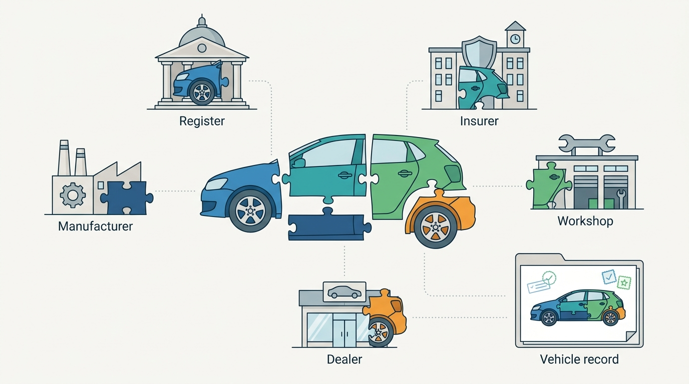
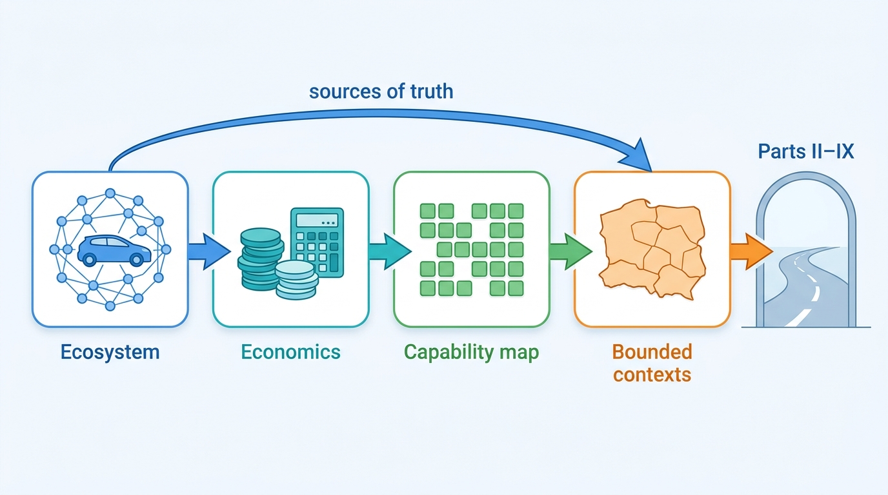

> **IN THIS PART, YOU WILL:** Map the ecosystem of registers, manufacturers, insurers, portals, dealers and software vendors that hold the facts about a car; turn the unit economics of dealers, data providers and dealer software into requirements; build a capability map of what the business must be able to do; and draw the bounded contexts and sources of truth that every later chapter builds on.

> **WHY THE BUSINESS CARES:** A group that cannot say who supplies which fact, on what terms, what one call earns or what one rooftop costs to serve cannot price, defend or sell the business. Part I gives the CEO and the board one picture of suppliers, money, capabilities and ownership.

> **WHY ARCHITECTS SHOULD CARE:** The market draws the platform's boundaries before any architect does. Who owns each fact sets the sources of truth, the economics set the latency, freshness, accuracy and metering requirements, and the capability map decides what both halves share. Get these wrong and every later chapter inherits the error.

> **KEY POINTS:**
>
> * **Nobody sees the whole car.** Registers, manufacturers, insurers, workshops, portals, auctions and dealers each hold one part of the facts on their own terms. A vehicle data provider's product is the assembly: one record per car, with each fact's source, date and license, put to work in the dealer's daily workflow.
> * **Economics become requirements.** A dealer makes about €2,100 gross on a typical car and loses about €9 a day while it stands (illustrative), a licensed lookup can cost more than it sells for, and a rooftop grows through retention and pull-through. Each number becomes a latency, freshness, accuracy or metering requirement, and the platform must record it as an event at the source.
> * **Share the keys, then draw the lines where meanings change.** Map capabilities, not products, and share first the parity capabilities that carry keys: vehicle, account, meter, license. Then give every principal entity one owner and one opaque key, label every copy, and translate at every external edge.

> **[FAILURE PATTERNS THIS PART ADDRESSES](where-vehicle-platforms-go-wrong.html):**
>
> * **The Acquisition Archipelago** — answered with a capability map that shows what is built twice and an entity–owner table that gives each shared entity one owner.
> * **The Unmetered Call** — answered by deriving requirements from unit economics and recording cost, outcome, tenant and license on every billable call.
> * **License Blindness** — answered by mapping who supplies which fact on what terms, and treating licensing as a shared capability rather than a clause in a PDF.

 
Every page in this book is about **one physical car and the decisions people make about it**: what it is, what happened to it, what it is worth, where to advertise it and who owns it now. Part I steps back from the decisions and asks the questions that come before any design. Who knows what about the car? Who makes money from what? What must the business be able to do? And who is allowed to say that a fact is true?

**Figure 1:** *Nobody sees the whole car: registers, manufacturers, insurers, workshops and dealers each hold one piece of its facts on their own terms, and a vehicle data provider sells the assembled record.*

The argument of this part is that **the market draws the architecture's first lines**. A platform that sells vehicle data and dealer software, the two halves of Axleby, the fictional group this book follows, owns almost none of the facts it sells, earns cents on calls whose upstream cost it must know, and bills dealers by the rooftop and month. Those facts decide its sources of truth, its non-functional requirements, the capabilities its two halves must share and the boundaries its teams own. Service design starts after them, not before.

Axleby learned this in early 2027, one question at a time. The **License Breach** of January, an API client reselling history data against its license, showed that nobody could say who supplied what on which terms. Preparing the €38 million **One Dossier** business case, the group found it could state revenue per rooftop (about €1,110 a month) but not cost per rooftop, and revenue per call but not margin per call. The board's map showed **9 of 39 capabilities built two or three times**. And when five teams defined "sold", they gave five correct answers, while a census found **29 principal entities, 11 with more than one writer and 4 with no owner at all**.

**Figure 2:** *Each chapter of Part I turns a business question into an architectural input: suppliers and terms into sources of truth, economics into requirements, capabilities into shared building blocks, and ownership into the context lines the rest of the book follows inward.*

## Chapters in this part

[[vehicle-data-ecosystem]] decides **who holds which fact about a car and on what terms**: the participants, the dated history of how dealer software grew around registers and portals, the value chain from Identify to Insight, and how each market's register and dominant players shape it. Ines Marchetti's ecosystem map after the License Breach is the case.

[[dealer-and-data-economics]] decides **which requirements the money sets**: gross per unit and the cost of a day in stock, cost per lookup and no-hit-no-fee, revenue and cost per rooftop, each captured as an event at the source. The board's question, "what is one rooftop worth and what does one call earn?", is the case, with its 58-versus-51 days-to-turn and €0.46 build-data fetch.

[[vehicle-capability-map]] decides **what the business must be able to do and what the two halves share**: a map of 6 domains and 39 capabilities drawn from a 28-block reference model, classified by investment and by scope, with the key-carrying parity capabilities shared first. Map v1 for the 16 March 2027 board is the case.

[[vehicle-bounded-contexts]] decides **who may say a fact is true**: contexts drawn where words change meaning, an entity–owner table with one owner and one opaque key per entity, labeled copies, and anti-corruption layers toward registers, suppliers, portals and DMS. The five meanings of "sold" and the table approved on 3 June 2027 are the case.

Begin with [[vehicle-data-ecosystem]].
