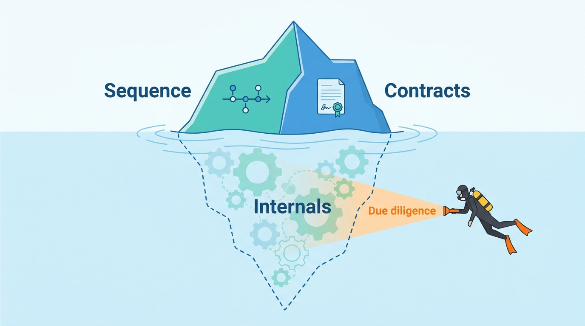

> **IN THIS PART, YOU WILL:** Test the book's patterns against four real companies: a portfolio group (Cox Automotive), a dealer management system vendor (CDK Global), a portal that became a retailer platform (Auto Trader UK) and a register-access business that became a dealer platform (VWE).

> **WHY THE BUSINESS CARES:** These are the competitors, partners and suppliers a vehicle data or dealer software group deals with. Their public records show which positions in the value chain held, which dependencies proved costly, and how long integration took when real money and real customers were at stake.

> **WHY ARCHITECTS SHOULD CARE:** A fictional company can illustrate a pattern; it cannot test one. The cases show the patterns under real constraints (courts, regulators, outages, acquisitions and dealer protest), and they show how little a public record reveals about internals, which is itself a lesson in reading vendor claims.

> **KEY POINTS:**
>
> * **Read every case as dated evidence, not as a description of today.** A documented fact carries its source and publication year. The author's reading is marked, and reference-architecture inference sits in a labeled callout. A 2018 conference talk describes 2018.
> * **Where a company sits in the value chain decides its hardest architectural problem.** For Cox it is integrating an acquired portfolio; for CDK, being the system of record others depend on; for Auto Trader, the contract of its partner API; for VWE, a single register connection.
> * **Public records are strong on sequence and contracts and thin on internals.** All four document what was built and when; none documents in any detail how tenancy, license enforcement or vehicle-key resolution work inside. Those gaps are where an architect's due diligence must ask directly.

> **[FAILURE PATTERNS THIS PART ADDRESSES](where-vehicle-platforms-go-wrong.html):**
>
> * **The Acquisition Archipelago** — Cox's decade-long effort to make more than 20 brands behave as one, and VWE's acquisitions and divestment from 2022 to 2026, show how portfolios form and how slowly they converge.
> * **DMS Hostage** — CDK's 2015 lock-out of independent integrators, the litigation that followed, and Cox's dependence on rival DMS products form the reference record.
> * **Borrowed Uptime** — the June 2024 CDK outage stopped normal work at about 15,000 dealerships, and almost every documented VWE product rests on one register.

 
Parts I to IX argued from patterns, research and Axleby, the fictional vehicle data and dealer software group this book follows. Part X tests that argument against **four companies that have put enough on the public record to be read as architecture cases**. Each case states what the company built, why, what it teaches and where the public evidence stops, and ends by comparing the case with the book's patterns and with Axleby's choices.

**The cases follow stricter evidence rules than the rest of the book.** A documented fact carries its source and its publication year in the sentence, because old evidence may describe replaced systems. Undated web pages are cited as "read October 2026" and treated as current but changeable. The author's interpretation is marked "my reading" or sits in the Chief Architect's view. Any claim about how a real company's systems work inside, beyond what it has published, is a reference-architecture inference in a callout labeled `INFERENCE, NOT DOCUMENTED`. Vendor case studies are cited as such: their numbers are the vendor's numbers. Axleby appears only in each case's final comparison, and it is not a disguised version of any of the four.

**Figure 1:** *Public records show a company's sequence and contracts above the waterline; its internals stay below it, where an architect's due diligence must ask directly.*

The four cases cover the book's two halves from different starting points, and their evidence differs as much as their positions:

| | Cox Automotive | CDK Global | Auto Trader UK | VWE |
| --- | --- | --- | --- | --- |
| Position | US portfolio group across the used-car chain | Largest US DMS vendor; its European branch is now Keyloop | UK portal turned retailer data and software platform | Dutch register-access company turned dealer platform |
| Hardest problem | Making acquired brands behave as one | Access to, and failure of, a system of record | A partner API that carries the business model | Dependence on one register and licensed sources |
| Best evidence | Releases, conference talks and vendor case studies (2016–2026), court records | Public-company filings, appellate opinions, an FTC challenge, dealers' 2024 filings | Annual results (2023–2026), Connect API documentation and changelog | Product, price and API pages; news releases (2022–2026) |
| Where evidence stops | Shared tenancy, license enforcement across brands | Hosting, the 2024 recovery architecture, current access fees | Valuation accuracy, entitlement enforcement | Revenue, volumes and almost all internals |

**Table 1:** *The four cases at a glance. Read each row as the starting point for that case's "How to Read This Case" and "Where the Public Evidence Stops" sections.*

## Chapters in this part

[[case-cox-automotive]] shows that **portfolio integration comes in layers, each taking years**: infrastructure, governance, identity, data, APIs and embedded features over eight years, by linking and federating rather than replacing.

[[case-cdk-global]] shows that **access terms to a system of record are architecture**, reviewed by courts and legislators, and that concentration turns one incident into an industry outage in which integrations recover last.

[[case-auto-trader-uk]] shows that **the taxonomy, the stock record and the partner API come before valuations, AI and transactions**, and that a bundled feature which moves control of a dealer's stock is a commercial change.

[[case-vwe]] shows that **in a strong-register market the register connection is both the moat and the main dependency**, and that licensed sources show through in a public interface.

Begin with [[case-cox-automotive]].
