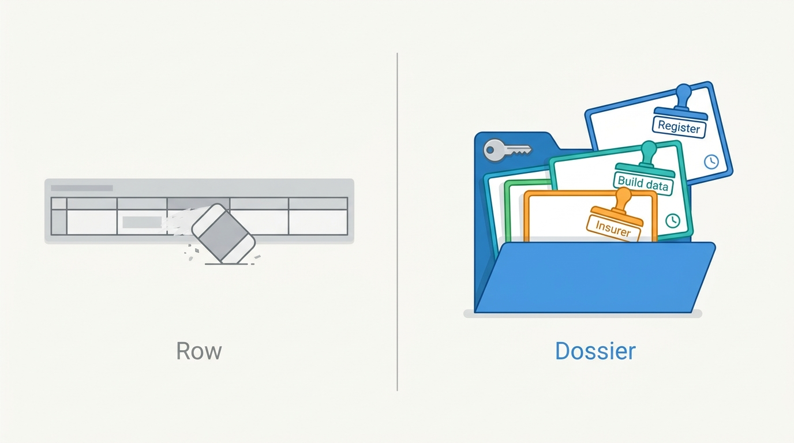
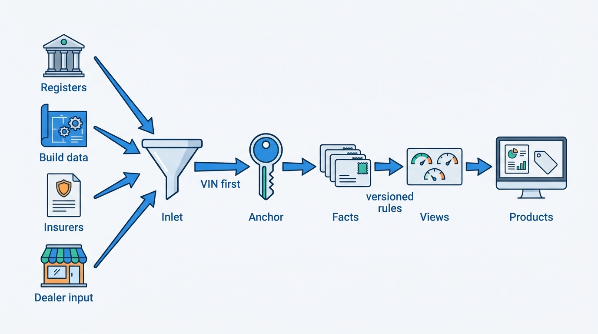

> **IN THIS PART, YOU WILL:** Build the foundation of the data half: the identity graph that says which car a fact is about, the register gateway, the specification resolver, the history event store, the ingestion pipeline that turns many deliveries into one record per vehicle, and the provenance envelope that says where every fact came from.

> **WHY THE BUSINESS CARES:** Every report, valuation and advert the group sells is a claim about one car. A clone's damage in the genuine car's report, a guessed edition in a trade-in offer or a batch of miles read as kilometers is paid for in credits, complaints and lost trust from data clients.

> **WHY ARCHITECTS SHOULD CARE:** The decisions in this part are schema decisions for every fact store. They set the key a fact is joined on, whether it carries its source and two timestamps, and whether its current value is computed or overwritten. They are cheap on day one and very expensive to retrofit.

> **KEY POINTS:**
>
> * **Key the car, not the plate.** A plate identifies a registration at a date. The VIN (vehicle identification number) is the best natural key, but it is mistyped and cloned. Re-key every fact at ingestion to an internal vehicle key anchored to the VIN, treat plates as dated assignments, and publish merges and splits as events.
> * **Store observations; compute everything else as views.** Register data, catalog versions, as-built options, odometer readings and damage claims are sourced events. "Edition unknown", "rollback suspected" and the current mileage are computed from them by versioned rules that can be re-run when a rule or a source changes.
> * **Provenance is part of the fact.** Source, batch, observation time, recording time, license and confidence travel with every value, and corrections append instead of overwriting. Without that envelope a correction cannot find what it touched, and the platform cannot say what it told a client on a given day.

> **[FAILURE PATTERNS THIS PART ADDRESSES](where-vehicle-platforms-go-wrong.html):**
>
> * **The Cloned Identity** — replaced by a VIN-anchored vehicle key and plate-at-date resolution in every store and pipeline.
> * **Provenance Amnesia** — answered with a provenance envelope on every fact and a raw, immutable copy of every delivery.
> * **The Sticky Error** — contained by making merges, catalog fixes and data corrections events that reach every report, valuation and advert built from the old value.

 
Part I mapped the market and drew the boundaries. Part II builds **the foundation of the data half**: the facts about a car that every product of Axleby, the fictional vehicle data and dealer software group this book follows, sells or depends on. Adverts, valuations, appraisals and history reports start from the same questions: which car is this, what does the official register say, what was built, and what has happened to it since?

The argument of this part is that **a vehicle record is not a row but a set of observations from sources with different authority**. A register has legal standing. A build-data provider is paid per call. An insurer's claim arrives months late, and a dealer's appraisal reading may be a typo. The platform's job is to attach each observation to the right car, keep its source and its time, and compute what products show from that evidence, so that a correction changes the answer everywhere.

**Figure 1:** *A vehicle record is not a row overwritten in place but a dossier of observations, each keeping the stamp of its source and its time, so the platform can compute what products show and recompute it after a correction.*

Axleby's incidents show the cost of the opposite. In the **Cloned Plate** (2026), history keyed by plate put a clone's damage into a genuine Audi's report. A Lotwise plate cache, one of three copies of the Dutch register, let a dealer agree a €9,800 trade-in on a 19-day-old entry that the register then refused. And in the **Odometer Correction** of May 2027, one supplier batch in miles read as kilometers reached 6,140 valuations, 412 history reports and 1,180 live adverts, and the fix overwrote the evidence of what had been served.

**Figure 2:** *Every delivery enters through one pipeline, is attached to one vehicle key and is stored with its envelope. What products show is computed from those facts by versioned rules, so it can be recomputed when a fact or a rule changes.*

## Chapters in this part

[[vehicle-identity]] decides **which car a fact is about**: an internal key in Anchor anchored to the VIN, plates as time-bounded assignments, and confidence, merge and split as audited operations. The Cloned Plate is the case.

[[registers-and-official-data]] decides **what the platform may take from official registers and what it owes them**: mirror what may be mirrored, ask live what a decision needs, and run every read and write through one gateway, Turnstile. The Three Copies review is the case.

[[specification-and-equipment]] decides **what exactly was built**: register, catalog and as-built layers kept apart, candidate sets with an explicit "edition unknown" state, and per-VIN build data bought only when a decision depends on it. Specbook's "€46 per hundred" problem is the case.

[[vehicle-history]] decides **what has happened to the car**: typed, sourced events in Tracewell, judgements such as rollback suspicion computed by rules that rank sources by trust, and reports as dated snapshots in which "no record" never means "clean". A false rollback flag on a 2016 Volvo V60 is the case.

[[ingestion-and-entity-resolution]] decides **how data gets in and becomes one record per vehicle**: an ingestion mode per source chosen from requirements, a raw landing zone with quarantine, VIN-first matching and a golden record computed by survivorship rules. The Kilometra file that arrived on time with the wrong unit is the case.

[[provenance-and-data-quality]] decides **how the platform knows where each fact came from and how good it is**: the provenance envelope, bitemporal corrections, freshness targets per data class and supplier scorecards measured against independent ground truth. An insurer's question, "what did you tell us on 17 May?", is the case.

Begin with [[vehicle-identity]].
