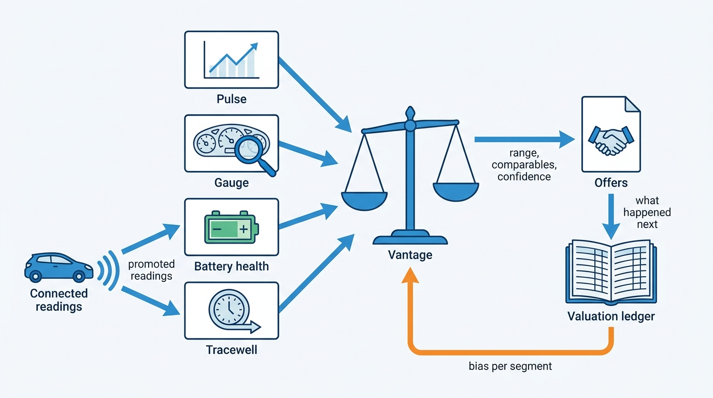
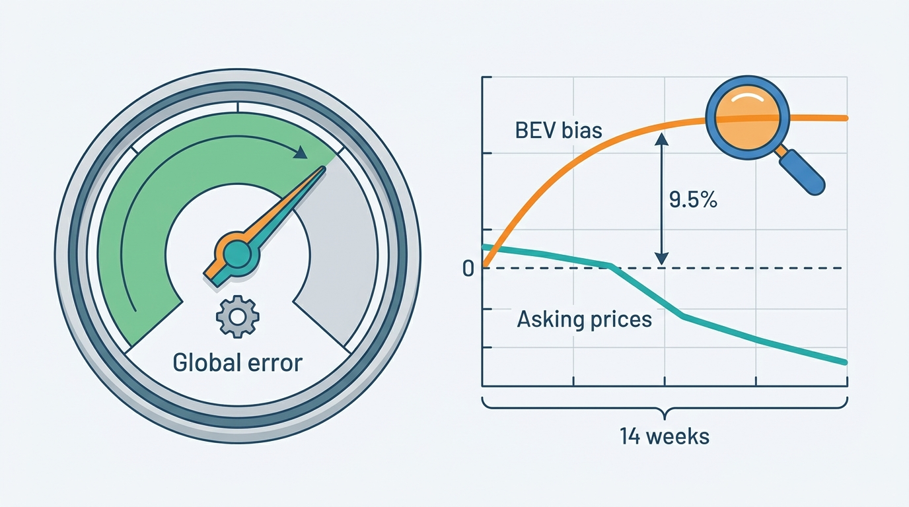

> **IN THIS PART, YOU WILL:** Build the value layer: market data from adverts and transactions, the valuation engine and its ledger, condition capture and damage estimation, battery state of health, and data sent by the connected car itself.

> **WHY THE BUSINESS CARES:** Valuations set trade-in offers, stock prices, lease residuals, auction reserves and insurance settlements. A valuation that runs 9.5% too high for 14 weeks, or a battery figure nobody can verify, costs dealers margin and lessors disputes, and the provider's reputation pays for both.

> **WHY ARCHITECTS SHOULD CARE:** Every input to value is partial. Adverts cover part of the market, inspections see part of the damage, battery tests use incompatible methods, and connected data reaches some cars under consents that end. The architecture decides whether that partiality is visible to the decisions that depend on it.

> **KEY POINTS:**
>
> * **Value is an estimate with evidence, so return the evidence.** A valuation names its value type and returns a range, comparables, adjustment lines and a confidence flag, and it may answer "no valuation". Market statistics carry their coverage, and "insufficient data" is a legitimate answer.
> * **Inputs are observations with methods, not attributes of the car.** A de-listing is evidence of a sale, not a sale. A damage finding has a photo, an inspector and a time. A state-of-health figure has a method, a device and a battery pack. Store the observation, derive grades and figures with versioned rules, and never average across methods.
> * **Measure against outcomes, per segment, because the market moves first.** A valuation ledger linked to offers and sales, reconditioning estimates compared with invoices, and signed bias tracked per segment beside leading signals such as asking prices turn accuracy into a measured property and catch a drifting segment in weeks, not months.

> **[FAILURE PATTERNS THIS PART ADDRESSES](where-vehicle-platforms-go-wrong.html):**
>
> * **The Confident Valuation** — answered with ranges, comparables, published coverage and per-segment drift monitoring on every value the platform serves.
> * **Provenance Amnesia** — answered by giving damage findings, battery readings and connected readings the method, source and capture time a dispute needs.
> * **License Blindness** — answered by tagging harvested adverts and connected readings with the rights and purpose under which they were obtained.

 
Part II gave every fact a car, a source and a degree of trust. Part III asks what those facts make the car **worth**. Value is where the data half earns much of its revenue and where the dealer half takes most of its risk: a trade-in offer, a stock price, a lease residual, an auction reserve and an insurer's total-loss settlement all start from a valuation.

The argument of this part is that **value is an estimate built on partial evidence, and the platform must say how partial**. In 2026 Pulse, the market data lake of Axleby (the fictional vehicle data and dealer software group this book follows), matched only 61% of adverts to a vehicle, and a Dutch audit found that only 68% of de-listings were sales. Inspections miss damage, battery certificates use incompatible methods, and connected data reaches only some cars. A valuation that hides those gaps looks confident until its segment moves.

The **EV Overvaluation** is the thread. In 2026, after used battery-electric prices fell, Vantage, Axleby's valuation engine, overvalued used battery-electric vehicles (BEVs) by 9.5% on average for 14 weeks while its global error metric barely moved. Pulse had seen asking prices fall first, but nothing connected that signal to Vantage. Reserve prices set from those valuations pushed Fleetmoor Lease's BEV no-sale rate on Tradefloor, Axleby's trade exchange, from 18% to 41%. Each later chapter adds a kind of evidence the valuation needs, and asks how sure that evidence is.

**Figure 1:** *Value combines market, condition, battery, history and connected evidence. The valuation ledger links each valuation to what happened next, so bias is measured per segment and fed back before the next stock turn.*

## Chapters in this part

[[market-data]] decides **how the platform reads the market**: observations with their source and rights, adverts clustered into market vehicles across portals and relists, sales inferred with a confidence, and coverage published with every statistic. "What does 61% mean?" is the case.

[[valuation-engine]] decides **how a valuation stays honest**: a typed answer with a range and comparables, a ledger linked to offers and sales, and per-segment drift monitoring with a circuit breaker on automated buying. The EV Overvaluation is the case.

**Figure 2:** *An average can hide a moving segment: Vantage's global error barely moved while its BEV valuations ran 9.5% too high for 14 weeks, after asking prices had already started to fall.*

[[condition-and-damage]] decides **how condition is captured and priced**: dated evidence on a panel map in Gauge, machine detections kept apart from human findings, and a reconditioning cost that is not an insurer's repair estimate. Fleetmoor's return inspections, with 21% of damage charges contested in one quarter, are the case.

[[ev-battery-health]] decides **how battery health is stored and used**: state of health as an observation with a method and a pack identity, certificates verified with their issuer, and "unknown" instead of a make-and-model average. One ID.3 with two certificates, 94% and 87%, is the case.

[[connected-vehicle-data]] decides **how data from the car itself enters the platform**: a consent grant per vehicle under the EU Data Act, raw telemetry kept apart from history, and deliberate promotion of the readings the grant allows. Fleetmoor's request for the car's own odometer is the case.

Begin with [[market-data]].
