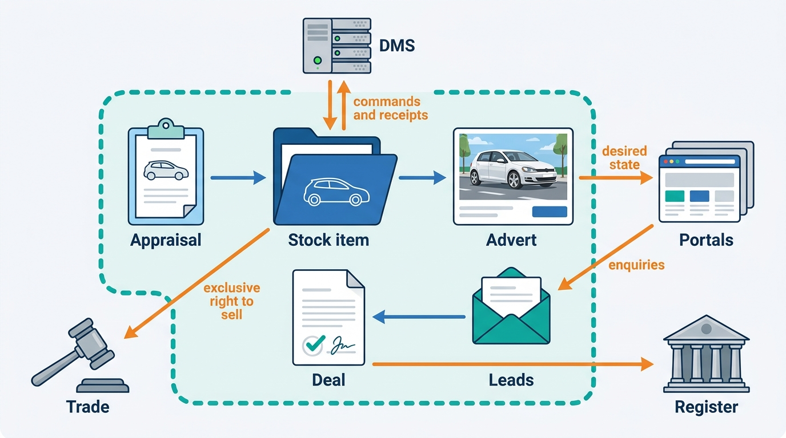
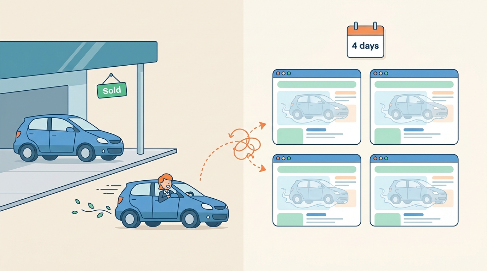

> **IN THIS PART, YOU WILL:** Follow a used car through the dealer's business: appraisal and purchase, the stock item and its dossier, pricing, merchandising, syndication to portals, leads, deals and documents, register transactions, the dealer management system (DMS), and trade between businesses.

> **WHY THE BUSINESS CARES:** A used car costs money every day it stands. Each step that is slow, wrong or silent costs margin: an offer nobody recorded, a sold car still live on four portals, 1,460 leads nobody worked, 1,240 cars invoiced under the wrong VAT scheme.

> **WHY ARCHITECTS SHOULD CARE:** The dealer workflow crosses more systems the platform does not control than any other part of the book: portals, CRMs, lenders, registers, DMS products and auction partners. Most of its failures happen at those boundaries, where every hop reports success to the one before it.

> **KEY POINTS:**
>
> * **A stock item is a stay, and the dossier is its record.** The vehicle is shared and outlives every dealer; the stock item is one tenant's ownership of it, with a small commercial state machine and parallel tracks for preparation, advertising and registration. Ownership of each field shared with a DMS is decided field by field and written down.
> * **Record decisions, not values.** An offer is a versioned, expiring commitment. A price change carries its author, reason and market reference. An advert is a rendering of sourced facts, and an issued invoice is numbered and immutable. Each can then be explained, reversed or re-rendered when a fact changes.
> * **At every boundary, hold the intent and confirm the outcome.** Publish desired state to portals and read back what they show. Count a lead as delivered when a person can see it. Treat a register timeout as unknown until the register says what it did. Send DMS writes as commands with receipts, and let only one trade channel at a time hold the right to sell.

> **[FAILURE PATTERNS THIS PART ADDRESSES](where-vehicle-platforms-go-wrong.html):**
>
> * **The Zombie Listing** — replaced by desired-state syndication, prioritized withdrawals, reconciliation against the portals and an exclusive right to sell in trade.
> * **The Leaky Lead** — answered with routing validated against the dealer's current organization and delivery confirmed by read-back.
> * **DMS Hostage** — answered with sanctioned interfaces, one adapter per DMS and a degraded mode that keeps the dealer selling for weeks.

 
Parts II and III built the facts about a car and its value. Part IV puts them to work in **the dealer's daily business**: buying a car, preparing it, pricing it, advertising it, answering enquiries, selling it, registering it and, when it does not suit the forecourt, trading it on. This is the workflow half of Axleby, the fictional vehicle data and dealer software group this book follows, sold mainly as Lotwise modules to 7,200 rooftops in the Netherlands, Belgium and Germany.

The argument of this part is that **each step is either a decision or a legal act, and both must be recorded with their reasons**. A field overwritten in place cannot explain itself, and a message sent without a receipt cannot prove it arrived. The second half of the argument concerns boundaries. The dealer's stock lives on dozens of portals, its leads in CRMs, its books in a DMS and its ownership changes in a register. The platform controls none of them, so it must hold the intended state, confirm the actual state and reconcile the difference.

**Velto Mobility Group**, a 46-rooftop franchised group on the fictional DriveDesk DMS, runs through the part. In February 2027 a sold Golf stayed live on four portals for four days (the **Zombie Golf**): its sold status in the DMS was never matched in Lotwise, and once it was marked sold by hand, its deletes queued behind failed updates from Velto's Thursday repricing run. After Velto reorganized into nine hubs, 1,460 leads went to a CRM queue that accepted and discarded them. In November 2027 DriveDesk was offline for 12 days after a ransomware attack.

**Figure 1:** *One stock item carries the car from offer to registration. Every arrow that leaves the platform crosses into a system it does not control, and each needs a contract, a receipt and reconciliation.*

## Chapters in this part

[[vehicle-acquisition]] makes **the maximum purchase price a visible, versioned decision** priced on the valuation's uncertainty, and every offer an expiring commitment; 23% of sampled purchases differed from the last recorded offer, with no reason recorded.

[[inventory-and-vehicle-dossier]] models **one stock item per stay** with a commercial lifecycle, parallel tracks and system of record decided per field; one Octavia existed as six records.

[[used-car-pricing]] treats **each price as a decision** with an author, a reason and a market reference, and puts repricing rules behind guardrails, simulation and a control group; Velto's Thursday run is the case.

[[merchandising]] composes **the advert as a rendering of sourced facts**, with generated text checked against a fact sheet and disclosures computed per market; the seven-day gap from stock-in to first advert is the case.

[[listing-syndication]] replaces commands with **desired state per car and channel**, withdrawal as a prioritized saga and a reconciler that reads the portals back; the Zombie Golf is the case.

**Figure 2:** *The Zombie Golf: a car already sold stayed live as a ghost on four portals for four days, which is why syndication holds desired state per channel and reads the portals back.*

[[leads-and-crm]] treats **a lead as a buyer's interest in a car at a rooftop**, validates routing against the tenant directory and counts delivery only when a person can see the lead; the Lost Leads of Velto are the case.

[[deals-and-sales-documents]] models **the deal as a contract with immutable, numbered documents** and the VAT regime as a fact of the purchase; the Margin-Scheme Error is the case.

[[registration-and-trade-services]] builds **register transactions as legal acts** with an authority chain, ambiguous timeouts as a third outcome and ordered queues per vehicle; the Month-End Register Outage, with 214 double submissions, is the case.

[[dms-integration]] decides **ownership field by field** and connects through sanctioned interfaces with a degraded mode for a DMS that is gone for weeks; the Golf that changed its DriveDesk stock number and the DriveDesk Outage are the cases.

[[b2b-trade-and-remarketing]] gives **one channel at a time the exclusive right to sell**, records the lease return once as evidence and keeps trade in one deal record; 17 Fleetmoor cars sold twice are the case.

Begin with [[vehicle-acquisition]].
