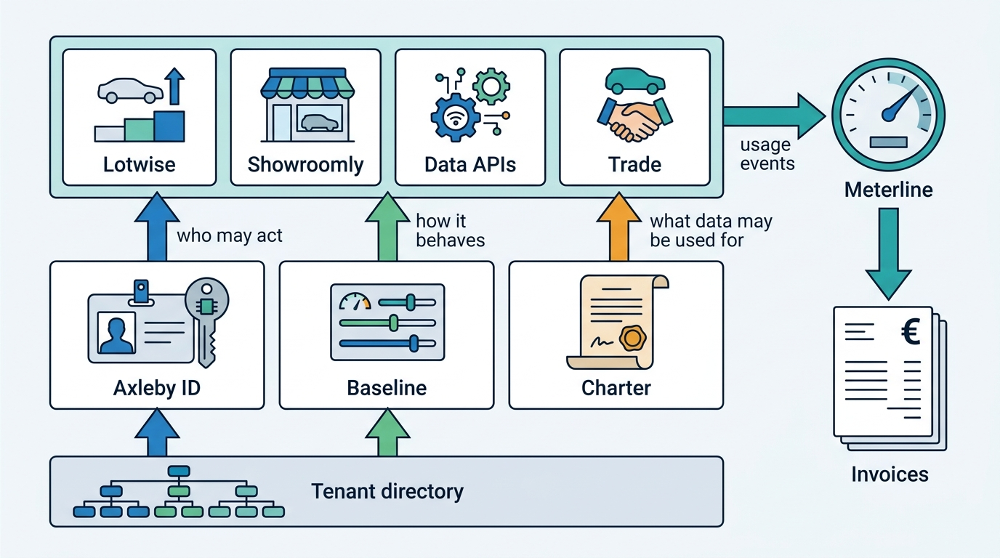
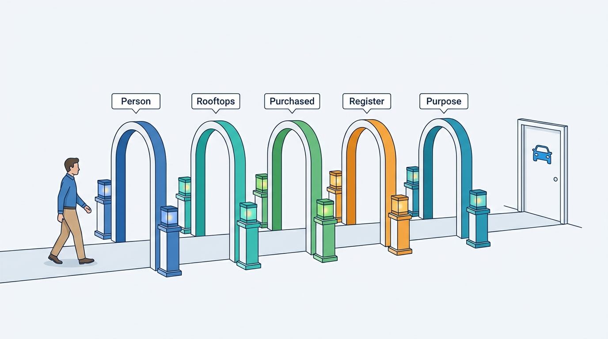

> **IN THIS PART, YOU WILL:** Design the SaaS control plane: tenancy for independents and dealer groups, identity and entitlements across acquired products, onboarding and configuration without forks, billing for a mix of subscriptions and lookups, and the licenses and purposes that govern every fact sold.

> **WHY THE BUSINESS CARES:** These are the systems customers meet around the product: the contract, the login, the onboarding, the invoice and the license. A dealer that sees another dealer's leads, a group that waits 199 days for its last rooftop, €186,000 credited for a rule read two ways and a client reselling reports for five months all cost revenue and trust.

> **WHY ARCHITECTS SHOULD CARE:** The control plane is where an acquired portfolio either becomes one platform or stays several. Tenant, identity, entitlement, configuration, price book and license are models every product depends on. When each product keeps its own, every group feature and every audit becomes a reconciliation project.

> **KEY POINTS:**
>
> * **The tenant is the contracting organization, and every layer carries it.** Legal entities, regions and rooftops form a versioned hierarchy beneath it. Tenant context comes from a verified token and is enforced in caches, jobs, events and the database, because the Cross-Tenant Lead leaked through a cache key, not a query.
> * **Separate the questions and give each one owner.** Who the person is, which rooftops they manage, what the rooftop has bought, what the legal entity may do at the register and what the data may be used for are five gates with five sources of truth. Folding them into roles, shared logins or one product's settings is how forks and breaches begin.
> * **Commercial facts are evidence.** Configuration is versioned and effective-dated. A billable event is recorded once by the service that knows the outcome and priced by one rating engine. A license is a rule checked on every request and backed by a recipient audit. Each can then settle a dispute with records instead of code reading.

> **[FAILURE PATTERNS THIS PART ADDRESSES](where-vehicle-platforms-go-wrong.html):**
>
> * **The Tenant Blur** — replaced by an organization-level tenant with first-class rooftops and tenant context enforced in every layer that holds data.
> * **The Acquisition Archipelago** — answered with one identity, one tenant directory, one configuration service and one rating engine shared by every product.
> * **License Blindness** — answered with license terms and purposes as data, checked on every request and recorded in an immutable audit.

 
Part IV followed the dealer's workflow. Part V turns to **the business structure every workflow runs inside**: who the customer is, who inside it may do what, how it is brought on board and configured, how it is billed, and what it may do with the data it paid for. In a single-product start-up these are settings. At Axleby, the fictional vehicle data and dealer software group this book follows, they are the main reason five acquired products still behave like five companies.

The argument of this part is that **tenancy, identity, configuration, billing and licensing form one control plane**. Each needs one owner and one model that every product uses. Axleby entered 2027 with three tenant models, three login systems, three billing systems and four readings of the same supplier contracts. The first-year promise of its One Dossier program, "one dossier, one account", depends on this part more than on any other.

The incidents mark the seams. In June 2027 a cache key without a tenant id showed 112 leads of one dealer to users of three others for 47 minutes (the **Cross-Tenant Lead**). Velto's seven-person central desk held 322 Lotwise logins. Two API stacks read "no hit" differently, and Axleby credited €186,000 to 41 clients (the **No-Hit Credit**). And a lead-generation client resold history reports to consumers for five months while paying every invoice (the **License Breach**).

**Figure 1:** *One control plane under every product: the tenant directory defines the customer, Axleby ID and Gatekeeper decide who may act, Baseline configures, Charter governs data use, and Meterline turns usage into explainable invoices.*

## Chapters in this part

[[tenancy-and-dealer-groups]] decides **whose data this is and where it lives**: the contracting organization as tenant with rooftops as first-class children, tenant context enforced in every layer, and pooled, siloed or bridged infrastructure chosen per component. The Cross-Tenant Lead is the case.

[[identity-access-and-entitlements]] decides **who may do what**: one identity per person and per client in Axleby ID, five independent gates for each action, and machine credentials with a lifecycle. Velto's shared logins, used even for register transactions, are the case.

**Figure 2:** *Every action passes five independent gates: who the person is, which rooftops they manage, what the rooftop has bought, what the legal entity may do at the register and what the data may be used for, each with its own source of truth.*

[[onboarding-and-configuration]] decides **how a customer goes from contract to first advert without a fork**: onboarding as a measured pipeline in Runway, migration as reconciliation with a single channel hand-over, and typed, inherited configuration in Baseline. Velto's 199 days are the case.

[[billing-and-metering]] decides **how every invoice line can be explained**: usage events recorded where the outcome is known, one rating engine with a versioned price book, and upstream cost metered beside price. The No-Hit Credit is the case.

[[data-licensing-and-governance]] decides **what each client may do with the data**: license terms and purposes as data in Charter, a purpose check on every request, obligations attached to each response and a recipient audit. The License Breach is the case.

Begin with [[tenancy-and-dealer-groups]].
