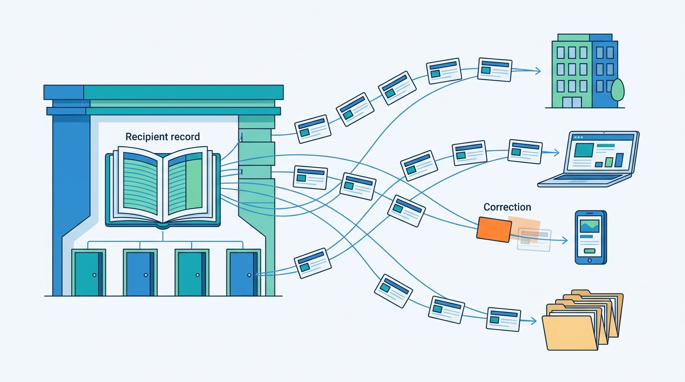
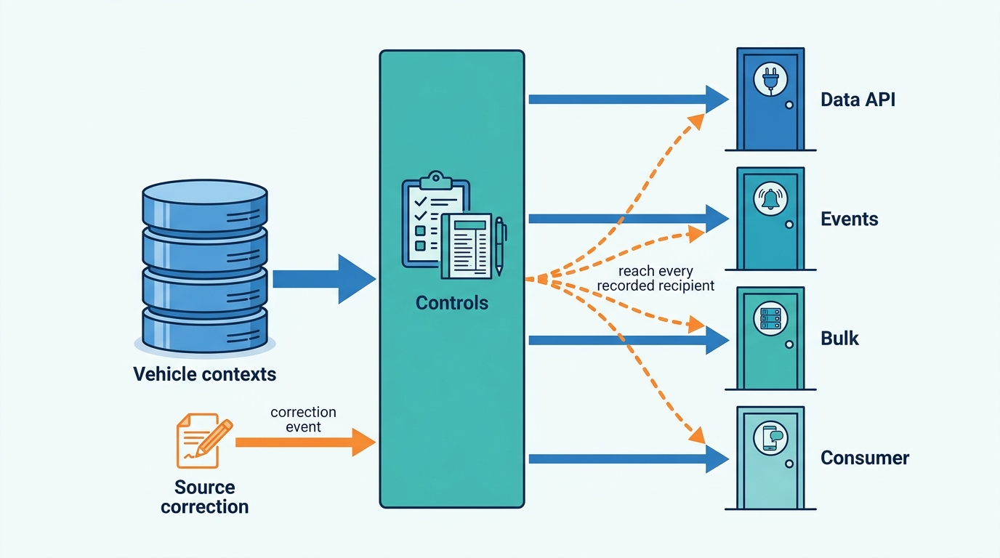

> **IN THIS PART, YOU WILL:** Design the four doors through which vehicle data leaves the platform: the data API sold as category blocks, the domain events and webhooks that keep internal and partner systems in step, the enrichment files, insight cubes and scores sold in bulk, and the free plate check and paid report sold to consumers.

> **WHY THE BUSINESS CARES:** Distribution is where data turns into revenue, and where its mistakes turn into credits, refunds and lost clients: €186,000 credited to 41 API clients for inconsistent no-hit billing, a sold Golf live on four portals for four days, and 96 consumer reports sold with a wrong mileage.

> **WHY ARCHITECTS SHOULD CARE:** Every door is a contract with parties who integrate once and change slowly, and every copy that leaves is one the platform no longer controls. Outcome vocabulary, versioning, delivery guarantees, license checks and correction paths have to be designed into the door, because they cannot be added to copies already delivered.

> **KEY POINTS:**
>
> * **Each door sells the same facts under a different contract.** An API response, an event, an enrichment file and a consumer report are built from the same vehicle contexts. What differs is the contract: the unit sold, its outcome and freshness, its license and purpose, and who may receive it. Write that contract down once per door and enforce it where the door is, not in each product.
> * **What leaves cannot be called back, so every copy needs a way to be corrected.** Pair every push with a pull: a replayable feed and a reconciliation job for events, a correction path for files and cubes, supersession and refund for consumer reports. A fix in the source is worth only as far as it reaches the copies built on it.
> * **Exposure changes what a fact means.** A free check is a bulk-export interface, an aggregate can disclose one competitor, and a score about a car is often a score about its owner. Decide yield, disclosure control and purpose per door, before the first client asks for more.

> **[FAILURE PATTERNS THIS PART ADDRESSES](where-vehicle-platforms-go-wrong.html):**
>
> * **The Unmetered Call** — replaced by one outcome vocabulary that decides the response, the meter and the service level together.
> * **The Sticky Error** — contained by correction events, recipient records and supersession for every API answer, file, cube and report that carried a wrong fact.
> * **License Blindness** — answered by checking license and purpose per category block, per bulk job and per consumer display, and recording who received what.

 
Parts II to V built the facts, the dealer workflow and the tenancy and commercial model around them. Part VI is about **how those facts leave**. Axleby, the fictional vehicle data and dealer software group this book follows, distributes through four doors: two data API stacks with 640 client organizations, an event and webhook layer between its own products and partners, insight and enrichment products worth €16 million in 2026, and Odolo, the consumer app with about 2.1 million free checks a month.

The argument of this part is that **distribution is one platform with several doors, not several products with their own copies of the data**. The governed facts stay in the contexts that own them. Each door composes them for one kind of recipient and carries the same controls outward: an outcome the meter agrees with, a freshness label, the source and license of each block, and a record of who received what, so a correction can follow.

**Figure 1:** *What leaves cannot be called back, so every copy stays tied to a record of who received it, and a correction can follow the thread to each recipient.*

Axleby's incidents show what happens when each door is built on its own. Connect XML and JSON API v1 classified "no hit" differently, and the gap became the **No-Hit Credit**. A sold status left Lotwise by eight different paths, and one of them lost the **Zombie Golf**'s delete. A postcode benchmark showed one dealer its only competitor's sales. And in August 2027 the free check gave away derived history counts to a scraper walking about 9 million plates.

**Figure 2:** *Four doors draw on the same contexts through one layer of controls. Because that layer records who received each fact, a correction in the source can reach the copies every door has already delivered.*

## Chapters in this part

[[vehicle-data-apis]] decides **what a data client buys and how the contract evolves**: category blocks assembled by a response composer, one outcome vocabulary of hit, partial, no hit and failed shared with the meter, and a contract registry that renders legacy XML and JSON from one description. Fleetmoor Lease's four calls that disagreed are the case.

[[events-webhooks-and-sync]] decides **how every system that copies a fact stays in step**: a small catalog of business events published through a transactional outbox, idempotent consumers and signed webhooks, and a reconciliation job behind every push. One sold car traced along eight paths is the case.

[[data-products-and-insights]] decides **what rules a data product obeys when it leaves in bulk**: written data-product contracts, a separate batch lane, 30-day retention for customer files, disclosure control enforced in the insight cube, and ownership-change scores only for plates the client already holds. A rural postcode benchmark and a lead-list privacy assessment are the case.

[[consumer-vehicle-checks]] decides **how the consumer door is built on the business platform**: a free check that returns only public facts, a paid report stored as a dated snapshot under consumer law, and a firewall between what the report says and who pays to be shown next to it. Odolo's four complaints in nine months are the case.

Begin with [[vehicle-data-apis]].
