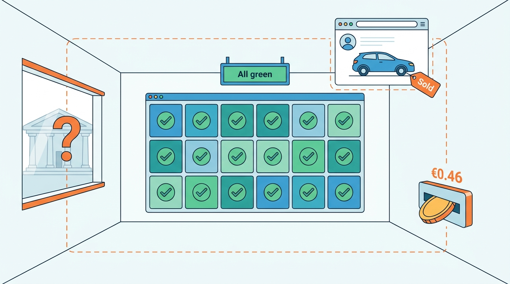
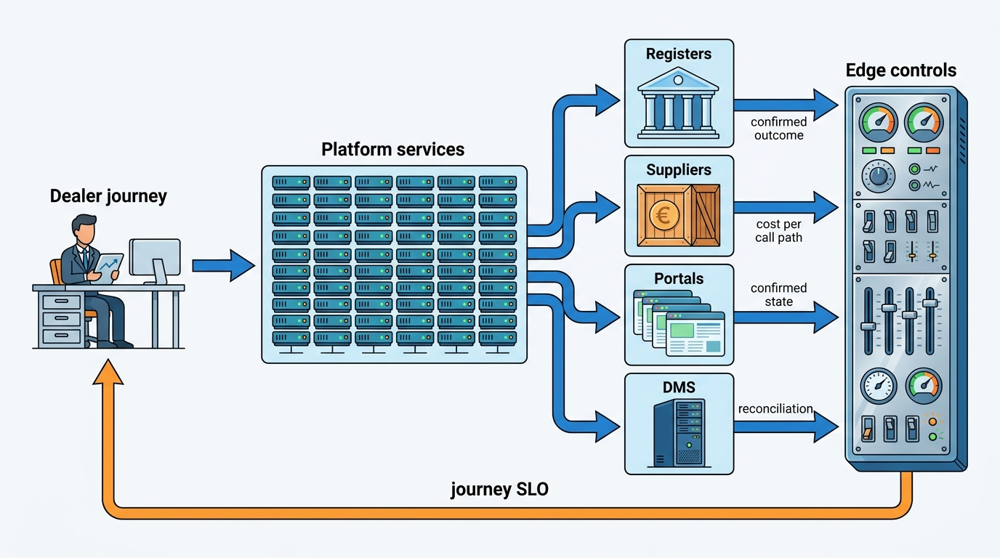

> **IN THIS PART, YOU WILL:** Run the platform: set journey SLOs and dependency budgets for registers, suppliers, portals and DMS products; size lanes for the workload shapes and cost every call path; monitor business flows and data quality end to end; defend lookup endpoints and credentials; and make retention and erasure platform services.

> **WHY THE BUSINESS CARES:** Operations decide whether a dealer can deliver a car on the last day of the quarter, whether a batch customer is profitable, and whether the group learns of a failure before its customers do. At Axleby, one insurer's Saturday batch earned €96,525 and cost €105,490, €96,140 of it in build-data fees, and 58% of serious 2026 incidents were first reported by a customer.

> **WHY ARCHITECTS SHOULD CARE:** A vehicle platform borrows its uptime, most of its unit cost and much of its risk from parties it cannot replace. Generic SRE, FinOps and security practice still applies, but only once it is pointed at the journeys, call paths and copies that cross those edges.

> **KEY POINTS:**
>
> * **Measure journeys and confirmed outcomes, not services and hops.** A dealer experiences "I could not register this sale", not a supplier's error rate. Give each journey an SLO and each dependency a share of its budget, measure flows to the external system's confirmed state, and treat an ambiguous timeout or an unknown state as a state of its own, never as success or failure.
> * **Most of the cost and risk of a call sits upstream, so control it per call path.** Paid upstream data is about two-thirds of Axleby's €0.031 average lookup, and every lookup endpoint is a bulk-export interface. Separate lanes, cache under the license, and give every caller a scoped credential with a quota and a spend cap.
> * **Every copy is a liability you must be able to reach.** Degraded modes serve labeled copies; a cached fact, a delivered file and a backup are all copies. Retention schedules, erasure ledgers and data-quality quarantine work only if the platform knows where each copy is.

> **[FAILURE PATTERNS THIS PART ADDRESSES](where-vehicle-platforms-go-wrong.html):**
>
> * **Borrowed Uptime** — replaced by dependency budgets, degraded modes for reads and honest queues for writes with legal effect, and separate lanes so a batch burst cannot exhaust an interactive quota.
> * **License Blindness** — addressed where cost, security and privacy meet it: caching only what the license allows, scoped credentials that limit what a leak returns, and purpose recorded for every use of personal data.
> * **The Sticky Error** — contained by data-quality monitors that quarantine a bad batch before it spreads, and by erasure that reaches the warehouse, the backups and the next recomputation.

 
Parts II to VI designed what the platform holds, does and sells. Part VII asks **how it stays useful, affordable, safe and lawful while running**. Axleby, the fictional vehicle data and dealer software group this book follows, depends on registers, build-data providers, history sources, 61 portal and channel adapters and the DMS (dealer management system) products of 2,250 connected rooftops. Each of them can be slow, expensive, compromised or wrong.

The argument of this part is that **a vehicle platform is operated at its edges**. Its services can all be green while a register transaction is ambiguous, a portal still shows a sold car, a cache miss buys build data at €0.46 a request, a trial key returns licensed fields to a scraper, or a deleted customer survives in a backup. The five chapters move the operational controls to those edges: the journey, the call path, the confirmed outcome, the caller and the copy.

**Figure 1:** *Every service can be green while the platform fails at its edges: an ambiguous register transaction, a sold car still on a portal, a cache miss that buys build data at €0.46.*

Axleby's 2027 incidents give the cases. On **31 March** the Dutch register's transaction channel was unavailable to Axleby for 5 hours 40 minutes, and 214 transactions were submitted twice after ambiguous timeouts. The **Zombie Golf** stayed live while every adapter's dashboard was green. The **Plate Enumeration Attack** walked about 9 million plates in six days. And one consumer's request to "delete everything" took six working days just to find her data in nine systems.

**Figure 2:** *The platform's health, cost and exposure are decided where it meets registers, suppliers, portals and DMS products. Part VII places its controls there and reports back on the dealer's journey, not on internal services.*

## Chapters in this part

[[reliability-and-dependencies]] decides **how the platform stays useful when an authority or supplier fails**: journey SLOs, a dependency budget per external party, reads that degrade to a labeled copy, writes with legal effect that wait in an honest queue, and probe before retry. The Month-End Register Outage is the case.

[[scale-and-cost]] decides **where the platform must scale and what a lookup really costs**: named workload shapes with their own lanes and admission rules, caching under the license as the main cost lever, and cost per call path reconciled against supplier invoices. Rijnstaal's Saturday batch is the case.

[[observability-and-data-operations]] decides **how the platform knows that its flows and its data are healthy for each dealer and channel**: business-flow monitors against confirmed outcomes, publish lag, data-quality monitors with quarantine, tenant tags at the right cardinality, and one support console. Green dashboards during the Zombie Golf are the case.

[[vehicle-platform-security]] decides **how a platform of public identifiers and central dealer access is defended**: enumeration defense for every lookup endpoint, scoped credentials, isolated adapters and cells, and rehearsed restores. The Plate Enumeration Attack is the case.

[[privacy-and-retention]] decides **how plates, leads and contracts are treated as personal data**: controller or processor per product and data class, people kept out of the vehicle stores, and retention and erasure as platform services that reach every copy. One consumer's erasure request across nine systems is the case.

Begin with [[reliability-and-dependencies]].
