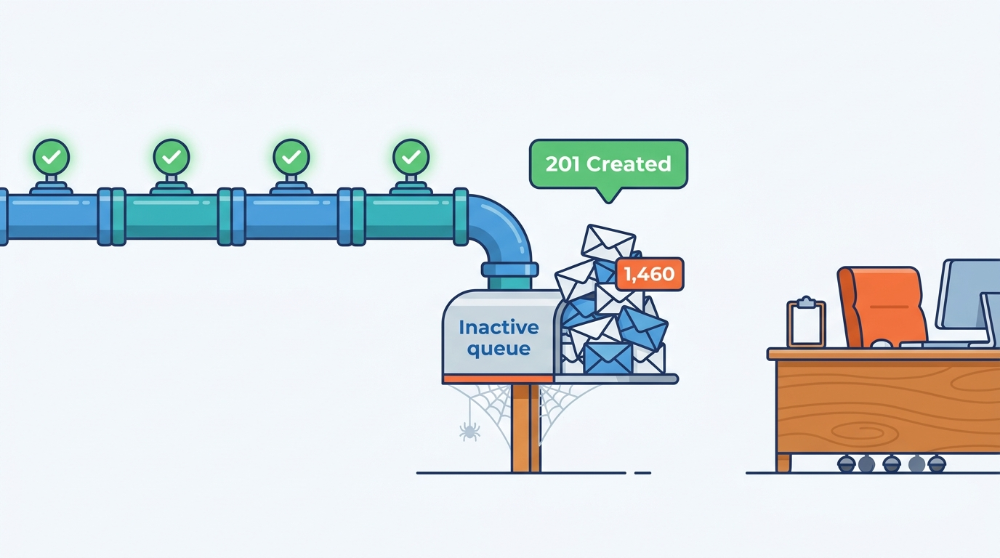
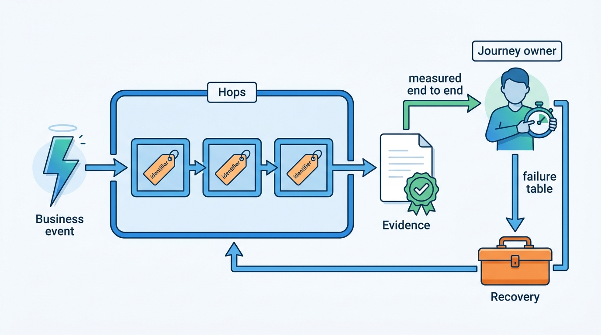

> **IN THIS PART, YOU WILL:** Follow four flows across every boundary they cross: a trade-in from the forecourt to seven advertising channels, a supplier's correction to every copy of a wrong mileage, a buyer's enquiry into a dealer's customer relationship management (CRM) system, and a signed contract through the register to a new keeper. For each one you will see its owners, identifiers, requirements, failures and recovery.

> **WHY THE BUSINESS CARES:** Dealers and data clients judge the platform by outcomes, not components: whether the car is on Marktplaats, whether the buyer was answered, whether the buyer drove home in the car. In 2027 Axleby's worst incidents happened while every component reported success: 1,460 leads delivered to a queue nobody worked, and 214 registrations shown as "rejected" that the register had completed.

> **WHY ARCHITECTS SHOULD CARE:** Parts II to VII each draw one boundary well. A flow crosses eight or ten of them, and the defects sit between them: an identifier looked up again by plate, a 201 Created taken as proof, a correction that reaches the source and stops. Only a walk of the whole flow shows which hop must prove what, and who owns the journey when no hop is at fault.

> **KEY POINTS:**
>
> * **Mint each identifier once, and use it as the next hop's idempotency key.** Appraisal id, stock item, Axleby Vehicle Key (AVK), advert revision, lead id, deal id and register transaction id each come from one owner. A hop that re-derives identity from a plate or a dealer management system (DMS) stock number is where duplicates, twin adverts, unmatched leads and double submissions begin.
> * **A journey is proven at its ends, not by its hops.** Evidence on the channel, acknowledgement by a person, a re-fetch by the client, a confirmation from the register: measure each journey from a business event to that evidence, and compare against a party outside the platform where one exists.
> * **Recovery is part of the design, and it needs an owner.** Every journey has a failure that no hop can repair alone: a withdrawal overtaken by an update, a wrong fact in issued reports, leads in an inbox nobody can open, a buyer told "refused" for a car in her name. Give each journey an owner, a failure table and a rehearsal.

> **[FAILURE PATTERNS THIS PART ADDRESSES](where-vehicle-platforms-go-wrong.html):**
>
> * **The Zombie Listing** — the inventory and sale journeys both end in a withdrawal that must reach every channel, even when it races an update or a portal is down.
> * **The Sticky Error** — the correction journey turns "what did this wrong fact touch?" from eleven days of manual work into a query over impact edges recorded at the moment of use.
> * **The Leaky Lead** — the lead journey replaces hop-level success codes with an acknowledgement ladder, a watched fallback and dead-letter review.

 
Parts II to VII designed the platform one context at a time. Each chapter drew a boundary, named an owner and set the requirements on its interfaces. Axleby, the fictional vehicle data and dealer software group this book follows, built most of those contexts well, and still had its worst weeks of 2027 in flows where **every component did what it was designed to do**.

**Figure 1:** *Every hop can succeed while the journey fails: 1,460 Velto leads were accepted with 201 Created by a queue nobody worked.*

Part VIII changes the unit of analysis from the context to the **journey**: one car, one fact, one lead or one sale, followed hop by hop. Only the journey view shows four things. It shows the **hops** themselves, and which of them still ran on an old mechanism after the others were modernized. It shows the **identifiers** that cross each boundary, and whether each hop keys its work on the one the previous hop minted, so that a retry, a replay or a correction finds what it must change. It shows the **evidence at the ends**, where the dealer, the buyer, the client or the register confirms the outcome. And it shows **recovery**: what happens when a hop says done and is not, and who notices.

Each journey follows the same shape: a scene from 2027, the success path with a hop table of owners, identifiers and requirements, a sequence diagram, the failure cases, the trade-offs, journey-level metrics and a short "What Changes in Another Market" section.

**Figure 2:** *A journey runs from a business event to evidence outside the hop that sent it. The identifier chain holds the hops together, and the journey owner measures the whole and owns the recovery that no single hop can perform.*

## Chapters in this part

[[journey-inventory-to-portal]] follows a 2021 Volkswagen Golf Variant traded in at **Autobedrijf Brandsma** in September 2027, from appraisal and stock-in to adverts on seven channels. The new hops worked, but the car reached five channels four hours after handover. The journey finds a twin stock item from a DMS re-key, an equipment-code rejection, a partial photo upload, a withdrawal racing an update and a portal outage.

[[journey-data-correction]] follows the **Odometer Correction** of May 2027: one Kilometra batch with miles stored as kilometers for 2,870 cars, and a wrong mileage that reached 6,140 valuations, 412 reports and 1,180 adverts. It owns the **correction event** and the **impact graph**, and argues for containing first, recomputing what is live and superseding what was issued.

[[journey-lead-to-dms]] follows the **Lost Leads of Velto**: after a reorganization into nine hubs, 1,460 leads went to an inactive DriveDesk queue that answered 201 Created. It owns **lead acknowledgement** and **dead-letter review**, and replays the same path through the DriveDesk Outage.

[[journey-sale-to-registration]] follows Brandsma's Kia Niro through the **Month-End Register Outage** of 31 March 2027, seen from the showroom: three state machines (commercial, channel and legal) that must agree at the hand-over, and one key chain from deal to ownership event.

Begin with [[journey-inventory-to-portal]].
