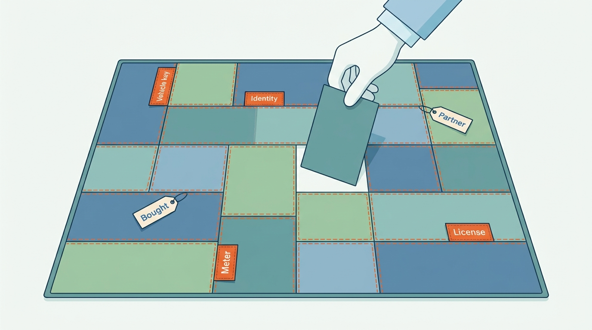
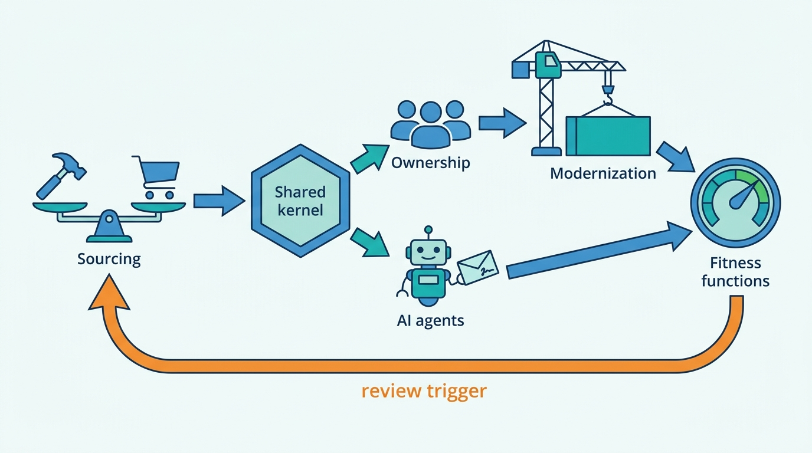

> **IN THIS PART, YOU WILL:** Decide what a vehicle data and dealer software group should build, buy or partner for. You will also decide which shared kernel turns acquired products into one platform, how to organize engineering around journeys and domains, how to retire a legacy API and a monolith while customers use them, where AI agents may act for dealers, and how to keep the platform coherent over ten years.

> **WHY THE BUSINESS CARES:** These are the decisions a board pays for and lives with. They set the cost of every data contract, whether a dealer group sees one supplier or nineteen invoices, whether a sold car disappears from every portal by Monday, and what an owner can still sell or buy without rebuilding the platform.

> **WHY ARCHITECTS SHOULD CARE:** Parts II to VIII designed the boxes and arrows. Part IX decides which of them the group keeps in its own hands, who owns each one, in what order the old estate is switched off, and how anyone can tell, quarter by quarter, that the design still holds. These decisions are the hardest to reverse.

> **KEY POINTS:**
>
> * **Own the seam, rent the commodity.** The vehicle key, the identity and tenant directory, the meter, the license check, provenance and the evidence behind valuations let the group switch suppliers, join acquired products and separate a brand again. Buy, license or partner for the rest, behind adapters with contracts and an exit plan.
> * **Every box needs one owner, and every move needs one writer.** Organize teams around dealer journeys and vehicle-data domains rather than acquired brands. Give each external dependency a named owner, move systems of record one at a time behind a parallel run, and treat an AI agent as a named person's delegate acting through that person's commands.
> * **Steer by retirements and fitness functions, not by target diagrams.** Count progress by what has been switched off. Stress the design with what could plausibly happen. Measure every quarter whether facts about each car still travel correctly.

> **[FAILURE PATTERNS THIS PART ADDRESSES](where-vehicle-platforms-go-wrong.html):**
>
> * **The Acquisition Archipelago** — answered by a shared kernel with an integration contract, an organization that is not shaped by brands, and retirement dates that end double running.
> * **License Blindness** — contained by testing data rights before any purchase, keeping licensed data away from model providers unless the license allows it, and holding license and purpose as data that survives a ruling or a repricing.
> * **Borrowed Uptime** — reduced by giving every bought service and partner a named owner, a degraded mode and an exit path, so the next shock costs a configuration change rather than a dealer's day.

 
Parts II to VII built the vehicle facts, the dealer workflow and the shared backbone. Part VIII then walked four journeys across every boundary. Each journey ended at a decision that no single team at Axleby, the fictional vehicle data and dealer software group this book follows, could take alone. Part IX takes those decisions. It follows **One Dossier**, the €38 million program the board approved in March 2027 to give Axleby's products one vehicle key, one account and one meter by the end of 2029.

The argument of this part is that **leadership in a platform group means choosing a small set of things that must stay shared, owned and measurable, and then keeping them that way while products, suppliers, people and owners change**. Every chapter applies that rule to one question. Sourcing decides which keys and records to own. Integration decides which ones every product must share. Organization gives each one a team that is paged for it. Modernization moves them out of legacy systems. AI governance keeps a new kind of caller inside them. The final chapter tests whether they survive the decade.

**Figure 1:** *Own the seam, rent the commodity: the vehicle key, identity, meter and license check stay in the group's hands, while bought and partner pieces can be swapped around them.*

Axleby enters the part with the evidence of 2027. It pays about €7.8 million a year for build data. Velto Mobility Group appears as 58 customer records and receives 19 invoices a month. 57 components have no owning team. A parallel run shows that most differences between old and new valuations were errors in the old system. And Harrowgate Capital, the majority owner, asks which part of the €38 million still pays off if the plan turns out to be wrong.

**Figure 2:** *The six decisions form one loop. Sourcing decides what the group owns, the kernel shares it, ownership and modernization make it real, AI must act inside it, and quarterly fitness functions decide when a sourcing or structural decision has to be taken again.*

## Chapters in this part

[[build-buy-or-partner]] decides **what to build, buy, license or partner for, capability by capability**, using four gates and a data-rights test, with every decision recorded together with its reversing assumption and exit plan. The case is four proposals in one October week: a €6.9 million flat fee for build data, an internal catalog, a white-label CRM and a billing platform.

[[one-platform-from-many-products]] decides **what an acquired portfolio must share first, and in what order**: identity and tenant directory, vehicle key, meter and license check, each moved through link, migrate and retire, with milestones customers can see. The case is Velto's 58 records and 19 invoices, followed through capability map v2 and the integration contract for the next acquisition.

[[organizing-engineering]] decides **who owns each box and who is paged for each arrow**: stream-aligned teams for journeys, data-product teams for vehicle domains, adapters with an owner for each partner, and an architecture forum that works through decision records. The case is the Zombie Golf, where every hop had an owner but nobody owned the outcome, and an ownership census of 38 teams and 438 components.

[[modernizing-the-platform]] decides **how to retire Connect XML and strangle Lotwise Classic while dealers and API clients keep using them**: change data capture instead of dual writes, a per-rooftop switch of the writing system, parallel runs on pinned inputs and a client sunset policy for 31 December 2029. The case is the Appraise parallel run of summer 2027.

[[ai-in-dealer-workflows]] decides **where AI may draft, screen and propose, and how an agent acts for a dealer**: as a delegate of one named person, using that person's commands, inside a signed envelope, governed together with the valuation models. The case is Velto's buying-assistant pilot on Tradefloor and its double offer.

[[evolving-the-vehicle-platform]] decides **what must stay true over ten years**: 16 stressors reduced to nine residues, a few cheap options with triggers someone watches, and twelve fitness functions with owners and 2027 baselines. The case is the board's November 2027 question about what One Dossier still buys if the plan is wrong.

Begin with [[build-buy-or-partner]].
