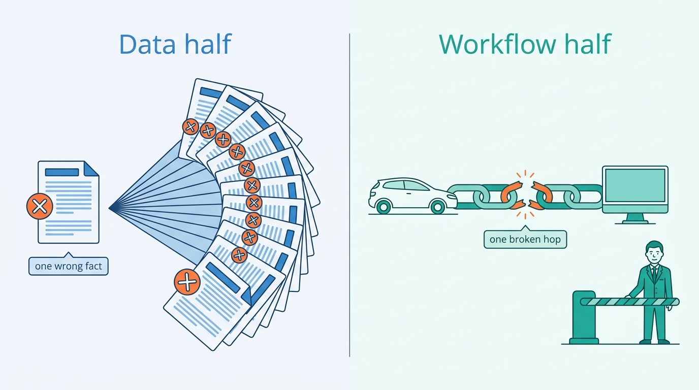
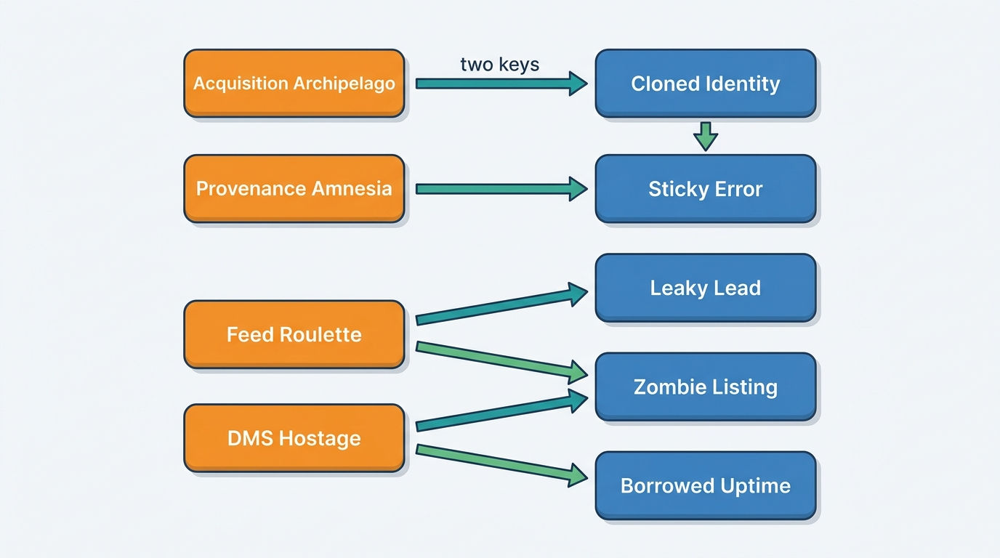

> **IN THIS SECTION, YOU WILL:** Learn fifteen named failure patterns that recur in vehicle data services and dealer software, recognize their warning signs, understand the mechanism behind each, see what they cost in public cases and in the book's fictional example, and find the chapters whose designs prevent or repair each one.

> **WHY THE BUSINESS CARES:** These patterns are where the money leaks: a car bought at the wrong price, a sold car that keeps producing leads, credits paid to API clients, a dealer who cannot sell for two weeks because a supplier was down, a license breach found by a customer. None of them appears as a line in a project budget.

> **WHY ARCHITECTS SHOULD CARE:** The patterns give design reviews and steering committees a shared vocabulary. "This is Borrowed Uptime" moves a discussion straight to the mechanism and the owner, instead of to the latest incident.

> **KEY POINTS:**
>
> * **Each pattern is locally rational.** A team that keys stock by plate because dealers type plates, an integrations lead who ships one more channel adapter without a contract, a sales director who promises a large group one special field: each choice made sense to the person who made it. The failure is the accumulation, and only someone accountable for the whole platform sees it.
> * **The half decides where each pattern hurts.** Identity, provenance, valuation and licensing patterns live in the data half, where one wrong fact is sold thousands of times; listing, lead, DMS, tenancy and customization patterns live in the workflow half, where one broken hop stops a dealer. Five of the fifteen hit both.
> * **The patterns travel in chains, and most chains start with a missing key, a missing contract or a missing owner.** The Acquisition Archipelago feeds The Cloned Identity and The Unmetered Call; Feed Roulette feeds The Zombie Listing and The Leaky Lead. Fixing the downstream symptom rarely holds; breaking the chain at its origin usually does.

 
The [[introduction]] describes a vehicle data and dealer software platform as a machine that sells **decisions about one physical car**: what it is, what happened to it, what it is worth, what to pay, what to ask, where to advertise it and who now owns it. Each decision is only as good as the identity, provenance and freshness of the facts beneath it. This page names the ways those decisions go wrong, so the rest of the book can point back to them.

The platform has two halves (see [[vehicle-data-ecosystem]]). **Vehicle data services**, the data half, sell identity, specification, history, valuation and market data by the call, the report and the license. **Dealer SaaS**, the workflow half, sells software dealers use to buy, stock, price, advertise, sell and register cars, usually by the rooftop (one dealership location) and the month. The halves fail differently, and the patterns cluster by half.

Each pattern below gets a characteristic quote (fictional and unattributed), its warning signs, the mechanism, what it costs (with dated public evidence where it exists), an illustration from **Axleby, the fictional vehicle data and dealer software group this book follows** (see [[meet-axleby]]), the half it hits hardest and the chapters that address it. None of the patterns implies incompetence. **Most are the residue of reasonable decisions** taken under deadline by teams accountable for one step of the car's journey, which is why they need a name and an owner.

## Fifteen Patterns to Recognize

The patterns fall into four families. The **vehicle facts** family (the first five) damages what the platform knows about a car. The **dealer workflow** family (four) breaks the hops between the dealer's stock, the portals, the leads and the DMS (dealer management system, the dealer's own system of record for deals, accounting and often stock). The **commercial** family (three) is about who the customer is, what they used and what they were allowed to use. The **platform** family (three) is about dependencies, history and the pull of the largest customers.

| Pattern | The warning sign | Hits hardest | First number to ask for |
| --- | --- | --- | --- |
| **The Cloned Identity** | Vehicles are keyed by plate or by a product's own stock id; one record mixes two cars, or one car appears as several. | Data | Share of records keyed by VIN; plate assignments per vehicle |
| **Spec Guesswork** | Edition and options are inferred from model names or dealer input, so adverts, valuations and reports disagree about what the car is. | Both | Share of stock with a resolved edition and its source |
| **Provenance Amnesia** | Facts are stored without source, observation date, license or confidence; nobody can say where a number came from or whether it may be shown. | Data | Share of facts carrying source, observed-at and license |
| **The Sticky Error** | A corrected fact lives on in caches, reports, valuations, adverts and clients' copies, because nobody knows where it spread. | Both | Time from correction to the last affected copy |
| **The Confident Valuation** | Valuations come without confidence, comparables or back-testing, and keep being trusted after the market moves. | Data | Back-tested error by segment, and weeks to detect drift |
| **The Zombie Listing** | Sold or withdrawn cars stay live on portals because deletes are fire-and-forget and channel state is never reconciled. | SaaS | Median and worst time from sold to off every portal |
| **Feed Roulette** | Dozens of channel and supplier adapters run without contracts, status feedback or monitoring; every format change is discovered by a dealer. | SaaS | Adapters with a contract, a health check and an owner |
| **The Leaky Lead** | Leads are lost, duplicated or misrouted between portals, inboxes, CRMs and DMS, and every hop reports success. | SaaS | Leads acknowledged by the final system, per channel |
| **DMS Hostage** | Critical dealer workflows depend on brittle or unsanctioned DMS access; when the DMS vendor changes terms or goes down, the dealer stops. | SaaS | Workflows that stop when one DMS is unavailable |
| **The Tenant Blur** | Dealer groups, rooftops and users are bolted onto a single-dealer model; permissions are shared logins and tenant ids are optional. | SaaS | Tables, caches and topics without a mandatory tenant key |
| **The Unmetered Call** | Billable events are reconstructed from logs at month-end; no-hit rules, bundles and credits differ by product and nobody can explain an invoice. | Both | Places that decide whether a call is billable |
| **License Blindness** | Data is cached, combined or resold beyond what its source license and the client's purpose allow, and nobody can prove what was used for what. | Data | Data API calls checked against a license and purpose at request time |
| **Borrowed Uptime** | The platform's availability is the product of every register, supplier, portal and DMS it calls synchronously; one outage stops the dealer. | Both | Synchronous external calls on each critical journey |
| **The Acquisition Archipelago** | Acquired products keep their own logins, vehicle keys, billing and data; customers re-type plates and the group cannot see one customer. | Both | Logins, vehicle keys and billing systems per customer |
| **Customization Creep** | Large customers get code forks, special fields and bespoke workflows instead of configuration and extension points, until every release is a migration. | SaaS | Customer-specific branches, flags and fields |

These numbers are not targets in themselves: a Zombie Listing time can fall because the platform stopped publishing to slow portals, and a lead-acknowledgement rate can rise because rejections were silently dropped. **Read each indicator with the mechanism in mind.**

### The Cloned Identity

*"Dealers type plates. Nobody types a VIN. Key it on the plate and move on."*

**Warning signs.** The stock table's primary key is the dealer product's stock id; the data product's is the plate. One car appears twice after a re-registration, or one history mixes two cars. Imports arrive with no history because the foreign plate was never linked to the domestic one. Support resolves "wrong car" tickets by hand.

**Why it happens.** A plate is what a dealer sees, what a register lookup takes and what a portal displays, so it is the natural first key. But a plate identifies a **registration**, not a vehicle: it changes on import, on personalization and in some markets on re-registration, and criminals copy it. The VIN (vehicle identification number, ISO 3779) identifies the vehicle for life. A product built around a plate works until a car crosses a border or meets its clone ([[vehicle-identity]]).

**What it costs.** Wrong histories sold to buyers, wrong valuations, and lost trust. Broken identity also hides fraud: in its 31 May 2018 resolution on odometer manipulation, the European Parliament cited studies estimating that **5–12%** of used cars sold nationally and **30–50%** sold across borders had tampered odometers, with total damage of **€5.6–9.6 billion** across the Union ([European Parliament, 2018](https://oeil.europarl.europa.eu/oeil/en/document-summary?id=1537136)). My reading, not the Parliament's: the cross-border gap is what happens when a car's history does not follow its identity over a border.

**At Axleby (fictional).** In 2026 two Audi A4s carried the same Dutch plate, and Tracewell, the history store, merged the clone's damage events into the genuine car's history until a consumer complaint through Odolo exposed it. Anchor now keys every car by VIN, with plates as time-bounded assignments; its 58 million plate assignments for 41 million vehicles show how often plates move.

**Hits hardest: data.** A history or valuation product multiplies one identity error across every report it sells; a dealer usually notices a wrong car on the forecourt.

**Where this book helps:** [[vehicle-identity]] builds the identity graph; [[ingestion-and-entity-resolution]] resolves sources to it; [[vehicle-bounded-contexts]] makes the vehicle key the one every context conforms to; [[inventory-and-vehicle-dossier]] and [[journey-inventory-to-portal]] key every stock item and hop to it; [[vehicle-history]] and [[consumer-vehicle-checks]] show the VIN in what they sell; [[market-data]] matches adverts to vehicles.

### Spec Guesswork

*"It's a Golf with alloys and a big screen. Call it a Highline."*

**Warning signs.** Edition (trim) comes from a free-text field or a guess from the model name. The advert says one edition, the valuation assumes another and the history report a third. Equipment lists are copied from the previous similar car. Nobody knows which cars had their specification resolved from build data and which were guessed.

**Why it happens.** The VIN does not carry the edition or the options. In the United States, 49 CFR Part 565 requires positions 4–8 of a passenger car's VIN to encode make, line, series, body type, engine type and restraint systems, not trim or optional equipment ([eCFR, 49 CFR 565.15, n.d.](https://www.ecfr.gov/current/title-49/subtitle-B/chapter-V/subchapter-A/part-565)). Edition and factory options come from manufacturer build data, which providers license **per request**. When a lookup costs real money, teams skip it and let the dealer, or a heuristic, decide ([[specification-and-equipment]]).

**What it costs.** Option packs can move a car's value by thousands of euros, so a guessed edition becomes a wrong valuation, a wrong advert and a dispute with the buyer. Portals reject or mis-file adverts whose equipment codes do not map.

**At Axleby (fictional).** Specbook pays an average of **€0.46** per build-data request, against a €0.09 list price for a plate-to-specification call: "the €46 per hundred" problem. The temptation to skip the request for cheap cars is constant, and every skipped request is a guess that Vantage, the advert editor and the history report then inherit.

**Hits hardest: both.** The data half sells the guess as a fact; the workflow half publishes it to 61 channels.

**Where this book helps:** [[specification-and-equipment]] resolves editions with confidence and an explicit "edition unknown" state; [[merchandising]] and [[listing-syndication]] map equipment to portals; [[valuation-engine]] and [[vehicle-acquisition]] price options; [[build-buy-or-partner]] weighs licensed build data against an own catalog; [[case-auto-trader-uk]] shows a taxonomy as the bottom rung of a product ladder.

### Provenance Amnesia

*"The mileage is in the database. Where it came from is in someone's head."*

**Warning signs.** A fact table has a value and an updated-at timestamp, but no source, no observation date, no license and no confidence. Two sources disagree and the last writer wins. When a supplier reports a bad batch, nobody can list the facts it touched. Product teams cannot answer whether a field may be shown to a consumer.

**Why it happens.** Ingestion is built for the happy path: land the file, upsert the rows. Provenance looks like overhead until the first correction or license question, and by then the data has already lost it. Most platforms add sources one at a time, so each pipeline invents its own metadata, or none ([[provenance-and-data-quality]]).

**What it costs.** Every correction becomes a forensic project; every license question becomes a guess; every dispute with a buyer is argued without evidence. Provenance Amnesia is rarely visible on its own. It is the reason The Sticky Error and License Blindness are expensive.

**At Axleby (fictional).** In May 2027 a Kilometra batch recorded miles as kilometers for **2,870** UK-imported vehicles. The first question in the incident was which readings had come from that batch; a store that keeps only the latest value per field cannot answer it.

**Hits hardest: data.** The data half's product is the fact plus the right to sell it; without provenance it can sell neither with confidence.

**Where this book helps:** [[provenance-and-data-quality]] defines the provenance envelope and bitemporal facts; [[ingestion-and-entity-resolution]] keeps raw inputs and survivorship rules; [[vehicle-history]] carries source and date into reports; [[condition-and-damage]] and [[ev-battery-health]] store evidence with its method; [[data-licensing-and-governance]] attaches the license; [[observability-and-data-operations]] monitors freshness per source.

### The Sticky Error

*"We fixed it in the database on Tuesday. Why is the advert still wrong?"*

**Warning signs.** Corrections are made by updating a row. Caches, search indexes, reports, valuations, adverts and API clients' copies keep the old value. Nobody can list who received a fact. Consumers who bought a report before the fix are never told.

**Why it happens.** A vehicle fact spreads by design: into valuations, reports, adverts, insight cubes and clients' systems. Each consumer copies it and moves on. Without a record of who received what, and an event that announces a correction, the fix reaches only the systems that read the source again ([[journey-data-correction]]).

**What it costs.** Buyers and dealers act on known-wrong facts; consumers hold reports that the platform knows are wrong; trust and liability follow. Where the fact is personal data, the law expects propagation: Article 19 of the General Data Protection Regulation (GDPR) requires a controller to communicate any rectification or erasure to each recipient of the data, unless this proves impossible or involves disproportionate effort ([Regulation (EU) 2016/679, 2016](http://publications.europa.eu/resource/celex/32016R0679)).

**At Axleby (fictional).** The Kilometra batch was corrected after **11 days**. By then **6,140** valuations, **412** history reports (**96** of them to consumers) and **1,180** live adverts carried the wrong mileage, and **19** external API clients had received it in **2,310** lookups, which took a manual impact analysis until 3 June to establish.

**Hits hardest: both.** The data half has to reach reports and clients; the workflow half has to reach adverts and dealers' prices.

**Where this book helps:** [[journey-data-correction]] builds the impact graph and the correction event; [[provenance-and-data-quality]] models corrections bitemporally; [[valuation-engine]] and [[merchandising]] find and re-render what used the old value; [[events-webhooks-and-sync]] and [[vehicle-data-apis]] notify clients; [[consumer-vehicle-checks]] handles reissued reports; [[privacy-and-retention]] propagates rectification and erasure.

### The Confident Valuation

*"The model has been right for three years. Why would it be wrong this month?"*

**Warning signs.** A valuation is a single number with no confidence band and no comparables. Nobody can say which model version produced last week's valuations. Back-testing against realized sale prices is a quarterly slide, not a monitor. Dealers override valuations in one segment far more than in others, and nobody looks.

**Why it happens.** Dealers want a number, and a band looks like hedging. Models trained on a stable market look accurate until the market moves: interest rates, supply shocks, a new technology's resale curve. Drift shows first in realized prices of cars already bought, weeks after the valuations were trusted ([[valuation-engine]]).

**What it costs.** Cars bought above what they can be sold for, residuals set too high, and dealers who stop trusting the tool. The most-cited cautionary analogue is outside motoring: Zillow Group stopped buying homes in November 2021 after its home-buying unit, which priced offers with its own models, lost about **$420 million** in the third quarter of that year ([The New York Times, 2021](https://www.nytimes.com/2021/11/02/business/zillow-q3-earnings-home-flipping-ibuying.html)). The analogy holds only so far: dealers buy one car at a time and see the result within weeks.

**At Axleby (fictional).** After used battery-electric (BEV) prices fell, Vantage overvalued used BEVs by **9.5%** on average for **14 weeks** before drift monitoring caught it. Fleetmoor Lease and two dealer groups complained.

**Hits hardest: data.** The data half sells the valuation thousands of times a day; one dealer's bad purchase is a local loss.

**Where this book helps:** [[valuation-engine]] builds the valuation ledger, confidence and back-tests; [[market-data]] supplies comparables; [[condition-and-damage]] and [[ev-battery-health]] price condition and battery; [[used-car-pricing]] and [[vehicle-acquisition]] act on confidence; [[ai-in-dealer-workflows]] shares model governance.

### The Zombie Listing

*"We sent the delete. If the portal didn't process it, that's on them."*

**Warning signs.** Sold cars generate leads. Dealers ask portals to remove adverts by hand. The syndication queue processes deletes in the same order as updates, so a stuck update blocks a delete. Nobody compares what each portal shows with what the dealer's stock says.

**Why it happens.** Syndication is usually built as **commands**: insert, update, delete, sent once to each channel. A command that fails, or succeeds on a portal that silently drops it, leaves the portal's state diverging from the dealer's, and nothing notices. The fix is to treat each channel listing as **desired state** and reconcile it, which costs reads and adapters most platforms never built ([[listing-syndication]]). Channel managers in travel face the same problem with room availability (see [[connectivity-and-channel-managers]]).

**What it costs.** Wasted leads and test drives, annoyed buyers, portal quality penalties and, for advertised prices, consumer-protection exposure. Public, dated evidence is scarce: zombie listings show up in dealer forums and support queues, not in filings.

**At Axleby (fictional).** In February 2027 Velto sold a 2021 Volkswagen Golf at its Breda rooftop. The sold status from DriveDesk, its DMS, failed to sync, and Relay's deletes queued behind failed updates. The car stayed live on **4** portals for **4 days**, producing **37** leads and **9** booked test drives.

**Hits hardest: SaaS.** The workflow half owns the publish queue and the dealer's reputation on the portal.

**Where this book helps:** [[listing-syndication]] designs desired-state sync and reconciliation; [[journey-inventory-to-portal]] and [[journey-sale-to-registration]] walk publishing and delisting end to end; [[inventory-and-vehicle-dossier]] owns the stock state; [[dms-integration]] matches a DMS stock number that changed on a rooftop transfer, so a sold row is not lost; [[b2b-trade-and-remarketing]] holds one right to sell across binding channels; [[events-webhooks-and-sync]] and [[observability-and-data-operations]] measure publish lag.

### Feed Roulette

*"The portal changed the equipment codes again. We'll find out which dealers broke on Monday."*

**Warning signs.** Each channel or supplier adapter was written by whoever needed it. There is no contract per adapter, no record of the last successful exchange, no status feedback and no owner. Portal format changes and supplier unit changes are discovered by dealers or by valuations, not by monitors.

**Why it happens.** Adapters are small, urgent and numerous: a new portal, a new DMS, a new data supplier, each a sales request. Each is cheap to build and expensive to own, and ownership is never funded. The count grows faster than the team, and the oldest adapters quietly rot ([[listing-syndication]], [[dms-integration]]).

**What it costs.** Adverts missing from portals, failed publishes nobody retries, and supplier data that lands in the wrong unit or format. Integrations teams spend their time firefighting instead of building.

**At Axleby (fictional).** Relay runs **61** channel adapters and about **1.4 million** channel operations a day. The Kilometra batch that recorded miles as kilometers is Feed Roulette on the supply side: no contract on the field's unit, no check that a UK import's reading was plausible.

**Hits hardest: SaaS.** The workflow half runs most adapters and feels each break as a dealer complaint; the data half's supplier feeds share the pattern.

**Where this book helps:** [[listing-syndication]] treats channel adapters as products with contracts; [[journey-inventory-to-portal]] routes each rejection to whoever can fix it; [[merchandising]] maps content; [[dms-integration]] puts each DMS behind an anti-corruption layer; [[ingestion-and-entity-resolution]] validates and quarantines supplier data; [[observability-and-data-operations]] monitors each channel; [[organizing-engineering]] assigns adapter ownership.

### The Leaky Lead

*"The CRM returned 200. The lead was delivered."*

**Warning signs.** Leads arrive by portal API, by ADF/XML e-mail (Auto-lead Data Format, the industry's XML lead format), by web form and by phone, and each path has its own code. Deliveries to external CRMs (customer relationship management systems) and DMS are fire-and-forget. Nobody compares leads sent with leads worked. Routing rules reference rooftops that have closed.

**Why it happens.** Every hop reports success to the previous one, and none confirms that a salesperson saw the lead. Routing rules encode the dealer group's organization, which changes; the rules do not. External CRMs accept messages they then discard ([[leads-and-crm]]).

**What it costs.** Lost sales the dealer never sees, duplicate contacts that annoy buyers, and portal attribution that undervalues the channel. Lead response time is among the metrics dealers watch most closely, which makes a silent loss worse than a visible failure.

**At Axleby (fictional).** In September 2027 Velto reorganized **46** rooftops into **9** regional hubs. Routing rules sent three closed rooftops' leads to an inactive DriveDesk CRM queue that returned success but discarded them: **1,460** leads went unworked for **9 days**.

**Hits hardest: SaaS.** Lead handling is a workflow promise; the data half rarely touches it.

**Where this book helps:** [[leads-and-crm]] defines one lead model and routing; [[journey-lead-to-dms]] adds acknowledgement and dead-letter review; [[dms-integration]] handles CRM and DMS adapters; [[tenancy-and-dealer-groups]] models restructuring; [[observability-and-data-operations]] monitors lead delivery.

### DMS Hostage

*"We read their database through the dealer's login. It's the dealer's data, after all."*

**Warning signs.** Integrations with the DMS use screen scraping, shared dealer credentials or undocumented database access. Stock, deals or leads can only move through the DMS. The DMS vendor's partner terms or fees change and a feature stops. A DMS outage stops the dealer's use of your product too.

**Why it happens.** The DMS holds the franchised dealer's system of record, and its vendor controls access. Certified partner programs cost money and time; unsanctioned access is faster. Products then build on access they do not control ([[dms-integration]]).

**What it costs.** Features that disappear when terms change, litigation, and outages the platform cannot fix. In the United States, data access to the two largest DMS vendors became a decade of litigation: in *Authenticom v. CDK Global* the Seventh Circuit recorded in November 2017 that CDK and Reynolds held over 40% and around 30% of the DMS market, and vacated a preliminary injunction that would have forced them to give the integrator access ([US Court of Appeals, 7th Cir., 2017](https://caselaw.findlaw.com/court/us-7th-circuit/1879150.html)). In June 2024 a ransomware attack on CDK Global affected about **15,000** North American dealerships ([CyberScoop, 2024](https://cyberscoop.com/?p=81004)).

**At Axleby (fictional).** In November 2027 DriveDesk, the DMS of **1,900** Lotwise rooftops, was hit by ransomware and offline for **12 days**. Lotwise served as the fallback for stock, adverts and sales documents, because the dossier, not the DMS, held the copy dealers needed.

**Hits hardest: SaaS.** The workflow half sits beside the DMS in the dealer's day; the data half rarely depends on it.

**Where this book helps:** [[dms-integration]] designs certified adapters and system-of-record decisions per entity; [[inventory-and-vehicle-dossier]] holds a usable copy; [[deals-and-sales-documents]] keeps a fallback invoice series; [[reliability-and-dependencies]] plans degraded modes; [[vehicle-platform-security]] treats the DMS as a threat path; [[build-buy-or-partner]] weighs partner programs; [[case-cdk-global]] reads the public record.

### The Tenant Blur

*"A group is just a dealer with more logins. We'll add a group id later."*

**Warning signs.** The product was built for one dealer; groups were added as shared logins or a parent id on some tables. Tenant ids are optional in queries, caches and topics. Users who move between rooftops get a second account. A group restructuring requires a database script.

**Why it happens.** Early customers are single rooftops, and their model works. Groups arrive later and bring hierarchy (group, legal entity, rooftop, department, user), cross-rooftop features and enterprise identity, each retrofitted where it is needed ([[tenancy-and-dealer-groups]]).

**What it costs.** Data leaks between dealers, wrong permissions, and slow, risky onboarding of groups. Object-level authorization failures top the industry's API risk list: "Broken Object Level Authorization" is API1 of the OWASP API Security Top 10 2023 ([OWASP, 2023](https://api-security.owasp.org/editions/2023/en/0x11-t10)).

**At Axleby (fictional).** In June 2027 a cache key without a tenant id in Showroomly's lead-inbox backend-for-frontend showed **112** leads of one dealer to users of **3** other dealers for **47 minutes**; Axleby reported it to the UK Information Commissioner's Office as a personal-data breach. Velto's reorganization into hubs is the same pattern in its slower form.

**Hits hardest: SaaS.** Tenancy is a dealer-software property; data clients are fewer, larger and isolated by API credentials.

**Where this book helps:** [[tenancy-and-dealer-groups]] models the customer hierarchy and tenant context; [[identity-access-and-entitlements]] adds relationship-based authorization; [[onboarding-and-configuration]] handles group policies; [[vehicle-platform-security]], [[privacy-and-retention]] and [[observability-and-data-operations]] make tenancy enforceable and visible.

### The Unmetered Call

*"Billing reads the access logs at month-end. It's always worked."*

**Warning signs.** Usage is reconstructed from logs by a billing job. The no-hit rule, bundles and credits are implemented separately in each API stack or product. Customers dispute invoices and support cannot explain them. Finance and engineering disagree about how many calls were made.

**Why it happens.** Billing is built after the product, from whatever the product logs. Each new stack or acquisition re-implements the pricing rules from the contract text. Rules such as **no-hit-no-fee** (a lookup that finds no record is not billed) look simple and hide decisions: what counts as a hit, a partial hit, a retry or a cached answer ([[billing-and-metering]]).

**What it costs.** Credits, disputes, revenue leakage and lost trust in invoices. For data businesses with licensed upstream costs, unmetered calls also hide margin: a call that costs money upstream and is not billed downstream is a loss.

**At Axleby (fictional).** In 2026 the no-hit-no-fee rule was implemented differently in Connect XML and JSON API v1. Axleby credited **€186,000** to **41** API clients.

**Hits hardest: both.** The data half bills per call; the workflow half bills reports and transactions inside subscriptions.

**Where this book helps:** [[billing-and-metering]] emits usage events at the source and rates them in one engine; [[vehicle-data-apis]] uses one outcome vocabulary for the response, the meter and the service level; [[registration-and-trade-services]] charges a register transaction only on confirmation; [[dealer-and-data-economics]] and [[scale-and-cost]] connect price to cost per lookup; [[modernizing-the-platform]] retires the second stack.

### License Blindness

*"The client pays for the data. What they do with it is their business."*

**Warning signs.** Nobody can say, per data source, whether it may be cached, for how long, combined with other sources or resold. Client contracts state a purpose, but the API does not check it. Misuse is detected by complaints. Data from a register, a supplier and a portal end up in one cube with no record of who may see it.

**Why it happens.** License terms live in contracts and in the heads of the people who negotiated them. Engineering builds caches and products for speed and cost. The gap between what is allowed and what is done grows with every new product ([[data-licensing-and-governance]]).

**What it costs.** Lost register access, supplier disputes, fines and reputational harm. Some regimes write the audit duty into law: in the United States, the Driver's Privacy Protection Act requires any authorized recipient that resells or rediscloses personal information from motor-vehicle records to keep, for five years, records of each recipient and the permitted purpose, and to show them to the motor vehicle department on request ([18 U.S.C. § 2721(c), n.d.](https://www.law.cornell.edu/uscode/text/18/2721)).

**At Axleby (fictional).** In January 2027 a small lead-generation API client resold history-report data to a consumer website against its license. A customer complaint, not monitoring, revealed it, and Charter, the license and purpose register with a request-path check and an immutable access audit, followed. The Plate Enumeration Attack of August 2027 (about **9 million** requests in 6 days through Odolo's free check and leaked trial API keys) is a security threat, owned by [[vehicle-platform-security]], but it tested the same question: who was allowed to use what.

**Hits hardest: data.** Licenses govern the data half's raw material and its product.

**Where this book helps:** [[data-licensing-and-governance]] builds the license register and purpose check; [[registers-and-official-data]] covers provider obligations; [[vehicle-data-apis]] enforces at the gateway; [[data-products-and-insights]], [[market-data]] and [[consumer-vehicle-checks]] apply licenses to derived products; [[build-buy-or-partner]] tests data rights before any contract; [[privacy-and-retention]] adds lawful basis and retention.

### Borrowed Uptime

*"The register has never been down at month-end. Why would we queue?"*

**Warning signs.** Appraisals, reports and registrations call registers, build-data providers, history sources and DMS synchronously. Supplier outages appear as the platform's own outages. Timeouts and retries are configured per developer. Nobody can state which journeys still work when a given supplier is down.

**Why it happens.** Vehicle platforms are built on external authorities and suppliers they cannot replace. Synchronous calls are the simplest integration and work on normal days. Each new dependency multiplies the probability that some critical journey is down, and peaks (month-end registrations, Monday stock edits) hit suppliers and platform at once ([[reliability-and-dependencies]]).

**What it costs.** Dealers who cannot sell, register or quote, duplicate submissions after ambiguous timeouts, and credits. When CDK Global shut most systems down in June 2024, AutoNation told investors that its locations stayed open, operating "through manual and alternative means and processes, albeit with lower productivity" ([AutoNation Form 8-K, 2024](https://www.sec.gov/Archives/edgar/data/350698/000035069824000078/an-20240619.htm)); a month later it estimated the second-quarter impact at about **$1.50** per share before recoveries ([AutoNation Form 8-K, 2024](https://www.sec.gov/Archives/edgar/data/350698/000035069824000085/an-20240715.htm)).

**At Axleby (fictional).** On **31 March 2027**, the last working day of the quarter, the Dutch register's transaction channel was unavailable to Axleby for **5 hours 40 minutes**. **3,100** transactions queued; the retry queue preserved order, but **214** were submitted twice after ambiguous timeouts and needed correction.

**Hits hardest: both.** The data half's lookups and the workflow half's registrations and DMS sync share the same suppliers.

**Where this book helps:** [[reliability-and-dependencies]] sets journey SLOs (service level objectives), dependency budgets and degraded modes; [[registration-and-trade-services]] and [[journey-sale-to-registration]] make transactions idempotent and ordered; [[registers-and-official-data]] monitors sessions and quotas; [[dms-integration]] plans for the DMS outage; [[scale-and-cost]] plans the peaks.

### The Acquisition Archipelago

*"We'll integrate it next year. For now, give them a link from our menu."*

**Warning signs.** Each acquired product keeps its own login, vehicle key, customer record, billing and data warehouse. Dealers re-type the same plate into several screens. Sales cannot see one customer's total spend. Every cross-product feature starts with an identity-mapping spreadsheet.

**Why it happens.** Acquisitions are bought for revenue and customers, and the first priority is not to disturb them. Integration is deferred, then funded only where a cross-sell needs it. Each acquired product's model of car, customer and user is a reasonable local choice that no longer fits the group ([[one-platform-from-many-products]]).

**What it costs.** Re-typing, inconsistent answers about one car, cross-sell that stalls, and duplicated platforms. The documented example of the shape, not of its costs, is Cox Automotive, which its 2018 fact sheet shows assembled from Manheim (1968), AutoTrader.com, Kelley Blue Book, vAuto, VinSolutions, Xtime and Dealertrack (2015), among others ([Cox Automotive, 2018](https://www.coxautoinc.com/wp-content/uploads/2018/08/Cox-Automotive-Corporate-Fact-Sheet-April-2018.pdf)); its single sign-on, Bridge ID, links users to the products' own accounts ([Cox Automotive, n.d.](https://www.coxautoinc.com/bridgeid/)).

> **INFERENCE, NOT DOCUMENTED:** a linking identity of this kind is the cheapest path for a portfolio and usually leaves roles and dealer mapping inside each product; Cox has not published how Bridge ID is built beyond its product page.

**At Axleby (fictional).** Five products, three login systems and two vehicle keys: Lotwise Classic keys a car by stock id plus plate, Connect XML by plate, Anchor by VIN. History reports, valuations and register transactions are ordered from different screens. One Dossier exists to end this.

**Hits hardest: both.** It splits the data half's vehicle key and the workflow half's customer.

**Where this book helps:** [[one-platform-from-many-products]] sequences the integration; [[vehicle-capability-map]] and [[vehicle-bounded-contexts]] decide what to share; [[identity-access-and-entitlements]] builds one account; [[billing-and-metering]] one meter; [[modernizing-the-platform]] retires the old stacks; [[organizing-engineering]] stops organizing by acquired brand; [[case-cox-automotive]] and [[case-vwe]] read the public record.

### Customization Creep

*"They're our biggest group. Just add the field for them."*

**Warning signs.** Large customers have their own branches, feature flags that only they use, special fields and workflows written into the core. Releases need per-customer testing. Onboarding a new group starts with a list of exceptions. Nobody can say which customer-specific code is still used.

**Why it happens.** Dealer groups are the most valuable and most demanding customers, and saying no to them is hard. A special field is faster than an extension point; a branch is faster than configuration. Each exception is cheap; together they turn every release into a migration ([[onboarding-and-configuration]]).

**What it costs.** Slower releases, higher cost to serve, bugs that hit one customer at a time, and a platform that cannot change its core without negotiating with its largest accounts.

**At Axleby (fictional).** **410** dealer groups own **58%** of Lotwise rooftops, and the largest are the customers most likely to ask for exceptions. When Hartley Motor Group (**28** rooftops) moved onto shared identity and configuration in late 2027, Showroomly held **14** Hartley-specific code paths: nine became settings or templates, three became product features for everyone, one a webhook and partner API, and one was deleted. Velto's 2026 onboarding raised **23** special requests, and none became code (17 configuration, 4 extension points, 2 declined).

**Hits hardest: SaaS.** Data clients consume a versioned API contract; dealer software is where workflows are bent.

**Where this book helps:** [[onboarding-and-configuration]] separates configuration from customization and defines extension points; [[tenancy-and-dealer-groups]] gives groups inherited policies; [[used-car-pricing]] and [[deals-and-sales-documents]] turn a group's rules into configuration; [[events-webhooks-and-sync]] offers webhooks instead of forks; [[modernizing-the-platform]] keeps the core owned.

## Where the Patterns Strike

The patterns strike at different stages of the chain the book follows, **Identify → Check → Value → Stock → Advertise → Sell → Register → Trade → Insight** ([[vehicle-data-ecosystem]]). Some patterns sit under every stage.

| Journey stage | What goes wrong | Patterns that strike | Axleby example (fictional) |
| --- | --- | --- | --- |
| **Identify** | The platform resolves the wrong car, or the right car with the wrong edition | The Cloned Identity, Spec Guesswork | The Cloned Plate |
| **Check** | A history report mixes cars, hides its sources or keeps a corrected error | Provenance Amnesia, The Sticky Error, The Cloned Identity | The Odometer Correction |
| **Value** | A valuation is wrong and does not say how unsure it is | The Confident Valuation, Spec Guesswork | The EV Overvaluation |
| **Stock** | The dossier and the DMS disagree, or the DMS is gone | DMS Hostage, The Acquisition Archipelago | The DriveDesk Outage |
| **Advertise** | Portals show the wrong car, the wrong price or a sold car | The Zombie Listing, Feed Roulette, The Sticky Error | The Zombie Golf |
| **Sell** | Leads are lost or shown to the wrong dealer | The Leaky Lead, The Tenant Blur | The Lost Leads of Velto, the Cross-Tenant Lead |
| **Register** | Official transactions fail, duplicate or stall | Borrowed Uptime | The Month-End Register Outage |
| **Trade and Insight** | Data is billed wrongly or used beyond its license | The Unmetered Call, License Blindness | The No-Hit Credit, the License Breach |
| **Under every stage** | Keys, logins, tenants and dependencies that do not fit | The Acquisition Archipelago, The Tenant Blur, Borrowed Uptime, Customization Creep | Five products, three logins, two vehicle keys |

The early stages belong to the data half and the middle stages to the workflow half; registration, trade and insight draw on both. That is why the book treats identity, the dossier, accounts, metering, licensing and events as shared platform concerns: they are the places where patterns from both halves meet.

**Figure 1:** *The half decides how a pattern hurts: in the data half one wrong fact is sold thousands of times; in the workflow half one broken hop stops a dealer.*

## How the Patterns Reinforce Each Other

The patterns rarely appear alone. They feed each other in recognizable chains, and **fixing a downstream symptom while the upstream pattern continues produces the same symptom again**, usually within a year.

**Figure 2:** *The patterns form chains. Most dealer-visible symptoms (a wrong report, a zombie advert, a lost lead, an unexplained invoice) trace back to a missing key, a missing contract or a portfolio that was never integrated.*

Four chains appear most often.

**The identity chain: The Cloned Identity and Spec Guesswork → The Confident Valuation and The Sticky Error.** A valuation of the wrong car, or of the right car with a guessed edition, is wrong however good the model; a fact attached to the wrong car spreads to every report and advert. **Break the chain at the key**, with VIN-keyed identity and a resolved or explicitly unknown edition, before tuning the model.

**The fact chain: Provenance Amnesia → The Sticky Error and License Blindness.** Without source, date and license on each fact, a correction cannot find its copies and a license check cannot find its terms. Axleby's Odometer Correction and License Breach have the same root.

**The integration chain: Feed Roulette and DMS Hostage → The Zombie Listing, The Leaky Lead and Borrowed Uptime.** Adapters without contracts, feedback and owners lose deletes and leads; adapters on access the platform does not control make outages its own. The Zombie Golf started with a DriveDesk sync and ended on four portals.

**The portfolio chain: The Acquisition Archipelago and Customization Creep → most of the rest.** Two vehicle keys produce cloned identities; two API stacks produce two metering rules; a single-dealer product with groups bolted on produces the Tenant Blur; customer forks keep the islands apart. That is why One Dossier starts with one key, one account and one meter ([[meet-axleby]]).

## Using the Patterns

The names are meant for rooms where decisions are made. In a design review, ask which pattern a proposal risks and what would stop it. In a steering committee, ask which pattern a falling metric is a symptom of. In a portfolio review after an acquisition, ask which patterns the acquired product brings and which root they share with yours.

Three habits keep the names useful rather than accusatory: **name the mechanism, not the person**; **pair every pattern with a number** from the summary table; and **look for the upstream pattern** before funding a downstream fix, because the cheapest remedy is usually a key, a contract or an owner, not a new system.

Some variation is legitimate. A plate lookup at the auction lane, resolved to a VIN within the same call, is not The Cloned Identity. A valuation with a stated band that the dealer chooses to ignore is not The Confident Valuation. A group-specific configuration on shared extension points is not Customization Creep. The test is whether the variation was **decided, owned and measured**, or simply accumulated.

The rest of the book works through the remedies. Before that, meet the group whose platform shows every one of these patterns in 2027, and the program that sets out to fix them: [[meet-axleby]].

## Sources and Evidence

### Company, product and investor sources

- [AutoNation Form 8-K (CDK incident)](https://www.sec.gov/Archives/edgar/data/350698/000035069824000078/an-20240619.htm), AutoNation / SEC, 2024 — CDK's June 2024 incident; locations operating by manual means.
- [AutoNation Form 8-K (update and EPS estimate)](https://www.sec.gov/Archives/edgar/data/350698/000035069824000085/an-20240715.htm), AutoNation / SEC, 2024 — restoration status and estimated second-quarter impact.
- [Cox Automotive Corporate Fact Sheet](https://www.coxautoinc.com/wp-content/uploads/2018/08/Cox-Automotive-Corporate-Fact-Sheet-April-2018.pdf), Cox Automotive, 2018 — the portfolio's acquisition history to 2015.
- [Bridge ID](https://www.coxautoinc.com/bridgeid/), Cox Automotive, n.d. (accessed 2026-10) — single sign-on linking products' own accounts.

### Standards, regulation and official documentation

- [Odometer manipulation in motor vehicles: revision of the EU legal framework (2017/2064(INL)), summary](https://oeil.europarl.europa.eu/oeil/en/document-summary?id=1537136), European Parliament Legislative Observatory, 2018 — resolution of 31 May 2018; 5–12% and 30–50% tampering estimates; €5.6–9.6 billion damage.
- [49 CFR Part 565, Vehicle Identification Number (VIN) Requirements](https://www.ecfr.gov/current/title-49/subtitle-B/chapter-V/subchapter-A/part-565), US National Highway Traffic Safety Administration / eCFR, n.d. (accessed 2026-10) — what the VIN's descriptor section must and need not encode.
- [Regulation (EU) 2016/679 (General Data Protection Regulation)](http://publications.europa.eu/resource/celex/32016R0679), European Union, 2016 — Article 19 notification of rectification and erasure to recipients; applies from 25 May 2018.
- [18 U.S.C. § 2721, Driver's Privacy Protection Act](https://www.law.cornell.edu/uscode/text/18/2721), Legal Information Institute, n.d. (accessed 2026-10) — permitted uses and five-year resale records.
- [Authenticom, Inc. v. CDK Global, LLC, Nos. 17-2540 and 17-2541](https://caselaw.findlaw.com/court/us-7th-circuit/1879150.html), US Court of Appeals for the Seventh Circuit (FindLaw), 2017 — DMS market shares and the vacated access injunction.
- [OWASP Top 10 API Security Risks – 2023](https://api-security.owasp.org/editions/2023/en/0x11-t10), OWASP Foundation, 2023 — Broken Object Level Authorization as API1.

### Research and practitioner sources

- [Wallets tied to CDK ransom group received $25 million](https://cyberscoop.com/?p=81004), CyberScoop, 2024 — about 15,000 dealerships affected; restoration by 12 July 2024.
- [Zillow, facing big losses, quits flipping houses](https://www.nytimes.com/2021/11/02/business/zillow-q3-earnings-home-flipping-ibuying.html), The New York Times, 2021 — the home-buying unit's third-quarter 2021 loss and exit (press report).

The pattern names and their descriptions are the author's synthesis of common industry practice. Axleby is fictional; architectural recommendations, labeled inferences and labeled assumptions are the author's judgement.
