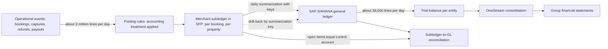
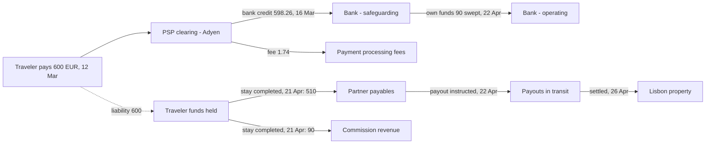
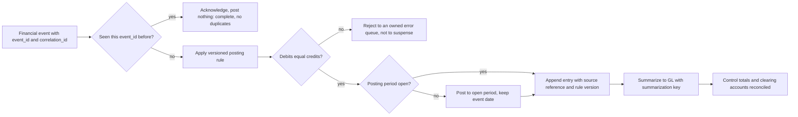

{id: accounting-for-architects}
# 8. Accounting for Architects: Ledgers, Journals and Revenue

> **IN THIS CHAPTER, YOU WILL:** Learn the accounting that finance systems are built to carry out (double entry, journal entries, charts of accounts, subledgers, accrual and the period close, revenue recognition, principal versus agent, currency and intercompany) by following one booking, one subscription invoice, one refund and one chargeback through the books, entry by entry.

> **WHY FINANCE CARES:** Every number the CFO signs is a sum of journal entries produced by systems that accountants did not build. When engineers do not understand what an entry means, Finance spends the close finding out: manual journals, unexplained clearing balances and revenue in the wrong period.

> **WHY ARCHITECTS SHOULD CARE:** Accounting rules are design inputs, not reporting details. Principal versus agent decides which events you must capture. The period close decides your cut-off and lock design. The chart of accounts decides which detail lives in the ledger and which stays in the subledger.

> **KEY POINTS:**
>
> * **Every published number is a sum of balanced, immutable journal entries.** Accountants decide which entries to make; architects own the invariants that make the sums trustworthy: balanced, immutable, period-locked, traceable and complete.
> * **Cash received is not revenue, and collecting the cash does not make you the principal.** In the Lisbon booking, Northmere holds €600 for five weeks, earns €90 of it and owes €510 to the property. The principal-versus-agent judgment decides which liabilities, events and accounts the systems must carry.
> * **Accounting choices become system requirements.** Revenue timing sets which operational events must reach finance. The close sets cut-off and lock design. Dimensions decide what lives in the general ledger and what stays in the subledger. Currency rules decide what every line must store.

> **[FAILURE PATTERNS THIS CHAPTER ADDRESSES](#where-finance-architecture-goes-wrong):**
>
> * **Lost in Aggregation** — The chapter shows exactly what a summarized ledger line must keep so that a balance can be traced back to the bookings behind it.
> * **The Shadow Ledger** — The worked examples show why a brand platform that applies its own accounting treatment is keeping books, and must be reconciled and controlled as books.
> * **The Suspense Swamp** — Clearing accounts are designed to return to zero; the chapter shows the entries that empty them and what it means when they do not.

Most finance-system failures I have seen were not technology failures. They were **accounting misunderstandings built into software**. A payment service that called captured cash "revenue". A refund flow that corrected a posted entry by editing it. A ledger that summarized a day's bookings so well that nobody could tell which booking a balance belonged to. Each was a reasonable engineering decision made by someone who did not know what the numbers would be used for.

This chapter gives architects the accounting they need to avoid those mistakes. It is not an accounting course; it does not teach you to prepare financial statements. It teaches you what the systems you design must **record, preserve and prove**, and why. Every concept comes with the design decision it drives, and every rule is shown in a worked journal entry with real numbers.

Other chapters build on this one. When [Never Update, Only Append: Designing Custom Ledgers](#designing-financial-ledgers) discusses posting rules, when [Payments-to-Ledger: Draining the Suspense Swamp](#payments-to-ledger) designs clearing accounts, when [Controls by Design, Not by Audit Season](#controls-and-auditability) discusses audit trails, and when [The Life of a Booking: From €600 Payment to $97.38 of Revenue](#transaction-to-report) follows a booking into the published statements, they assume the vocabulary and the entries set out here. The chapter ends with the **accounting invariants your systems must preserve**, the five properties that later chapters turn into designs, standards and tests.

{id: accounting-for-architects--setting-the-scene-at-northmere-the-event-that-could-not-be-booked}
## Setting the Scene at Northmere: The Event That Could Not Be Booked

Northmere, the fictional group this book follows, is a multi-brand digital commerce group listed in New York. It reports in US dollars under US GAAP, and its accommodation brand Stayloft takes about 64% of its gross transaction value through the **merchant model**: Stayloft collects the traveler's payment at booking, holds it until after the stay and pays the property net of commission.

It is February 2027. Lucía Romero, Dana Whitlock's lead integration architect, is reviewing the first draft of the Keystone canonical financial events with Jonas Berg's Stayloft Finance Engineering team. The draft has one event for a merchant booking: `BookingPaid`, carrying the booking id, the amount and the currency. It is clean, small and easy to publish from the booking engine.

Leila Haddad, Chief Accounting Officer, reads the draft and asks three questions. When the traveler pays €600 in March for an April stay, how much of it is Stayloft's revenue in March? When the property is paid in April, where does the €510 come from in the books? And if the traveler cancels on 2 April, which entry undoes what? The draft cannot answer any of them. A single "paid" event tells the ledger that money arrived. It does not say that the money belongs mostly to someone else, that the part that does belong to Stayloft is not yet earned, or when it will be.

Dana's conclusion, recorded in the first Keystone design-authority minutes, is the premise of this chapter: **the event model is downstream of the accounting model**. Before her architects design an event, a subledger or a summarization job, they need to know which accounts the business touches, when each amount moves between them, and what has to stay true at every step. The rest of this chapter is the briefing she asked Leila's team and her own architects to write together.

{id: accounting-for-architects--double-entry-the-invariant-behind-every-number}
## Double Entry: The Invariant Behind Every Number

**Double-entry bookkeeping** records every economic event as a **journal entry** with at least two lines, where the total of the debits equals the total of the credits. It rests on the accounting equation:

**Assets = Liabilities + Equity**, where equity accumulates **income minus expenses** over time (retained earnings).

Every event changes at least two terms of the equation and leaves it in balance. A traveler's €600 arriving at Northmere's bank raises an asset (cash) and, because Northmere owes it onward, a liability by the same amount. Equity does not move: nothing has been earned.

**Debit** and **credit** are a sign convention, not a judgment. They mean left and right, and which one increases an account depends on the account's class:

| Account class | Normal balance | Increased by | Appears in | Lisbon booking example |
| --- | --- | --- | --- | --- |
| Asset | Debit | Debit | Balance sheet | Cash at bank, receivable from Adyen |
| Liability | Credit | Credit | Balance sheet | Traveler funds held, payable to the property |
| Equity | Credit | Credit | Balance sheet | Retained earnings (where profit ends up) |
| Revenue | Credit | Credit | Income statement | Commission revenue |
| Expense | Debit | Debit | Income statement | Payment processing fees |

For an engineer, the useful translation is to store each line as a signed amount, debit positive and credit negative (or the reverse, chosen once and documented), so that the invariant becomes:

`SUM(amount) = 0` for every journal entry, per currency, per ledger.

That invariant is the reason a ledger is trustworthy in a way an application database is not. It is checkable for every entry, by machine, at the moment of posting. A ledger that only checks it afterwards, in a nightly job, has already accepted an entry it should have rejected. Two further engineering rules follow directly: never represent money in binary floating point, and decide where rounding happens and which line absorbs the rounding difference, because an entry that is out of balance by one cent is out of balance. [Never Update, Only Append: Designing Custom Ledgers](#designing-financial-ledgers) covers money representation and rounding policy in depth.

{id: accounting-for-architects--what-a-balanced-trial-balance-does-not-prove}
### What a balanced trial balance does not prove

A **trial balance** lists every account's balance at a date; total debits equal total credits. It is the starting point for the financial statements and for the auditor. A balanced trial balance proves that the double-entry invariant held. It does **not** prove that the books are right. A booking posted twice, revenue posted to the wrong period, a refund posted to the wrong account, a payment never posted at all: every one of these leaves the trial balance perfectly balanced. Balance is a necessary condition, cheap to enforce. Completeness and accuracy are the expensive part, and they are what reconciliations, controls and traceability exist to prove.

{id: accounting-for-architects--anatomy-of-a-journal-entry}
## Anatomy of a Journal Entry

A journal entry is not just "debit this, credit that". In an enterprise ledger it carries the context that lets a controller, an auditor or a regulator understand it years later, and every field exists because something downstream depends on it. The table below lists the fields I expect any system that produces journal entries to populate, and why each matters to an architect.

| Field | What it is | Why the architect cares |
| --- | --- | --- |
| Entry id | Unique, immutable identifier | Idempotency and drill-back key. Some jurisdictions require gapless sequential numbering for invoices; few require it for every ledger entry. |
| Ledger or book | Which accounting book: group US GAAP, local statutory, tax | One event can post to several ledgers with different rules (parallel ledgers). |
| Legal entity | The company whose books these are | Statutory reporting, tax and intercompany all key off it; it cannot be inferred later. |
| Posting date (accounting date) | The date that decides which period the entry belongs to | The basis of cut-off and period locks; it is a business decision, not a server timestamp. |
| Document or event date | When the business event happened | Kept alongside the posting date so late events can be explained. |
| Entered at, entered by | System timestamp and user or service identity | Audit trail; for automated postings, the identity of the service and the rule version. |
| Source system and source reference | Where the entry came from and which record it represents | Traceability back to the booking, invoice or settlement line. |
| Lines | Account, dimensions, debit or credit amount | The economic content. |
| Currency data per line | Transaction currency and amount, rate, rate type, functional-currency amount | FX traceability; revaluation needs the original rate. |
| Entry type | Standard, accrual, reversal, adjustment, elimination | Drives reversal logic and reporting; a reversal links to the entry it reverses. |
| Approval status | Workflow and approver for manual entries | Manual journals are a key control area; the evidence must be in the record. |

One rule sits above all the fields: **a posted entry is never edited or deleted.** Errors are corrected by new entries, typically a reversal that mirrors the original and a corrected re-post. This is an audit expectation everywhere and a legal requirement in some jurisdictions; Germany's principles for electronic bookkeeping (GoBD) are the example practitioners usually cite. For an engineer this means a journal table is append-only, and an `UPDATE` statement on a posted line is a defect, whatever the reason.

{id: accounting-for-architects--the-chart-of-accounts-and-its-dimensions}
## The Chart of Accounts and Its Dimensions

The **chart of accounts** (CoA) is the list of accounts an entity posts to. A modern chart separates two things:

- The **natural account** says *what* the amount is: cash at bank, trade receivables, traveler funds held, commission revenue, payment processing fees.
- **Dimensions** (also called segments) say *where, for whom and why*: legal entity, brand, business model, market, channel, cost center, product, intercompany counterparty.

The combination of a natural account and its dimension values is the **accounting string** or account combination. The design rule that practitioners converge on is to keep natural accounts few and stable (hundreds, not tens of thousands) and push analytical variety into dimensions. The classic anti-pattern is account explosion, where "Commission revenue – Stayloft – Portugal – mobile app – merchant" becomes its own account, and every new market or channel means a chart change, a mapping change and a consolidation change.

The question architects face is not only "natural account or dimension?" It is a four-way placement decision for every piece of detail, and it is one of the most consequential decisions in a finance design:

| Where the detail lives | What belongs there | Northmere example | Cost of getting it wrong |
| --- | --- | --- | --- |
| **Natural account** | The economic nature of the balance, at the level the financial statements and auditors need | `Traveler funds held`, `Partner payables`, `Commission revenue` | Too many accounts: chart sprawl and mapping spreadsheets. Too few: balances that mix different obligations. |
| **Dimension on the GL line** | Anything needed to *report, consolidate or eliminate* from the ledger: entity, brand, business model, market, intercompany counterparty | `brand = Stayloft`, `business_model = merchant`, `ic_partner = NMP-NL` | Missing at posting time means retrofitting history, which is expensive and sometimes impossible. |
| **Subledger** | Per-counterparty and per-document detail needed to *operate and reconcile*: each booking, each property's open items | The €510 owed to the Lisbon property, linked to booking id | Putting it in the GL makes the GL slow and unreadable; omitting it means nobody can explain a balance. |
| **Operational system only** | Detail with no accounting meaning: room type, guest names, search channel | Apartment amenities, traveler's preferences | Copying it into finance creates privacy exposure and noise. |

The test I use for the second row: if the CFO's reporting, the segment note, a statutory filing or an elimination needs to cut a balance by an attribute, that attribute must exist as a dimension *at posting time*. US segment reporting (ASC 280) and new disclosure rules such as the US expense disaggregation standard (ASU 2024-03, effective for US public companies for annual periods beginning after 15 December 2026, as of 2026) are examples of "disclosure changes" that are really data-model changes. Northmere's three charts of accounts, one in each ERP and mapped only in OneStream spreadsheets, are the cost of not deciding this once; [Finance Data Architecture: Who Owns the Truth](#finance-data-architecture) owns the group chart of accounts program.

{id: accounting-for-architects--operational-records-subledgers-and-the-general-ledger}
## Operational Records, Subledgers and the General Ledger

Three layers hold financial truth in an enterprise, and much of finance architecture is about the boundaries between them.

- **Operational records** are the business events themselves: bookings, modifications, payments, refunds, usage, payouts. They are high volume, per event, and owned by the brand and payments platforms.
- A **subledger** holds accounting-relevant detail for one area, with the accounting treatment already applied: every booking's funds held, every property's payable, every customer's open invoices. Accounts receivable, accounts payable, fixed assets and Stayloft's merchant subledger in the Stayloft Finance Platform (SFP) are subledgers.
- The **general ledger** (GL) holds balances by account and dimension, summarized, and is the source of the financial statements.

Each subledger has a **control account** in the GL (for example `Partner payables`) whose balance must equal the sum of the open items in the subledger. Proving that equality every period, **subledger-to-GL reconciliation**, is one of the most important key controls in any finance estate.

**Figure 1:** *Detail narrows as it moves toward the statements: millions of operational lines become tens of thousands of GL lines. The design works only if every summarized line can be traced back to its detail and the subledger's open items can be proven equal to the GL control account.*

At Northmere the volume gradient is concrete: SFP turns about 3 million subledger lines a day into about 38,000 GL lines posted to SAP S/4HANA. That ratio is not a problem; it is the reason the subledger exists. The problem appears when the summarization drops the information needed to go back. A summarized line must carry a **summarization key** (the date, entity, account combination and batch it summarizes) that the subledger can use to list every line behind it. Without that key, Northmere has the failure pattern **Lost in Aggregation**: a balance nobody can explain. [Anatomy of a Finance Estate: Layers, Planes and Boundaries](#finance-landscape) places the subledger layer in the wider reference model, and [Never Update, Only Append: Designing Custom Ledgers](#designing-financial-ledgers) designs the summarization.

A point that matters for brand platforms: a system that decides how an operational event is treated in accounting (what is a liability, what is revenue, when it moves) is **keeping books**, whatever it is called. SFP is a subledger in this sense, and so is any brand service that computes "net revenue" for its own dashboards. If its numbers are not reconciled to the GL, it is **The Shadow Ledger**.

{id: accounting-for-architects--accrual-accounting-and-the-period}
## Accrual Accounting and the Period

Financial statements under US GAAP and IFRS (apart from the cash-flow statement) are prepared on the **accrual basis**: revenue is recorded when earned and expenses when incurred, regardless of when cash moves. Operational systems, by contrast, are mostly event- or cash-driven. The finance stack's job is to turn one into the other, and the instruments it uses are a small set:

| Instrument | What it does | Northmere example |
| --- | --- | --- |
| **Accrued expense** | Records an expense incurred but not yet invoiced | Cloud hosting used in March, invoiced in April |
| **Accrued revenue / unbilled receivable** | Records revenue earned but not yet billed | Tablekin usage in March, invoiced 1 April |
| **Prepaid expense** | Defers an expense paid in advance | An annual software license paid in January |
| **Deferred revenue / contract liability** | Defers revenue billed or collected before the service is delivered | Tablekin's April subscription, invoiced 1 April |
| **Reversing entry** | Automatically reverses an accrual on day one of the next period, so the real invoice posts normally | The March hosting accrual, reversed 1 April |
| **Adjusting entry** | Corrects or trues up balances at period end | A refund reserve based on cancellation history |

{id: accounting-for-architects--the-period-close-and-what-it-asks-of-systems}
### The period close, and what it asks of systems

A **period** is the unit of financial reporting, a month for Northmere's management accounts, a quarter for its SEC filings. The **period close** is the routine that makes a period's books complete, accurate and final: cut off the subledgers, post accruals and deferrals, run revaluations, match intercompany, reconcile balance-sheet accounts, consolidate, review and finally **lock** the period so nothing more can post to it. Northmere's close takes nine working days; Keystone's target is five by the end of 2028. [Order to Cash, Procure to Pay, Record to Report](#finance-processes) follows the close as a process; this chapter is concerned with what it demands of the systems underneath.

Three design consequences follow.

1. **Every event needs two dates.** The **event date** says when something happened; the **posting date** says which period it belongs to in the books. Usually they fall in the same period. When an event arrives after its period is locked (a settlement file for 31 March delivered on 3 April after the March cut-off), it is posted in the current open period with its original event date preserved, so the late arrival can be explained and measured. The systems must never silently post into a locked period, and must never discard the event date.
2. **Cut-off is a design, not a moment.** For each feed, finance and engineering agree what "all of March" means: by which event date, in which time zone, received by when, proven complete by which control total. A cut-off that depends on a batch job happening to run after midnight in Amsterdam is not a cut-off.
3. **Locks are enforced by the ledger, not by convention.** Period status (open, closing, closed) is master data that every posting path checks, including APIs used by brand platforms and scripts used by finance operations. [Never Update, Only Append: Designing Custom Ledgers](#designing-financial-ledgers) treats this as bi-temporality: the difference between when something happened and when the books recorded it.

{id: accounting-for-architects--revenue-recognition-five-steps-translated-into-system-requirements}
## Revenue Recognition: Five Steps, Translated Into System Requirements

Revenue is the most scrutinized number in the statements, and its rules are where engineering intuition fails most often. IFRS 15 and its US counterpart, ASC Topic 606, were issued jointly in May 2014 and are substantially converged; both organize revenue recognition into [five steps](https://www.ifrs.org/issued-standards/list-of-standards/ifrs-15-revenue-from-contracts-with-customers/). Northmere reports under US GAAP, so its policies cite ASC 606; its European subsidiaries' statutory books apply IFRS 15 or local GAAP. The table translates each step into what systems must hold.

| Step | What the standard asks | What the systems must hold | Northmere example |
| --- | --- | --- | --- |
| 1. Identify the contract | An enforceable agreement with a customer | The contract and its terms as data: who the customer is, cancellation rights, effective dates | The booking and its cancellation policy; the Tablekin subscription |
| 2. Identify the performance obligations | Each distinct promise to the customer | A catalog of promises per product and business model | Stayloft's promise to arrange the stay; Tablekin's platform access and its per-cover service |
| 3. Determine the transaction price | The consideration expected, including variable amounts such as refunds and usage, constrained to what is unlikely to reverse | Price, discounts, expected refunds and the history needed to estimate them | €90 commission, subject to cancellation until the stay; $0.25 per seated cover |
| 4. Allocate the price | Split across obligations by relative standalone selling price | Standalone selling price tables as governed, versioned reference data | Not material in the Lisbon booking; matters in bundles |
| 5. Recognize revenue when (or as) each obligation is satisfied | At a point in time or over time | Recognition triggers (events) and schedules, with the rule version applied | Commission at stay completion; subscription ratably over the month |

Three consequences matter more than the steps themselves.

- **Billing is not revenue.** An invoice is a legal and tax document; revenue follows performance. An invoice for a service not yet delivered creates a contract liability, not revenue, and usage delivered but not yet invoiced is revenue without an invoice. A billing system is not a revenue subledger, and the two must reconcile.
- **Revenue timing decides which operational events finance needs.** If Stayloft recognizes commission at stay completion, a `StayCompleted` event (or a reliable derivation of it) is a financial event, not an operational detail. If the policy recognized at check-in, check-in would be the trigger.
- **Policy changes need re-runs.** When Leila's team changes a recognition policy or an estimate, the systems must be able to recompute the effect across every open contract. That is only possible if open bookings are held as data with their history, not as already-aggregated balances.

{id: accounting-for-architects--principal-or-agent-the-judgment-that-decides-what-you-capture}
## Principal or Agent: The Judgment That Decides What You Capture

When a third party is involved in providing the service, an entity must decide whether it is the **principal**, which controls the service before it is transferred to the customer and reports revenue **gross** (the full price, with the third party's share as a cost), or an **agent**, which arranges for the other party to provide it and reports revenue **net** (its commission or margin). Control is the test. Indicators such as primary responsibility for fulfillment, inventory risk and discretion over price support the control assessment; they are not a checklist that overrides it. The assessment is made per specified good or service, so one platform can be principal for some products and agent for others.

For a marketplace like Stayloft the contrast between the two business models looks like this:

| | Agency model | Merchant model |
| --- | --- | --- |
| Who collects the traveler's money | The property, usually at the stay | Stayloft (through Northmere Pay), at booking |
| Who provides the room night | The property | The property |
| Stayloft's likely conclusion | Agent | Still commonly agent, because Stayloft does not control the room night before it is transferred |
| Stayloft's revenue | Commission, invoiced to the property | Commission, retained from the traveler's payment |
| What else Stayloft's books carry | A receivable from the property | Funds held for travelers, payables to properties, PSP clearing, refunds, chargebacks, safeguarded cash |

The teaching point in the right-hand column is the one engineers most often miss: **collecting the cash does not make you the principal.** Being the merchant of record, holding funds, and having tax obligations are separate questions from the revenue standard's control assessment. Under the EU's VAT in the Digital Age package (ViDA), short-term accommodation platforms will become [deemed suppliers](https://taxation-customs.ec.europa.eu/taxation/vat/vat-digital-age-vida_en) for VAT from 1 July 2028 (member states may delay to 1 January 2030) where the underlying provider does not charge VAT. That makes the platform liable for the VAT; it does not make it the principal for revenue. The same transaction can be "agent" for revenue, "deemed supplier" for VAT, "marketplace facilitator" for US sales tax and "reporting platform" under the EU's DAC7 platform-reporting rules. Systems therefore need the tax treatment and the accounting treatment as **separate attributes** of a transaction, determined by separate services.

> **What this chapter simplifies.** The principal-versus-agent conclusion is a judgment made by the accounting team, documented in policy, agreed with the auditor, and specific to contract terms. This chapter treats Stayloft as agent in both models because Northmere's (fictional) accounting policy says so, not because the merchant model always leads there; real companies disclose different conclusions for different product lines. The *timing* of an agent's revenue (at booking, at check-in or at stay completion) is also a judgment that depends on what the agent promised and on cancellation terms; Northmere's policy recognizes Stayloft commission at stay completion, while Wayfare, which is merchant of record for rail tickets but also an agent, recognizes its €6.72 margin on the €84.00 Paris–Lyon ticket at ticket issue, because its promise (arranging and issuing the ticket) is complete then. Architects implement these policies; they do not make them.

{id: accounting-for-architects--why-the-architect-needs-this}
### Why the architect needs this

The principal-versus-agent conclusion determines the **shape of the data**, not only a line in the income statement:

| If the conclusion is... | Revenue line | Events finance must capture | Accounts the systems must carry |
| --- | --- | --- | --- |
| Agent, agency model | Commission | Stay completed, commission invoiced, invoice paid | Receivables from properties, commission revenue, bad-debt allowance |
| Agent, merchant model | Commission (net) | Payment captured, settled, fees, stay completed, refunds, chargebacks, payout instructed and settled | Funds held for travelers, PSP clearing, partner payables, safeguarding bank accounts, payouts in transit, commission revenue |
| Principal | Gross price | All of the above, plus the cost of the room night and any inventory commitments | Gross revenue, cost of revenue, supplier payables, inventory or prepayments |

A change of conclusion, for example a new product where Stayloft pre-buys room allotments and bears unsold-inventory risk, is therefore not a reporting change. It changes which events must be captured, what the subledger stores and how the GL is structured. That is why I ask, in every design review of a new business model, "has accounting policy concluded on principal versus agent yet?" before I ask anything about the event model.

{id: accounting-for-architects--three-kinds-of-money-that-are-not-revenue}
## Three Kinds of Money That Are Not Revenue

The merchant model fills the balance sheet with money that is not Northmere's income, and the systems must keep three kinds of it apart.

- A **contract liability** (commonly called **deferred revenue**) is Northmere's obligation to deliver a service it has already been paid for, or has billed. It becomes Northmere's revenue when the service is delivered. Tablekin's April subscription, invoiced on 1 April, is a contract liability until April passes.
- **Funds held for customers** (Northmere's account is `Traveler funds held`; public filings in the travel industry often call this balance **deferred merchant bookings**) is cash collected from travelers for stays not yet taken. It is mostly *not* Northmere's revenue at all: most of it will be paid to properties or refunded, and only the commission share will ever be earned. Treating all of it as deferred revenue overstates future revenue by several times.
- A **partner payable** is the amount owed to a property once the stay has happened and the obligation is fixed.

Because Northmere Payments B.V. is a licensed e-money institution, travelers' funds are also subject to **safeguarding**: the [E-Money Directive (2009/110/EC), Article 7](https://eur-lex.europa.eu/eli/dir/2009/110/oj), requires e-money institutions to safeguard funds received, typically by holding them in segregated accounts protected from other creditors. Safeguarding turns a balance-sheet distinction into a regulatory control: Northmere must show, daily, that the cash in its safeguarding accounts covers what it owes travelers and properties. That is only possible if the chart of accounts separates safeguarded cash from Northmere's own operating cash, and the subledger can say at any moment how much is held, for which bookings, in which entity and currency. [Payments for Finance Architects: Eleven Reasons the Numbers Disagree](#payments-fundamentals) covers the regulation; [Global by Design: Entities, Currencies, Jurisdictions and Brands](#global-scale) covers licensed entities.

**Figure 2:** *Of the €600 a traveler pays, €510 is owed to the property and only €90 ever becomes Stayloft's revenue; until the stay, all of it is safeguarded funds held, not deferred revenue.*

{id: accounting-for-architects--the-lisbon-booking-entry-by-entry}
## The Lisbon Booking, Entry by Entry

The canonical worked example of this book is a merchant-model booking. A traveler from Germany books a three-night stay in a Lisbon apartment on Stayloft: **€600.00** including VAT, paid by card through Adyen on **12 March 2027**, for a stay on **18–21 April 2027**. The commission rate is **15%**, so Stayloft's commission is **€90.00** and the property is owed **€510.00**. Adyen books the capture into its settlement batch on Sunday **14 March** and the batch payout reaches Northmere's bank on Tuesday **16 March** (illustrative), after deducting a **€1.74** processing fee (illustrative). The payout is instructed on **22 April** and settles on **26 April**.

{id: accounting-for-architects--simplifications-stated-up-front}
### Simplifications stated up front

- **One entity view.** The entries below show the group's books as if one euro-functional entity performed every step. In Northmere's structure the cash sits in Northmere Payments B.V. and the commission in Stayloft B.V.; the intercompany section later in this chapter splits the entries across the two.
- **VAT.** The €600 includes the property's VAT on the accommodation, which is the property's obligation in the agency relationship and passes through Stayloft's books inside the partner payable. For the commission, I assume a business-to-business supply to a VAT-registered Portuguese property that accounts for the VAT itself under the reverse-charge mechanism, so no output VAT appears in Stayloft's entries. Where a host is not VAT-registered, the platform may have to charge VAT on its commission, and ViDA's deemed-supplier rules change the picture from mid-2028. Kofi Asante's tax team and Vertex decide those treatments; the entries here are for teaching.
- **Booking-level entries.** In production, Adyen settles thousands of payments in one batch and SFP posts daily summaries. The entries show one booking so that each movement is visible.
- **Policy.** Revenue at stay completion and agent treatment are Northmere's (fictional) accounting policy, as stated above.

{id: accounting-for-architects--the-accounts}
### The accounts

| Account | Class | Meaning |
| --- | --- | --- |
| PSP clearing – Adyen | Asset | Money Adyen owes Northmere for captured payments, not yet settled to the bank. Should return to zero as settlements arrive. |
| Bank – safeguarding | Asset | Segregated account holding travelers' funds. |
| Bank – operating | Asset | Northmere's own cash. |
| Traveler funds held | Liability | Cash collected for stays not yet taken; refundable on cancellation. |
| Partner payables | Liability | Owed to properties for completed stays. |
| Payouts in transit | Liability | Payouts instructed but not yet confirmed settled by the bank. |
| Commission revenue | Revenue | Stayloft's net revenue as agent. |
| Payment processing fees | Expense | PSP fees. |

{id: accounting-for-architects--the-entries}
### The entries

| # | Date | Trigger event | Account | Debit | Credit | Note |
| --- | --- | --- | --- | --- | --- | --- |
| 1 | 12 Mar | `PaymentCaptured` | PSP clearing – Adyen | 600.00 | | Adyen now owes Northmere the traveler's money |
| | | | Traveler funds held | | 600.00 | Nothing earned; fully refundable under the cancellation policy |
| 2 | 14 Mar | `PSPFeeCharged` | Payment processing fees | 1.74 | | Fee deducted in the settlement report |
| | | | PSP clearing – Adyen | | 1.74 | |
| 3 | 16 Mar | `PaymentSettled` | Bank – safeguarding | 598.26 | | Net amount settled in Adyen batch 1047 on 14 Mar; simplified straight to the bank, which the batch payout credits on 16 Mar |
| | | | PSP clearing – Adyen | | 598.26 | Clearing for this booking is now zero |
| 4 | 16 Mar | Safeguarding top-up | Bank – safeguarding | 1.74 | | Northmere's policy safeguards the full €600 held, so own funds cover the fee |
| | | | Bank – operating | | 1.74 | Done in aggregate daily, not per booking |
| 5 | 21 Apr | `StayCompleted` | Traveler funds held | 600.00 | | The obligation to the traveler is fulfilled |
| | | | Partner payables | | 510.00 | Now owed to the property |
| | | | Commission revenue | | 90.00 | Earned: revenue recognized, net, as agent |
| 6 | 22 Apr | Own-funds sweep | Bank – operating | 90.00 | | The commission is no longer travelers' money |
| | | | Bank – safeguarding | | 90.00 | Moved after the daily safeguarding reconciliation |
| 7 | 22 Apr | `PartnerPayoutInstructed` | Partner payables | 510.00 | | Payout file sent to the bank |
| | | | Payouts in transit | | 510.00 | |
| 8 | 26 Apr | `PartnerPayoutSettled` | Payouts in transit | 510.00 | | Bank confirms the transfer |
| | | | Bank – safeguarding | | 510.00 | |

The booking confirmation itself creates no entry. `BookingConfirmed` carries the data every later entry needs (entity, business model, amounts, stay dates, cancellation terms, property), but no money has moved and nothing is owed until the payment is captured. Entries 4 and 6 are not driven by booking events at all; they come from treasury's daily safeguarding process. They are shown because they are what the bank statements will contain, and the reconciliation must explain them.

{id: accounting-for-architects--the-balances-period-by-period}
### The balances, period by period

| Account | After 16 Mar | At 31 Mar close | After 21 Apr | After 26 Apr |
| --- | --- | --- | --- | --- |
| PSP clearing – Adyen | 0.00 | 0.00 | 0.00 | 0.00 |
| Bank – safeguarding | 600.00 Dr | 600.00 Dr | 600.00 Dr | 0.00 |
| Bank – operating | 1.74 Cr | 1.74 Cr | 1.74 Cr | 88.26 Dr |
| Traveler funds held | 600.00 Cr | 600.00 Cr | 0.00 | 0.00 |
| Partner payables | 0.00 | 0.00 | 510.00 Cr | 0.00 |
| Payouts in transit | 0.00 | 0.00 | 0.00 | 0.00 |
| Commission revenue (cumulative) | 0.00 | 0.00 | 90.00 Cr | 90.00 Cr |
| Payment processing fees (cumulative) | 1.74 Dr | 1.74 Dr | 1.74 Dr | 1.74 Dr |

*"After 26 Apr" shows the bank balances after the 22 April sweep and the 26 April payout. "Cr" on the operating bank account means Northmere's own cash went down by that amount.*

Read the "At 31 Mar close" column as Leila would. The booking has put €600 of cash in a safeguarded account and an equal liability on the balance sheet; March's income statement shows a €1.74 expense and no revenue. A dashboard that called the €600 "March revenue" would overstate March by €600 for this booking, and by €510 even if it netted out the property's share. When the stay completes in April, revenue of €90 appears, the liability changes character from "owed to the traveler" to "owed to the property", and by 26 April every balance-sheet account the booking touched is back to zero except Northmere's own cash, up €88.26, which equals revenue minus the fee.

**Figure 3:** *One merchant booking moves through five balance-sheet accounts before it settles. Only €90 ever becomes revenue; every other account it touches must return to zero, which is what reconciliation checks.*

{id: accounting-for-architects--what-the-design-must-therefore-do}
### What the design must therefore do

The entries tell the architect what the systems need, more precisely than any requirements workshop:

- **Six booking and payment events** drive six of the entries (treasury's daily safeguarding process drives the other two), and each must carry the booking id as correlation key so that the eight entries can be tied together and to the bank.
- **Two clearing accounts** (PSP clearing and payouts in transit) exist to be emptied. Each must be emptied by matching specific items, not by netting totals. When they do not return to zero, the items left behind are the €14 million of unreconciled PSP clearing balances Northmere carried at month-end in 2026. That is **The Suspense Swamp**, and [Payments-to-Ledger: Draining the Suspense Swamp](#payments-to-ledger) designs the cure.
- **Revenue depends on an event from the stay**, which originates in the booking platform, not in payments. If `StayCompleted` is late or missing, revenue is late or missing, and the funds-held liability is overstated.
- **The subledger must hold the liability per booking.** At 31 March Northmere must be able to say which bookings make up its traveler funds held, by entity and currency, for the balance sheet, for safeguarding and for the auditor.

{id: accounting-for-architects--the-same-stay-under-the-agency-model}
## The Same Stay Under the Agency Model

Under the agency model the traveler pays the Lisbon property directly, at the stay. Stayloft never touches the €600. It earns the same €90 commission and invoices the property monthly through SAP FI-CA, Northmere's contract-accounting subledger for agency partner accounts. Assume the commission is recognized at stay completion, invoiced on 30 April and collected by direct debit on 15 May (dates illustrative).

| # | Date | Trigger event | Account | Debit | Credit | Note |
| --- | --- | --- | --- | --- | --- | --- |
| 1 | 21 Apr | `StayCompleted` | Unbilled receivables | 90.00 | | Commission earned, not yet invoiced |
| | | | Commission revenue | | 90.00 | Same revenue, same timing as the merchant model |
| 2 | 30 Apr | `CommissionInvoiced` | Trade receivables – partners | 90.00 | | Monthly commission invoice to the property |
| | | | Unbilled receivables | | 90.00 | |
| 3 | 15 May | Direct debit collected | Bank – operating | 90.00 | | |
| | | | Trade receivables – partners | | 90.00 | |

The income statement is identical: €90 of commission revenue in April. Everything else differs:

| | Merchant model | Agency model |
| --- | --- | --- |
| Journal entries for one booking | 8 (plus refunds and chargebacks when they occur) | 3 |
| Peak balance sheet exposure | €600 of travelers' funds held | €90 receivable |
| Main financial risk | Refunds, chargebacks, fraud, payout errors, safeguarding breaches | Credit risk: the property does not pay the invoice |
| Systems involved | Booking platform, Northmere Pay, Adyen, SFP, treasury, banks, S/4HANA | Booking platform, FI-CA, S/4HANA |
| Reconciliations | Booking to PSP, PSP to bank, payouts to bank, safeguarding daily, subledger to GL | Invoices to collections, subledger to GL |
| Regulatory exposure | E-money license, safeguarding, payment regulation | Invoicing and VAT rules |

This is why the rise in Stayloft's merchant share from 51% of GTV in 2023 to 64% in 2026 is an architecture event, not only a commercial one. Revenue barely changed shape; the volume of entries, reconciliations, liabilities and regulated cash multiplied. The agency invoice also shows why "commission revenue at stay" and "commission invoice at month end" are different events: the revenue belongs in April whether or not the invoice run happens on 30 April or slips to 2 May.

{id: accounting-for-architects--when-the-money-goes-back-a-refund-and-the-420-chargeback}
## When the Money Goes Back: A Refund and the €420 Chargeback

Reversals are where weak designs break, because they arrive later, in different systems and often in a different period.

{id: accounting-for-architects--a-cancellation-before-the-stay}
### A cancellation before the stay

Suppose the Lisbon traveler had canceled on 2 April, within the free-cancellation window, and received a full refund through Adyen.

| # | Date | Trigger event | Account | Debit | Credit | Note |
| --- | --- | --- | --- | --- | --- | --- |
| 1 | 2 Apr | `BookingCancelled`, `RefundIssued` | Traveler funds held | 600.00 | | The obligation to the traveler is discharged by repayment |
| | | | PSP clearing – Adyen | | 600.00 | Adyen will deduct the refund from a later settlement batch |

No revenue is reversed, because none was ever recognized: a fully refunded cancellation is never revenue. The €1.74 processing fee is commonly not returned when a payment is refunded (it depends on the PSP contract), so the canceled booking costs Northmere €1.74 and earns nothing. The PSP clearing account now carries a *credit* item, to be matched against the deduction in a later settlement report.

A partial refund is more demanding. If the traveler had shortened the stay to two nights and received €200 back, the funds held would fall to €400, and the eventual commission (€60) and payout (€340) would be recalculated from the modified booking. That recalculation depends on `BookingModified` reaching finance before `StayCompleted`; if it arrives late, the subledger recognizes revenue on the old amount and someone corrects it during the close. Late modifications are among the commonest causes of manual journals in marketplace finance.

{id: accounting-for-architects--the-420-chargeback}
### The €420 chargeback

A **chargeback** is a reversal of a card payment initiated by the cardholder's bank after a dispute. The book's second canonical example is a separate €420 merchant booking: booked 2 April 2027, stay 1–4 May 2027, commission €63.00, payout €357.00 settled on 7 May. On **13 June 2027**, 40 days after check-out, the traveler's bank raises a chargeback ("apartment not as described"). Adyen debits €420 from Northmere's next settlement and charges a dispute fee (€15.00, illustrative). By then, April's and May's books are closed, revenue has been recognized and the property has been paid.

| # | Date | Trigger event | Account | Debit | Credit | Note |
| --- | --- | --- | --- | --- | --- | --- |
| 1 | 13 Jun | `ChargebackReceived` | Chargebacks under dispute | 420.00 | | An asset: Northmere may win the dispute |
| | | | PSP clearing – Adyen | | 420.00 | Deducted from the next settlement |
| 2 | 13 Jun | `PSPFeeCharged` | Chargeback fees | 15.00 | | Charged win or lose (illustrative) |
| | | | PSP clearing – Adyen | | 15.00 | |

Northmere Pay submits evidence (**representment**). Two outcomes are possible; in the book's example the issuer rules for the cardholder on 26 July, so 3b is what happens ([Payments for Finance Architects: Eleven Reasons the Numbers Disagree](#payments-fundamentals)):

| # | Date | Outcome | Account | Debit | Credit | Note |
| --- | --- | --- | --- | --- | --- | --- |
| 3a | 26 Jul | `ChargebackResolved`, won | PSP clearing – Adyen | 420.00 | | Funds returned in a later settlement |
| | | | Chargebacks under dispute | | 420.00 | |
| 3b | 26 Jul | `ChargebackResolved`, lost, recovered from the property | Partner receivables | 357.00 | | Offset against the property's next payout, as its contract allows |
| | | | Refunds and chargebacks (contra-revenue) | 63.00 | | The commission is given up |
| | | | Chargebacks under dispute | | 420.00 | |

The outcome in 3b is a policy choice, not an accounting law. Whether a lost chargeback is recovered from the property depends on the partner contract and on the reason; fraud chargebacks on a stay that genuinely took place are commonly absorbed and expensed as losses; whether Northmere's lost €63 is a reduction of revenue or an expense is an accounting policy that Leila's team sets. What is not a choice is **where** the correction lands: in June and July, the periods in which the chargeback was received and resolved. May's revenue of €63 is not reopened. At the June close, the €420 under dispute is assessed for recoverability, and the refund-and-chargeback reserve, an estimate of future reversals based on history, is trued up. That estimate is itself a key control and needs governed data by cohort, which the subledger must keep.

For architects the chargeback carries three requirements. The booking id must survive for months across payments, subledger and partner systems, so that a chargeback can find its booking and its property. The partner subledger must be able to hold a *receivable* from a partner, not only payables, and net it against future payouts. And every reversal must post in the current open period, linked to the original entries, never by editing them.

{id: accounting-for-architects--tablekin-one-invoice-two-revenue-treatments}
## Tablekin: One Invoice, Two Revenue Treatments

Tablekin, Northmere's restaurant-software brand, sells subscriptions plus usage. The book's canonical example is a venue in Austin on the **Pro plan**: **$249 a month** plus **$0.25 per seated cover**. In March 2027 the venue seated 3,120 covers, so usage is **$780**, and the invoice total is **$1,029** before sales tax. Stripe Billing produces the invoice; Workday Financial Management is the ledger.

Northmere's configuration, a common pattern for subscriptions with metered usage, bills the fixed fee **in advance** and the usage **in arrears**: Stripe [aggregates metered usage at the end of the billing period](https://docs.stripe.com/billing/subscriptions/usage-based/recording-usage). The invoice dated **1 April 2027** therefore contains two charges that belong to two different months: the **April subscription** ($249) and the **March usage** ($780). The March subscription was billed on 1 March.

Under ASC 606, platform access is a stand-ready obligation satisfied **over time**, so the subscription is recognized ratably across the month it covers. The per-cover fee is variable consideration that relates to a distinct period of service; Northmere's policy allocates it to the month in which the covers were seated (an alternative practical expedient lets an entity recognize revenue in the amount it has the right to invoice, when that amount corresponds directly to the value delivered). Either way, March usage is March revenue.

| # | Date | Trigger event | Account | Debit | Credit | Note |
| --- | --- | --- | --- | --- | --- | --- |
| 1 | 31 Mar | Month end, March subscription | Contract liability | 249.00 | | March subscription invoiced 1 March, now delivered |
| | | | Subscription revenue | | 249.00 | |
| 2 | 31 Mar | `UsageRated` (3,120 covers, summarized) | Unbilled receivables | 780.00 | | Usage delivered in March, invoice not yet issued |
| | | | Usage revenue | | 780.00 | |
| 3 | 1 Apr | `SubscriptionInvoiced` | Trade receivables | 1,029.00 | | The invoice, excluding sales tax |
| | | | Unbilled receivables | | 780.00 | March usage is now billed |
| | | | Contract liability | | 249.00 | April's subscription: billed, not yet earned |
| 4 | 1 Apr | Card charge succeeds | Stripe clearing | 1,029.00 | | Stripe's payout and fees are a payments-to-ledger matter |
| | | | Trade receivables | | 1,029.00 | |
| 5 | 30 Apr | Month end, April subscription | Contract liability | 249.00 | | |
| | | | Subscription revenue | | 249.00 | |

The coincidence in this example is instructive. March revenue for this venue is $249 + $780 = **$1,029**, and the 1 April invoice is also **$1,029**, but the two numbers are made of different things. A design that used the invoice as the revenue record would get March right only by luck, and would be wrong in every month in which usage changes. The billing system's invoice lines and the ledger's revenue schedule are two records that must reconcile, which is the point of the misconception "billing equals revenue".

**Figure 4:** *The 1 April invoice and March revenue are both $1,029 but made of different things: the invoice carries April's $249 subscription and March's $780 usage, while March revenue is March's subscription plus March's usage.*

Three further points. Sales tax charged on the invoice is owed to the taxing authorities and posts to a sales-tax payable, not to revenue; US GAAP allows an entity to exclude such taxes from the transaction price, and Tablekin does. Whether recognition is daily or monthly is a policy choice with system consequences (a daily schedule is more precise for mid-month upgrades and cancellations and much more voluminous). And where the revenue schedule lives (in a billing tool's revenue module, in Workday or in a custom service) is a system-of-record decision that [Systems of Record: Ending the Doppelgänger Record](#systems-of-record) addresses; what matters here is that exactly one system owns it.

{id: accounting-for-architects--currency-revaluation-is-not-translation}
## Currency: Revaluation Is Not Translation

Northmere customers pay in 46 currencies and partners are settled in 31. Three currency concepts govern how the systems record this, and the standards, [IAS 21](https://www.ifrs.org/issued-standards/list-of-standards/ias-21-the-effects-of-changes-in-foreign-exchange-rates/) under IFRS and ASC 830 under US GAAP, distinguish them carefully:

- **Transaction currency** is the currency of an individual transaction.
- **Functional currency** is the currency of the primary economic environment in which an entity operates. It is determined by facts (prices, costs, financing), not chosen. Stayloft B.V.'s is the euro.
- **Presentation currency** is the currency the statements are presented in; Northmere's group presentation currency is the US dollar.

Three processes use them, and systems that conflate them produce errors that are hard to find:

1. **Initial recognition**: a foreign-currency transaction is recorded in the functional currency at the rate on the transaction date.
2. **Revaluation (remeasurement)**: at each reporting date, **monetary items** (cash, receivables, payables) in a foreign currency are retranslated at the closing rate, and the difference goes to **profit or loss**. Non-monetary items, such as deferred revenue in most analyses, stay at their historical rate.
3. **Translation**: when consolidating a foreign operation, its statements are converted into the presentation currency (assets and liabilities at the closing rate, income and expenses at transaction-date or average rates), and the balancing difference goes to **other comprehensive income** as the **cumulative translation adjustment** (CTA), outside profit or loss.

{id: accounting-for-architects--a-revaluation-worked-through}
### A revaluation worked through

A New York hotel is contracted to Stayloft B.V. (euro functional currency) and settled in US dollars. A stay completes on 30 March 2027 and the property is owed **USD 1,700.00**, paid on 6 April. Rates are illustrative and quoted as US dollars per euro; amounts round to the cent.

| # | Date | Rate (USD per EUR) | Account | Debit (EUR) | Credit (EUR) | Note |
| --- | --- | --- | --- | --- | --- | --- |
| 1 | 30 Mar | 1.0800 | Partner payables (USD 1,700) | | 1,574.07 | Recognized at the stay-completion rate (the funds-held side of the entry is omitted) |
| 2 | 31 Mar | 1.0900 | Partner payables | 14.44 | | Remeasured at the closing rate: €1,559.63 |
| | | | Unrealized FX gain (P&L) | | 14.44 | The dollar weakened, so the euro cost of the debt fell |
| 3 | 6 Apr | 1.0850 | Partner payables | 1,559.63 | | Carrying amount cleared |
| | | | Realized FX loss (P&L) | 7.19 | | |
| | | | Bank – USD account (USD 1,700) | | 1,566.82 | Euro value of the dollars paid at the payment-date rate |

Over the life of the payable, Northmere gained €7.25 (€1,574.07 − €1,566.82): €14.44 in March and −€7.19 in April. Two simplifications: some ledgers reverse the month-end revaluation on day one of the next period instead of carrying it forward (the total is the same; the split between realized and unrealized differs), and the US dollar bank account is itself a monetary item that is revalued, which partly offsets the payable's movement. Commission revenue recognized from the stay is *not* revalued later: it stays at the rate on the day it was recognized.

The design requirements are specific. Every line in a foreign currency must store the transaction amount, the rate applied, the rate type (spot, closing, average) and the functional-currency amount. Rates come from one governed rate table with a source and a timestamp, not from whatever service each system happens to call. And revaluation must know which accounts are monetary, which is a property of the account in the chart, set by accounting.

{id: accounting-for-architects--translation-briefly}
### Translation, briefly

When OneStream consolidates Stayloft B.V. into the US-dollar group, the Lisbon booking's €90 of April commission is translated at April's average rate (1.0820, illustrative): **$97.38**. Stayloft B.V.'s euro balance sheet is translated at the 30 April closing rate, and because income, balance sheet and equity use different rates, a difference appears that is posted to CTA. Translation does not change any euro amount in Stayloft B.V.'s own books, and it does not go through profit or loss. [Global by Design: Entities, Currencies, Jurisdictions and Brands](#global-scale) owns the multi-currency model, rate types and hyperinflationary cases.

**Figure 5:** *Revaluation remeasures an entity's foreign-currency monetary items and runs through profit or loss; translation converts a whole entity's statements into the presentation currency and parks the difference in other comprehensive income.*

{id: accounting-for-architects--intercompany-the-booking-across-two-legal-entities}
## Intercompany: The Booking Across Two Legal Entities

Groups trade between their own legal entities, and each side records its half. In consolidation, intercompany balances, income and expenses are **eliminated** so that the group presents only transactions with outside parties. Intercompany is one of the most persistent close bottlenecks, because the two halves are often posted by different systems, at different times, at different rates.

In Northmere's (fictional) structure the Lisbon booking involves two entities. Northmere Payments B.V., the e-money institution, receives the Adyen settlement and holds travelers' funds in safeguarding accounts. Stayloft B.V. is the contracting entity with the traveler and the property, and earns the commission. Adyen's fee is incurred by Northmere Payments B.V. and recharged to Stayloft B.V. The real allocation of legal obligations between such entities is a legal, regulatory and tax design; this split is illustrative. At stay completion the entries become:

| Entity | Account | Debit | Credit | Note |
| --- | --- | --- | --- | --- |
| Northmere Payments B.V. | Traveler funds held | 600.00 | | |
| Northmere Payments B.V. | Partner payables | | 510.00 | Paid out from the safeguarding account |
| Northmere Payments B.V. | Intercompany payable – Stayloft B.V. | | 90.00 | The commission belongs to Stayloft B.V. |
| Stayloft B.V. | Intercompany receivable – Northmere Payments B.V. | 90.00 | | |
| Stayloft B.V. | Commission revenue | | 90.00 | |
| Consolidation | Intercompany payable – Stayloft B.V. | 90.00 | | Elimination |
| Consolidation | Intercompany receivable – Northmere Payments B.V. | | 90.00 | Group shows only revenue, payable and cash |

The fee recharge follows the same pattern: Northmere Payments B.V. records recharge income of €1.74 and Stayloft B.V. a fee expense of €1.74; consolidation eliminates the pair, leaving the group with the original €1.74 fee to Adyen, an outside party. After elimination the group's figures equal the single-entity tables earlier in the chapter, which is why those tables can be read as the consolidated view.

The architectural lessons are the ones Northmere's intercompany backlog teaches every month. Both halves must carry the **intercompany counterparty** as a dimension from the moment of posting, since elimination depends on it. Both halves should be generated from the same event, with the same amount, rate and posting date, by one posting rule, rather than by two systems that hope to agree. And intercompany settlement (the actual movement of the €90 between the entities) is a treasury process with its own entries and reconciliation. [Global by Design: Entities, Currencies, Jurisdictions and Brands](#global-scale) owns the legal-entity model and transfer pricing.

{id: accounting-for-architects--accounting-invariants-your-systems-must-preserve}
## Accounting Invariants Your Systems Must Preserve

Everything above reduces to five properties that every system producing or holding financial records must preserve. They are the contract between Finance and Engineering: Finance decides what the entries are; Engineering guarantees these properties hold for every entry, at every volume, through every failure. Later chapters turn each into designs, standards and controls; this section defines them.

| Invariant | What it means | How a system enforces it | What the auditor sees | Deepened in |
| --- | --- | --- | --- | --- |
| **1. Balanced** | Every entry's debits equal its credits, per currency and per ledger; every subledger's open items equal its GL control account | Reject unbalanced entries at the posting boundary; generate both sides from one rule; reconcile control accounts each period | Posting-engine validation as an automated control; subledger-to-GL reconciliations | [Never Update, Only Append: Designing Custom Ledgers](#designing-financial-ledgers) |
| **2. Immutable** | Posted entries are never changed or deleted; corrections are new, linked entries | Append-only storage; reversals generated by the system with a link to the original; no update path for posted lines, including for administrators | A complete history of corrections; change-management and privileged-access controls over the store | [Controls by Design, Not by Audit Season](#controls-and-auditability) |
| **3. Period-locked** | Nothing posts into a closed period; every entry carries an event date and a posting date | Period status checked on every posting path; late events posted to the open period with the original event date | Period-status change log with approvals; late-event reports | [Never Update, Only Append: Designing Custom Ledgers](#designing-financial-ledgers), [Order to Cash, Procure to Pay, Record to Report](#finance-processes) |
| **4. Traceable** | Every GL balance can be traced to the events and documents behind it, and every event forward to its GL line | Correlation ids (booking id) on every event and line; summarization keys on GL lines; drill-back from GL to subledger | Walkthroughs from statement line to booking and back | [Reconciled by Design: Traceability and Audit Across Boundaries](#traceability-and-reconciliation) |
| **5. Complete** | Every financial event produces exactly one accounting effect: none lost, none duplicated | Idempotent consumers keyed on event id; control totals per batch and period; clearing accounts that must return to zero | Completeness reconciliations (bookings to PSP to bank); aging of clearing items | [Files, Events and APIs: How Finance Systems Talk](#integration-architecture), [Payments-to-Ledger: Draining the Suspense Swamp](#payments-to-ledger) |

I add a sixth to my own reviews, because the other five depend on it: **posting rules are deterministic and versioned.** The same event, processed under the same rule version, always produces the same entry, and every entry records which rule version produced it. That is what makes a policy change replayable, a historical entry explainable and an automated posting auditable. It is the subject of [Never Update, Only Append: Designing Custom Ledgers](#designing-financial-ledgers).

**Figure 6:** *Each invariant becomes a check on the posting path: idempotency for completeness, a balance check before acceptance, a period check that redirects rather than rejects late events, append-only storage with source references, and reconciliation of what was summarized.*

Two notes on the invariants. "Immutable" is a control concept, not a technology mandate: an append-only table with reversal entries and controlled access satisfies auditors; nothing requires a blockchain. And the invariants apply to every system that keeps books in the sense used above, including brand platforms, not only to the ERP. A brand subledger that updates rows in place is not exempt because its summaries post correctly to S/4HANA.

{id: accounting-for-architects--where-the-accounting-treatment-should-be-applied}
## Where the Accounting Treatment Should Be Applied

Every finance estate must decide where operational events become journal entries, and the decision shapes ownership, controls and change cost for a decade. Northmere today has all three answers at once: SFP applies Stayloft's treatment, Oracle Fusion and Workday apply Wayfare's and Tablekin's, and S/4HANA receives summaries.

| Option | How it works | Strengths | Weaknesses | Right when |
| --- | --- | --- | --- | --- |
| **In each brand platform** | The booking or billing system computes entries and posts them | Fast to build; close to product knowledge | Accounting policy implemented N times; brand engineers own controls they do not see; Shadow Ledger risk | A single brand, early stage, with a plan to centralize |
| **In a central subledger or accounting engine** | Brands publish canonical financial events; one rules engine creates entries and summaries | One implementation of policy; consistent invariants; one place for auditors to test | Needs a canonical event model and governance; becomes a critical, high-volume system | Several brands or business models with shared policies (Northmere's Keystone direction) |
| **Directly in the ERP general ledger** | Detailed transactions post as ERP documents | Strong standard controls; no extra system | Volume and latency limits; detail clutters the GL; product change waits on ERP change | Low-volume, standard flows such as procurement and expenses |

A related decision is the **granularity of what reaches the GL**: line-level (every booking), summarized with keys and drill-back, or summarized without keys. The first does not scale at Northmere's billion-event volume; the third is Lost in Aggregation. Summarized with keys is the default I recommend, and the design work is in choosing the summarization dimensions (entity, account, business model, currency, day) so that the GL can answer every reporting question and the subledger every "which bookings?" question. [When the ERP Isn't Enough: Custom Finance Platforms](#custom-finance-platforms) discusses when a brand-specific platform is justified, and [Never Update, Only Append: Designing Custom Ledgers](#designing-financial-ledgers) covers the accounting engine.

{id: accounting-for-architects--integration-with-the-rest-of-the-estate}
## Integration With the Rest of the Estate

Each entry in the Lisbon table maps to a Keystone canonical event (`PaymentCaptured`, `PSPFeeCharged`, `PaymentSettled`, `StayCompleted`, `PartnerPayoutInstructed`, `PartnerPayoutSettled`, `RefundIssued`, `ChargebackReceived`, `ChargebackResolved`), whose envelope carries entity, business model, correlation id and amount in minor units; [Files, Events and APIs: How Finance Systems Talk](#integration-architecture) introduces that model. PSP clearing, fees and chargebacks are where Northmere Pay, Adyen and Stripe meet the ledger ([Payments for Finance Architects: Eleven Reasons the Numbers Disagree](#payments-fundamentals), [Payments-to-Ledger: Draining the Suspense Swamp](#payments-to-ledger)). Accounts, dimensions, rate tables and period calendars are master data with owners ([Finance Data Architecture: Who Owns the Truth](#finance-data-architecture)). Posting validations, period locks and reconciliations are the controls the auditor tests ([Controls by Design, Not by Audit Season](#controls-and-auditability)). BlackLine reconciles the balance-sheet accounts these entries create and OneStream translates and eliminates them ([BlackLine: Matching, Certifying and Closing](#blackline), [OneStream: Consolidating Actuals, Planning the Future](#onestream)). [The Life of a Booking: From €600 Payment to $97.38 of Revenue](#transaction-to-report) follows the Lisbon booking all the way into the 10-K.

{id: accounting-for-architects--failure-modes}
## Failure Modes

These are the accounting-shaped failures I would look for first in any finance estate, each with its mechanism:

- **Revenue at capture.** A payments or booking service emits "revenue" when cash arrives. Dashboards and sometimes ledgers then count the full €600, or even €90 before the stay, as March income. The fix is in the event model: payments publish payment facts; only the recognition rules create revenue.
- **Funds held treated as deferred revenue.** All of the travelers' cash is booked to a deferred-revenue account and "released" at stay. Revenue is overstated by the partners' share unless something nets it later, and safeguarding cannot be evidenced from the ledger.
- **Edits instead of reversals.** A correction updates a posted line. The trial balance still balances; the audit trail is gone, and so is the auditor's reliance on the system.
- **Event date used as posting date, with no lock.** Late settlement files post into March after March has closed, so reported figures change after they are published.
- **Clearing accounts used as suspense.** Unmatched items are parked in PSP clearing and netted at month end. The account never returns to zero, and its balance grows without explanation. Northmere's €14 million month-end average, with about €2.1 million older than 90 days, is what this looks like at scale.
- **Missing dimensions at posting time.** No intercompany counterparty, no business model, no market. Eliminations, segment notes and merchant-versus-agency analysis then depend on spreadsheets, the failure pattern **Spreadsheet Glue**.
- **Rates looked up, not stored.** Each system fetches its own FX rate at posting time and keeps only the converted amount. Revaluation and audit cannot reconstruct what was done, and the two halves of an intercompany pair disagree by a rounding difference that nobody can trace.
- **Reversals unlinked from their originals.** A chargeback lands as a free-standing entry. Nobody can tell which booking, property or period it relates to, so recovery from the partner and the reserve calculation both fail.

{id: accounting-for-architects--the-chief-architect-s-view}
## The Chief Architect's View

The most important governance point in this chapter is a boundary of decision rights. **Accounting policy belongs to the Chief Accounting Officer; the systems that implement it belong to architecture and engineering; the posting rules that connect the two are owned jointly.** At Northmere, Leila decides that Stayloft is an agent and that commission is earned at stay completion. Dana's architecture function decides how that policy is implemented once, for every brand, with the invariants preserved. Neither can do the other's job, and every serious failure I have seen in this area started with one side assuming the other had done it.

The decisions I would put on a Chief Architect's agenda:

1. **One accounting event catalog.** Every financial event type, the posting rule it triggers, the accounting policy that rule implements, and the owner of each. At Northmere this extends the Keystone canonical event list with a column that Leila's team signs off.
2. **The invariants as a mandatory standard.** Balanced, immutable, period-locked, traceable and complete, plus versioned posting rules, applied to every system that keeps books, including brand platforms. Exceptions are explicit, time-limited and recorded, which is how [Architecture Governance That Speeds Decisions](#architecture-governance) treats any standard.
3. **Where treatment is applied.** A target-state decision on the trade-off above, with a dated plan for each brand. At Northmere this is bound up with the 2027 Q4 decision between Central Finance and an accounting hub, which [SAP S/4HANA: One Journal, Clean Core](#sap-s4hana) and [Converge or Coexist: Living with More Than One ERP](#multiple-erps) discuss.
4. **The dimension set.** Which dimensions every GL line carries at posting time, decided with the controller, tax and FP&A, and governed as master data.
5. **Policy-change readiness.** A test that any recognition policy can be re-run across open contracts, rehearsed before it is needed.

The metrics I would watch, because each reveals an invariant weakening before an auditor does: the number and value of manual journal entries per close and their causes; aging of items in clearing accounts; volume of events arriving after cut-off; unexplained subledger-to-GL differences; and the share of GL lines that can be drilled back to source automatically.

Long-term, the question is not whether Northmere's systems can produce the right entries today, but whether they can keep doing so as business models change. The 2023–2026 shift toward the merchant model, ViDA's deemed-supplier rules in 2028 and a Brazil launch with local payment methods will each change which events matter and which accounts they touch. An estate where policy is implemented once, as versioned rules over canonical events, absorbs those changes as configuration. An estate where policy is scattered across brand code absorbs them as projects.

{id: accounting-for-architects--questions-to-ask}
## Questions to Ask

Take these into the next design review of any system that touches money:

1. Which accounting policy does this system implement, who owns that policy, and where is it documented?
2. Has accounting concluded on principal versus agent, and on revenue timing, for every product this system handles?
3. Which events does the system publish, and does each one carry entity, business model, correlation id, event date and amount in minor units with currency?
4. Where are posting rules defined, are they versioned, and does every entry record the rule version that produced it?
5. Can any posted entry be changed or deleted, by anyone, through any path?
6. What happens to an event that arrives after its period is closed?
7. Which clearing accounts does this design create, what empties each of them, and who owns the items that do not clear?
8. Can you take one GL line and list every booking behind it, and take one booking and find every GL line it touched?
9. Which dimensions are on every GL line at posting time, and which reporting or elimination needs are not covered by them?
10. For foreign-currency lines, where do rates come from, and is the rate stored on the line?

The next chapter, [Order to Cash, Procure to Pay, Record to Report](#finance-processes), takes these entries out of the ledger and into the processes that produce them: Record-to-Report, Order-to-Cash and its marketplace variant, Procure-to-Pay and the close, and the hand-offs between systems where the invariants are most often lost.

{id: accounting-for-architects--sources-and-evidence}
## Sources and Evidence

*Standards and regulation*

- [IFRS 15 Revenue from Contracts with Customers](https://www.ifrs.org/issued-standards/list-of-standards/ifrs-15-revenue-from-contracts-with-customers/), IFRS Foundation, 2014 (amended 2016) — the five-step model and joint issuance with the FASB in May 2014.
- FASB Accounting Standards Codification Topic 606, *Revenue from Contracts with Customers* (access-controlled at asc.fasb.org) — the US GAAP counterpart applied by Northmere; principal-versus-agent guidance in ASC 606-10-55-36 to 55-40 and the sales-tax presentation election, cited through the research brief.
- [IAS 21 The Effects of Changes in Foreign Exchange Rates](https://www.ifrs.org/issued-standards/list-of-standards/ias-21-the-effects-of-changes-in-foreign-exchange-rates/), IFRS Foundation — functional versus presentation currency, revaluation and translation; ASC 830 is the US counterpart.
- [Directive 2009/110/EC (E-Money Directive)](https://eur-lex.europa.eu/eli/dir/2009/110/oj), European Union, 2009 — Article 7 safeguarding requirements for e-money institutions.
- [VAT in the Digital Age (ViDA)](https://taxation-customs.ec.europa.eu/taxation/vat/vat-digital-age-vida_en), European Commission, 2025 — deemed-supplier rules for short-term accommodation platforms from 1 July 2028, with possible delay to 2030.
- [Deloitte DART: FASB clarifies effective date of ASU 2024-03](https://dart.deloitte.com/USDART/home/news/all-news/2025/jan/fasb-effective-date-asu-disaggregation-income-statement), Deloitte, 2025 — effective dates of the US expense disaggregation standard (secondary source).

*Vendor documentation*

- [Record usage for billing](https://docs.stripe.com/billing/subscriptions/usage-based/recording-usage), Stripe — metered usage is aggregated at the end of the billing period, supporting billing usage in arrears.

*Practitioner and research sources*

- Research brief *Accounting, Controls and Regulation for Finance-Systems Architects* (this book's research base, October 2026) — journal-entry anatomy, chart-of-accounts design, accrual and close mechanics, principal-versus-agent illustrations, misconceptions and cautions; foundational mechanics there are textbook material rather than newly verified claims.
- Productscape digest, tutorial concepts "Following the money" (this book's research base, generalized) — the merchant-booking walkthrough, deferred merchant bookings, subledger-versus-GL and reconciliation concepts.

Northmere Group, its brands, entities, systems, people, rates, fees and accounting policies are fictional; the journal entries are teaching illustrations, not accounting advice, and the architectural recommendations are the author's judgment.
