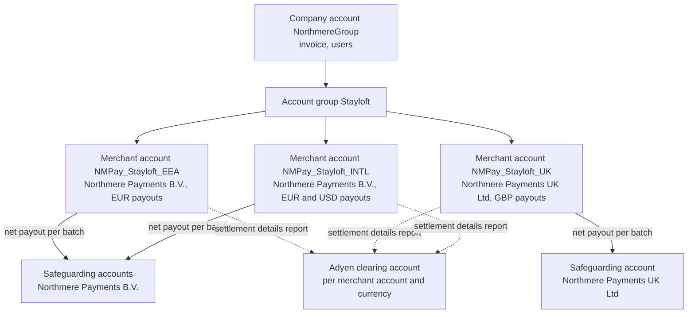
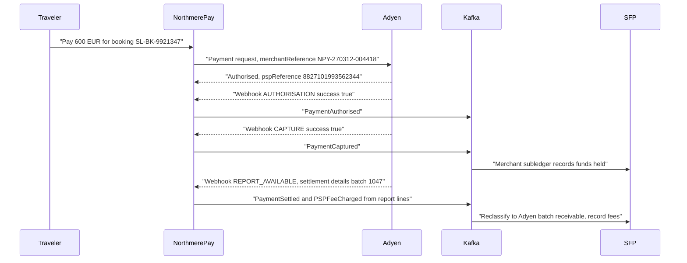
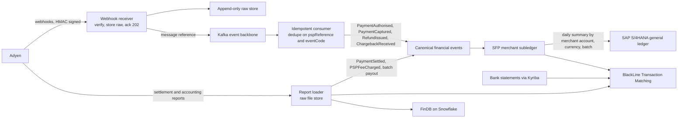

{id: adyen}
# 24. Adyen: Single-Platform Acquiring and Platform Payments

> **IN THIS CHAPTER, YOU WILL:** Learn what makes Adyen architecturally different from a gateway-plus-acquirer stack, how to map its company and merchant accounts to legal entities, brands and business models, how to carry its references into canonical events and the ledger, how to consume its webhooks safely, and how to reconcile one settlement batch from its reports to the bank credit.

> **WHY FINANCE CARES:** Most of the cash behind merchant-model revenue arrives as one net bank credit per batch, after fees, refunds and chargebacks have been deducted. If every line in the batch can be traced to a booking and a posting, the PSP clearing account closes to zero; if not, the difference sits in suspense until someone writes it off.

> **WHY ARCHITECTS SHOULD CARE:** Adyen's account structure, its two report vocabularies and its at-least-once webhooks are design inputs, not configuration details. Getting them wrong shows up a year later as an unexplained clearing balance, a payout engine coupled to one vendor, or a migration nobody can afford.

> **KEY POINTS:**
>
> * **One platform means one identity for each payment, and one concentration of risk.** Because gateway, risk and acquiring sit in one place, the `pspReference` issued at authorization reappears in the settlement and accounting reports, which makes transaction-level reconciliation tractable. The same design concentrates authorization, fraud decisions and settlement funds with one counterparty, so the dependency has to be hedged deliberately.
> * **Reconcile from reports, operate from webhooks, and never confuse the two vocabularies.** Webhooks are fast, at-least-once and unordered, which suits operational state and early accounting. The settlement details report's *journal types* describe money moving in a payable batch, and the payment accounting report's *record types* describe lifecycle statuses. Post money from the first, explain fees and timing with the second.
> * **Design the account structure and references before the first payment.** Merchant accounts should follow contracting legal entity, settlement currency and payout profile, not brand vanity; brand and business model travel as data. A unique merchant reference per payment, a modification reference per refund and the batch number on every summarized ledger line are what let a €1,380.52 bank credit be explained down to a single Lisbon booking.

> **[FAILURE PATTERNS THIS CHAPTER ADDRESSES](#where-finance-architecture-goes-wrong):**
>
> * **The Suspense Swamp** — Unmatched alternative-payment-method lines in the Adyen clearing account are Northmere's largest single source of suspense, and most of them trace back to reference and timing design, not to Adyen.
> * **Lost in Aggregation** — Posting one ledger line per payout hides the sales, refunds, chargebacks and fees that netted into it, so the clearing account cannot be explained at transaction level.
> * **The Borrowed Roadmap** — With about two-thirds of payment transactions on one platform, Adyen's vocabulary, report formats and product packaging can quietly become the enterprise's payments architecture unless the boundary is held.

[Payments for Finance Architects: The Lifecycle of Money Movement](#payments-fundamentals) followed one payment through its lifecycle: authorization, authentication, capture, clearing, settlement and payout, and the parties who take a share on the way. This chapter takes one provider that implements that lifecycle and asks the architect's questions about it: what is distinctive about its design, what data it gives back, and how the enterprise should be shaped around it so that **every euro it pays out can be explained**.

Adyen publishes unusually detailed reconciliation documentation: report columns, journal types and webhook semantics an architect can design against. This chapter treats that documentation as the contract and makes no claims about internals Adyen has not published.

The illustrations use **Northmere, the fictional group this book follows** (see [Meet Northmere: The Running Example](#meet-northmere)). Northmere Pay, Northmere's internal payments platform and licensed e-money institution, uses Adyen as its primary provider for Stayloft's merchant-model bookings. The running example is the Lisbon booking: €600.00, paid by card on 12 March 2027.

{id: adyen--setting-the-scene-at-northmere-one-batch-three-answers}
## Setting the Scene at Northmere: One Batch, Three Answers

On Wednesday 17 March 2027, Dana Whitlock, Northmere's Chief Architect for enterprise applications and financial systems, sat with Ingrid Solberg, managing director of Northmere Pay, and Leila Haddad, the chief accounting officer. The February close had finished on working day nine, as usual. On working day three, BlackLine Transaction Matching had again left about **1.9% of Stayloft's alternative-payment-method (APM) settlement lines** unmatched, and the PSP clearing and suspense accounts had ended February with about **€14 million** of unreconciled balances, about €2.1 million of it older than 90 days.

Leila had brought a single bank credit: **€1,380.52** received on 16 March into the euro account of Northmere Payments B.V., the Dutch e-money institution that safeguards traveler funds. (In the real estate the batch holds hundreds of thousands of lines; for the meeting, Ingrid's team had cut it down to the eight lines that mattered.) She asked three questions that every controller eventually asks of a payment provider:

1. Which bookings, refunds and chargebacks make up this amount?
2. What did Northmere pay to process them, and to whom: the card issuer, the card scheme or Adyen?
3. Why does the same batch look different in Northmere Pay's operational data, in the Stayloft Finance Platform (SFP) merchant subledger and in the general ledger in SAP S/4HANA?

Ingrid could answer the first question from Adyen's settlement details report in minutes. The second needed the payment accounting report as well. The third took the rest of the morning, because the answer was not about Adyen at all. It was about how Northmere had set up merchant accounts, which reference it sent with each payment, how its webhook consumer treated duplicates, and where its daily ledger summarization threw away the batch number. The rest of this chapter is the answer Dana wrote up afterwards.

{id: adyen--what-is-architecturally-distinctive-about-adyen}
## What Is Architecturally Distinctive About Adyen

{id: adyen--gateway-risk-and-acquiring-on-one-platform}
### Gateway, risk and acquiring on one platform

A **payment service provider (PSP)** packages the capabilities a merchant needs to accept payments: a **gateway** that routes payment requests, **risk** screening, connections to payment methods, and **acquiring**, the licensed role of contracting the merchant, receiving funds from the card schemes and paying the merchant (see [Payments for Finance Architects: The Lifecycle of Money Movement](#payments-fundamentals)). Many estates assemble these from separate parties: a gateway from one vendor, acquiring from a bank, fraud screening from a third.

Adyen markets itself as a **single platform** that provides gateway, risk and acquiring together, across online and in-person commerce ([Adyen pricing](https://www.adyen.com/pricing)). It acquires under its own European banking license, which Adyen reports was granted in 2017 ([Adyen press release](https://www.adyen.com/press-and-media/adyens-branch-license-application-approved-by-us-federal-reserve)), and the US Federal Reserve approved a federal branch of Adyen N.V. in San Francisco in May 2021 ([Federal Reserve order, 24 May 2021](https://www.federalreserve.gov/newsevents/pressreleases/orders20210524a.htm)). Adyen has been listed on Euronext Amsterdam since its initial public offering on 13 June 2018 (as reported in secondary sources such as [Wikipedia: Adyen](https://en.wikipedia.org/wiki/Adyen)). Claims about a "single code base" are Adyen's own description; the consequences below follow from the documented data, not the marketing.

For a finance architect, the single platform has three consequences that matter more than any feature.

**One identity per payment, end to end.** Adyen issues a `pspReference`, its unique reference for a payment, at authorization, and a separate `pspReference` for each **modification** (a capture, refund or cancellation), with `originalReference` pointing back to the authorization ([Adyen: Capture](https://docs.adyen.com/online-payments/capture)). The same references appear in the settlement details report and the payment accounting report. In a gateway-plus-third-party-acquirer stack, by contrast, the gateway's transaction ID and the acquirer's settlement record are joined by whatever the acquirer chooses to carry, often a scheme reference or an amount-and-date heuristic. With Adyen, the join from operational event to settlement line is a key, not a guess.

**Fees determined and reported by the party that settles.** Because the acquirer is also the reporting system, the settlement line carries its own cost breakdown: **Commission**, split into **Markup**, **Scheme Fees** and **Interchange** where interchange-level data is available ([Adyen: Settlement details report](https://docs.adyen.com/reporting/settlement-reconciliation/transaction-level/settlement-details-report)). That is the raw material for accounting under **interchange++ (IC++)** pricing, in which the issuer's interchange and the scheme's fees are passed through at cost and the provider adds an explicit markup.

**Concentration.** The same design puts authorization, fraud decisions, acquiring and the settlement funds with one counterparty. If Adyen degrades, Northmere loses the whole acceptance path for that volume, not just a gateway; funds held before payout are an exposure to one credit institution. I return to this under dependency risk.

**Figure 1:** *With gateway, risk and acquiring on one platform, the reference issued at authorization reappears in the settlement and accounting reports; the same design concentrates authorization, fraud decisions and settlement funds with one counterparty.*

{id: adyen--externally-settled-payments-a-gateway-for-someone-else-s-acquiring}
### Externally settled payments: a gateway for someone else's acquiring

Adyen can also act as gateway for transactions another acquirer settles; the reports then carry record types such as `SettledExternally` and `ChargebackExternally` and an **EpaPaid** journal type, with Adyen's reference exchange rate rather than the acquirer's ([Adyen: Payment accounting report](https://docs.adyen.com/reporting/invoice-reconciliation/payment-accounting-report); [Settlement details report](https://docs.adyen.com/reporting/settlement-reconciliation/transaction-level/settlement-details-report)). In a multi-acquirer estate, not every Adyen line nets into an Adyen payout.

{id: adyen--account-structure-mapping-adyen-to-entities-brands-and-business-models}
## Account Structure: Mapping Adyen to Entities, Brands and Business Models

{id: adyen--the-documented-building-blocks}
### The documented building blocks

Adyen's account structure has three documented levels ([Adyen: Account structure](https://docs.adyen.com/account/account-structure)):

- The **company account** "represents your core business entity" with Adyen. It holds all merchant accounts and users, and the monthly invoice is issued there by default.
- A **merchant account** is where payments are processed: "The merchant account is where you receive the payout of funds", and it is where reconciliation reports are produced and payment methods, processing currencies and risk-rule overrides are configured. Many businesses need only one; several "might be useful or even required in some cases".
- **Stores** sit under a merchant account to represent physical locations for point-of-sale payments, and optional **account groups** bundle merchant accounts for user access and cross-account reporting; a merchant account can belong to only one group.

Adyen's own guidance mentions regions and brands mainly as ways to organize *account groups*, and it does not say whether legal entities need separate merchant accounts. That decision is the enterprise's, and it is one of the most consequential settings in the whole integration, because **the merchant account is the unit of payout, reporting and reconciliation**. Each one produces its own payable batches, its own settlement details reports and its own bank credits.

{id: adyen--the-rule-i-use}
### The rule I use

I map merchant accounts to the things that change how money and liability move, and carry everything else as data:

| Split merchant accounts by… | Because… | Carry as data instead… | Because… |
| --- | --- | --- | --- |
| **Contracting legal entity** | The entity that contracts with Adyen receives the payout, holds the receivable from Adyen and is the one whose books the batch lands in | **Brand** | Several brands in one entity share a payout and a clearing account; a brand account splits cash for no accounting reason |
| **Settlement currency and payout profile** | Payout frequency is configured per merchant account, and each currency's bank credits need their own clearing account ([Adyen: Getting paid](https://docs.adyen.com/account/getting-paid)) | **Business model** | Merchant and agency flows differ in *who owns the money*, which is a ledger question; the payment flow is evidence, not the answer |
| **Payout model** | Sales day payout and pass-through payout produce different batch shapes; pass-through is the only model in Africa, Brazil and India ([Adyen: Getting paid](https://docs.adyen.com/account/getting-paid)) | **Market or country of the property** | Tax and partner rules depend on it, but the payout does not |
| **Regulatory perimeter** | Funds that must be safeguarded should not share a payout with funds that need not be | **Channel** (web, app, call center) | Operational reporting, not accounting |

The test is simple: if two flows would be posted to different clearing accounts, belong to different legal entities' books, or follow different payout timing, they need different merchant accounts. If they would only be *reported* differently, they need a field.

{id: adyen--northmere-s-structure}
### Northmere's structure

Northmere Pay contracts with Adyen through its two licensed entities. Stayloft's **agency** bookings never reach Adyen, because the property collects the traveler's payment; only **merchant**-model bookings, where Stayloft collects, holds the funds until after the stay and pays the property net of commission, flow through Northmere Pay. So Dana's team designed the structure around Northmere Pay's entities, not around Stayloft:

**Figure 2:** *Northmere's illustrative Adyen structure: merchant accounts follow the contracting entity, the regulatory perimeter and the payout currency; brand is an account group and business model is a field. Every merchant account and currency gets its own clearing account, so each batch has exactly one place to land.*

EEA travelers pay into **NMPay_Stayloft_EEA**, with euro payouts to Northmere Payments B.V. UK travelers pay into **NMPay_Stayloft_UK**, contracted by Northmere Payments UK Ltd, because post-Brexit UK and EEA funds sit in different safeguarding perimeters and cannot share a batch. **NMPay_Stayloft_INTL** pays out in both euro and US dollars, so dollar sales are not converted to euro and back when partners are paid in dollars.

Two alternatives were rejected. A **single merchant account** would mix two legal entities' money in one batch, which is not possible without intercompany settlement inside every payout. **One merchant account per brand and country**, about 38 for Stayloft alone, would multiply batches, clearing accounts and matching rules more than tenfold, all posting to the same two entities' books. Brand travels in the reference instead, as described next.

The rule has one deliberate exception. When Northmere launches in Brazil in 2028 with a new legal entity, any Adyen processing there would need a separate merchant account anyway, because pass-through payout is the only model Adyen offers in Brazil, and a pass-through batch has a different shape from a sales-day batch.

{id: adyen--references-as-correlation-keys}
## References as Correlation Keys

{id: adyen--the-identifiers-adyen-gives-back}
### The identifiers Adyen gives back

Reconciliation is a join, and a join needs keys. The settlement details report's standard columns include, in order: Company Account, Merchant Account, Psp Reference, Merchant Reference, Payment Method, Creation Date with TimeZone, Type (the journal type), Modification Reference, gross currency and amounts, Exchange Rate, net currency and amounts, Commission, Markup, Scheme Fees, Interchange, Payment Method Variant, Modification Merchant Reference and Batch Number ([Adyen: Settlement details report](https://docs.adyen.com/reporting/settlement-reconciliation/transaction-level/settlement-details-report)). Five of these are correlation keys:

| Key | Who sets it | What it identifies | How Northmere uses it |
| --- | --- | --- | --- |
| **Psp Reference** | Adyen | The payment, from authorization onward | Primary key of the payment in Northmere Pay's store; carried in every canonical event about the payment |
| **Merchant Reference** | The merchant, in the payment request | The merchant's own identifier for the payment | Northmere Pay's payment ID, unique per payment attempt; maps to the booking |
| **Modification Reference** | Adyen | The modification (capture, refund, chargeback); for a MerchantPayout line, a description including the account, batch number and the payout reference (`TX…XT`) that also appears on the bank statement | Joins refunds and captures to their webhooks; joins the batch payout to the bank line |
| **Modification Merchant Reference** | The merchant, optionally, in the modification request | The merchant's own identifier for a refund or capture | Northmere Pay's refund ID, so a refund in SFP can be found in the batch |
| **Batch Number** | Adyen | The payable batch a line belongs to | Summarization key for ledger postings; matching key for the bank credit |

{id: adyen--northmere-s-reference-design}
### Northmere's reference design

The decision with the longest consequences is what to put in the **merchant reference**. Sending the **booking ID** is tempting, because finance thinks in bookings. But one booking can produce several payments (a failed attempt then a successful one, a top-up for an extra night), and if they share the booking ID every matching rule needs an amount or date tiebreak.

Northmere sends its own **payment ID**, unique per payment attempt, as the merchant reference, for example `NPY-270312-004418` for the Lisbon booking, and keeps the mapping from payment ID to booking ID in Northmere Pay, which owns it. Refunds carry Northmere's refund ID in the modification merchant reference. The **booking ID** (`SL-BK-9921347` for the Lisbon stay) travels in the canonical event as `correlation_id`, the envelope field Keystone's event model reserves for the business key (see [Integration Architecture for Finance](#integration-architecture)). Brand and business model travel as envelope fields too, not as merchant-account names.

Every canonical payment event emitted by Northmere Pay therefore carries, in its payload, the full key set: `psp_reference`, `original_reference` for modifications, `merchant_reference`, `modification_merchant_reference`, `merchant_account` and, once known, `batch_number`. SFP stores them on every merchant-subledger line. The **daily summarization** into S/4HANA, which compresses about three million subledger lines into about 38,000 general-ledger lines, keeps `merchant_account`, currency and `batch_number` as summarization keys. That last choice is what turns Leila's third question into a lookup: each general-ledger line on the Adyen clearing account belongs to exactly one batch, and each batch can be expanded back to its lines in SFP and in the report. Summarizing by day alone, which is what Northmere did until 2027, is **Lost in Aggregation** in its purest form.

{id: adyen--payment-and-modification-flows}
## Payment and Modification Flows

{id: adyen--synchronous-requests-asynchronous-outcomes}
### Synchronous requests, asynchronous outcomes

The Lisbon payment is a single card payment with immediate capture: the stay is five weeks away, and card authorizations for card-not-present payments typically expire within about a week (see [Payments for Finance Architects: The Lifecycle of Money Movement](#payments-fundamentals)), so Stayloft captures at booking and holds the funds as a liability until the stay is delivered.

Adyen's modifications are asynchronous. A capture request returns `received`, and the outcome arrives later by webhook with event code `CAPTURE` and a `success` flag ([Adyen: Capture](https://docs.adyen.com/online-payments/capture)). The same pattern applies to refunds and cancellations. A partial capture cancels the uncaptured remainder automatically, and multiple partial captures are disabled by default. The architectural rule follows directly: **an API response is an acknowledgment, not a state**. Northmere Pay records the request as pending and moves the payment's state only when the webhook arrives.

**Figure 3:** *The Lisbon payment through Adyen: the API response gives identity, webhooks give operational state, and the settlement report gives money. Each step produces a Keystone canonical event; the settlement events are derived from the report, not from webhooks.*

{id: adyen--refunds-cancellations-and-chargebacks}
### Refunds, cancellations and chargebacks

A **cancellation** before capture releases the authorization; no money moved, so there is nothing to refund and nothing to post. A **refund** after capture is a new money movement with its own `pspReference`, and it can itself fail or be returned: Adyen's settlement details report has a **RefundedReversed** journal for refunds returned because they could not be credited, and, under sales day payout, **RefundNotCleared** ([Settlement details report](https://docs.adyen.com/reporting/settlement-reconciliation/transaction-level/settlement-details-report)). A **chargeback**, a reversal of the payment raised by the cardholder's bank through the card scheme, moves through Adyen's documented stages from request for information and notification of chargeback to chargeback, possible reversal, pre-arbitration and second chargeback, with webhook codes `NOTIFICATION_OF_CHARGEBACK`, `CHARGEBACK`, `CHARGEBACK_REVERSED`, `SECOND_CHARGEBACK`, `PREARBITRATION_WON` and `PREARBITRATION_LOST` ([Adyen: Dispute process and flow](https://docs.adyen.com/risk-management/understanding-disputes/dispute-process-and-flow)). Only some of these stages move money; the notification is a workflow trigger, not a posting.

{id: adyen--webhooks-fast-at-least-once-unordered}
## Webhooks: Fast, At-Least-Once, Unordered

{id: adyen--what-adyen-documents}
### What Adyen documents

Adyen's webhook documentation is precise about the contract ([Adyen: Handle webhook events](https://docs.adyen.com/development-resources/webhooks/handle-webhook-events); [Troubleshoot webhooks](https://docs.adyen.com/development-resources/webhooks/troubleshoot)):

- **Acknowledge quickly.** Return a 2xx response and "store the webhook message in your database or a queue" before processing. If Adyen does not get a response within 10 seconds, the webhook is marked as failing.
- **Verify the signature.** "Always verify the HMAC signature before processing the payload." An HMAC (hash-based message authentication code) signature proves the message came from Adyen and was not altered; Adyen's server libraries include a validator.
- **Expect duplicates.** Duplicates "have the same values in the eventCode and pspReference fields", and the receiver "should use the details from the latest webhook event".
- **Do not rely on order.** Check the timestamp; some payloads carry a `sequenceNumber`.
- **Retries last up to 30 days.** After a few quick retries, undelivered messages go to a retry queue with intervals "from 30 seconds up to 8 hours", for up to 30 days, and can be retried or ignored manually in Adyen's Customer Area.
- **Reports are announced by webhook.** A `REPORT_AVAILABLE` webhook carries the report's file name and download location; the file is fetched with a separate report-service credential ([Adyen: Automatically get reports](https://docs.adyen.com/reporting/automatically-get-reports)). Field names differ between webhook versions, so the consumer must pin the version it was built for.

{id: adyen--northmere-s-idempotent-consumer}
### Northmere's idempotent consumer

Northmere Pay's webhook receiver does four things and nothing else: it verifies the HMAC signature, writes the raw message unchanged to an append-only store keyed by a receipt ID, publishes a reference to it on a Kafka topic, and returns 202. Processing happens downstream, in a consumer that Lucía Romero, Dana's lead integration architect, specified in three rules:

1. **Deduplicate on state, not on message.** The consumer keeps, per `pspReference` and `eventCode`, the latest known outcome. A duplicate that carries the same outcome changes nothing and emits nothing. A later message that carries a different outcome replaces the state, as Adyen's guidance requires, and emits a *correcting* canonical event that refers to the one it supersedes. Canonical events are never updated in place.
2. **Tolerate out-of-order arrival.** A `CAPTURE` or `REFUND` webhook that arrives before its `AUTHORISATION` is parked against its `originalReference` until the parent appears. The parking area is monitored; anything parked for more than an hour pages Northmere Pay's on-call engineer.
3. **Treat webhooks as early, not final.** Webhook-derived events drive operational state and the *in-flight* postings described below. Money postings into the Adyen batch receivable come from the settlement details report, which is the record Adyen reconciles to its own payout.

The 30-day retry window is a resilience feature and an accounting hazard. A receiver outage over a month-end means webhooks for the last days of the month arrive in the next period. The consumer stamps each canonical event with both `occurred_at` (Adyen's event time) and `recorded_at` (receipt), and the period cut-off rule, owned by Leila's team, uses `occurred_at` in the merchant account's report time zone. That rule needs stating, because Adyen's reports follow the account's time-zone setting while its invoices are based on Central European Time ([Payment accounting report](https://docs.adyen.com/reporting/invoice-reconciliation/payment-accounting-report)).

**Figure 4:** *Two Adyen feeds, two jobs. Webhooks carry operational state through an idempotent consumer; reports carry money and fees. Both become canonical events, and BlackLine matches the three legs: subledger, report and bank.*

{id: adyen--reports-for-finance-two-vocabularies}
## Reports for Finance: Two Vocabularies

{id: adyen--the-reports-that-matter}
### The reports that matter

Adyen produces several reconciliation reports for classic acquiring. Four matter to finance:

| Report | Granularity | What it is for | Northmere use |
| --- | --- | --- | --- |
| **Settlement details report** | Transaction lines within a payable batch, with fees | Every credit and debit in a batch, generated per merchant account per batch or on a schedule, in CSV, TSV, XLS or XML formats ([Adyen](https://docs.adyen.com/reporting/settlement-reconciliation/transaction-level/settlement-details-report)) | The money record: source of `PaymentSettled`, fee postings and the batch payout |
| **Aggregate settlement details report** | Batch totals over a date range, by merchant account, store, payment method and journal type | Matching payouts to bank deposits; generated before 10:00 in the account time zone ([Adyen](https://docs.adyen.com/reporting/settlement-reconciliation/batch-level/aggregate-settlement-details-report)) | Daily treasury view and a control total for each batch |
| **Payment accounting report** | Every status change of every payment, with associated costs | "Match up fees to payment statuses and perform invoice reconciliation" ([Adyen](https://docs.adyen.com/reporting/invoice-reconciliation/payment-accounting-report)) | Fee attribution, invoice reconciliation and finding payments that never reached Settled |
| **Received payment details report** | Payment attempts with method, issuing country, 3-D Secure interaction and statuses | Finding unsettled payments ([Adyen](https://docs.adyen.com/reporting/settlement-reconciliation/transaction-level)) | Investigation of APM payments missing from batches |

{id: adyen--journal-types-and-record-types-are-different-things}
### Journal types and record types are different things

The most common misunderstanding of Adyen's data is to treat its two vocabularies as one; an architecture that mixes them posts the same money twice or not at all.

- **Journal types**, in the settlement details report, describe **money moving in a payable batch**: Settled, Refunded, Chargeback, SecondChargeback, ChargebackReversed, RefundedReversed, Fee, MiscCosts, MerchantPayout, InvoiceDeduction, Balancetransfer, DepositCorrection, ReserveAdjustment, MerchantPayin, BankInstructionReturned, EpaPaid and others, including sales-day-payout reversals such as CaptureFailed, RefundNotCleared and SettledReversed ([Settlement details report](https://docs.adyen.com/reporting/settlement-reconciliation/transaction-level/settlement-details-report)).
- **Record types**, in the payment accounting report, describe **lifecycle statuses**: Received, Authorised, AuthorisedPending, SentForSettle, Settled, SentForRefund, Refunded, Refused, Cancelled, Expired, CaptureFailed, Chargeback, SecondChargeback, ChargebackReversed, the *Externally* variants and others ([Payment accounting report](https://docs.adyen.com/reporting/invoice-reconciliation/payment-accounting-report)).

Some names appear in both lists, which is the source of the confusion. **Received, Authorised and SentForSettle are record types only**; no money moves at those statuses. And the **Fee** journal is not a per-payment commission: it carries Adyen's transaction fees "for Received and SentForRefund transactions booked in the batch period". The interchange, scheme fees and markup of a payment sit on its **Settled** line, in the Commission columns. The payment accounting report carries Received, Authorised and Captured amounts, the same commission split, a Processing Fee column and the Payable Batch, "the sequence number of the payout batch".

**Figure 5:** *Record types describe a payment's lifecycle status, while journal types describe money moving in a payable batch; no money moves at the early statuses, so post money from the settlement report and use the statuses to explain fees and timing.*

{id: adyen--from-journal-types-to-accounting-events-and-postings}
### From journal types to accounting events and postings

The table below is the core of Northmere's posting design. **It is illustrative**: it shows one defensible design for a payments entity that safeguards customer funds, not a prescribed treatment. The accounts are Northmere's; the credit side of the capture belongs to the merchant subledger, whose design [Why Enterprises Build Their Own Finance Platforms](#custom-finance-platforms) and [Payments-to-Ledger: Connecting Providers, Brand Platforms and the ERP](#payments-to-ledger) cover.

| Adyen source | Canonical event | Illustrative posting (Northmere Payments B.V.) | Note |
| --- | --- | --- | --- |
| Record types **Authorised**, **Refused**, **Cancelled**, **Expired** | `PaymentAuthorised` or state change | None | No money has moved |
| Record type **SentForSettle** (webhook `CAPTURE`, success) | `PaymentCaptured` | Dr *Adyen in-flight receivable* / Cr *Booking funds held* (subledger control) | Gross amount in payment currency |
| Journal **Settled** | `PaymentSettled`, `PSPFeeCharged` | Dr *Adyen batch receivable* (net) and Dr *Interchange*, *Scheme fees*, *PSP markup* expense / Cr *Adyen in-flight receivable* (gross) | FX difference to *FX result* when payment and settlement currencies differ |
| Journal **Fee** | `PSPFeeCharged` | Dr *PSP processing fees* / Cr *Adyen batch receivable* | Attributed to payments via the payment accounting report |
| Journal **Refunded** | `RefundIssued` (settled leg) | Dr *Refunds in flight* / Cr *Adyen batch receivable* | `RefundIssued` from the webhook posted Dr *Booking funds held* / Cr *Refunds in flight* |
| Journal **RefundedReversed** | `RefundIssued` reversal | Dr *Adyen batch receivable* / Cr *Refunds in flight* | Refund came back; traveler still owed |
| Journal **Chargeback**, **SecondChargeback** | `ChargebackReceived` | Dr *Disputes receivable* / Cr *Adyen batch receivable* | Recovery or loss decided later |
| Journal **ChargebackReversed** | `ChargebackResolved` (won) | Dr *Adyen batch receivable* / Cr *Disputes receivable* | |
| Journal **InvoiceDeduction**, **MiscCosts** | `PSPFeeCharged` | Dr *PSP fees payable* or expense / Cr *Adyen batch receivable* | Ties to Adyen's monthly invoice |
| Journal **Balancetransfer** | (batch movement) | Dr/Cr *Adyen batch receivable*, batch N and batch N+1 | Moves a negative or unpaid balance to a later batch |
| Journal **ReserveAdjustment**, **DepositCorrection**, **MerchantPayin** | (reserve movement) | Dr/Cr *Restricted funds at Adyen* / *Adyen batch receivable* | Restricted, not netted into sales |
| Journal **SettledReversed**, **CaptureFailed** | `PaymentSettled` reversal | Reverse the Settled posting | Sales day payout pre-financed a payment that did not arrive |
| Journal **MerchantPayout** | (batch payout) | Dr *Cash in transit, Adyen* / Cr *Adyen batch receivable* | One per batch with a positive balance |
| Bank statement line with payout reference | (bank receipt) | Dr *Bank, safeguarding EUR* / Cr *Cash in transit, Adyen* | Matched in BlackLine on the `TX…XT` reference |
| Journal **BankInstructionReturned** | (payout returned) | Dr *Adyen batch receivable* / Cr *Cash in transit, Adyen* | Bank rejected the payout |

Three accounts carry the design: an **in-flight receivable** that holds captured-but-unsettled amounts, a **batch receivable** per merchant account and currency that must return to zero when each batch is paid out, and **cash in transit** that must return to zero when the bank credit arrives. Each is a clearing account in the sense of [Payments-to-Ledger: Connecting Providers, Brand Platforms and the ERP](#payments-to-ledger), and each zero is a separate assertion with a separate owner.

Two record types deserve a word. **SettledReversed** and **CaptureFailed** exist because under sales day payout Adyen pre-finances a sales day and reverses funds it does not receive within 30 days; the webhooks for these reversals are "disabled by default" ([Settlement details report](https://docs.adyen.com/reporting/settlement-reconciliation/transaction-level/settlement-details-report)). Northmere enabled them, because a reversal that only appears in a report a week later is a reversal the merchant subledger learns about too late.

{id: adyen--settlement-batches-payout-timing-and-fees}
## Settlement Batches, Payout Timing and Fees

{id: adyen--payable-batches}
### Payable batches

Adyen pays out per **payable batch**: if a batch's payable balance is positive when it closes, Adyen instructs a payout, and "Payouts are net" of refunds, chargebacks, fees and other deductions ([Adyen: Getting paid](https://docs.adyen.com/account/getting-paid)). Two payout models exist:

- **Sales day payout**, the default and recommended model, puts a whole sales day in one batch and pre-finances it.
- **Pass-through payout** splits a sales day across batches as funds arrive from the schemes; it is "the only available payout model in Africa, Brazil, and India".

Payout frequency is configured per merchant account. After a batch closes, initiating the payout takes one to two business days, and the bank may need up to three more; if funds have not arrived five business days after batch close, Adyen directs merchants to the BankInstructionReturned journal in the aggregate report. Bank holidays block payouts in the affected currencies. Batches with a negative balance are carried forward with Balancetransfer entries rather than paid.

For Northmere, the dates matter because the scenario fixes them. The Lisbon payment was captured on Friday 12 March 2027; its Settled line was booked into **batch 1047** of NMPay_Stayloft_EEA on **14 March 2027**, two days after capture, the settlement date Northmere's finance team records for the booking. Because 14 March 2027 is a Sunday, Adyen initiated the batch payout on Monday 15 March and the credit reached the Northmere Payments B.V. safeguarding account on **Tuesday 16 March**. Between 14 and 16 March the €598.36 the Lisbon line contributed was a receivable from Adyen, then cash in transit. That distinction is not pedantry: Northmere Payments B.V. is an e-money institution with a daily **safeguarding reconciliation**, and funds held at a PSP before payout are a recurring question for its compliance function, which [Payments for Finance Architects: The Lifecycle of Money Movement](#payments-fundamentals) introduces. Ingrid's team treats the age of undisbursed batch balances at Adyen as a treasury metric reported to Kofi Asante, the group head of tax and treasury.

{id: adyen--fees-under-interchange}
### Fees under interchange++

Adyen's public price list shows card pricing as a fixed fee plus "Interchange++" plus a percentage markup, and says custom pricing is available ([Adyen pricing](https://www.adyen.com/pricing)). Enterprises at Northmere's scale negotiate their own terms; the figures here are illustrative, not Adyen's prices.

The Lisbon traveler paid with a German consumer debit card. Under the EU Interchange Fee Regulation, interchange on consumer debit cards is capped at 0.2% of the transaction value and on consumer credit cards at 0.3%, and commercial cards are excluded from the caps ([Regulation (EU) 2015/751](https://eur-lex.europa.eu/eli/reg/2015/751/oj)). Northmere's illustrative **€1.74** total processing cost for the booking breaks down like this:

| Component | Where it appears | Amount (EUR) | Who receives it |
| --- | --- | --- | --- |
| Interchange (0.2% of €600) | Settled line, Interchange column | 1.20 | Card issuer |
| Scheme fees | Settled line, Scheme Fees column | 0.21 | Card scheme |
| Markup | Settled line, Markup column | 0.23 | Adyen |
| Processing fee (the rest of the €0.33 negotiated markup) | Fee journal for the Received transaction; Processing Fee column in the payment accounting report | 0.10 | Adyen |
| **Total** | | **1.74** | |

So the Lisbon line in the settlement details report shows a gross credit of 600.00, a commission of 1.64 split into its three parts, and a net credit of 598.36; the remaining 0.10 arrives as part of the batch's Fee entry. Adyen's own margin is therefore €0.33, split €0.23 on the line and €0.10 at batch level, which is the IC++ view [Payments for Finance Architects: The Lifecycle of Money Movement](#payments-fundamentals) shows. Northmere Pay's adapter attributes the €0.10 back to the payment from the payment accounting report, so the canonical `PSPFeeCharged` event carries €1.74 and `PaymentSettled` a net of €598.26. Two consequences for accounting follow.

First, **the fee is known at settlement, not at booking**. Under interchange++ the interchange and scheme fees are fixed at clearing, and some scheme fees reach the merchant later through Adyen's invoice. The payment accounting report exists to match those costs to payment statuses ([Payment accounting report](https://docs.adyen.com/reporting/invoice-reconciliation/payment-accounting-report)). Northmere accrues an expected fee at capture for margin reporting in FinDB but posts actual fees only from the report, and trues up invoice-only costs when Adyen's monthly invoice arrives, using CET month boundaries as Adyen does.

Second, **fees belong to the brand that caused them**. Northmere Pay is an enabler; payment fees are recharged to Stayloft. The fee postings therefore carry the brand and business model from the canonical envelope, and an intercompany recharge from Northmere Payments B.V. to the Stayloft entity is generated monthly from the same lines. Separate expense accounts for interchange, scheme fees and markup let Ingrid show Tomás Ferreira, the group CFO, which cost Northmere can negotiate (markup) and which it can only influence through routing and card mix.

{id: adyen--chargebacks-in-reports}
### Chargebacks in reports

The chargeback in the same batch shows how disputes appear. It is an earlier €420 dispute, not the June 2027 chargeback that [Payments for Finance Architects: The Lifecycle of Money Movement](#payments-fundamentals) follows: a separate Stayloft stay from 30 January to 2 February 2027; the traveler disputed it, and the chargeback was debited on 14 March, 40 days after the stay. In the settlement details report it is a **Chargeback** journal line with a gross and net debit of 420.00, carrying the original payment's `pspReference`. For Chargeback lines the Modification Reference can match the capture reference, which Adyen documents as expected behavior. The earlier `NOTIFICATION_OF_CHARGEBACK` webhook opened the dispute case in Northmere Pay's dispute tool; no money moved then. If Stayloft wins, a **ChargebackReversed** line credits a later batch. Dispute handling fees follow Northmere's contract and arrive through the invoice.

{id: adyen--worked-example-reconciling-batch-1047-to-the-bank}
## Worked Example: Reconciling Batch 1047 to the Bank

Here is the miniature of batch 1047 that Ingrid's team prepared for Leila. Amounts are in euro; the batch belongs to merchant account NMPay_Stayloft_EEA.

| # | Journal type | Merchant reference | What it is | Gross (EUR) | Commission (EUR) | Net credit | Net debit |
| --- | --- | --- | --- | --- | --- | --- | --- |
| 1 | Settled | NPY-270312-004418 | Lisbon booking, German consumer debit card | 600.00 | 1.64 | 598.36 | |
| 2 | Settled | NPY-270312-011902 | Porto booking, consumer credit card | 350.00 | 1.39 | 348.61 | |
| 3 | Settled | NPY-270312-020577 | Amsterdam booking, iDEAL (bank-redirect APM, flat fee, no interchange split) | 240.00 | 0.29 | 239.71 | |
| 4 | Settled | NPY-270312-031260 | Barcelona booking, UK commercial card, GBP 690.00 at 1.1700 | 807.30 | 12.96 | 794.34 | |
| 5 | Refunded | NPY-270302-087731 | Refund of a canceled Seville booking; modification merchant reference NRF-270311-00092 | 180.00 | | | 180.00 |
| 6 | Chargeback | NPY-270118-064005 | An earlier €420 dispute (stay 30 Jan–2 Feb) | 420.00 | | | 420.00 |
| 7 | Fee | | Processing fees, four Received payments and one SentForRefund at €0.10 | | | | 0.50 |
| 8 | MerchantPayout | | Modification reference contains batch 1047 and payout reference TX…XT | | | | 1,380.52 |

Line 4 shows two complications at once. The traveler paid in sterling, so the gross is in GBP and the net in EUR at the exchange rate shown, and the card is a commercial card, which the EU interchange caps do not cover; its €12.96 commission (interchange €12.11, scheme fees €0.65, markup €0.20) is more than seven times the Lisbon booking's.

The arithmetic a reconciler checks, in order:

| Check | Calculation | Result |
| --- | --- | --- |
| Gross settled sales in EUR | 600.00 + 350.00 + 240.00 + 807.30 | 1,997.30 |
| Less commission on settled lines | 1.64 + 1.39 + 0.29 + 12.96 | 16.28 |
| Net settled credits | 1,997.30 − 16.28 | 1,981.02 |
| Less refunds, chargebacks and fees | 180.00 + 420.00 + 0.50 | 600.50 |
| Payable balance at batch close | 1,981.02 − 600.50 | **1,380.52** |
| MerchantPayout journal | | 1,380.52 |
| Bank credit, 16 March, camt.053 statement via Kyriba, reference TX…XT | | **1,380.52** |

The **three-way match** that [Payments-to-Ledger: Connecting Providers, Brand Platforms and the ERP](#payments-to-ledger) owns then has three legs, each with its own key:

1. **Subledger to report.** Each Settled, Refunded and Chargeback line is matched to SFP by `merchant_reference` (or `modification_merchant_reference` for the refund) and `psp_reference`. Lines 1–6 match.
2. **Report to batch payout.** The lines of batch 1047 sum to the MerchantPayout amount. Line 8 matches.
3. **Payout to bank.** The bank statement line's remittance information contains the payout reference from the MerchantPayout line's modification reference, and the amount agrees. The bank leg matches.

And the ledger, using the illustrative postings above, nets the batch receivable for NMPay_Stayloft_EEA in EUR to zero:

| Account | Debit | Credit | Note |
| --- | --- | --- | --- |
| Adyen batch receivable | 1,981.02 | | Net of the four Settled lines |
| Interchange expense | 14.36 | | 1.20 (Lisbon) + 1.05 (Porto) + 12.11 (Barcelona); iDEAL has none |
| Scheme fees expense | 1.11 | | 0.21 + 0.25 + 0.65 |
| PSP markup expense | 0.81 | | 0.23 + 0.09 + 0.29 (iDEAL flat fee) + 0.20 |
| Adyen in-flight receivable | | 1,997.30 | Gross captured amounts released |
| PSP processing fees expense | 0.50 | | Fee journal |
| Refunds in flight | 180.00 | | Seville refund settled |
| Disputes receivable | 420.00 | | Chargeback |
| Adyen batch receivable | | 1,981.02 | 0.50 + 180.00 + 420.00 + 1,380.52 |
| Cash in transit, Adyen | 1,380.52 | | MerchantPayout |
| Bank, safeguarding EUR | 1,380.52 | | 16 March |
| Cash in transit, Adyen | | 1,380.52 | Matched on payout reference |

(The Porto line's €1.39 commission splits into interchange €1.05, the 0.3% consumer-credit cap, scheme fees €0.25 and markup €0.09. The three expense rows total €16.28, equal to the commission on the settled lines; the iDEAL flat fee sits in markup because no interchange split exists for it.)

This is the answer to Leila's first two questions. The answer to her third was what had broken in February, and it was not in this batch at all.

{id: adyen--why-the-apm-lines-did-not-match}
### Why the APM lines did not match

The 1.9% of APM lines left unmatched on working day three were concentrated in two bank-redirect methods. When Lucía's team traced 400 of them by hand, they found three causes, none of them an Adyen defect:

- **Reused merchant references.** For redirect payments, an earlier version of Northmere Pay sent the **checkout session ID** as the merchant reference. A traveler who abandoned the bank page and retried created a second payment with the same reference. BlackLine's rule matched on merchant reference and amount, found two candidates and matched neither.
- **A matching window that assumed card timing.** Some APM payments were confirmed by the bank after the traveler had left the site and settled in a later batch than SFP expected. The BlackLine rule looked for the settlement within two days of the booking and then gave up, leaving the item to age in suspense even after the money had arrived.
- **Refunds made outside Adyen.** For one method, agents had refunded some travelers by manual bank transfer from Kyriba when the original payment could not be refunded through the provider. SFP recorded a refund; Adyen never saw one. The clearing account waited for a Refunded line that would never come.

The fixes followed the design in this chapter: a unique payment ID as merchant reference for every attempt; a matching window per payment method, set from the observed distribution of capture-to-settlement days in FinDB; and a rule that refunds made outside the provider generate their own canonical `RefundIssued` event with a bank reference, matched on the bank leg instead of the PSP leg. Northmere's target for the payments-to-ledger program is that the Adyen clearing accounts end every month with no unexplained items older than the longest documented settlement window for the method.

{id: adyen--adyen-for-platforms-and-the-balance-platform}
## Adyen for Platforms and the Balance Platform

{id: adyen--what-it-is}
### What it is

Marketplaces and platforms that pay out to their own users have a second Adyen product line. In **Adyen for Platforms**, built on what Adyen calls the **Balance Platform**, the documented resources are ([Adyen: Platform structure](https://docs.adyen.com/platforms/account-structure-resources/platform-structure)):

- a company account and a merchant account per country or region, and one **balance platform** per acquiring region;
- a **liable account holder** with a **liable balance account**, which holds the platform's own funds;
- per user (for Stayloft, a property): a **legal entity** carrying the know-your-customer (KYC) data, an **account holder** with its capabilities, **balance accounts** that hold funds in a base currency, and a **transfer instrument**, the verified bank account for payouts.

Funds flow from payment to merchant account, then settle into balance accounts according to the platform's **split instructions** ("You define how each payment is split between your liable balance account and the user's balance accounts"), and stay there until paid out. **Transfers** move funds between balance accounts or to and from bank accounts; webhooks such as `balancePlatform.transfer.created`, `balancePlatform.transfer.updated` and `balancePlatform.transaction.created` report them, and a status of `booked` means funds moved ([Adyen: Transfer webhooks](https://docs.adyen.com/api-explorer/transfer-webhooks/4/post/balancePlatform.transfer.created)). Booked is not final for payouts: instant payouts can be rejected and regular payouts returned ([Adyen: Payout lifecycle](https://docs.adyen.com/payouts/payout-service/payout-lifecycle/)).

Finance reconciles it with the **Balance Platform accounting report**, a daily report of every balance change, with several rows per transfer as its status progresses and separate Booking Date and Value Date ([Adyen: Balance Platform accounting report](https://docs.adyen.com/marketplaces/reports-and-fees/balance-platform-accounting-report)). The older "classic" Adyen for Platforms survives in the XASTransfer journal type; treat it as legacy.

{id: adyen--should-a-marketplace-use-it-or-pay-its-partners-itself}
### Should a marketplace use it or pay its partners itself?

This is a sourcing decision with ledger consequences, and Northmere has already made it once: Stayloft pays its properties from SFP, out of funds safeguarded by Northmere Payments B.V., about nine million partner payouts a month across Stayloft and Tablekin. [Why Enterprises Build Their Own Finance Platforms](#custom-finance-platforms) explains why Stayloft built that payout capability. The question Dana was asked in 2027 is whether moving Stayloft's merchant-model payouts onto Adyen's Balance Platform would retire it.

| Question | Use the provider's platform product (Adyen Balance Platform, Stripe Connect) | Pay partners yourself |
| --- | --- | --- |
| Do you hold a license to hold customer funds? | No: the provider holds funds and performs KYC on your users | Yes: you safeguard and pay out under your own license |
| How many acquirers fund the payouts? | One, or one per region | Several: a single payout must combine money from several providers |
| Who owns partner onboarding and KYC? | You want the provider to | You already do, under your own obligations |
| Where does the partner balance live? | In the provider's balance accounts, mirrored in your subledger | In your own subledger, which is the record |
| Exit cost | High: balances, KYC records and payout instruments sit with the provider | Lower for payouts, higher for build and run |
| Typical fit | Platforms starting out, single-PSP marketplaces, SaaS with embedded payments | Large marketplaces with a license and several acquirers |

For Northmere the answer was clear. About **32%** of Northmere Pay's transactions arrive through Stripe and local APM providers, not Adyen; a Balance Platform would hold only Adyen's share, so every property paid from mixed sources would need a second payout path, and Northmere would add a third payout engine to the two it is already trying to consolidate (see [Preventing Redundant Capabilities and Unnecessary Coupling](#redundancy-and-coupling)). The license, the safeguarding accounts and the partner relationships already sit with Northmere. The provider product would move the partner balance, the most sensitive record in the merchant model, outside the estate.

Tablekin is the counter-example. It holds no payments license of its own and processes mainly through Stripe, so venue payouts run on Stripe Connect, the equivalent product (see [Stripe: Programmable Payments, Billing and Connected Accounts](#stripe)). Both answers are right for their brand; the rule is about license, acquirer count and who should own the partner balance, not about which vendor is better.

{id: adyen--issuing-and-capital-briefly}
### Issuing and Capital, briefly

Two further Balance Platform products are worth knowing about. **Issuing** provides virtual and physical Visa and Mastercard cards in the EEA, UK and US, drawing on balance accounts; an **authorization relay** lets the platform approve or decline each card authorization from its own systems ([Adyen: Issuing](https://docs.adyen.com/issuing)). Virtual cards are a common way to pay travel suppliers per booking; for Northmere they would be one more payout channel to reconcile. **Capital** lets a platform offer financing to its users, repaid as a fixed share of their processed volume, with Adyen carrying the credit risk ([Adyen: Financial products](https://docs.adyen.com/platforms/financial-products)). The finance-architecture question is whether repayments deducted from a property's flows reach the partner subledger as their own lines.

{id: adyen--trade-offs-integration-options-around-adyen}
## Trade-offs: Integration Options Around Adyen

| Decision | Option A | Option B | When A is right | When B is right |
| --- | --- | --- | --- | --- |
| **Source of money postings** | Settlement details report | Webhooks | Always for settled money, fees and payouts: the report is what Adyen pays against | For operational state and early, provisional in-flight postings |
| **Ledger granularity** | Transaction lines in a subledger, summarized to the GL by merchant account, currency and batch | One GL posting per payout | At any volume where suspense matters: every balance can be expanded | Very small volumes with one product and no disputes; rarely at enterprise scale |
| **Merchant accounts** | By entity, currency, payout model and regulatory perimeter | By brand and country | Most enterprises; fewer batches, fewer clearing accounts | Where brands are separate legal entities with separate payouts, which makes them the same rule |
| **Partner payouts** | Own subledger and payout engine under own license | Balance Platform | Licensed, multi-acquirer marketplaces | Single-provider platforms without a license |
| **Multi-PSP abstraction** | Canonical events and settlement normalization owned by the enterprise | A payment orchestrator's normalized data | When the ledger must stay provider-neutral and reconciliation is a core competence | When routing and token portability are the main problem and the orchestrator's data is good enough for finance |

The pattern in the table is consistent with the rest of this book: **use the provider's data as the evidence, keep the record in the enterprise**. The provider's reports are excellent evidence. They are not the enterprise's ledger, and an architecture that lets them become one has built **The Shadow Ledger** on someone else's servers.

{id: adyen--integration-with-the-rest-of-the-estate}
## Integration With the Rest of the Estate

Each Adyen interface has an owner:

- **Northmere Pay** (Ingrid) owns the relationship, merchant accounts, webhook consumer, report loader and the mapping to canonical events. Nothing outside Northmere Pay parses Adyen formats.
- **Kafka**, owned by Ravi Menon's Platform Engineering, carries the canonical events ([From Customer Transaction to Financial Statement](#transaction-to-report) follows them end to end).
- **SFP** (Jonas Berg) is the merchant subledger of record. It consumes the events and produces the daily summary for **SAP S/4HANA**, where the Adyen clearing accounts live in Northmere Payments B.V.'s company code ([SAP S/4HANA: The Enterprise Finance Core](#sap-s4hana)).
- **BlackLine Transaction Matching** performs the three-way match among SFP, the settlement details report and bank statements delivered through **Kyriba** ([BlackLine: Close Automation, Reconciliation and Continuous Accounting](#blackline)).
- **FinDB** on Snowflake, owned by Owen Mbeki, keeps raw reports and normalized lines for fee and settlement-time analysis.
- **Stripe**, the secondary provider for Stayloft, produces the same canonical events from its balance transactions, so nothing downstream of Northmere Pay knows which provider processed a booking unless it asks ([Stripe: Programmable Payments, Billing and Connected Accounts](#stripe)).

The **anti-corruption layer**, the boundary that translates a vendor's model into the enterprise's, sits at Northmere Pay's edge. It is the most important structural decision in this chapter, and the one that makes the dependency hedges below possible.

{id: adyen--strengths-limits-and-dependency-risk}
## Strengths, Limits and Dependency Risk

{id: adyen--strengths-and-limits-for-a-finance-architect}
### Strengths and limits for a finance architect

**Strengths.** One reference per payment from authorization to batch; fee components on the settlement line; separate vocabularies for money and lifecycle; batch reports that sum to the payout; webhook semantics precise enough to design against; a platform product for those who want one.

**Limits.** Reconciliation data is file-based, so the enterprise needs a loader, a raw store and a schema-change process as columns and journal types evolve. Interchange splits are not available for every method. Report and invoice time zones differ. Sales day payout pre-finances and later reverses. And the single platform that makes the data clean also makes the dependency deep.

{id: adyen--concentration-what-68-means}
### Concentration: what 68% means

About 420 million payment transactions a year run through Northmere Pay, and about **68%** of them, roughly 285 million, run through Adyen. For those transactions, Adyen is gateway, risk engine, acquirer and the holder of funds between capture and payout. An outage, commercial dispute or regulatory action reaches all of them at once.

Northmere Payments B.V. is a financial entity under the EU's Digital Operational Resilience Act (DORA), so its dependency on critical third parties must be documented, tested and backed by exit plans ([Regulation (EU) 2022/2554](https://eur-lex.europa.eu/eli/reg/2022/2554/oj)). Whether a given PSP service falls under DORA's information and communication technology third-party rules is a legal classification for compliance to make; I recommend treating Adyen as a critical dependency in the architecture regardless of how that classification falls.

The hedges Northmere uses are the ones [Vendor Strategy and Avoiding Excessive Dependency](#vendor-portfolio-strategy) develops in general:

- **A warm second provider.** Stripe already processes about 22% of Northmere Pay's transactions through the same abstraction, so routing more volume to it is a configuration and capacity question, not a project. The cost is real (integration, dispute operations, reconciliation rules, weaker pricing tiers), and Northmere accepts it because the alternative is a single point of failure for most of its revenue.
- **Provider-neutral records.** Canonical events, the merchant subledger and the clearing-account design do not use Adyen vocabulary. A provider change alters a mapping, not the ledger.
- **Token portability.** Stored card credentials held as provider tokens do not move between providers on their own. Where available, network tokens and a negotiated credential export at exit reduce the lock-in; the export right is a contract clause, and it has to be negotiated before it is needed.
- **Funds exposure limits.** Treasury tracks how much of Northmere's money sits at Adyen at any moment and how long, as it would for any bank counterparty.
- **An exit plan that is exercised.** Once a year, starting in November 2027, Northmere Pay moves one market's new-card traffic between providers for a week, to prove that routing, reconciliation and dispute handling work on both.

The opposite mistake is to abstract everything. A generic wrapper around every Adyen product removes the features Northmere pays for and still does not make balances or KYC records portable. The abstraction belongs at the ledger and payment-request boundaries.

{id: adyen--failure-modes}
## Failure Modes

- **Processing webhooks inside the HTTP request.** Ledger calls inside the receiver exceed the 10-second limit during a slow period, Adyen marks the endpoint as failing and queues retries, and a backlog hits month-end. Acknowledge, store, then process.
- **No deduplication, or deduplication on message ID.** At-least-once delivery produces double captures in the subledger. Deduplicate on `pspReference` and `eventCode`, keep the latest outcome, and emit corrections as new events.
- **Reconciling at payout level only.** One GL line per bank credit leaves the clearing account explainable only in total; refunds and chargebacks months later have nothing to match against. This is Lost in Aggregation.
- **Ignoring Balancetransfer and reserves.** A negative batch carried forward looks like a missing payout; a reserve adjustment netted into sales distorts revenue analysis. Both need their own accounts.
- **Leaving reversal webhooks disabled.** SettledReversed and CaptureFailed then surface only in reports, after the merchant subledger has already paid the partner.
- **A brittle report parser.** Column order or a new journal type changes and the loader fails silently, or worse, maps an unknown type to a default account. Parse by header name, reject unknown journal types into a quarantine queue, and alert.
- **Undefined cut-off rules.** Reports in the account's time zone, invoices in CET, the GL in local time: without a written rule, the same fee appears in two periods or none.

{id: adyen--the-chief-architect-s-view}
## The Chief Architect's View

The decisions about Adyen that belong at the architecture board, not in the payments team's backlog, are few, and each has a natural owner:

| Decision | Decided by | Why it is an enterprise decision |
| --- | --- | --- |
| Merchant-account structure and the rule behind it | Dana with Ingrid and Leila | It fixes the unit of payout, clearing account and reconciliation for years |
| Reference standard: merchant reference, modification merchant reference, propagation into events and summaries | Dana's design authority, Lucía as owner | Every downstream match depends on it; changing it later breaks history |
| Source of truth for money postings (reports) versus state (webhooks) | Leila as process owner, Dana as design authority | It defines when a posting is final and what auditors test |
| Posting design for each journal type, including reserves and reversals | Leila's accounting policy team, implemented by Jonas | It is accounting policy expressed as integration rules |
| Partner payouts: own engine or provider platform | Tomás, on Dana's recommendation | It moves the partner balance and license obligations |
| Provider concentration limits and exit testing | Ingrid with Kofi, reported to the risk committee | It is counterparty and operational risk, not a technical preference |

Three things I watch over time. First, **clearing-account aging per merchant account and payment method**, the earliest signal that a reference, a matching rule or a provider behavior has changed. Second, **the share of fees explained at component level**, which drops when card mix shifts or a report change breaks the split. Third, **Adyen's product packaging**: new platform, risk and financing products arrive bundled with commercial incentives, and each one is a chance for **The Borrowed Roadmap** to move a capability that the enterprise decided to own. The test I apply is the same each time: does the product sit behind Northmere Pay's boundary and produce canonical events, or does it ask the estate to speak Adyen?

Mei Tanaka, who owns Northmere's internal-controls program, asked one more question that belongs here. Adyen's reports are information produced by an outside party and used in key controls, so the reconciliation control must evidence that the report is complete (batch lines sum to the payout and the payout to the bank) and that the loader did not alter it (the raw file is stored and hashed). [Controls, Auditability and Security by Design](#controls-and-auditability) covers how that evidence is tested.

{id: adyen--questions-to-ask}
## Questions to Ask

1. What is our rule for creating a merchant account, and does every existing merchant account follow it?
2. Is the merchant reference unique per payment attempt, and does every refund carry a modification merchant reference?
3. Which ledger lines carry the batch number, and can any balance on the Adyen clearing accounts be expanded to transaction lines in under an hour?
4. Do we post money from the settlement details report and only from it? Where do record types from the payment accounting report enter our books, if anywhere?
5. How does our webhook consumer handle a duplicate, an out-of-order event, a correction and a 30-day-late delivery? Has each been tested?
6. Are SettledReversed and CaptureFailed webhooks enabled, and where do they go?
7. How much of our payment cost can we split into interchange, scheme fees and markup, by brand and by method?
8. What is our written period cut-off rule for Adyen reports and invoices?
9. What share of our transactions runs on Adyen, how much of our money sits there on an average day, and when did we last move traffic to the second provider?
10. If we had to leave Adyen in twelve months, which records, tokens and partner data would we need, and does the contract give us them?

{id: adyen--from-one-provider-to-the-other}
## From One Provider to the Other

Adyen's design rewards an enterprise that treats its reports as evidence and its webhooks as signals, and that decides account structure and references before the first payment. Its single platform makes those disciplines easier and the dependency deeper. The next chapter turns to the other provider in Northmere's estate, whose object model takes a different route to the same problem: [Stripe: Programmable Payments, Billing and Connected Accounts](#stripe) reconciles through the balance transaction rather than the batch report, and puts billing and connected accounts on the same platform. The chapter after the platforms, [Payments-to-Ledger: Connecting Providers, Brand Platforms and the ERP](#payments-to-ledger), takes both providers' data and turns it into one clearing-account design for the whole group.

{id: adyen--sources-and-evidence}
## Sources and Evidence

{id: adyen--vendor-documentation}
### Vendor documentation

- [Account structure](https://docs.adyen.com/account/account-structure), Adyen Docs, accessed October 2026 — company account, merchant accounts, stores and account groups.
- [Capture](https://docs.adyen.com/online-payments/capture), Adyen Docs, 2026 — asynchronous modifications, `pspReference` and `originalReference`, partial capture behavior.
- [Handle webhook events](https://docs.adyen.com/development-resources/webhooks/handle-webhook-events), Adyen Docs, 2026 — acknowledgment within 10 seconds, HMAC verification, duplicates and ordering.
- [Troubleshoot webhooks](https://docs.adyen.com/development-resources/webhooks/troubleshoot), Adyen Docs, 2026 — retry queue intervals and 30-day retry window.
- [Automatically get reports](https://docs.adyen.com/reporting/automatically-get-reports), Adyen Docs, 2026 — `REPORT_AVAILABLE` webhook and report download credentials.
- [Settlement details report](https://docs.adyen.com/reporting/settlement-reconciliation/transaction-level/settlement-details-report), Adyen Docs, 2026 — columns, journal types, Modification Reference semantics, Fee journal, reversal webhooks disabled by default.
- [Aggregate settlement details report](https://docs.adyen.com/reporting/settlement-reconciliation/batch-level/aggregate-settlement-details-report), Adyen Docs, 2026 — batch-level report used to match payouts to bank deposits.
- [Payment accounting report](https://docs.adyen.com/reporting/invoice-reconciliation/payment-accounting-report), Adyen Docs, 2026 — record types, fee columns, Payable Batch, CET-based invoices.
- [Transaction-level settlement reconciliation](https://docs.adyen.com/reporting/settlement-reconciliation/transaction-level), Adyen Docs, 2026 — received payment details report and reconciliation guidance.
- [Getting paid](https://docs.adyen.com/account/getting-paid), Adyen Docs, 2026 — payable batches, sales day and pass-through payout, payout timing, net payouts.
- [Dispute process and flow](https://docs.adyen.com/risk-management/understanding-disputes/dispute-process-and-flow), Adyen Docs, 2026 — dispute stages and webhook event codes.
- [Platform structure](https://docs.adyen.com/platforms/account-structure-resources/platform-structure), Adyen Docs, 2026 — balance platform resources, split instructions and funds flow.
- [Balance Platform accounting report](https://docs.adyen.com/marketplaces/reports-and-fees/balance-platform-accounting-report), Adyen Docs, 2026 — balance changes, transfer categories, booking and value dates.
- [Transfer webhooks: balancePlatform.transfer.created](https://docs.adyen.com/api-explorer/transfer-webhooks/4/post/balancePlatform.transfer.created), Adyen API Explorer, 2026 — transfer webhooks and `booked` status.
- [Payout lifecycle](https://docs.adyen.com/payouts/payout-service/payout-lifecycle/), Adyen Docs, 2026 — payouts can be returned or rejected after booking.
- [Issuing](https://docs.adyen.com/issuing), Adyen Docs, 2026 — card issuing regions and authorization relay.
- [Financial products](https://docs.adyen.com/platforms/financial-products), Adyen Docs, 2026 — Capital financing for platform users.
- [Pricing](https://www.adyen.com/pricing), Adyen, 2026 — single-platform positioning and interchange++ price structure (indicative).
- [Adyen's branch license application approved by US Federal Reserve](https://www.adyen.com/press-and-media/adyens-branch-license-application-approved-by-us-federal-reserve), Adyen press release, 2021 — European banking license and US branch.
- [Adyen investor relations](https://investors.adyen.com/), Adyen, accessed October 2026 — reporting calendar; consult for current figures.

{id: adyen--standards-and-regulation}
### Standards and regulation

- [Regulation (EU) 2015/751 on interchange fees for card-based payment transactions](https://eur-lex.europa.eu/eli/reg/2015/751/oj), EUR-Lex, 2015 — 0.2% and 0.3% consumer caps, commercial-card exclusion.
- [Directive (EU) 2015/2366 (PSD2)](https://eur-lex.europa.eu/eli/dir/2015/2366/oj), EUR-Lex, 2015 — safeguarding of user funds.
- [Regulation (EU) 2022/2554 (DORA)](https://eur-lex.europa.eu/eli/reg/2022/2554/oj), EUR-Lex, 2022 — third-party dependency and exit-planning obligations for financial entities.
- [Federal Reserve approval of Adyen N.V.'s federal branch](https://www.federalreserve.gov/newsevents/pressreleases/orders20210524a.htm), Board of Governors of the Federal Reserve System, 24 May 2021 — US branch approval.

{id: adyen--practitioner-and-research-sources}
### Practitioner and research sources

- [Adyen](https://en.wikipedia.org/wiki/Adyen), Wikipedia, accessed October 2026 — IPO and Euronext Amsterdam listing on 13 June 2018 (secondary source).
- [More PSPs, more problems?](https://stripe.com/sessions/2026/more-psps-more-problems), Stripe Sessions, 2026 — the counter-argument on multi-provider cost.

Northmere is fictional; architectural recommendations are the author's judgment.
