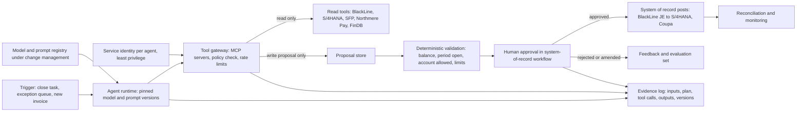
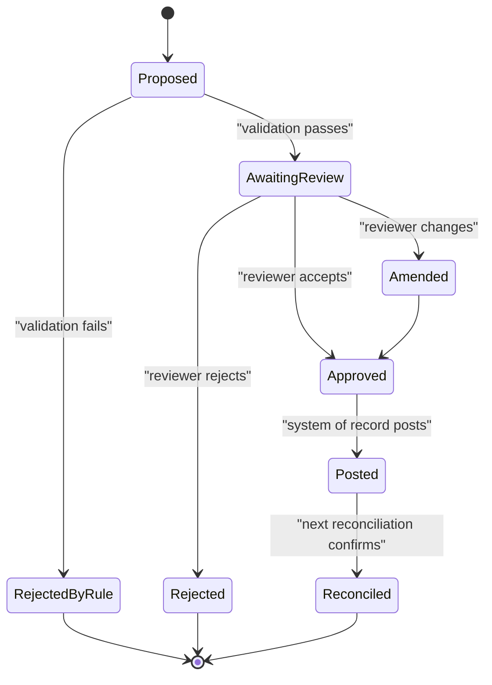

{id: ai-in-finance}
# 46. AI, Automation and Agentic Finance Operations

> **IN THIS CHAPTER, YOU WILL:** Place rules, robotic process automation, machine learning, generative AI and agents on one ladder, rank finance use cases by value and control risk, and design the architecture that lets an agent work on the books without becoming an unowned control: a tool layer with least privilege, a proposal store, human approval in the system of record, and an evidence log that can reconstruct every run.

> **WHY FINANCE CARES:** The close is slow where people work exceptions, and that is exactly where AI is now useful. But the CFO signs a certification about internal control, and an agent that changes the books without an owner, a reviewer and evidence turns a productivity gain into an audit finding.

> **WHY ARCHITECTS SHOULD CARE:** Every vendor in the estate now ships agents, and each one wants to act on the same ledger. Without an enterprise pattern for identity, tools, proposals, approval and evidence, the estate acquires a dozen unowned automated controls in eighteen months.

> **KEY POINTS:**
>
> * **AI earns its place in the exception layer, not the happy path.** Deterministic rules and APIs should carry every transaction they can; machine learning and generative models are worth their non-determinism only on the residue that rules cannot reach — unmatched lines, uncoded invoices, unexplained variances — and only after the upstream data fix has been tried.
> * **The agent may propose; a controlled process disposes.** Agents read through scoped tools and write only proposals; posting, approval and master-data change stay in the system of record's existing controls, so the agent's output is an input to a control a named person owns, not a control in its own right.
> * **Treat every agent as an IT application plus a control, from day one.** It needs an owner, a service identity with least privilege, versioned prompts and models under change management, an evidence log that reconstructs each run, and monitoring that shows it still performs; the agent control card makes those six things a condition of going live.

> **[FAILURE PATTERNS THIS CHAPTER ADDRESSES](#where-finance-architecture-goes-wrong):**
>
> * **Nobody's Bot** — agents that post, approve or change master data without an owner, a reviewer or a reconstructable run are this pattern in its newest and fastest form.
> * **Audit Archaeology** — prompt and model changes that nobody put under change management become the next significant deficiency, discovered by the auditor rather than designed out.
> * **Capability Creep** — the ERP, the close platform, the consolidation platform and the productivity suite each ship a reconciliation agent, and nobody decides which one owns the job.

Finance has automated for as long as it has had computers. Posting rules, matching rules, batch interfaces and scheduled reports took the arithmetic out of accounting decades ago; **robotic process automation (RPA)**, software that drives an application's user interface the way a person would, took a slice of the keystrokes in the 2010s. What none of it reached was the **exception layer**: the settlement line with no booking reference, the supplier invoice with no purchase order, the account balance that moved for a reason nobody has written down. That layer is where finance people spend their time, and it is where the close loses its days.

Generative models and agents are the first automation that can read the messy evidence of an exception — a remittance note, an email thread, a free-text invoice line — and propose what it means. They also bring properties finance has spent a century designing out: outputs that are not reproducible, reasoning that cannot be fully inspected, and a confident explanation whether or not one exists.

This chapter's argument is that the two facts are reconcilable by architecture. **The agent may propose; a controlled process disposes.** An agent reads through narrow tools, writes proposals to a store it does not own, and hands them to the approval workflow the system of record already runs. Every run leaves evidence a reviewer can re-perform. Built that way, an agent is a fast, tireless preparer inside an existing control. Built any other way, it is a new control nobody owns.

{id: ai-in-finance--setting-the-scene-at-northmere-three-pilots-and-a-controls-lead}
## Setting the Scene at Northmere: Three Pilots and a Controls Lead

Northmere, the fictional multinational commerce group this book follows ([Meet Northmere: The Running Example](#meet-northmere)), wrote "AI-assisted reconciliation and controls with auditable evidence" into the Year 5 aspiration of Program Keystone, its finance transformation. By June 2027 the phrase had become three requests on the desk of Dana Whitlock, the Chief Architect.

The first came from the payments-to-ledger program. In 2026, about **1.9%** of the settlement lines for Stayloft's **alternative payment methods (APMs)** — local wallets, bank transfers and vouchers that are not card payments — were still unmatched at working day 3 of the close, and the unreconciled balances in the payment-service-provider (PSP) clearing and suspense accounts averaged **€14 million** at month-end, with about **€2.1 million** older than 90 days. BlackLine Transaction Matching was being extended to APMs in mid-2027 ([Payments-to-Ledger: Connecting Providers, Brand Platforms and the ERP](#payments-to-ledger)); the team wanted an agent to work whatever the rules still left: classify each exception, find the counterpart, propose a match or a correcting entry.

The second came from Leila Haddad, the Chief Accounting Officer, whose controllers write **variance commentary** — the explanation of why an account or line moved between periods beyond a threshold — for every close. They wanted first drafts generated, so that controllers reviewed explanations instead of writing them.

The third came from procurement operations: supplier invoices without a purchase order arrive in Coupa, Northmere's procure-to-pay front end, and need a person to choose the account and cost center. They wanted the coding proposed automatically.

Mei Tanaka, Head of Internal Controls, replied to Dana in four lines. Northmere had closed FY2026 with a **significant deficiency** — a control weakness serious enough to report to the audit committee, though short of a material weakness — over change management and access on the Stayloft Finance Platform's payout engine: developers had production access, and payout rule changes lacked documented approval. "I am not explaining to the external auditor next year," she wrote, "that we fixed change management on payout rules and then let a model change our journals with a prompt nobody approved. Who owns each of these controls, how do we re-perform what the agent did, and what happens when the vendor updates the model?"

Those three questions — ownership, re-performance, change — are the chapter. The pilots went ahead in the second half of 2027, but on an architecture Dana's team designed first.

{id: ai-in-finance--the-automation-ladder}
## The Automation Ladder

For a finance architect, "AI" is five rungs of a ladder, and the properties an auditor cares about change sharply from rung to rung. Two matter most: **determinism** (the same input always produces the same output) and **explainability** (a reviewer can see why the output is what it is, in terms they can check).

| Rung | What it is | Good at in finance | Bad at | Determinism and explanation | Control treatment |
| --- | --- | --- | --- | --- | --- |
| **Rules and workflow** | Configured posting, matching, tolerance and routing logic | High-volume, well-specified cases | What the rule author did not foresee; format drift | Deterministic; the rule *is* the explanation | Automated application control; reliance on IT general controls |
| **RPA** | A bot drives screens and files as a person would | Bridging systems with no interface, short-term | Screen or data changes; exceptions; scale | Deterministic but fragile; the script explains | IT-dependent automated control: bot identity, credential vaulting, change management |
| **Machine learning (ML)** | A model trained on history predicts a label or score | Fuzzy matching, cash application, anomaly detection, forecasting | Cases outside the training data; drift | Deterministic per model version; explanation partial (features, scores) | Validation, performance monitoring, review below a confidence threshold |
| **Generative AI** | A large language model produces text or structured output from a prompt and context | Reading unstructured evidence; drafting; summarizing | Arithmetic without tools; facts not in context; fluent wrong explanations | Not reliably reproducible; explanation is a narrative, not a trace | Input to human review; prompts and models under change management; runs logged |
| **Agents** | A model directs its own sequence of tool calls toward a goal | Multi-step exception work across systems | Open-ended authority; compounding errors; irreversible actions | Path and output vary between runs; explanation is the logged plan and calls | Scoped identity and tools, propose-only writes, approval in the system of record, full run evidence |

Two observations follow. First, **each rung up buys reach into the exception layer at the price of determinism**, and that price is worth paying only where the lower rung has run out. A one-to-one match between a PSP settlement line and a captured payment should be a rule, forever; a model that matches it "correctly 99.7% of the time" has replaced a certainty with a probability. The rule I use: *push every case as far down the ladder as it will go, and point AI at the residue.*

**Figure 1:** *Each rung up the automation ladder buys reach into the exception layer at the price of determinism: push every case as far down as it will go, and point AI at the residue.*

Second, **the word "agent" covers two different designs**. Anthropic's widely cited engineering note, [Building Effective Agents](https://www.anthropic.com/research/building-effective-agents) (Erik Schluntz and Barry Zhang, December 2024), distinguishes **workflows**, where models and tools run along predefined code paths, from **agents**, where the model directs its own process and tool use. Nearly every finance process I would automate in 2027 should be a workflow with model steps inside it — classify, retrieve, propose, with programmatic checks between steps. I keep the word "agent" because vendors and finance teams use it, but the architecture constrains it toward the workflow end.

Gartner has a name for the opposite habit. In June 2025 it predicted that [over 40% of agentic AI projects will be canceled by the end of 2027](https://www.gartner.com/en/newsroom/press-releases/2025-06-25-gartner-predicts-over-40-percent-of-agentic-ai-projects-will-be-canceled-by-end-of-2027.) because of cost, unclear value or inadequate risk controls, and warned of **"agent washing"**: relabeling chatbots and RPA as agents. It estimated that only about 130 of the thousands of vendors claiming agentic capability were real. "Which rung is this, really?" is the fastest question in a vendor demonstration.

{id: ai-in-finance--where-the-value-is-use-cases-by-value-and-control-risk}
## Where the Value Is: Use Cases by Value and Control Risk

I rank use cases on two axes. **Value** is the effort and delay removed from the close or the cash cycle, plus any risk reduced. **Control risk** is what happens to the financial statements, to cash or to an external party if the output is wrong and nobody catches it — which depends mostly on whether the output changes the books, moves money or leaves the building.

| Use case | What AI does | Value | Control risk if wrong and uncaught | My verdict for 2027 |
| --- | --- | --- | --- | --- |
| **Policy and process Q&A** | Answers "how do we account for X?" from the accounting manual | Medium | Low, if never used for posting | Do it; label answers non-authoritative |
| **Reconciliation exception triage** | Classifies unmatched items, gathers evidence, proposes a match or correcting journal | High | Medium: proposed journals touch the books | Pilot, propose-only |
| **Variance commentary drafting** | Drafts explanations of account movements | Medium–high | Medium: a wrong explanation becomes audit evidence and can mask an error | Pilot, evidence-linked drafts |
| **Supplier invoice coding** | Proposes account and cost center for non-PO invoices | Medium–high | Medium: misclassification (capital versus expense, wrong entity) | Pilot, approval unchanged |
| **Cash application** | Matches incoming payments and remittances to open receivables | High where receivables are large | Medium: misapplication hides disputes | Buy mature embedded ML; thresholds plus review |
| **Journal anomaly detection** | Scores journals for unusual patterns | Medium | Low as a monitoring aid; high if relied on unvalidated | Monitoring aid first |
| **Continuous control testing** | Tests whole populations, selects exceptions | Medium–high | Medium: must be validated before reliance | Later, once model validation practice exists |
| **Collections drafting** | Prioritizes dunning, drafts customer emails | Medium | Medium–high: external commitments | Draft-only; a person sends |
| **Autonomous journal posting** | Posts to the general ledger without approval | Looks high | High: an unreviewed control | Not in 2027 |
| **Master-data change** | Updates supplier bank details or credit limits | Low | Very high: payment fraud | Never autonomous |

The high-value, contained-risk rows are preparer work in the exception layer: triage, drafting, coding. The dangerous rows post, pay or change master data without a human decision. Northmere chose its three pilots from the first group on purpose, which matches Gartner's August 2026 advice to finance leaders: [start with a low-risk, contained workflow where mistakes can be detected and reversed](https://www.gartner.com/en/newsroom/new/pr-q-a-new-vis-template/2026-08-20-gartner-says-cfos-mus-pilot-governance-first-before-scaling-ai-agents), treat the first agent as a governance pilot, and keep restatements and regulatory reporting out of pilots.

**Figure 2:** *Rank use cases by value and control risk: the pilots belong in preparer work such as triage, drafting and coding, while anything that posts, pays or changes master data stays out of agent authority.*

{id: ai-in-finance--vendor-embedded-agents-and-enterprise-built-agents}
## Vendor-Embedded Agents and Enterprise-Built Agents

Every major platform in a finance estate now ships things it calls agents. The line-up changes every quarter, so dates matter as much as names. As of October 2026:

| Vendor | What was announced or shipped | Date and status | Source |
| --- | --- | --- | --- |
| **SAP** | Joule agents for finance grouped under "assistants": a Cash Management Agent, a Dispute Resolution Agent in the accounts-receivable assistant, a Cash Positioning Agent on the roadmap | Training material current in 2026; general availability varies by agent | [SAP Learning](https://learning.sap.com/courses/reviewing-the-use-of-sap-joule-agents-in-finance/identifying-sap-joule-agents-for-core-finance-workflows_e8a39562-5bcf-4fea-bb19-442504a5dc80) |
| **Workday** | Illuminate finance agents: Financial Close Agent, Financial Test Agent (continuous testing of financials), Cost & Profitability Agent; AI consumed through Flex Credits | Announced 16 Sep 2025 "available in 2026" | [Workday newsroom](https://newsroom.workday.com/2025-09-16-Workday-Illuminate-TM-Expands-with-New-AI-Agents-for-HR%2C-Finance%2C-and-Industry) |
| **Workday** | Workday Build with an "Agent Gateway" using MCP-compliant APIs; in October 2026, Extend AI custom agents and agent-ready tools generally available | Sep 2025 announcement; Oct 2026 GA | [Workday Build](https://newsroom.workday.com/2025-09-16-Workday-Unveils-Workday-Build,-Giving-Developers-the-Tools-to-Build-the-Future-of-Work); [Workday Rising 2026](https://blog.workday.com/en-us/rising-product-announcements.html) |
| **Oracle** | Fusion finance agents: Payables, Ledger, Planning, Payments; AI Agent Studio for Fusion Applications to modify or build agents; "no additional cost" at launch | Announced 15 Oct 2025 | [Accounting Today reproduction of the Oracle release](https://www.accountingtoday.com/list/tech-news-oracle-announces-new-ai-agent-offerings) |
| **BlackLine** | Verity AI suite with "Vera", an orchestrating lead agent; Verity Prepare, an agentic reconciliations agent; a Finance Control Console for governing agents | Verity launched 9 Sep 2025; Verity Prepare GA July 2026; Control Console announced June 2026 as a preview | [Launch release](https://www.cpapracticeadvisor.com/2025/09/09/blackline-launches-verity-trusted-ai-purpose-built-for-the-office-of-the-cfo/168563/); [BlackLine Q2 2026 results](https://www.sec.gov/Archives/edgar/data/0001666134/000117184326005201/exh_991.htm) |
| **OneStream** | SensibleAI Forecast, SensibleAI Studio routines, SensibleAI Agents (private preview at launch), SensibleAI Account Reconciliations | Announced 13 May 2025; OneStream taken private by Hg, completed around 1 Apr 2026 | [OneStream release](https://www.onestream.com/news/onestream-unveils-sensibleai-agents-sensibleai-studio-and-the-most-advanced-sensibleai-forecast-to-automate-finance-s-most-demanding-tasks/) |
| **Stripe** | A payments foundation model; Radar risk scoring; Authorization Boost for retries and routing | Announced May 2025 | [TechCrunch on Sessions 2025](https://techcrunch.com/2025/05/07/stripe-unveils-ai-foundation-model-for-payments-reveals-deeper-partnership-with-nvidia); [Stripe Sessions updates](https://stripe.com/blog/top-product-updates-sessions-2025) |
| **Adyen** | Uplift, an AI payment-optimization suite for conversion, risk and cost | Launched 9 Jan 2025 | [Adyen release](https://www.nasdaq.com/press-release/introducing-adyen-uplift-payment-solution-optimizing-every-transaction-ai-2025-01-09) |
| **Microsoft** | The Finance solution in Microsoft 365 Copilot (formerly Copilot for Finance): financial reconciliation GA; variance analysis in preview as of October 2025 | Naming subject to change | [Microsoft blog, Oct 2025](https://microsoft.com/en-us/dynamics-365/blog/it-professional/2025/10/20/empowering-finance-with-an-ai-assistant-in-microsoft-365-copilot) |

Three cautions keep this table honest. **Announcement is not availability**: check general availability, region and contract packaging before planning on any of these. **Vendor numbers are vendor claims**: SAP's up-to-70% time saving for cash-management reconciliation, OneStream's forecast-accuracy figures, Stripe's 64% card-testing improvement and Adyen's up-to-6% conversion uplift are what the vendors say, not results in your estate. And **not all of these are finance-operations agents**: Stripe's and Adyen's AI acts on authorization, fraud and routing, upstream of the ledger; it matters to finance because it changes the data finance reconciles, which [Stripe: Programmable Payments, Billing and Connected Accounts](#stripe) and [Adyen: Single-Platform Acquiring and Platform Payments](#adyen) cover.

{id: ai-in-finance--what-vendor-embedded-agents-do-well-and-what-they-cannot-do}
### What vendor-embedded agents do well, and what they cannot do

A vendor-embedded agent runs inside the platform that holds the data and the workflow. It inherits the platform's security model, audit trail, approval routing and — if the vendor has scoped it in — its SOC 1 report, the independent auditor's report on a service organization's controls relevant to its customers' financial reporting ([Controls, Auditability and Security by Design](#controls-and-auditability) owns SOC 1 and complementary user-entity controls). For work that lives inside one platform — invoice intake in Oracle Payables, reconciliation preparation in BlackLine — the embedded agent is usually the right first answer.

What it cannot do is see past its platform. Northmere's APM exception needs evidence from the settlement file in BlackLine, the payment in Northmere Pay and the booking in the Stayloft Finance Platform. No vendor's agent holds all three. Enterprise-built agents exist for cross-platform exceptions, and that is also where their risk lives: they need identities and tool access in several systems at once.

| Criterion | Vendor-embedded agent | Enterprise-built agent |
| --- | --- | --- |
| **Data reach** | One platform's data model | Whatever the tool layer exposes, across platforms |
| **Controls inherited** | Platform roles, approval workflow, audit trail; SOC 1 coverage only if the vendor has scoped AI features in | None; every control must be built and evidenced |
| **Change management** | Vendor-controlled model and prompt updates on the vendor's release cadence; you control enablement and configuration | Fully yours: model version, prompts, tools, thresholds |
| **Evidence of a run** | Whatever the vendor logs and exposes; often thinner than an auditor wants | As complete as you design it |
| **Cost model** | Bundled, credit-based (Workday Flex Credits) or "no additional cost" at launch (Oracle); subject to change at renewal | Model consumption plus engineering and operations |
| **Lock-in** | Prompts, configurations and evidence live in the vendor's format | Portable if tools are standard (for example MCP) and evidence is in your store |
| **Right when** | The exception and its evidence live inside one platform | The exception spans systems, or no vendor covers it |

The rule I recommend, and Northmere adopted: **embedded first for single-platform work; enterprise-built only where the evidence spans platforms; the same control standard for both.** Teams skip the last clause. A vendor agent switched on by a configuration toggle is still a change to a financially relevant system and an automated participant in a control management certifies.

The rule also checks **Capability Creep**. An estate like Northmere's can have reconciliation agents from BlackLine, OneStream, Oracle and Microsoft available at once, mostly under licenses it already holds; reconciliation already happens in three places, and the agents would make it six. The overlap register in [Preventing Redundant Capabilities and Unnecessary Coupling](#redundancy-and-coupling) should name which platform owns each AI-assisted capability, as it does for matching.

{id: ai-in-finance--reference-architecture-for-agentic-finance-workflows}
## Reference Architecture for Agentic Finance Workflows

The architecture has one organizing principle, which I state as a standard in [Principles, Standards and Reference Architectures](#principles-standards-reference) terms:

> **Principle — the agent may propose; a controlled process disposes.** An AI agent may read financial data through scoped tools and may create proposals. It may not post, approve, pay or change master data. Every proposal is disposed of — accepted, amended or rejected — by the system of record's existing control, operated by a named person or by a deterministic rule that is itself a tested control.

Everything else is mechanism.

**Figure 3:** *The agent never holds the pen. It reads through a policy-checked tool gateway, writes only proposals, and every disposition happens in the system of record's own approval control; the evidence log captures each step so a run can be reconstructed.*

{id: ai-in-finance--the-components-and-their-responsibilities}
### The components and their responsibilities

**Agent runtime.** Where the model runs, with a pinned model version and prompt version per agent: a model change is a change request, evaluated against a fixed test set before release. For vendor-embedded agents this is the component you control least.

**Tool gateway.** The single path from any agent to any system. It exposes narrow, named tools — `get_settlement_line`, `find_payment_by_psp_reference`, `create_match_proposal` — rather than general database or API access. Each agent has its own service identity, never a person's credentials, and a tool allow-list; the gateway enforces it, logs every call, applies volume limits and strips fields the agent does not need. This is where **least privilege** becomes concrete: the triage agent can read four systems and write to one table.

The **Model Context Protocol (MCP)** is a reasonable standard for this layer. It is an open protocol, introduced by Anthropic in November 2024 and [donated in December 2025 to the Agentic AI Foundation](https://www.anthropic.com/news/donating-the-model-context-protocol-and-establishing-of-the-agentic-ai-foundation) under the Linux Foundation, that standardizes how model applications (hosts and clients) discover and call tools and read resources exposed by servers, over JSON-RPC 2.0. Workday's Agent Gateway exposes MCP tools, and other platforms are following. The [current specification (2026-07-28)](https://modelcontextprotocol.io/specification/2026-07-28) states that "tools represent arbitrary code execution and must be treated with appropriate caution", that tool descriptions from untrusted servers are untrusted, and that MCP "cannot enforce these security principles at the protocol level". MCP standardizes the plug; it does not make anything behind the plug safe. The enterprise's gateway, identity and policy enforcement do that.

**Proposal store.** The only place the agent can write. Each proposal carries the agent identity and run identifier, the proposed action (a match, a journal, a coding), the evidence references relied on, a category or confidence, and the model and prompt versions. Proposals are immutable; an amendment is a new linked record. The store is a deliberate seam that turns agent output into data ordinary, deterministic software can check and route.

**Deterministic validation.** Before a person sees a proposal, rules check what rules can: the journal balances, the period is open, the account is allowed for this entity and agent, the amount is under the agent's limit, the counterpart is not already matched. A failing proposal is rejected with a reason, never shown to a reviewer — cheap insurance against a whole class of model errors.

**Human approval in the system of record.** Disposition happens where it already happens: a proposed journal enters BlackLine Journal Entry and follows the existing approval matrix; a proposed coding appears in Coupa's approval flow as a pre-filled field; a proposed match appears in the BlackLine matching workspace. I am strict about this: **no parallel approval interface built for the agent**. A second approval path is a second control to design, test and evidence, and it invites reviewers to treat agent output as more trustworthy than a colleague's.

**Evidence log.** Append-only, retained as long as the records it supports, and held in the enterprise's own store — for vendor agents too, wherever the vendor exposes logs. For each run: trigger, inputs, step sequence, every tool call and response, output, model and prompt versions, validation results, and the reviewer's disposition with identity and time. Gartner's August 2026 guidance puts the bar exactly here: ["the finance team should be able to reconstruct what the agent planned, accessed, and produced for every run."](https://www.gartner.com/en/newsroom/new/pr-q-a-new-vis-template/2026-08-20-gartner-says-cfos-mus-pilot-governance-first-before-scaling-ai-agents) The traceability design in [Designing for Traceability, Reconciliation and Audit Across Boundaries](#traceability-and-reconciliation) applies unchanged: a correlation key — the proposal identifier — links the agent run to the journal, the journal to the reconciliation, and the reconciliation to the balance.

**Model and prompt registry.** Every model version, prompt version, tool definition and threshold an agent uses, with its approver and evaluation results — the change-management evidence an auditor will ask for.

{id: ai-in-finance--the-proposal-lifecycle}
### The proposal lifecycle

**Figure 4:** *The agent controls only the first state of a proposal's lifecycle; amended and rejected proposals are kept, because they are the agent's measured error rate and the evaluation set for the next model or prompt change.*

{id: ai-in-finance--when-can-a-proposal-be-approved-in-bulk}
### When can a proposal be approved in bulk?

Reviewing every proposal one by one kills the value of high-volume use cases. Bulk or threshold acceptance is acceptable when — and only when — the accepted class behaves like a rule-based automated control: narrowly defined, its error rate measured on a re-performed sample, monitored continuously, its threshold under change management. At that point, ask whether the class should simply become a matching rule. Usually it should. An agent that keeps proposing the same type of match with 99.9% acceptance has discovered a rule; write it, move the case one rung down, and let the agent work on what remains.

{id: ai-in-finance--in-practice-the-three-northmere-pilots}
## In Practice: The Three Northmere Pilots

Dana's team ran the three pilots from August to December 2027 on this architecture. The figures are illustrative and rounded.

{id: ai-in-finance--pilot-1-exception-triage-for-unmatched-apm-settlement-lines}
### Pilot 1: exception triage for unmatched APM settlement lines

Stayloft's APM settlement files carry about **3.2 million settlement lines a month**. At the 2026 rate of 1.9% unmatched at working day 3, that is about **61,000 lines a month** in the exception queue — the population behind the €14 million suspense average. The rules extended in mid-2027 reduced the queue; the pilot worked whatever they left.

The agent is a workflow with model steps. For each unmatched line it retrieves the settlement line from BlackLine, searches Northmere Pay for candidate payments by PSP reference, amount and date window, retrieves the booking from SFP, and classifies the exception into one of seven root-cause categories defined by Lucía Romero's integration team: missing or truncated booking reference; amount differs by a PSP fee netted at source; currency conversion difference; timing (settled in a later file); partial capture or split settlement; duplicate settlement line; unknown. It then writes one of three proposal types: a **match proposal** (link this line to that payment), a **correcting journal proposal** (for example, recognize a netted fee into the PSP fee expense account), or an **escalation** with the evidence gathered.

The worked example the reviewers used most: an Indonesian e-wallet settlement line of IDR 2,436,000 with a truncated reference. The agent found one Northmere Pay capture of IDR 2,486,000 with the same PSP transaction prefix two days earlier; a tool computed the IDR 50,000 difference (about 2%) and compared it with the PSP's fee schedule for that method; the agent classified the line as "fee netted at source" and proposed a match plus a fee journal. The validator checked balance, account and limit; an analyst accepted the match in BlackLine, and the journal went through BlackLine Journal Entry approval like any other. The arithmetic was done by a tool, not the model: **models classify and explain; tools calculate.**

| Pilot 1 measure (illustrative, November 2027 close) | Result |
| --- | --- |
| Exception lines processed by the agent | about 24,000 |
| Lines where reviewers agreed with the category (re-performed sample of 1,500) | 92% |
| Match proposals accepted without amendment | 86% |
| Journal proposals rejected by deterministic validation before review | 3.1% |
| Analyst time per exception line, median | from about 6 minutes to about 2 |
| Proposals that would have misstated a balance if accepted, caught by review | 11, the largest €2,300 |

The most useful output was not the time saved but the category distribution: **58%** of exceptions were "missing or truncated booking reference", concentrated in two APM providers. That is a data contract problem, not an AI problem, and it went back to Lucía's team and Ingrid Solberg's PSP relationship owners as a fix to the providers' file specifications ([Canonical Events and Adapters for Loosely Coupled Financial Domains](#loosely-coupled-domains) covers the contracts). This is the trap I warn every finance team about: **an agent that makes exceptions cheap to work can make them permanent.** If triage is efficient enough, nobody fixes the cause, and the suspense account becomes a well-managed backlog instead of an empty one. The Suspense Swamp is not cured by a faster shovel. Northmere put the category distribution into the program's monthly metrics so root-cause fixes were measured alongside triage.

**Figure 5:** *An agent that makes exceptions cheap to work can make them permanent: 58% of APM exceptions came from missing or truncated booking references, a data-contract fix that no faster shovel replaces.*

{id: ai-in-finance--pilot-2-variance-commentary-drafting}
### Pilot 2: variance commentary drafting

Northmere's controllers write about **1,400** variance explanations per close, for lines that move beyond both a percentage and an absolute threshold. The pilot drafted them from ledger and subledger movements in S/4HANA, close task notes in BlackLine, and operational metrics in FinDB, Northmere's Snowflake finance data platform.

The pilot surfaced an architectural problem before a model problem. FinDB is not yet tied out to the ledger — the gap [Finance Data Across the Estate: From Operations to Analytics](#finance-data-flows) describes — so a draft explaining revenue with FinDB's booking volumes is only as reliable as unreconciled data. In audit language, data used in performing a control is **information produced by the entity (IPE)** and must be shown to be complete and accurate. Mei's position, which Dana supported: drafts cite the ledger for every financial figure, and FinDB only for operational drivers.

Two design choices made the drafts reviewable. Every sentence carried a citation to the data it relied on — an account movement, a journal, a task note — so that the controller could click through rather than trust. And the agent was required to write "no explanation found in the available evidence" rather than infer one; drafts with that phrase went to the controller unfilled. The most dangerous output of a generative model in a close is a plausible explanation of a movement that is actually an error. A commentary that says "increase driven by higher merchant volume in Iberia" for a movement caused by a misposted accrual does not just fail to detect the error; it documents it as reviewed.

The controller's review is a **management review control**, which auditors test for precision: what the reviewer looked at, what threshold they used, what they would have done if something was wrong. A reviewer who accepts 1,400 drafts in an afternoon has not performed it, whatever the log says. Northmere measured edit rates per controller and re-performed samples of accepted drafts. In the pilot, controllers edited **41%** of drafts and rejected **9%**; the controllers who edited almost nothing were the ones Mei's team sampled first.

{id: ai-in-finance--pilot-3-supplier-invoice-coding-in-coupa}
### Pilot 3: supplier invoice coding in Coupa

About **9,000** non-PO indirect invoices a month arrive in Coupa needing account and cost-center coding. The pilot pre-filled proposed coding in Coupa's existing approval flow, with the supplier's coding history and the reason, for the approver to confirm or change. Whether proposals come from Coupa's own AI features or an enterprise model behind the integration was the embedded-versus-built decision; the design authority chose to evaluate the embedded option first, because the evidence — invoice, supplier, history — lives in Coupa.

Accounts payable is where fraud lives, so three rules were non-negotiable. The coding agent has **no access to supplier master data changes**, including bank details; supplier bank changes remain a separate, call-back-verified control. The agent's identity is **segregated** from approval and payment: it cannot approve an invoice, release a payment, or be the approver of record. And coding that crosses a classification boundary that matters to the financial statements — capital versus expense, intercompany versus third party — is always routed to a human regardless of confidence. The pilot's measured result was modest and useful: approvers accepted **78%** of proposals unchanged, and the most common change was cost center, not account, which pointed at Workday HCM's cost-center assignments as stale input rather than at the model.

{id: ai-in-finance--icfr-what-changes-when-an-agent-joins-a-control}
## ICFR: What Changes When an Agent Joins a Control

**Internal control over financial reporting (ICFR)** is the set of processes that give reasonable assurance that the financial statements are reliable; for Northmere, a New York–listed SEC registrant, management assesses it annually under Sarbanes-Oxley section 404 and the external auditor attests to it. [Controls, Auditability and Security by Design](#controls-and-auditability) owns the vocabulary. This section owns what an agent changes.

{id: ai-in-finance--who-owns-the-control}
### Who owns the control

An agent does not own a control; a person does. For each pilot Northmere recorded which existing control the output fed and who owned it: the APM reconciliation (the payments reconciliation lead in Leila's organization), the flux review (each entity controller), invoice approval (the procurement operations lead). The agent appears in the control description as a preparer step, as a report or a junior analyst would. A use case that cannot name the human-owned control it feeds is not ready for production.

{id: ai-in-finance--the-agent-s-output-as-ipe}
### The agent's output as IPE

When a reviewer relies on an agent's output to perform a control, that output is IPE, and the auditor will ask how management knows it is complete and accurate. For a deterministic report the answer is "we tested the logic and the IT general controls over it." For an agent it has three parts: the population was complete (a control total between the queue and the proposal store); the reviewer relied on the evidence the agent cited, not on its assertions; and accuracy is measured by re-performing samples. Teams forget completeness. An agent that silently skipped 300 exceptions because a tool call timed out has produced an incomplete reconciliation that looks complete.

{id: ai-in-finance--change-management-for-prompts-models-and-tools}
### Change management for prompts, models and tools

Northmere's FY2026 significant deficiency was about change management, which made this non-negotiable. **IT general controls (ITGCs)** — the controls over access, change and operations that let auditors rely on automated controls — must cover agents as they cover code. For an enterprise-built agent, a change to prompt, model version, tool definition or threshold is a change request: authorized, evaluated against the fixed test set, approved by someone other than its author, logged in the registry. For a vendor-embedded agent Northmere controls what it can: enablement and configuration as changes, vendor release notes reviewed for AI changes, a regression run on Northmere's own evaluation set after each release, and "do your SOC 1 controls cover the AI features we use?" asked in writing at every renewal. BlackLine, for example, [states](https://www.blackline.com/legal/security/) that it holds ISO/IEC 42001 certification for AI management systems — useful, but not a substitute for SOC 1 coverage of the features a control relies on.

{id: ai-in-finance--monitoring-and-sampling}
### Monitoring and sampling

Auditors usually test a rule-based automated control once and rely on ITGCs to show it has not changed — a "test of one". That logic does not transfer to a non-deterministic component, because an unchanged model can behave differently on next month's data. The replacement is **ongoing monitoring**: acceptance, amendment and rejection rates per agent and category; validation rejections; completeness totals; and a monthly re-performed sample sized by risk. A sustained drop in reviewer edit rates is investigated as possible rubber-stamping, not celebrated as model improvement.

{id: ai-in-finance--the-frameworks-to-anchor-on}
### The frameworks to anchor on

Three sources are worth citing to an audit committee, with their status stated precisely.

- **COSO, *Achieving Effective Internal Control Over Generative AI* (February 2026).** It applies the 2013 Internal Control–Integrated Framework to generative AI and defines eight capability types — ingestion, transformation, posting, orchestration, judgment, monitoring, regulatory intelligence and human-AI interaction — each with minimum control expectations and illustrative metrics for audit evidence ([Journal of Accountancy](https://www.journalofaccountancy.com/news/2026/feb/coso-creates-audit-ready-guidance-for-governing-generative-ai/); [Deloitte Heads Up](https://dart.deloitte.com/USDART/home/publications/deloitte/heads-up/2026/coso-internal-controls-generative-ai)). It is the most usable reference; the control card maps each agent to its capability types. In those terms, Figure 3 allows ingestion, transformation and judgment in the agent and keeps posting in the system of record.
- **PCAOB staff Spotlight (July 2024).** A [staff publication](https://pcaobus.org/documents/generative-ai-spotlight.pdf) on outreach about generative AI in audits and financial reporting — explicitly not a rule, policy or statement of the Board. It found audit firms' use mainly administrative and research, firms stressing supervision, and companies' use of generative AI in financial reporting secondary to operational and customer-facing uses. No AI-specific auditing standard has been issued; existing standards apply.
- **The IIA's Artificial Intelligence Auditing Framework** ([updated version dated 13 September 2024 on the IIA site](https://www.theiia.org/en/content/tools/professional/2023/the-iias-updated-ai-auditing-framework/)), aligned to the Three Lines Model and the Global Internal Audit Standards. It gives internal audit a structure for auditing AI governance and management.

{id: ai-in-finance--model-risk-privacy-and-the-eu-ai-act}
## Model Risk, Privacy and the EU AI Act

{id: ai-in-finance--model-risk}
### Model risk

**Model risk** is the risk of loss or misstatement from a model that is wrong or misused. Banks manage it formally; most corporate finance functions do not. The minimum I recommend, scaled to the control risk: a documented intended use and limitations; a fixed evaluation set of real, reviewed cases, including hard ones; acceptance criteria agreed with the control owner before go-live; re-evaluation on every change; and a named person who can stop the agent. Two finance-specific tests matter most: **arithmetic** (the model must not compute amounts; tools do) and **fabrication** (the evaluation set includes cases whose correct answer is "no explanation found").

{id: ai-in-finance--data-privacy}
### Data privacy

Finance data is full of personal data: traveler names in remittances, sole traders on invoices, employees in expense entries. The **General Data Protection Regulation (GDPR)** applies to an agent as to any system: the gateway returns only the fields a task needs; the model provider's terms exclude training on Northmere's data and fix retention; transfers outside the EEA need the usual safeguards; and the evidence log, which holds inputs, is itself a personal-data store whose retention must balance statutory retention against minimization. No agent's tools touch systems in PCI DSS scope ([Resilience, Observability, Security and Recovery for Finance Systems](#resilience-and-security)).

{id: ai-in-finance--the-eu-ai-act}
### The EU AI Act

The **EU AI Act** (Regulation (EU) 2024/1689) phases in obligations by risk category. The **Digital Omnibus on AI, Regulation (EU) 2026/1744**, in force since 27 July 2026, moved the dates for high-risk systems: stand-alone systems in Annex III now apply from **2 December 2027**, and high-risk AI embedded in regulated products from **2 August 2028**; the Article 50 transparency obligations still applied from 2 August 2026 ([National Law Review](https://natlawreview.com/article/eu-digital-omnibus-ai-enters-force); [Addleshaw Goddard](https://www.addleshawgoddard.com/en/insights/insights-briefings/2026/technology/eu-ai-act-ai-omnibus-formally-adopted/)).

The careful reading for finance operations: Annex III lists, among others, **credit scoring of natural persons** and certain **employment** uses; reconciliation triage, invoice coding and variance commentary are not listed, so they are **likely not high-risk** under the Act. Each organization should confirm that with counsel for its own systems; it is not a blanket exemption. AI-literacy measures, Article 50 transparency duties where they apply, and deployer obligations for any high-risk use elsewhere in the group still matter. But the **binding control framework for financial reporting remains ICFR**. An agent can be lawful under the AI Act and still be a deficiency under SOX.

{id: ai-in-finance--adoption-evidence-versus-hype}
## Adoption Evidence Versus Hype

The adoption numbers in circulation measure different things, and an architect presenting a business case should say which.

- **Gartner (November 2025):** [59% of finance functions use AI](https://www.cfo.com/news/cfo-optimism-around-ai-rises-as-adoption-levels-off-gartner-/805868/), from a survey of 183 CFOs and senior finance leaders — up from 58% in 2024 and 37% in 2023, so adoption has **plateaued**, which Gartner attributes to complexity, data and talent. The top use cases were knowledge management (49%), accounts-payable automation (37%) and error and anomaly detection (34%), as reported by CFO.com.
- **KPMG (December 2024):** [71% of 2,900 companies](https://kpmg.com/us/en/articles/2024/ai-in-finance-us-report.htm.html) use AI in finance, 41% to a moderate or large degree — a broader definition than Gartner's, which explains much of the gap.
- **Gartner (June 2025):** over 40% of agentic AI projects will be canceled by end-2027, as above.
- **PCAOB staff (July 2024):** companies' generative AI use in financial reporting was secondary to operational uses.

None of these measures autonomous agents posting to a ledger; survey "adoption" counts any AI use, including policy Q&A and decade-old embedded ML matching. Some circulating figures about "fully integrated" finance agents cannot be traced to any primary source, and I do not use them. My reading as of October 2026: **embedded ML in matching and capture is mainstream; generative assistants for drafting and Q&A are common; agents acting on the books are early and are being piloted under governance constraints.** An estate's first year with the 2025-announced vendor agents should be a governance pilot, not a rollout.

{id: ai-in-finance--integration-with-the-rest-of-the-estate}
## Integration with the Rest of the Estate

An agent is a new consumer and producer on the integration architecture, and it should use the same paths as everything else.

Five relationships matter.

- **Integration.** The gateway is an API product on the integration layer of [Integration Architecture for Finance](#integration-architecture), not a side channel: its tools call published APIs, never databases, and its write tools land in proposal intakes the systems of record own.
- **Canonical events.** When agents create business records upstream — AI assistants booking stays for travelers is the obvious case — those are ordinary canonical events (`BookingConfirmed` with the agent as channel), distinguishable only by an attribute.
- **Data platform.** Agents reading FinDB inherit its reconciliation status; until the tie-out exists, financial figures come from the ledger.
- **Identity.** Agent identities are provisioned, reviewed and deprovisioned like privileged accounts and appear in segregation-of-duties (SoD) analysis; an identity that can both propose and approve is a conflict, as for a person.
- **Governance.** Every production agent passes the review board of [Architecture Governance That Speeds Decisions](#architecture-governance) with its control card attached and has an owner in the application portfolio. Agents are applications.

{id: ai-in-finance--failure-modes}
## Failure Modes

**The agent with a person's credentials.** A finance-built pilot runs under an analyst's login because a service identity "takes weeks". Actions are attributed to someone who did not take them, SoD analysis is blind, and when the analyst leaves the agent breaks or keeps running. *Fix:* no agent without its own identity; make provisioning fast rather than the rule optional.

**Silent model change.** A vendor upgrades the model behind an embedded agent; acceptance falls six points over two closes and nobody notices. *Fix:* per-agent monitoring thresholds and a regression run after every vendor release.

**The rubber stamp.** Edit rates near zero, proposals accepted in seconds: the control exists on paper only. *Fix:* measure review time and edit rate per reviewer, and sample the least-editing reviewers first.

**Confident fabrication becomes evidence.** A variance draft explains an error as business activity, and the explanation enters the audit file as reviewed. *Fix:* citation-required drafts and a tested "no explanation found" path.

**Incomplete processing that looks complete.** Timeouts leave a batch half-processed behind a clean-looking queue. *Fix:* population control totals on every run.

**Prompt injection through documents.** An invoice PDF carries text instructing the model how to code it. *Fix:* treat document content as data, keep write tools proposal-only, validate deterministically, and never give an agent that reads external documents a tool that moves money or changes master data.

**Efficiency that entrenches the backlog.** Triage gets so cheap that nobody fixes the reference problem behind 58% of exceptions. *Fix:* report root causes next to agent productivity.

**Six reconciliation agents.** Every platform's "included" agent is enabled, and two prepare the same account. *Fix:* one owner per AI-assisted capability in the overlap register; enabling an agent is a change, not a toggle.

{id: ai-in-finance--the-agent-control-card}
## The Agent Control Card

Northmere made the control card a mandatory standard, STD-FIN-06, in Q3 2027: no agent — enterprise-built or vendor-embedded — goes into a financially relevant process without one, approved by the control owner, the system owner and Internal Controls. A blank version belongs in the [Toolkit: Templates for the Finance Architect](#toolkit). Here it is filled in for Pilot 1.

| Field | What to record | Pilot 1: APM exception triage agent |
| --- | --- | --- |
| **Agent and version** | Name, build or vendor feature, model and prompt versions | `apm-triage` v1.3; model version pinned in registry; prompt v1.3 |
| **Business owner** | Named person accountable for outcomes | Payments reconciliation lead (Leila Haddad's organization) |
| **Technical owner** | Named person accountable for operation | Finance integration product owner (Lucía Romero's team) |
| **Control fed** | The human-owned control its output supports; ICFR relevance | Monthly APM clearing-account reconciliation (key control); preparer step |
| **COSO capability types** | From COSO's 2026 generative AI guidance | Ingestion, transformation, judgment; not posting |
| **Rung and pattern** | Rules, ML, generative, agent; workflow or open-ended | Workflow with model classification step; fixed step sequence |
| **Identity** | Service identity; never a person's | `svc-apm-triage`; reviewed quarterly in access review |
| **Read tools** | Exact tools and data scopes | Settlement lines (BlackLine); payments by PSP reference (Northmere Pay); bookings (SFP, masked); PSP fee schedules |
| **Write tools** | Proposal targets only | Match proposals and journal proposals to the proposal store |
| **Prohibited actions** | Explicitly listed | Post, approve, change master data, contact PSPs or customers |
| **Limits** | Amount, volume and scope limits | Journal proposals ≤ €5,000; PSP fee and FX accounts only; Northmere Payments B.V. only |
| **Deterministic validation** | Rules applied before review | Balanced entry; open period; allowed account; under limit; counterpart unmatched |
| **Disposition** | Where and by whom proposals are accepted | Matches: analyst in BlackLine matching; journals: BlackLine Journal Entry approval matrix |
| **Evidence captured** | What the log holds; retention | Inputs, steps, tool calls, outputs, versions, validation, disposition; retained with the reconciliation |
| **Completeness check** | How the run proves it processed the whole population | Queue count equals proposals plus escalations, per run |
| **Evaluation and acceptance** | Test set, criteria, last result | 1,200 reviewed cases; category agreement ≥ 90%; zero unvalidated journals; last run passed |
| **Monitoring** | Metrics and thresholds that trigger review | Acceptance below 80%, validation rejections above 5%, reviewer edit rate below 3% |
| **Change management** | What counts as a change; approval path | Model, prompt, tool, threshold or limit change: change request, re-evaluation, approval by technical and business owner |
| **Data protection** | Personal data handled; masking; provider terms | Traveler names masked at gateway; provider: no training on inputs, EU processing |
| **Regulatory classification** | EU AI Act and other assessments | Not an Annex III use (assessed with counsel, Q3 2027) |
| **Stop rule** | Who can switch it off, and what happens then | Business owner or Internal Controls; queue reverts to manual triage |
| **Review date** | When the card is re-approved | Every six months, and on any material change |

The card does three jobs: it is the design checklist, so nothing is discovered late; the audit walkthrough document, so Mei's team does not reconstruct it afterwards; and the inventory entry — commentary on COSO's guidance stresses inventories of AI use, including **shadow AI** built outside governance, and the card gives an inventory content rather than names.

{id: ai-in-finance--trade-offs}
## Trade-offs

Three choices recur in every agent design decision, and none has a universal answer.

| Decision | Option A | Option B | When A is right | When B is right |
| --- | --- | --- | --- | --- |
| **Autonomy** | Propose-only; humans or tested rules dispose | Agent acts within limits (auto-accept above a threshold) | Anything that touches the books, money or master data while the error rate is unproven | A narrow class with a measured, monitored error rate — and then ask whether it should be a rule |
| **Where the agent lives** | Vendor-embedded | Enterprise-built | Evidence and workflow live in one platform; vendor's controls and SOC 1 cover the feature | Evidence spans platforms; you need full change control and evidence |
| **Agent versus deterministic fix** | Use AI on the exception | Fix the upstream data or write the rule | The residue is genuinely heterogeneous and unstructured | Exceptions cluster in a few root causes that a data contract or rule can remove |
| **Model sourcing** | One enterprise model platform for all agents | Per-vendor and per-use model choices | Consistent controls, contracts and evaluation matter more than marginal quality | A specialized model is materially better for one task and the controls can be duplicated |

My default for a 2027 finance estate is the first column on the first three rows and a single enterprise model platform for enterprise-built agents, with vendor-embedded agents accepted on vendor models under the same card.

{id: ai-in-finance--the-chief-architect-s-view}
## The Chief Architect's View

Dana's job was not to choose models. It was to make five decisions that let anyone in Northmere build or enable an agent safely, and to decline one shortcut.

**Decide the principle and make it a standard.** "The agent may propose; a controlled process disposes" went into Northmere's mandatory standards in Q3 2027 as STD-FIN-06, with the control card as its conformance artifact. A waiver to let an agent post directly requires the review board, the control owner and Internal Controls, and is time-limited.

**Own the platform pieces centrally.** The gateway, proposal store pattern, evidence log and registry are enterprise platforms owned by the integration and platform teams, not rebuilt per pilot. It is the cheapest decision on the list and the one that most reduces risk: one gateway is one place to enforce least privilege.

**Assign ownership of AI-assisted capabilities in the overlap register.** Which platform's agent prepares reconciliations, which drafts commentary, which codes invoices. Without this decision, licensing decides.

**Put agents in the portfolio.** Every production agent is an application in LeanIX with an owner, a criticality and a review date, and is in ITGC scope.

**Measure root causes, not just automation.** The metric pack for any AI program in finance should include the upstream fixes it prompted: references corrected, rules written, cases moved down the ladder. An agent program that shows rising automation and flat root causes is building The Suspense Swamp a nicer interface.

The shortcut Dana declined was letting the first vendor agent through on the vendor's certifications. Vendor assurance covers the vendor's controls, not Northmere's configuration, reliance or reviewers' attention — the complementary user-entity controls SaaS always leaves with the customer.

Who decides what: the **control owner** in Finance decides whether an agent's output can support their control; **Internal Controls** (Mei) decides whether the design and evidence satisfy ICFR; the **Chief Architect** decides the platform pattern and standards; the **CISO** decides identity, data protection and threat controls; and the **CFO** decides the risk appetite — how much autonomy, in which processes, on what evidence. What to watch over the next three years: vendor SOC 1 scopes extending to AI features (or not); auditors' inspection focus on AI as IPE; the EU AI Act high-risk date of 2 December 2027 for any credit or HR uses in the group; and model provider changes, which will arrive faster than finance release calendars.

{id: ai-in-finance--questions-to-ask}
## Questions to Ask

1. Which rung of the ladder is this, really — rules, RPA, ML, generative model or agent — and has the case been pushed as far down the ladder as it will go?
2. Which existing human-owned control does the agent's output feed, and who owns it?
3. Can the agent post, approve, pay or change master data? If yes, why, and who approved the waiver?
4. Does the agent have its own service identity, and what exactly can its tools read and write?
5. Can we reconstruct any single run — inputs, steps, tool calls, outputs, versions, disposition — from our own evidence store?
6. How do we prove the agent processed the whole population, not most of it?
7. What counts as a change to this agent, and how is a vendor's model update detected and evaluated?
8. What are the acceptance, amendment and rejection rates, and how do we detect rubber-stamping?
9. Which root causes has this agent surfaced, and which have been fixed upstream?
10. Does the vendor's SOC 1 cover the AI features we rely on, and what complementary user-entity controls does that leave with us?

{id: ai-in-finance--closing-agents-as-one-more-stressor}
## Closing: Agents as One More Stressor

The three Northmere pilots did not deliver an autonomous finance function, and were not meant to. They delivered something more durable: a pattern — tools, proposals, approval, evidence — and a control card that let Mei's team walk the external auditor through every agent run in the FY2027 audit without a new finding on how the agents were changed or accessed. The Year 5 aspiration of AI-assisted reconciliation with auditable evidence now has an architecture that can grow into it, one rung and one use case at a time.

AI is also the clearest example of a stressor the estate will keep meeting: a technology shift that arrives through every vendor at once, faster than any roadmap, with a regulatory and assurance regime still catching up. [Evolving the Finance Estate Over a Decade](#long-term-evolution) takes that view across a decade — regulation, acquisitions, vendor change and technologies like this one — and asks what has to stay true about the estate for it to remain reconcilable through all of them.

{id: ai-in-finance--sources-and-evidence}
## Sources and Evidence

{id: ai-in-finance--vendor-documentation}
### Vendor documentation

- [Identifying SAP Joule Agents for Core Finance Workflows](https://learning.sap.com/courses/reviewing-the-use-of-sap-joule-agents-in-finance/identifying-sap-joule-agents-for-core-finance-workflows_e8a39562-5bcf-4fea-bb19-442504a5dc80) — SAP Learning, 2025–2026; names the Cash Management, Dispute Resolution and planned Cash Positioning agents.
- [Workday Illuminate Expands with New AI Agents for HR, Finance, and Industry](https://newsroom.workday.com/2025-09-16-Workday-Illuminate-TM-Expands-with-New-AI-Agents-for-HR%2C-Finance%2C-and-Industry) — Workday, 16 Sep 2025; Financial Close, Financial Test and Cost & Profitability agents, availability in 2026, Flex Credits.
- [Workday Unveils Workday Build](https://newsroom.workday.com/2025-09-16-Workday-Unveils-Workday-Build,-Giving-Developers-the-Tools-to-Build-the-Future-of-Work) — Workday, 16 Sep 2025; Agent Gateway with MCP-compliant APIs.
- [Workday Rising 2026 product announcements](https://blog.workday.com/en-us/rising-product-announcements.html) — Workday, Oct 2026; Extend AI custom agents and agent-ready tools generally available.
- [Oracle announces new AI agent offerings](https://www.accountingtoday.com/list/tech-news-oracle-announces-new-ai-agent-offerings) — Accounting Today reproduction of Oracle's release, 15 Oct 2025; Payables, Ledger, Planning and Payments agents; AI Agent Studio; no additional cost at launch.
- [BlackLine launches Verity](https://www.cpapracticeadvisor.com/2025/09/09/blackline-launches-verity-trusted-ai-purpose-built-for-the-office-of-the-cfo/168563/) — BlackLine release via PR Newswire, 9 Sep 2025; Verity and the Vera lead agent.
- [BlackLine Q2 2026 results exhibit](https://www.sec.gov/Archives/edgar/data/0001666134/000117184326005201/exh_991.htm) — BlackLine, SEC filing, 2026; Verity Prepare GA and the Finance Control Console.
- [OneStream unveils SensibleAI Agents, Studio and Forecast](https://www.onestream.com/news/onestream-unveils-sensibleai-agents-sensibleai-studio-and-the-most-advanced-sensibleai-forecast-to-automate-finance-s-most-demanding-tasks/) — OneStream, 13 May 2025; SensibleAI portfolio and private-preview status of Agents; vendor accuracy claims.
- [Stripe unveils AI foundation model for payments](https://techcrunch.com/2025/05/07/stripe-unveils-ai-foundation-model-for-payments-reveals-deeper-partnership-with-nvidia) — TechCrunch reporting Stripe's statements, May 2025; foundation model and card-testing claim.
- [Top product updates from Sessions 2025](https://stripe.com/blog/top-product-updates-sessions-2025) — Stripe, 2025; Radar and Authorization Boost.
- [Introducing Adyen Uplift](https://www.nasdaq.com/press-release/introducing-adyen-uplift-payment-solution-optimizing-every-transaction-ai-2025-01-09) — Adyen via PR Newswire, 9 Jan 2025; Uplift and the 60-merchant pilot claim.
- [Empowering finance with an AI assistant in Microsoft 365 Copilot](https://microsoft.com/en-us/dynamics-365/blog/it-professional/2025/10/20/empowering-finance-with-an-ai-assistant-in-microsoft-365-copilot) — Microsoft, 20 Oct 2025; naming and GA/preview status.

{id: ai-in-finance--standards-and-regulation}
### Standards and regulation

- [Model Context Protocol specification, 2026-07-28](https://modelcontextprotocol.io/specification/2026-07-28) — MCP project, 2026; architecture, primitives and security principles, including that the protocol cannot enforce them.
- [Donating the Model Context Protocol and establishing the Agentic AI Foundation](https://www.anthropic.com/news/donating-the-model-context-protocol-and-establishing-of-the-agentic-ai-foundation) — Anthropic, Dec 2025; MCP governance under the Linux Foundation.
- [COSO creates audit-ready guidance for governing generative AI](https://www.journalofaccountancy.com/news/2026/feb/coso-creates-audit-ready-guidance-for-governing-generative-ai/) — Journal of Accountancy, Feb 2026; COSO's *Achieving Effective Internal Control Over Generative AI* and its eight capability types.
- [Heads Up: COSO internal controls over generative AI](https://dart.deloitte.com/USDART/home/publications/deloitte/heads-up/2026/coso-internal-controls-generative-ai) — Deloitte, 2026; summary and publication date of the COSO guidance.
- [Staff Update on Outreach Activities Related to the Integration of Generative AI in Audits and Financial Reporting](https://pcaobus.org/documents/generative-ai-spotlight.pdf) — PCAOB staff, Jul 2024; staff (not Board) observations on GenAI use.
- [The IIA's Artificial Intelligence Auditing Framework](https://www.theiia.org/en/content/tools/professional/2023/the-iias-updated-ai-auditing-framework/) — The IIA, updated 13 Sep 2024; internal-audit framework for AI.
- [EU Digital Omnibus on AI enters into force](https://natlawreview.com/article/eu-digital-omnibus-ai-enters-force) — National Law Review, 2026; Regulation (EU) 2026/1744 and the revised high-risk dates.
- [EU AI Act: AI Omnibus formally adopted](https://www.addleshawgoddard.com/en/insights/insights-briefings/2026/technology/eu-ai-act-ai-omnibus-formally-adopted/) — Addleshaw Goddard, 2026; Annex III and Article 50 timing.

{id: ai-in-finance--practitioner-and-research-sources}
### Practitioner and research sources

- [Building Effective Agents](https://www.anthropic.com/research/building-effective-agents) — Erik Schluntz and Barry Zhang, Anthropic, Dec 2024; workflow-versus-agent distinction and guardrail patterns.
- [Gartner predicts over 40% of agentic AI projects will be canceled by end of 2027](https://www.gartner.com/en/newsroom/press-releases/2025-06-25-gartner-predicts-over-40-percent-of-agentic-ai-projects-will-be-canceled-by-end-of-2027.) — Gartner, 25 Jun 2025; cancellation forecast and "agent washing".
- [Gartner says CFOs must pilot governance first before scaling AI agents](https://www.gartner.com/en/newsroom/new/pr-q-a-new-vis-template/2026-08-20-gartner-says-cfos-mus-pilot-governance-first-before-scaling-ai-agents) — Gartner newsroom Q&A with Alex Levine, 20 Aug 2026 (reported by [CFOtech](https://cfotech.news/story/gartner-urges-cfos-to-pilot-finance-ai-with-governance)); run reconstruction and low-risk, reversible first pilots.
- [CFO optimism around AI rises as adoption levels off](https://www.cfo.com/news/cfo-optimism-around-ai-rises-as-adoption-levels-off-gartner-/805868/) — CFO.com reporting Gartner's 2025 survey; 59% adoption and the top use cases.
- [AI in finance](https://kpmg.com/us/en/articles/2024/ai-in-finance-us-report.htm.html) — KPMG, Dec 2024; 71% of 2,900 companies using AI in finance.

Northmere Group, its people, systems, pilots and figures are fictional; the architectural recommendations are the author's judgment.
