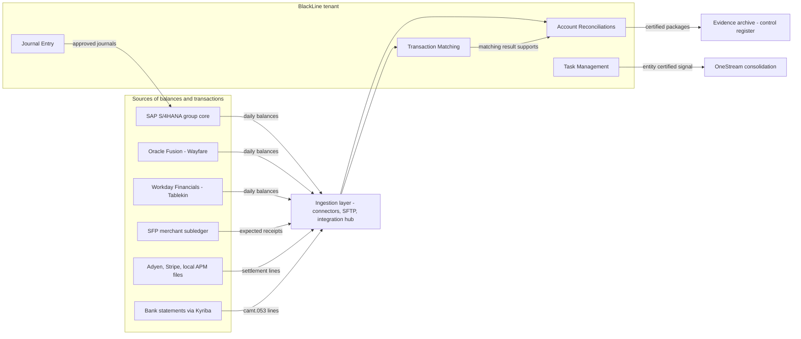
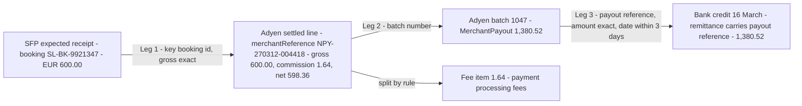
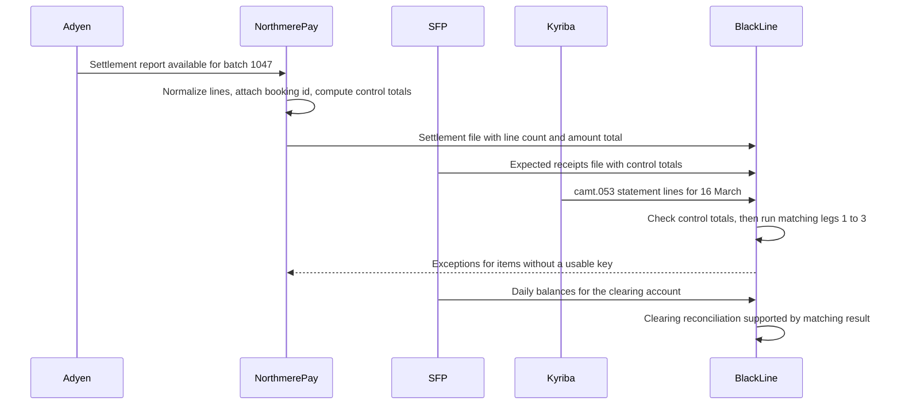
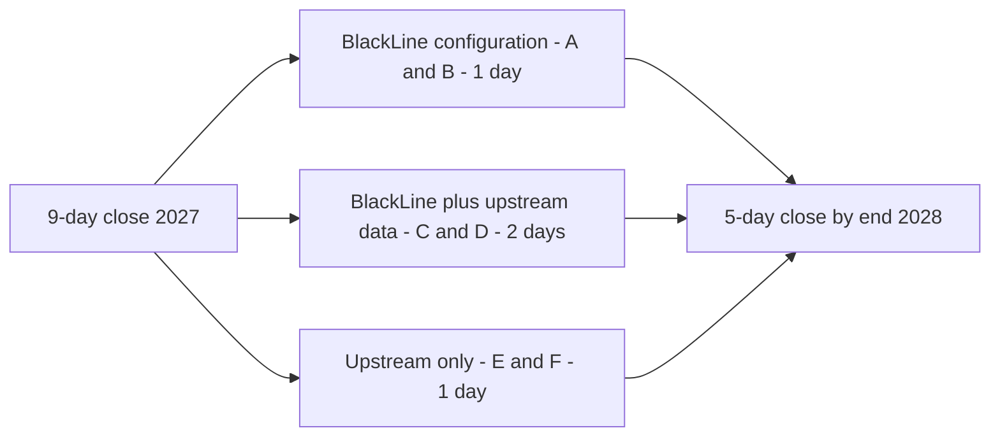

{id: blackline}
# 21. BlackLine: Close Automation, Reconciliation and Continuous Accounting

> **IN THIS CHAPTER, YOU WILL:** Place a close-automation platform in the finance estate. You will learn how reconciliation types, risk ratings, auto-certification, transaction matching, task management, journal entry and intercompany work as architecture, follow an Adyen settlement batch through a three-way match, and see which close days the tool removes and which only upstream fixes can remove.

> **WHY FINANCE CARES:** The close is where the controller proves that the books agree with reality. Reconciliations and their evidence are the bulk of that proof, and the auditor tests them. A faster close that weakens the evidence is not a faster close. It is a deferred audit finding.

> **WHY ARCHITECTS SHOULD CARE:** A close platform sits at the junction of every ledger, bank, payment provider and consolidation system. It also sits in the posting path and in the scope of the Sarbanes-Oxley Act (SOX). Its data feeds, matching rules and write-backs are interfaces that need the same design discipline as a ledger integration, and the platform can only move as fast as the data it is fed.

> **KEY POINTS:**
>
> * **Close automation organizes, matches and evidences. It does not repair upstream data.** A reconciliation platform turns a close from a spreadsheet ritual into a controlled workflow. Payment lines without a reference, late subledger postings and charts of accounts mapped in spreadsheets still arrive late or wrong. They simply arrive in a better-organized place.
> * **Matching rules and auto-certification are controls, so design them like code.** Keys, tolerances, many-to-one grouping, fee and FX splitting, risk tiers and certification rules decide what nobody looks at. They need owners, tests, change management and evidence, because the auditor will test the rules, not just the results.
> * **Continuous accounting is an architecture, not a product feature.** It needs event-level data, daily balances and daily matching upstream. At Northmere, BlackLine configuration alone removes about one of the four days between a 9-day and a 5-day close. The other three need fixes in payments data, intercompany and mapping.

> **[FAILURE PATTERNS THIS CHAPTER ADDRESSES](#where-finance-architecture-goes-wrong):**
>
> * **The Suspense Swamp** — PSP clearing and suspense accounts fill faster than people clear them, and a matching engine only helps if the lines carry a key it can match on.
> * **Capability Creep** — reconciliation happens in three platforms at once, and nobody has decided which one is the system of record for which balance.
> * **Nobody's Bot** — auto-certification rules and AI preparers sign off balances that no named person has reviewed or owns.

Every finance team reconciles. The question for an architect is not whether reconciliation happens. It is **where it happens, on what data, at what grain, under whose rules, and with what evidence**. In a small company the answer is a spreadsheet per balance-sheet account, a tick from the controller and a folder the auditor opens once a year. In a group with 71 legal entities, three ERPs, three payment service providers and 46 customer currencies, that answer stops working. The spreadsheets multiply, the folder becomes a file share, and the close becomes a coordination problem that nobody can see whole.

Close-automation platforms exist to solve that coordination problem. BlackLine, this chapter's main example, was founded in 2001 to move accounting work, reconciliations above all, out of spreadsheets. It **popularized "continuous accounting"**, the idea that period-end work should be done daily so that month-end becomes a confirmation, though there is no evidence it coined the term.

The platform is valuable and limited in predictable ways. It is an excellent **system of record for reconciliation evidence and close status**, a capable matching engine and, with care, part of the posting path for manual journals. It is **not a remedy for bad data**: it cannot shorten the parts of the close where data arrives late, without keys, or summarized beyond use. Northmere's plan to go from a 9-day close to 5, at the end of the chapter, shows where that line falls.

A note on corporate status, because it changes quickly: **as of October 2026**, BlackLine, Inc. was listed on Nasdaq (ticker BL). It had been the subject of acquisition interest, including a 2025 offer from SAP that was reported and that BlackLine rejected. In March 2026 its board confirmed a Strategic Committee empowered to evaluate strategic transactions. Check the current position before you rely on it in a vendor strategy.

{id: blackline--setting-the-scene-at-northmere-working-day-three}
## Setting the Scene at Northmere: Working Day Three

Northmere, the fictional multi-brand digital commerce group this book follows, closes its books in **9 working days**. Leila Haddad, the Chief Accounting Officer and Group Controller, has committed to Tomás Ferreira, the Group CFO, that the close will take **5 days by the end of 2028** and 3 by 2030, as part of Program Keystone.

It is the morning of working day 3 (WD3) of the April 2027 close. Leila's close dashboard in BlackLine shows that 41% of the group's **~6,800 balance-sheet account reconciliations** have been prepared and 18% reviewed. The task list for the 71 entities is green except for a cluster of red items in Northmere Payments B.V., the group's Dutch e-money institution:

- **Transaction Matching** shows that **1.9% of Stayloft's alternative payment method (APM) settlement lines** remain unmatched by count. That is about 40,000 lines this month, most of them from the local APM providers in Brazil, India and Indonesia.
- The PSP clearing and suspense accounts carry about **€14 million** of unreconciled balance, of which about **€2.1 million is older than 90 days**. These are the 2026 month-end averages, and April looks no better.
- The high-risk reconciliation for the Adyen EUR clearing account cannot be certified until those items are explained. The Northmere Payments B.V. entity cannot be locked until it is certified. OneStream cannot start the group consolidation for that entity until the lock.

Dana Whitlock, the Chief Architect, joins Leila's WD3 stand-up. The finance operations team's proposal is to buy more BlackLine automation: more matching rules, AI-assisted preparation and a second Transaction Matching environment for APMs. Dana's question is different. **Which of these unmatched lines could any matching engine match, given the data it receives?** The answer, worked through below, is that about two-thirds of them cannot be matched with any rule, because the provider files do not carry Northmere's booking reference. That is not a BlackLine problem. It is a payments-to-ledger problem that happens to surface in BlackLine.

{id: blackline--what-close-automation-is-for}
## What Close Automation Is For

The **financial close** is the routine of making a period's books complete, accurate and locked. It covers subledger cut-off, accruals, revaluation, reconciliations, intercompany agreement, review, period lock and then consolidation. [Accounting for Architects: Ledgers, Journals and Revenue](#accounting-for-architects) covers the accounting and [The End-to-End Finance Processes](#finance-processes) places the close inside Record-to-Report. A close-automation platform supports five jobs within it:

| Job | What the platform does | What it does not do |
| --- | --- | --- |
| **Substantiate balances** | Holds one reconciliation per account (or account group) per period, with support, explanations, preparer and reviewer sign-off and history | Decide whether the balance is right. People and rules do that, using data from elsewhere |
| **Match transactions** | Compares high-volume records from two or more sources by rule and leaves exceptions for people | Create the reference keys that make matching possible |
| **Orchestrate the close** | Runs the close calendar as tasks with owners, dependencies, deadlines and status | Make an upstream system deliver its data on time |
| **Control manual journals** | Prepares, reviews, approves and posts manual journal entries to the ERP with evidence | Replace the ERP's posting controls or period locks |
| **Evidence the close** | Gives auditors one place to see who did what, when, with what support | Turn a weak process into a strong one by digitizing it |

The right column is the point of this chapter. Every row describes something a platform *organizes*, not something it *repairs*.

{id: blackline--reconciliation-types}
### Reconciliation Types

A **reconciliation** proves that two records of the same reality agree, and explains every difference. In a close platform the term covers several distinct designs. Mixing them up is the most common cause of a reconciliation population that is large, busy and still unconvincing.

| Type | Compares | Grain | Typical accounts | Northmere example |
| --- | --- | --- | --- | --- |
| **Balance-to-balance** | GL balance against an independent balance: a bank statement, a PSP balance, a third-party confirmation, a schedule | One balance per account per period | Cash, safeguarding accounts, loans, prepaids against an amortization schedule | S/4HANA bank account balance against the Kyriba-delivered closing balance on the camt.053 statement |
| **Subledger-to-GL** | Subledger control total against the GL control account | Balance, with drill-down to subledger detail | Receivables, payables, partner payables, deferred merchant bookings | SFP merchant subledger partner-payable total against the S/4HANA partner-payable control account |
| **Bank reconciliation** | Ledger cash movements against bank statement lines | Transaction | Operating and safeguarding bank accounts | Northmere Payments B.V. EUR safeguarding account: PSP payout credits against clearing-account postings |
| **Intercompany** | One entity's receivable or revenue against the counterparty's payable or expense | Balance by counterparty, sometimes by transaction | Due-to and due-from, intercompany revenue and expense | Stayloft B.V. management-fee recharge against Wayfare's expense in Oracle Fusion |
| **Transaction-level matching** | Line-by-line records from two or more sources, by rule | Transaction | PSP clearing, card settlement, payouts | Adyen settlement detail lines against SFP expected receipts, and Adyen payouts against bank credits |

Two consequences follow. First, **balance reconciliations need balances and transaction matching needs transactions**: a light daily or monthly feed versus a high-volume pipeline with its own latency, retention and failure modes. Both are called "reconciliation", but they are different integrations. Second, **a balance reconciliation of a high-volume account is supported by a matching result**. The Adyen EUR clearing account is certified on the strength of the matching run: matched items net to zero, and the open items *are* the explanation of the balance. Oracle's Account Reconciliation product makes the same split, with Reconciliation Compliance for balances and Transaction Matching for volume, integrated with each other.

{id: blackline--risk-rating-spend-review-effort-where-error-is-likely}
### Risk Rating: Spend Review Effort Where Error Is Likely

Not every account deserves the same attention. **Risk-based reconciliation** rates each account, usually on balance size, volatility, transaction volume, judgment content and history of errors. The rating then drives four things: which template the account uses, how often it is reconciled, how many review levels it needs, and whether it may be auto-certified. BlackLine describes this practice in its own guidance. The exact configuration syntax is in customer documentation behind a login, and this book does not describe it.

Northmere's rating model, rebuilt in 2027 under Mei Tanaka's SOX program, has three tiers:

| Tier | Accounts | Examples | Frequency | Review | Auto-certification |
| --- | --- | --- | --- | --- | --- |
| **High** | ~900 | PSP clearing and suspense, safeguarding bank accounts, deferred merchant bookings, partner payables, intercompany, revenue accruals | Monthly, daily matching where volume justifies it | Preparer plus two review levels | Never |
| **Medium** | ~2,600 | Most receivables and payables control accounts, accruals, provisions, tax payables | Monthly | Preparer plus one reviewer | Only for zero-balance, no-activity accounts |
| **Low** | ~3,300 | Prepaids with schedules, dormant entity accounts, fixed-asset clearing with no activity | Quarterly, or monthly by rule | One reviewer, or auto-certified | Yes, under documented rules |

The tiering is a **controls design decision**. The external auditor will ask how each account was rated, who approved the rating and how often it is revisited. A rating changed in the quarter an account went wrong is exactly the kind of fact an audit finds.

{id: blackline--auto-certification-is-a-control}
### Auto-Certification Is a Control

**Auto-certification** lets a reconciliation be certified without manual preparation when defined conditions hold. BlackLine documents rules set globally or per account, with thresholds, and gives the example of a prepaid account that auto-certifies when the month-end GL balance equals the expected balance from its amortization schedule. Typical rule families include:

- **Zero balance and no activity** in the period.
- **Balance equals an expected balance** from a schedule (prepaids, amortizing intangibles, straight-line accruals).
- **Balance below a materiality threshold** and unchanged from a previously certified period.
- **Subledger equals GL**, where the subledger total arrives through a controlled feed and the interface's completeness check passed.

The last rule is the most useful and the most dangerous, because it is only as good as the feed that supplied the subledger total. If the feed silently dropped a file, both sides can be wrong in the same way. I therefore treat every auto-certification rule as an **automated application control** with four obligations:

1. **An owner** in the control framework, usually the process owner for the account family, with Mei's team as the second line.
2. **Change management.** A rule change is a configuration change to a SOX-relevant system: requested, tested, approved by someone other than the requester, and logged.
3. **Proven inputs.** The rule relies on information produced by the entity (IPE), the reports and extracts a control depends on, so the feed must be shown to be complete and accurate.
4. **Look-back.** Re-perform a sample of auto-certified accounts each quarter. If the sample finds an error, the rule is wrong, not the account.

Northmere's 2028 target is to auto-certify about **2,400 of the 6,800 reconciliations**, almost all in the low tier, which frees roughly 25 preparer-days a month. It removes **less close time than people expect**, because low-risk accounts are rarely on the critical path. The close is as long as its longest chain of dependencies, not its largest pile of work.

**Figure 1:** *Auto-certifying about 2,400 of 6,800 reconciliations frees preparer time but removes less close time than people expect, because the close is as long as its longest chain of dependencies, not its largest pile of work.*

{id: blackline--architecture-where-the-platform-sits}
## Architecture: Where the Platform Sits

[Anatomy of a Financial Systems Landscape](#finance-landscape) places a **close and controls layer** between the transactional ledgers, which are the systems of record for postings, and consolidation and enterprise performance management (EPM), which is the system of record for group numbers. A close platform is the system of record for three things only: **reconciliation evidence, close-task status and the approval history of manual journals**. It is not a ledger. It holds copies of balances and transactions so that it can compare them, and those copies are never the authority.

BlackLine's FY2025 annual report (Form 10-K) groups its products into three suites on one platform:

- **Financial Close & Consolidation:** Account Reconciliations, Transaction Matching, Task Management, Journal Entry, Smart Close for SAP, Reporting & Analysis, Account Analysis, Journals Risk Analyser, Consolidation and Compliance.
- **Intercompany:** Intercompany Create, Intercompany Balance & Resolve, and Intercompany Net and Settle.
- **Invoice-to-Cash:** cash application, collections, credit and related modules.

They run on a platform it calls **Studio360**, whose Integrate area covers connectors and APIs. Older literature uses names the 10-K no longer lists, such as "Variance Analysis" and "Intercompany Hub". Treat those as historical. Northmere licenses four modules: Account Reconciliations, Task Management, Journal Entry and Transaction Matching.

**Figure 2:** *Northmere's close platform receives copies of balances and transactions from six kinds of source, writes back only approved manual journals, and hands consolidation a status signal rather than data. It is the system of record for evidence and status, never for balances.*

Three boundaries in Figure 2 carry most of the architecture:

- **Inbound copies are not authority.** If a balance in BlackLine disagrees with S/4HANA, S/4HANA is right and the feed is broken. Every feed needs a control total that proves the copy is complete.
- **Write-back is narrow.** Only approved manual journals flow back to a ledger. Matching results do not post directly; the next sections explain why.
- **Consolidation gets status, not data.** OneStream's workflow consumes an "entity certified" signal before it accepts that entity's trial balance. Duplicating reconciliation data into the consolidation system creates a second reconciliation system of record. This is the "status, not data" pattern that [OneStream: Consolidation, Planning and Performance Management](#onestream) develops from the consolidation side.

{id: blackline--transaction-matching-rule-design-for-high-volume}
## Transaction Matching: Rule Design for High Volume

**Transaction matching** compares records from two or more sources and pairs them by rule. Matched items drop out, and what remains are exceptions for people to work. BlackLine's 10-K describes the module as automating the reconciliation of high-volume transactions and flagging exceptions. The rule types below are standard across matching tools; Oracle documents one-to-one, one-to-many, many-to-one and many-to-many rules with tolerances in its own product. Treat them as the general vocabulary of the field, not as BlackLine internals.

At Northmere, Transaction Matching handles about **1.3 million PSP settlement lines a day** across Adyen, Stripe and the local APM providers. Each day it compares them with SFP's expected receipts, and compares about **1,500 PSP payout credits** with bank statement lines. The volume is the reason the matching runs in a dedicated engine and not in a spreadsheet. It is also the reason rule design matters: a rule that is 99% right still leaves 13,000 lines a day for people to look at.

{id: blackline--the-four-design-decisions-in-every-matching-rule}
### The Four Design Decisions in Every Matching Rule

| Decision | Question | Northmere's choice for Adyen card lines | Why it matters |
| --- | --- | --- | --- |
| **Keys** | Which fields must agree before amounts are compared? | `merchantReference` (Northmere Pay payment id, linked to the SFP booking id by normalization) plus Adyen `pspReference`; batch number for the payout leg | Without a shared key, matching falls back to amount and date, which produces false matches at volume |
| **Tolerances** | How far may amounts and dates differ and still match? | Gross amount exact in transaction currency; settlement-currency amount within 0.5% for FX; value date within 0–3 business days | A tolerance quietly decides what nobody reviews. Every tolerance is a materiality judgment |
| **Cardinality** | One-to-one, one-to-many, many-to-one or many-to-many? | One-to-one for card lines; many-to-one for local APM daily aggregates; one-to-one for payout to bank credit | Many-to-one matches hide individual errors inside a total |
| **Splitting** | What happens to the difference between gross and net? | Fees split to a fee item and FX differences to an FX item, each posted by rule | An unsplit difference becomes a manual exception every single time |

{id: blackline--a-worked-match-adyen-batch-to-bank-credit-to-sfp-expected-receipts}
### A Worked Match: Adyen Batch to Bank Credit to SFP Expected Receipts

Take the Lisbon booking that runs through this book: a traveler from Germany books a three-night stay in a Lisbon apartment on Stayloft for **€600.00**, paid by card through Adyen on **12 March 2027**. Adyen's processing fee on it is **€1.74** (illustrative). Adyen books it into settlement batch 1047 on Sunday **14 March 2027**, and the batch payout reaches Northmere Payments B.V.'s bank on Tuesday **16 March 2027**. The figures for the batch around it are illustrative, and they are the miniature of batch 1047 that [Adyen: Single-Platform Acquiring and Platform Payments](#adyen) reconciles line by line.

Adyen's settlement details report for Northmere Payments B.V.'s EEA merchant account (`NMPay_Stayloft_EEA`), batch 1047 (booked 14 March), contains these totals:

| Journal type in the settlement report | Lines | Amount (EUR) |
| --- | --- | --- |
| Settled | 4 | 1,997.30 |
| Refunded | 1 | −180.00 |
| Chargeback | 1 | −420.00 |
| Fees (commission and payment fees across the batch) | — | −16.78 |
| **MerchantPayout** (net paid to bank) | 1 | **−1,380.52** |

The −€420.00 chargeback in this batch is an earlier, separate dispute on a January stay, not the June 2027 chargeback that [Payments for Finance Architects: The Lifecycle of Money Movement](#payments-fundamentals) follows. The report carries gross amounts in the transaction currency, net amounts in the settlement currency, an exchange rate and fee columns for each line. Adyen's own guidance is to reconcile at two levels: the payout entry (payout reference, batch number and merchant account) against the bank statement, and the individual lines against the merchant's sales. [Adyen: Single-Platform Acquiring and Platform Payments](#adyen) explains the report family. Northmere's matching runs three legs:

**Figure 3:** *The three-way match for one Lisbon booking. The fee is split by rule rather than left as an exception, and the batch, not the booking, is what reaches the bank. Each leg uses a different key.*

1. **Leg 1, expected receipt to settled line (one-to-one).** SFP's expected receipt for booking `SL-BK-9921347` (€600.00) matches Adyen's settled line on `merchantReference` (`NPY-270312-004418`, which normalization links to the booking id), with the gross amount exact. The line's net of €598.36 differs by €1.64: interchange €1.20, scheme fees €0.21 and €0.23 of Adyen's markup. The fee rule splits that €1.64 into a fee item, and the match is complete with no human involved. The remaining €0.10 of the booking's €1.74 fee, the rest of the €0.33 markup, is Adyen's processing fee charged at batch level on the Fee line.
2. **Leg 2, settled lines to batch (many-to-one).** All seven lines of batch 1047 roll up to the batch total (a production batch holds hundreds of thousands). The control is arithmetic: the line amounts and fees must sum to the MerchantPayout amount. If they do not, the report is incomplete and the whole batch is held.
3. **Leg 3, batch to bank (one-to-one).** The MerchantPayout of €1,380.52 matches the bank credit on 16 March, delivered through Kyriba on the camt.053 statement, on payout reference and exact amount, inside a three-business-day window.

**FX splitting** works the same way. A traveler from the UK pays £300.00 for a booking SFP recorded at €350.00, using the booking-date rate. Adyen settles it in EUR at gross €349.12, with a fee of €1.02 and a net of €348.10. The rule matches on the transaction-currency amount (£300.00 exact). It splits the €1.02 to fees and the €0.88 difference between SFP's €350.00 and Adyen's €349.12 to an FX difference item, because 0.25% is inside the 0.5% tolerance. A 2% difference would become an exception, because it more likely signals a wrong rate or a partial capture than ordinary FX movement.

The accounting that results is simple. **Where it is posted is the architectural decision.**

| Account | Debit | Credit | Note |
| --- | --- | --- | --- |
| Bank – safeguarding, Northmere Payments B.V. EUR | 1,380.52 | | Bank credit matched to batch 1047 |
| PSP clearing – Adyen EUR | | 1,380.52 | Clears the batch's net receivable |
| Payment processing fees | 16.78 | | Batch fees, split by rule (includes €1.74 for Lisbon) |
| PSP clearing – Adyen EUR | | 16.78 | Clearing is relieved gross; fees move to expense |

I recommend that **these postings come from the subledger or payments platform, driven by settlement events, not from the matching tool.** SFP already posts daily summaries to S/4HANA. The settlement and fee entries belong in the same posting engine, under the same controls and with the same summarization and drill-back. The matching tool's job is to prove that what was posted agrees with what the provider and the bank say. If the matching tool posts the entries itself, it becomes a second posting engine for 1.3 million lines a day. That would be a second accounting logic, outside the subledger, invisible to [Designing Custom Ledgers and Financial Event Processing](#designing-financial-ledgers). BlackLine Journal Entry is the right place only for the **residue**: the aggregated, approved adjustments for exceptions that people have worked. Clearing account design itself is owned by [Payments-to-Ledger: Connecting Providers, Brand Platforms and the ERP](#payments-to-ledger).

{id: blackline--why-1-9-stays-unmatched}
### Why 1.9% Stays Unmatched

When Dana's team analyzed the roughly 40,000 unmatched APM lines in the April close, they fell into four groups:

| Cause | Share of unmatched lines | Can a better rule fix it? | Real fix |
| --- | --- | --- | --- |
| Local APM provider files carry the provider's own transaction id but not Northmere's booking reference | ~48% | No. No key exists to match on | Payments platform passes the booking id to every provider and rejects providers that cannot return it |
| Provider reports one aggregate line per method per day | ~19% | Partly: a many-to-one rule matches the total but hides individual errors | Contract for line-level reports; until then, many-to-one with a tight control total |
| Partial refunds netted against later settlements | ~21% | Yes: a rule for netted refunds with a reference to the original capture | Rule change in BlackLine, plus a canonical `RefundIssued` event from SFP |
| Cut-off differences (provider day in local time, SFP day in UTC) | ~12% | Yes: date tolerance plus a time-zone normalization step | Normalize to one time basis in the ingestion layer |

About a third of the problem (the partial refunds and the cut-off differences) is a matching-rule problem. About two-thirds (the missing references and most of the aggregate lines) is a data problem that no rule can solve. **This analysis, more than any product decision, set the shape of the 2027 program.** The matching rules were fixed in six weeks. The provider references needed changes in Northmere Pay's integrations, owned by Ingrid Solberg's team, and contract changes with two providers. [Payments-to-Ledger: Connecting Providers, Brand Platforms and the ERP](#payments-to-ledger) tells that story from the payments side, including how the €14 million suspense balance came down.

Three cautions generalize. **Tolerances drift wider under deadline pressure**: widening a date window from three to ten days at WD3 raises the match rate and lowers match quality, so Northmere logs and approves tolerance changes like any rule change. **Many-to-one matches need a ceiling**: a rule that lets 4,318 expected receipts match one provider line "if the sum is within €50" will eventually absorb two offsetting errors larger than €50. **Unmatched items need a named owner by age**: items over 30 days have one, items over 90 days are reported to Leila, and the €2.1 million over 90 days was the measure the audit committee watched in 2027.

{id: blackline--task-management-the-close-calendar-as-orchestration}
## Task Management: The Close Calendar as Orchestration

**Task Management** runs the close calendar: recurring tasks, owners, deadlines and dependencies across entities. It is the least glamorous module and, for close duration, often the most important, because the close is a **critical path problem**. The critical path is the longest chain of dependent tasks, and the close ends when its last task ends.

Northmere's 9-day calendar, reconstructed from early-2027 task data, looks like this:

| Working day | Main work | Critical-path dependency |
| --- | --- | --- |
| WD −2 to 0 | Pre-close: accrual estimates, IC recharges calculated, FX rates loaded | IC recharges arrive from three ERPs on different dates |
| WD1 | Subledger cut-off: SFP final daily summary, FI-CA, Concur, Coupa; bank statements | SFP posts the last day's summary late on WD1 |
| WD2 | Accruals and revaluation in S/4, Fusion and Workday; manual journals | Manual journals wait for subledger cut-off |
| WD3 | Matching status review; reconciliations start in earnest | APM unmatched lines and the clearing reconciliations |
| WD4–5 | Reconciliation preparation and review; suspense investigation | High-risk clearing and suspense reconciliations in Northmere Payments B.V. |
| WD5 | Intercompany agreement across SAP, Oracle and Workday entities | Disputes over IC balances between Wayfare and the SAP entities |
| WD6–7 | Entity certification and lock; trial balances loaded to OneStream; mapping and consolidation | Last entity certified; mapping exceptions across three charts of accounts |
| WD8–9 | Eliminations review, top-side adjustments, group review and sign-off; flash results to the CFO | — |

Task Management makes this visible: every task has an owner, a predecessor and a timestamp. That visibility is what made the critical path analysis possible. **Visibility is not acceleration, though.** A task that waits for SFP's late summary waits just as long in BlackLine as it did in a spreadsheet. The module accelerates the close in two narrower ways:

- **Enforced dependencies.** A downstream task cannot start on stale data. This removes rework, which is a hidden source of delay.
- **Re-sequencing.** When the data shows that intercompany agreement waits for a reconciliation it does not need, the dependency is removed and the work runs in parallel.

SAP's own **Advanced Financial Closing (AFC)** schedules and monitors closing tasks and jobs across SAP and non-SAP systems. It overlaps Task Management and BlackLine's in-SAP Smart Close, not balance substantiation. Northmere's February 2027 decision record kept Task Management as the group calendar because the close spans three ERPs, and noted AFC as an option if the 2029 convergence shrinks the non-SAP close.

{id: blackline--journal-entry-the-boundary-with-the-erp}
## Journal Entry: The Boundary With the ERP

**Journal Entry** prepares, reviews, approves and posts manual journals, with approval checkpoints and attached support. It is the module that puts BlackLine **in the posting path**, and that changes its controls profile.

The boundary has three parts:

1. **Posting rights live in the ERP.** BlackLine posts to S/4HANA through an integration user. That user can post only the document types and company codes defined for manual journals, and only into open periods. The ERP's period lock, balancing checks and validation rules remain the last line of defense. BlackLine's approval does not replace them.
2. **Segregation of duties (SoD) is enforced in two places.** BlackLine enforces that the preparer is not the approver. The ERP must prevent the same people from bypassing BlackLine to post directly. At Northmere, direct manual posting of in-scope document types in S/4HANA was removed from finance user roles in 2027, and only a small firefighter (emergency access) role remains, logged and reviewed. Without that step, the approval workflow is a suggestion.
3. **Completeness runs both ways.** Every journal approved in BlackLine must appear once in the ERP, and every manual journal in the ERP must have come from BlackLine or from a documented exception path. Northmere runs this as a daily automated reconciliation. It is a small control that auditors value highly, because it closes the gap a write-back interface creates.

Northmere processes about **11,500 manual journals per close**, most of them in S/4HANA. Wayfare still posts manual journals directly in Oracle Fusion, and Tablekin in Workday. Extending Journal Entry to both in 2028 is less a connector problem than a role-redesign problem: in each ERP, someone must take away the right to post directly.

Journals Risk Analyser, BlackLine's anomaly detection over journal entries, is a **detective** control. It complements approval and SoD but does not replace them, and its alerts need an owner and a closure record like any other exception.

{id: blackline--intercompany-one-process-across-three-erps}
## Intercompany: One Process Across Three ERPs

**Intercompany** transactions are those between the group's own legal entities. Each side books its half, and consolidation eliminates both. [Many Entities, Currencies, Jurisdictions and Brands](#global-scale) covers the entity structure and transfer pricing. The close problem is agreement: the two halves are booked by different teams, in different ERPs, at different times and sometimes at different FX rates, and they do not match.

Northmere reconciles intercompany in three places, which is a textbook case of **Capability Creep**:

- **BlackLine Account Reconciliations** for SAP-run entities, at balance level by counterparty.
- **Oracle Fusion** for Wayfare's own intercompany, using Fusion's intercompany capabilities within its ledgers.
- **OneStream**, where eliminations surface the differences that slipped through. Northmere also bought a OneStream reconciliation module in 2022, now used for only 22 corporate-entity accounts.

The result is predictable. Differences between Wayfare and SAP entities are found on WD5 in reconciliations, or on WD6–7 in consolidation, and argued over by email.

BlackLine's intercompany suite came largely from its acquisition of FourQ in January 2022. It has three parts: **Intercompany Create** originates intercompany transactions and invoices, **Balance & Resolve** reconciles balances and manages disputes, and **Net and Settle** nets and settles balances with treasury. The architectural question is not whether to buy it. It is **where intercompany is originated**. If both halves are generated from one agreed transaction, with one amount, one rate, one date and one counterparty, then matching becomes confirmation. If each side books independently, matching remains investigation, whichever tool does it.

Dana's recommendation to the design authority in mid-2027 was as follows. These are judgments, recorded in a decision record:

1. **One intercompany process owner** (Leila's team), and one cross-ERP matching platform for all entity pairs. SAP's intercompany matching serves SAP entities well, but Northmere's hard pairs cross ERPs.
2. **Originate recurring recharges once.** Management fees, IT recharges and royalties are calculated centrally and generated for both sides before month-end. Whether that happens in a close platform's intercompany module or in the S/4HANA core is a 2028 decision, tied to the convergence decision in [Multiple ERPs, One Finance Core: Coexistence and Convergence](#multiple-erps).
3. **Retire the duplicates.** Wayfare's Fusion intercompany reconciliation and the unused OneStream module are retired as reconciliation systems of record for cross-entity balances. Fusion still records Wayfare's postings.

{id: blackline--data-ingestion-balances-transactions-and-time}
## Data Ingestion: Balances, Transactions and Time

A close platform is an integration hub that most enterprises do not design as one. [Integration Architecture for Finance](#integration-architecture) gives the general rules; this section applies them.

{id: blackline--four-feeds-four-profiles}
### Four Feeds, Four Profiles

| Feed | Content | Volume at Northmere | Timing | Transport |
| --- | --- | --- | --- | --- |
| **Balances** | GL balances by entity, account, currency and period | ~25,000 rows per load across three ERPs | Daily, plus final at entity lock | Vendor connectors for S/4HANA and Oracle; file through the integration layer for Workday |
| **Transactions for matching** | PSP settlement lines, SFP expected receipts, bank statement lines | ~1.3 million PSP lines plus ~1.3 million expected receipts a day; ~1,500 bank credits a day | Intraday, as reports arrive | SFTP files produced by Northmere Pay's normalization service; camt.053 through Kyriba |
| **Reference data** | Entities, chart of accounts, account-to-owner assignments, FX rates, users | Small | On change | File or API, mastered elsewhere |
| **Write-back** | Approved manual journals | ~11,500 per close | On approval | Connector to S/4HANA; Fusion and Workday planned |

The table holds the main design facts.

**Connectors versus flat files.** BlackLine published an Oracle connector for balances, transactions and currency rates in 2018, and its 2019 ecosystem announcement relied on iPaaS partners for Workday and other sources. This book claims no technical detail beyond that. Flat files over SFTP remain common for bank and payment data. They are fine if they carry **control totals**: a record count and an amount total per file, checked on arrival against the source. Most ingestion failures I have seen were not "the file failed". They were "the file arrived with 80% of its lines and nobody noticed".

**Normalize before you match.** Northmere does not send raw Adyen, Stripe and local-provider files to BlackLine. Northmere Pay's normalization service maps each provider's settlement data to one internal settlement record, keyed by booking id, with the provider's reference and batch preserved. That is the canonical `PaymentSettled` and `PSPFeeCharged` events from [Canonical Events and Adapters for Loosely Coupled Financial Domains](#loosely-coupled-domains) in file form. One matching rule set then works for every provider. Without that layer, every new APM means new rules, and every provider format change breaks the close.

**Timing is part of the interface.** Adyen's batch-level settlement report is generated before 10:00 in the account's time zone, Stripe warns that a payout can arrive before its reconciliation data, and local providers deliver when they deliver. When one leg is late, the item should be marked "awaiting data", not "unmatched", with its aging clock running from the expected arrival time. Otherwise the WD3 dashboard mixes genuine exceptions with data that has not arrived yet.

**Figure 4:** *Ingestion for one settlement day. Every file carries control totals checked before matching runs, exceptions caused by missing keys go back to the team that owns the keys, and the account reconciliation is supported by the matching result rather than prepared separately.*

{id: blackline--retention-and-residency}
### Retention and Residency

Matching detail is large, and statutory retention is long: Germany, for example, requires books and annual financial statements to be kept for ten years. A SaaS tenant is not an archive. Northmere **exports certified reconciliation packages and matching summaries each quarter to the group's evidence archive**, owned by Mei's team. BlackLine keeps line-level matching detail for the period agreed in the contract, and older detail can be rebuilt from the source files Northmere Pay retains. Ask where the tenant is hosted and record the answer: BlackLine has used its own data centers and Google Cloud facilities, so do not assume either.

{id: blackline--evidence-and-audit}
## Evidence and Audit

The close platform's most durable value is evidence. Each reconciliation carries preparer and reviewer sign-offs, timestamps, attached support and a history that cannot be edited quietly. External auditors are commonly given read-only access. That replaces the annual file-share hunt with a population the auditor can sample directly.

Three architectural facts follow, covered in depth in [Controls, Auditability and Security by Design](#controls-and-auditability):

- **The vendor's SOC 1 Type 2 report is necessary, not sufficient.** BlackLine states that it holds SOC 1 Type 2, SOC 2 Type 2 and SOC 3 reports and several ISO/IEC certifications, including ISO/IEC 42001 for AI management. A SOC 1 Type 2 report covers a service organization's controls relevant to its customers' financial reporting, over a period. It lists **complementary user entity controls (CUECs)** the customer must operate, such as access review, configuration change control and feed completeness, and each must map to a named, tested Northmere control. A **bridge letter** covers the gap to Northmere's 31 December year-end. Which BlackLine modules, data centers and AI features the current report covers is not public and is to be confirmed against the report itself each year.
- **The rules are in scope.** Matching rules, tolerances, auto-certification rules and risk ratings decide whether a key control operated, so the auditor tests them and the IT general controls around them.
- **The feeds are in scope.** The control totals in Figure 4 are audit evidence, not just operational hygiene.

{id: blackline--the-sap-relationship}
## The SAP Relationship

BlackLine is an **SAP Solution Extension** partner, and has been since 2018. SAP sells BlackLine products on SAP paper under SAP names, for example **"SAP Account Substantiation and Automation by BlackLine"**, and BlackLine receives a share of the revenue. BlackLine's 10-K confirms the arrangement but does not disclose the share. Press coverage based on Reuters reporting put SAP's resale at nearly 30% of BlackLine's revenue in 2025. **Smart Close for SAP** is a separate product that runs inside the SAP interface to automate SAP-side closing steps.

For an architect, this has three consequences:

- **The runtime is the same.** Buying through SAP or directly gives the same BlackLine cloud and integration design. What differs is contracting, the support route (SAP first line for resold products), license metrics and renewal leverage.
- **Ownership can change.** A close platform resold by the ERP vendor, and the subject of that vendor's acquisition interest, may change hands, and with it roadmap, pricing and ERP neutrality. That is an argument for keeping the integration contracts (normalized files, control totals, status signals) independent of the tool, so a replacement would be a migration rather than a rebuild. [Vendor Strategy and Avoiding Excessive Dependency](#vendor-portfolio-strategy) covers this as **The Borrowed Roadmap**.
- **The SAP-native alternative is partial.** AFC covers task orchestration and SAP's intercompany matching serves SAP entities, but for balance substantiation SAP's own answer has been to resell BlackLine. Treat "we have S/4HANA, so we do not need a close platform" as a hypothesis to test.

Northmere's subscription is direct, contracted in 2020, with renewal in 2028 (illustrative). Procurement will price both routes. Dana's condition is that whatever route is chosen, the contract must not give either party rights over Northmere's matching rules and normalized data formats.

{id: blackline--continuous-accounting-is-an-architecture}
## Continuous Accounting Is an Architecture

**Continuous accounting** moves period-end work into the period: reconciliations, matching, journal review and variance analysis run daily or weekly, so the close confirms rather than discovers. BlackLine has championed the concept since at least 2016. The concept is sound. The trap is believing that buying the tool delivers it.

Continuous accounting has four preconditions, and only the last is a feature of a close platform:

| Precondition | What it means | Where it lives at Northmere |
| --- | --- | --- |
| **Event-level data flows daily** | Financial events (`PaymentSettled`, `RefundIssued`, `PSPFeeCharged`, `PartnerPayoutSettled`) reach the subledger and the matching engine within a day, with keys | Northmere Pay, SFP, the Kafka backbone; [Canonical Events and Adapters for Loosely Coupled Financial Domains](#loosely-coupled-domains) |
| **Ledgers are posted continuously** | Subledgers post to the GL daily, not in a month-end batch, with control totals and drill-back | SFP's daily summaries to S/4HANA already exist; Fusion and Workday feeds are monthly for some flows |
| **Balances are available daily** | The close platform receives daily balances, not just period-end ones | Daily balance feeds since 2027 for S/4HANA; Fusion and Workday in 2028 |
| **Reconciliation runs on that cadence** | High-risk accounts are matched daily and reconciled weekly; month-end certifies an already-explained balance | BlackLine Transaction Matching and Account Reconciliations |

If the first three rows are not true, a daily reconciliation is a daily report of what has not arrived. **Continuous accounting is a property of the data flow, which the close platform then exploits.** That is why this chapter treats it as an architecture, owned jointly by the payments, subledger and ERP teams, rather than as a module owned by the close team. It also explains why the Keystone roadmap puts it in Year 5 (2031), after canonical events (Year 3) and payments-to-ledger completeness (Year 1).

{id: blackline--ai-in-the-close-platform}
## AI in the Close Platform

BlackLine launched **Verity**, its suite of AI capabilities embedded across the platform, on 9 September 2025. The launch introduced "Vera", described as an AI team lead that orchestrates specialized agents, and named Google Cloud's Gemini models as the model partner. **Verity Prepare**, an agentic reconciliation agent, reached general availability in July 2026. In June 2026 BlackLine announced a **Finance Control Console**, a governance layer for monitoring and enforcing policy over AI agents, initially as a preview program. The company now describes its offering as an "Agentic Financial Operations Platform". All of this is dated as of October 2026, and availability changes quarterly.

Three controls questions apply to any AI preparer, from any vendor:

1. **Who is the preparer of record?** An agent that prepares a reconciliation is a process participant. Its output is reviewed by a named person, and that review must be substantive, not a click.
2. **What changed, and who approved it?** Prompts, rules, model versions and agent permissions are configuration. They go through change management like a matching rule.
3. **Is it covered?** Check whether the vendor's SOC 1 scope includes the AI features you use. An ISO/IEC 42001 certificate is relevant, but it is not a substitute for SOC 1 coverage.

Northmere's 2027 stance, agreed between Mei and Dana: pilot Verity Prepare on 300 medium-tier accounts, keep a human reviewer on every one, and measure review rejection rates for two quarters before expanding. High-tier accounts stay human-prepared until the evidence supports a change. That is the opposite of **Nobody's Bot**. [AI, Automation and Agentic Finance Operations](#ai-in-finance) develops the general model.

{id: blackline--trade-offs-alternatives-and-overlaps}
## Trade-Offs: Alternatives and Overlaps

The market splits into ERP-native capabilities, EPM suites with reconciliation modules, and specialist close platforms. The table below uses only facts verified from vendor documentation or filings; the "when it fits" column is my judgment.

| Option | Center of gravity | Verified scope | When it fits | Watch-outs |
| --- | --- | --- | --- | --- |
| **BlackLine** | Close and controls across many ERPs | Account Reconciliations, Transaction Matching, Task Management, Journal Entry, Intercompany suite, Invoice-to-Cash (10-K) | Heterogeneous estates, many entities, shared-service close teams, existing SAP Solution Extension contract | Another integration layer and control environment; corporate status in flux as of 2026 |
| **ERP-native (SAP)** | Close inside the ERP | AFC for task orchestration across SAP and non-SAP systems; intercompany matching for SAP entities | Single-instance S/4HANA estates with modest non-SAP scope | Balance substantiation is sold via BlackLine; non-SAP entities still need loading |
| **Oracle Account Reconciliation** (often still called ARCS) | Reconciliation inside Oracle Cloud EPM | Reconciliation Compliance and Transaction Matching, documented as integrated | Oracle-centric estates already licensing Oracle EPM | Transaction Matching licensing is inconsistent across Oracle's own documentation; verify |
| **OneStream Account Reconciliations and Transaction Matching** | Reconciliation inside the consolidation platform | Solution Exchange applications running in the OneStream platform | Balance-level populations, preparers who also certify consolidation data, modest volumes | Loading transaction detail into the CPM platform; mixing operational matching with group close |
| **Trintech** | Specialist close platform | Cadency and Adra product lines; Transaction Matching, Reconciliation, Journal Entry and Close Task Management modules | Enterprise (Cadency) or mid-market (Adra) close standardization | Ownership and roadmap not verified here; ask |
| **FloQast** | Accountant-led close management | Close Checklist, Account Reconciliations, AI Matching, journal entry and variance analysis; founded 2013 | Mid-market and fast-growing companies with NetSuite, Workday or Intacct | Depth at very high transaction volume should be proven in a pilot |

Two rules guide the choice. First, **follow the grain and the owner, not the vendor list**. Transaction-level, high-volume matching run by an operations team points to a specialist platform. Balance-level reconciliation by the people who certify consolidation data can live in the EPM tool. Second, **one reconciliation system of record per balance**. Two tools may coexist after an acquisition, but each account belongs to exactly one, and that assignment is written into the control framework. Northmere's overlap register, owned by [Preventing Redundant Capabilities and Unnecessary Coupling](#redundancy-and-coupling), carries the reconciliation entry: BlackLine is the system of record for all balance-sheet reconciliations from Q1 2028, Fusion intercompany reconciliation retires with the Wayfare convergence, and the OneStream module's 22 accounts move to BlackLine in the first rationalization wave, which ends in Q1 2028.

{id: blackline--in-practice-from-9-days-to-5}
## In Practice: From 9 Days to 5

In September 2027 Dana and Leila took the critical-path data from Task Management to the Keystone design authority with one question per day of the close: **what removes it, and is that BlackLine or something upstream?** The answer is the plan below. The day estimates are judgments built from task timestamps, not guarantees.

| # | Measure | Close days removed | Who owns it | BlackLine, upstream or both |
| --- | --- | --- | --- | --- |
| A | Re-sequence the critical path: remove false dependencies, run intercompany and low-risk reconciliations in parallel, enforce data-ready gates | ½ | Leila's close team | **BlackLine** (Task Management) |
| B | Risk tiers and auto-certification for ~2,400 low-tier accounts, so review capacity shifts to WD3–5 high-risk work | ½ | Leila, Mei | **BlackLine** (Account Reconciliations) |
| C | Daily matching and weekly reconciliation of PSP clearing accounts, so WD3–5 suspense investigation moves into the month | 1 | Ingrid's payments team, Jonas's SFP team, Leila | **Both:** BlackLine runs it; it only works once APM references, line-level provider reports and normalized settlement events exist |
| D | Intercompany originated once for recurring recharges, agreed before WD1, with one cross-ERP matching platform | 1 | Leila; Hana for Wayfare | **Both:** a close-platform intercompany module or the S/4HANA core; the gain comes from origination, not matching |
| E | Chart of accounts mapping as governed, effective-dated rules (in OneStream since May 2027) with validation at source and the group CoA v2 | ½ | Owen's data team, Leila | **Upstream** ([OneStream: Consolidation, Planning and Performance Management](#onestream), [Finance Data Architecture: Master Data, Systems of Record and Governance](#finance-data-architecture)) |
| F | SFP and the brand ledgers post their final daily summary by 06:00 on WD1, with control totals | ½ | Jonas; Hana; Arjun | **Upstream** |
| | **Total** | **4 days: 9 → 5** | | |

**Figure 5:** *Where Northmere's four days come from. BlackLine configuration alone removes about one day. Two days need BlackLine and upstream data together, and one day needs no close-platform change at all.*

Three lessons generalize. **The tool-only day is real but small**: measures A and B were done in 2027 and took the close to about 8 days, cheaply, and produced the data that justified the rest. **The shared days decide the program**: measure C is the payments-to-ledger program by another name, funded in Keystone Year 1, owned by Ingrid's and Jonas's teams and measured in BlackLine. A close team that buys more matching capacity without it gets more exceptions, faster. **The last day is not in the close team's hands**: measures E and F belong to data and engineering teams that do not run the close, and without governance to assign them they do not happen.

The plan also says what *not* to do. The second Transaction Matching environment proposed at the WD3 stand-up would have matched nothing the first could not. Dana's decision record declined it and funded the provider-reference work instead.

{id: blackline--integration-with-the-rest-of-the-estate}
## Integration With the Rest of the Estate

The ledgers ([SAP S/4HANA: The Enterprise Finance Core](#sap-s4hana), [Oracle Fusion Cloud ERP: Ledgers, Accounting Hub and Coexistence](#oracle-fusion), [Workday: Financials, People and the Organizational Backbone](#workday)) supply balances and receive approved journals, and their period locks stay authoritative. The payment providers ([Adyen: Single-Platform Acquiring and Platform Payments](#adyen), [Stripe: Programmable Payments, Billing and Connected Accounts](#stripe)) supply settlement data through Northmere Pay's normalization layer, under the clearing design owned by [Payments-to-Ledger: Connecting Providers, Brand Platforms and the ERP](#payments-to-ledger). OneStream consumes certification status, not reconciliation data. The reconciliation catalog, which lists every boundary that must be proven complete and the tool that proves it, belongs to [Designing for Traceability, Reconciliation and Audit Across Boundaries](#traceability-and-reconciliation): BlackLine proves most of those boundaries, but it is not the catalog.

{id: blackline--failure-modes}
## Failure Modes

- **Reconciliation as screenshot.** Preparers attach an ERP screenshot of the balance and write "agrees to GL". The platform records a certification that proves nothing. Templates should require an independent source for each account type.
- **Auto-certification without look-back.** A "subledger equals GL" rule certifies accounts for months while a feed drops files, so both sides are wrong in the same way.
- **The matching tool becomes a posting engine.** Exception handling grows into rules that post fees, FX and write-offs directly from matching results. A second accounting logic emerges outside the subledger, and nobody owns it.
- **Two systems of record for one balance.** After an acquisition, the same accounts are reconciled in two tools by two teams with two answers. That is **Capability Creep**, and it surfaces as an audit question nobody can answer.
- **Suspense flagged but not owned.** The matching tool flags unmatched items, but no team owns fixing their cause, so they age in a clearing account. That is **The Suspense Swamp**.
- **Direct ERP posting left open.** The journal workflow exists, but finance users can still post manual journals directly in the ERP, so the approval can be bypassed.

{id: blackline--the-chief-architect-s-view}
## The Chief Architect's View

A close platform looks like a finance tool that Finance should choose. Most of what determines its value is architecture, so the Chief Architect should own five decisions with the Controller:

1. **System-of-record assignments.** For each balance-sheet account family, decide which tool reconciles it, and which one tool is the system of record for intercompany matching and for close status. Write the answer into the overlap register and the control framework.
2. **The posting boundary.** The matching tool proves; the subledger posts. The journal workflow posts only manual, approved journals, and direct ERP posting of those types is closed.
3. **The data contracts.** Normalized settlement records, balance feeds with control totals, and status signals to consolidation are enterprise interfaces with owners and versions, independent of the tool. This is also the exit strategy.
4. **Rules as controlled configuration.** Matching rules, tolerances, risk tiers and auto-certification rules are versioned, tested, approved and logged. That includes AI agent configurations.
5. **The upstream backlog.** Every exception class the platform reports is classified as "rule problem" or "data problem". Data problems are assigned to the teams that own the data, with dates. This is how the close platform becomes a sensor for the whole estate rather than a place where problems wait.

What to watch over the long term: **vendor ownership** (BlackLine's status as of October 2026 is unsettled), **native ERP agents** (SAP, Oracle and Workday are all announcing close and reconciliation agents that may shrink the specialist's territory in single-ERP estates), and **the ratio of auto-certified to reviewed accounts**. If that ratio rises faster than the evidence supports it, the control environment is weakening even while the dashboard turns green.

{id: blackline--questions-to-ask}
## Questions to Ask

1. For each balance-sheet account family, which tool is the reconciliation system of record, and where is that written down?
2. What share of our unmatched items is a rule problem and what share is a data problem, and who owns each?
3. Which matching tolerances changed in the last two quarters, who approved each change, and why?
4. Which auto-certification rules depend on a feed, and how do we prove that feed was complete each period?
5. Can anyone post a manual journal in any ERP without going through the approval workflow?
6. Does every approved journal appear exactly once in the ledger, and how do we know daily?
7. Which CUECs in the vendor's SOC 1 report map to which of our controls, and who tests them?
8. Which tasks are on the close's critical path, and which of them wait for data rather than for people?
9. If our close platform changed owner next year, what would we have to rebuild?
10. Who reviews AI-prepared reconciliations, and what is their rejection rate?

The close platform proves that each entity's books are complete and explained. The next question is what happens when 71 sets of explained books meet: translation, elimination, ownership and the group's own chart of accounts. That is the work of consolidation and performance management, the subject of [OneStream: Consolidation, Planning and Performance Management](#onestream).

{id: blackline--sources-and-evidence}
## Sources and Evidence

**Vendor documentation and filings**

- [BlackLine FY2025 Form 10-K](https://www.sec.gov/Archives/edgar/data/1666134/000162828026011915/bl-20251231.htm) — BlackLine, Inc., 2026; product suites and module names, Studio360, SAP Solution Extension arrangement.
- [BlackLine Q2 2026 Form 10-Q](https://www.sec.gov/Archives/edgar/data/0001666134/000162828026053353/bl-20260630.htm) — BlackLine, Inc., 2026; Agentic Financial Operations Platform naming, Verity, SAP resale wording.
- [BlackLine Q2 2026 results release](https://www.sec.gov/Archives/edgar/data/0001666134/000117184326005201/exh_991.htm) — BlackLine, Inc., August 2026; Verity Prepare general availability and the Finance Control Console.
- [BlackLine 8-K exhibit on the Engaged Capital cooperation agreement](https://www.sec.gov/Archives/edgar/data/1666134/000119312526100451/d121231dex991.htm) — BlackLine, Inc., March 2026; Strategic Committee empowered to evaluate strategic transactions.
- [BlackLine acquires FourQ](https://www.blackline.com/about/press-releases/2022/blackline-acquires-fourq-redefining-intercompany-financial-management/) — BlackLine, 2022; origin of the intercompany suite.
- [BlackLine releases Oracle ERP connector](https://www.blackline.com/about/press-releases/2018/blackline-releases-oracle-erp-connector/) — BlackLine, 2018; connector scope (GL balances, transactions, currency rates).
- [BlackLine expands technology partner ecosystem](https://www.blackline.com/about/press-releases/2019/blackline-expands-technology-partner-ecosystem-teaming-with-dell-boomi-host-analytics-onecloud-workato/) — BlackLine, 2019; iPaaS partners for Workday and other sources.
- [Improve and automate your account reconciliation process](https://www.blackline.com/blog/improve-automate-your-account-reconciliation-process/) — BlackLine blog; auto-certification rules, global or per account, with thresholds.
- [Sum theory: reconciliations don't have to be a grind](https://www.blackline.com/resources/sum-theory-reconciliations-dont-have-to-be-a-grind/) — BlackLine; prepaid auto-certification against an expected balance.
- [Three audit benefits of reconciliation automation](https://www.blackline.com/blog/3-audit-benefits/) — BlackLine blog; risk-based reconciliation and audit evidence.
- [BlackLine security](https://www.blackline.com/legal/security/) — BlackLine; vendor-stated SOC 1/2/3 and ISO/IEC certifications.
- [BlackLine joins forces with Google Cloud](https://www.blackline.com/about/press-releases/2019/blackline-joins-forces-with-google-cloud-to-expand-global-footprint/) — BlackLine, 2019; hosting partnership.
- [Continuous accounting investor document](https://investors.blackline.com/node/6421/pdf) — BlackLine; the company's description of continuous accounting.
- [SAP Account Substantiation and Automation by BlackLine, supplemental terms](https://assets.cdn.sap.com/agreements/product-use-and-support-terms/cls/zhtw/sap-account-substantiation-and-automation-by-blackline-financial-review-option-supplement-englishchinese---traditional-v6-2026.pdf) — SAP, 2026; the resold product name.
- [SAP Advanced Financial Closing](https://www.sap.com/uk/products/financial-management/advanced-financial-closing.html) — SAP; close task orchestration scope.
- [Oracle Cloud EPM Account Reconciliation documentation](https://docs.oracle.com/en/cloud/saas/account-reconcile-cloud/admin_use.html) — Oracle, 2026; Reconciliation Compliance and Transaction Matching.
- [Oracle Account Reconciliation: Transaction Matching concepts](https://docs.oracle.com/en/cloud/saas/account-reconcile-cloud/raarc/transaction_matching_concepts.html) — Oracle; match types and tolerances.
- [OneStream Solution Exchange](https://www.onestream.com/solution-exchange/) — OneStream; Account Reconciliations and Transaction Matching applications.
- [Trintech: About us](https://www.trintech.com/about-us/) — Trintech, 2026; product lines and modules.
- [FloQast: About](https://www.floqast.com/about) — FloQast, 2026; founding year and product scope.
- [Adyen settlement details report](https://docs.adyen.com/reporting/settlement-reconciliation/transaction-level/settlement-details-report) — Adyen; journal types, gross and net columns, payout reconciliation by batch.
- [Adyen: Getting paid](https://docs.adyen.com/account/getting-paid) — Adyen; net payouts and payout timing.
- [Stripe payout reconciliation report](https://docs.stripe.com/reports/payout-reconciliation) — Stripe; report data can lag payouts.

**Standards and regulation**

- [AICPA: SOC 1](https://www.aicpa-cima.com/topic/audit-assurance/audit-and-assurance-greater-than-soc-1) — AICPA; SOC 1 reports on controls relevant to user entities' financial reporting.
- [Germany's Fourth Bureaucracy Relief Act on retention](https://www.haufe.de/steuern/gesetzgebung-politik/viertes-buerokratieentlastungsgesetz_168_613390.html) — Haufe, 2025; ten-year retention of books and eight years for vouchers.

**Practitioner and research sources**

- [SAP makes bid worth billions for BlackLine](https://www.techzine.eu/news/applications/135798/sap-makes-bid-worth-billions-for-blackline/) — Techzine, citing Reuters, 2025; the rejected SAP offer and the reported share of revenue via SAP.
- [BlackLine launches Verity](https://www.cpapracticeadvisor.com/2025/09/09/blackline-launches-verity-trusted-ai-purpose-built-for-the-office-of-the-cfo/168563/) — CPA Practice Advisor, September 2025; Verity, Vera and the Gemini partnership.
- [BlackLine Systems](https://en.wikipedia.org/wiki/BlackLine_Systems) — Wikipedia; founding in 2001, IPO in 2016 and the acquisitions history (leadership section out of date).

Northmere is fictional, and all its figures are illustrative. The architectural recommendations are the author's judgment.
