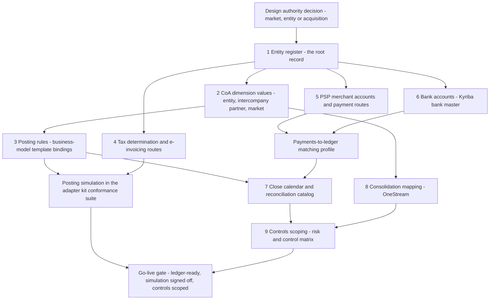
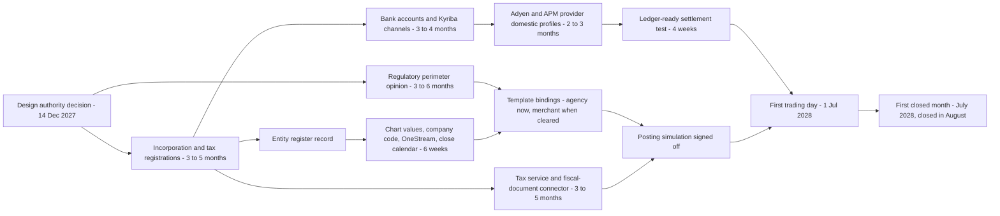
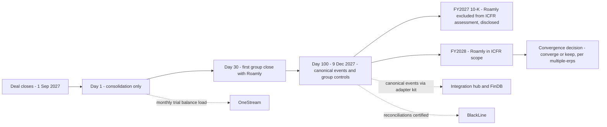

{id: brands-entities-markets}
# 35. Onboarding Brands, Entities and Markets as Configuration


> **IN THIS CHAPTER, YOU WILL:** Learn what "configuration, not code" means in each layer of a finance estate, how business-model templates and a market launch kit turn onboarding into a repeatable product, how to bring an acquired brand in over its first hundred days, and how to recognize, time-box and measure the forks that remain.

> **WHY FINANCE CARES:** Every new market or acquisition adds entities to close, accounts to reconcile, taxes to file and controls to evidence. If each one is built by hand, the close gets longer with every deal and every launch, and the controller inherits a new variant of the books each time.

> **WHY ARCHITECTS SHOULD CARE:** Growth is the stressor that tests whether the architecture's variation points are in the right places. A launch that needs code changes in the shared finance core shows exactly where they are missing, and each workaround becomes a fork the estate carries for a decade.

> **KEY POINTS:**
>
> * **Configuration is governed data in a known set of layers, not a setting someone toggles.** A new brand, entity or market touches nine layers, from the entity register to controls scoping. Each layer has an authority, an owner, a change class and a lead time. If a launch needs a code change in the shared core, a variation point is missing, and that gap should be fixed once rather than worked around.
> * **Business-model templates and a market launch kit make onboarding a product.** A template bundles canonical events, posting rules, reconciliations and controls for one way of making money. The launch kit lists every item with an owner and a lead time. The critical path runs through entities, banks, licenses and providers, not software.
> * **Acquisitions come in stages, and forks come with an expiry.** Consolidate an acquired brand from day one through a trial-balance load, bring its events and controls in by day 100, and decide convergence later on the evidence. Measure each onboarding by lead time to the first closed month and by the number of code changes it needed.

> **[FAILURE PATTERNS THIS CHAPTER ADDRESSES](#where-finance-architecture-goes-wrong):**
>
> * **The Permanent Exception** — each launch and acquisition argues for its own tax logic, posting pipeline or payout rule, and without an expiry each exception becomes a permanent fork.
> * **The Doppelgänger Record** — a new entity, bank account or merchant account is created separately in each system that needs it, from whichever document the local team had at hand.
> * **Audit Archaeology** — an acquired brand's controls, opening balances and mapping are scoped for SOX after the first close that depends on them, not before.

Most groups say they want to onboard new brands and markets "as configuration". Few can say what that means. In practice it usually means that somebody configures a company code, somebody else asks the payment provider for an account, a third person adds a mapping row to a spreadsheet, and the brand team writes whatever code is left. **Configuration that nobody has enumerated is not an architecture. It is a hope that the next launch resembles the last one.**

This chapter makes the idea precise. It builds on [Many Entities, Currencies, Jurisdictions and Brands](#global-scale), which separated legal entity, brand, market, business model and currency into five independent dimensions and introduced the legal entity register, intercompany design and the group rate service. It also builds on [Canonical Events and Adapters for Loosely Coupled Financial Domains](#loosely-coupled-domains), which designed the canonical financial events and the brand adapter kit. Those chapters supply the dimensions and the contract. This one turns them into a **repeatable onboarding capability**: the configuration layers, the business-model templates, the market launch kit, the acquired-brand playbook, the rules for legitimate forks, and the metrics that show whether any of it works.

{id: brands-entities-markets--setting-the-scene-at-northmere-one-launch-and-one-acquisition}
## Setting the Scene at Northmere: One Launch and One Acquisition

Northmere, the fictional group this book follows, has two onboarding problems on the Keystone design authority's agenda in the autumn of 2027.

The first is **Brazil**. Stayloft, Northmere's accommodation marketplace, will open to Brazilian hosts in 2028. That means a new legal entity in São Paulo with the Brazilian real (BRL) as its functional currency, local card acquiring, Pix through a local alternative payment method (APM) provider, Brazilian electronic fiscal documents, an indirect-tax system in the middle of a multi-year reform, new bank accounts, local statutory books and a 39th Pillar Two jurisdiction. [Many Entities, Currencies, Jurisdictions and Brands](#global-scale) closed with a preview table of these decisions. The commercial plan still says "configure Stayloft for Brazil".

The second is **Roamly**. Roamly is a fictional campervan and motorhome rental marketplace headquartered in Copenhagen. Owners list vehicles and renters book them, with Roamly collecting payment through Stripe and paying owners net of an 18% commission. Northmere signed to acquire it in July 2027 and the deal closed on **1 September 2027**. Roamly is small: about $38 million of revenue in 2026, about 0.5% of the group's $8.2 billion. It runs three legal entities on its own NetSuite instance (Roamly ApS in Denmark, Roamly AB in Sweden and Roamly GmbH in Germany), keeps its reconciliations in spreadsheets, and has an 11-person finance team that has never worked to a group close calendar.

Dana Whitlock, the Chief Architect, puts the two cases side by side in front of the design authority, which she chairs with Leila Haddad, the Chief Accounting Officer. Her argument is that they are the same problem. Both add entities, currencies, payment routes, bank accounts, tax obligations, reconciliations and controls to an estate that already struggles with three charts of accounts and two payout engines. And both tempt everyone involved toward the same shortcut. For Brazil it is "copy Stayloft's European setup and patch it". For Roamly it is "leave them alone, they're tiny".

Keystone's five-year goal is that **new brands and markets are onboarded as configuration**. The question for this chapter is what has to be true for that sentence to mean something.

{id: brands-entities-markets--concepts-configuration-extension-adapter-fork}
## Concepts: Configuration, Extension, Adapter, Fork

The word "configuration" hides four different kinds of change. They have different costs, owners and risks, so I separate them before anything else.

| Kind of change | What it is | Who makes it | How it is controlled | Example at Northmere |
| --- | --- | --- | --- | --- |
| **Configuration** | New values in a governed data structure the shared capability already reads: a register entry, a code-list value, a rule binding, a mapping row | The data owner's team, through a workflow | Change class, approval, effective date, evidence by design | Adding Stayloft Brasil Ltda. to the legal entity register |
| **Extension** | Code written behind a published extension point of a shared capability, without changing the capability itself | The shared capability's team, or a brand team under its standard | Normal software change management plus the extension point's contract tests | A Brazilian connector behind the e-invoicing gateway |
| **Adapter** | Code at the edge that translates a new producer or provider into the canonical language | The producer's team, using the adapter kit; or Northmere Pay for providers | Conformance suite, control totals, certification before go-live | Roamly's booking platform publishing canonical events |
| **Fork** | A separate copy or variant of a shared capability, maintained for one brand, market or entity | Whoever needed it | A recorded decision with an owner and expiry, or nothing at all | Wayfare's second payout engine |

The first three are healthy. Every new market legitimately needs some configuration, the occasional extension and, when it brings a new provider, an adapter. The fourth is **The Permanent Exception** in its mature form. The aim is not "no code". The aim is that code lands only at the edges and behind extension points, so the shared core does not change for each new brand, entity or market.

Four more terms recur:

- A **variation point** is a place where the shared design expects legitimate difference and exposes a parameter for it. Examples are a commission basis, a revenue recognition trigger, a payout schedule, or who holds the customer's funds. The design question for every capability is whether its variation points cover the differences that actually occur.
- A **business-model template** is a versioned, reusable bundle of canonical event types, posting rule families, reconciliations and controls that implements one way of making money (agency, merchant and so on). A brand and entity *bind* to a template and supply its parameters.
- A **market launch kit** is the checklist-backed set of configuration items, templates, owners, lead times and gates needed to start trading in a new market or through a new entity. It is run as a product with an owner, not reinvented as a project each time.
- **Onboarding** covers all three cases: a new market for an existing brand (Brazil), a new legal entity for an existing business, and an acquired brand (Roamly). They share most of the kit and differ in what already exists on day one.

The rule I use is P7 in [Principles, Standards and Reference Architectures](#principles-standards-reference): **configuration before code, code before forks**. Express a difference as configuration of a shared capability first. If that cannot carry it, write code behind a published extension point. Fork only by recorded decision, with a retirement date.


**Figure 1:** *Configuration before code, code before forks: the shared core stays unchanged, extensions plug into published extension points, adapters sit at the edges, and a fork is a recorded, time-boxed exception.*

{id: brands-entities-markets--the-nine-configuration-layers}
## The Nine Configuration Layers

"Configure Stayloft for Brazil" is a sentence. The architecture needs a list. At Northmere, onboarding touches nine layers. Each layer is a governed data structure with an authority (the system of record, in the sense of [Systems of Record and Authoritative Data Boundaries](#systems-of-record)), an owner, a change class from the Finance Data Council's scheme in [Finance Data Architecture: Master Data, Systems of Record and Governance](#finance-data-architecture), and a typical lead time.

| # | Layer | What configuration means concretely | Authority | Owner | Change class | Typical lead time |
| --- | --- | --- | --- | --- | --- | --- |
| 1 | **Entity register** | Legal entity record: type, ownership, functional currency and its evidence, statutory GAAP, fiscal calendar, tax residence and registrations, regulatory status, book of record per basis, system representations | Legal entity register | Legal (identity); group controller (accounting attributes) | Structural | Weeks to register; months for the underlying incorporation and registrations |
| 2 | **Chart of accounts dimension values** | New entity and intercompany-partner values; market and product values if new; validation rules unchanged | Group finance core governance workflow | Leila's group reporting team | Standard (market, product); structural (entity) | Days once the entity exists |
| 3 | **Posting rules per business model** | Binding of the entity, brand and market to one or more business-model templates, with the template's parameters | Accounting rule store | Accounting policy team | Significant | Two weeks, plus simulation |
| 4 | **Tax determination** | Registrations, jurisdiction set-up, product taxability mappings, document types and e-invoicing routes in the shared tax service and gateway | Vertex via the tax service adapter; e-invoicing gateway | Kofi Asante's tax team | Significant; extension where a new regime needs a connector | Weeks for determination; months where clearance or accreditation is involved |
| 5 | **PSP merchant accounts and payment routes** | Merchant accounts or provider profiles per contracting entity, payout currency and payout model; clearing accounts; the payments-to-ledger matching profile | Northmere Pay's provider configuration | Ingrid Solberg's team | Significant | Weeks to months, driven by provider onboarding and know-your-customer checks |
| 6 | **Bank accounts** | Accounts, signatories, statement channels, cash-pool and netting membership, restricted-cash flags | Kyriba bank account master | Kofi's treasury team | Significant | The longest single item in most launches |
| 7 | **Close calendar and reconciliation catalog** | Entity added to the close calendar; reconciliation catalog entries with risk tier, owner and evidence destination; certification gating | BlackLine and the reconciliation catalog | Leila's close team | Standard | Two to four weeks |
| 8 | **Consolidation mapping** | OneStream entity member, ownership and consolidation method, translation rules, mapping set for a non-group chart, intercompany pairs | OneStream | Group reporting | Significant (mapping); structural (ownership) | Two to six weeks |
| 9 | **Controls scoping** | Risk and control matrix instances for the entity and its flows, SOX scoping decision, entity-level controls, sub-certification | Risk and control matrix | Mei Tanaka's internal controls team | Significant | One quarter before the first relevant year-end |



**Figure 2:** *The nine configuration layers form a dependency graph rooted in the entity register. Nothing downstream can be configured for an entity the register does not know, and nothing goes live until the posting simulation, the settlement matching profile and the controls scoping have converged on the same gate.*

The figure shows which configuration depends on which, and so what to start first. Three properties make these layers *configuration* rather than a list of tasks.

**Every layer reads from the register, never from a document.** [Many Entities, Currencies, Jurisdictions and Brands](#global-scale) made the legal entity register the golden source for entity identity and attributes. In the launch kit that becomes enforceable. The integration hub rejects events for an unknown `legal_entity`, as [Canonical Events and Adapters for Loosely Coupled Financial Domains](#loosely-coupled-domains) describes. The tax service refuses a determination for an entity without registrations. Kyriba will not open a statement channel for an account whose owning entity is missing. Without these checks, **The Doppelgänger Record** returns with every launch: a merchant account opened from the commercial plan, a company code configured from a legal memo, and a OneStream entity built from an email.

**Every layer has a change class and produces its own evidence.** A business-model template binding changes how money is posted, so it is a significant change with simulation and approval. Adding a market value is standard. The Finance Data Council's change classes apply unchanged. That is why launch configuration produces SOX evidence as a by-product instead of an audit request after the fact.

**Every layer is effective-dated.** A Brazilian entity exists in the register from its incorporation date, books from its first trading date, and enters consolidation from its first reporting period. Tax configuration for a reform carries old and new regimes side by side, each with its own effective dates. Effective dating is how a launch can be prepared months ahead without anything going live early.

The layers also show where Northmere's variation points are missing. In 2027 a new **payout schedule** for a partner type requires code in SFP's payout engine. The configuration pattern exists for payout *rules* after the remediation in [Controls, Auditability and Security by Design](#controls-and-auditability), but not yet for *schedules*. That is a known gap, recorded against the Keystone convergence of the payout engines. The layers are a checklist and, just as usefully, an inventory of missing variation points.

{id: brands-entities-markets--business-model-templates}
## Business-Model Templates

Layer 3 is where most forks start. A new brand says its business is different, and often it is right at the commercial level. At the accounting level, the number of genuinely different ways of making money is small. Northmere's chart of accounts v2 has seven business-model values. Five of them carry templates:

| Template | Who holds the customer's money | Canonical events (Keystone v1) | Posting rule families (illustrative) | Reconciliations | Key controls | Northmere instances |
| --- | --- | --- | --- | --- | --- | --- |
| **Agency** | The partner; Northmere earns a commission it invoices | `BookingConfirmed`, `BookingModified`, `BookingCancelled`, `StayCompleted`, `CommissionInvoiced` | Commission accrual on completion; commission invoice and receivable; cancellation and no-show adjustment; bad-debt reserve | Commission subledger to GL; receivables aging; tax engine to GL tax accounts | Commission rate master change control; invoice completeness against completed bookings; e-invoice acceptance monitoring | Stayloft agency, Wayfare flights |
| **Merchant** (own licensed funds holder) | A Northmere licensed entity holds the funds as client money until payout | Booking events plus `PaymentAuthorised`, `PaymentCaptured`, `PaymentSettled`, `PSPFeeCharged`, `RefundIssued`, `ChargebackReceived`, `ChargebackResolved`, `PartnerPayoutInstructed`, `PartnerPayoutSettled`, `FXRateApplied` | Funds held; PSP clearing; fee; net revenue on performance; partner payable; payout; refund and chargeback families | Three-way match of booking, PSP settlement and bank; traveler funds held to subledger; daily safeguarding reconciliation | Safeguarding check before release; payout rule maker-checker; ledger-ready settlement matching | Stayloft merchant (the Lisbon booking) |
| **Marketplace with payouts** (provider-held funds) | A payment provider's platform product holds balances for the platform and its sellers | As merchant, with payouts executed by the provider platform rather than Northmere Pay | As merchant, with "provider balance" accounts replacing safeguarding accounts | Provider balance to ledger; provider payout to bank; seller payable to provider transfers | Provider-side seller onboarding evidence; transfer reconciliation; complementary user entity controls from the provider's assurance report | Tablekin venue payments (Stripe Connect), Roamly from day 100 |
| **Subscription and usage** | The customer pays Northmere for its own service | `SubscriptionInvoiced`, `UsageRated`, payment events | Billing in advance as contract liability; ratable recognition; usage recognized as delivered; sales tax liability | Billing system to revenue subledger; contract liability roll-forward; usage rated to usage billed | Price book change control; usage completeness; revenue schedule review | Tablekin subscriptions (the $1,029 invoice) |
| **Advertising** | The advertiser pays Northmere for placement | `AdClickBilled`, payment events | Billed click revenue; invalid-click credits; receivable | Click rating to billing; billing to receivables | Invalid-traffic adjustment approval; rate card change control | Northmere Ads |

Each row needs some explanation.

**A template is a package, not a document.** At Northmere it is a versioned entry in the accounting rule store that names the event types and versions it consumes, the posting rule families it applies, the reconciliation catalog entries it creates, the control instances it requires and the conformance test cases it must pass. When Leila's policy team changes a rule family in the merchant template, every binding to that template version gets the change on the same effective date, and the change goes through the posting simulation once for all of them.

**The template carries the accounting pattern; the parameters carry the business.** Stayloft and Roamly charge different commission rates, recognize revenue on different completion events, and pay partners on different schedules. None of that is a different template. Here is the binding Northmere's launch kit generated for Roamly's Danish entity, simplified:

```yaml
binding: ROAMLY-DK-RENTAL
legal_entity: Roamly ApS            # from the legal entity register
brand: RMY
business_model: MER                 # chart of accounts business-model value
market_scope: [DK, SE, NO, DE]
template: marketplace-with-payouts
template_version: 1.3
parameters:
  funds_holder: provider_platform   # Stripe balance, not a Northmere safeguarding account
  revenue_basis: net_commission     # accounting policy decision, principal-versus-agent assessed
  commission_basis: rental_price_excl_extras
  recognition_trigger: StayCompleted    # end of rental; event semantics extended in v1.4
  payout_trigger: rental_start_plus_1_day
  payout_currency_rule: owner_bank_account_currency
  deposit_holds: authorization_only     # no accounting unless captured
  tax_profile: roamly-nordic-rental-intermediation
effective_from: 2027-12-01
approved_by: accounting-policy (four-eyes), change CR-2027-1184
```

The parameters are not free text. Each refers to a value the rule store already supports. When a brand asks for a value that does not exist, such as a payout trigger the payout service cannot schedule, that request is the signal of a missing variation point. It goes to the template owner as a change request, not to the brand's backlog as a workaround.

**Agency, merchant and marketplace are accounting and regulatory distinctions, not payment-flow distinctions.** The difference between the merchant template and the marketplace-with-payouts template is *who holds the money and under which regulatory regime*. Northmere Payments B.V. holds Stayloft's merchant-model funds under e-money safeguarding. A provider platform such as Stripe Connect holds Tablekin's and Roamly's balances, and the provider's documentation of its charge types decides who bears refunds, disputes and fees ([Stripe: Connect charges](https://docs.stripe.com/connect/charges)). Revenue presentation is a third, separate question. Under Northmere's policy, all three of Stayloft merchant, Wayfare rail and Roamly are *agents* recognizing net revenue, while Tablekin is principal for the payment-processing service it sells venues. [Accounting for Architects: Ledgers, Journals and Revenue](#accounting-for-architects) explains why collecting the cash does not make a company the principal. The templates encode that separation, which is why `revenue_basis` is a parameter set by the accounting policy team after its principal-versus-agent assessment, and never inferred from `funds_holder`.

**Templates also travel to tax, and that is where they are least uniform.** Tax treatment varies with market, counterparty status and date, so templates carry a `tax_profile` reference rather than tax rules. The profile lives in the shared tax service ([Around the Core: Tax, Treasury, Procurement and Reporting Platforms](#satellite-platforms)). As [Many Entities, Currencies, Jurisdictions and Brands](#global-scale) showed for the Lisbon booking, accounting, tax and regulatory treatments are separate determinations. A template that hard-codes VAT on commission will be wrong the day a deemed-supplier rule applies to that market.

{id: brands-entities-markets--what-the-template-does-to-one-transaction}
### What the template does to one transaction

Roamly's first rental posted under its template makes the reuse concrete. A renter books a five-night motorhome rental from a Danish owner on **2 October 2027** for **DKK 6,000.00**, to start on 15 October. Roamly's commission is 18%, or DKK 1,080.00, and the owner is due DKK 4,920.00. Stripe's fee is an illustrative DKK 95.00. VAT and the separate damage-protection product are ignored for simplicity. The rental is shown here as it will post once the binding is live. In October 2027 the same economics still arrive through the trial-balance route described later.

| Date | Account | Debit (DKK) | Credit (DKK) | Note |
| --- | --- | --- | --- | --- |
| 2 Oct | Provider balance – Stripe DKK | 5,905.00 | | Renter payment net of fee, in Roamly's Stripe balance |
| 2 Oct | Payment processing fees | 95.00 | | `PSPFeeCharged` |
| 2 Oct | Renter funds held | | 6,000.00 | Liability until the rental is completed; not revenue |
| 16 Oct | Owner payables | 4,920.00 | | Transfer to the owner's connected account (`payout_trigger`: start plus one day) |
| 16 Oct | Provider balance – Stripe DKK | | 4,920.00 | |
| 20 Oct | Renter funds held | 6,000.00 | | `StayCompleted` (rental returned) |
| 20 Oct | Owner payables | | 4,920.00 | Clears the transfer already made |
| 20 Oct | Commission revenue | | 1,080.00 | Net, as agent (Northmere policy, illustrative) |

The rule families are exactly those of the Lisbon booking, with two parameter differences. The funds sit in a provider balance instead of a safeguarding account, and the payout is released at rental start instead of after completion. That second difference created a real accounting question: an owner payable paid before the obligation is earned. The policy team answered it with an existing rule family, *partner prepayment*, rather than new code. **Reusing the template forced the question into the open in a design review, instead of leaving it to surface as an unexplained balance at the first close.**

{id: brands-entities-markets--where-templates-change}
### Where templates change

Templates are not frozen. Roamly needed one genuine extension. `StayCompleted` was defined in Keystone v1 as "the guest checked out of an accommodation", and a campervan rental is not a stay. Lucía Romero's canonical model change board, described in [Canonical Events and Adapters for Loosely Coupled Financial Domains](#loosely-coupled-domains), approved an additive change in v1.4. The event's definition was generalized to "the service period ended", and a `service_type` payload field was added with values for stays, rentals and journeys. This was a governed change to the shared language, made once and usable by every future brand. The alternative, a `RentalCompleted` event that only Roamly would ever publish, would have been the first step toward a Roamly-specific posting pipeline.

{id: brands-entities-markets--the-market-launch-kit}
## The Market Launch Kit

Templates answer *how the money posts*. The **market launch kit** answers *what has to exist before the first transaction, who provides it and how long it takes*. Northmere runs it as a product owned by a launch kit lead in Dana's team, with a checklist in the onboarding portal described in [Canonical Events and Adapters for Loosely Coupled Financial Domains](#loosely-coupled-domains). Each item has an owner, a lead time, its dependencies and the gate it feeds.

The kit's most useful property is that it makes the critical path visible early. **In every launch I have seen, the critical path ran through legal entities, banks, licenses and providers, not through software.** Configuring a company code takes days. Opening a bank account for a newly incorporated foreign-owned company can take months. Teams that plan around the software meet the banking timeline in the last month.

{id: brands-entities-markets--brazil-item-by-item}
### Brazil, item by item

Here is the Brazil kit as the design authority approved it on **14 December 2027**, with a target first trading day of **1 July 2028**. Lead times are Northmere's planning estimates. Items marked *to be confirmed* depend on Brazilian law and practice that local advisers must confirm, and the chapter does not state them as fact.

| Item | Owner | Planning lead time | Depends on | Notes |
| --- | --- | --- | --- | --- |
| Regulatory perimeter: may Stayloft Brasil hold traveler funds between booking and stay, or must a licensed provider hold them? | Ingrid Solberg with compliance and local counsel | 3–6 months for an opinion; far longer if a local authorization is needed | — | *To be confirmed with local advisers.* Decides the template parameter `funds_holder`, not the architecture |
| Incorporate Stayloft Brasil Ltda.; obtain tax registrations | Legal, Kofi Asante | 3–5 months | — | A new operating entity, not the existing São Paulo engineering service entity ([Many Entities, Currencies, Jurisdictions and Brands](#global-scale)) |
| Entity register record, functional currency evidence (BRL), statutory GAAP | Group controller | 2 weeks after incorporation | Incorporation | Functional currency is determined by economic facts under [IAS 21](https://www.ifrs.org/issued-standards/list-of-standards/ias-21-the-effects-of-changes-in-foreign-exchange-rates/), not chosen |
| Bank accounts (operating, tax payments, provider settlement) at two local banks; signatories; statement channels into Kyriba | Kofi's treasury team | 3–4 months | Incorporation, registrations | The longest technical item; also the one most often started too late |
| Treasury rules for moving money into and out of Brazil (capital injection, royalties, service fees) | Treasury, group tax | 2–3 months | Entity, banks | *To be confirmed with local advisers*; decides whether Brazil joins netting |
| Local card acquiring through Adyen: a merchant account contracted by the Brazilian entity | Northmere Pay | 2–3 months | Entity, banks, perimeter decision | Adyen documents pass-through payout as the only payout model available in Brazil ([Adyen: Getting paid](https://docs.adyen.com/account/getting-paid)), so the batch shape and matching profile differ from Europe |
| Pix and other local methods through the local APM provider: a domestic settlement profile in BRL to the Brazilian entity | Northmere Pay | 2–3 months | Entity, banks | Northmere Pay already accepts Pix through this provider for Brazilian travelers booking abroad, settled to Northmere Payments B.V. The domestic profile needs a new contracting entity, settlement currency and settlement report |
| Indirect tax set-up in the shared tax service, including the transition rules of Brazil's consumption-tax reform | Kofi's tax team | 3–4 months | Registrations | *To be confirmed*: rules for the commission and any amounts collected on behalf of hosts; both old and new regimes configured with effective dates |
| Electronic fiscal documents through the e-invoicing gateway | Tax, Lucía's integration team | 3–5 months including provider accreditation | Registrations, gateway connector | One new connector behind the gateway's extension point; the issuing systems do not change |
| Chart of accounts values (entity BR01, intercompany partner) | Group reporting | Days | Register | Market `BR` and the accommodation products already exist |
| Template bindings: agency and merchant for Stayloft Brasil, with parameters | Accounting policy | 2 weeks plus simulation | Chart values, perimeter decision | Merchant binding stays inactive until the perimeter decision; the agency binding can go live alone |
| S/4HANA company code in the group core; local GAAP in a parallel ledger | Sven Aalto's SAP team | 4–6 weeks | Register, chart values | Configuration under change management, created from the register |
| Close calendar, reconciliation catalog entries (about 45 accounts), BlackLine set-up | Leila's close team | 3 weeks | Company code, clearing accounts | Brazilian provider and bank accounts enter matching from the first day |
| OneStream entity member, ownership, translation | Group reporting | 2 weeks | Register | Group chart, so no mapping set is needed |
| Intercompany agreements: brand royalty to Stayloft B.V., payment service fees, shared services | Group tax, legal | 2–3 months | Entity | Transfer pricing reviewed for local rules; *to be confirmed* |
| Local statutory reporting and bookkeeping obligations | Group controller, local accountant | 2–3 months to set up | Entity, ledger | *To be confirmed*: Brazil runs electronic bookkeeping and tax-reporting obligations that read directly from the books |
| Controls scoping and risk and control matrix instances | Mei Tanaka | 1 quarter before the first year-end in scope | All above | Brazil will be immaterial at launch; scoping decides which group-level controls cover it |
| Ledger-ready test: settlement data from Adyen and the APM provider matches automatically at the agreed rate | Northmere Pay, Leila's team | 4 weeks of testing | Providers, BlackLine | Keystone's "ledger-ready before launch" criterion ([Payments for Finance Architects: The Lifecycle of Money Movement](#payments-fundamentals)) |



**Figure 3:** *The Brazil critical path runs through incorporation, banking and providers. The software configuration fits in a few weeks inside that path, which is why the kit starts the slow items on the day of the decision.*

Three design choices in the Brazil plan are worth drawing out.

**The perimeter decision is a parameter, not a redesign.** Nobody at Northmere knows in December 2027 whether Stayloft Brasil may hold travelers' money between booking and stay without a local authorization. In a forked architecture that uncertainty would freeze the build. Here, the merchant binding exists with `funds_holder` either `provider_held` or `own_entity`, and the agency binding can launch alone. If the opinion arrives late, Brazil launches as agency on 1 July and the merchant binding is activated later by an approved configuration change, with its own simulation. **Uncertainty that the architecture can express as a parameter does not block the plan.**

**The tax reform is effective-dated configuration, not a project.** Brazil's consumption-tax reform was enacted by constitutional amendment in December 2023. It is widely reported to phase in new value-added taxes alongside the existing taxes over several years, with the old taxes withdrawn in stages into the 2030s. The specific rules, rates and document requirements for an intermediation platform are exactly what Northmere must confirm with local advisers, and this book does not state them. The architectural point holds whatever the details are. A tax service that stores every determination with its rule version and effective date can run both regimes side by side during the transition. A booking platform with tax arithmetic in its code cannot. Early in the plan, the Stayloft Brazil product team asked to compute Brazilian taxes in the booking service so that checkout could show a tax-inclusive price. The design authority declined, and the booking service calls the tax service's estimate endpoint instead, as [Around the Core: Tax, Treasury, Procurement and Reporting Platforms](#satellite-platforms) describes for quotes. That was **The Permanent Exception** in its smallest form, caught at design time.

**Payments reuse what exists and add one thing.** Northmere Pay already accepts Pix for Brazilian travelers booking abroad, through the local APM provider and settled to Northmere Payments B.V. Pix is the Brazilian central bank's instant payment scheme, launched in 2020 and available around the clock ([widely reported](https://www.globalgovernmentforum.com/brazil-central-bank-launches-instant-payments-system-pix/)). The new thing is *domestic* settlement to a Brazilian entity in BRL. The provider configuration and the matching profile are new. The provider's anti-corruption layer is extended to read a second settlement report, and that is one of the plan's four code items. Adyen's documented pass-through payout model in Brazil produces a different batch shape from Europe, which is why [Adyen: Single-Platform Acquiring and Platform Payments](#adyen) predicted a separate merchant account for Brazil. That account follows Northmere's rule for merchant accounts: split by contracting entity, payout model and currency, and carry brand as data.

{id: brands-entities-markets--what-the-kit-counts}
### What the kit counts

The Brazil plan contains about **190 configuration items** across the nine layers, two template bindings and **four code items**:

| Code item | Kind | Why it is not configuration |
| --- | --- | --- |
| Domestic settlement report mapping in the APM provider's anti-corruption layer | Adapter | A new report format from an existing provider |
| Brazilian fiscal-document connector behind the e-invoicing gateway | Extension | A new regime behind a published extension point; issuing systems unchanged |
| Booking platform: capture of host and traveler tax identifiers on Brazilian bookings, where local advisers confirm they are needed on fiscal documents | Brand change (data capture) | New data at the source; no finance logic in the brand |
| Kyriba statement format for one of the two banks | Extension (vendor-supported) | A bank format not yet in the treasury system's library |

There are no changes to the accounting rule engine, the subledger, consolidation, the close platform or the payout service. That is the result Keystone is aiming for.


**Figure 4:** *Brazil as configuration: about 190 configuration items across the nine layers and four code items at the edges, with no change to the accounting engine, subledger, consolidation, close platform or payout service.*

{id: brands-entities-markets--onboarding-an-acquired-brand-the-first-hundred-days}
## Onboarding an Acquired Brand: The First Hundred Days

An acquisition differs from a market launch in one respect that changes everything. **The business already trades.** On the day the deal closes, the acquired company has entities, books, a payment provider, bank accounts, tax filings and staff, all of it working. The group's job is not to build its finance stack. It is to bring the acquired company into group reporting immediately, into group controls and data quickly, and into the group's platforms only when that is worth doing.

The generalized domain model behind this book puts the response in one phrase: **consolidate from day one, stream canonical events, retire legacy on a dated plan**. Northmere's playbook splits that into three horizons.



**Figure 5:** *The acquired-brand timeline separates three questions that are often merged: when the group can report the brand (day 1), when the group can rely on its data and controls (day 100), and whether the brand's systems should be replaced (a later decision on evidence).*

{id: brands-entities-markets--day-1-consolidation-only}
### Day 1: consolidation only

On the day the deal closed, Roamly entered the group through the thinnest possible interface, a **monthly trial-balance (TB) load** into OneStream. No interface to S/4HANA, no change to Roamly's booking platform and no change to its Stripe integration. What *did* happen on day 1 was configuration in five of the nine layers:

- **Entity register.** Roamly ApS (DKK functional currency), Roamly AB (SEK) and Roamly GmbH (EUR) were registered as brand operating entities. NetSuite was recorded as their book of record, and acquisition date and ownership were recorded for consolidation. Kofi's team confirmed the functional currencies against economic facts rather than copying NetSuite's settings.
- **Chart values.** Brand code `RMY` and three entity and intercompany-partner values were added. Both the brand list and the business-model list grow by configuration.
- **Consolidation mapping.** Roamly's chart of about 380 NetSuite accounts was mapped to the group chart as governed, effective-dated rules in OneStream under the April 2027 mapping ADR ([OneStream: Consolidation, Planning and Performance Management](#onestream)). Roamly's finance team became the source owner, group reporting the approver, and there were no catch-all rules. The first load surfaced 17 unmapped accounts and stopped, as designed.
- **Bank accounts.** Roamly's nine bank accounts at three banks were added to the Kyriba bank account master on statement-only channels. That gave the group cash visibility from week one, with no change to who could pay.
- **Controls.** Entity-level controls were applied, and a sub-certification by Roamly's CFO was introduced. Write access to Roamly's payment and bank systems was frozen to the existing approvers, with any new access approved by Northmere's controls team.

Consolidation-only is not the same as "no accounting change". Roamly's management accounts presented gross rental value as revenue and owner payouts as cost of sales, while Northmere's policy treats Roamly as an agent recognizing its commission net. A mapping cannot change presentation. Until day 100, group reporting therefore posts a **documented reclassification** in OneStream each month, calculated from Roamly's commission report and reviewed as a key control. The opening balance sheet at fair value from the purchase price allocation sits in the same place. Both are top-side adjustments with an owner, a calculation and an expiry. They are not permanent features of the consolidation, which is what [OneStream: Consolidation, Planning and Performance Management](#onestream) warns against.

{id: brands-entities-markets--day-30-the-first-group-close}
### Day 30: the first group close

Roamly's September 2027 numbers entered the group's September quarter close. It was tight. Roamly had closed on working day 10. Northmere's calendar runs a flash consolidation on working day 3 and the final consolidation on working day 7. For the first quarter the design authority granted a recorded exception: Roamly submitted a preliminary trial balance for the flash and its final one on working day 6, the latest point at which group reporting could still review the mapping and the reclassification before the final run. The exception expires with the December close.

{id: brands-entities-markets--day-100-canonical-events-and-group-controls}
### Day 100: canonical events and group controls

By **9 December 2027**, day 100, Roamly had moved from "reported" to "relied upon". Four things changed:

1. **Canonical events.** Roamly's booking platform publishes `BookingConfirmed`, `BookingModified`, `BookingCancelled` and `StayCompleted` (under the v1.4 definition) through the adapter kit's SDK. Roamly's engineers built the adapter in about six engineer-weeks. The conformance suite ran a posting simulation of three weeks of Roamly's production bookings against the marketplace-with-payouts template, and Leila's policy team signed off the simulated entries before the first production event.
2. **Payment data.** Roamly's Stripe account was brought under Northmere Pay's Stripe anti-corruption layer and into the Stripe Data Pipeline feed into FinDB that Tablekin already uses ([Stripe: Programmable Payments, Billing and Connected Accounts](#stripe)). The payment events, provider balance and payout matching now look like every other provider's. This was configuration of an existing anti-corruption layer, not a new one.
3. **Reconciliations.** About 140 balance-sheet accounts across the three entities entered BlackLine with risk tiers and owners, replacing the spreadsheets. Renter funds held, owner payables and the Stripe balance are reconciled under the template's catalog entries.
4. **Group controls on Roamly's flows.** Roamly staff moved onto corporate identity with registered segregation-of-duties roles. Changes to the commission rate master and to payout rules came under maker-checker approval. Bank signatories came under the Kyriba master.

Two things deliberately did *not* change at day 100. **Roamly still keeps its books in NetSuite**, now fed by postings derived from the template and summarized daily into NetSuite through a thin adapter, so the commission reclassification top-side retires with the December close. **Roamly still files its own Nordic and German taxes** with NetSuite's tax set-up, pending its move to the shared tax service in 2028. Both are recorded waivers with owners and expiry dates.

{id: brands-entities-markets--later-converge-or-keep}
### Later: converge or keep

Whether NetSuite survives is a decision for [Multiple ERPs, One Finance Core: Coexistence and Convergence](#multiple-erps), not for the onboarding playbook. The playbook supplies the evidence: the close timeliness Roamly reached, the cost of a fourth ERP, the volume, and the fit with Keystone's 2029 convergence onto one group finance core. Dana's recommendation, recorded for the 2028 review, is to migrate Roamly's three entities into the group core as company codes in the 2029 convergence wave at a year boundary. A fourth ERP for 0.5% of revenue fails every test in [Multiple ERPs, One Finance Core: Coexistence and Convergence](#multiple-erps), and the day-100 work means the migration replaces the ledger without touching Roamly's events, reconciliations or controls. The fallback, if convergence slips, is to keep NetSuite as a governed second-tier ledger under the same conditions Workday Financials faces in [Workday: Financials, People and the Organizational Backbone](#workday).

{id: brands-entities-markets--sox-scoping-for-an-acquisition}
### SOX scoping for an acquisition

Acquisitions create a particular timing problem for a US registrant like Northmere, a large accelerated filer whose auditor attests to internal control over financial reporting (ICFR). The SEC staff's long-standing guidance lets management exclude an acquired business from its annual ICFR assessment for a limited time. The exclusion "may not extend beyond one year from the date of acquisition", nor may the assessment be omitted from more than one annual report. Management must identify the excluded business and state its significance, and must still disclose any material change in ICFR caused by the acquisition ([SEC staff FAQ, Question 3, revised 2007](https://www.sec.gov/oca/controlfaq.htm)).

Mei Tanaka, Head of Internal Controls, and the external auditor agreed the following for Roamly:

- **FY2027:** Roamly is excluded from management's assessment. The 10-K names it and states its significance. The exclusion covers *Roamly's own* controls. It does **not** cover the group's controls over Roamly's numbers: the TB load and its mapping, the reclassification top-side, the purchase price allocation and goodwill, and the consolidation entries. Those are group controls that exist because of the acquisition, so they are designed, documented and tested in FY2027.
- **FY2028:** Roamly is in scope. About 25 key controls are added to the risk and control matrix. Most are instances of the marketplace-with-payouts template's controls, which is why they can be designed in December 2027 instead of discovered in an interim audit in mid-2028.

The trap is treating the one-year exclusion as a year without control work. **The exclusion postpones the assessment, not the design.** A team that uses the year to integrate superficially reaches the first in-scope year-end with controls that have operated for a few weeks and evidence that lives in spreadsheets. That is **Audit Archaeology** with a deal timetable. The day-100 milestone exists so that the controls have most of a year of operating history before they are assessed.

{id: brands-entities-markets--when-a-fork-is-legitimate}
## When a Fork Is Legitimate

Not every difference fits a variation point, and pretending otherwise drives teams to hide forks inside "configuration" that is really code. [Why Enterprises Build Their Own Finance Platforms](#custom-finance-platforms) gives five legitimate reasons to build finance software. The narrower question here is when a *brand-, market- or entity-specific variant* of a shared capability is justified. I accept four reasons:

| Reason | Test | Example |
| --- | --- | --- |
| **A binding external date the shared capability cannot meet** | A regulator, contract or deal date that is fixed, before the shared capability's committed delivery date | A national e-invoicing mandate that goes live before the gateway supports that country |
| **A genuinely new business model** | The template set cannot represent the model's obligations without inventing meanings for its parameters | A new brand that sells pre-purchased inventory as principal, for which no template exists yet |
| **An expected separation** | A divestiture, carve-out or joint venture is planned or likely, so tight integration would have to be undone | A brand being prepared for sale keeps its own ledger and tax set-up |
| **A shared capability that does not yet exist** | The capability is on the target state but not live, and waiting would stop the business | Roamly's own tax filing until the shared tax service covers its markets |

The commonest reasons offered are not on the list: "our customers are different", "our team knows the old system", "the shared platform is slow to change". The last one deserves an answer rather than a refusal. If the shared capability is too slow, that is a funding and governance problem for [Architecture Governance That Speeds Decisions](#architecture-governance) to fix. Granting a fork in that case hides the problem.

**A legitimate fork is time-boxed by design.** Northmere's waiver rules from [Architecture Governance That Speeds Decisions](#architecture-governance) apply, with four additions for forks:

1. **The data contract is not waivable.** A forked capability still reads the entity register, still publishes canonical events and still produces the template's reconciliations. The fork changes *how* something is computed, not *what* the rest of the estate sees. This is what makes the fork reversible.
2. **Exit criteria, not just an expiry date.** The record states what must be true for the fork to retire, such as "gateway supports Poland in production for one month". It names who will check, and the expiry is the latest date by which that should happen.
3. **A visible carrying cost.** The fork's annual cost, in run cost, controls and duplicated regulatory change, is recorded in the portfolio ([Manage the Application Portfolio as an Investment](#application-portfolio)) so the decision to extend it is a decision about money.
4. **One extension, then escalation.** A fork can be extended once by the design authority. A second extension goes to Tomás Ferreira, the CFO, and Ravi Menon, the CTO, as a strategic decision, because by then it is no longer a fork. It is a second platform.

Wayfare's payout engine is the cautionary case. It was kept at the 2024 acquisition because ground-transport contracts "work differently", with no exit criteria and no expiry. By 2027 the difference had shrunk to a payment schedule and a netting rule, at a carrying cost of about $2.64 million a year. Under these rules it would have carried the exit criterion "SFP payout engine supports supplier schedules and netting", and its retirement would have been a dated plan from the start rather than a Keystone wave-2 item five years later.

{id: brands-entities-markets--measuring-onboarding}
## Measuring Onboarding

Keystone's year-5 goal, new brands and markets onboarded as configuration, needs numbers, or it will be declared achieved by whoever launches the next market. Northmere tracks five, per onboarding:

| Metric | Definition | Why it matters | Northmere value |
| --- | --- | --- | --- |
| **Lead time to first closed month** | From the design authority decision (or deal close) to the first month whose books close on the group calendar with all catalog reconciliations certified | The business outcome: the group can report and rely on the new entity | Brazil: planned 14 Dec 2027 to the July 2028 close, about 34 weeks. Roamly: deal close to the first fully reconciled close (December 2027) about 4 months |
| **Code changes by kind** | Count of changes classified as extension, adapter, brand data capture, shared-core change or fork | Shared-core changes and forks point to missing variation points | Brazil plan: 4 (1 adapter, 2 extensions, 1 brand data capture), 0 shared-core, 0 forks. Roamly: 1 adapter, 1 canonical model change, 0 shared-core, 0 forks |
| **Configuration items and their automation** | Items in the kit, and the share validated automatically (register checks, simulation, matching tests) rather than by review | A growing manual share means the kit is decaying into a document | Brazil: about 190 items, about 60% validated automatically |
| **Waivers opened at launch** | Recorded exceptions created by the onboarding, with their ages | Exceptions are expected; old ones are forks in disguise | Roamly: 3 (close timing, tax, NetSuite ledger), all with expiry dates |
| **Time to ledger-ready** | From first transaction to the first day settlement matches automatically at the agreed rate | Suspense from new providers is the commonest launch debt ([Payments-to-Ledger: Connecting Providers, Brand Platforms and the ERP](#payments-to-ledger)) | Brazil target: before first trading day |

The first two are the ones I would put in front of the CFO. Lead time to the first closed month measures what the business experiences. Counting code changes by kind is the architecture's own test: each shared-core change or fork is a variation point the next launch will need again. The generalized domain model behind this book sets targets in the same spirit: onboarding effort falling from about 60 to about 20 engineer-weeks, adapter reuse rising from 35% to 80%, and parallel runs shrinking from four closes to two. These are planning ambitions, not benchmarks, but they say the right thing. **Onboarding gets cheaper only if each one leaves the kit better than it found it.** After Roamly, the kit gained the v1.4 service-period definition, a NetSuite TB load mapping template and a day-100 checklist. After Brazil it will gain a pass-through settlement profile and a reform-aware tax configuration pattern.

{id: brands-entities-markets--trade-offs-how-much-to-standardize}
## Trade-Offs: How Much to Standardize

There is a real tension here. Over-standardize, and the group forces a campervan marketplace into a hotel model and pays for it in workarounds. Under-standardize, and every brand runs its own stack. The options:

| Approach | Strengths | Weaknesses | Right when |
| --- | --- | --- | --- |
| **Copy the nearest brand's stack** | Fast for the first launch; familiar to the team | Every copy is a fork; regulatory change is built once per copy; this is how Northmere got two payout engines | Never as a strategy; occasionally as a dated fork for a separation |
| **Leave the acquired brand alone, consolidate only** | Protects deal value; minimal disruption | Hardens into a permanent parallel stack; controls and data stay outside the group's reach; the "temporary" ERP lasts a decade | A planned divestiture, or the first 100 days only |
| **Shared capabilities with templates and a launch kit** (this chapter) | Launches and acquisitions become configuration; each improves the kit; controls by design | Needs a funded kit team, governed templates, and variation points designed ahead of demand | A multi-brand group that launches markets or acquires regularly, as Northmere does |
| **One global template, no variation** | Simplest to govern; strongest comparability | Real differences move to spreadsheets and side systems; brands route around it | Single-business-model groups |

The third row is my recommendation for Northmere. It holds only while two conditions hold. The kit must be funded centrally, as [Canonical Events and Adapters for Loosely Coupled Financial Domains](#loosely-coupled-domains) argued for the adapter kit; a kit each brand pays for loses to the brand's roadmap. And the template owner must answer variation-point requests in weeks, not quarters. When either condition fails, brands rationally choose the first row, and the design authority should treat the resulting forks as evidence about the kit, not just about the brands.

{id: brands-entities-markets--integration-with-the-rest-of-the-estate}
## Integration with the Rest of the Estate

The launch kit owns none of the layers it configures; it orchestrates them. Registers and chart values belong to [Finance Data Architecture: Master Data, Systems of Record and Governance](#finance-data-architecture) and [Many Entities, Currencies, Jurisdictions and Brands](#global-scale), events and the adapter kit to [Canonical Events and Adapters for Loosely Coupled Financial Domains](#loosely-coupled-domains), posting rules to the accounting engine in [Designing Custom Ledgers and Financial Event Processing](#designing-financial-ledgers), tax and e-invoicing to [Around the Core: Tax, Treasury, Procurement and Reporting Platforms](#satellite-platforms), provider set-up to [Adyen: Single-Platform Acquiring and Platform Payments](#adyen), [Stripe: Programmable Payments, Billing and Connected Accounts](#stripe) and [Payments-to-Ledger: Connecting Providers, Brand Platforms and the ERP](#payments-to-ledger), reconciliation design to [Designing for Traceability, Reconciliation and Audit Across Boundaries](#traceability-and-reconciliation), close gating to [BlackLine: Close Automation, Reconciliation and Continuous Accounting](#blackline) and [OneStream: Consolidation, Planning and Performance Management](#onestream), and scoping to [Controls, Auditability and Security by Design](#controls-and-auditability). The kit contributes the dependency graph, one checklist and one gate, so that nine owners converge on a launch date without running nine projects.

{id: brands-entities-markets--failure-modes}
## Failure Modes

- **The launch planned around the software.** The company code is ready in February and the bank account opens in June. The plan slips by the banking lead time, and the team fills the gap with a temporary arrangement through another entity's account, which then becomes permanent.
- **The template forked by parameter abuse.** A brand team cannot get a variation point added, so it sets a parameter to a value that "works": a recognition trigger on payment instead of completion, say. The ledger is wrong in a way no test catches, because the template is behaving as configured.
- **The day-1 top-side that never retires.** A policy reclassification for an acquired brand stays in the consolidation for years. Nobody can explain its calculation after the person who built it leaves, which is **Spreadsheet Glue** at group level.
- **The exclusion year spent waiting.** An acquired brand is excluded from the ICFR assessment, nothing is designed, and the first in-scope year-end arrives with controls that have operated for weeks.
- **The fork with no data contract.** A legitimate, dated fork is allowed to stop publishing canonical events "until it is retired". Retirement then needs a data migration nobody planned, so it does not happen.
- **The register bypassed under deadline.** A merchant account or bank account is opened from the commercial plan a week before launch, and the register catches up a quarter later. The hub's rejection of unknown entities, which [Canonical Events and Adapters for Loosely Coupled Financial Domains](#loosely-coupled-domains) showed quarantining 37 events, is the safety net. It should never be the first time anyone notices.

{id: brands-entities-markets--the-chief-architect-s-view}
## The Chief Architect's View

Onboarding is where an architecture's claims meet the business's growth plans. A Chief Architect can draw a clean target state. Whether it holds is decided the first time a market launch has a hard date and the shared capability is not ready. The decisions that matter:

| Decision | Who decides | The architect's role |
| --- | --- | --- |
| The configuration layers and their authorities | Design authority, with each layer's data owner | Define the nine layers, their dependencies and the go-live gate; make the register the root |
| Business-model templates and their variation points | Chief Accounting Officer (accounting policy), with the template owner | Ensure templates are versioned packages with simulation; track variation-point requests as demand |
| Launch kit ownership and funding | CFO and CTO | Fund the kit centrally and give it a product owner; publish its lead times |
| Regulatory perimeter per market | Licensed-entity management and compliance | Make the perimeter a template parameter so the decision does not block the build |
| Acquisition integration horizons | CFO, with the deal team | Insist on day-1 consolidation and day-100 events and controls in the integration plan, before signing |
| SOX scoping of acquisitions | Head of internal controls, with the external auditor | Ensure group-level controls over the acquired numbers are designed in the exclusion year |
| Forks | Design authority; second extensions to CFO and CTO | Enforce the four fork rules; report carrying cost |
| Convergence of acquired ERPs | Per [Multiple ERPs, One Finance Core: Coexistence and Convergence](#multiple-erps) | Supply the evidence; keep the data contract so convergence is a ledger swap |

**What to watch:** lead time to first closed month, trending down launch by launch; shared-core code changes per onboarding, which should be zero; the age of waivers opened by onboardings; variation-point requests waiting on template owners; and the share of launch-kit items validated automatically. If the next launch takes longer than the last one, the kit is decaying.

**What to resist:** the integration plan that defers finance to "phase 2" of an acquisition, and the market plan that treats banking and licensing as legal's problem. Both put the slowest items outside the plan and guarantee a workaround. Resist also the reverse error: forcing an acquired brand onto the group's ERP in its first year to prove a point. The playbook separates reporting, reliance and replacement because they have different value and different risk. Merging them is **Big-Bang Bravado** on a deal timetable.

{id: brands-entities-markets--questions-to-ask}
## Questions to Ask

1. Can we list every configuration item a new market needs, with its authority, owner and lead time, and which of them the last launch got wrong?
2. Which systems can create an entity, bank account or merchant account that the legal entity register does not know?
3. How many business-model templates do we have, are they versioned packages with posting simulation, and how many brands bypass them?
4. Which variation points did our last two launches ask for that did not exist, and were they added or worked around?
5. For our next market, which items are on the critical path, and have the slow ones started?
6. For our last acquisition, on which day did we consolidate it, on which day did we rely on its data and controls, and is its ERP decision recorded?
7. Which group-level controls over the acquired brand's numbers did we design during the ICFR exclusion year?
8. Which forks exist today, what are their exit criteria, what do they cost each year, and do they still publish the canonical events?
9. What was the lead time from decision to first closed month for our last launch, and how many code changes did it need, by kind?

{id: brands-entities-markets--from-onboarding-to-migration}
## From Onboarding to Migration

Onboarding as configuration describes how the estate should grow. Northmere still has to get there from where it is: a custom subledger holding most of its volume, three ledgers and duplicated payout and billing capabilities, all moving onto the shared core while the close keeps running every month. [Modernizing Without Stopping the Close: An Incremental Migration](#incremental-modernization) works through that migration, with Stayloft's merchant subledger moving in stages from SFP to the group accounting engine that posts into S/4HANA, and reconciliations serving as the gates between them.

{id: brands-entities-markets--sources-and-evidence}
## Sources and Evidence

{id: brands-entities-markets--vendor-documentation}
### Vendor documentation

- [Getting paid](https://docs.adyen.com/account/getting-paid), Adyen Docs, accessed October 2026 — payout models; pass-through payout as the only model available in Africa, Brazil and India.
- [Account structure](https://docs.adyen.com/account/account-structure), Adyen Docs, accessed October 2026 — company and merchant accounts, and splitting merchant accounts by region or brand.
- [Connect charge types](https://docs.stripe.com/connect/charges), Stripe Docs, accessed October 2026 — direct, destination and separate charges and transfers, and where refunds, disputes and fees land.

{id: brands-entities-markets--standards-and-regulation}
### Standards and regulation

- [Management's Report on Internal Control Over Financial Reporting and Certification of Disclosure in Exchange Act Periodic Reports: Frequently Asked Questions](https://www.sec.gov/oca/controlfaq.htm), US SEC Office of the Chief Accountant, revised 24 September 2007 — Question 3: excluding an acquired business from management's ICFR assessment for no more than one year and one annual report, with identification, significance and disclosure of material changes.
- [IAS 21 The Effects of Changes in Foreign Exchange Rates](https://www.ifrs.org/issued-standards/list-of-standards/ias-21-the-effects-of-changes-in-foreign-exchange-rates/), IFRS Foundation — functional currency determined by the primary economic environment.
- [VAT in the Digital Age](https://taxation-customs.ec.europa.eu/taxation/vat/vat-digital-age-vida_en), European Commission — deemed-supplier rules for platforms from July 2028, cited for the separation of tax and accounting treatment in templates.
- [Brazil central bank launches instant payments system Pix](https://www.globalgovernmentforum.com/brazil-central-bank-launches-instant-payments-system-pix/), Global Government Forum, November 2020 — secondary report of Pix's launch by Banco Central do Brasil and its round-the-clock availability; Pix details were not verified against the central bank's own pages for this edition.

{id: brands-entities-markets--practitioner-and-research-sources}
### Practitioner and research sources

- The generalized finance-domain model behind this book (capability bricks, streams and stressors) — the brand finance adapter kit, the "onboard a brand onto the global finance core" stream (assess, decide, map, integrate, parallel-run, cut over), the acquisition stressor ("consolidate from day one"), and onboarding targets (engineer-weeks, adapter reuse, parallel runs), used as planning ambitions, not benchmarks.
- [Architecture: Selling Options](https://architectelevator.com/architecture/architecture-options/), Gregor Hohpe — the framing of variation points and effective-dated parameters as options that let a decision be taken later.

Brazil-specific tax, e-invoicing, statutory, foreign-exchange and regulatory rules are described only at the level of "to be confirmed with local advisers". The December 2023 constitutional reform and its multi-year transition are as widely reported, and the chapter states no rates, document types or dates as fact.

Northmere Group, Roamly and every figure attributed to them are fictional. Architectural recommendations are the author's judgment.
