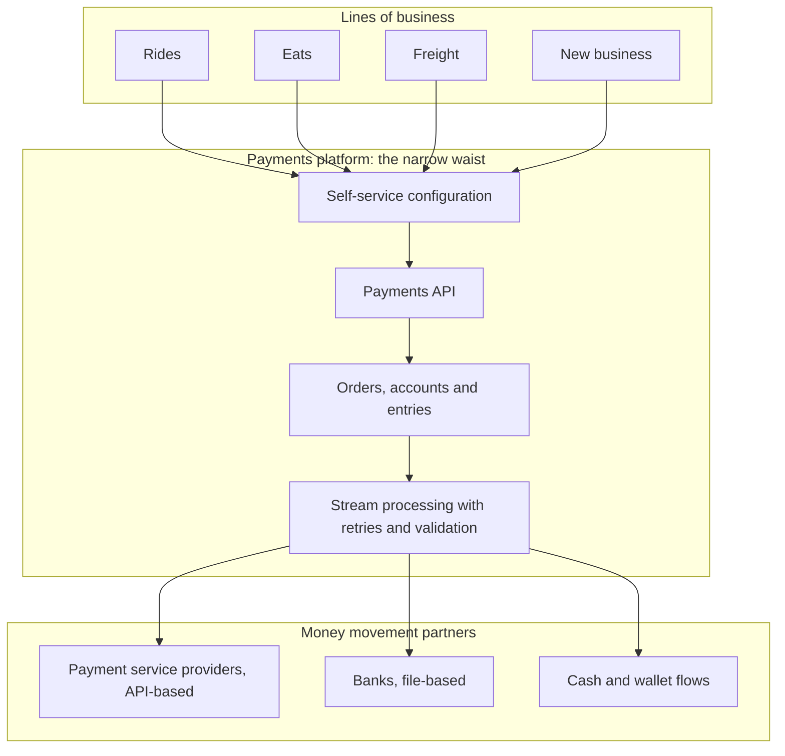
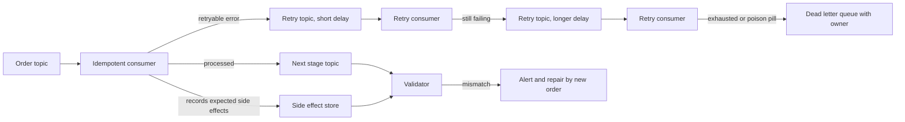
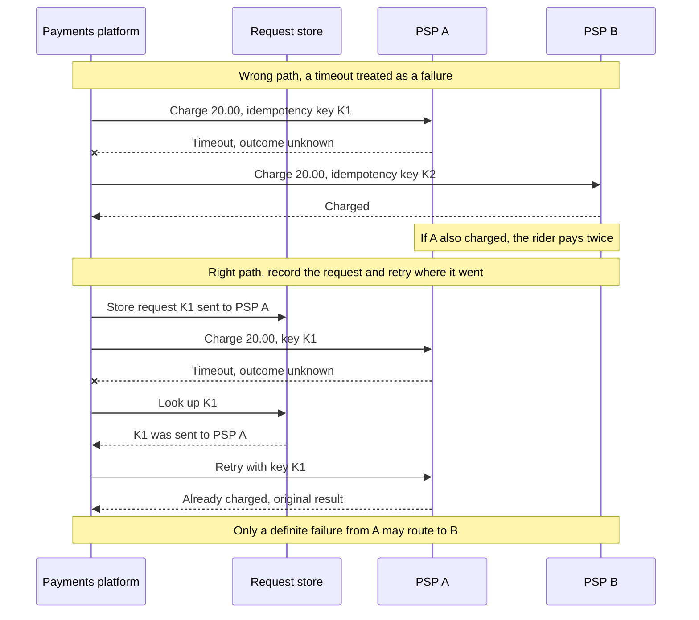
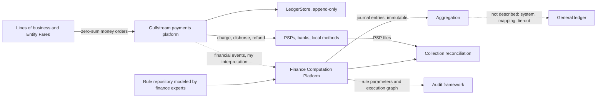
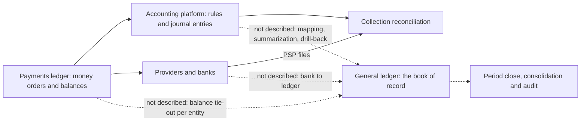

{id: case-uber-payments}
# 48. Uber's Payments Platform: A Ledger at the Center of Money Movement

> **IN THIS CHAPTER, YOU WILL:** Read Uber's payments platform as a case study: what Uber's engineers have said in public since 2018, what that evidence supports and what it does not, and how its choices compare with the patterns this book recommends and with the choices made at Northmere, the fictional group this book follows.

> **WHY FINANCE CARES:** A payments platform that keeps its own zero-sum ledger can prove that money moved correctly, but not, by itself, that the books are right. The controller needs to know where a platform's ledger ends and the book of record begins, and who reconciles the two.

> **WHY ARCHITECTS SHOULD CARE:** Most published payments architectures are vendor material. Uber's talks and blog posts are one of the few long-running, engineer-authored public records of a payments platform at global scale, and they let you test this book's patterns against a real system rather than an invented one.

> **KEY POINTS:**
>
> * **A ledger is the platform's contract, not its back office.** Uber describes every money movement as an immutable order of entries that must sum to zero across accounts. That one rule gives lines of business a common language, gives distributed processing an error detector, and makes corrections additive, as [Never Update, Only Append: Designing Custom Ledgers](#designing-financial-ledgers) recommends.
> * **Correctness at scale is a property of the edges.** At-least-once streams, idempotent consumers, dead letters, side-effect validation and request storage for retries across providers are where double charges are prevented. The public material shows the same lesson this book draws: exactly-once effect is built by the receiver, never assumed from the transport.
> * **A payments ledger is not a book of record, and Uber does not treat it as one.** Uber's later posts describe a separate finance computation platform that turns money movement into journal entries under rules modeled by finance experts, the same split between facts and accounting that this book recommends. What stays unpublished is the governance: chart of accounts, rule approval, periods, the hand-off to the general ledger and its reconciliation. Design that part yourself.

> **[FAILURE PATTERNS THIS CHAPTER ADDRESSES](#where-finance-architecture-goes-wrong):**
>
> * **The Permanent Exception** — Uber's starting point was payments built separately for each line of business; the platform turned every new business into configuration rather than a fork.
> * **Point-to-Point Spaghetti** — the hourglass puts one narrow waist between many businesses and many providers, so neither side integrates with every member of the other.
> * **The Shadow Ledger** — a payments ledger with its own balances is a ledger finance did not design; the chapter shows where it must be reconciled to the book of record and why the public material cannot show it.

For forty-three chapters this book has followed Northmere, an invented group whose every number was chosen to teach. A fictional case has one great strength: it can be complete. It has one weakness: nothing in it can surprise the author. This last part tests the book's patterns against **real systems described in public by the people who built them**, and this chapter starts with the one I have followed longest.

In 2019 I wrote an analysis of Uber's payments platform from the talks Uber's engineers had given in 2018 and 2019 ([my 2019 analysis](https://underhood.blog/uber-payments-platform)). It described a platform that sits between Uber's lines of business, its payment service providers (PSPs, the companies that accept card and other electronic payments on a merchant's behalf) and its banks; a conceptual model of **orders, accounts and entries** borrowed from double-entry bookkeeping; and a stream-processing implementation whose hardest problems were retries, duplicates and external integrations. This chapter revisits that analysis seven years later, checks which of its sources still exist, adds what Uber has published since, and reads the whole record as a finance architect would.

The question is narrow on purpose: **what does a publicly documented, large-scale payments platform teach about the patterns in this book, and where does the evidence stop?** The answer has two halves. On money movement, the evidence is rich and it agrees with the book, and Uber's own 2026 retrospective confirms that the core ideas of 2018 survived ten years of growth. On accounting, the evidence is thinner but more interesting than I expected in 2019: Uber keeps money movement and accounting in separate platforms, as this book recommends. On the governance of the book of record (the chart of accounts, who approves the rules, period close, the tie-out to the general ledger) the public record is close to silent, and that silence is itself a lesson for a finance architect.

{id: case-uber-payments--why-a-real-case-and-how-to-read-it}
## Why a Real Case, and How to Read It

A real case needs a discipline the fictional one did not. Every statement in this chapter is one of three kinds, and the wording says which:

- **Documented**: stated by Uber's engineers in a talk or on Uber's engineering blog, linked and dated. Where I summarize a talk, the summary is mine and may lose detail; the talk is the source.
- **Interpretation**: my reading of what the documented facts imply, marked as mine ("I read this as…", "my interpretation").
- **Not public**: things a finance architect would want to know that the public record does not show. I name them rather than guess.

Engineering posts and talks are written by engineers who know the system, which makes them more specific than vendor material, and to explain a success or recruit, which makes them selective. They describe one moment and rarely say what was later replaced. I have not validated any of this with Uber, and no Uber employee was involved in writing it.

| Topic | Documented (source type) | My interpretation | Not public |
| --- | --- | --- | --- |
| Platform shape | One payments platform serving all lines of business, PSPs and banks (2018 talks) | An hourglass with a narrow, generic waist | How lines of business configure it today; team boundaries |
| Conceptual model | Orders of entries across accounts; zero-sum; immutability; corrections by new orders (2018 talk) | A double-entry ledger of money movement | The full account taxonomy; how orders map to accounting entries |
| Processing | Kafka-based streams; at-least-once delivery; idempotent handling; retries, dead letters, timeouts; validation of side effects (2018–2019 talks) | Exactly-once effect built in the consumers | Current topology, volumes, error rates |
| External integration | API-based PSPs and file-based banks; idempotency IDs; request storage for multi-PSP retries (2018 talk) | Retry routing is a ledger question, not a network question | Current provider list and routing policy |
| Ledger storage | DynamoDB at launch, cold data in a blob store, then migration to LedgerStore, an append-only, verifiably immutable store (2024 blog posts) | Ledger storage is an engineering platform, evolved under the same model | Current cost, operating model, retention rules |
| Accounting | A finance computation platform turns financial events into journal entries using rules "modeled by Financial experts"; immutable, idempotent; reconciliation of collections to PSP files; an automated audit framework; accounting data testing (2021–2024 posts) | The facts-versus-accounting split of [Never Update, Only Append: Designing Custom Ledgers](#designing-financial-ledgers), at Uber's scale | Which general ledger, the chart of accounts, rule approval workflow, period lock, subledger-to-GL tie-out, close calendar, audit findings |

**Table 1:** *The evidence boundary for this case. The right-hand column matters as much as the left.*

{id: case-uber-payments--the-problem-payments-built-once-per-business}
## The Problem: Payments Built Once per Business

The 2018 keynote by Mathieu Chauvin, [Engineering Uber's Next-Gen Payment Platform](https://www.youtube.com/watch?v=rp7_7HcqmKA), describes the platform as the end of a journey that started with payment functionality built for each line of business, ride-hailing first and then food delivery, freight and others, and ended with one automated, business-independent money system. The [Payments Integration at Uber](https://www.youtube.com/watch?v=yooCE5B0SRA) case study by Gergely Orosz lists what that system had to cover: the standard card flows (authorization, capture, voids, refunds); Uber-specific flows such as tipping, scheduled rides, promotions and switching payment method mid-trip; dunning (the scheduled collection of unsettled payments); cash and wallet flows; and recovery from duplicate, wrong or missing payments and **dangling authorizations** (card holds never captured or released).

In this book's vocabulary, the starting point was **The Permanent Exception** applied to payments. Its cost is not the duplicated code. It is that a new payment method, a fraud control or a fix for a duplicate-charge defect reaches each business on a different date, and the group's exposure is the union of every business's weakest implementation.

The answer Uber's engineers described is a single platform in the middle, which my 2019 analysis drew as an hourglass.

**Figure 1:** *The hourglass, redrawn from my 2019 analysis of the 2018 talks. Many businesses above and many providers below meet at one generic waist; a new business configures the waist instead of integrating with providers, and a new provider integrates once instead of once per business.*

The hourglass is the payments version of the narrow published language this book argues for in [Files, Events and APIs: How Finance Systems Talk](#integration-architecture) and [Canonical Events: A Common Language for Money](#loosely-coupled-domains). What makes it work is the waist's vocabulary. If the waist speaks in rides and deliveries, every new business widens it. If it speaks in money movements between accounts, it can stay the same while the businesses above it change. The 2018 talks are explicit that the second choice was made, and that is the subject of the next section.

My interpretation of the trade-off, which the talks do not discuss: a narrow waist concentrates risk. A platform defect reaches every business at once, and the platform team becomes a dependency for every launch. Staged rollouts and per-region monitoring, covered later, are the price of that concentration.

{id: case-uber-payments--the-conceptual-core-orders-accounts-and-entries}
## The Conceptual Core: Orders, Accounts and Entries

The talk [Evolution of Payments at Uber](https://www.youtube.com/watch?v=Dz6dAZs8Scg) by Nimish Sheth and Steven Karis (2018) presents the platform's model as three concepts and three principles taken from double-entry bookkeeping. The concepts:

- An **account** represents a party in payments, a rider or eater, a driver or courier, a merchant, an Uber business, and holds all entries for that party. The sum of its entries is its balance.
- An **entry** is one amount added to or taken from one account.
- An **order** groups all the entries of one business transaction across all parties involved.

The principles, as presented: **immutability** (an order, once created, is not changed; an order created in error is corrected by a new order), **auditability** (every money movement is stored and cannot be altered), and the **zero-sum rule** (the entries of every order sum to zero, so every amount added to one account is taken from another). The talk presents the zero-sum rule as the platform's error detector: in a system where one order fans out into several provider and bank operations that can each fail or be delayed, an order whose entries no longer sum to zero is a defect that can be found mechanically.

A ride paid by card, in this model, is one order with three entries. The amounts below are my illustration, not Uber's data:

| Account | Entry | Meaning |
| --- | --- | --- |
| Rider | −20.00 | Money collected from the rider for the trip |
| Driver | +15.00 | Money owed to the driver |
| Uber business | +5.00 | Uber's service fee |
| **Order total** | **0.00** | Zero-sum: collected equals distributed |

**Table 2:** *One order, three entries (illustrative amounts). Collection, disbursement and the platform's share are one transaction, not three separate payments that might drift apart. Uber's own published example, in a 2020 post, is a $20 trip split into an $18 trip fare and a $2 service fee, with entries that net to zero ([Singla and Wu, 2020](https://www.uber.com/blog/money-scale-strong-data/)).*

**Figure 2:** *My illustration of the order model, not Uber's data: one order's entries across rider, driver and platform accounts must sum to zero, so an order that does not net to zero is a defect found mechanically.*

{id: case-uber-payments--where-it-matches-this-book-s-ledger-design}
### Where it matches this book's ledger design

Set beside the invariants in [Never Update, Only Append: Designing Custom Ledgers](#designing-financial-ledgers), the match is close:

| This book's invariant ([Never Update, Only Append: Designing Custom Ledgers](#designing-financial-ledgers)) | Uber's model as presented in 2018 | Match |
| --- | --- | --- |
| **Balance:** every entry sums to zero per currency | Every order sums to zero | Same idea. The talks I reviewed do not say how currency conversion inside one order is represented |
| **Append-only:** corrections are new entries | Orders are immutable; errors are corrected by new orders | Same; this is Fowler's Reversal Adjustment |
| **One effect per event** | Idempotent processing of orders and provider calls | Same goal, enforced in the processing layer (next section) |
| **Account limits** | Not discussed in the 2018 talk | The 2024 LedgerStore index post uses strongly consistent indexes for card authorization holds, where a stale read could cause a duplicate charge; strongly consistent balances are a stated design goal in the 2026 retrospective |
| **Open period** | Not discussed | A payments ledger has no accounting periods; see below |

**Table 3:** *Uber's order model against this book's ledger invariants. The model covers the money-movement invariants and is silent on the accounting ones.*

The zero-sum rule is what accountants call a **zero proof**: if the totals do not net to zero, something is missing or duplicated. And as Fowler noted, an account is itself an event-sourced log of everything that changed it ([Fowler, 2005](https://martinfowler.com/eaaDev/EventSourcing.html)); Uber's orders are that log.

{id: case-uber-payments--where-a-payments-ledger-differs-from-a-book-of-record}
### Where a payments ledger differs from a book of record

In [Never Update, Only Append: Designing Custom Ledgers](#designing-financial-ledgers) a **financial event** (what happened) is kept separate from an **accounting entry** (the controller's approved interpretation of it), and **posting rules** owned by finance turn one into the other. Uber's orders are closer to the event side: they record who owes whom how much, in parties and money, not in general-ledger accounts. My reading is that this is right for a payments platform: the vocabulary of riders, drivers and Uber businesses stays stable across countries, while the accounting interpretation changes with policy, tax and legal entity.

Uber's later writing confirms the reading: a separate finance computation platform, described in 2021, turns financial events into journal entries using a repository of rules "modeled by Financial experts" ([Agarwal, 2021](https://www.uber.com/blog/ubers-finance-computation-platform/)). The section on what changed since 2019 covers it. Four things a book of record needs are not in the payments model, and the public record says little about where they live; the section on the gap returns to them:

1. **Legal entity and chart of accounts.** An Uber business account is a party, not a general-ledger account in a specific entity's books.
2. **Accounting date and period.** Orders have times; a book of record also has periods that close and stop accepting postings.
3. **Recognition.** Collecting a fee and earning revenue are different events; [Accounting for Architects: Ledgers, Journals and Revenue](#accounting-for-architects) shows why, using principal-versus-agent and timing.
4. **Approved posting rules.** Which entry a movement produces is a controller's decision under change control, as the SFP deficiency in [Controls by Design, Not by Audit Season](#controls-and-auditability) showed.

{id: case-uber-payments--processing-streams-retries-and-proof-of-side-effects}
## Processing: Streams, Retries and Proof of Side Effects

My 2019 analysis described the implementation as microservices, mostly in Go and Java, connected through Apache Kafka, based on the talks. The 2019 MoneyCon talk [Reliable Processing in a Streaming Payment System](https://www.youtube.com/watch?v=5TD8m7w1xE0) by Emilee Urbanek and Manas Kelshikar names three classes of failure a streaming payment system must survive: **system failures** midway through processing, **poison pills** (messages that can never be consumed successfully), and **functional bugs** (processing that succeeds technically and produces the wrong result). The mechanisms they and the 2018 speakers describe map onto a small set of patterns:

| Failure | Mechanism described | Enterprise integration pattern | Book chapter that owns it |
| --- | --- | --- | --- |
| Crash midway | Durable topics; at-least-once delivery; **idempotent** consumers | Guaranteed Delivery; Idempotent Receiver | [Files, Events and APIs: How Finance Systems Talk](#integration-architecture) |
| Load spike | Queues smooth load; competing consumers scale out | Competing Consumers | [Recover Before the Close: Resilience and Security for Finance](#resilience-and-security) |
| Slow dependency | Timeouts on internal and external calls | Circuit Breaker (by analogy) | [Recover Before the Close: Resilience and Security for Finance](#resilience-and-security) |
| Transient error | Retry under an explicit error strategy | Retry topics with backoff | [Files, Events and APIs: How Finance Systems Talk](#integration-architecture) |
| Poison pill | Move to a **dead letter** queue so the stream keeps flowing and nothing is lost | Dead Letter Channel | [Files, Events and APIs: How Finance Systems Talk](#integration-architecture) |
| Functional bug | Record expected **side effects** and validate later that they happened | Reconciliation, at the level of one operation | [Reconciled by Design: Traceability and Audit Across Boundaries](#traceability-and-reconciliation) |

**Table 4:** *Failure classes and mechanisms from the 2018–2019 talks, mapped to standard patterns and to the chapters of this book.*

Uber also published the retry-and-dead-letter design in writing. [Building Reliable Reprocessing and Dead Letter Queues with Apache Kafka](https://www.uber.com/blog/reliable-reprocessing/) by Ning Xia (February 2018) describes tiered retry topics with increasing delays and a dead letter queue whose messages can be listed, purged or merged back into the first retry topic once the cause is fixed, and it states the consequence of at-least-once delivery plainly: consumers that move money must be idempotent. A 2020 post on migrating to the new platform adds the mechanism: identifiers are generated deterministically, and "the processed order unique identifiers are used to guarantee exactly once order processing" ([Singla and Wu, 2020](https://www.uber.com/blog/money-scale-strong-data/)).

**Figure 3:** *Processing as described in the talks and the 2018 dead-letter post, redrawn: retries in tiers, dead letters for messages that cannot be processed, and a validator that compares what should have happened with what did. The repair is a new order, never an edit.*

Two of these mechanisms deserve a finance architect's attention.

**Idempotency is the consumer's job.** In Uber's design, as in most Kafka-based ones, delivery is at least once. A consumer that charges a card or credits an account must produce one effect however many times it sees the same message. [Never Update, Only Append: Designing Custom Ledgers](#designing-financial-ledgers) makes the same argument for the SFP subledger: "exactly-once effect is something the ledger provides, not something the middleware delivers". Uber's talks reached the same conclusion from the payments side.

**Side-effect validation is reconciliation at the scale of one operation.** A functional bug produces no error: the message is consumed and the result is wrong. The only defense is an independent record of what the operation should have produced, compared afterwards with what it did produce, which is what a reconciliation is ([Reconciled by Design: Traceability and Audit Across Boundaries](#traceability-and-reconciliation)). My interpretation is that Uber's per-operation check and finance's period-end reconciliation are one discipline at two time scales, and an estate needs both: the first finds the defect within minutes, the second proves to an auditor that nothing escaped it.

{id: case-uber-payments--external-integration-providers-banks-and-the-double-charge-trap}
## External Integration: Providers, Banks and the Double-Charge Trap

At the end of 2018, according to Paul Sorenson's talk [To the Nines: Building Uber's Payments Processing System](https://www.youtube.com/watch?v=MJABqwzBkHs), Uber integrated with 28 payment service providers and five banks directly. The talk distinguishes two integration styles that any finance architect will recognize:

| Style | Typical counterparty | Exchange | Latency | Idempotency support |
| --- | --- | --- | --- | --- |
| **API** | Modern PSPs | REST and JSON, one transaction per call | Near real time | Usually an idempotency key per request |
| **File** | Banks | Batch files over SFTP | Hours to a day | Depends on the bank; often constrained identifiers |

**Table 5:** *Two integration styles, as described in the 2018 talk. Northmere's estate has the same two: provider APIs in Northmere Pay ([Payments for Finance Architects: Eleven Reasons the Numbers Disagree](#payments-fundamentals)) and host-to-host bank files through Kyriba ([Around the Core: Where Specialist Platforms Earn Their Place](#satellite-platforms)).*

**Idempotency against an external system** works when the caller supplies an operation identifier and the provider remembers it: a repeated request with the same identifier returns the original result instead of executing again. Stripe documents the same contract for its API ([Stripe idempotent requests](https://docs.stripe.com/api/idempotent_requests)). Sorenson's talk adds a constraint enterprise architects meet in bank integrations: **legacy systems accept a limited range of identifier values**, so identifiers must be allocated, rotated and timed so that a bank does not reject a new request as a duplicate of an old one, or accept a retry as new. The talk describes techniques for this; the general lesson is that the identifier scheme is part of the integration contract, negotiated with the counterparty, not an implementation detail.

The talk's most instructive example is the **multi-PSP retry trap**. A payment is sent to provider A. The network times out. The caller does not know whether A charged the card. If the routing logic treats the timeout as a failure and sends the payment to provider B, and A did in fact charge, the customer is charged twice. A timeout is not a failure; it is an unknown outcome.

**Figure 4:** *The multi-PSP retry trap, redrawn from my 2019 analysis of Sorenson's talk. The wrong path treats an unknown outcome as a failure and moves to a second provider with a new key; the right path stores every request before sending it, so a retry returns to the original provider with the original key.*

The fix the talk describes is a **request store**: before the platform calls a provider, it records which provider received which request under which identifier. A retry consults the store and goes back to the original provider with the original identifier, where idempotency makes it safe. Only a definite failure from the first provider allows the payment to move to another.

This is the lesson in the case I would put in front of every payments team. Multi-provider routing is common, and [Payments for Finance Architects: Eleven Reasons the Numbers Disagree](#payments-fundamentals) explains why Northmere runs it. Its risk lies in the boundary between "failed" and "unknown", and it is a ledger question, not a network question: the request store is a record of commitments made to the outside world, written before the commitment, with the ledger's durability. [Recover Before the Close: Resilience and Security for Finance](#resilience-and-security) states the rule as "a retry must never become a second payment"; Uber's talk shows the mechanism.

For finance the trap has a second edge. If a double charge does happen, the two captures arrive in two providers' settlement reports, in two clearing accounts, matched to the same order. The three-way match in [Payments-to-Ledger: Draining the Suspense Swamp](#payments-to-ledger) will find one of them unmatched against the order and route it to an exception queue. Reconciliation catches what the request store missed, a day or two later and at a higher cost.

{id: case-uber-payments--what-changed-since-2019}
## What Changed Since 2019

My 2019 analysis warned that the information might already be outdated. Seven years later the core ideas stand, with steady change around them. I searched Uber's engineering blog, which moved from eng.uber.com to uber.com/blog (the old links no longer redirect), and read every post cited below in October 2026. The dates are the posts' own.

| Date | Uber Blog post | What it adds |
| --- | --- | --- |
| Dec 2018 | [Engineering Uber's Next-Gen Payments Platform](https://www.uber.com/blog/payments-platform/) | Recap of the 2018 talks: exactly-once processing through idempotency, double-entry auditability |
| Oct 2020 | [Revolutionizing Money Movements at Scale](https://www.uber.com/blog/money-scale-strong-data/) | Gulfstream named; "a single, integrated, SOX-compliant system" replacing separate collection and payout systems |
| Aug 2021 | [Uber's Finance Computation Platform](https://www.uber.com/blog/ubers-finance-computation-platform/) | A separate, rule-driven accounting platform producing journal entries |
| Jun 2023 | [Automated Audit Framework](https://www.uber.com/blog/automated-audit-framework-for-internet-scale-financial-transactions/) | Reproducible journal entries for auditors |
| Apr 2024 | [Accounting Data Testing Strategies](https://www.uber.com/blog/accounting-data-testing-strategies/) | Shadow and capture-replay testing of accounting builds |
| Apr 2024 | [LedgerStore indexes](https://www.uber.com/blog/how-ledgerstore-supports-trillions-of-indexes/) and [migration from DynamoDB](https://www.uber.com/blog/migrating-from-dynamodb-to-ledgerstore/) | Ledger storage history and a two-year migration |
| Nov 2024 | [Unified Checkout](https://www.uber.com/blog/unified-checkout/) | About 70 endpoints that could start a financial transaction consolidated into one flow, prompted by Strong Customer Authentication |
| Jul 2025 | [Early Chargeback Signals](https://www.uber.com/blog/how-uber-processes-early-chargeback-signals/) | Card-network fraud signals that arrive days before the chargeback, processed through Kafka |
| Mar 2026 | [High Throughput Payment Account Processing](https://www.uber.com/us/en/blog/high-throughput-processing/) | Hot accounts and batched updates |
| Aug 2026 | [Zero-Sum by Design: 10 Years of Uber's Payments Platform](https://www.uber.com/blog/ubers-payments-platform/) | The platform's own ten-year retrospective |

**Table 6:** *Uber's public writing on payments and accounting since 2018, read in October 2026; authors are listed in the sources. The summaries are mine.*

{id: case-uber-payments--the-core-model-survived-ten-years}
### The core model survived ten years

The strongest evidence is the August 2026 retrospective, co-written by Nimish Sheth, who presented the order model in 2018. It says the platform, known internally as **Gulfstream**, "began in 2016 in a single conference room" (the migration post dates its launch to 2017), that Uber "scaled from $50 billion to $217 billion in annualized gross bookings" on it, "processing nearly 2x gross bookings in total money movement" and "maintaining ledger balances for more than 1.2 billion entities" ([Sheth, Kelshikar and Singh, 2026](https://www.uber.com/blog/ubers-payments-platform/)).

The vocabulary has settled on the **money order**, "a series of debits and credits between the entities involved in the real-world commerce transaction". The zero-sum rule is now a **pre-commit validation**: "Before writing a money order down, we always run pre-commit validations. One of the validations is to ensure that all entries in any money order sum to zero." That is precisely the "invariants belong in the write path" principle of [Never Update, Only Append: Designing Custom Ledgers](#designing-financial-ledgers), stated by the people who run it. The retrospective also describes pushing the rule upstream: **Entity Fares** record the fare for every participating entity, "enforcing the zero-sum principle at the point of computation", so an unbalanced split is caught where it is calculated, not where it is posted. I read this as the most important development since 2019: the invariant moved closer to the source of the fact.

The retrospective also describes an **entity changelog** that "captures balance updates on the ledger, providing a complete audit trail"; Kafka as "the underlying messaging bus", with Uber's Cadence workflow engine for synchronous payments; "50+ payment methods" behind a common interface; and a **Ledger-as-a-Service** model for other teams.

{id: case-uber-payments--ledger-storage-evolved-under-the-model}
### Ledger storage evolved under the model

The 2024 migration post says the platform launched in 2017 on DynamoDB, kept "only 12 weeks of data" there for cost reasons, moved older data to TerraBlob, Uber's internal blob store, and by 2021 ran on three stores at once. It then moved to **LedgerStore**, described as an "append-only, ledger-style database" whose records are "verifiably immutable", checked for alteration with cryptographic signatures. The migration covered "more than a trillion entries", with "1.2 PB compressed" of immutable records; validation compared "760 billion records in a single job" against a completeness and correctness target of at least 99.99%, and the migration took "over two years without any downtime or outages" ([Gautam, Seaberg and Kanhar, 2024](https://www.uber.com/blog/migrating-from-dynamodb-to-ledgerstore/)). The companion index post reports "trillions of indexes" over "hundreds of billions of ledgers", and uses strongly consistent indexes for card authorization holds, where a stale read could cause a duplicate charge ([Devarajaiah, 2024](https://www.uber.com/blog/how-ledgerstore-supports-trillions-of-indexes/)).

Two lessons transfer. **A ledger migration is validated like a reconciliation**: shadow reads, full offline comparison, an explicit completeness threshold and the old store kept as a fallback, the discipline [Changing the Engine in Flight: Modernization Patterns for Finance](#modernization-patterns) recommends for finance data. And **immutability survived three storage platforms**: the model, not the database, carried the guarantee.

**Figure 5:** *My interpretation of Uber's 2024 posts: immutability survived three storage platforms because the model, not the database, carried the guarantee, and the migration was validated like a reconciliation.*

The March 2026 post on hot accounts shows the same model meeting a classic ledger problem: business accounts, such as fleet operators and Uber for Business customers, that receive tens of thousands of transactions a day were limited to "3-4 update operations per second". The fix batches updates in 250-millisecond windows and writes them atomically with optimistic locking, while keeping "an immutable audit trail for SOX compliance" ([Gautam and Kale, 2026](https://www.uber.com/us/en/blog/high-throughput-processing/)). [Never Update, Only Append: Designing Custom Ledgers](#designing-financial-ledgers) discusses the same hot-account problem for partner balances.

{id: case-uber-payments--accounting-is-a-separate-platform}
### Accounting is a separate platform

The finding that changes this chapter most is not about payments at all. In 2019 I could not say how Uber's money movements became accounting. Three later posts give part of the answer.

The 2021 post on the **Finance Computation Platform** describes a system that exists "to perform accounting operations and record the necessary financial numbers in the general ledger (GL)". Its financial engine "maintains a rule repository to host various configurable business rules that have been modeled by Financial experts"; "editing a Transaction is disabled, and any corrections are taken as additional transactions"; and the system "guarantees to always produce the same transaction for a given event". Collections are reconciled: "collection transactions need to tally with Payment service provider (PSP) files" ([Agarwal, 2021](https://www.uber.com/blog/ubers-finance-computation-platform/)). The 2023 audit framework records, for every accounting transaction, the rule parameters and the execution graph "needed to reproduce the same journal entries", and notes that accounting-approved rule commits follow SOX controls ([Kumar, Srinivasan and Kathpalia, 2023](https://www.uber.com/blog/automated-audit-framework-for-internet-scale-financial-transactions/)). It also gives the reason for the effort in one sentence a controller will recognize: a variance of one cent per trip found in an auditor's sample, extrapolated, "would be 15 million dollars for a quarter". The 2024 testing post describes shadow testing and capture-replay of accounting builds against about 1.5 billion journal entries a day ([Ramakkagari, Ravuri and Srinivasan, 2024](https://www.uber.com/blog/accounting-data-testing-strategies/)).

**Figure 6:** *Money movement and accounting as Uber's 2020–2026 posts describe them. Component names are Uber's; solid arrows are relationships stated within a post. The dashed arrows are mine: the feed from the payments platform to the accounting platform, which no post draws, and the hand-off to the general ledger, which the posts mention but do not describe.*

My interpretation is that this is the same separation [Never Update, Only Append: Designing Custom Ledgers](#designing-financial-ledgers) recommends: **post facts, derive accounting**. Gulfstream records who owes whom what, in zero-sum money orders; the Finance Computation Platform interprets those facts as journal entries under rules owned by finance; the audit framework keeps the evidence of which rules and parameters produced a given entry. Northmere's SFP redesign, with its event store, versioned rule store and posting keys, is the same shape at a smaller scale.

{id: case-uber-payments--what-i-could-not-verify}
### What I could not verify

Several things a reader might expect are not in the public record I could find:

- **Driver and courier payouts.** I found no Uber engineering post on earner payouts, instant cash-out or the debit products announced with Uber Money in October 2019. The 2018 meetup recap mentions a talk on disbursements (idempotent retries, external identifiers, deterministic batching); nothing later describes the payout architecture.
- **Uber Money.** The original October 2019 announcement page on Uber's newsroom no longer exists at its old address, which now shows an unrelated product page. I rely on my 2019 analysis and its press links for the launch, and make no claim about what Uber Money is today.
- **Idempotency as a design topic.** No post since 2019 treats idempotency on its own; it appears inside the posts above as a property of the platforms.
- **The general ledger itself.** No post names the general-ledger system, describes the chart of accounts or explains how aggregated entries are posted and tied out.

All six recorded talks from 2018 and 2019 that my 2019 analysis cited are still online on the Uber Engineering YouTube channel, checked in October 2026.

{id: case-uber-payments--engineering-practice-testing-money-in-production}
## Engineering Practice: Testing Money in Production

Orosz's 2018 talk described the payments teams' development practices, and they remain a useful checklist, because the real dependency of a payment system is someone else's production system moving real money.

- **Sandboxes and real cards.** Integrations are built against PSP sandboxes, but sandboxes do not reproduce every issuer's behavior or settlement-file quirk, so at some point testing needs real payment instruments.
- **Testing in production.** Production load and data cannot be reproduced in a test environment at Uber's scale; the talk described tests that run against production systems, with [Cerberus](https://cerberus-testing.com/) named among the tools.
- **Staged rollouts as experiments.** Rollouts were planned in advance with agreed metrics and started in carefully selected regions; the 2020 migration post describes the new platform rolled out per country from 1% of traffic through 5, 10, 20 and 50% to 100%.
- **Segmented monitoring and alerting.** Dashboards segmented by payment type, operation and city or region; anomaly detection with machine learning; alerting at global and country level; log analysis to decide quickly whether an outage is under way.

My interpretation: each practice detects a **correctness failure** quickly, not only an availability failure; a defect that breaks one payment method in one country is invisible in a global success rate. [Recover Before the Close: Resilience and Security for Finance](#resilience-and-security) calls this business observability. The difference is the audience: the dashboards described serve engineers, and a finance estate also needs the controller to see the same signals as reconciliation status.

One caution: testing in production with real cards must sit inside a control framework that says who may initiate test transactions, in which entity's books they land and how they are reversed and kept out of revenue. The public material does not describe those controls; an enterprise under SOX or safeguarding rules must design them ([Controls by Design, Not by Audit Season](#controls-and-auditability)).

{id: case-uber-payments--lessons-for-the-finance-architect-uber-the-book-and-northmere}
## Lessons for the Finance Architect: Uber, the Book and Northmere

The table sets each documented Uber practice beside the pattern this book recommends and the choice Northmere made, and says where Northmere differs and why. Northmere is fictional; Uber is real; the comparison is of approaches, not of companies.

| Uber practice (documented) | Book pattern | Northmere choice | Where it differs and why |
| --- | --- | --- | --- |
| One payments platform for all lines of business, configured by each | Shared platform with a narrow published language ([Canonical Events: A Common Language for Money](#loosely-coupled-domains)) | Northmere Pay serves Stayloft merchant bookings; Tablekin runs Stripe Connect; Wayfare uses Stripe for rail ([Payments for Finance Architects: Eleven Reasons the Numbers Disagree](#payments-fundamentals)) | Northmere grew by acquisition and accepts provider-native stacks per brand for now; the canonical events, not one platform, are its narrow waist |
| Orders of entries, zero-sum, immutable | Ledger invariants in the write path; append-only; reversal ([Never Update, Only Append: Designing Custom Ledgers](#designing-financial-ledgers)) | SFP merchant subledger redesign, May 2027: approved versioned posting rules, append-only journal | Northmere's subledger is an accounting subledger with GL accounts and periods; Uber's model, as presented, records money movement between parties |
| At-least-once streams with idempotent consumers | Exactly-once effect built by the receiver ([Files, Events and APIs: How Finance Systems Talk](#integration-architecture)) | Kafka event lane; posting key `(event_id, rule_id, ledger)`; posting registry in front of S/4HANA after the February 2027 duplicate | Same; Northmere learned it from an incident on its ERP boundary, where Uber's talks discuss it on the provider boundary |
| Retry tiers and dead letters | Quarantine with owner and age; dead letters are not suspense ([Payments-to-Ledger: Draining the Suspense Swamp](#payments-to-ledger)) | SFP quarantine as "a suspense account for events"; rejected documents to a dead-letter store | Northmere adds ownership and aging because each dead letter can be an unbooked amount at month-end |
| Side-effect validation | Reconciliation as a designed interface ([Reconciled by Design: Traceability and Audit Across Boundaries](#traceability-and-reconciliation)) | Reconciliation catalog v1, 64 entries in nine types; "closed means reconciled" | Uber's check runs per operation in near real time; Northmere's runs per account and gates the close. Both are needed |
| Request store before multi-PSP retries | A retry never becomes a second payment ([Recover Before the Close: Resilience and Security for Finance](#resilience-and-security)) | In-house routing between Adyen and Stripe; idempotent payout IDs; stored cards cannot fail over | Northmere's token lock-in limits failover for stored cards, which also limits exposure to the cross-provider trap |
| Idempotency identifiers negotiated with legacy banks | Identifier scheme is part of the contract ([Payments-to-Ledger: Draining the Suspense Swamp](#payments-to-ledger)) | Adyen merchant reference = payment ID unique per attempt; booking ID as correlation key | Northmere's 1.9% unmatched APM lines were caused partly by a session ID reused across retries, the identifier problem from the other side |
| Accounting computed from money movement by a separate platform, under rules modeled by finance experts (2021) | Post facts, derive accounting; posting rules as approved configuration ([Never Update, Only Append: Designing Custom Ledgers](#designing-financial-ledgers)) | SFP event store, rule store owned by Leila's accounting policy team, posting keys | Same split; this book can show Northmere's rule approval, period states and drill-back because Northmere is invented, while Uber's equivalents are not public |
| Accounting audit framework that stores rule parameters and execution graph per transaction (2023) | Evidence produced by normal operation ([Controls by Design, Not by Audit Season](#controls-and-auditability)) | Every entry stamped with `event_id` and rule version; central evidence store from July 2027 | Same aim; Uber's posts describe reproducibility of entries, Northmere's design adds the tie-out to the general ledger |
| Custom platform built and owned | Build where volume or product makes it yours ([When the ERP Isn't Enough: Custom Finance Platforms](#custom-finance-platforms)) | SFP kept for commission rating, traveler funds and payouts; merchant subledger converges on the group core in 2029 | Northmere plans to hand the accounting subledger to the ERP; Uber's public record does not say how its accounting platform hands over to its general ledger |

**Table 7:** *Uber's documented practices against the book's patterns and Northmere's choices (chapters 13, 14, 20, 25, 30, 31 and 40).*

Three conclusions follow, and they are my judgment.

First, **the case validates the money-movement half of the book**. Every mechanism the talks describe has a counterpart in the patterns this book recommends, and none contradicts them. That matters because Northmere's design was invented to teach and Uber's was built under load, by a different team, years earlier. The 2026 retrospective adds the strongest form of validation an architecture can get: the same invariants held for ten years while the storage underneath changed three times.

Second, **Uber keeps the payments ledger and the accounting apart, and so should you**. In 2019 I could not see past the payments platform. The later posts show a second platform that interprets money movements as journal entries under finance-owned rules, with its own immutability, idempotency, audit evidence and testing. An enterprise copying the payments model should copy this split as well: a zero-sum money-movement ledger is not, by itself, an accounting subledger, and Northmere's SFP needed posting rules, periods and drill-back for exactly that reason.

Third, **the multi-provider trap is the most transferable lesson**. Northmere's in-house routing between Adyen and Stripe has the same exposure. The request store belongs in the Northmere Pay design whether or not the talks are remembered, and I would make "no cross-provider retry without a recorded definite failure" a payments standard alongside "ledger-ready before launch".

{id: case-uber-payments--the-gap-a-payments-platform-does-not-close}
## The Gap a Payments Platform Does Not Close

The public record of Uber's payments platform is unusually rich on how money moves correctly, and, since 2021, it shows that accounting is computed from those movements by a separate, rule-driven platform. It still says very little about the last steps: how journal entries reach the general ledger, how the general ledger is structured and governed, how periods close, and how anyone proves that the payments ledger, the accounting platform and the book of record agree. This is not a criticism of Uber's engineers, who wrote about what they built. It is a boundary a reader must not cross by assumption.

**Figure 7:** *Where the public evidence stops. Solid arrows are documented in Uber's posts; dashed arrows are the links every enterprise must still design between a payments ledger, an accounting platform and the book of record, and which the public material does not show for Uber.*

What a finance architect would need to know, and cannot learn from the public record:

| Question | Why it matters | Where this book answers it |
| --- | --- | --- |
| Which chart of accounts and which legal entities do the journal entries land in, and who approves a change to the rules? | Account determination is a controller's decision under change control; the posts say rules are modeled by finance experts and follow SOX controls, but not how | [Never Update, Only Append: Designing Custom Ledgers](#designing-financial-ledgers), [Controls by Design, Not by Audit Season](#controls-and-auditability) |
| How are journal entries summarized into the general ledger, and can a GL balance be traced back to money orders? | Without a durable drill-back key, detail is Lost in Aggregation | [Never Update, Only Append: Designing Custom Ledgers](#designing-financial-ledgers), [Reconciled by Design: Traceability and Audit Across Boundaries](#traceability-and-reconciliation) |
| How are payments-ledger balances tied out to general-ledger balances per entity and currency? | Two ledgers that are never compared drift; the gap is found by the auditor | [Reconciled by Design: Traceability and Audit Across Boundaries](#traceability-and-reconciliation) |
| How are settlements, payouts and bank statements matched beyond collections, and where do breaks wait? | Captured is not settled; settled is not banked | [Payments-to-Ledger: Draining the Suspense Swamp](#payments-to-ledger) |
| How do balances owed to drivers or held for customers appear in each legal entity's books? | Customer funds and payables are liabilities in specific entities, sometimes under safeguarding rules | [Payments for Finance Architects: Eleven Reasons the Numbers Disagree](#payments-fundamentals), [The Next Brand Should Be Boring: Onboarding as Configuration](#brands-entities-markets) |
| What happens to a money order that arrives after the period closed? | A book of record must not change a closed period | [Never Update, Only Append: Designing Custom Ledgers](#designing-financial-ledgers) |

**Table 8:** *The questions the case cannot answer, and the chapters that answer them for an enterprise you design yourself.*

The boundary matters for a practical reason. A payments platform with a zero-sum, immutable ledger feels like a book of record to the engineers who built it, because it has accounts, entries and balances. If finance does not reconcile it to the general ledger, it becomes **The Shadow Ledger**: well engineered, internally consistent and outside the controller's proof. [When the ERP Isn't Enough: Custom Finance Platforms](#custom-finance-platforms) gives the boundary rule I use: custom platforms own operational financial facts and per-transaction detail; the ERP owns the book of record, its structure and its calendar. Uber's public architecture is consistent with that rule as far as it goes; the interfaces across the line are where an enterprise's own design work lies, and where the public record cannot help.

There is a second reason. Most of what Uber has published about its ledger is about volume: a trillion entries, petabytes, hot accounts. [Never Update, Only Append: Designing Custom Ledgers](#designing-financial-ledgers) argues that "the volume is not the hard part; the evidence is", and Uber's audit and testing posts show its engineers take evidence seriously too. Most enterprises have a fraction of Uber's volume, so almost all of their difficulty is the evidence. Copy the invariants and the evidence discipline; copy the storage engineering only with the volume that justified it.

{id: case-uber-payments--questions-to-ask-when-reading-any-company-s-engineering-blog-as-evidence}
## Questions to Ask When Reading Any Company's Engineering Blog as Evidence

Engineering blogs are among the best public sources a finance architect has, and the easiest to misread. These are the questions I ask before I let one change a design:

1. **What kind of statement is this?** A description of a running system, a migration plan, a technique, a recruiting story? Only the first is evidence of how the system works.
2. **When was it true?** Note the date and look for later posts that replace it. A 2018 architecture is a historical fact, not a current one.
3. **What problem was it solving?** A ledger built for money movement solves different problems from one built for accounting; the same words (account, entry, ledger, balance) can mean different things.
4. **Which numbers are stated, and which are inferred?** Quote stated numbers with their date and context; never extrapolate them.
5. **What is absent?** Controls, reconciliation to the book of record, audit, failure history and cost are rarely in engineering posts. Absence is not evidence that they do not exist, and not evidence that they do.
6. **Who owns what?** Posts describe systems, rarely decision rights. Ask who would own the equivalent in your organization ([Who Owns What: Organizing Architecture Across Finance and Technology](#organizing-for-architecture)).
7. **Does it transfer?** A practice built for one company's volumes, team size and regulatory position may not fit yours. State the conditions under which it holds.
8. **Would the controller and the auditor accept it?** If the post never mentions them, design that part yourself.

{id: case-uber-payments--from-cases-to-your-own-estate}
## From Cases to Your Own Estate

Uber's public record shows a payments platform built on the same invariants this book recommends: immutable, zero-sum records of money movement; exactly-once effect built in the consumer; retries that respect the difference between failed and unknown; and checks that compare what should have happened with what did. Its later posts show accounting derived from money movement by a separate, rule-driven platform, the split this book recommends. The record stops at the governance of the book of record, which is where most of this book's work lies. The [Working Papers: Templates for the Finance Architect](#toolkit) collects the instruments for that work, the canonical event specification, the reconciliation design card and the decision record among them, so that the next platform you build or review can be read against both halves.

{id: case-uber-payments--sources-and-evidence}
## Sources and Evidence

{id: case-uber-payments--uber-engineering-talks-and-posts}
### Uber engineering talks and posts

- [Engineering Uber's Next-Gen Payment Platform](https://www.youtube.com/watch?v=rp7_7HcqmKA), Mathieu Chauvin, Uber Engineering (YouTube), 2018 — the move from per-business payments to one platform.
- [Evolution of Payments at Uber](https://www.youtube.com/watch?v=Dz6dAZs8Scg), Nimish Sheth and Steven Karis, Uber Engineering (YouTube), 2018 — orders, accounts, entries; immutability, auditability, zero-sum.
- [Payments Integration at Uber: A Case Study](https://www.youtube.com/watch?v=yooCE5B0SRA), Gergely Orosz, Uber Engineering (YouTube), 2018 — payment flows, testing in production, rollouts, monitoring.
- [To the Nines: Building Uber's Payments Processing System](https://www.youtube.com/watch?v=MJABqwzBkHs), Paul Sorenson, Uber Engineering (YouTube), 2018 — API and file integrations, idempotency identifiers, the multi-PSP retry trap and request storage.
- [Welcome and Keynote, MoneyCon 2019](https://www.youtube.com/watch?v=jItgWGO5qHE), Lee Crawford, Uber Engineering (YouTube), 2019 — context for the 2019 conference.
- [Reliable Processing in a Streaming Payment System](https://www.youtube.com/watch?v=5TD8m7w1xE0), Emilee Urbanek and Manas Kelshikar, Uber Engineering (YouTube), 2019 — system failures, poison pills, functional bugs.
- [Engineering Uber's Next-Gen Payments Platform](https://www.uber.com/blog/payments-platform/), Dmitry Chornyi, Uber Blog, 5 December 2018 — recap of the September 2018 meetup and its design goals (formerly eng.uber.com/payments-platform).
- [MoneyCon '19: Uber Hosts its First FinTech Engineering Conference](https://www.uber.com/blog/moneycon/), Mathieu Chauvin, Uber Blog, 11 July 2019 — the May 2019 conference program (formerly eng.uber.com/moneycon).
- [Building Reliable Reprocessing and Dead Letter Queues with Apache Kafka](https://www.uber.com/blog/reliable-reprocessing/), Ning Xia, Uber Blog, 16 February 2018 — tiered retry topics, dead letter queue, idempotent consumers.
- [Scaling Cash Payments in Uber Eats](https://www.uber.com/blog/driver-app-cash-payments/), Steven Austin, Uber Blog, 12 December 2018, and [Re-Architecting Cash and Digital Wallet Payments for India](https://www.uber.com/blog/india-payments/), Yijun Liu and Mrina Natarajan, Uber Blog, 19 June 2017 — cash and wallet flows (formerly on eng.uber.com).
- [Revolutionizing Money Movements at Scale with Strong Data Consistency](https://www.uber.com/blog/money-scale-strong-data/), Aakriti Singla and Simon Wu, Uber Blog, 2 October 2020 — Gulfstream as a single SOX-compliant collection and disbursement platform; zero-sum orders; deterministic identifiers for exactly-once processing; staged migration.
- [Uber's Finance Computation Platform](https://www.uber.com/blog/ubers-finance-computation-platform/), Shashank Agarwal, Uber Blog, 3 August 2021 — rule-driven journal entries, immutability, idempotency, collection reconciliation to PSP files.
- [Automated Audit Framework for Internet Scale Financial Transactions](https://www.uber.com/blog/automated-audit-framework-for-internet-scale-financial-transactions/), Jayram Kumar, Hari Srinivasan and Saurabh Kathpalia, Uber Blog, 15 June 2023 — reproducible journal entries from rule parameters and execution graphs; the one-cent extrapolation.
- [Ensuring Precision and Integrity: A Deep Dive into Uber's Accounting Data Testing Strategies](https://www.uber.com/blog/accounting-data-testing-strategies/), Viswanath Ramakkagari, Harsha Aditya Ravuri and Hari Srinivasan, Uber Blog, 18 April 2024 — about 1.5 billion journal entries a day; shadow and capture-replay testing.
- [How LedgerStore Supports Trillions of Indexes at Uber](https://www.uber.com/blog/how-ledgerstore-supports-trillions-of-indexes/), Kaushik Devarajaiah, Uber Blog, 4 April 2024 — LedgerStore indexes; strongly consistent indexes for authorization holds.
- [Migrating a Trillion Entries of Uber's Ledger Data from DynamoDB to LedgerStore](https://www.uber.com/blog/migrating-from-dynamodb-to-ledgerstore/), Raghav Gautam, Erik Seaberg and Abhishek Kanhar, Uber Blog, 11 April 2024 — storage history since 2017, migration validation and outcome.
- [Unified Checkout: Streamlining Uber's Payment Ecosystem](https://www.uber.com/blog/unified-checkout/), Felipe Fiali de Sá, Uber Blog, 14 November 2024 — consolidation of about 70 transaction-initiating endpoints.
- [How Uber Processes Early Chargeback Signals](https://www.uber.com/blog/how-uber-processes-early-chargeback-signals/), Avadhut Thakar, Uber Blog, 15 July 2025 — pre-chargeback signals through Kafka.
- [Building High Throughput Payment Account Processing](https://www.uber.com/us/en/blog/high-throughput-processing/), Raghav Kumar Gautam and Akshay Kale, Uber Blog, 5 March 2026 — hot accounts, batching with optimistic locking, SOX audit trail.
- [Zero-Sum by Design: 10 Years of Uber's Payments Platform](https://www.uber.com/blog/ubers-payments-platform/), Nimish Sheth, Manas Kelshikar and Dhirendra Kumar Singh, Uber Blog, 6 August 2026 — the ten-year retrospective: money orders, pre-commit zero-sum validation, Entity Fares, entity changelog, LedgerStore, Ledger-as-a-Service.

{id: case-uber-payments--the-author-s-earlier-analysis}
### The author's earlier analysis

- [Uber's Payments Platform](https://underhood.blog/uber-payments-platform), Željko Obrenović, underhood.blog, November 2019 — the original analysis this chapter updates: the hourglass, the order model, the stream-processing and external-integration lessons, and the development practices.

{id: case-uber-payments--practitioner-and-research-sources}
### Practitioner and research sources

- [Event Sourcing](https://martinfowler.com/eaaDev/EventSourcing.html), Martin Fowler, 2005 — an account as an event-sourced log of its changes.
- [Patterns for Accounting](https://martinfowler.com/eaaDev/AccountingNarrative.html), Martin Fowler, 2006 draft — Reversal Adjustment as the correction pattern for posted entries.
- [Idempotent requests](https://docs.stripe.com/api/idempotent_requests), Stripe API documentation — the caller-supplied idempotency key contract used for comparison.
- [Enterprise Integration Patterns](https://www.enterpriseintegrationpatterns.com/), Gregor Hohpe and Bobby Woolf, 2003 — Guaranteed Delivery, Competing Consumers, Dead Letter Channel and Idempotent Receiver.
- [Distributed architecture concepts I learned while building a large payments system](https://blog.pragmaticengineer.com/distributed-architecture-concepts-i-have-learned-while-building-payments-systems/), Gergely Orosz, The Pragmatic Engineer, 2018 (updated 2021) — idempotency, delivery semantics and consistency from a former Uber payments engineer.
- [Cerberus Testing](https://cerberus-testing.com/) — the open-source test tool named in the 2018 talk.

Uber's statements are cited from its engineers' public talks and posts as dated; all interpretations of them are mine and were not validated with Uber. Northmere Group is fictional, and the architectural recommendations are the author's judgment.
