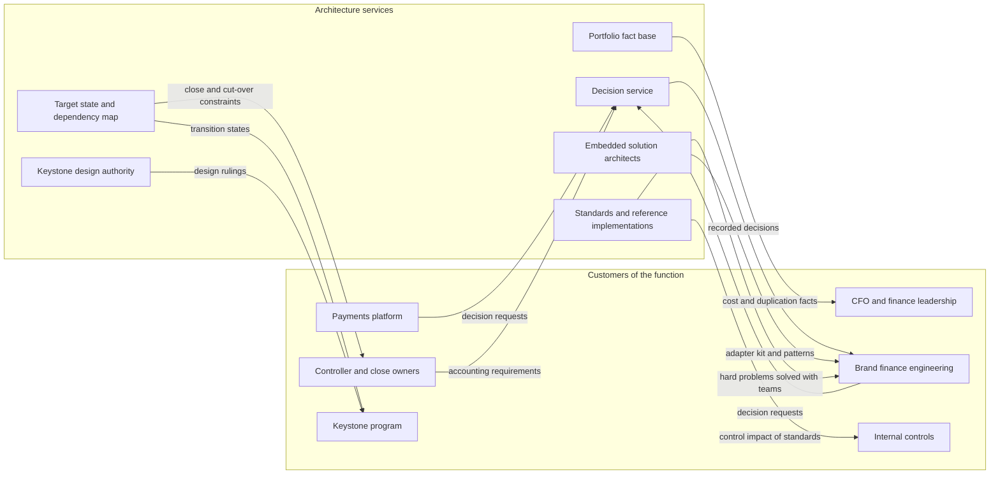
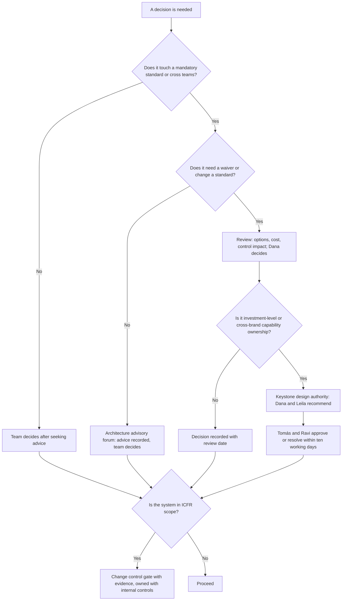
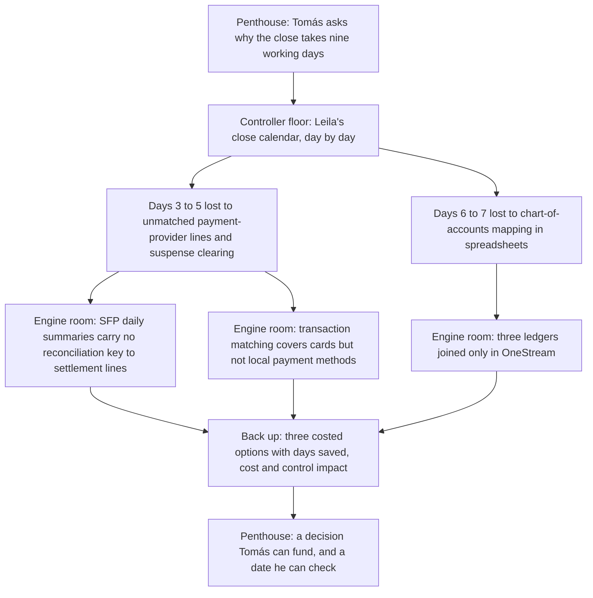

{id: chief-architect-role}
# 4. The Chief Architect's Job: Making Many Systems Tell One Story

> **IN THIS CHAPTER, YOU WILL:** Define what enterprise architecture is for in a finance estate, choose an operating model and a set of decision rights that fit a federated, multi-brand group, and see how a new Chief Architect turns a CFO's three blunt questions into a 90-day plan.

> **WHY FINANCE CARES:** A CFO does not buy architecture; they buy a shorter close, numbers that tie out, controls that hold during change, and a transformation that actually switches systems off. The architecture function is the part of technology that can explain why those things are hard and which decisions would make them easier.

> **WHY ARCHITECTS SHOULD CARE:** In finance, an architecture decision is often reversible only at the next period boundary, after an audit, or never. An architecture function without explicit decision rights either becomes a bottleneck or is ignored, and in a matrix with brand engineering the second happens quietly.

> **KEY POINTS:**
>
> * **Architecture is a decision service, not a document set.** The function exists to improve the quality, speed and coherence of decisions that are expensive to reverse. Its products are recorded decisions, standards with reference implementations, and a trusted fact base. It should be measured by those decisions' lead time and outcomes, not by how many diagrams it produces.
> * **Decision rights must be explicit, and narrow where they are mandatory.** A short list of mandatory standards belongs to the Chief Architect, with expiring waivers. Accounting policy stays with the controller, control design with internal controls, and solution design inside the standards with the brands, under an advice process. For changes to in-scope financial systems, documented approval is a control and does not go away.
> * **Finance changes the job.** Correctness, auditability, regulatory deadlines, period-end rhythms and money in flight make finance architecture its own discipline. The Chief Architect rides the elevator between the CFO's question ("why nine days?") and its causes in the engine room, then rides back up with costed options.

> **[FAILURE PATTERNS THIS CHAPTER ADDRESSES](#where-finance-architecture-goes-wrong):**
>
> * **Capability Creep** — Duplicate payout engines, billing approaches and reconciliation tools are what accumulates when nobody holds the right to decide which platform owns a capability.
> * **The Permanent Exception** — In a matrix without explicit decision rights and expiring waivers, every brand's exception becomes a permanent fork.
> * **The Borrowed Roadmap** — An enterprise without an architecture function of its own lets each vendor's roadmap draw part of its target state.

A finance estate is the set of systems, data flows, controls and people that turn a company's operational activity into money moved, books kept and numbers reported. In a multinational, multi-brand group it is rarely designed. It is **accumulated**: an ERP chosen in one decade, a subledger built in another, brand ledgers that arrive with acquisitions, a consolidation tool that papers over the differences, and a few hundred spreadsheets carrying the mappings nobody had time to automate. Each piece was usually a sensible decision when it was made. The sum is rarely sensible.

**Enterprise architecture** is the discipline that treats that sum as a system. This book takes the view of a **Chief Architect** responsible for enterprise architecture, enterprise applications and financial systems. That person cannot run every platform and does not own most of the engineers. They are nevertheless accountable for whether the estate holds together: whether two systems that describe the same money agree, whether a new brand can be onboarded without a new ledger, whether the next vendor renewal is a choice or a hostage negotiation.

This chapter sets out the job: what architecture is for in a finance estate, why finance makes it different, how the function is organized, where its decision rights stop, and how to tell whether it is any good. The rest of the book reuses its vocabulary.

{id: chief-architect-role--setting-the-scene-dana-s-first-month-at-northmere}
## Setting the Scene: Dana's First Month at Northmere

Northmere, the fictional multi-brand digital commerce group this book follows, is introduced in full in [Meet Northmere: Five Brands, One Set of Books](#meet-northmere). In 2026 it reported about $8.2 billion of revenue on about $64 billion of gross transaction value. It has 71 legal entities in 38 countries and a New York listing that puts its financial reporting under the Sarbanes-Oxley Act. **Dana Whitlock** joined from a payments company in September 2026 as Chief Architect, Enterprise Applications and Financial Systems. She reports to Ravi Menon, the Group CTO, with a dotted line to Tomás Ferreira, the Group CFO, and leads about 30 architects. Her mandate letter gives her **final decision rights on mandatory enterprise-application standards**. The roughly 60 engineers who run the Stayloft Finance Platform, and the finance-systems teams at Wayfare and Tablekin, do not report to her.

In her first month she found an estate that every chapter of this book will return to:

- **Three ledgers.** SAP S/4HANA is the group finance core; Wayfare's Oracle Fusion Cloud ERP and Tablekin's Workday Financial Management came with acquisitions. The three meet only at consolidation, in OneStream, through chart-of-accounts mappings kept in spreadsheets. The **chart of accounts** is the list of accounts a ledger posts to.
- **A custom subledger doing ledger work.** The Stayloft Finance Platform (SFP) handles commission billing, the merchant **subledger** (the detailed record of individual bookings, payments and partner balances), and partner payouts. It posts about 38,000 summarized general-ledger (GL) lines a day into S/4HANA, condensed from about 3 million subledger lines.
- **Duplicate capabilities.** Two partner-payout engines; three billing approaches; reconciliations in BlackLine, a rarely used OneStream module and Oracle Fusion; indirect tax in Vertex and, for some Wayfare markets, Oracle's tax engine.
- **Plumbing.** About 1,100 interfaces, about 240 of them flat files and about 70 with spreadsheets in the loop; three integration technologies (SAP Integration Suite, Kafka, MuleSoft); 214 finance-relevant applications in SAP LeanIX.
- **Money not yet explained.** In 2026, unreconciled balances in payment-service-provider clearing and suspense accounts averaged €14 million at month-end, of which about €2.1 million was older than 90 days. A **suspense account** is a holding account for amounts the books have received but cannot yet assign.
- **A control problem on a payout engine.** The external auditor's interim work had found that SFP developers had production access and that payout-rule changes lacked documented approval. It was later reported as a **significant deficiency** in internal control over financial reporting (ICFR) for FY2026: less severe than a material weakness, but important enough to merit the audit committee's attention ([Controls by Design, Not by Audit Season](#controls-and-auditability)).
- **An ERP that resists change.** About 2,300 custom objects in S/4HANA, and upgrades that take seven months.

Program Keystone, the multi-year finance transformation, was then a business case in draft, due to go to the board in December. In her third week Tomás asked her three questions. He said he had asked them before and been given slides.

1. **Why does the close take nine working days?** Competitors talk about four or five.
2. **Why do we have three ledgers?** Was that a decision anyone took, or something that happened to Northmere?
3. **What will Keystone actually change?** The draft case asks for about $310 million over five years. What would he be able to see in 2027 that he cannot see now?

None of the three is a technology question; each is answered by a chain of decisions, mostly unrecorded. That is the Chief Architect's job in a sentence: **make the decisions behind the estate explicit, make the next ones faster and better, and keep them coherent with each other.** Dana's answers come near the end of the chapter, after the tools she needed to produce them.

{id: chief-architect-role--what-enterprise-architecture-is-for}
## What Enterprise Architecture Is For

The definition of architecture that has served me best comes from Ralph Johnson, as Martin Fowler retells it: architecture is "the shared understanding that the expert developers have of the system design", and in the end it "is about the important stuff. Whatever that is." ([Fowler, Software Architecture Guide](https://martinfowler.com/architecture/)). Enterprise architecture applies the same idea one level up. The system is the enterprise's whole application and data estate. The experts are spread across finance, engineering, security and several brands. "The important stuff" means the decisions that are expensive to reverse and that affect more than one team.

I use the following working definition throughout the book. **Enterprise architecture** is the function that makes cross-cutting, hard-to-reverse decisions about an enterprise's capabilities, applications, data and integration explicit, well-informed and coherent with each other, and that keeps the enterprise able to make the next ones. Frameworks such as The Open Group's [TOGAF Standard](https://www.opengroup.org/togaf) (10th Edition, published in 2022 and structured as Fundamental Content plus Series Guides) describe methods and content for doing this. They are useful reference material, not the purpose, which in a finance estate comes down to four things.

| Purpose | What it means in a finance estate | What it looked like at Northmere in 2026 |
| --- | --- | --- |
| **Decision quality** | Decisions are taken with the options, costs, control impact and accounting consequences on the table, by people who hold the right to take them, and the reasoning is recorded | A cross-brand payouts decision had circled for months over "extend SFP" versus "use the Wayfare engine". The rationale for SFP's daily summarization level was nowhere written down |
| **Coherence** | Systems that describe the same money agree, or there is a designed way to prove that they agree. Each capability has one owner platform, or a deliberate reason for two | Three charts of accounts mapped in spreadsheets; two payout engines; reconciliation done in three tools |
| **Optionality** | The estate can absorb a new brand, market, regulation or vendor change without a rebuild. Exits from vendors are possible, if not cheap | Brazil (2028) would need a new entity, local payment methods and e-invoicing. Every vendor relationship was renewed by default |
| **Risk** | Architecture choices do not create control failures, regulatory breaches or concentration on one supplier that nobody chose | The SFP control finding; 70 interfaces with spreadsheets in the loop; three integration technologies with different error handling |

**Optionality** deserves a word of caution, because it is the purpose most easily turned into a slogan. Gregor Hohpe describes architecture as selling options: the right, but not the obligation, to take a decision later, whose value rises with uncertainty ([Architecture: Selling Options](https://architectelevator.com/architecture/architecture-options/)). A finance estate faces plenty of uncertainty: EU VAT in the Digital Age (ViDA), Pillar Two, the next payment-services regulation, the next acquisition. But an option costs something to hold. A canonical event layer, an anticorruption layer in front of the ERP, or an exportable data model each has a price paid now. The rule I use is to buy an option only when I can name the decision it defers and roughly when that decision will fall due. "Keeping our options open" with no named decision is gold-plating.

{id: chief-architect-role--why-finance-architecture-is-its-own-discipline}
## Why Finance Architecture Is Its Own Discipline

Five traits of the finance domain change how familiar architecture techniques are weighed.

| Trait | What it means | Architectural consequence | Where the book goes deeper |
| --- | --- | --- | --- |
| **Correctness is binary at the boundary** | A balance is right or it is wrong. "Eventually consistent" is acceptable inside a pipeline, never in the posted ledger at period end | Delivery guarantees are designed as at-least-once delivery plus idempotent effects plus reconciliation, never as a property bought from middleware | [Files, Events and APIs: How Finance Systems Talk](#integration-architecture), [Never Update, Only Append: Designing Custom Ledgers](#designing-financial-ledgers) |
| **Auditability** | Every reported number must trace to the transactions behind it, and every change to a system that produces it must be authorized and evidenced | Audit trails, segregation of duties and change approval are design inputs, not retrofits. The auditor is a stakeholder in design reviews of in-scope systems | [Controls by Design, Not by Audit Season](#controls-and-auditability), [Reconciled by Design: Traceability and Audit Across Boundaries](#traceability-and-reconciliation) |
| **Regulatory deadlines** | Filing dates, e-invoicing mandates and tax reporting go-lives are external and fixed | The roadmap has immovable dates that technology did not choose, and architecture must leave room for them | [Global by Design: Entities, Currencies, Jurisdictions and Brands](#global-scale), [The Middle Matters: Transition States and the Roadmap](#target-and-transition-states) |
| **Period-end rhythm** | Load, risk and organizational attention spike at month, quarter and year end | Change freezes, peak-capacity engineering and cut-overs aligned to period boundaries. A design that works on day 15 can fail on working day 2 | [Order to Cash, Procure to Pay, Record to Report](#finance-processes), [Recover Before the Close: Resilience and Security for Finance](#resilience-and-security) |
| **Money in flight** | At any moment, funds are between customer, payment service provider, bank, safeguarding account and partner, and some of them belong to someone else | The estate must show where every euro is and whose it is. For a licensed e-money institution, safeguarding reconciliation is a daily regulatory obligation | [Payments-to-Ledger: Draining the Suspense Swamp](#payments-to-ledger), [Payments for Finance Architects: Eleven Reasons the Numbers Disagree](#payments-fundamentals) |

These traits give finance architecture a different temperament from product architecture. The cost of a wrong decision often arrives months later, at an audit, a filing or a close, and lands on people who were not in the room. That delay is why decision quality and a written rationale matter more here than in most domains, and why finance teams can seem conservative to engineers: usually they are pricing a risk the engineers have not yet seen.

{id: chief-architect-role--architecture-as-a-function-and-a-service}
## Architecture as a Function and a Service

Many enterprise architecture teams are judged by what they publish: a framework, a metamodel, current-state diagrams, a principles poster. They are easy to fund in year one and easy to cut in year three, because nothing changes when the documents improve. The alternative is to run architecture as a **function that delivers services**. The function has customers (finance leadership, brand engineering, the transformation program, internal controls), a small catalog of things it does for them, and service levels it can be held to.

Dana's catalog, as she drafted it in her second month, had six services.

1. **Decision service.** Intake of decisions that cross teams or touch mandatory standards; options with cost, risk, control impact and accounting consequences; a recorded decision with an owner and a review date; a published lead-time target. The mechanics of decision records and review forums belong to [Architecture Governance That Speeds Decisions](#architecture-governance).
2. **Standards and patterns.** A short catalog of mandatory standards (for example idempotent posting, subledger-to-general-ledger reconciliation, clean-core extension of the ERP, segregation of duties by design) and a longer catalog of recommended patterns, each with a **reference implementation** a brand team can copy. [Principles That Decide Things](#principles-standards-reference) covers how to write them.
3. **Portfolio fact base.** The application inventory with owners, lifecycle, capability, cost, contract dates and audit relevance, kept accurate enough that people stop maintaining private copies ([Manage the Application Portfolio as an Investment](#application-portfolio)).
4. **Target state and dependency map.** Where the estate is going, the stable transition states on the way, and the cross-program dependencies that will block it if nobody owns them ([The Middle Matters: Transition States and the Roadmap](#target-and-transition-states)).
5. **Design authority for transformation.** For Keystone, a standing forum that rules on design questions with the authority of the program sponsor. Dana chairs it with Leila Haddad, the Chief Accounting Officer ([The Technology Is the Easy Part: Leading a Finance Transformation](#finance-transformation) owns the term).
6. **Embedded architecture.** Solution and integration architects who work inside brand and platform teams on their hardest problems. This is the service that earns the trust the other five spend.

**Figure 1:** *The architecture function as a set of services with named customers. Each arrow is something a customer would notice if it stopped. A document set has readers; a function has customers who can complain.*

The service framing has two consequences that are easy to state and hard to keep. First, **every service needs a measure a customer would recognize**: lead time for decisions, the share of brand integrations built on the reference implementation, the accuracy of the portfolio when Finance uses it for a budget. Second, **the function must say no to work that has no customer**. A full current-state model of 214 applications to the level of every interface field is an example. It has no customer until a specific decision needs it.

{id: chief-architect-role--artifacts-that-earn-their-keep-and-shelfware}
### Artifacts that earn their keep, and shelfware

Architecture produces artifacts, and some of them are indispensable. The test I apply is whether **someone outside the architecture team would notice within a quarter if the artifact stopped being maintained**. If nobody would notice, the artifact is shelfware: kept for its own sake, read by its authors.

| Artifact | Earns its keep when | Becomes shelfware when | Northmere, December 2026 |
| --- | --- | --- | --- |
| **Decision records** | Short, numbered, linked to the change they authorize, with options and consequences; searched when a decision is questioned | They are written after the fact to satisfy a gate, or run to twenty pages | None existed; Dana reconstructed eleven decisions from email and steering minutes |
| **Mandatory standards with reference implementations** | A brand team can copy the code, schema or test harness and pass conformance on the first attempt | They are prose rules with no example, or there are fifty of them | Proposed five; none yet in force |
| **Application portfolio (LeanIX)** | Finance uses it for budgets and contract renewals; owners update it because it drives their cost allocation | Architects update it once a year before an audit of the repository itself | 214 applications, owners missing for about a fifth (Dana's estimate) |
| **Capability map** | It is used to find overlap and to assign each capability one owner platform | It is a poster with no applications mapped to it | Planned for Q1 2027 ([Map What Finance Does Before What Runs It](#capability-mapping)) |
| **Systems-of-record matrix** | It settles disputes about which system is authoritative for a legal entity, a partner or a rate | It lists systems without the data objects or the authority | Planned for Q1 2027 ([Systems of Record: Ending the Doppelgänger Record](#systems-of-record)) |
| **Target and transition states** | Each transition state is stable, fundable and shows what is switched off | It shows only the end state, with no route to it | Keystone draft showed year-five end state only |

The pattern: **an artifact earns its keep when a decision depends on it**. Dana's rule was that no artifact is created unless a decision, a control or a program gate needs it, and whoever owns that dependency maintains it.

One caution about the repository itself. Northmere's portfolio lives in SAP LeanIX, which SAP [acquired in November 2023](https://news.sap.com/2023/11/sap-completes-acquisition-of-leanix/). That says nothing against the product. It does mean that the enterprise's fact base about its SAP estate sits in a tool owned by the ERP vendor whose estate is being rationalized. Dana's response was not to replace it. She made sure the data could be exported on a schedule into the finance data platform, so the facts did not depend on the tool. This is a small, cheap instance of resisting **The Borrowed Roadmap**.

{id: chief-architect-role--operating-models-centralized-federated-and-advisory}
## Operating Models: Centralized, Federated and Advisory

An **operating model** for architecture answers three questions: where the architects sit, who decides what, and how decisions are made across team boundaries. Three models recur, and most organizations blend them.

- **Centralized.** One function designs and approves solutions; standards are many and enforced through review.
- **Federated.** A small central team owns enterprise standards, the portfolio and the target state; architects sit in brand and platform teams with a professional line to the center.
- **Advisory.** The center offers guidance and patterns, but teams decide. Andrew Harmel-Law's **advice process** is the most developed version. Anyone may make an architectural decision, provided they first seek advice from everyone meaningfully affected and from people with relevant expertise, and record the advice they received, whether or not they followed it. The process is supported by decision records, a weekly open Architecture Advisory Forum, team-sourced principles and a technology radar ([Harmel-Law, Scaling the Practice of Architecture, Conversationally](https://martinfowler.com/articles/scaling-architecture-conversationally.html)).

| | Centralized | Federated | Advisory |
| --- | --- | --- | --- |
| **Who decides** | The central function | Central team for enterprise standards; domain teams for the rest | The team doing the work, after seeking advice |
| **Where architects sit** | In one team, assigned to projects | Central core plus architects embedded in brands and platforms | Small central team; architecture is a skill spread across engineers |
| **Coherence across the estate** | High while the center keeps up | High on the few things standardized, variable elsewhere | Depends on culture and the quality of advice |
| **Decision speed** | Slow at scale; the center becomes the queue | Fast for local decisions; enterprise decisions need a forum with a lead-time target | Fastest; costs show up later as divergence |
| **Brand buy-in** | Low; architecture is something done to the brand | Medium to high, if standards come with reference implementations | High |
| **Fit with financial controls** | Good on paper; reviews create approval evidence | Good if the control gate for in-scope systems is explicit | Weak on its own. In-scope changes still need documented approval |
| **Typical failure** | Ivory tower and bottleneck; teams route around it | Central standards creep until it is centralized again; or the core is too thin to hold anything | **The Permanent Exception** at scale; nobody can say no |
| **When it is right** | Small estates, or a short crisis period such as remediating a control failure | Multi-brand groups with a shared finance core: most of the readers of this book | High-trust engineering organizations with weak coupling between teams and little regulated scope |

For a group like Northmere I recommend **federated, with a thin mandatory core and an advisory periphery**. The mandatory core is a short list of standards that protect the whole: how money events are published, how subledgers reconcile to the ledger, how the ERP is extended, how access is separated. Within that core, the Chief Architect decides. Outside it, teams decide using an advice process, and the architecture function competes for influence on the quality of its advice.

There is one finance-specific caveat, and I would not soften it. **The advice process does not remove documented change approval for systems in ICFR scope.** A brand team may decide its own design through advice. A change to a system that feeds the financial statements still needs authorization and evidence that satisfies the auditor, and that is what Northmere's SFP finding was about. The credible model runs advice for design and keeps a thin, explicit control gate for in-scope changes, owned jointly with internal controls. Where this recommendation does not hold: during the remediation of a significant deficiency, I would run the affected platform under a temporarily centralized model, with every change reviewed, and say in writing when that will end.

**Figure 2:** *Federated with a thin mandatory core: the Chief Architect decides a short list of standards, teams decide the rest through advice, and every change to an in-scope system still passes the control gate.*

{id: chief-architect-role--decision-rights-mandatory-standards-and-advice}
## Decision Rights: Mandatory Standards and Advice

**Decision rights** state who may take which decision, who must be consulted before it is taken, who can block a specific aspect of it, and who is only informed. An architecture function without them has two possible fates. It can approve everything to stay popular, or it can claim everything and become the queue. Both are common.

Dana's mandate gave her one decision right outright: final decisions on mandatory enterprise-application standards. Her first deliverable was to make that right precise. She defined what counts as a mandatory standard and wrote down whose rights border hers. The table below is the version she agreed with her peers in November 2026. It uses D for decides, R for recommends, C for consulted (must be heard before the decision), S for sign-off on one specific aspect, and I for informed.

| Decision | Dana (Chief Architect) | Leila (CAO and Group Controller) | Ravi (Group CTO) | Brand CTOs | Ingrid (MD, Northmere Pay) | Mei (Head of Internal Controls) |
| --- | --- | --- | --- | --- | --- | --- |
| Mandatory enterprise-application standards (canonical financial events, idempotent posting, subledger-to-GL reconciliation, clean-core extension, segregation of duties by design) | **D** | C | C | C | C | S on control impact |
| Waivers from a mandatory standard, always with an expiry date | **D** | C if accounting is affected | I | R (requester) | C if payments are affected | S if the system is in ICFR scope |
| Accounting policy, chart-of-accounts design, posting logic meaning | C | **D** | I | I | C | C |
| Engineering platforms: event backbone, cloud, identity | C | I | **D** | C | C | I |
| Brand solution design inside the standards | C (advice) | C where it touches posting | I | **D** | C where it touches payments | C where in ICFR scope |
| Payments platform design: PSP routing, safeguarding, payment methods | C on the payments-to-ledger contract | C | C | I | **D** | C |
| Whether a change is SOX-relevant, and the evidence it needs | C | C | I | I | I | **D** |
| Cross-brand capability ownership, such as which payout engine survives | **R**, decided at the Keystone design authority with Leila | **R** | C | C | C | C |
| Investment-level choices, such as ledger convergence by Central Finance or an accounting hub | **R** with Leila | **R** with Dana | C, co-approves with Tomás | C | C | C |

The **brand CTOs** in the table are the technology heads of Stayloft, Wayfare and Tablekin. Their finance-systems leads, Jonas Berg, Hana Kowalski and Arjun Rao, are the people Dana works with day to day. Escalations go to Tomás and Ravi jointly. Northmere's CFO and CTO had agreed to resolve any escalated architecture dispute within ten working days, and to say so publicly. That agreement mattered more than any line in the table.

Three properties make a decision-rights table like this one work.

- **The mandatory list is short and closed.** Five standards, each with a written scope. (In 2027 they became STD-FIN-01 to STD-FIN-05, declared mandatory from 1 April 2027, with the canonical-events and idempotent-posting standards enforced from 1 July 2027 when the schema registry went live; a sixth, STD-FIN-06 for AI agents, followed in Q3 2027. [Principles That Decide Things](#principles-standards-reference) holds the catalog.) Anything not on the list is advisory. Adding a standard is itself a recorded decision with consultation, so the list cannot grow by stealth.
- **Every right borders another right explicitly.** Dana decides *how* posting is made idempotent and reconcilable. Leila decides *what* the posting means. Mei decides *whether* a change needs control evidence. The table prevents the most common finance-architecture dispute, an architect redesigning accounting or a controller redesigning integration, by naming the border.
- **Waivers expire.** A waiver without an end date is a fork with paperwork. Every Northmere waiver records the standard, the reason, the compensating control if the system is in ICFR scope, the owner and the expiry. Expired waivers are reported to the design authority.

Decisions are also routed by **materiality**, so that most never reach a forum.

**Figure 3:** *Decisions route by materiality, and most never reach a forum. Every path converges on the same control gate for systems in ICFR scope: advice can replace approval for design, never for change evidence.*

The mechanics behind this diagram are owned by [Architecture Governance That Speeds Decisions](#architecture-governance): what a decision record contains, how the review board and the advice forum differ, how waivers are tracked, and how conformance is checked. This chapter's point is narrower. **Decision rights come first, and forums second.** A review board set up before the rights are agreed becomes a debating society, or a court with no jurisdiction.

{id: chief-architect-role--the-matrix-with-brand-finance-engineering}
## The Matrix with Brand Finance Engineering

The hardest part of the Chief Architect's job at a group like Northmere is not technical. Dana is accountable for the coherence of an estate whose largest custom component, SFP, is run by about 60 engineers who report to Jonas Berg and, through him, to Stayloft. Wayfare's Oracle Fusion and payout engine belong to Hana Kowalski. Tablekin's Workday Financials and Stripe integration belong to Arjun Rao. This is a **matrix**: brand engineering reports to the brands, and takes standards and architectural direction from Dana.

A matrix works when each side gets something it cannot get alone. Brand finance teams commonly want stable contracts, fast decisions and not rebuilding ledger, tax or reconciliation logic; they fear a central mandate that freezes their roadmap. Architecture needs them to adopt standards, retire duplicates and surface problems early. Dana made her side of the bargain explicit.

| What Dana asks of the brands | What Dana owes the brands in return |
| --- | --- |
| Publish financial events in the canonical format once it exists, and stop building new bespoke feeds | An adapter kit with schemas, mappings and a test harness, maintained by her integration architects under Lucía Romero |
| Bring cross-team decisions to the decision service early | A published decision lead time, ten working days for standard requests, and a named architect per request |
| Accept that the five mandatory standards apply to them | No new mandatory standard without consultation and a reference implementation; no change mid-program without a transition period |
| Retire duplicate capabilities on an agreed schedule | A seat in the decision about which platform survives, and migration support from the central team, not just a deadline |
| Keep the portfolio data for their systems accurate | Portfolio data that pays for itself in cost allocation and contract renewals |

Two things make the matrix fail. The first is **the Chief Architect without a budget**: standards that each brand must fund from its own roadmap will lose to the brand's roadmap every time. Keystone solved part of this for Dana by funding the adapter kit and the first migrations centrally. The second is **the Chief Architect as messenger**, whose authority depends on escalating to the CFO. Each escalation spends trust; Dana's rule was at most one a quarter.

Team design across this matrix, including stream-aligned brand teams, platform teams for the ledger and integration, and enabling architecture, is owned by [Who Owns What: Organizing Architecture Across Finance and Technology](#organizing-for-architecture). Here the point is that the matrix is a contract, and contracts need consideration on both sides.

{id: chief-architect-role--riding-the-architect-elevator}
## Riding the Architect Elevator

Gregor Hohpe's image for the architect's position is an elevator. The architect connects the **penthouse**, where business strategy is set, with the **engine room**, where the enabling technologies are built and run, and rides between the floors ([The Software Architect Elevator](https://architectelevator.com/book/)). An architect who stays in the engine room produces designs nobody funds; one who stays in the penthouse produces strategies nobody can implement. The value is in the ride.

In finance, the penthouse speaks of days to close and audit findings, the engine room of summarization levels and settlement file formats. Between them sits a floor technology-side architects underrate: the controller's floor, where accounting policy, close calendars and reconciliations live. Dana answered Tomás's first question by riding all the way down and back up.

**Figure 4:** *The elevator ride behind the CFO's first question. The question arrives in the penthouse in days; the causes are found in the engine room as missing keys and missing coverage; the answer goes back up as options priced in days, money and control risk.*

{id: chief-architect-role--the-close-walk}
### The close walk

Dana did not start with the systems. She asked Leila to let her sit in on the September 2026 quarter close from first working day to last, with each day's critical-path task written down. The result, simplified to the critical path, she called the close walk.

| Working day | Critical-path activity | Why it takes that long |
| --- | --- | --- |
| 1–2 | Subledger feeds land in S/4HANA, Oracle Fusion and Workday; accruals booked | SFP's daily summaries are complete only after a final run; late feeds are re-run by hand |
| 3–5 | Payment-service-provider settlement matched to SFP and to bank; suspense and clearing accounts worked down; intercompany agreed | About 1.9% of settlement lines for Stayloft's local payment methods are unmatched at working day 3; each break is investigated by hand, because summarized SFP postings cannot be traced to settlement lines |
| 6–7 | Brand trial balances loaded into OneStream; chart-of-accounts mapping; consolidation and eliminations | Three charts of accounts; mappings maintained in spreadsheets; mapping errors found during load are fixed and reloaded |
| 8–9 | Review, top-side adjustments, sign-offs | Adjustments driven by the residual differences of days 3–7 |

The walk changed the conversation. Nine days was not one problem. It was three, each with a different owner and a different cure. **Days 3 to 5 were a traceability problem**: SFP summarized before posting and kept no key from summary to settlement line, so every break had to be investigated by reconstructing the detail. This is **Lost in Aggregation**, and [Reconciled by Design: Traceability and Audit Across Boundaries](#traceability-and-reconciliation) treats its cure. **Days 6 to 7 were a coherence problem**: three ledgers and spreadsheet mappings, which is **Spreadsheet Glue** on top of an unmade decision about ledger convergence. **Days 8 to 9 were mostly consequences** of the first two, and would shrink as they did.

**Figure 5:** *The close walk split nine days into three problems with different owners: days 3 to 5 lost to traceability, days 6 to 7 to coherence across three ledgers, and days 8 to 9 to the consequences of both.*

Dana did not answer "nine days" with "we need a new ERP", the answer vendors and integrators are commercially inclined to give. Nor did she claim architecture alone would fix the close: the calendar is Leila's, and some of the time is policy and people. Her answer was a contribution, in days, with its assumptions shown.

{id: chief-architect-role--dana-s-answers-to-the-three-questions}
## Dana's Answers to the Three Questions

Dana answered Tomás in writing in mid-November 2026. Each answer was one page, and the three summarized to a table that went into the Keystone board pack.

| Question | Short answer | Decision it leads to | What Tomás can check in 2027 |
| --- | --- | --- | --- |
| **Why does the close take nine working days?** | Three causes: payments that cannot be traced through summarized postings (about three days), three charts of accounts joined by spreadsheets (about two days), and the review work those two create. The ERP is not the bottleneck | Payments-to-ledger completeness for cards and local payment methods in 2027, with reconciliation keys from SFP summaries to settlement lines; one group chart of accounts planned for 2029 | Unmatched settlement lines at working day 3, and the €14 million average suspense balance, reported monthly with targets |
| **Why do we have three ledgers?** | Because two acquisitions each brought a working ledger and integrating them at consolidation was the cheapest way to report on day one. That was reasonable in 2023 and 2024. Nobody then decided whether it was the end state, so it became one by default | A recorded decision in Q4 2027 on convergence: SAP Central Finance versus an accounting-hub pattern, with options, costs and control impact; until then, no new ledger anywhere in the group | The decision record itself, dated, with the options and the reasons |
| **What will Keystone actually change?** | In 2027, governance and evidence rather than new platforms: one decision record and review forum, five mandatory standards, payments-to-ledger completeness, a published target state, a portfolio cost baseline, and remediation of the SFP finding. Larger changes follow in later years, and each is tied to a transition state that switches something off | Keystone's year-one scope and the design authority's charter | A quarterly Keystone report on decisions taken and their lead time, systems retired, suspense balances and close days, each against a target |

The second answer is the one I would point any new Chief Architect to. **"Three ledgers" was not a mistake. It was a decision deferred until deferral became the decision.** Integrating acquisitions at consolidation level is a common and defensible pattern. It goes wrong when nobody records it as a transition state with a review date. The Chief Architect's contribution is to put a date on the decision, not to decide on day 40 something that needs a year of evidence. Northmere's ledger convergence decision is examined throughout Part III, in [Converge or Coexist: Living with More Than One ERP](#multiple-erps) and [Systems of Record: Ending the Doppelgänger Record](#systems-of-record).

{id: chief-architect-role--measuring-the-architecture-function}
## Measuring the Architecture Function

A service should be measured as one. The most visible outputs (documents, reviews, diagrams) are the least meaningful, and the meaningful outcomes, such as a shorter close or fewer duplicate systems, have several causes. A credible scorecard mixes measures the function controls with outcomes it contributes to, and says which is which.

| Measure | Definition | Northmere baseline, Q4 2026 | 2027 target | How it gets gamed | Counterweight |
| --- | --- | --- | --- | --- | --- |
| **Decision lead time** | Working days from when a decision is first raised to when it is recorded, by materiality tier | Median 41 working days across 11 reconstructed decisions | 10 days for standard requests; 25 for design-authority decisions | Starting the clock at formal intake, not when the question was first raised; refusing intake | Measure from first raised; report rejected and deferred intakes |
| **Reopened decisions** | Share of recorded decisions reopened within 12 months without new facts | 3 of 11 | Under 10% | Never revisiting decisions that should be revisited | Distinguish reopening on new facts (healthy) from reopening on lost rationale (not) |
| **Reuse of standard patterns** | Share of new or changed financial-event feeds built on the canonical events and adapter kit | 0% (no canonical events existed) | First two brand feeds | Counting thin wrappers around bespoke feeds as adoption | Count only feeds that pass the conformance harness |
| **Duplicate capabilities retired** | Duplicates switched off, with contract ended and a read path archived where retention requires | Baseline list: two payout engines, three billing approaches, three reconciliation tools, two tax engines | Retirement plan agreed for each; OneStream reconciliation module retired | Declaring retirement while the system still runs "for reference" | Retired means no transactions, no license, and an archive with an audit read path |
| **Waivers** | Active waivers, and the share closed by their expiry date | No standards, so none | All waivers dated; over 80% closed on time | Zero waivers, which usually means the standards are trivial or not enforced | Report waivers next to conformance results |
| **Close-days contribution** | Working days removed from the close that trace to architecture decisions, agreed with the controller | Close at 9 days | Contribution to the group target of 5 days by end of 2028 | Claiming the whole improvement | Leila owns the close metric; architecture reports its contribution with assumptions |

Three cautions about vanity metrics. **Counting decision records** rewards writing them, not deciding. **Counting reviews** rewards a bottleneck. **Conformance percentages** without the standard's difficulty attached reward easy standards. I have seen architecture functions report 95% conformance to standards that no team would ever have broken. The strongest single measure, in my experience, is decision lead time with reopened decisions next to it, because the pair is hard to improve without actually deciding faster and better.

Dana deliberately left a portfolio-wide application count off the year-one scorecard: it would have rewarded retiring easy, cheap applications first ([Manage the Application Portfolio as an Investment](#application-portfolio)).

{id: chief-architect-role--integration-with-the-rest-of-the-estate-and-the-book}
## Integration with the Rest of the Estate and the Book

Coherence is the job, so the role touches every chapter. Four dependencies matter from the start. Decision rights over which platform owns a capability presuppose a capability map ([Map What Finance Does Before What Runs It](#capability-mapping)). Duplication claims and retirement plans need the portfolio as their fact base ([Manage the Application Portfolio as an Investment](#application-portfolio)). Internal controls co-owns any change to an in-scope system ([Controls by Design, Not by Audit Season](#controls-and-auditability)). And architects must understand double entry, subledgers and revenue recognition well enough to know where their own decision rights end ([Accounting for Architects: Ledgers, Journals and Revenue](#accounting-for-architects)). Part IV builds the governance mechanics, the standards and the organization on the decision rights set out here.

{id: chief-architect-role--failure-modes}
## Failure Modes

Architecture functions fail in recognizable ways. Most of these are failures of decision rights or of the service model, not of technical judgment.

- **The ivory tower.** The function produces a target state and a principles set that brand teams never read, because none of it arrived with a reference implementation or a funded migration. Symptom: the same integration built three times while the target state says it should exist once.
- **Architecture police.** Every change needs a review, reviews take weeks, and teams learn to describe changes so they fall below the threshold. Symptom: nobody measures decision lead time, and teams talk about "getting through architecture".
- **The Permanent Exception by waiver.** Waivers are granted without expiry or compensating controls. Five years later the "mandatory" standard applies to two of five brands, and nobody remembers why.
- **The vendor's architect.** The target state is the vendor's reference architecture with the enterprise's logo on it, and the roadmap tracks the vendor's release schedule. This is **The Borrowed Roadmap**, and the symptom is a target state that contains no system the vendor does not sell ([Own Your Roadmap: Vendor Strategy Without Lock-In Panic](#vendor-portfolio-strategy)).
- **Program capture.** The transformation program absorbs all architecture capacity, decisions are optimized for its milestones, and the run estate drifts. Symptom: a design authority that rules only on program scope.
- **Accountability without authority.** The Chief Architect is blamed for incoherence they had no right to prevent, such as a brand's own reconciliation tool. The cure is the decision-rights table, agreed before the next incident.

{id: chief-architect-role--the-chief-architect-s-view}
## The Chief Architect's View

The role, as this book uses it, is accountable for four things and deliberately not accountable for several others.

**Accountable for:**

1. **The coherence of the estate.** Each capability has an owner platform or a recorded reason for two. Systems that describe the same money have a designed way to agree. The target state and its transition states are current, funded and believed.
2. **The quality and speed of architecture decisions.** Including those the Chief Architect does not take: the function answers for its advice and process, not only its rulings.
3. **The mandatory standards.** A short list, each with a reference implementation, conformance checks and an honest waiver register.
4. **The enterprise's options.** Vendor exits that are possible, data and events that are portable, and new brands and markets that can be onboarded without a new ledger.

**Not accountable for:** accounting policy (the controller), control effectiveness (internal controls and management's ICFR assessment), payments-platform product decisions, brand roadmaps, or program delivery. The Chief Architect contributes to each, as the decision-rights table specifies.

**What to decide first.** The decision-rights table, because every later argument depends on it; the mandatory standards, the only lever that does not depend on persuasion; and dates for the large deferred decisions, because a decision with a date stops being a default.

**What to watch.** Decision lead time and reopened decisions; the age of the oldest waiver; whether brand teams bring problems early or late; and whether the CFO's questions are getting more specific. When Tomás stopped asking "why nine days?" and started asking "what happens to working day 4 if we turn on matching for local payment methods in June?", the function had started to work.

{id: chief-architect-role--dana-s-first-90-days}
## Dana's First 90 Days

Dana's plan, as she wrote it in her first week and revised twice, ran from mid-September to mid-December 2026. It ended as the board approved Keystone, so year one could start with rights, standards and a baseline already agreed.

| Window | Focus | What Dana did | Outputs | With whom |
| --- | --- | --- | --- | --- |
| **Days 1–30** (mid-Sept to mid-Oct 2026) | Listen and establish the facts | One-to-ones with Tomás, Leila, Ravi, Ingrid, Mei, Kofi and the three brand finance-systems leads; sat in on the September quarter close end to end; reconstructed eleven recent cross-team decisions from email and minutes; sampled LeanIX entries against reality | The close walk; the decision reconstruction (median 41 working days, three reopened); a list of open and deferred decisions; the duplicate-capability list | Leila's close team; Jonas, Hana and Arjun; her own architects |
| **Days 31–60** (mid-Oct to mid-Nov) | Answer the questions and propose the rights | Wrote one-page answers to Tomás's three questions; drafted the decision-rights table and negotiated it peer by peer; proposed five mandatory standards; worked with Mei and Jonas on the design side of the SFP access and change-approval remediation; reshaped the Keystone year-one scope around governance and payments-to-ledger completeness | Answers to the three questions; agreed decision-rights table; draft standards; Keystone year-one scope | Tomás, Leila, Ravi, Mei, Ingrid, brand CTOs |
| **Days 61–90** (mid-Nov to mid-Dec) | Commit and baseline | Chartered the Keystone design authority with Leila; issued the first two decisions under the new rights (the change-approval standard for SFP payout rules, and the scope of payments-to-ledger matching for local payment methods); set baselines for the function's scorecard; planned the Q1 2027 launch of the decision record, the review forum and the capability map | Design authority charter; first two recorded decisions; scorecard baseline; Q1 2027 plan | Leila, Mei, Ingrid, Lucía, the Keystone program office |

Three choices in the plan are worth naming. **She sat in on the close before proposing anything**, which earned her credibility on the controller's floor and gave her evidence that slides could not. **She took her first two decisions on problems Finance already felt**, a control finding and a reconciliation gap, not on an architecture topic like integration technology, where the benefit would have been invisible to Tomás. **She did not try to fix the three integration technologies, the 2,300 custom objects or the ledger question in 90 days.** She gave each of them an owner and a date. The first quarter establishes the right to decide; decisions that bind for years come after.

{id: chief-architect-role--questions-to-ask}
## Questions to Ask

1. Which decisions in our finance estate are expensive to reverse, and who holds the right to take each of them today?
2. What is on our list of mandatory standards, how long is it, and does each standard have a reference implementation a team can copy?
3. How many active waivers do we have, and how many have no expiry date?
4. How long does a cross-team architecture decision take from first raised to recorded, and how many get reopened?
5. Where do the days of our close go, day by day, and which of them are caused by architecture rather than policy or people?
6. Which capabilities do we run in more than one platform, and is each duplication a recorded decision or an accident?
7. For systems in ICFR scope, where does our architecture decision process end and our change-control evidence begin?
8. Which of our large decisions are being deferred, and by what date will each be taken?

{id: chief-architect-role--from-accountability-to-a-map}
## From Accountability to a Map

The Chief Architect's accountabilities all depend on one thing Dana did not yet have in December 2026: a shared description of what Northmere's finance function must be able to do, independent of which system does it. Without that description, "which payout engine survives" is a contest between two teams' attachments to their platforms. With it, the question becomes which platform best serves a capability whose requirements everyone has agreed. The next chapter, [Map What Finance Does Before What Runs It](#capability-mapping), builds that description for Northmere and uses it to expose four overlapping capabilities that the landscape view alone hid.

{id: chief-architect-role--sources-and-evidence}
## Sources and Evidence

**Vendor documentation**

- [SAP completes acquisition of LeanIX](https://news.sap.com/2023/11/sap-completes-acquisition-of-leanix/), SAP News Center, 2023. Supports the ownership and date of the EA repository vendor and the independence caution.

**Standards and regulation**

- [The TOGAF Standard](https://www.opengroup.org/togaf), The Open Group, 10th Edition, 2022. Reference framework for enterprise architecture methods. The edition's date and its split into Fundamental Content and Series Guides are widely reported; this chapter relies on the framework only as background.

**Practitioner and research sources**

- [Software Architecture Guide](https://martinfowler.com/architecture/), Martin Fowler, martinfowler.com. Ralph Johnson's definition of architecture as shared understanding and "the important stuff"; the IEEE Software column "Who Needs an Architect?" is linked there.
- [The Software Architect Elevator](https://architectelevator.com/book/), Gregor Hohpe, O'Reilly. The elevator metaphor connecting business strategy with the IT engine room. The publisher and year (2020) are from the author's bibliography and were not shown on the page consulted.
- [Architecture: Selling Options](https://architectelevator.com/architecture/architecture-options/), Gregor Hohpe, 2016. Architecture as options whose value rises with uncertainty; basis for the optionality purpose and its caveat.
- [Scaling the Practice of Architecture, Conversationally](https://martinfowler.com/articles/scaling-architecture-conversationally.html), Andrew Harmel-Law, martinfowler.com, 2021. The advice process, Architecture Advisory Forum, decision records and team-sourced principles behind the advisory operating model.
- [Facilitating Software Architecture](https://www.oreilly.com/library/view/facilitating-software-architecture/9781098151850/), Andrew Harmel-Law, O'Reilly, 2024. Book-length treatment of decentralized architecture decision-making.
- [Documenting Architecture Decisions](https://cognitect.com/blog/2011/11/15/documenting-architecture-decisions), Michael Nygard, Cognitect, 2011. The decision-record format referenced by the decision service; owned in depth by the governance chapter.

Northmere is fictional, and so are all of its figures, people and events. The architectural recommendations in this chapter are the author's judgment.
