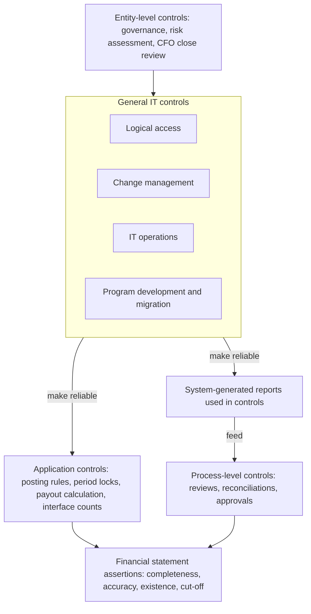
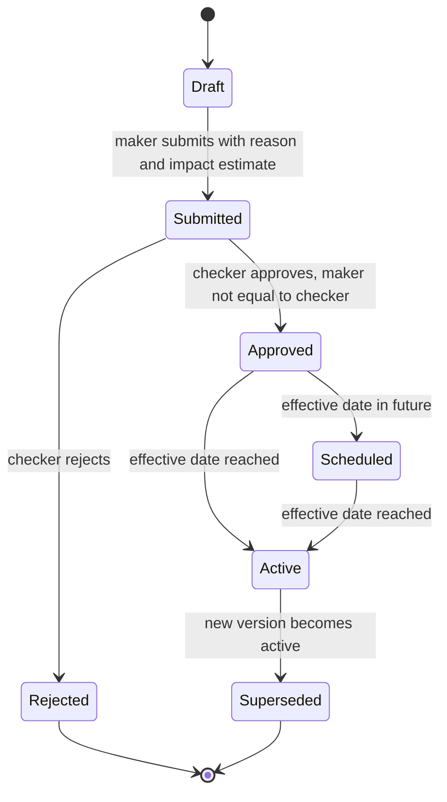
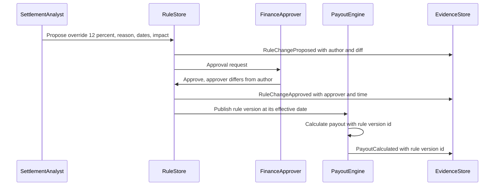
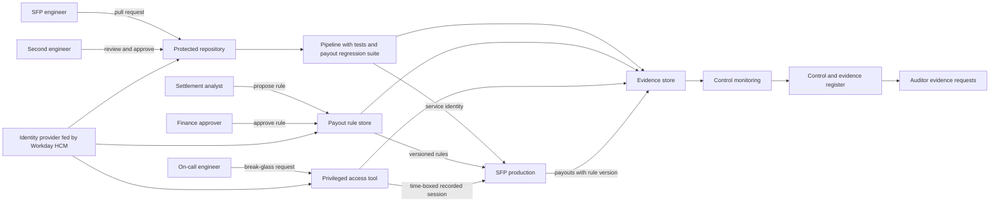

{id: controls-and-auditability}
# 11. Controls, Auditability and Security by Design

> **IN THIS CHAPTER, YOU WILL:** Learn the control vocabulary auditors use and see how each term becomes a design decision, then follow Northmere's remediation of an audit finding on a custom payout engine as an architecture change rather than a paperwork exercise.

> **WHY FINANCE CARES:** The CEO and CFO personally certify the controls behind every quarterly and annual report. A deficiency on a system that moves money is a conversation with the audit committee, and a material weakness is a disclosure to the market.

> **WHY ARCHITECTS SHOULD CARE:** Every key control lands on a system: on its access model, its deployment pipeline, its configuration store, its logs and its reports. Designed in, these controls cost little and run on every change; retrofitted after a finding, they cost a quarter of a team's roadmap and still produce weaker evidence.

> **KEY POINTS:**
>
> * **Auditors rely on automated controls only as far as they trust the general IT controls beneath them.** Access, change management, operations and implementation controls are the foundation; when they fail, every automated control and every system-generated report above them loses its value as evidence at once.
> * **Remediate findings with architecture, not with sign-off sheets.** Northmere's payout-engine finding is closed by a deployment pipeline that cannot ship an unreviewed change, by payout rules held as approved, versioned data instead of code, and by production access that exists only for minutes and leaves a record.
> * **Evidence by design means the system that makes the change also produces the proof.** A complete population of changes, approvals and access events, emitted automatically into an evidence store the control owner can query, is what turns quarter-end sampling into continuous monitoring and makes a SaaS vendor's SOC 1 report usable.

> **[FAILURE PATTERNS THIS CHAPTER ADDRESSES](#where-finance-architecture-goes-wrong):**
>
> * **Audit Archaeology** — the payout engine was built for speed of change, and its controls were bolted on only after the auditor asked who had approved a rule change.
> * **Nobody's Bot** — payout rules changed by engineers in production moved real money with no owner, no approval and no record a reviewer could test.
> * **Spreadsheet Glue** — key reports and reconciliations that run on unvalidated extracts and spreadsheets cannot be relied on as evidence, however carefully people work.

Finance architecture has a client that most software does not: the **external auditor**, who must form an opinion on the financial statements and, for a large US-listed company, on the controls over them. When those controls are automated, the auditor tests the system that runs them and the controls over that system. **Controls are architectural requirements**, with the same standing as throughput, latency or availability.

Most engineering organizations learn this the expensive way. A platform is built for speed of change, and one year the auditor asks for every change made to a payment calculation in the period, with its approver. The list does not exist, because nobody designed the system to produce it, and the **remediation** (correcting the deficiency and proving the correction works) competes with the roadmap for a year.

This chapter defines the control vocabulary precisely, because auditors and engineers use the same words differently, and works through one remediation: Northmere's **significant deficiency** on the Stayloft payout engine. The argument is simple: **the cheapest control evidence is a by-product of normal operation**, and that happens only when the control is part of the design.

{id: controls-and-auditability--setting-the-scene-a-significant-deficiency-on-the-payout-engine}
## Setting the Scene: A Significant Deficiency on the Payout Engine

Northmere, the fictional group this book follows, is listed in New York and files with the Securities and Exchange Commission (SEC). It therefore falls under the Sarbanes-Oxley Act: management must report each year on the effectiveness of its internal control over financial reporting, and, as a large accelerated filer, its external auditor must attest to that report.

In February 2027, as the FY2026 audit closes, the auditor reports a **significant deficiency** to the audit committee. It concerns the payout engine inside the Stayloft Finance Platform (SFP), the custom system that holds the merchant-model subledger and instructs Stayloft's share of the roughly 9 million partner payouts Northmere makes each month. The auditor found two things:

1. **Developers had production access.** Fourteen SFP engineers held standing write access to the production payout database and could deploy to production without a second person. Access had been granted during an incident in 2024 and never withdrawn.
2. **Payout rule changes lacked documented approval.** Payout rules are the configuration that decides how much a partner is paid and when: commission rates and overrides per contract tier, the release delay after check-out, holds and reserves. Of the 23 payout rule changes made in 2026, nine had no record of who requested or approved them. They were edits to configuration files, merged by the engineer who wrote them.

The auditor re-performed a sample of payouts and found **no misstatement**. That is why the finding is a significant deficiency and not a material weakness. But the auditor could not rely on SFP's automated payout calculation, because the controls that would make it reliable (who can change it, and how) had not operated. The auditor had to do more substantive testing, and next year's audit will do the same unless the controls are fixed and have operated long enough to test.

Mei Tanaka, Head of Internal Controls, brings the finding to Dana Whitlock, the Chief Architect, and Jonas Berg, who runs Stayloft Finance Engineering and its 60 engineers. Jonas's first proposal is a sign-off spreadsheet: every deployment gets a row, every row gets a manager's initials. Mei's answer frames the rest of this chapter: *"That gives me a control I have to test by hand forty times a week, and the first time someone forgets a row, I have a repeat finding. I want a system that cannot deploy an unapproved change, and that tells me so."*

Program Keystone, Northmere's finance transformation, lists the remediation as a Year 1 deliverable. Dana's question is how to fix it so that it stays fixed, scales to the other custom finance platforms, and does not slow SFP's deployments to a crawl.

{id: controls-and-auditability--internal-control-over-financial-reporting-in-one-page}
## Internal Control over Financial Reporting in One Page

**Internal control over financial reporting (ICFR)** is the process, designed by management and overseen by the board, that provides reasonable assurance that financial reporting is reliable and the financial statements are prepared in accordance with the applicable accounting framework. It is narrower than "all controls": it covers only what could cause a misstatement in the financial statements.

Three pieces of law and standard frame it for a US registrant:

- **Sarbanes-Oxley Act section 302** requires the CEO and CFO to certify each quarterly and annual report, including that they have disclosed significant deficiencies, material weaknesses and fraud to the auditor and the audit committee.
- **Section 404(a)** requires management's annual assessment of ICFR effectiveness against a recognized framework; **section 404(b)** requires the external auditor's attestation for accelerated and large accelerated filers. Non-accelerated filers are exempt from 404(b) but not 404(a). The SEC's [2007 interpretive guidance](https://www.sec.gov/rules/interp/2007/33-8810.pdf) sets a top-down, risk-based approach to management's evaluation.
- **PCAOB AS 2201**, the [Public Company Accounting Oversight Board standard](https://pcaobus.org/oversight/standards/auditing-standards/details/AS2201) for an audit of ICFR integrated with the financial statement audit, tells the auditor to work top-down: from the financial statements to significant accounts, to the **relevant assertions** (existence or occurrence, completeness, valuation or allocation, rights and obligations, presentation and disclosure), to the controls that address each assertion.

AS 2201 distinguishes two levels of failure. A **material weakness** means there is a reasonable possibility that a material misstatement will not be prevented or detected on a timely basis; it must be disclosed and leads to an adverse opinion on ICFR. A **significant deficiency** is less severe but merits the attention of those charged with governance. The distinction is a judgment about severity, not a property of the control: the same access weakness can be a material weakness in one company and a significant deficiency in another, depending on the accounts it touches and the compensating controls around it. (A time-sensitive note: an SEC proposal of May 2026 would let registrants elect semiannual reporting; as of October 2026 it is still a proposal, and it would change 302 certification frequency, not section 404.)

{id: controls-and-auditability--the-framework-behind-the-assessment}
### The framework behind the assessment

Management assesses ICFR against a framework, in practice the **COSO 2013 Internal Control — Integrated Framework**: five components (control environment, risk assessment, control activities, information and communication, monitoring) and seventeen principles, each of which must be present and functioning ([Deloitte summary](https://www.iasplus.com/en/publications/us/heads-up/2013/coso)). Three principles are where system design becomes audit evidence. **Principle 9**, identifying significant change, is why a re-platforming project needs Internal Controls in its steering group. **Principle 11**, general controls over technology, is the foundation of everything in the next section. **Principle 13**, relevant, quality information, is the root of every question about whether a report can be trusted.

{id: controls-and-auditability--outside-the-united-states-provision-29-and-the-eu}
### Outside the United States: Provision 29 and the EU

The [UK Corporate Governance Code 2024](https://www.frc.org.uk/library/standards-codes-policy/corporate-governance/uk-corporate-governance-code/) applies to financial years beginning on or after 1 January 2025, and its **Provision 29** applies to financial years beginning on or after **1 January 2026**. It asks the board to declare the effectiveness of its **material controls** (financial, operational, reporting and compliance) as at the balance-sheet date, and to describe any material control that did not operate effectively and the remediation. For December year-ends, the first declarations appear in annual reports published in early 2027. Provision 29 is **not "UK SOX"**: it is broader in scope (all material controls, not only financial reporting), lighter in assurance (the Financial Reporting Council states that the external auditor's scope does not change and that boards decide whether to seek external assurance), applies on a comply-or-explain basis, and leaves the definition of "material" to each board. Northmere, listed only in New York, is not subject to it; a UK-listed group would be, and should not assume its SOX-style evidence answers the board's wider question.

There is **no EU-wide equivalent of SOX** requiring a management assessment of ICFR with auditor attestation. EU requirements arrive through the corporate governance statement in the Accounting Directive, the audit legislation and sectoral rules such as the Digital Operational Resilience Act (DORA) for financial entities, which reaches Northmere Payments B.V. as an e-money institution (see [Resilience, Observability, Security and Recovery for Finance Systems](#resilience-and-security)). An architect in an EU group should not assume SOX vocabulary maps one-to-one onto local obligations.

{id: controls-and-auditability--a-control-taxonomy-for-architects}
## A Control Taxonomy for Architects

A **control** is a specific activity that reduces the risk that a financial statement assertion is wrong. Auditors classify controls on several axes at once, and each axis changes what the system must do.

| Axis | Values | What it means for the system |
| --- | --- | --- |
| **Timing** | **Preventive** (stops the error) vs **detective** (finds it after the fact) | Preventive controls live in the transaction path and need to be fast and available; detective controls live in reconciliation, monitoring and review, and need complete data |
| **Nature** | **Manual**; **automated** (performed entirely by a system); **IT-dependent manual** (a person acts on system-produced information) | Automated controls need ITGCs; IT-dependent manual controls need ITGCs *and* a validated report |
| **Level** | **Entity-level** (tone, governance, risk assessment, the close review by the CFO); **process-level** (within a business process, such as payout release); **application** controls; **general IT** controls | Entity-level controls rarely touch systems directly; application and ITGC controls are almost entirely system design |
| **Significance** | **Key** controls (relied on to address a risk) vs non-key | Only key controls are tested; designing the system so a few strong automated key controls replace many weak manual ones is the largest lever on audit cost |

**Application controls** are automated controls inside an application: balanced-entry enforcement, posting-period locks, three-way match, duplicate invoice detection, automated calculations such as revenue schedules, and interface completeness checks with record counts and hash totals. An automated control is typically tested once by walking a transaction through it (a "test of one") and then relied on for the whole period, *provided the general IT controls over the application were effective throughout*.

**General IT controls (ITGCs)** are the controls over the environment in which applications run. Audit firms group them in four domains:

| ITGC domain | What the auditor looks for | Typical system design response |
| --- | --- | --- |
| **Logical access** | Approved provisioning; timely removal of leavers; periodic user access reviews; privileged and administrator access restricted and monitored; generic and shared accounts controlled; service accounts owned | Identity provider as the only entry point; joiner-mover-leaver driven from the HR system; just-in-time privileged access; named owners for every service account |
| **Change management** | Changes authorized, tested and approved before production; separation between developers and production deployment, or compensating controls; an emergency change process | Protected branches, mandatory review, pipeline-only deployment, change records linked to commits, emergency path with retrospective approval |
| **IT operations** | Job scheduling and monitoring; interface failure handling; backup and recovery; incident management | Monitored schedules, interface error queues with owners, restore tests, incident records linked to financial impact |
| **Program development (implementation)** | Controls over new systems and data migrations, especially the completeness and accuracy of migrated balances | Migration reconciliations as go-live gates (see [Modernization Patterns for Legacy Finance Systems](#modernization-patterns)) |

**Figure 1:** *The reliance chain. Automated controls and system-generated reports are trusted only because the general IT controls beneath them operated all year; a failed access or change control removes the foundation from everything that sits on it.*

This chain explains the SFP finding. The payout calculation is an **application control** the auditor could test once with a sample payout. But because developers could change the code and rules without approval, and write directly to the payout tables, nobody could show that the calculation tested in March was the one that ran in November. **The ITGC failure did not make the payouts wrong; it made them unprovable.**

{id: controls-and-auditability--key-reports-and-information-produced-by-the-entity}
## Key Reports and Information Produced by the Entity

**Information produced by the entity (IPE)** is any report, query, extract or spreadsheet the company produces and uses either in the performance of a control or as audit evidence. A **key report** is IPE that a key control depends on. The auditor must be satisfied that each one is **complete and accurate**: that its source is the right one, its parameters and filters are correct, and the ITGCs over the system that produces it are effective. IPE and management review controls have been a recurring theme in PCAOB inspection findings for about a decade, which is why auditors now test them in detail.

Three Northmere examples show how IPE drags systems into audit scope:

- **The payout release report.** Each day, Stayloft's partner-settlement operations team reviews payouts above a threshold before release. The review is an IT-dependent manual control, and the SFP report listing those payouts is IPE. If the report's threshold filter could be edited by anyone, the review proves nothing.
- **Transaction Matching inputs.** BlackLine matches payment service provider (PSP) settlement lines against the SFP settlement extract (see [BlackLine: Close Automation, Reconciliation and Continuous Accounting](#blackline)). The extract is IPE: if it silently drops a file, the reconciliation reports a clean match on an incomplete population.
- **The chargeback reserve.** The chargeback reserve is estimated from a FinDB query in Snowflake. Once a key control uses that query, the dbt models behind it, their change process and the Snowflake roles that can alter them are in ITGC scope.

The consequence: **a data platform becomes an in-scope financial system the day a key control depends on it.** Owen Mbeki's FinDB team did not plan to operate under change-management controls; the chargeback reserve made it so. The response is to decide deliberately which reports are key, keep them few, and produce them from versioned, reviewed queries with control totals that tie to the ledger. A report built ad hoc and pasted into a review is the most common IPE failure, and it is **Spreadsheet Glue** under another name.

{id: controls-and-auditability--segregation-of-duties-and-sensitive-access}
## Segregation of Duties and Sensitive Access

**Segregation of duties (SoD)** means no single person can initiate, approve, record and reconcile the same transaction, or change the system that does so. The classic conflicts are creating a supplier and approving payments to it, or posting a manual journal and approving it. **Sensitive access** is access that is risky on its own, without a conflicting second right: changing bank details, releasing payments, opening or closing periods, administering users, deploying code, reading secrets.

SoD is implemented through role design, a **ruleset** of conflicting permissions checked when access is requested and periodically afterwards, and **mitigating controls** (usually a detective review) where a conflict cannot be removed, as in a small team in a minor entity. In SAP estates this is commonly run through a governance, risk and compliance tool with **firefighter access**: a time-boxed emergency identity whose every action is logged and reviewed.

The hard part in a multi-platform estate is **cross-system SoD**. Each vendor platform has its own role model and its own conflict rules, and each is internally clean. The conflict appears only when one person's rights are viewed across systems: a payments engineer who can change partner bank details in SFP and also approve the payment run in S/4HANA, or a Tablekin finance user who can change Stripe Connect payout settings and also reconcile venue payouts in Workday.

| Conflict | Systems involved at Northmere | Risk | Design response |
| --- | --- | --- | --- |
| Change partner bank details / release payouts | SFP partner master; SFP payout release; Kyriba payment factory | Payout diverted to a fraudulent account | Bank detail changes through a maker-checker workflow with call-back verification; release rights in a different role; cross-system ruleset |
| Change payout rules / deploy SFP code | SFP rule store; SFP deployment pipeline | A rule and the code that interprets it changed by the same person, unreviewed | Rules approved by Finance in the rule workflow; code approved by a second engineer; neither path can approve itself |
| Post manual journal / approve it | S/4HANA; Oracle Fusion; Workday; BlackLine Journal Entry | Unsupported entries reach the ledger | Workflow approval with self-approval blocked in every ledger; threshold-based review |
| Create supplier / approve supplier invoice or payment | Coupa; S/4HANA; Kyriba | Fictitious supplier | Supplier master owned by a master-data team; approval roles in procurement and treasury |
| Change Stripe Connect payout configuration / reconcile venue payouts | Stripe Dashboard and API keys; Workday Financials | Payout errors hidden by the person who should find them | Stripe roles and restricted API keys mapped to named owners; reconciliation in a separate role |

Two practical rules follow. First, **the identity provider must know every finance-relevant role in every system**, including the custom ones; a cross-system conflict cannot be detected in a system that only sees itself. Second, **engineers are users too**. Production database access, deployment rights, pipeline administration and secret-store access are sensitive access and belong in the same ruleset as journal approval. SFP's finding was, at root, an SoD conflict between writing code and deploying it, and between writing rules and approving them, that no ruleset covered because nobody had classified engineering rights as financial access.

{id: controls-and-auditability--remediation-as-architecture-fixing-the-payout-engine}
## Remediation as Architecture: Fixing the Payout Engine

Dana rejects the sign-off spreadsheet: it would satisfy the letter of the finding while creating a manual control tested by sampling, which fails the first time someone is busy and slows deployment enough that engineers route around it. She also makes the remediation the reference design for every custom finance platform, including Wayfare's payout engine, which Hana Kowalski's team runs with the same weaknesses and no finding yet.

The design has five parts.

{id: controls-and-auditability--chapter-1-a-change-pipeline-where-approval-is-the-evidence}
### 1. A change pipeline where approval is the evidence

All SFP code reaches production through one deployment pipeline, running under a **service identity**; no human credential can deploy. The pipeline enforces, before it deploys:

- a merged pull request on a protected branch, approved by an engineer other than the author;
- passing automated tests, including a **payout regression suite** that replays a fixed set of historical bookings through the payout calculation and compares results to the penny;
- a link from the change to a work item, so the reason for the change is recorded;
- for changes classified as **SOX-relevant** (anything touching payout calculation, posting rules, the rule store schema or the SFP-to-S/4 interface), a second approval from a named code owner in the payout domain.

Continuous deployment is compatible with these controls, provided there is evidence that they operated **for every change in the period** and that the pipeline's own configuration is under change control. SFP keeps deploying about forty times a week; each deployment now writes a record that proves it was reviewed.

The decisive detail is where the **population** comes from. An auditor samples from the complete list of production changes; a list taken from the ticketing system contains only the changes someone remembered to ticket. SFP's pipeline emits the population from the deployment log itself (every deployment, its commit range, approvers and test results), and a weekly check reconciles that log to the production version history, so a change that arrived by any other route surfaces within days, not at year-end.

{id: controls-and-auditability--chapter-2-segregation-of-duties-in-deployment-and-no-standing-production-access}
### 2. Segregation of duties in deployment and no standing production access

The fourteen engineers lose standing write access to production. Production data is reached through three routes only:

- **Read access** through a reporting replica, with personal data masked.
- **Operational changes** (re-sending a failed payout instruction, releasing a hold) through audited operational tools that call SFP's own APIs, so the same validations and logs apply as for automated processing.
- **Break-glass access** for incidents, requested through the privileged access tool, approved by an on-call lead other than the requester, limited to four hours, session-recorded, and reviewed the next working day by someone outside the team.

The rule Dana writes into the Keystone standard on segregation of duties by design (STD-FIN-05) is short: *no human writes to a production financial data store except through an application path that validates, logs and can be reviewed.* Jonas's concern is incident response at 3 a.m.; the answer is that break-glass access takes two minutes to approve and is rarely needed once the operational tools exist. Between July and December 2027, break-glass is used eleven times, each reviewed within a day.

{id: controls-and-auditability--chapter-3-payout-rules-as-approved-versioned-data}
### 3. Payout rules as approved, versioned data

The most consequential change is to move payout rules out of code and configuration files into a **rule store**: configuration held as data, with a schema, validation, effective dates and an approval workflow. A rule change is proposed by a partner-settlement operations analyst (the maker), approved by a finance approver (the checker) who cannot be the maker, and becomes active only at its effective date. Engineers change the rule *engine* through the code pipeline; Finance changes the *rules* through the rule workflow. Neither can do the other's job, and each path has its own evidence.

**Figure 2:** *The lifecycle of an SFP payout rule. Every transition is recorded with who, when and why; a rule cannot reach Active without passing an approval by someone other than its author, and a superseded version is kept, never overwritten.*

The rule store also gives the payout calculation a property the auditor values: every payout records the **rule version** it was calculated under. A reviewer can take any payout, retrieve the exact rules that applied on that date, and recompute it. That is traceability from a cash movement back to an approved decision, and it is the same pattern [Designing Custom Ledgers and Financial Event Processing](#designing-financial-ledgers) applies to posting rules.

A worked example shows why this matters. Take the Lisbon booking that this book follows: €600.00 paid by a traveler on 12 March 2027 for a stay of 18–21 April, Stayloft commission 15%, payout of €510.00 instructed on 22 April. Suppose a partner-success manager wants a promotional commission override of 12% for Lisbon apartments for April stays. Under the old process, still in force that spring, an engineer edits a configuration file and merges it. Under the new one, live from July, the analyst submits the override with a reason, a date range and an impact estimate, and a finance approver signs it off.

| Account | Debit | Credit | Note |
| --- | --- | --- | --- |
| Traveler funds held (liability to partner and traveler) | €600.00 | | At check-out, the booking's held funds are split |
| Commission revenue | | €90.00 | 15% under the approved standard rule; €72.00 if the 12% override applies |
| Partner payable | | €510.00 | €528.00 if the override applies |

*Simplified: VAT on the commission and payment fees are omitted; the full entry set for a merchant-model booking is in [Accounting for Architects: Ledgers, Journals and Revenue](#accounting-for-architects).*

An €18 difference per booking is immaterial on its own. Applied by an unreviewed change to thousands of bookings for a quarter, it moves real revenue and real cash, and Finance would find out only when the margin analysis looked odd. That is why the auditor cared about nine undocumented changes even though the sampled payouts were correct: **an unapproved rule change is a revenue decision taken by someone without the authority to take it.**

**Figure 3:** *A payout rule change at Northmere after remediation. The evidence is not collected afterwards; each step emits its own record, and each payout carries the version of the rule that produced it.*

{id: controls-and-auditability--chapter-4-access-reviews-that-cover-engineers-and-machines}
### 4. Access reviews that cover engineers and machines

Quarterly user access reviews, long run for S/4HANA, now cover SFP and include engineering rights: deployment approvers, pipeline administrators, rule-store approvers, secret-store access and every service account, each with a named owner. The review is generated from the identity provider and the platforms' role data, not from a spreadsheet kept by the team under review, and revocations flow back automatically. Joiners, movers and leavers are driven from Workday HCM, so a transfer out of Stayloft Finance Engineering removes the SFP roles the same day.

{id: controls-and-auditability--chapter-5-logging-that-an-auditor-can-rely-on}
### 5. Logging that an auditor can rely on

Every rule change, deployment, privileged session, approval and payout release writes an **append-only, tamper-evident log entry** (who, what, when, from where, with before and after values) to a store SFP engineers cannot alter, retained as long as the records it supports, and queryable by Mei's team directly. The test Dana uses is blunt: *if Internal Controls needs an engineer to answer an evidence request, the logging is not finished.*

{id: controls-and-auditability--the-architecture-as-a-whole}
### The architecture as a whole

**Figure 4:** *Remediation as architecture. Three change paths, for code, for rules and for emergencies, each enforce separation of duties and each feed one evidence store; the control register and the auditor read from that store instead of asking engineers.*

{id: controls-and-auditability--timing-the-remediation}
### Timing the remediation

A deficiency is remediated when the new controls have been designed, implemented and have **operated for long enough to be tested**. Management's assessment is as at 31 December 2027, so the controls must be live well before year-end. Mei's plan, which Dana adopts as a Keystone milestone, works backwards from that date:

| Period | Work | Evidence produced |
| --- | --- | --- |
| March–April 2027 | Design reviewed by Internal Controls; walkthrough of the design with the auditor | Design document mapped to the risk and control matrix |
| May–June 2027 | Pipeline controls, rule store, break-glass and logging built; standing access removed on 15 June | Access removal confirmed from the identity provider |
| 1 July 2027 | New controls operating; old configuration-file rules migrated into the rule store with a reconciliation of every active rule | Migration reconciliation signed by Finance |
| Q3–Q4 2027 | Management tests operating effectiveness on samples from the complete populations; continuous monitoring runs in parallel | Test workpapers; monitoring exceptions and their resolution |
| January 2028 | Auditor tests as part of the FY2027 integrated audit | Auditor's conclusion on remediation |

Six months of operation is not a rule in any standard; it is a commonly used planning margin that gives management room to test, find an exception, fix it and test again before year-end. **A remediation that goes live in November is a remediation that will probably be reported as still open.**

{id: controls-and-auditability--saas-platforms-soc-1-reports-and-the-controls-they-hand-back}
## SaaS Platforms, SOC 1 Reports and the Controls They Hand Back

Much of Northmere's control surface runs on software it does not operate: BlackLine, OneStream, Workday, Stripe, Adyen, and S/4HANA hosted under RISE with SAP. The auditor still needs assurance over the controls inside those services, and the mechanism is the **SOC 1 report**.

A **SOC 1** report is an independent auditor's examination of a service organization's controls that are [likely to be relevant to user entities' internal control over financial reporting](https://www.aicpa-cima.com/topic/audit-assurance/audit-and-assurance-greater-than-soc-1), performed under the AICPA attestation standards (SSAE 18, AT-C 320). The international equivalent is an **ISAE 3402** report. A **Type I** report covers the design of controls at a point in time; a **Type II** report covers design *and operating effectiveness over a period*, typically six to twelve months. Only Type II gives the user's auditor evidence that controls worked during the year. A **SOC 2** report, against the Trust Services Criteria for security, availability and related areas, serves vendor risk management but **is not a substitute for SOC 1** when the service affects financial reporting.

Every SOC 1 report contains two lists that architects must read:

- **Complementary user entity controls (CUECs)**: controls the *customer* must operate for the vendor's controls to achieve their objectives. Typical examples are granting and reviewing access to the customer's tenant, approving configuration changes, reviewing interface error reports and securing the customer's API credentials. Each CUEC must map to an owned, tested control in the customer's own control framework.
- **Complementary subservice organization controls (CSOCs)**: controls at the vendor's own providers, usually a hyperscaler. Under the **carve-out** method, the vendor's report excludes them, and reliance passes to the subservice provider's own reports.

Two practical issues follow. Reports rarely cover the customer's fiscal year exactly, so a **bridge letter** (the vendor's statement that no significant changes or failures occurred between the report's end and a later date) plus the customer's own monitoring covers the gap. And reports can contain **exceptions**: controls that did not operate in some instances. Each exception must be assessed for its effect on the customer's controls, not filed.

The principle is one sentence: **a SaaS platform transfers the operation of controls, not the accountability for them.** Northmere's configuration, roles, integrations and reports on every one of these platforms remain fully in scope.

**Figure 5:** *A SOC 1 report covers the controls the vendor operates; the complementary user entity controls around the platform, such as access, configuration changes, interface monitoring and reconciliation, remain the customer's to run.*

| Platform | Role in Northmere ICFR | Assurance evidence (as checked October 2026) | Typical CUECs Northmere must operate | Northmere owner |
| --- | --- | --- | --- | --- |
| **BlackLine** | Account reconciliations, Transaction Matching of PSP settlement, Task Management, Journal Entry | Obtain the current SOC 1 Type II (or ISAE 3402) report and bridge letter under NDA; confirm that the modules Northmere uses are in scope. I could not confirm the report's scope from public sources | User provisioning and review; approval of matching rules and auto-certification criteria; completeness of data loaded from ledgers and banks (IPE); review of failed loads | Leila Haddad's close team; Mei Tanaka for the CUEC map |
| **OneStream** | Consolidation, eliminations, currency translation, group mappings | As for BlackLine: request the current SOC 1 Type II and bridge letter and confirm scope; not confirmed from public sources | Mapping and metadata change approval; access reviews; reconciliation of loaded trial balances to source ledgers; review of consolidation journals | Group consolidation team |
| **Workday** (HCM and Tablekin Financials) | Tablekin's ledger; group source of workers, cost-center assignments and approvers | Workday publishes a [SOC 1 Type II report issued under ISAE 3402](https://workday.com/en-us/why-workday/trust/compliance.html), covering Workday Enterprise Products | Security-group design and review; business-process configuration approval; tenant configuration change control; integration error review | Arjun Rao (Financials); HR systems team (HCM) |
| **Stripe** (Billing and Connect) | Tablekin subscription and usage billing; venue payouts; secondary PSP | Stripe states that [SOC 1 and SOC 2 Type II reports are produced annually](https://docs.stripe.com/security); customers can [download them from the Dashboard](https://support.stripe.com/questions/download-soc-reports) | Dashboard roles and restricted API keys mapped to owners; review of account security history; approval of price and payout-schedule changes; reconciliation of Stripe balances and payouts to the ledger | Arjun Rao; Ingrid Solberg for the PSP relationship |
| **Adyen** | Primary acquirer and PSP for Stayloft merchant bookings | Adyen's [Trust Center](https://trust.adyen.com/) lists ISAE 3402 / SOC 1 reports for overlapping twelve-month periods (most recent: April 2025 to March 2026, unqualified opinion) and quarterly bridge letters | Customer-area user administration; API credential management; webhook and settlement-report completeness checks; reconciliation of settlement to bank and to SFP | Ingrid Solberg's Northmere Pay team |

The Adyen row illustrates the coverage problem. Northmere's fiscal year runs January to December; a report covering April to March covers only part of it, so Mei's team combines two overlapping reports and the bridge letters to cover the whole year, and documents that judgment. For S/4HANA under RISE, the same exercise applies to the controls SAP operates on Northmere's behalf; [SAP S/4HANA: The Enterprise Finance Core](#sap-s4hana) describes the shared-responsibility split.

The CUEC lists are the most underused architecture input in finance: together they specify what the enterprise must build around every SaaS platform (identity integration, configuration change control, interface monitoring, reconciliation). I recommend reviewing the CUEC map at vendor selection, not after go-live; a vendor whose CUECs assume controls you cannot run is one you will compensate for every year (see [Build, Buy or Compose: Vendor Selection and Portfolio Rationalization](#build-versus-buy)).

{id: controls-and-auditability--audit-trail-requirements-for-custom-ledgers}
## Audit Trail Requirements for Custom Ledgers

Vendor ledgers come with an audit trail shaped by thousands of audits; custom ledgers such as SFP's have whatever audit trail their engineers thought of. What auditors and regulators expect is consistent:

- **Posted records are immutable.** Corrections are made by reversal and re-posting, never by update or delete. This is a control concept, not a technology mandate: an append-only table with reversal entries satisfies it, and no auditor requires a blockchain.
- **Who, what and when** is recorded for every creation, approval and change, including by systems and service identities.
- **Before and after values** are preserved for master data and configuration that drive amounts: partner bank details, commission rates, payout rules, account mappings, tax codes, standalone selling price tables.
- **Traceability runs in both directions**: from a financial statement line to the general ledger, to the subledger, to the source event and document, and back. Summarized postings must keep drill-back to their detail (see [Designing for Traceability, Reconciliation and Audit Across Boundaries](#traceability-and-reconciliation)).
- **Period integrity**: closed periods cannot receive postings; late events post to the open period with their original event date recorded.
- **Retention** matches the statutory period for the underlying records, including the logs that prove who did what.

Jurisdictions add specifics, such as Germany's electronic bookkeeping rules (GoBD), France's standard general ledger export on tax audit (the *fichier des écritures comptables*) and Spain's Verifactu invoicing-software rules; each applies to the custom ledger's export and retention design, not only to the ERP. The ledger design itself belongs to [Designing Custom Ledgers and Financial Event Processing](#designing-financial-ledgers); this chapter adds the test: **could an auditor take any balance in the custom ledger, list every entry that makes it up, and show who or what created each entry under which approved rule?** If not, the ledger is not finished.

{id: controls-and-auditability--evidence-by-design}
## Evidence by Design

**Evidence by design** is the practice of building systems so that the evidence a control has operated is produced automatically, completely and immutably as a by-product of the control operating. It is the difference between a control that generates its own proof and a control whose proof someone has to assemble at quarter-end.

The patterns below are the ones I would require for any finance-relevant system Northmere builds or configures.

| Pattern | What it means | Northmere example |
| --- | --- | --- |
| **Populations from the system of action** | The complete list of changes, approvals or transactions comes from the system that performed them, not from a ticket or a spreadsheet | SFP deployment population from the pipeline log, reconciled weekly to production versions |
| **Approvals as data, not signatures** | Approvals are records with an approver identity, timestamp and the exact version approved | Rule store approvals; pull request approvals bound to the merged commit |
| **Configuration as approved data** | Financially significant configuration lives in a validated, versioned store with maker-checker approval, not in code or files | Payout rules; commission tiers; GL account mappings in the posting rules |
| **Version stamping** | Every calculated amount records the version of the logic and rules that produced it | Each payout carries its rule version ID |
| **Key reports as code** | Key reports run from reviewed, versioned query definitions with control totals that tie to the ledger | The payout release report; the chargeback reserve query in FinDB |
| **Tamper-evident, self-service evidence store** | Evidence, tagged with its control ID, is written to a store the people being controlled cannot alter and control owners can query directly | Central evidence store owned by Internal Controls and Security, not by SFP |

These patterns are cheap at design time and expensive afterwards: a rule store with approval is a few weeks of work in a new platform, but retrofitting one into SFP, with the migration and reconciliation of every active rule, takes Jonas's team most of a quarter. That difference is the economic case against **Audit Archaeology**.

**Figure 6:** *The cheapest control evidence is a by-product of normal operation: each step of the pipeline writes its own record into a store the controlled team cannot alter, instead of someone assembling proof at quarter-end.*

{id: controls-and-auditability--continuous-control-monitoring}
## Continuous Control Monitoring

**Continuous control monitoring (CCM)** is automated, ongoing testing of control operation, and of the transactions controls govern, across the full population rather than a sample. Once evidence is a complete stream of records, testing becomes a query.

Useful monitors in a finance estate include:

- **Change monitors**: every production deployment has an approved, non-author review; every SOX-relevant change has a code-owner approval; no change reached production outside the pipeline.
- **Access monitors**: no SoD conflicts across systems; no standing privileged access; every break-glass session reviewed within one working day; no active accounts for leavers.
- **Configuration monitors**: no payout rule, posting rule or mapping active without approval; no change to bank details without call-back verification.
- **Transaction monitors**: manual journals above thresholds approved by someone other than the poster; payouts calculated under an active rule version; interface record counts and control totals balanced (see [Integration Architecture for Finance](#integration-architecture)).
- **Reconciliation monitors**: unmatched PSP settlement lines and suspense balances against thresholds and aging (see [Payments-to-Ledger: Connecting Providers, Brand Platforms and the ERP](#payments-to-ledger)).

At Northmere, monitoring results flow into the control and evidence register that Mei's team owns: the single register of key controls mapped to processes, systems and risks. Northmere's FY2026 risk and control matrix held about 610 key controls, of which about 38% were automated; Keystone's target is 60% by 2029. Exceptions become tasks with owners and deadlines, and the trend of exceptions becomes evidence that the control is monitored, which COSO's monitoring component asks for.

Two cautions. **Monitoring is not reliance**: whether the external auditor uses CCM results to reduce their testing is their judgment, and depends on ITGCs over the monitoring platform itself; a monitor anyone can edit proves nothing. And **a monitor that fires constantly gets ignored**: thresholds, exception workflows and owners matter as much as the queries.

{id: controls-and-auditability--working-with-internal-controls-and-the-external-auditor-early}
## Working with Internal Controls and the External Auditor Early

The most effective control practice I know is a meeting before design is finished, in which the architect walks Internal Controls through the design. Northmere makes it mandatory: every architecture decision record for a finance-relevant system includes a **control impact assessment**, completed with Internal Controls before approval (the template is in [Architecture Governance That Speeds Decisions](#architecture-governance) and [Toolkit: Templates for the Finance Architect](#toolkit)). It answers which key controls the change adds, alters or retires; what evidence each will produce and where; and whether the risk and control matrix must change before go-live. A brand payments integration that goes live mid-quarter without updating the control matrix is how a near-miss on revenue completeness happens.

The external auditor must stay independent, so **the auditor cannot design your controls**. What you can do is share designs early and ask how they intend to test: which population, what evidence format, reliance on automated controls or substantive testing. Mei walked the auditor through the SFP design in April 2027, before a line was built. Their questions (how the deployment population is proven complete, whether the pipeline's configuration is under change control, how rule-store administrators are separated from approvers) reshaped three details. Discovered in January 2028, they would have cost a second year of findings.

The governance rule I recommend: **no finance-relevant system goes live without the control owner's sign-off that the controls are designed, implemented and evidenced.** It is the same gate as a security review and should sit in the same place in the delivery process.

{id: controls-and-auditability--the-security-baseline-for-finance-systems}
## The Security Baseline for Finance Systems

Access and privileged-access controls are security controls by another name. The full security architecture, including payments security and recovery, belongs to [Resilience, Observability, Security and Recovery for Finance Systems](#resilience-and-security); this section sets the baseline the control framework assumes for every finance-relevant system.

| Area | Baseline | Why finance needs it |
| --- | --- | --- |
| **Identity** | Single sign-on through the corporate identity provider for every finance system, including SaaS consoles and custom tools; provisioning via SCIM where supported; joiner-mover-leaver driven from Workday HCM; multi-factor authentication resistant to phishing | Access reviews and SoD analysis are only possible if one system knows every identity and role |
| **Privileged access** | No standing administrator or production write access; just-in-time elevation with approval, time limits and session recording; service accounts owned, credential-rotated and non-interactive | Privileged users can bypass application controls; their access is sensitive access in SoD terms |
| **Encryption** | Encryption in transit everywhere and at rest for all financial and personal data; customer-managed keys where the platform supports them and the risk justifies the operational cost | Protects confidentiality of financial data and payment information; key access becomes a controlled privilege |
| **Secrets** | Credentials, API keys and signing keys in a secrets manager, never in code or configuration files; scoped keys (for example [Stripe's restricted API keys](https://docs.stripe.com/security)); automated rotation; access logged | A payout API key is as powerful as a bank mandate; leaked keys are a direct path to moving money |
| **Data residency** | A register of where each finance dataset is stored and processed, and under which transfer mechanism | Data protection law restricts transfers; some tax and sector rules add location or access requirements |
| **Retention and erasure** | Retention schedules per record type and jurisdiction; personal data minimized in ledgers | Statutory retention and privacy rights must both be met, by design |

{id: controls-and-auditability--data-residency-precisely}
### Data residency, precisely

The General Data Protection Regulation (GDPR) does not require personal data to stay in the EU; it restricts **transfers** to third countries, which need an adequacy decision (such as the EU–US Data Privacy Framework for certified US organizations, still subject to litigation as of 2026), standard contractual clauses or binding corporate rules. Separately, some tax laws set conditions on keeping electronic books abroad, and DORA adds location and access-right requirements for Northmere Payments B.V.'s outsourced information and communication technology (ICT) services. The response is a register, not a reflex: know where each dataset lives and why that is lawful, and move no ledger to a new region without Tax and Legal.

{id: controls-and-auditability--gdpr-erasure-versus-statutory-retention}
### GDPR erasure versus statutory retention

The German traveler who booked the Lisbon apartment may later ask Stayloft to erase their data, while tax and accounting law requires the booking, invoice and ledger entries to be kept for years; Germany, for example, requires ten years for books and, since 2025, eight for accounting vouchers including invoices.

GDPR resolves the conflict itself. [Article 17(3)](https://gdpr-info.eu/art-17-gdpr/) disapplies the right to erasure to the extent processing is necessary "for compliance with a legal obligation which requires processing by Union or Member State law" and "for the establishment, exercise or defence of legal claims". The practical pattern has four parts:

1. **Retention covers only what the law requires**, for the period required, counted usually from the end of the fiscal year: the invoice, the booking record, the ledger entry. It is not a license to keep everything.
2. **Everything else is erased or anonymized on request**: marketing preferences, browsing history, free-text notes.
3. **Retained personal data is restricted**: removed from operational use, access-controlled, deleted at expiry.
4. **Ledgers hold identifiers, not identities.** The canonical financial events carry a `counterparty_id`; the name, address and contact details live in a separate customer or partner store with its own lifecycle. Erasing or anonymizing the identity record does not break the immutable ledger.

Crypto-shredding (encrypting each subject's data with its own key, then destroying the key) is useful, but whether it counts as erasure is a legal judgment for the controller. I would design pseudonymized ledgers first and treat crypto-shredding as a supplement.

{id: controls-and-auditability--trade-offs-four-ways-to-remediate-a-control-finding}
## Trade-offs: Four Ways to Remediate a Control Finding

The choice Dana faced at Northmere recurs whenever a custom finance platform draws a finding. Four responses are common.

| Option | What it is | Cost to build | Cost to run and test | Evidence quality | When it is right |
| --- | --- | --- | --- | --- | --- |
| **Compensating manual review** | Keep the process; add a detective review of changes and payouts after the fact | Lowest | Highest: manual testing every quarter, forever | Weak: depends on the reviewer seeing everything | As a bridge for one or two quarters while a real fix is built |
| **Manual gate before change** | Remove developer access; require ticketed manager sign-off before each deployment or rule change | Low | High; slows deployment; tested by sampling | Medium: complete only if no change bypasses the ticket | Low-change systems with a few releases a year |
| **Pipeline-enforced controls with configuration as data** | Deployment only through an enforcing pipeline; rules in an approved, versioned store; just-in-time privileged access; evidence emitted automatically | Highest up front (Northmere: most of a quarter for one team) | Lowest; tested once plus monitoring | Strong: complete populations from the system of action | Any system that changes often and moves money; the Northmere standard |
| **Move the logic into a vendor platform** | Re-implement payout rules in ERP or a payments provider and inherit its controls through SOC 1 and CUECs | Very high; a migration | Medium: CUECs remain | Strong for the vendor's part; your configuration still in scope | When the capability is a commodity anyway and the migration is already justified on other grounds ([Why Enterprises Build Their Own Finance Platforms](#custom-finance-platforms)) |

My verdict is that the third option is right for any custom platform that deploys weekly or more and computes amounts that reach the ledger or a bank. The first option is a legitimate bridge, not a destination. The fourth should never be chosen *because of* a control finding; controls are a poor reason to migrate and a good reason to fix.

{id: controls-and-auditability--integration-with-the-rest-of-the-estate}
## Integration with the Rest of the Estate

Controls cut across the whole book. Ledger immutability, version stamping and drill-back are designed in [Designing Custom Ledgers and Financial Event Processing](#designing-financial-ledgers); reconciliations, the largest family of detective controls, in [Designing for Traceability, Reconciliation and Audit Across Boundaries](#traceability-and-reconciliation) and [BlackLine: Close Automation, Reconciliation and Continuous Accounting](#blackline); payout, settlement and safeguarding controls in [Payments-to-Ledger: Connecting Providers, Brand Platforms and the ERP](#payments-to-ledger) and [Payments for Finance Architects: The Lifecycle of Money Movement](#payments-fundamentals); ownership of the master data whose changes the audit trail preserves in [Finance Data Architecture: Master Data, Systems of Record and Governance](#finance-data-architecture). Bots and AI agents that post, approve or change financial data fall under the same ITGCs and evidence rules; [AI, Automation and Agentic Finance Operations](#ai-in-finance) owns the agent control card (STD-FIN-06) for them.

{id: controls-and-auditability--failure-modes}
## Failure Modes

These are the mistakes I see most often, each with the warning sign to look for.

- **Controls designed for the auditor, not for the risk.** The control satisfies the wording of a finding and prevents nothing. Warning sign: the control description was written after the audit letter and nobody in the business can explain what it protects.
- **Tickets as the population.** Evidence comes from the change ticketing system, so changes made without a ticket are invisible. Warning sign: nobody has ever reconciled the ticket list to the production deployment history.
- **Configuration treated as code, or as nothing.** Rules that determine amounts live in files reviewed only by engineers, or in admin screens nobody reviews. Warning sign: Finance cannot list the rules that determine what partners are paid.
- **SOC 1 reports filed, not read.** The vendor report is collected annually; nobody maps the CUECs or assesses the exceptions or the coverage gap. Warning sign: no one can name the CUECs for the close platform.
- **Emergency access as the normal path.** Break-glass is used daily because the operational tooling was never built. Warning sign: break-glass sessions outnumber incidents.
- **One remediation per platform.** Each brand fixes its own finding its own way, and the group ends up with three pipelines, three rule stores and three evidence formats. Warning sign: the same deficiency appears on a second payout engine a year later.

{id: controls-and-auditability--the-chief-architect-s-view}
## The Chief Architect's View

**Decide which controls are standards, not choices.** At Northmere, the Keystone standard STD-FIN-05, segregation of duties by design, makes five things mandatory for every finance-relevant system, built or bought: identity through the corporate provider with SoD-relevant roles registered; no standing human write access to production financial data; deployment only through an enforcing pipeline; financially significant configuration as approved, versioned data; and evidence emitted to the central evidence store. It is one of the mandatory enterprise-application standards STD-FIN-01 to STD-FIN-06 under Dana's decision rights ([Principles, Standards and Reference Architectures](#principles-standards-reference)), declared mandatory from 1 April 2027 for new builds and changed systems, with dated transition plans for existing ones such as SFP, and its five clauses were agreed with Mei and Marco Bellini, the CISO. STD-FIN-06, the agent control card, extends the same discipline to AI agents from Q3 2027.

**Build the control plane once.** The pipeline controls, rule-store pattern, privileged access tool and evidence store are shared platforms, not per-team projects. Wayfare's payout engine adopts the SFP design before it draws its own finding; the retirement of the duplicate payout engine planned for 2029 then inherits a controlled design rather than having to remediate one.

**Make the decision rights clear.**

| Decision | Decides | Consulted | Informed |
| --- | --- | --- | --- |
| Which controls are key and how they are tested | Head of Internal Controls (Mei) | Controller, process owners, Chief Architect | Audit committee via CFO |
| Mandatory control standards for systems | Chief Architect (Dana) | Internal Controls, CISO, CTO | Brand engineering leaders |
| Design of a system's controls | System owner (e.g., Jonas) | Chief Architect, Internal Controls | Auditor via Internal Controls |
| Approval of payout rules and other financial configuration | Finance process owner | Engineering owner of the engine | Internal Controls |
| Severity of a deficiency | Management, with the external auditor's own evaluation | Internal Controls | Audit committee |

**Watch a small set of measures.** The share of key controls that are automated; the share of finance-relevant changes with a completed control impact assessment; the time to answer an auditor's evidence request; the number of SoD conflicts across systems; the number of break-glass sessions and their review time; repeat findings. At Northmere the target for evidence retrieval moves from about four days to one, and repeat findings to zero.

**Plan for the long term.** Every Keystone migration (the brand ledgers converging on the group core, the SFP merchant subledger moving in 2029) is a significant change under COSO principle 9 and a program-development ITGC in its own right. Migration reconciliations, parallel runs and cut-over evidence are control evidence, and they must be designed with Internal Controls from the first stage gate ([Modernizing Without Stopping the Close: An Incremental Migration](#incremental-modernization)).

{id: controls-and-auditability--questions-to-ask}
## Questions to Ask

Take these into your next design review or audit planning meeting.

1. For this system, which key controls rely on it, and which relevant assertions do they address?
2. Can any human write to production financial data except through an application path that validates and logs?
3. Where does the population of production changes come from, and has it ever been reconciled to what actually runs in production?
4. Which configuration determines amounts, and who approves changes to it, separately from the engineers who build the engine?
5. Which reports does a key control depend on, and how is each proven complete and accurate?
6. Does our SoD ruleset include engineering rights and custom platforms, and does it see conflicts across systems?
7. For each finance-relevant SaaS platform: do we have the current SOC 1 Type II report, have we mapped every CUEC to an owned control, assessed the exceptions and covered the period gap?
8. Can Internal Controls answer an evidence request without an engineer?
9. Where is each personal data element in this system retained, under which legal obligation, and what happens on an erasure request?

Controls depend on data moving between systems completely, once and on time: every interface count, control total and reconciliation in this chapter assumes it. The next chapter, [Integration Architecture for Finance](#integration-architecture), takes that up, starting from Northmere's inventory of 1,100 interfaces.

{id: controls-and-auditability--sources-and-evidence}
## Sources and Evidence

*Vendor documentation*

- [Workday Compliance](https://workday.com/en-us/why-workday/trust/compliance.html), Workday, checked October 2026 — SOC 1 Type II report issued under ISAE 3402, covering Workday Enterprise Products, Adaptive Planning and VNDLY.
- [Security at Stripe](https://docs.stripe.com/security), Stripe, checked October 2026 — SOC 1 and SOC 2 Type II reports produced annually; restricted API keys, roles and security history audit logs.
- [Download SOC reports](https://support.stripe.com/questions/download-soc-reports), Stripe Support, checked October 2026 — SOC reports available from the Dashboard's Compliance & Documents section.
- [Adyen Trust Center](https://trust.adyen.com/), Adyen, checked October 2026 — ISAE 3402 / SOC 1 report periods and quarterly bridge letters.

*Standards and regulation*

- [AS 2201: An Audit of Internal Control Over Financial Reporting That Is Integrated with an Audit of Financial Statements](https://pcaobus.org/oversight/standards/auditing-standards/details/AS2201), PCAOB — top-down approach, material weakness and significant deficiency (definitions cited from the standard as generally known; the page could not be fetched during research).
- [Commission Guidance Regarding Management's Report on Internal Control Over Financial Reporting](https://www.sec.gov/rules/interp/2007/33-8810.pdf), SEC, 2007 — top-down, risk-based management evaluation.
- [SOC 1 — SOC for Service Organizations: ICFR](https://www.aicpa-cima.com/topic/audit-assurance/audit-and-assurance-greater-than-soc-1), AICPA & CIMA — scope of SOC 1 examinations.
- [UK Corporate Governance Code](https://www.frc.org.uk/library/standards-codes-policy/corporate-governance/uk-corporate-governance-code/), Financial Reporting Council — 2024 Code dates; Provision 29 from 1 January 2026; auditor scope unchanged; boards decide on external assurance.
- [GDPR Article 17](https://gdpr-info.eu/art-17-gdpr/), Regulation (EU) 2016/679 — right to erasure and its exceptions for legal obligations and legal claims.
- [Digital Operational Resilience Act](https://www.eiopa.europa.eu/digital-operational-resilience-act-dora_en), EIOPA — scope and application from 17 January 2025.

*Practitioner and research sources*

- [Heads Up: COSO 2013](https://www.iasplus.com/en/publications/us/heads-up/2013/coso), Deloitte, 2013 — COSO components, principles and transition.
- [Provision 29 explainer](https://assets.kpmg.com/content/dam/kpmgsites/ie/pdf/insights/consulting/ie-uk-corporate-governance-code-provision-29.pdf), KPMG — material controls, comply-or-explain, no mandatory audit sign-off.
- [SEC proposes optional semiannual reporting](https://www.dlapiper.com/insights/publications/2026/05/sec-proposes-optional-semiannual-reporting-for-public-companies), DLA Piper, May 2026 — status of the semiannual reporting proposal.
- [Viertes Bürokratieentlastungsgesetz](https://www.haufe.de/steuern/gesetzgebung-politik/viertes-buerokratieentlastungsgesetz_168_613390.html), Haufe — Germany's shortened retention period for accounting vouchers from 2025.

Northmere Group is fictional; all architectural recommendations are the author's judgment.
