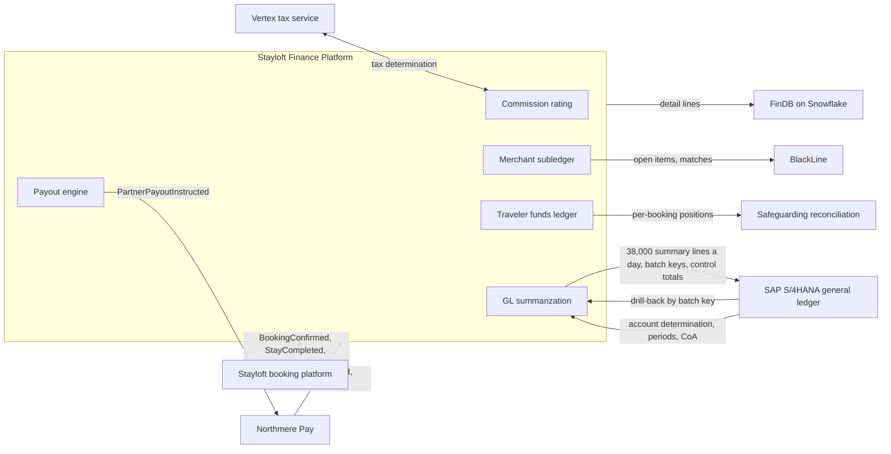
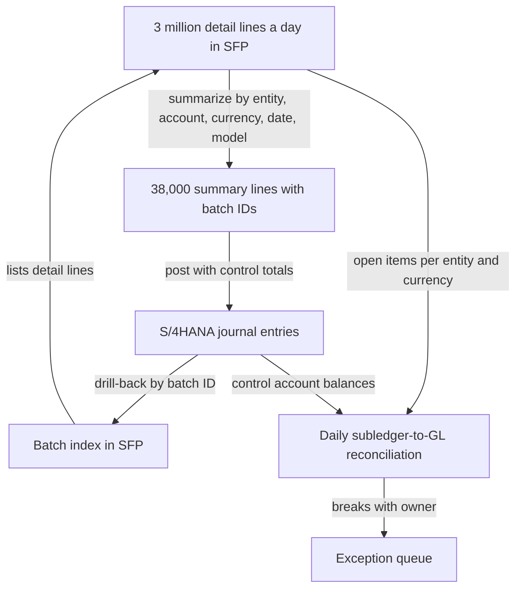
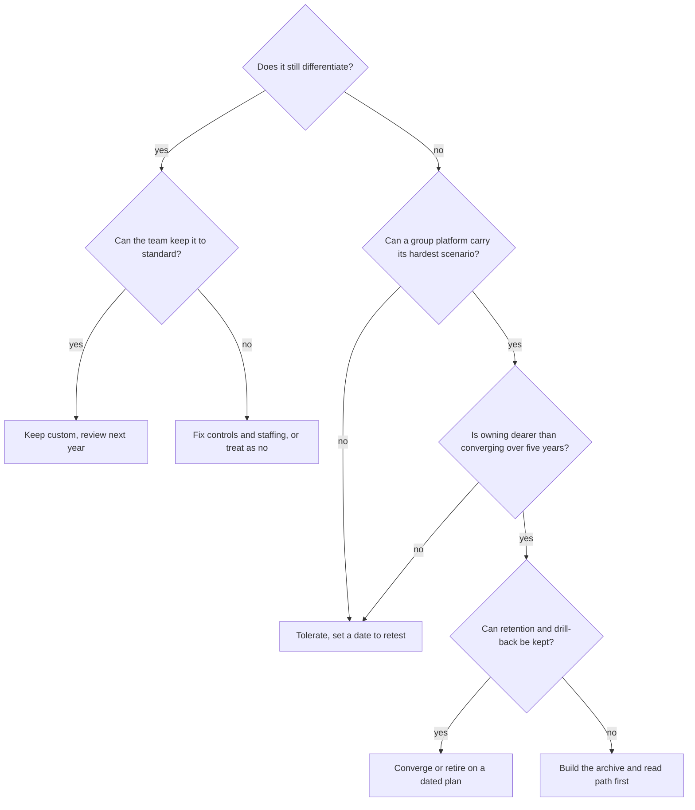

{id: custom-finance-platforms}
# 16. Why Enterprises Build Their Own Finance Platforms

> **IN THIS CHAPTER, YOU WILL:** Learn which finance capabilities enterprises legitimately build themselves, the boundary rules that keep a custom platform from becoming a second book of record, how it should integrate into the ERP, what owning it really costs, and how to decide, component by component, what to keep, converge or retire.

> **WHY FINANCE CARES:** A custom finance platform produces numbers the controller signs and the auditor tests, yet it sits outside the ERP's controls, release discipline and vendor assurance. Every rule it runs is a control the company must design, operate and evidence itself.

> **WHY ARCHITECTS SHOULD CARE:** Custom platforms are where the enterprise's business model meets its books. Draw the boundary well and they absorb volume and product change the ERP never could; draw it badly and they become shadow ledgers that slow the close and fail audits.

> **KEY POINTS:**
>
> * **Build for the product, not for the books.** Custom finance platforms earn their cost where the capability is coupled to how the business sells, prices, pays out or holds money: commission rules, payout orchestration, per-transaction customer-funds positions. They rarely earn it for invoicing, open-item management or general-ledger functions that packages do at volume.
> * **Custom owns operational financial facts; the ERP owns the book of record.** The platform keeps per-transaction detail and computes amounts; the ERP owns the chart of accounts, account determination, periods and balances. Integration is summarized postings with drill-back keys and control totals, never free posting to whatever account the platform chooses.
> * **Owning is a control obligation, not just an engineering cost.** People, audit evidence, change discipline and regulatory change make up most of the cost. Run an explicit retirement test on every component: if it no longer differentiates and a group platform can carry its hardest scenario, converge it.

> **[FAILURE PATTERNS THIS CHAPTER ADDRESSES](#where-finance-architecture-goes-wrong):**
>
> * **The Shadow Ledger** — a custom platform that keeps balances nobody ties to the general ledger is the commonest way a brand acquires its own books.
> * **Audit Archaeology** — custom platforms are built by product engineers to product standards, and their controls usually arrive with the first audit finding.
> * **Capability Creep** — custom platforms quietly duplicate invoicing, payouts and master data that group platforms already provide.

Every large digital enterprise I have worked with runs finance software it wrote itself. It is rarely a full ERP. It is the machinery that turns the company's particular business model into money: the engine that calculates a marketplace commission on every order, the service that decides when and how much to pay a partner, the ledger that tracks customer money held before a service is delivered. Packages exist for each in general; at the volumes involved, "almost fits" is expensive.

The trouble is that these platforms grow. A commission engine acquires an invoicing module because the ERP's invoicing was slow to configure. The payout service keeps partner balances because it needed them to net refunds. A few years later the brand has a **custom finance platform** that keeps its own books, posts its own journals and runs its own controls, and nobody decided that it should.

**Figure 1:** *Custom finance platforms grow by accretion: a commission engine acquires invoicing, then partner balances, then its own journals, until the brand has a second book of record that nobody decided to build.*

This chapter is about the decision nobody made: which finance capabilities to build, **where the boundary with the ERP must sit**, what owning really costs, and an **explicit retirement test** for deciding what to keep, converge or switch off. The internals of a custom ledger (posting rules, invariants, idempotency, bi-temporality) belong to the next chapter, [Designing Custom Ledgers and Financial Event Processing](#designing-financial-ledgers). This chapter decides what such a ledger should own; that one explains how to build it.

{id: custom-finance-platforms--setting-the-scene-the-sfp-question-at-northmere}
## Setting the Scene: The SFP Question at Northmere

Northmere, the fictional group this book follows (see [Meet Northmere: The Running Example](#meet-northmere)), is a multi-brand digital commerce group with about $8.2 billion of revenue in 2026. Its largest brand, Stayloft, is an accommodation marketplace that runs two business models side by side. Under the **agency model**, the property collects the traveler's payment and Stayloft invoices the property a monthly commission. Under the **merchant model**, Stayloft collects the payment, holds it until after the stay, and pays the property net of commission. The merchant share of Stayloft's gross transaction value rose from 51% in 2023 to 64% in 2026, and with it the amount of money, liability and reconciliation that runs through Stayloft's finance systems.

Those systems are mostly the **Stayloft Finance Platform (SFP)**, built by Stayloft engineering between 2012 and 2020. It calculates commission on every booking, keeps a merchant subledger of what is owed to and by partners, orchestrates partner payouts, tracks traveler funds per booking, and posts daily summarized journals into the group's SAP S/4HANA general ledger. It handles about **3 million subledger lines a day**, summarized into about **38,000 GL lines**, and about **7.6 million partner payouts a month** for Stayloft's merchant model (Tablekin's venue payouts through Stripe Connect make up the rest of the group's 9 million). Jonas Berg, Engineering Director for Stayloft Finance Engineering, owns it with about **60 engineers**.

In February 2027, two months after the board approved Program Keystone, Dana Whitlock, the Chief Architect, puts SFP on the agenda of the new design authority she chairs with Leila Haddad, the Chief Accounting Officer. Four facts make it urgent:

1. **The FY2026 significant deficiency.** The external auditor found that developers had production access to SFP's payout engine and that payout rule changes lacked documented approval. Remediation is a Keystone Year 1 goal.
2. **Agency accounts already left.** In 2025 SAP FI-CA (contract accounting, SAP's high-volume subledger) took over Stayloft's agency partner accounts: commission invoices, dunning and partner balances for about 850,000 partner contract accounts. SFP still invoices merchant-model partners, so Stayloft now bills commission from two systems.
3. **A duplicate payout engine.** Wayfare, acquired in 2024, pays its ground-transport suppliers through its own engine. Keystone's Year 3 plan retires one payout engine; the plan does not yet say which.
4. **The convergence decision is coming.** In Q4 2027 Northmere decides whether brand ledgers converge onto S/4HANA through SAP Central Finance or through an accounting-hub pattern. Either way, SFP's merchant subledger is scheduled to migrate incrementally to the group core by 2029.

Tomás Ferreira, the CFO, frames the question for the meeting in one sentence: *which parts of SFP are genuinely ours and should stay custom, which should move to the group core, and which should be switched off?* Jonas's answer is that the question is too coarse: SFP is nine components, not one, and they deserve nine answers. He is right, and the rest of the chapter builds the tools to give them.

{id: custom-finance-platforms--what-counts-as-a-custom-finance-platform}
## What Counts as a Custom Finance Platform

A **custom finance platform** is software the enterprise builds and operates that creates, calculates or holds financial facts that end up in the books: amounts owed, earned, held or paid. It is distinct from the brand's operational platform (the booking engine, the checkout, the ad server), which creates business events but no financial obligations of its own, and from the ERP, which is the **book of record**: the system whose ledger is the legal accounting record of each entity.

Two terms carry the rest of the chapter. An **operational financial fact** is a statement about one transaction in business terms: "booking 4471 owes the partner €510 after commission, payable after check-out." An **accounting entry** is the same reality expressed in the books: a debit and a credit, to specific accounts, in a specific entity and period. Custom platforms are good at the first. Whether they should produce the second, and how, is the boundary question (accounting entries and journals are defined in [Accounting for Architects: Ledgers, Journals and Revenue](#accounting-for-architects)).

The kinds of custom finance application that recur in digital businesses:

| Kind | What it does | Why packages struggle | Northmere example |
| --- | --- | --- | --- |
| **Brand-specific billing** | Rates usage or transactions and issues invoices or statements in the brand's terms | Pricing constructs change with the product; invoice content is part of the partner experience | SFP commission statements for merchant partners |
| **Commission engines** | Calculates the platform's take per transaction from rates, programs, tiers and overrides | Commission logic is commercial strategy, changed weekly, evaluated at booking time | SFP commission rating |
| **Settlement and payouts** | Decides what each partner is owed, nets refunds and adjustments, schedules and instructs payments | Payout timing and netting are product decisions; volume is per-transaction | SFP payout engine; Wayfare's supplier payout engine |
| **Customer or traveler funds** | Tracks money held on behalf of customers before performance, per transaction | Regulated positions, daily safeguarding, per-booking granularity | SFP traveler-funds ledger |
| **Revenue allocation** | Determines when and how much revenue each transaction yields, and allocates it across obligations | Recognition triggers are product events (stay completed, cancellation window closed) | SFP's recognition-timing rules |
| **Marketplace fees** | Charges buyers or sellers service, payment or cancellation fees | Fee rules are tied to checkout and to market regulation | Not modeled separately at Northmere; common where marketplaces charge buyers a fee |
| **Ad billing** | Rates clicks or placements, applies budgets and credits, invoices advertisers | Billing is coupled to the auction and to fraud filtering of clicks | Northmere Ads' billing service |

The platforms in this table share a property that matters more than their function: **each one makes financial decisions at transaction time, outside the ERP**. That is their value and their risk. In the layered reference model of [Anatomy of a Financial Systems Landscape](#finance-landscape), they sit in the financial event and subledger layer, between operational systems and the accounting core.

{id: custom-finance-platforms--why-enterprises-build-five-legitimate-reasons}
## Why Enterprises Build: Five Legitimate Reasons

Building finance software is rarely the default. Packages are cheaper to keep compliant, and [Build, Buy or Compose: Vendor Selection and Portfolio Rationalization](#build-versus-buy) gives the general criteria. Five reasons recur when building is right, and each has a test that separates a real reason from a preference.

**1. Volume and latency.** A marketplace that books millions of transactions a day needs commission, liability and payout positions per transaction, often within seconds, because partners and customers see them. General-ledger systems are designed for summarized postings; even packages built for volume, such as SAP's FI-CA, which SAP describes as [the first-choice subledger in S/4HANA "for industries with high volume and high performance requirements"](https://learning.sap.com/courses/implementing-sap-financial-contract-accounting/describing-sap-billing-and-revenue-innovation-management-sap-brim-), are batch-oriented subledgers rather than real-time product services. *The test:* does a user or partner need the number before the next batch would deliver it? A partner app that shows "you will be paid €510 on 26 April" the moment a booking is made passes. A monthly commission statement does not.

**2. Coupling to the product.** When a financial rule is part of what the business sells, it changes at product speed. Stayloft's commission depends on the property's program membership, its visibility boosts and promotional overrides, and Stayloft's commercial team changes these weekly. Putting that logic in an ERP pricing condition table would put the product release cycle behind the ERP's change process. *The test:* who asks for changes to this logic, and how often? If the answer is the product or commercial team, monthly or faster, the logic belongs near the product.

**3. Novel business models.** Packages encode yesterday's business models. A company that invents a new one (merchant-model accommodation in 2005, subscription-plus-usage-plus-payments for restaurants today) often finds no package that represents its obligations naturally. *The test:* can you describe the model with the package's standard objects without inventing meanings for its fields? If every implementation workshop ends in "we'll use the reference field for that", the model is not standard yet.

**4. Licensed-entity needs.** A company that holds customer money under a payments or e-money license must prove, every day, what it owes to whom. Under [PSD2 Article 10](https://eur-lex.europa.eu/eli/dir/2015/2366/oj), funds still held at the end of the business day after receipt must be segregated in a separate account at a credit institution (or in secure low-risk assets), or covered by insurance or a comparable guarantee. Northmere Payments B.V., the group's e-money institution, safeguards traveler funds this way. Proving the safeguarded amount is right requires a per-booking liability position reconciled daily to bank balances, which is a product of how bookings, cancellations and payouts flow, not of the general ledger. *The test:* does a regulator require a position at a granularity or frequency the ERP does not keep?

**5. Cost at scale.** Per-transaction license or processing fees that are trivial at a thousand transactions become material at a billion. A platform priced per invoice, per payout or per event can cost more each year than the team that would build the equivalent. *The test:* model the full cost both ways at today's volume and at three times today's, including the controls and people described later in this chapter. Cost at scale is the weakest of the five reasons on its own, because teams consistently undercount the cost of owning.

In my experience a strong case has at least two of these reasons, and one of them is coupling or a license. Volume alone argues for a high-volume product, not necessarily a custom one. Cost alone usually evaporates once controls are priced in.

{id: custom-finance-platforms--why-not-the-four-burdens-of-owning}
## Why Not: The Four Burdens of Owning

The case against building is not that engineers cannot write finance software. It is that **finance software carries obligations that product software does not**, and the enterprise carries them for as long as the software runs.

**The control burden.** Every automated calculation that feeds the financial statements is an **application control** the company must design, document and evidence, and every such control relies on **IT general controls (ITGCs)**: logical access, change management and operations over the system (see [Controls, Auditability and Security by Design](#controls-and-auditability)). A vendor's ERP comes with an assurance report on the vendor's side of those controls; a custom platform comes with nothing. Northmere's significant deficiency is the textbook case: an engineering team that deployed safely and often, with a pipeline that recorded every change, still drew an audit finding because nobody could show that a second person approved each payout rule change and that developers could not reach production data.

**The audit burden.** Auditors test custom platforms more deeply than configured packages because nothing about them is standard. They walk through the logic, test the reports and extracts that controls depend on (information produced by the entity), and ask for evidence that controls operated for every change in the period. Each audit cycle consumes engineering time to produce that evidence, and each new auditor asks for it again.

**The talent burden.** A custom finance platform needs engineers who understand accounting, and accountants who understand the platform. Both are scarce and both concentrate knowledge. Platforms built over eight years by a stable team carry rules nobody wrote down. When two or three people leave, the platform keeps running, but nobody can change its recognition rules with confidence.

**The regulatory-change burden.** Tax and payments regulation changes the content of invoices, the timing of reporting and the attributes a transaction must carry. A package vendor absorbs much of that change for all its customers at once. A custom platform absorbs it alone. The EU's [VAT in the Digital Age (ViDA) package](https://taxation-customs.ec.europa.eu/taxation/vat/vat-digital-age-vida_en) is a current example: from 1 July 2028 (member states may delay to 1 January 2030) platforms facilitating short-term accommodation rental can be deemed suppliers for VAT where the underlying provider does not charge VAT, and national e-invoicing mandates arrive country by country. Every custom invoicing component at Northmere must implement both, separately, unless invoicing converges first.

| Reason to build | The burden it creates | What keeps the trade worth it |
| --- | --- | --- |
| Volume and latency | Performance engineering, operations at period-end peaks | Detail stays in the platform; the ERP receives summaries |
| Coupling to the product | Frequent change to financially material logic | Rules as versioned, approved configuration, not code |
| Novel business model | Accounting interpretation lives in code | Accounting policy owned by the controller, implemented by engineering, with traceable rule versions |
| Licensed-entity needs | Regulatory reporting and daily reconciliation obligations | The licensed entity owns the requirement; the platform owns the evidence |
| Cost at scale | Hidden people and control costs | A full cost of owning, refreshed every year |

{id: custom-finance-platforms--boundary-rules-between-custom-platforms-and-the-erp}
## Boundary Rules Between Custom Platforms and the ERP

Where the boundary sits matters more than any other decision about a custom finance platform. A platform with a clean boundary can be large, fast and heavily customized without threatening the books. A platform with a blurred boundary becomes, in the language of [Where Finance Architecture Goes Wrong](#where-finance-architecture-goes-wrong), a Shadow Ledger, however good its engineering.

The principle I use is one sentence: **custom platforms own operational financial facts and per-transaction detail; the ERP owns the book of record, its structure and its calendar.** The table makes it concrete.

| Concern | Belongs in the custom platform | Belongs in the ERP | Why |
| --- | --- | --- | --- |
| Per-transaction amounts (commission, net payout, fee) | Yes: calculates and keeps them | No: receives them summarized | Volume, product coupling; the ERP has no use for 3 million lines a day |
| Chart of accounts and account determination | No: tags facts with business attributes | Yes: maps attributes to accounts | One CoA per group; a platform that picks accounts can corrupt the books silently |
| Posting periods, period open and close | Respects them: rejects or redates postings to closed periods | Yes: owns the calendar and locks | The period is a legal and control construct, not a technical one |
| GL balances and trial balance | No | Yes | Book of record |
| Subledger open items (partner payable per booking) | Yes while the subledger is custom | Control account balance only | Detail in the subledger, summaries in the GL; the two must reconcile |
| Customer-funds liability per transaction | Yes | Summarized liability balance | Regulatory granularity |
| Partner and customer master data | Consumes it; may own operational attributes (payout preferences) | Consumes them: the group partner hub assigns partner identity, and in the target state Northmere Pay alone authors bank and know-your-customer (KYC) attributes under change control (at Northmere, SFP still authors partner bank details until mid-2028) | One authority per attribute avoids The Doppelgänger Record |
| Revenue recognition policy | Implements triggers and calculations to policy | Owns policy, reviews schedules, receives entries | Accounting judgment belongs to the controller |
| Payment execution | Instructs payouts | Treasury and the payment factory execute | Dual approval, sanctions screening and bank connectivity once |
| Tax determination | Calls the group tax service | Tax engine is a shared service | One rule set per jurisdiction |
| Financial statements, consolidation | No | ERP and consolidation platform | Book of record |

From the table follow six rules I make mandatory in any estate I am responsible for:

1. **No custom platform posts to arbitrary GL accounts.** The platform sends facts with business attributes (entity, business model, transaction type, currency, counterparty type); account determination, the mapping from attributes to accounts, is owned by the controller and executed in the ERP or in an accounting engine governed like the ERP. If the platform must produce entries itself, it may use only accounts on a published allow-list per posting type, enforced by the receiving interface.
2. **Every posting carries its drill-back key.** Each summarized line identifies the summary batch, and the platform can list, for every batch, the detail lines that compose it, for as long as the retention period requires.
3. **Every interface carries control totals.** Record counts and amounts per entity and currency at each hop, reconciled automatically, with breaks routed to a named owner.
4. **The subledger reconciles to the GL every day, not every month.** The sum of open items equals the control account balance, per entity and currency.
5. **Accounting policy is configuration with an owner.** Recognition triggers, netting rules and payout rules are versioned artifacts approved by Finance, not constants in code.
6. **Corrections are reversals, not updates.** Posted facts are immutable; the platform corrects them with new entries (the mechanics are in [Designing Custom Ledgers and Financial Event Processing](#designing-financial-ledgers)).

**Figure 2:** *SFP's boundary as it should be: the platform owns per-transaction facts and computes amounts; S/4HANA owns accounts, periods and balances and receives only summaries it can drill back from; payment execution, tax and safeguarding are shared services the platform calls rather than reimplements.*

The diagram shows SFP as it should be. In 2027 SFP still determines its own GL accounts from a mapping table that Stayloft finance maintains inside SFP, bypassing group chart-of-accounts governance. Moving account determination out is the first boundary fix in Dana's plan: cheap, and it removes the largest silent risk.

{id: custom-finance-platforms--who-owns-the-financial-data}
## Who Owns the Financial Data

"Who owns the data" mixes three questions that should be answered separately: who is **authoritative** for a data element at each stage of its life, who **operates the platform** that stores it, and who is **accountable for its correctness** in the financial statements.

Authority moves along a transaction's life (the subject of [Systems of Record and Authoritative Data Boundaries](#systems-of-record)). For the Lisbon booking that recurs in this book, the booking platform is authoritative for the booking itself, SFP for the commission and the amount owed to the partner, Northmere Pay for the payment and its settlement, and S/4HANA for the resulting balances. Each hand-off is a point where the receiving system takes authority and the sending system keeps a reference.

Operating the platform and being accountable for its numbers are different roles. Jonas's team operates SFP. Leila, as Chief Accounting Officer, is accountable for every number SFP feeds into the statements, and Ingrid Solberg, Managing Director of Northmere Pay, is accountable for the safeguarded traveler funds. A healthy arrangement makes this explicit: **Finance owns the rules and signs the numbers, Engineering owns the platform and the evidence that it ran the rules as approved**. At Northmere before 2027, Stayloft finance maintained SFP's account mapping in the platform and Stayloft engineering changed payout rules on request; nobody at group level owned either, and the payout rules are where the auditor found it.

Two further obligations follow from data ownership in finance:

- **Retention.** Detail that supports the books must stay retrievable for the statutory period, which varies by jurisdiction and record type, commonly 7 to 10 years. A custom platform is in scope for that period even after it stops processing.
- **Traceability.** Whoever owns the detail owns the read path to it. Northmere learned this the hard way: for periods before 2025, SFP kept the mapping from summary batch to detail lines in a log store with 13-month retention, so an auditor's 2027 request to trace a Portuguese revenue balance had to be answered by rebuilding the trace from raw events.

{id: custom-finance-platforms--integration-into-the-core-summarized-postings-with-drill-back}
## Integration Into the Core: Summarized Postings With Drill-Back

The standard integration pattern between a high-volume custom platform and an ERP is the one in Figure 2: **detail in the subledger, summaries in the GL, with keys that connect them**. The pattern is old (it is how ERP subledgers have always posted to their own general ledgers) and vendors package it: Oracle describes its [Accounting Hub](https://docs.oracle.com/en/cloud/saas/financials/26c/faiac/how-oracle-accounting-hub-cloud-works.html) as an accounting rules engine that creates detailed journals from external source systems and transfers them to the GL with drill-down to transaction details, and Workday's [Accounting Center](https://workday.com/en-us/products/financial-management/accounting-center.html) turns high volumes of external business events into accounting entries and lets users drill from summarized reports to source level.

{id: custom-finance-platforms--the-lisbon-booking-through-sfp}
### The Lisbon booking through SFP

Follow one transaction. A traveler from Germany books a three-night stay in a Lisbon apartment for **€600.00** including VAT, paid by card through Adyen on Friday **12 March 2027**, stay **18–21 April 2027**. The commission rate is **15%**, so Stayloft's commission is **€90.00** and the partner is owed **€510.00**. Under Northmere's policy Stayloft acts as agent and recognizes the commission when the stay is completed; VAT on the commission is ignored here. Stayloft B.V. earns the commission while Northmere Payments B.V. holds the traveler funds; the table shows one combined view and omits the intercompany legs, which [Accounting for Architects: Ledgers, Journals and Revenue](#accounting-for-architects) works through.

SFP records the transaction as a short series of subledger entries. The account names below are the group accounts S/4HANA determines from SFP's attributes; SFP itself carries business types.

| Date | Account | Debit | Credit | Note |
| --- | --- | --- | --- | --- |
| 12 Mar 2027 | PSP clearing – Adyen | €600.00 | | Payment captured |
| 12 Mar 2027 | Traveler funds held (liability) | | €600.00 | Refundable until the cancellation window closes |
| 21 Apr 2027 | Traveler funds held (liability) | €600.00 | | Stay completed |
| 21 Apr 2027 | Partner payables | | €510.00 | Net of commission |
| 21 Apr 2027 | Commission revenue | | €90.00 | Recognized at stay completion |
| 22 Apr 2027 | Partner payables | €510.00 | | Payout instructed to Northmere Pay |
| 22 Apr 2027 | Payouts in transit | | €510.00 | Clears on settlement, 26 Apr 2027 |

Settlement of the €600 through Adyen batch 1047 (booked 14 March, credited to the bank 16 March), the Adyen processing fee of €1.74 and the bank leg of the payout belong to the payments-to-ledger flow ([Payments-to-Ledger: Connecting Providers, Brand Platforms and the ERP](#payments-to-ledger)); they clear the PSP clearing and in-transit accounts but are not SFP's facts.

None of these lines reaches S/4HANA individually. Each night SFP summarizes the day's lines by a **summarization key**: legal entity, group account (after determination), currency, posting date, business model, profit center and tax jurisdiction. On 12 March, the Lisbon booking's €600 becomes part of one summary line, "Traveler funds held, Northmere Payments B.V., EUR, 12 March 2027", alongside tens of thousands of other bookings. That line carries a **summary batch identifier**, and SFP keeps, for every batch, the list of detail lines it contains. An auditor who picks the summary line in S/4HANA can drill back through the batch identifier to the booking.

{id: custom-finance-platforms--control-totals-proving-the-summary-is-complete}
### Control totals: proving the summary is complete

Summarization is only safe if it is provably lossless. Each day's posting carries control totals at three hops, and each comparison is automated with a named owner for breaks:

| Hop | What is compared | Example, posting date 12 March 2027 (illustrative) | Break owner |
| --- | --- | --- | --- |
| Events in | Events received by SFP vs events published by the booking platform and Northmere Pay, by type | 2,114,880 published, 2,114,880 consumed | SFP on-call engineer |
| Detail to summary | Sum of detail lines vs sum of summary lines, per entity, account and currency; debits equal credits | 3,061,442 detail lines → 38,210 summary lines; EUR totals equal to the cent | SFP finance operations |
| Summary to GL | Summary lines and amounts sent vs posted in S/4HANA, per batch | 38,210 sent, 38,210 posted, zero rejected | S/4 platform team (Sven Aalto) |
| Subledger to GL | Open items in SFP vs control account balances in S/4HANA, per entity and currency | Differences cleared by working day 1 | Stayloft entity controller |

The fourth row is the one that matters most to Finance and is most often missing. A platform can post every summary correctly and still drift from the GL if a summary is posted to a closed period, reversed manually in the ERP or rejected and re-sent twice. The daily **subledger-to-GL reconciliation** catches all of these; the monthly version catches them too late to fix before the close. BlackLine already reconciles about 6,800 balance-sheet accounts a month at Northmere; SFP's control accounts should be among them with daily auto-certification.

**Figure 3:** *Summarization is safe only when it is reversible and provably complete: the batch index makes every GL line traceable to its detail, and the daily subledger-to-GL reconciliation proves that nothing was lost, duplicated or posted outside the platform.*

The two alternatives are worse defaults. **Per-transaction posting** into the GL moves the volume problem into the ERP and is right only at low volume or when the receiver is a high-volume subledger such as FI-CA. **Balance-only feeds**, one month-end balance per account, remove traceability and are the direct route to Lost in Aggregation. [Designing for Traceability, Reconciliation and Audit Across Boundaries](#traceability-and-reconciliation) treats the reconciliation design in depth.

{id: custom-finance-platforms--the-true-cost-of-owning}
## The True Cost of Owning

Business cases for custom finance platforms count engineers and cloud spend. The real cost has four further lines, and at Northmere they turn out to be almost half the total. In March 2027 Dana's team estimated SFP's annual cost of owning (illustrative, rounded):

| Cost line | What it covers | Estimate per year |
| --- | --- | --- |
| Engineering | ~60 engineers in Jonas's organization at the group planning rate of $165,000 per fully loaded FTE-year | ~$9.9M |
| Infrastructure | Cloud compute, storage, the event backbone share, environments | ~$3.0M |
| Controls and audit | Design and testing of SFP's 41 key controls, evidence production for internal controls and the external auditor, remediation of the FY2026 deficiency | ~$1.5M |
| Finance operations | ~25 full-time equivalents in Stayloft finance working SFP-specific exceptions, manual mappings and reconciliations | ~$4.1M |
| Regulatory change | E-invoicing mandates, ViDA preparation, safeguarding reporting changes implemented in SFP rather than in shared services | Included in engineering; about a fifth of 2027 capacity |
| **Total** | | **~$18.5M** |

Three observations come out of the table. First, **about a fifth of the engineering capacity is spent on change that creates no differentiation**: e-invoicing formats and tax content that a shared service would absorb once for all brands. Second, **controls and finance operations together cost more than half as much as the engineering line**, and neither appears in Stayloft engineering's budget, which is why SFP looked cheaper than it was. Third, **people are the binding constraint, not money**: a handful of senior engineers understand SFP's recognition and netting rules, and the audit remediation competes with product work for exactly those people.

The FY2026 deficiency shows what the control line buys. Mei Tanaka, Head of Internal Controls, and Jonas found that SFP's pipeline already recorded every change and every deployment. What was missing was separation and approval: 14 engineers held standing production write access left over from a 2024 incident, and 9 of the 23 payout rule changes in 2026 had no documented request or approval. The auditor re-performed sampled payouts and found no misstatement: the deficiency was in the controls, not in the numbers. The remediation is architectural, not procedural: payout rules become **versioned configuration** with maker-checker approval by Stayloft finance, standing production access is replaced by time-limited, logged break-glass access, and the pipeline refuses to deploy a rule change without a recorded approval. Standing access was removed on 15 June 2027 and the new controls operate from 1 July 2027 (detail in [Controls, Auditability and Security by Design](#controls-and-auditability)). The engineering cost is modest; the lesson is that it should have been designed in from the first payout, which is the definition of Audit Archaeology.

{id: custom-finance-platforms--scalability-where-custom-platforms-earn-and-lose-their-keep}
## Scalability: Where Custom Platforms Earn and Lose Their Keep

Finance workloads scale differently from product workloads. Three patterns matter at the architecture level; the engineering is in [Designing Custom Ledgers and Financial Event Processing](#designing-financial-ledgers).

- **Peaks follow the calendar, not the traffic.** Bookings peak with consumer demand, but SFP's heaviest hours are the nightly summarization, the payout batches after weekends and the first working days of each month, when corrections, reversals and reconciliations all run at once.
- **Hot accounts.** Per-transaction ledgers spread naturally across millions of bookings, but some balances (the in-transit account for one currency, the commission revenue account for one entity) receive a large share of all entries. A design that updates a single balance row per entry serializes the whole platform on those accounts.
- **Batch boundaries are control boundaries.** Payout batches by currency and cut-off are also the units Northmere Pay reconciles against bank statements. Splitting or merging them for performance reasons changes what the reconciliation can prove.

Scalability is also where the build case most often expires. SFP was built partly because the group's 2012 ERP could not carry per-booking subledger volume. FI-CA now carries 850,000 Stayloft agency partner accounts; a 2027 volume test, not a 2012 assumption, should decide whether it can carry the merchant subledger too.

{id: custom-finance-platforms--modernization-challenges-specific-to-custom-finance-platforms}
## Modernization Challenges Specific to Custom Finance Platforms

Modernizing a custom finance platform is harder than modernizing an ordinary application of the same size, for five reasons. The general patterns (strangler fig, parallel run, event interception, cut-over at period boundaries) are in [Modernization Patterns for Legacy Finance Systems](#modernization-patterns); these are the finance-specific obstacles.

1. **Accounting policy is buried in code.** Recognition triggers, netting order and rounding rules were implemented once and changed many times. Nobody can migrate them without first extracting them as explicit rules and having the controller confirm them. At Northmere, Leila's team found that SFP rounds commission per booking line while FI-CA rounds per invoice; at 7.6 million payouts a month, the difference is visible in the reconciliation.
2. **Open items must move, not just balances.** A subledger migration carries every unpaid partner payable, every traveler-funds position and every unsettled payout, with its history, and must prove that the sum of open items before and after is equal per entity and currency.
3. **History has to stay readable.** The platform's detail supports the books for the retention period. Retiring SFP's merchant subledger in 2029 does not end the obligation to drill back into 2022.
4. **Periods constrain the calendar.** Migrations land at period boundaries, avoid quarter-end and year-end, and usually run in parallel for one or two closes, which is costly and must be budgeted.
5. **The platform is coupled to the product.** SFP's events come from the booking platform, whose teams are not part of the modernization. Changing the boundary changes their contract too.

The approach that works is incremental: introduce the canonical financial events Keystone defines (`BookingConfirmed`, `StayCompleted`, `PartnerPayoutInstructed` and the rest, owned by [Canonical Events and Adapters for Loosely Coupled Financial Domains](#loosely-coupled-domains)), let SFP and the new target consume the same events, run them in parallel and reconcile the outputs, and move one component at a time. [Modernizing Without Stopping the Close: An Incremental Migration](#incremental-modernization) works through the SFP migration stage by stage.

{id: custom-finance-platforms--the-retirement-test}
## The Retirement Test

Every custom finance component should face the same question every year: **would we build this today?** I make it explicit with five questions, asked per component, not per platform.

1. **Does it still differentiate?** Would replacing it with a package's standard behavior cost revenue, partner or customer experience, or regulatory standing? If not, it is a commodity, however well built.
2. **Can a group or vendor platform carry its hardest scenario?** Not a demo: a proof on the component's real volume, its worst day, its most complex transaction type and its period-end peak.
3. **Is the cost of owning higher than the cost of converging plus running the alternative?** Using the full cost table above, over a five-year horizon.
4. **Can its data obligations be met after retirement?** Retention, drill-back and audit access for every period it supported, through an archive with a read path.
5. **Can the team keep it to standard?** If the controls, evidence and knowledge cannot be sustained (key people leaving, audit findings recurring), the component is a risk, whatever its other merits.

**Figure 4:** *The retirement test applied per component: differentiation decides whether convergence is even considered, and a proven alternative, a full cost comparison and a preserved audit trail decide whether it happens now.*

The test reads like the portfolio dispositions in [Manage the Application Portfolio as an Investment](#application-portfolio) (tolerate, invest, migrate, eliminate), applied at a finer grain. That grain is the point. Platform-level decisions about SFP keep failing because the platform contains both the most differentiating logic Stayloft has (its commission rules) and the most commodity logic (invoice rendering). Asking the questions per component separates them.

{id: custom-finance-platforms--northmere-s-decision-classifying-sfp}
## Northmere's Decision: Classifying SFP

Over March and April 2027 Dana's architects, Jonas's engineering leads, Leila's controllers and Mei's controls team apply the test to each SFP component, plus the two other custom platforms in scope. The design authority accepts the result in May 2027 as an architecture decision record.

| Component | What it does | Verdict | Reasoning | Timing |
| --- | --- | --- | --- | --- |
| **Commission rating** | Calculates Stayloft's commission per booking from rates, programs and overrides | **Keep custom** | Coupled to Stayloft's commercial programs, changed weekly; no package advantage. Must stop determining GL accounts and emit rated amounts with business attributes only | Boundary fix 2027 |
| **Merchant commission invoicing and statements** | Issues commission invoices and payout statements to merchant-model partners | **Converge** to FI-CA convergent invoicing | Commodity; duplicates the agency invoicing already in FI-CA; e-invoicing and ViDA would otherwise be built twice | 2028 |
| **Merchant subledger** | Partner payables and traveler-side open items, clearing | **Converge** to the group core | A book-of-record function; FI-CA is built for this volume class, subject to the 2027 volume proof; ends The Shadow Ledger risk | Incremental, completed 2029 |
| **Traveler funds ledger** | Per-booking liability and safeguarding positions for Northmere Payments B.V. | **Keep custom** | Licensed-entity need: daily per-booking positions reconciled to safeguarding accounts; reconciles to the group core's merchant open items after 2029 | Review after 2029 migration |
| **Payout calculation and orchestration** | Nets amounts, applies holds and schedules, instructs Northmere Pay | **Keep, and make it the group payout service** | Payout timing and netting are partner experience; the engine is the better of the group's two; controls remediated in 2027 | Remediation 2027; group service 2029 |
| **Payout rules and partner bank details** | Payout terms, holds, beneficiary data | **Converge** the master data | Partner identity moves to the group partner hub and bank-detail authority moves from SFP to Northmere Pay; payout rules stay in SFP as approved configuration | Bank details by 30 June 2028 |
| **Revenue recognition timing** | Applies recognition triggers (stay completed, cancellations) | **Converge** the rules | Policy belongs with the group accounting engine chosen in Q4 2027; SFP keeps emitting `StayCompleted` and `BookingCancelled` | With the hub decision |
| **GL summarization and posting interface** | Nightly summarization, account mapping, S/4 posting | **Retire** | Replaced by canonical events into the group accounting engine; account determination leaves SFP first | Mapping 2027; interface 2029 |
| **SFP finance reports and extracts** | Deferred merchant bookings and partner balance reports built inside SFP | **Retire** | Rebuilt as governed metrics in FinDB, tied out to the ledger | 2028 |
| **Wayfare payout engine** | Monthly payouts to ground-transport suppliers | **Retire** into the group payout service | Its remaining differences (a payment schedule and a netting rule) are configuration in SFP's engine | Keystone Year 3 |
| **Northmere Ads billing** | Rates clicks, applies budgets and credits, invoices advertisers, posts summarized AR to S/4 | **Keep rating, converge invoicing and receivables** | Click rating is coupled to the auction and fraud filtering; invoicing and receivables are commodity and belong with FI-CA | 2028–2029 |

Three judgments in the table deserve a sentence each. Keeping the **payout engine** after an audit finding looks perverse until you separate the finding from the capability: the finding was about change and access controls, which are fixable in months, while the capability (netting, holds and scheduling across 31 settlement currencies) is the hardest part of Stayloft's finance to replicate. Keeping the **traveler funds ledger** custom while converging the merchant subledger creates a new reconciliation between them; Dana accepts it because the safeguarding requirement belongs to the licensed entity, and Ingrid wants it in a component whose release cycle her team can influence. And **retiring the summarization interface** is not retiring summarization: the group accounting engine will still summarize, but under the group's governance rather than SFP's.

The table also answers the original question in Tomás's terms. Of SFP's nine components, three stay custom, four converge, and two are retired. Dana's team estimates that the converged scope would free about a third of Jonas's engineers for product-coupled work by 2029 and cut the finance-operations line roughly in half, the latter subject to the convergence proof.

**Figure 5:** *SFP is nine components, not one, and they get nine answers: three stay custom, four converge onto group platforms and two are retired, because the retirement test is asked per component rather than per platform.*

{id: custom-finance-platforms--trade-offs-where-the-merchant-subledger-could-live}
## Trade-Offs: Where the Merchant Subledger Could Live

The most consequential verdict in the table is the merchant subledger's, and it is not settled until the Q4 2027 decision on how brand ledgers converge. The options are compared below; the platform chapters explain each vendor product in depth ([SAP S/4HANA: The Enterprise Finance Core](#sap-s4hana), [Oracle Fusion Cloud ERP: Ledgers, Accounting Hub and Coexistence](#oracle-fusion), [Workday: Financials, People and the Organizational Backbone](#workday)).

| Option | What it means | Strengths | Weaknesses | Right when |
| --- | --- | --- | --- | --- |
| **Keep custom (SFP)** | Modernize SFP's subledger in place | No migration; full control of performance and model | Keeps the control, audit and talent burdens; remains a second book | The model is genuinely novel and no package carries the volume |
| **SAP FI-CA in the group S/4 core** | Merchant partner accounts join the agency accounts already in FI-CA | One subledger for both Stayloft models; vendor-maintained; SAP positions FI-CA for high-volume industries | Batch-oriented; real-time partner balances still need a custom read model; FI-CA design and SAP skills | The group core is S/4 and the volume proof passes |
| **Accounting hub over a custom operational ledger** | SFP keeps per-booking facts; a vendor accounting engine creates entries by rule | Accounting rules as configuration under Finance's control; drill-back built in | Two systems to reconcile; hub throughput must be proven (Oracle and Workday publish no volume figures) | The ERP decision favors a hub pattern |
| **Commercial or open-source ledger service** | A purpose-built double-entry ledger replaces SFP's storage | Engineered for volume and immutability | Still custom accounting logic around it; less familiar to auditors | Engineering-led organizations with strong accounting ownership |
| **Separate brand ERP** | Stayloft gets its own ERP instance | Familiar to auditors | Adds a fourth ledger to consolidate; contradicts Keystone | Rarely; perhaps for a carve-out |

My recommendation to Northmere is the FI-CA option, conditional on the volume proof, because it puts both Stayloft business models in one subledger that the group already operates and audits. If the proof fails at merchant volume, the accounting-hub option is the fallback, not keeping SFP's subledger: the point of the decision is to move the book-of-record function out of a brand team, whichever product receives it. The commercial ledger options and the engineering trade-offs between them are covered in [Designing Custom Ledgers and Financial Event Processing](#designing-financial-ledgers).

*A note from later in the story: this May 2027 recommendation did not survive. On 8 December 2027 the Keystone design authority chose the accounting-hub pattern for brand-ledger convergence, with a group accounting engine generalized from SFP's redesigned subledger engine posting into S/4HANA; FI-CA keeps merchant invoicing but not the merchant subledger. The record above is left as it was argued at the time; [Multiple ERPs, One Finance Core: Coexistence and Convergence](#multiple-erps) tells the decision and [Modernizing Without Stopping the Close: An Incremental Migration](#incremental-modernization) the migration that followed.*

{id: custom-finance-platforms--integration-with-the-rest-of-the-estate}
## Integration With the Rest of the Estate

A custom finance platform touches nearly every other part of the estate, and each contact has an owner elsewhere in this book:

- **Payments.** SFP consumes payment events from Northmere Pay and instructs payouts back to it; settlement, fees and the three-way match between booking, PSP settlement and bank are in [Payments-to-Ledger: Connecting Providers, Brand Platforms and the ERP](#payments-to-ledger).
- **Events and adapters.** SFP becomes the first large producer and consumer of Keystone's canonical financial events, which [Canonical Events and Adapters for Loosely Coupled Financial Domains](#loosely-coupled-domains) defines; SFP's adapter is the template for other brands.
- **Master data.** Partner identity moves to the group partner hub and bank details to Northmere Pay, as [Finance Data Architecture: Master Data, Systems of Record and Governance](#finance-data-architecture) describes; SFP keeps operational payout preferences.
- **Close and reconciliation.** SFP's control accounts join BlackLine's daily reconciliations and transaction matching ([BlackLine: Close Automation, Reconciliation and Continuous Accounting](#blackline)).
- **Data.** SFP's detail flows to FinDB, where the ledger-to-warehouse tie-out, a known gap in 2027, is addressed in [Finance Data Across the Estate: From Operations to Analytics](#finance-data-flows).
- **Overlaps.** The duplicate billing and payout capabilities enter the overlap register in [Preventing Redundant Capabilities and Unnecessary Coupling](#redundancy-and-coupling).

{id: custom-finance-platforms--failure-modes}
## Failure Modes

Several failure modes have already appeared: platforms that pick their own accounts, drill-back that expires with a log store, monthly instead of daily subledger reconciliation, and policy hidden in code. Four more recur.

- **Production access as an operating model.** Engineers fix financial data by hand because the platform has no correction workflow. Remedy: corrections by reversal through the application; break-glass access logged and reviewed.
- **Growth by convenience.** The platform adds invoicing, dunning or reporting because a shared service was slow to respond. Each addition is reasonable; together they make a second ERP. Remedy: new financial capabilities pass the design authority, and the retirement test runs yearly.
- **Peak blindness.** Capacity is tested on average days, and the platform fails on the first working day of the quarter. Remedy: load tests on period-end profiles.
- **The orphaned platform.** The brand reorganizes, the founding engineers move on, and the platform keeps running with nobody able to explain its rules. Remedy: rule documentation and controller sign-off as part of the definition of done, and a named owner in the portfolio.

{id: custom-finance-platforms--the-chief-architect-s-view}
## The Chief Architect's View

The Chief Architect does not decide whether a brand may write software. The decisions that belong at enterprise level are narrower and more durable:

- **The boundary rules are mandatory standards.** No custom platform posts to arbitrary accounts; every posting carries drill-back keys and control totals; subledgers reconcile daily; corrections are reversals. These are among the few standards I would refuse to waive, because each waiver creates audit exposure that compounds.
- **Build decisions are recorded per capability, with a review date.** Each custom component has a decision record stating which of the five reasons justifies it and when it will be retested. A platform with no recorded reason is a candidate for the retirement test now.
- **Finance owns the rules; Engineering owns the platform.** Decision rights for accounting policy, account determination and payout rules sit with the CAO's organization; the platform team owns implementation and evidence. Write it into the operating model ([Organizing Architecture Ownership Across Finance, Engineering, Security and Data](#organizing-for-architecture)).
- **The cost of owning is reported in full.** Controls, audit evidence, finance operations and regulatory change appear next to engineering and infrastructure in the portfolio, so that build and converge options compete on equal terms.

What to watch: the share of engineering capacity spent on non-differentiating regulatory change; the age of open subledger-to-GL differences; control deficiencies on custom platforms; key-person concentration; and the number of capabilities a custom platform has acquired since its last review. When the first and last of these rise together, the platform is turning into an ERP nobody chose.

{id: custom-finance-platforms--questions-to-ask}
## Questions to Ask

1. For each custom finance component, which of the five reasons justifies it, and when was that last tested?
2. Who determines the GL accounts this platform's transactions land in, and can a mapping change bypass group chart-of-accounts governance?
3. Can an auditor drill from any GL line back to its transactions for every period still under retention?
4. Are control totals checked at every hop, and who owns each break?
5. How often does the subledger reconcile to the GL, and how old is the oldest open difference?
6. Which financially material rules are code rather than approved configuration, and who approved the last change?
7. What does owning this platform cost per year when controls, audit evidence, finance operations and regulatory change are included?
8. Which capabilities has the platform acquired that a group platform already provides?
9. If we retired this component tomorrow, how would we serve audit queries for the last seven to ten years?
10. Has any group or vendor platform been tested on this component's hardest scenario since it was built?

Deciding what a custom platform should own is half the problem. The other half is building what it keeps so that accountants and auditors can trust it: financial events that become entries by explicit rules, double-entry invariants enforced by the system, corrections by reversal, idempotent processing, money represented without rounding drift, and summarization with drill-back designed in. That is the subject of the next chapter, [Designing Custom Ledgers and Financial Event Processing](#designing-financial-ledgers), which redesigns the Stayloft subledger from the inside.

{id: custom-finance-platforms--sources-and-evidence}
## Sources and Evidence

*Vendor documentation*

- [How Oracle Accounting Hub Cloud Works](https://docs.oracle.com/en/cloud/saas/financials/26c/faiac/how-oracle-accounting-hub-cloud-works.html), Oracle, 2026 (26C) — accounting rules engine for external sources, detailed journals transferred to GL, drill-down to transaction details.
- [Workday Accounting Center](https://workday.com/en-us/products/financial-management/accounting-center.html), Workday — high-volume external business events turned into accounting entries, rules configured by Finance, drill from summarized reports to source.
- [Implementing SAP Financial Contract Accounting: Describing SAP BRIM](https://learning.sap.com/courses/implementing-sap-financial-contract-accounting/describing-sap-billing-and-revenue-innovation-management-sap-brim-), SAP Learning — FI-CA as the S/4HANA subledger for high-volume industries, documents assigned to business partner and contract account, GL summarization.
- [Stripe Connect: charge types](https://docs.stripe.com/connect/charges), Stripe — how marketplace charge structures assign refund, dispute and fee liability; background for Tablekin's venue payouts.
- [Adyen for Platforms: platform structure](https://docs.adyen.com/platforms/account-structure-resources/platform-structure), Adyen — split of payments between liable and user balance accounts; the vendor alternative to custom payout ledgers.

*Standards and regulation*

- [Directive (EU) 2015/2366 (PSD2), Article 10](https://eur-lex.europa.eu/eli/dir/2015/2366/oj), European Union, 2015 — safeguarding requirements behind the traveler-funds ledger.
- [VAT in the Digital Age](https://taxation-customs.ec.europa.eu/taxation/vat/vat-digital-age-vida_en), European Commission, 2025 — deemed-supplier rules for short-term accommodation platforms from 1 July 2028 and the e-invoicing timeline.

*Practitioner and research sources*

- [Accounting Patterns (Analysis Patterns supplement)](https://martinfowler.com/apsupp/accounting.pdf), Martin Fowler — posting rules and reversal adjustments as the vocabulary for separating facts from entries.
- [Books, an immutable double-entry accounting database service](https://developer.squareup.com/blog/books-an-immutable-double-entry-accounting-database-service/), Łukasz Strzałkowski, Square, 2019 — a published example of a company building its own immutable ledger service.
- [Ledger: Stripe's system for tracking and validating money movement](https://stripe.dev/blog/ledger-stripe-system-for-tracking-and-validating-money-movement), Ilya Ganelin, Stripe, 2024 — a ledger used as the backbone for completeness and clearing checks (as reported).
- [Strangler Fig](https://martinfowler.com/bliki/StranglerFigApplication.html), Martin Fowler, 2024 — the incremental replacement approach applied to SFP's components.
- [Patterns of Legacy Displacement](https://martinfowler.com/articles/patterns-legacy-displacement/), Ian Cartwright, Rob Horn and James Lewis, 2021 (revised 2024) — event interception and transitional architecture for moving SFP's functions.

Northmere is fictional; the architectural recommendations are the author's judgment.
