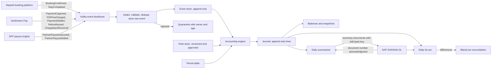
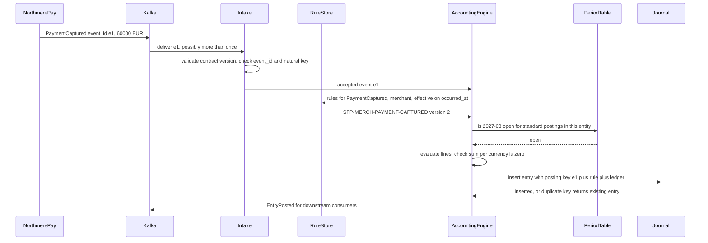
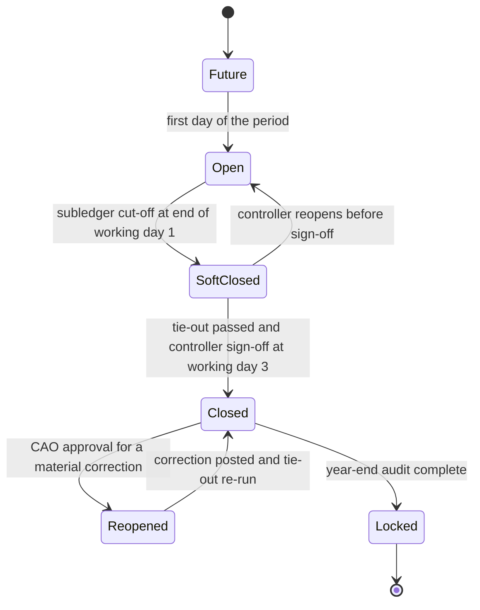

{id: designing-financial-ledgers}
# 17. Designing Custom Ledgers and Financial Event Processing


> **IN THIS CHAPTER, YOU WILL:** Learn how to design a high-volume subledger and the financial event pipeline that feeds it: the separation of financial events from accounting entries, posting rules as approved configuration, the invariants that must hold on every write, money and currency representation, the time dimensions of a ledger, summarization to the general ledger with drill-back, built-in reconciliation, testing, scaling, and when to buy instead of build.

> **WHY FINANCE CARES:** A subledger the controller cannot interrogate is a liability on the audit file. Finance needs to know, for any balance, which approved rule produced it, from which business events, and whether every event that should have been accounted for was.

> **WHY ARCHITECTS SHOULD CARE:** A ledger is the one system where "eventually correct" is not good enough and "we fixed the row in production" is a control failure. The design decisions in this chapter (immutability, idempotency, versioned rules, time handling) are cheap on day one and very expensive to retrofit once a few billion lines exist.

> **KEY POINTS:**
>
> * **Post facts, derive accounting.** A financial event records what happened in the business; an accounting entry is one approved interpretation of it. Keep them separate, stamp every entry with the event and the rule version that produced it, and a changed accounting policy becomes a re-derivation instead of a data repair.
> * **Invariants belong in the write path.** Balanced entries per currency, append-only storage, one effect per event, and no posting into a closed period are enforced by the posting engine at the moment of writing. A nightly report that finds an unbalanced entry has already let a wrong number into the books.
> * **The volume is not the hard part; the evidence is.** Three million lines a day is about 35 writes a second. What makes a ledger hard is proving completeness, traceability and correct timing to an auditor, so drill-back keys, control totals and a daily tie-out to the general ledger are part of the design, not reports added later.

> **[FAILURE PATTERNS THIS CHAPTER ADDRESSES](#where-finance-architecture-goes-wrong):**
>
> * **The Shadow Ledger** — a payout engine that keeps mutable running balances is a subledger without a subledger's discipline; this chapter gives it that discipline.
> * **Lost in Aggregation** — summarization to the general ledger is designed here with a drill-back key that is stored with the detail and retained as long as the detail.
> * **Audit Archaeology** — posting rules, period states and reconciliation are built into the engine, so evidence is produced by normal operation rather than reconstructed for the auditor.

Most enterprises do not set out to build a ledger. They build a payout engine, a billing service or a wallet, and that system needs to know how much is owed to whom. Within a few years it holds balances that the general ledger depends on, and it has become a **subledger** (a detailed record of one area of the books, such as partner payables or customer funds, whose totals feed a control account in the general ledger). [Why Enterprises Build Their Own Finance Platforms](#custom-finance-platforms) covers when a business should own such a system at all. This chapter assumes the decision has been made and asks how to build it well.

The answer is not a technology. It is a small set of disciplines accountants have used for centuries: **record what happened, never overwrite it, correct by adding, and prove that the totals agree**. What most custom builds lack is not knowledge of these disciplines but the decision to treat the subledger as a book of record from the first line of code.

The chapter follows Northmere, the fictional group this book follows, as it redesigns the merchant-model subledger inside the Stayloft Finance Platform in 2027. It goes deeper technically than most chapters; the code is deliberately language-neutral, because the design choices are the point.

{id: designing-financial-ledgers--setting-the-scene-rebuilding-the-sfp-merchant-subledger}
## Setting the Scene: Rebuilding the SFP Merchant Subledger

In April 2027 Jonas Berg, who runs Stayloft Finance Engineering, brings a proposal to the Keystone design authority chaired by Dana Whitlock, the Chief Architect, and Leila Haddad, the Chief Accounting Officer. The **Stayloft Finance Platform (SFP)** holds Stayloft's merchant-model subledger: for every booking where Stayloft collects the traveler's money, SFP tracks the funds held, the commission earned and the amount owed to the property. It writes about **3 million subledger lines a day** and posts about **38,000 summarized general-ledger (GL) lines a day** into SAP S/4HANA, the group's finance core.

SFP works, in the sense that partners are paid and the books close. But three facts make Jonas's team uneasy:

1. **Accounting logic lives in code.** The mapping from a booking or payment to debits and credits is spread across four services. When Leila's team changed the account used for alternative-payment-method fees in 2026, the change took a sprint, and the old and new logic coexisted for eleven days because one service deployed late.
2. **Corrections are updates.** When a defect booked fees to the wrong cost center, an engineer ran a script that updated 140,000 lines in place. The numbers were right afterwards; nobody can now show what they were before.
3. **The drill-back is fragile.** Summary lines in S/4HANA carry a batch identifier, but the map from batch to subledger lines lived in a log store with 13-month retention until 2025. The external auditor's request to trace a March revenue balance for a Portuguese entity is the story told in [Where Finance Architecture Goes Wrong](#where-finance-architecture-goes-wrong).

The FY2026 **significant deficiency** on the SFP payout engine, covered in [Controls, Auditability and Security by Design](#controls-and-auditability), adds urgency: the auditor could not rely on SFP's automated calculations because nobody could prove which logic ran when.

Dana sets three constraints. The redesign must use the Keystone canonical financial events, so the producers do not change again when the subledger moves. It must be **replaceable**: Keystone plans to migrate the merchant subledger to the group finance core in 2029, and the 2027 Q4 decision between SAP Central Finance and an accounting-hub pattern is still open. And it must give Leila's team, not engineers, ownership of the accounting.

Leila's condition is shorter: *"I want to be able to pick any euro on the S/4 balance sheet and get to the booking in three clicks, and I want to approve every rule that decides where a euro goes."*

{id: designing-financial-ledgers--concepts-events-entries-rules-and-the-ledger}
## Concepts: Events, Entries, Rules and the Ledger

[Accounting for Architects: Ledgers, Journals and Revenue](#accounting-for-architects) teaches double entry, journal entries and the merchant-model accounting this chapter implements. Here the concepts are defined as a ledger designer needs them.

{id: designing-financial-ledgers--financial-event-versus-accounting-entry}
### Financial event versus accounting entry

A **financial event** is an immutable record that something with financial consequences happened in the business: a booking was confirmed, a payment was captured, a payout settled. It is written by the system that owns the business fact, in business terms, and it says nothing about debits, credits or accounts. Keystone's canonical events (`BookingConfirmed`, `PaymentCaptured`, `PaymentSettled` and so on) share an envelope: `event_id`, `event_type`, `event_version`, `occurred_at`, `recorded_at`, `brand`, `legal_entity`, `business_model`, `source_system`, `correlation_id`, `amount` (minor units plus currency), `counterparty_id`, `tax_jurisdiction` and a type-specific `payload`. [Integration Architecture for Finance](#integration-architecture) introduces the event model.

An **accounting entry** (a journal entry) is the ledger's interpretation of one or more events: two or more lines, each with an account, dimensions, a side and an amount, whose debits equal their credits. One event can produce zero, one or several entries; the same event can be interpreted differently by a US GAAP ledger and a local statutory ledger.

The separation matters for three reasons. The producer team does not need to know accounting, and the accounting team does not need to read producer code. A change in accounting policy changes the interpretation, not the facts, so it can be re-run against the stored facts. And the auditor gets two populations that can be reconciled to each other: every event either produced its entries or is explicitly marked as producing none.

Fowler's "Event Sourcing" essay makes the connection directly: accounting entries are a log of everything that changed an account, so **an account is itself an example of event sourcing** ([Fowler, 2005](https://martinfowler.com/eaaDev/EventSourcing.html)). The subledger described here is event-sourced twice: the event store holds the business facts, and the journal holds the accounting facts derived from them.


**Figure 1:** *Post facts, derive accounting: events are immutable business facts, an approved and versioned posting rule interprets them, and a changed accounting policy swaps the rule and re-derives the entries instead of repairing data.*

{id: designing-financial-ledgers--posting-rule-and-accounting-engine}
### Posting rule and accounting engine

A **posting rule** maps an event type, under stated conditions, to the lines of an entry: which accounts, which side, which amount expression, which dimensions. Fowler's *Analysis Patterns* accounting supplement names the pattern **Posting Rule**, alongside **Accounting Entry**, **Account**, **Accounting Transaction** and the **Secondary Posting Rule** for entries that are triggered by other entries ([Fowler, Accounting Patterns](https://martinfowler.com/apsupp/accounting.pdf)). The **accounting engine** is the component that selects the applicable rule version for an event, evaluates it and writes the entry.

{id: designing-financial-ledgers--ledger-invariants}
### Ledger invariants

An **invariant** is a property that must hold after every write. For a subledger, four are non-negotiable, and a fifth is specific to accounts that carry limits:

| Invariant | Statement | Where it is enforced |
| --- | --- | --- |
| **Balance** | Every entry's lines sum to zero per currency (debits positive, credits negative) | Posting engine, in the same database transaction as the write |
| **Append-only** | Posted lines are never updated or deleted; corrections are new entries | Storage permissions and schema; no update path exists |
| **One effect per event** | An event produces its entries exactly once, however many times it is delivered | Unique constraint on the posting key |
| **Open period** | An entry's accounting date falls in a period that accepts postings of its type | Posting engine, against the period table |
| **Limits** (selected accounts) | An account that must not go negative, such as a partner's available payout balance, cannot be overdrawn | Posting engine, with a lock or a conditional write on that account |

{id: designing-financial-ledgers--immutability-and-corrections}
### Immutability and corrections

Fowler's accounting patterns describe three ways to adjust posted entries: **Replacement Adjustment** (delete and re-post), **Reversal Adjustment** (post an exact negative of the wrong entry, then the right one) and **Difference Adjustment** (post only the delta) ([Fowler, Patterns for Accounting, 2006 draft](https://martinfowler.com/eaaDev/AccountingNarrative.html)). For a book of record, replacement is unacceptable: it destroys the evidence of what was reported. Reversal is what accountants do and what auditors expect; difference adjustments are acceptable for revaluations and true-ups where the original entry was right at the time.

Published designs agree: Square's Books service ([2019](https://developer.squareup.com/blog/books-an-immutable-double-entry-accounting-database-service/)), Stripe's internal Ledger, in which transactions "cannot be deleted or modified" ([2024](https://stripe.dev/blog/ledger-stripe-system-for-tracking-and-validating-money-movement)), and TigerBeetle's append-only transfers ([docs](https://docs.tigerbeetle.com/concepts/debit-credit/)) all correct by adding. Immutability is a control concept, not a technology mandate; an append-only table in a relational database satisfies it.


**Figure 2:** *Correct by adding, never by overwriting: a reversal and a new entry keep both the original and the correction visible, while an update in place destroys the evidence of what was reported.*

{id: designing-financial-ledgers--architecture-the-financial-event-pipeline}
## Architecture: The Financial Event Pipeline

The redesigned SFP subledger is a pipeline with six responsibilities, each owned by one component.



**Figure 3:** *The redesigned SFP subledger pipeline. Producers publish business facts; only the accounting engine writes entries, only under an approved rule version and an open period; the summarizer and the tie-out turn the general-ledger posting into a reconcilable boundary rather than a one-way export.*

| Component | Responsibility | Writes | Never does |
| --- | --- | --- | --- |
| **Intake** | Validate the event against its contract and version; deduplicate; persist the raw event; quarantine failures | Event store, quarantine | Interpret accounting |
| **Event store** | Hold every accepted event, unchanged, for the retention period | Append-only | Update or delete within retention |
| **Accounting engine** | Select the rule version, evaluate it, enforce invariants, write the entry | Journal | Post without a rule version, or into a closed period |
| **Rule store** | Hold posting rules as versioned, approved data with effective dates | Rule versions | Activate a rule its author approved |
| **Balances** | Maintain running balances and periodic snapshots derived from the journal | Balance tables | Act as a source of truth that disagrees with the journal |
| **Summarizer and tie-out** | Aggregate lines to GL documents, post to S/4HANA, prove the two agree | Summary records, tie-out results | Lose the link from a summary to its lines |

Two boundaries deserve emphasis. First, **the payout engine is a producer, not a writer**: it decides what to pay and emits `PartnerPayoutInstructed`; it does not update a partner balance. The partner's payable balance is a ledger account that the payout engine reads, which removes the Shadow Ledger inside SFP. Second, **intake rejects; the engine does not guess**. An event that fails validation goes to quarantine with an owner, an age and a control total, because an event silently dropped is an incomplete ledger. Quarantine is a suspense account for events, and it is watched the same way (see [Payments-to-Ledger: Connecting Providers, Brand Platforms and the ERP](#payments-to-ledger) on suspense).

{id: designing-financial-ledgers--the-core-schema}
### The core schema

The journal needs fewer tables than most teams expect. A sketch in standard SQL:

```sql
CREATE TABLE financial_event (
  event_id        UUID PRIMARY KEY,          -- producer-assigned, globally unique
  event_type      TEXT NOT NULL,
  event_version   INT  NOT NULL,
  legal_entity    TEXT NOT NULL,
  occurred_at     TIMESTAMPTZ NOT NULL,      -- when it happened in the business
  recorded_at     TIMESTAMPTZ NOT NULL,      -- when the producer recorded it
  received_at     TIMESTAMPTZ NOT NULL,      -- when the subledger accepted it
  correlation_id  TEXT NOT NULL,             -- e.g. booking id
  natural_key     TEXT NOT NULL,             -- e.g. PSP reference + event type
  payload_hash    BYTEA NOT NULL,
  payload         JSONB NOT NULL,
  UNIQUE (event_type, natural_key)
);

CREATE TABLE journal_entry (
  entry_id          UUID PRIMARY KEY,
  event_id          UUID NOT NULL REFERENCES financial_event,
  rule_id           TEXT NOT NULL,
  rule_version      INT  NOT NULL,
  ledger            TEXT NOT NULL,           -- e.g. US_GAAP, PT_STAT
  legal_entity      TEXT NOT NULL,
  accounting_date   DATE NOT NULL,           -- drives the period
  original_period   TEXT,                    -- set when a late event was shifted
  posted_at         TIMESTAMPTZ NOT NULL,
  entry_type        TEXT NOT NULL,           -- standard, reversal, adjustment
  reverses_entry_id UUID REFERENCES journal_entry,
  UNIQUE (event_id, rule_id, ledger)         -- the posting key
);

CREATE TABLE journal_line (
  entry_id          UUID NOT NULL REFERENCES journal_entry,
  line_no           SMALLINT NOT NULL,
  account           TEXT NOT NULL,
  dimensions        JSONB NOT NULL,          -- profit center, partner, booking...
  currency          CHAR(3) NOT NULL,        -- ISO 4217
  amount_minor      BIGINT NOT NULL,         -- signed: debit +, credit -
  functional_minor  BIGINT NOT NULL,         -- in the entity's functional currency
  fx_rate_id        UUID,                    -- rate, source and timestamp used
  summary_id        UUID,                    -- set when summarized to the GL
  PRIMARY KEY (entry_id, line_no)
);
```

The application role that writes these tables has `INSERT` rights only, with one exception: the summarizer may set `summary_id` once, from null to a value. Every other change is a new row. That is how "append-only" stops being a convention and becomes a property of the system, which matters to the control described in [Controls, Auditability and Security by Design](#controls-and-auditability): no human writes to a production financial data store except through an application path.

{id: designing-financial-ledgers--posting-rules-as-versioned-approved-configuration}
## Posting Rules as Versioned, Approved Configuration

The most consequential design decision is where the accounting lives. Northmere's answer is a **rule store** with the same lifecycle that [Controls, Auditability and Security by Design](#controls-and-auditability) built for payout rules: drafted by an accounting analyst, approved by a different person in Leila's accounting policy team, effective from a date, superseded but never overwritten. Engineers change the engine through the code pipeline; accountants change the rules through the rule workflow; each path leaves its own evidence.

A rule is data with a small, declarative grammar. One way to express it:

```yaml
rule_id: SFP-MERCH-STAY-COMPLETED
version: 3
effective_from: 2027-11-01
approved_by: <approver id>                 # never the author
event_type: StayCompleted
when:
  business_model: merchant
  brand: stayloft
ledgers: [US_GAAP, LOCAL_STAT]
lines:
  - account: traveler_funds_held
    side: debit
    amount: booking.gross
  - account: partner_payable
    side: credit
    amount: booking.gross - booking.commission
    dimensions: { partner: event.counterparty_id }
  - account: commission_revenue
    side: credit
    amount: booking.commission
    dimensions: { profit_center: derive(brand, market) }
```

Three properties make this auditable. **Every entry carries `rule_id` and `rule_version`**, so any line can be traced to the exact rule text and its approver. **Rules are evaluated, not executed**: the grammar has amount expressions, conditions and account derivations, but no loops and no calls to other systems, so a rule can be reviewed by an accountant and tested exhaustively. And **the engine refuses an entry that does not balance**, whatever the rule says, so a badly written rule fails loudly at posting time rather than quietly at month-end.

Note the amount on the partner line: `booking.gross - booking.commission`. Computing one amount and deriving the other as the remainder guarantees the entry balances after rounding (see the money section below).

{id: designing-financial-ledgers--the-worked-rule-table-the-lisbon-booking}
### The worked rule table: the Lisbon booking

The Lisbon booking that this book follows: a traveler from Germany books a three-night stay in a Lisbon apartment on Stayloft, **€600.00** including VAT, paid by card through Adyen on **12 March 2027**; Adyen books the capture into settlement batch 1047 on **14 March** and the batch payout reaches Northmere's bank on **16 March**; the stay runs **18–21 April**; commission is **15%, €90.00**; the illustrative Adyen fee is **€1.74**; the partner payout of **€510.00** is instructed on **22 April** and settled on **26 April**.

The table shows the merchant-model rule set for the canonical events, with the Lisbon amounts in euro cents. Accounts are named rather than numbered.

| Event | Rule outcome | Debit | Credit | Lisbon amount (minor units) | Accounting date |
| --- | --- | --- | --- | --- | --- |
| `BookingConfirmed` | **No entry.** Opens the booking's position in the subledger index | — | — | 0 | 12 Mar |
| `PaymentCaptured` | Funds collected on behalf of traveler and partner | PSP clearing – Adyen | Traveler funds held | 60000 | 12 Mar |
| `PSPFeeCharged` | Processing fee deducted by the PSP | Payment processing fees | PSP clearing – Adyen | 174 | 14 Mar |
| `PaymentSettled` | Net cash settled by the PSP in its batch; the bank-to-ledger match moves it to Bank – safeguarding when the credit lands on 16 Mar | Cash in transit – Adyen | PSP clearing – Adyen | 59826 | 14 Mar |
| `StayCompleted` | Agent's obligation satisfied; held funds split | Traveler funds held 60000 | Partner payables 51000; Commission revenue 9000 | 60000 | 21 Apr |
| `PartnerPayoutInstructed` | Payable moved to payout in transit | Partner payables | Payouts in transit | 51000 | 22 Apr |
| `PartnerPayoutSettled` | Bank confirms the payout | Payouts in transit | Bank – safeguarding | 51000 | 26 Apr |
| `RefundIssued`, before the stay | Cancellation returns the held funds | Traveler funds held | PSP clearing – Adyen | full or partial amount | refund date |
| `RefundIssued`, after the stay | Goodwill refund funded by Stayloft | Refunds and chargebacks (contra-revenue) | PSP clearing – Adyen | refund amount | refund date |
| `ChargebackReceived` | PSP debits the disputed amount; Northmere may still win | Chargebacks under dispute | PSP clearing – Adyen | 42000 for the €420 dispute | 13 Jun |
| `ChargebackResolved`, won | PSP returns the funds | PSP clearing – Adyen | Chargebacks under dispute | 42000 | resolution date |
| `ChargebackResolved`, lost, recoverable from the property | Recovery against the next payout; commission given up | Partner receivables 35700; Refunds and chargebacks (contra-revenue) 6300 | Chargebacks under dispute 42000 | 42000 | 26 Jul |

*Simplifications, stated: VAT on the €90.00 commission is omitted; the €600.00 includes the accommodation VAT, which is the property's; the split between Stayloft B.V. and Northmere Payments B.V., the e-money institution that safeguards traveler funds, is collapsed into one set of books, and the intercompany entries it requires are in [Accounting for Architects: Ledgers, Journals and Revenue](#accounting-for-architects); the safeguarding top-up and own-funds sweep shown there are treasury movements outside this rule set; the illustrative €15.00 chargeback fee arrives as its own `PSPFeeCharged` event. Revenue is recognized at check-out, the point at which this illustration treats the agent's obligation as satisfied; [Accounting for Architects: Ledgers, Journals and Revenue](#accounting-for-architects) explains why that timing is a policy judgment, not a universal rule.*

Three observations a reviewer should make about this table:

- **PSP clearing – Adyen is a clearing account.** For the Lisbon booking it is debited 600.00 and credited 1.74 and 598.26; it returns to zero when settlement arrives. Stripe describes the same idea for its internal Ledger: at steady state "intermediate (clearing) pipes are empty", and a non-zero clearing balance flags missing, late or wrong data ([Stripe, 2024](https://stripe.dev/blog/ledger-stripe-system-for-tracking-and-validating-money-movement)). The design consequence is that **every clearing account has an expected zero date**, and an aging report of non-zero balances is the primary operational signal.
- **Traveler funds held is a per-booking open item.** It rises to 600.00 on 12 March and returns to zero on 21 April. At the 31 March close it holds the Lisbon booking's €600.00 along with every other future stay, and that balance must agree with the safeguarding calculation at Northmere Payments B.V.
- **Cash is 88.26 at the end**, across the safeguarding and operating accounts. €598.26 settled in, €510.00 paid out: €88.26 remains, which is the €90.00 commission less the €1.74 fee. If the cash, revenue and expense lines do not tell the same story, a rule is wrong.

`BookingConfirmed` produces no entry, and that is a rule too: `SFP-MERCH-BOOKING-CONFIRMED` maps the event to "no accounting" explicitly. **A deliberate no-op is different from a missing rule.** The engine treats an event with no applicable rule as an error that goes to quarantine; an event whose rule says "no entry" is marked as consumed. That distinction is what lets the completeness check say "every event was accounted for" without exceptions.

{id: designing-financial-ledgers--from-event-to-entry}
### From event to entry

The engine's work for one event, in sequence:



**Figure 4:** *One event becomes one entry. Rule selection uses the event's business time, the period check uses the accounting date, and the posting key turns a duplicate delivery into a no-op that returns the original result.*

In pseudo-code, the heart of the engine is short, and that is a feature:

```text
function post(event):
    rules = rule_store.applicable(event.type, event.attributes,
                                  effective_on = event.occurred_at)
    if rules is empty: quarantine(event, "NO_RULE"); return
    for rule in rules:
        for ledger in rule.ledgers:
            date  = accounting_date(event, ledger)        -- see time section
            lines = rule.evaluate(event, ledger)
            for currency in lines.currencies():
                assert sum(lines.amount_minor where currency) == 0
            assert sum(lines.functional_minor) == 0
            in one transaction:
                insert journal_entry(event.id, rule.id, rule.version,
                                     ledger, date, ...)
                    on conflict (event_id, rule_id, ledger) do nothing
                insert journal_line(...) for each line
```

Rule selection by `occurred_at` rather than by posting time is deliberate. A rule effective from 1 September applies to events that happened from 1 September; an August event that arrives in September is accounted for under August's rule. Whether that is right is a policy question for Leila's team, and it must be decided once, written down, and implemented in one place.

{id: designing-financial-ledgers--idempotency-and-deduplication}
## Idempotency and Deduplication

Event delivery is at least once. Kafka's exactly-once guarantee covers read-process-write within Kafka, not side effects in an external database ([Confluent, 2017](https://www.confluent.io/blog/exactly-once-semantics-are-possible-heres-how-apache-kafka-does-it/)); change-data-capture tools such as Debezium deliver duplicates after a crash, and those duplicates "will always be visible to downstream consuming applications" ([Debezium FAQ](https://debezium.io/documentation/faq/)). PSP webhooks are also delivered at least once and out of order. **Exactly-once effect is something the ledger provides, not something the middleware delivers.** [Integration Architecture for Finance](#integration-architecture) owns the general pattern; three layers of it matter inside the ledger.

1. **Transport duplicates** carry the same `event_id`. The primary key on `financial_event` absorbs them. If a redelivered `event_id` arrives with a different payload hash, the event is not a duplicate but a conflict, and it goes to quarantine. Stripe's idempotency keys behave the same way: a reused key with different parameters is an error, not a silent replay ([Stripe API docs](https://docs.stripe.com/api/idempotent_requests)).
2. **Semantic duplicates** carry different `event_id`s for the same business fact, typically because a producer retried after a timeout and generated a new identifier, or because the same capture arrives from a webhook and from a settlement report. The `UNIQUE (event_type, natural_key)` constraint catches them, where the natural key is defined per event type: the PSP's payment reference plus the modification reference for captures and refunds, the payout instruction identifier for payouts. Defining the natural key is part of the event contract, not an implementation detail.
3. **Posting duplicates** would occur if the engine processed the same accepted event twice, for example after a crash between writing the entry and committing the consumer offset. The posting key `(event_id, rule_id, ledger)` makes the second attempt a no-op that returns the first result.

The pattern Brandur Leach described for Stripe's API applies inside the ledger: the client supplies a key, the server stores the result against it, and a repeated key returns the stored result ([Leach, 2017](https://stripe.com/blog/idempotency)). The ledger never asks "have I seen this message?" in memory or in a cache with expiry. It asks the database, under a constraint, inside the same transaction as the write. Uber's payments engineers describe the same placement at far larger scale: deterministic identifiers give exactly-once order processing, and the entries of every order must sum to zero; [Uber's Payments Platform: A Ledger at the Center of Money Movement](#case-uber-payments) reads their public record against this chapter.

{id: designing-financial-ledgers--money-representation}
## Money Representation

The rules for money are short and absolute.

- **Integers in minor units, never binary floating point.** €600.00 is stored as `60000` with currency `EUR`. Fowler's Money pattern exists because mixing currencies and accumulating rounding errors are real defects ([Fowler, PoEAA](https://martinfowler.com/eaaCatalog/money.html)).
- **The currency travels with the amount.** A bare number in a ledger column is a defect waiting for a second currency. Use ISO 4217 codes ([ISO 4217](https://www.iso.org/iso-4217-currency-codes.html)).
- **Minor-unit exponents vary.** The euro and US dollar have two decimal places, the Japanese yen none, and the Kuwaiti dinar three ([ISO 4217 list maintained by SIX](https://www.six-group.com/en/products-services/financial-information/data-standards.html)). The exponent comes from a reference table, never from a constant in code. Northmere's customers pay in 46 currencies; a hard-coded "divide by 100" is wrong for some of them.
- **Rounding is a policy with a name.** Each rule states its rounding mode (half-up, half-even) and the point at which it rounds. Rounding once, at the last step, beats rounding at every intermediate step.
- **Allocate remainders deterministically.** When an amount is split, compute all but one part and derive the last as the remainder, or distribute leftover minor units by a stated order.

Two Stayloft cases show why. A €599.99 booking at 15% gives a commission of €89.9985. Rounded half-up, the commission is €90.00, and the partner payable, **derived as the remainder**, is €509.99; the entry balances to the cent by construction. Rounding the two amounts independently balances on some bookings and misses by a cent on others, and a ledger that rejects unbalanced entries then rejects them. The rule "compute one, derive the other" removes the class of error.

Allocation across nights is the second case. Allocating a €100.00 promotional discount across a three-night stay gives 3333.33 cents a night, which cannot be stored. A deterministic allocation gives 3334, 3333 and 3333, with the extra cent on the first night by stated rule. Whether the first or last night takes it does not matter; that it is always the same, and documented, does. The same booking in yen (¥9,999 at 15%, a commission of ¥1,499.85) rounds to ¥1,500 because the yen has no minor unit, which is the bug the exponent table prevents.

{id: designing-financial-ledgers--multi-currency-entries-and-fx}
## Multi-Currency Entries and FX

[Many Entities, Currencies, Jurisdictions and Brands](#global-scale) owns the multi-currency model of the group: transaction, functional and presentation currencies, rate types, revaluation and translation. Inside a subledger, three design rules carry most of the weight.

**Every line carries both amounts.** The transaction-currency amount (what moved) and the functional-currency amount (what the entity reports), plus a reference to the rate used: its value, its source and its timestamp. A line whose functional amount cannot be explained from a governed rate table fails audit.

**An entry balances in every currency it touches, and in functional currency.** That rule forces an explicit treatment of conversion. Suppose a US traveler books the same Lisbon apartment and pays **USD 652.17**, which at the capture-date rate of 0.9200 euro per dollar is **€600.00** after rounding (652.17 × 0.92 = 599.9964). Adyen converts and settles in euro on 14 March at its rate of 0.9190 euro per dollar: **€599.34**. Ignoring the fee for clarity, the settlement entry uses an **FX conversion account** (sometimes called a currency position or trading account) so that each currency balances on its own:

| Account | Currency | Transaction amount | Functional EUR | Note |
| --- | --- | --- | --- | --- |
| FX conversion – USD | USD | Dr 652.17 | Dr 600.00 | USD side closes the PSP clearing account at its booked rate |
| PSP clearing – Adyen USD | USD | Cr 652.17 | Cr 600.00 | Clearing account returns to zero in USD |
| Bank – safeguarding | EUR | Dr 599.34 | Dr 599.34 | What arrived |
| FX conversion – EUR | EUR | Cr 599.34 | Cr 599.34 | EUR side of the conversion |
| Realized FX loss | EUR | Dr 0.66 | Dr 0.66 | The difference between booked and settled value |
| FX conversion – EUR | EUR | Cr 0.66 | Cr 0.66 | Closes the conversion position in functional currency |

*Rates are illustrative.*

USD lines sum to zero in USD; EUR lines sum to zero in EUR; all lines sum to zero in functional euro. The conversion account's functional balance after the entry is zero, and the €0.66 has a home with a name. TigerBeetle forces the same discipline at the database level: each currency is a separate ledger, "transfers between pairs of accounts with different ledgers are not permitted", and an exchange is two linked transfers through liquidity accounts that "either both succeed or both fail" ([TigerBeetle, currency exchange recipe](https://docs.tigerbeetle.com/coding/recipes/currency-exchange/)).

**Record the PSP's rate and the group's rate as separate facts.** Adyen's settlement report and Stripe's balance transactions carry the rate the PSP applied ([Stripe API](https://docs.stripe.com/api/balance_transactions/object)); that is what happened. Month-end revaluation of open monetary items uses the entity's governed closing rate, posted as a difference adjustment, because the original entry was right at the time.

{id: designing-financial-ledgers--balances-running-computed-snapshotted-and-hot}
## Balances: Running, Computed, Snapshotted and Hot

A balance is a derived fact. The journal is the truth; a balance is a cached sum. Three ways to keep it, often used together:

| Approach | How it works | Strength | Weakness |
| --- | --- | --- | --- |
| **Computed on read** | `SUM(amount_minor)` over the account's lines up to a date | Always agrees with the journal | Slow for accounts with millions of lines |
| **Running balance** | A balance row updated in the same transaction as each line | Instant reads; can enforce limits | The balance row becomes a contention point; a bug in the update path corrupts it |
| **Snapshots plus delta** | Periodic closing balances per account, period and currency, plus a sum of lines since | Fast, and the snapshot is itself evidence at period end | Needs a rule for late entries; with the late-event rule below, a closed period's snapshot never changes |

The rule I use: **every stored balance must be recomputable from the journal, and a scheduled job must recompute it and compare**. Square's Books takes the same line: entries are append-only and only book balances are updated in place ([Square, 2019](https://developer.squareup.com/blog/books-an-immutable-double-entry-accounting-database-service/)). A balance that disagrees with its lines is an incident, and the lines win.

Ledger products make the in-flight state explicit. Modern Treasury's Ledgers reports **pending**, **posted** and **available** balances per account ([docs](https://docs.moderntreasury.com/docs/transaction-status-and-balances)); TigerBeetle's **two-phase transfers** reserve funds as pending before posting or voiding them ([docs](https://docs.tigerbeetle.com/reference/transfer)). SFP's "payouts in transit" account is the accounting form of the same idea: an instructed payout cannot be paid twice, and the books do not pretend the cash has left.

**Hot accounts** are accounts that a large share of entries touch: the Adyen clearing account, the safeguarding cash account, commission revenue for a large market. A running balance on one row for such an account serializes every posting through one lock. The options, in order of preference:

1. **Do not keep a running balance where nothing reads it in real time.** Commission revenue needs a balance at close and for reporting, not on every write; snapshots plus delta are enough.
2. **Shard the balance**: keep N sub-balance rows, write to one chosen by hash, and sum them on read. Limits cannot be enforced exactly against a sharded balance, so use this only for accounts without limits.
3. **Keep the strict running balance only for accounts that enforce a limit**, such as a partner's available payout balance, where contention is per partner and therefore spread.

{id: designing-financial-ledgers--time-occurred-recorded-posted-and-the-accounting-date}
## Time: Occurred, Recorded, Posted and the Accounting Date

A ledger has more clocks than most systems, and confusing them is the most common source of wrong-period errors. Fowler's "Bitemporal History" separates **actual time** (when something happened) from **record time** (when we learned of it), and keeps record history append-only ([Fowler, 2021](https://martinfowler.com/articles/bitemporal-history.html)). Accounting adds a third: the **accounting date**, which decides the period an entry belongs to, constrained by which periods are still open.

| Timestamp | Meaning | Set by | Used for |
| --- | --- | --- | --- |
| `occurred_at` | When the business fact happened | Producer | Rule selection; revenue timing; cut-off |
| `recorded_at` | When the producer recorded it | Producer | Lateness measurement; producer health |
| `received_at` / `posted_at` | When the subledger accepted and posted it | Subledger | Audit trail; what was known at a given time |
| `accounting_date` | The date whose period the entry belongs to | Accounting engine, by rule | Period assignment; GL posting date |

Two practical details trip teams up. **Time zones**: the accounting date is a local date in the entity's calendar, not a UTC date. An event at 23:30 UTC on 31 March 2027 happened at 00:30 on 1 April in Lisbon, because Portugal moved to summer time (UTC+1) on 28 March. Whether it is a March or an April event depends on the entity's calendar, so the conversion uses the entity's time zone from the legal-entity master, and the rule is written down. **PSP cut-offs**: Adyen's reports follow the account's time-zone setting, while Stripe's Sigma uses UTC (see [Payments for Finance Architects: The Lifecycle of Money Movement](#payments-fundamentals)); the subledger normalizes to the entity's calendar and keeps the source timestamp.

{id: designing-financial-ledgers--period-states-and-late-events}
### Period states and late events

Periods are per legal entity, per ledger. The period table is the engine's gate:



**Figure 5:** *SFP period states. Standard event postings land only in Open periods; SoftClosed accepts only approved adjustment entries; Closed and Locked accept nothing. Reopening is an exception with its own approval and evidence, not an operational convenience.*

The interesting case is an event whose `occurred_at` falls in a closed period. Interchange-plus-plus fees are often finalized after the sale (see [Payments for Finance Architects: The Lifecycle of Money Movement](#payments-fundamentals)), so PSP fee adjustments regularly arrive late. Suppose an Adyen fee adjustment of €0.12 on the Lisbon payment, which occurred on 14 March, reaches SFP on 20 April. March's SFP period closed in the first week of April. The engine's rule:

```text
function accounting_date(event, ledger):
    d = local_date(event.occurred_at, entity_timezone(event.legal_entity))
    p = period_of(d, ledger)
    if p.state == OPEN:                 return d
    if p.state == SOFT_CLOSED and event is approved adjustment: return d
    -- late event: post to the current open period, keep the reference
    q = first_open_period(ledger, event.legal_entity)
    record original_period = p.id
    return first_day(q)  or  received_date  (policy: one, written down)
```

The entry posts in April with `original_period = 2027-03`. Nothing about March changes; March's reported numbers stay what they were. A **late-postings report**, grouped by original period, account and amount, goes to the entity controller each month. Leila's team sets a threshold above which a late item triggers a decision on whether to reopen or to disclose; below it, the April posting is the correct treatment. The architecture's job is to make that decision possible with data, not to make it.

This is where bi-temporality earns its keep. The ledger can answer two different questions, and auditors ask both: *what are March's balances as reported* (lines with accounting date in March, as known at sign-off) and *what do we now know about March* (lines with `original_period = 2027-03`, whenever posted). A ledger that overwrites can answer only one of them.

{id: designing-financial-ledgers--corrections-by-reversal}
## Corrections by Reversal

Correction is the ledger's most important operational procedure, and the place where custom builds most often break their own rules. The 2026 SFP fix that updated 140,000 lines in place is the anti-pattern. The redesigned procedure for a wrong posting rule:

1. **Fix the rule.** A new rule version, approved through the rule workflow, effective from the original effective date or from now, depending on the policy decision.
2. **Select the affected population** by query, not by memory: entries with the faulty `rule_id` and `rule_version` in the affected date range. The population and its control totals (count, sums by account and currency) are recorded before anything is posted.
3. **Generate reversals.** One reversal entry per affected entry, with `entry_type = reversal` and `reverses_entry_id` set, exact negatives line by line.
4. **Re-post** from the stored events under the corrected rule version. Because the events are kept, re-posting is re-derivation, not reconstruction.
5. **Prove it.** Control totals after the job: reversals equal the selected population; re-posts equal what a replay under the new rule produces; the net effect by account is the expected correction, and it is presented to the controller for sign-off.

Reversals and re-posts land in the current open period under the late-event rule above, and the job is an application path with its own approval, not a script. Fowler warns that replay must not re-send instructions to external systems ([Event Sourcing](https://martinfowler.com/eaaDev/EventSourcing.html)); in SFP only the payout engine moves money, never the journal, so re-derivation cannot trigger a payout.

This also separates **logical recovery from disaster recovery**. Replication protects against losing a data center; it faithfully replicates a bad rule's entries too. Recovery from a logical error is a reversal-and-repost job, not a restore. [Resilience, Observability, Security and Recovery for Finance Systems](#resilience-and-security) covers the difference for financial incidents.

{id: designing-financial-ledgers--summarization-to-the-general-ledger}
## Summarization to the General Ledger

S/4HANA is the group's book of record for the Stayloft entities; SFP is its subledger. Posting 3 million lines a day into the GL would make the GL slow and unreadable and buys nothing, because the detail already lives in a ledger designed for it. Summarization is right. The failure is summarization that loses the link.

SAP's own high-volume subledger works this way: in FI-CA, documents "are consolidated into totals records" grouped by attributes such as GL account, company code, posting date, currency and tax code, under a **reconciliation key** that must be closed before the totals are transferred, a technique that "greatly reduces the volume of postings in the general ledger" ([SAP Learning, FI-CA general ledger integration](https://learning.sap.com/courses/implementing-sap-financial-contract-accounting/describing-general-ledger-integration)). Workday's Accounting Center posts summarized journals to the ledger and supports drill-down from a summarized report to source level ([Workday Accounting Center](https://www.workday.com/en-us/products/financial-management/accounting-center.html)). The custom design copies the principle.

**The summarization key** decides which lines collapse into one GL line. For SFP:

```text
summary key = (legal_entity, ledger, accounting_date, gl_account,
               profit_center, currency, business_model, tax_code)
```

Partner, booking and payment references are deliberately **not** in the key; they are the detail that stays in the subledger. That is how 3 million lines become about 38,000 a day, roughly 79 to 1.

**The drill-back key** is a `summary_id` generated per summary document and written onto every contributing subledger line (the one permitted update, null to value). The S/4HANA journal entry carries the `summary_id` in a reference field of the document header, and S/4HANA's document number comes back to SFP in an acknowledgment and is stored against the summary. The chain from a GL balance to a booking is then four joins, each on a stored key: GL document → `summary_id` → subledger lines → entry → `event_id` → `correlation_id` (the booking). Leila's three clicks.

**Retention of the map equals retention of the detail.** The `summary_id` lives on the line, in the ledger, not in a log store. The failure in [Where Finance Architecture Goes Wrong](#where-finance-architecture-goes-wrong), where the batch map expired after 13 months, cannot recur because there is no separate map to expire.

**Control totals travel with every summary.** Each summary batch carries the number of lines, total debits and total credits per currency, and a hash over the `summary_id`s it contains. The inbound interface on the S/4HANA side validates the totals before posting; a batch that fails is rejected whole, never partially posted. The SFP summarizer tracks every batch through three states (sent, acknowledged with a document number, rejected) and an unacknowledged batch older than four hours is an alert.

Summarization also decides what the GL can report. Revenue by partner or channel cannot come from S/4HANA if those attributes are not in the key; it comes from the subledger or from FinDB, the Snowflake finance data platform. That choice, which decides which reports are certified from which system, is made explicitly with Owen Mbeki's finance data team and the controllers ([Finance Data Across the Estate: From Operations to Analytics](#finance-data-flows)).

{id: designing-financial-ledgers--reconciliation-built-in}
## Reconciliation Built In

[Designing for Traceability, Reconciliation and Audit Across Boundaries](#traceability-and-reconciliation) owns the reconciliation catalog for the estate. A well-designed subledger runs three reconciliations of its own every day, automatically, and publishes the results as evidence.

**1. Event completeness (source to subledger).** For each producer and day: events published (from the producer's control total, carried in a daily `SourceControlTotal` message), events received, events posted, events with a no-entry rule, events in quarantine. The equation must close: published = posted + no-entry + quarantined + in flight. A gap is a missing event, which is the most dangerous kind of error because nothing else will reveal it.

**2. Subledger to GL tie-out.** For each legal entity, ledger, GL account fed by SFP and day: the subledger's balance of lines with that accounting date and a `summary_id`, against S/4HANA's balance of documents with SFP as source. The difference must be zero, or fully explained by batches sent and not yet acknowledged. In SQL terms, on the SFP side:

```sql
SELECT e.legal_entity, e.ledger, l.account, l.currency,
       SUM(l.amount_minor) AS sfp_movement
FROM   journal_line l JOIN journal_entry e USING (entry_id)
WHERE  e.accounting_date = :day AND l.summary_id IS NOT NULL
GROUP  BY 1, 2, 3, 4;
-- compared with the S/4HANA movement for the same keys, extracted daily;
-- every non-zero difference is a break with an owner and an age
```

Running this daily rather than at month-end is the single largest contribution a subledger can make to a shorter close. A difference found on 4 March is one day of data to investigate; found on working day 3 of April, it is a month. Breaks feed BlackLine as reconciling items ([BlackLine: Close Automation, Reconciliation and Continuous Accounting](#blackline)), so the account reconciliation at month-end starts from a known list, not from a search.

**3. Clearing and open-item health.** Every clearing account (PSP clearing accounts per PSP and currency, payouts in transit, FX conversion) is aged daily by expected zero date. Traveler funds held is reconciled per booking: each booking's balance must equal captured amounts minus refunds for bookings not yet completed, and zero for completed ones. The total is handed to Northmere Payments B.V.'s daily safeguarding calculation, because the regulator cares that safeguarded money covers what the subledger says is owed.

{id: designing-financial-ledgers--testing-a-ledger}
## Testing a Ledger

Unit tests of individual rules are necessary and nowhere near sufficient. A ledger needs three further layers.

**Property-based tests of invariants.** Instead of example cases, generate random but valid event sequences for a booking (captures, partial refunds, fee adjustments, chargebacks, late events, duplicates, out-of-order deliveries) and assert properties that must hold for all of them. Tools such as Hypothesis implement this style ([Hypothesis docs](https://hypothesis.readthedocs.io/)). The properties for SFP:

- every entry balances per currency and in functional currency;
- delivering any event twice, in any order, produces the same journal as delivering it once;
- for any booking whose events are complete, traveler funds held for that booking is zero after `StayCompleted` or a full refund;
- the PSP clearing account for a payment is zero once its settlement and fee events have arrived;
- total partner payouts for a booking never exceed captured amount minus commission minus refunds;
- no entry has an accounting date in a period that was closed when it was posted.

These tests find the bugs that example tests miss: the refund that arrives before the capture, the chargeback on a partially refunded booking, the fee adjustment for a payment captured in another currency.

**Replay of production event logs.** Because events are stored, any month can be re-run through a candidate engine or rule version in an isolated environment, and its journal compared line by line, aggregated by account, entity and day, with production. For a rule change, the expected differences are exactly those the change intends; anything else blocks the change. A month of SFP is about 90 million lines, which is a routine batch job.

**Shadow posting.** For an engine change of the size of this redesign, run the new engine in parallel on live events, writing to a shadow journal, for at least one full close. A daily diff by account, entity and day is reviewed by the engineering team, and the month-end diff by the controller. [Modernization Patterns for Legacy Finance Systems](#modernization-patterns) discusses parallel runs as a cut-over strategy; for a ledger they are the main evidence that the new system is right.

{id: designing-financial-ledgers--scaling-storage-and-retention}
## Scaling, Storage and Retention

The arithmetic is reassuring. **Three million lines a day is about 35 lines a second on average.** Even at ten times average in a peak hour, that is a few hundred inserts a second into an append-only table, which a well-configured relational database handles. Stripe's internal Ledger processes about five billion events a day ([Stripe, 2024](https://stripe.dev/blog/ledger-stripe-system-for-tracking-and-validating-money-movement)); SFP is three orders of magnitude smaller. Most enterprise subledgers do not need an exotic database. They need correct design.

Where scale does bite:

- **Partitioning.** Partition the journal by legal entity and accounting month. Entity is the natural boundary for period state, tie-out and access control; month is the boundary for close, snapshotting and archiving. Partitioning by account is rarely needed, except to isolate hot accounts.
- **Storage growth.** 3 million lines a day is about 1.1 billion a year. Kept for ten years at a few hundred bytes a line plus indexes, that is several terabytes of lines, and a multiple of that once indexes, events and replicas are counted. Square reported managing about 20 TB in its Books service with a three-person team ([Square, 2019](https://developer.squareup.com/blog/books-an-immutable-double-entry-accounting-database-service/)). Plan for tiering: recent months hot, closed years in cheaper storage that remains queryable for drill-back.
- **Indexes.** The drill-back needs indexes on `summary_id`, `correlation_id` and `event_id`; the tie-out needs entity, account and date. Each index is a write cost on every line, so add them for named queries only.

**Retention** is set by the longest applicable statutory and audit requirement across the entities whose books the subledger holds, not by engineering convenience. Requirements vary: Germany, for example, now requires accounting vouchers for eight years and books for ten, with the clock starting at year-end (see [Controls, Auditability and Security by Design](#controls-and-auditability) for the regime overview). The safe design rule is that **the event store, the journal and the drill-back keys share one retention schedule**, so detail never expires before the summaries that depend on it.

**Personal data** stays out of the journal: lines reference a `counterparty_id`, and identity lives in a separate store. GDPR Article 17(3) exempts data needed for a legal obligation from erasure ([GDPR Art. 17](https://gdpr-info.eu/art-17-gdpr/)), but the cleaner design lets an erasure request remove the identity mapping while the immutable ledger keeps only an opaque identifier. That is a design pattern, not legal advice.

{id: designing-financial-ledgers--observability-of-money-in-flight}
## Observability of Money in Flight

Infrastructure metrics say the engine is up; they do not say the money is accounted for. A ledger needs **business observability**, metrics in money and counts with finance meaning ([Resilience, Observability, Security and Recovery for Finance Systems](#resilience-and-security) owns the general practice). Leila's team watches six, per entity and currency:

| Signal | Definition | Healthy |
| --- | --- | --- |
| Events unposted by age | Accepted events not yet posted, bucketed by minutes and hours | Near zero beyond 15 minutes |
| Quarantine balance | Count and absolute amount of quarantined events, by reason and age | Falling; nothing older than 2 days without an owner |
| Clearing accounts past expected zero | PSP clearing accounts and payouts in transit beyond their expected settlement date | Small and explained |
| Summaries unacknowledged | Batches sent to S/4HANA without a document number | Zero beyond 4 hours |
| Tie-out breaks | Daily subledger-to-GL differences, count and amount | Zero by the next day |
| Late postings | Entries with an `original_period`, by period and amount | Below the controller's threshold |

These are the same quantities Stripe uses to judge its Ledger: **clearing** (did the fund flow complete), **timeliness** (did data arrive on time) and **completeness** (do we have all of it) ([Stripe, 2024](https://stripe.dev/blog/ledger-stripe-system-for-tracking-and-validating-money-movement)). Expressed in euros, they are the numbers a controller understands without translation.

{id: designing-financial-ledgers--in-practice-northmere-s-redesign}
## In Practice: Northmere's Redesign

The design authority approves Jonas's proposal in May 2027 with the following decisions, recorded as a Keystone architecture decision record.

**Scope.** The merchant-model subledger only. Commission billing for agency bookings stays in SAP FI-CA, where it moved in 2025. The payout engine stays in SFP but becomes a producer of `PartnerPayoutInstructed` and a reader of partner balances; its rule store, built for the audit remediation, is reused for posting rules.

**Technology.** The journal stays on the relational database platform SFP already operates, as append-only partitioned tables. Jonas's team evaluated TigerBeetle for the partner-payable accounts and found the fit good for balance enforcement, but the team does not want to run a second database technology before the 2029 migration decision, and the limit-checked accounts are a small fraction of the volume. The decision is revisited if partner-balance contention becomes measurable.

**Ownership.** Leila's accounting policy team owns the rule store's content: eleven merchant-model rule families at go-live, each with a named owner. Jonas's team owns the engine, intake, summarizer and tie-out. Mei Tanaka's controls team classifies the rule workflow, the period table and the tie-out as key controls, and the evidence comes from the platform's own logs.

**Migration.** Shadow posting runs on live events through the August, September and October 2027 closes; the controller reviews the month-end diff for each. The cut-over is Monday 1 November 2027, in the second month of the quarter as the Keystone cut-over rule in [Modernization Patterns for Legacy Finance Systems](#modernization-patterns) requires, well away from the quarter-end on 31 December and clear of Stayloft's July–August peak; opening balances per booking are migrated as an entry per booking from the legacy subledger with control totals, and the legacy summarizer stops after posting Sunday 31 October. [Modernizing Without Stopping the Close: An Incremental Migration](#incremental-modernization) describes the stage-gate design behind this.

**Measured results**, illustrative and for the November and December 2027 closes after cut-over:

| Measure | Before (Q2 2027) | After (Nov–Dec 2027) |
| --- | --- | --- |
| Days from period end to SFP-to-GL tie-out complete | 4 working days | 1 working day |
| Tie-out breaks outstanding at month-end | 23, about €310,000 absolute | 2, about €4,100 absolute |
| Time to change a posting account mapping | One sprint plus deployment | Two days including approval and replay test |
| Lines corrected by in-place update | 140,000 in one 2026 incident | None; reversal jobs only |
| Auditor drill-back sample (25 GL lines to bookings) | Took 6 days, partly rebuilt from raw events | Completed in the walkthrough meeting |

The close-day saving is not the whole story of Northmere's journey from nine days to five, but it removes SFP from the critical path of the Stayloft entities' close.

**The 2029 question.** Because producers publish canonical events and the accounting lives in approved rules rather than code, the 2029 migration is a replacement of the engine and journal behind a stable event contract. If Keystone chooses an accounting-hub pattern, the rule store's content is the specification for the hub's rules; if it chooses to post through SAP FI-CA and Central Finance, the same events feed a different engine. Dana's insistence on replaceability is what makes the 2027 work worth doing even if the code is retired in 2029. (As it turned out, the December 2027 decision chose the accounting-hub pattern and went one step further: Keystone generalized this engine into the group accounting engine; see [Multiple ERPs, One Finance Core: Coexistence and Convergence](#multiple-erps).)

{id: designing-financial-ledgers--trade-offs-build-buy-or-use-the-erp-s-hub}
## Trade-offs: Build, Buy or Use the ERP's Hub

[Build, Buy or Compose: Vendor Selection and Portfolio Rationalization](#build-versus-buy) owns the general method. For a subledger and accounting engine the realistic options are four: build on a general-purpose database as Northmere did, use a purpose-built ledger database or ledger product, use an ERP vendor's accounting hub, or use the ERP's own high-volume subledger. The table covers facts the vendors document; where a vendor does not publish a fact, the table says so.

| Option | What it is (documented) | Where the accounting rules live | Volume and limits | What you still build | Fits when |
| --- | --- | --- | --- | --- | --- |
| **Custom subledger** on a general-purpose database | Your schema, engine and rule store | Your rule store | What you engineer | Everything in this chapter | The business model is unusual, product coupling is tight, and you can staff a ledger team for years |
| **TigerBeetle** | A financial-transactions database whose model is accounts and transfers, with every debit matched by a credit, append-only transfers, linked transfers and two-phase pending transfers ([docs](https://docs.tigerbeetle.com/concepts/debit-credit/)) | In your application; TigerBeetle stores the postings | Designed for high-throughput online transaction processing (OLTP); one currency per ledger, cross-ledger exchange via linked transfers | Rule engine, periods, summarization, GL integration, reporting | Balance enforcement on hot, limit-checked accounts is the bottleneck |
| **Formance Ledger** | Open-source "programmable" core ledger with Numscript transaction scripting and idempotency keys, exposing REST and gRPC ([GitHub](https://github.com/formancehq/ledger)) | Numscript transactions written by your services | Not stated as a number in the project page | Accounting rules as approved configuration, periods, GL summarization | You want a ledger primitive with a scripting model and can operate it |
| **Modern Treasury Ledgers** | A managed, immutable, double-entry ledger database; transactions are pending, posted or archived, posted ones are locked and reversed by new transactions; balances are pending, posted and available; `effective_at` supports historical balances ([docs](https://docs.moderntreasury.com/docs/transaction-status-and-balances)) | In your application | Not documented as a number on the pages cited | Rule engine, period control, GL summarization | You want a managed ledger and accept a SaaS dependency for a book-of-record component |
| **Oracle Accounting Hub** | Uses the same Subledger Accounting rules engine as Oracle's subledgers to turn external transactions into detailed journals and transfers them to Oracle GL with drill-down ([Oracle 26C](https://docs.oracle.com/en/cloud/saas/financials/26c/faiac/how-oracle-accounting-hub-cloud-works.html)) | Oracle journal entry rule sets, as configuration | File-based import with documented scaling mechanisms; no throughput figure published ([Oracle 26C](https://docs.oracle.com/en/cloud/saas/financials/26c/faiac/advanced-features-for-importing-transaction-data-to-accounting.html)) | Event pipeline, staging and file generation, operational balances | The GL is Oracle Fusion and the volume suits scheduled batch processing |
| **Workday Accounting Center** | Turns "high volumes of business events into detailed accounting entries" from external systems, with rules maintained by Finance, audit-tracked changes and summarized journals with drill-down ([Workday](https://www.workday.com/en-us/products/financial-management/accounting-center.html)); ingestion from Prism tables ([Workday docs](https://doc.workday.com/admin-guide/en-us/financial-management/accounting-center/accounting-generation/iue1611339888720.html)) | Accounting Center rules, as configuration | Not publicly documented | Event pipeline, operational balances and open items | The GL is Workday and the source is not itself a balance-holding system |
| **SAP FI-CA** | Contract accounting subledger whose documents are summarized into totals records under reconciliation keys and transferred to the GL ([SAP Learning](https://learning.sap.com/courses/implementing-sap-financial-contract-accounting/describing-general-ledger-integration)) | SAP configuration (practitioner knowledge: account determination per business transaction) | Built for millions of business-partner accounts (practitioner knowledge; Northmere runs about 850,000 partner contract accounts on it) | Event mapping into FI-CA documents, often via billing components | The GL is S/4HANA and the problem is open items and receivables at scale |

The architectural reading, which is my judgment rather than any vendor's claim:

- **The ERP hubs move rules to configuration and give you drill-down to the ERP's GL**, which is most of what Finance wants. They do not replace an operational subledger that must hold balances in real time, such as partner payables that a payout engine reads. Oracle's and Workday's hubs sit downstream of such a system, not instead of it. Neither publishes throughput figures, so a proof of concept on a peak day's volume is mandatory.
- **The ledger databases and products solve the storage and invariant problem**, not the accounting problem. You still build the rule store, the period gate, the summarization and the tie-out. They are the right answer when balance enforcement under contention is the bottleneck, which for most enterprise subledgers it is not.
- **FI-CA is the natural home for receivables-style open items in an SAP estate**, which is why Northmere moved agency commission billing there in 2025. Whether the merchant subledger should follow in 2029 is exactly the Keystone question; its proven summarization model with reconciliation keys is the same pattern the custom design copied.
- **A custom build is justified by the domain, not the volume.** If a hub can express your posting rules and your volume fits its batch windows, the hub is cheaper over ten years, because the ledger team you do not need is the largest cost.

{id: designing-financial-ledgers--integration-with-the-rest-of-the-estate}
## Integration with the Rest of the Estate

Upstream, the subledger consumes the canonical events that [Integration Architecture for Finance](#integration-architecture) introduces and [From Customer Transaction to Financial Statement](#transaction-to-report) traces end to end; payment events arrive normalized through [Payments-to-Ledger: Connecting Providers, Brand Platforms and the ERP](#payments-to-ledger), whose three-way match has its ledger side in the PSP clearing accounts. Partner and entity master data come from the golden sources in [Finance Data Architecture: Master Data, Systems of Record and Governance](#finance-data-architecture); the subledger never creates its own. Downstream, S/4HANA receives summaries ([SAP S/4HANA: The Enterprise Finance Core](#sap-s4hana)), BlackLine receives tie-out breaks ([BlackLine: Close Automation, Reconciliation and Continuous Accounting](#blackline)) and FinDB receives line detail with its own tie-out ([Finance Data Across the Estate: From Operations to Analytics](#finance-data-flows)). [Systems of Record and Authoritative Data Boundaries](#systems-of-record) records the authority hand-off: the booking platform owns the booking, the subledger owns the per-booking liability and partner payable, and S/4HANA owns the entity's balance.

{id: designing-financial-ledgers--failure-modes}
## Failure Modes

Most custom-ledger failures are one of these, and each has a structural remedy already described above.

| Failure | What it looks like | Structural remedy |
| --- | --- | --- |
| Mutable balances as truth | A `balance` column with no lines underneath | Lines are the truth; balances derived and recomputed |
| Accounting in code | A policy change is a sprint; last March's rule cannot be shown | Versioned, approved rules stamped on every entry |
| Fix-in-place corrections | A script updates 140,000 rows | Reversal and re-post job with control totals |
| Silent drops | Invalid events logged and forgotten | Quarantine inside the completeness equation |
| UTC accounting dates | Midnight events land in the wrong month | Entity-calendar dates, rule written down |
| Expiring drill-back | Batch map in a log store | Drill-back key on the line, same retention |
| Month-end-only reconciliation | Breaks found on working day 3 | Daily tie-out with owned, aged breaks |
| Replay that moves money | Re-derivation re-sends payouts | The journal never triggers money movement |

{id: designing-financial-ledgers--the-chief-architect-s-view}
## The Chief Architect's View

A custom ledger is a twenty-year commitment disguised as a sprint plan. The decisions that matter are few, and most are about ownership rather than technology.

**Decide what is a ledger.** Any system that holds a balance someone else relies on is a subledger, whatever its team calls it. I make that a standard: such systems either meet the ledger disciplines in this chapter or feed a system that does. That rule finds Shadow Ledgers early, before an auditor does.

**Separate the three owners.** Producers own facts; Finance owns accounting rules; the platform team owns the engine and its invariants. The rule workflow and the code pipeline are distinct control paths, and nobody can approve their own change on either. This is the same separation that [Controls, Auditability and Security by Design](#controls-and-auditability) built for payout rules, and it is the remediation that keeps a significant deficiency from coming back.

**Standardize the invariants, not the implementation.** At Northmere the Keystone ledger standard lists the invariants (balanced per currency, append-only, posting key, open period, recomputable balances), the required timestamps, the drill-back key and the daily tie-out. Any subledger, custom or bought, must demonstrate them. That lets the estate evaluate an FI-CA configuration, an accounting hub or a custom engine against one bar.

**Watch three numbers.** Tie-out breaks by age, quarantine by age and amount, and late postings by period. If those three are healthy, the ledger is healthy; if any trends the wrong way, something upstream has changed without telling the ledger.

**Who decides.** The Chief Architect owns the ledger standard and the build-or-buy decision through the design authority. The Chief Accounting Officer owns the rule content, period policy, late-event thresholds and the summarization key's reporting consequences. The Head of Internal Controls decides which components are key controls. The engineering director owns the engine's correctness and its evidence. Those decision rights should be written into the decision record, not assumed.

{id: designing-financial-ledgers--questions-to-ask}
## Questions to Ask

1. Can you show, for any GL line fed by this subledger, the subledger lines, the events and the business records behind it, and how long does it take?
2. Where do the posting rules live, who approves a change, and does every entry record the rule version that produced it?
3. What happens when the same event is delivered twice, or two different events describe the same payment?
4. How is a wrong posting corrected, and when did anyone last update a posted line in place?
5. Which date decides the period of an entry, in which time zone, and what happens to an event for a closed period?
6. How are amounts stored, where does the currency exponent come from, and how is a remainder allocated?
7. What is reconciled every day, against what, and how many breaks are open today, by age?
8. If we replaced this engine in two years, what would the producers and the GL have to change?

The redesigned SFP subledger gives Northmere a merchant subledger it can prove; its summaries land in the system that is the group's book of record for the Stayloft entities. The next chapter, [SAP S/4HANA: The Enterprise Finance Core](#sap-s4hana), turns to that core: the Universal Journal, FI-CA and Central Finance, and how S/4HANA should be implemented and integrated so that subledgers like this one connect to it cleanly.

{id: designing-financial-ledgers--sources-and-evidence}
## Sources and Evidence

**Vendor documentation**

- [How Oracle Accounting Hub Cloud Works](https://docs.oracle.com/en/cloud/saas/financials/26c/faiac/how-oracle-accounting-hub-cloud-works.html), Oracle, release 26C (2026) — Accounting Hub uses the Subledger Accounting rules engine for external transactions and transfers journals to GL with drill-down.
- [Advanced Features for Importing Transaction Data to Accounting](https://docs.oracle.com/en/cloud/saas/financials/26c/faiac/advanced-features-for-importing-transaction-data-to-accounting.html), Oracle, 26C (2026) — Accounting Hub's import and scaling mechanisms; no published throughput figure.
- [Workday Accounting Center](https://www.workday.com/en-us/products/financial-management/accounting-center.html), Workday (accessed 2026) — rules maintained by Finance, audit-tracked changes, summarized journals with drill-down.
- [Accounting Sources in Accounting Center](https://doc.workday.com/admin-guide/en-us/financial-management/accounting-center/accounting-generation/iue1611339888720.html), Workday administrator guide (accessed 2026) — ingestion tables, enrichment, accounting generation and summarized posting.
- [Describing General Ledger Integration (FI-CA)](https://learning.sap.com/courses/implementing-sap-financial-contract-accounting/describing-general-ledger-integration), SAP Learning (accessed October 2026) — totals records, reconciliation keys and summarized transfer to the GL.
- [Debit-Credit concepts](https://docs.tigerbeetle.com/concepts/debit-credit/), [Transfer reference](https://docs.tigerbeetle.com/reference/transfer) and [Currency exchange recipe](https://docs.tigerbeetle.com/coding/recipes/currency-exchange/), TigerBeetle (accessed 2026) — accounts and transfers, append-only transfers, two-phase transfers, one ledger per currency.
- [Formance Ledger](https://github.com/formancehq/ledger), Formance, GitHub (accessed 2026) — open-source programmable ledger with Numscript and idempotency keys.
- [Ledgers overview](https://docs.moderntreasury.com/ledgers/docs/ledgers-overview) and [Transaction Status and Balances](https://docs.moderntreasury.com/docs/transaction-status-and-balances), Modern Treasury (accessed 2026) — managed immutable double-entry ledger; pending, posted and archived states; balance types.
- [Idempotent requests](https://docs.stripe.com/api/idempotent_requests) and [Balance Transaction object](https://docs.stripe.com/api/balance_transactions/object), Stripe API reference (accessed 2026) — idempotency-key semantics; exchange rate on balance transactions.

**Standards and regulation**

- [ISO 4217 Currency codes](https://www.iso.org/iso-4217-currency-codes.html), International Organization for Standardization — currency codes and minor units; the current code list is maintained by [SIX](https://www.six-group.com/en/products-services/financial-information/data-standards.html).
- [GDPR Article 17](https://gdpr-info.eu/art-17-gdpr/), Regulation (EU) 2016/679 — right to erasure and the legal-obligation exemption.

**Practitioner and research sources**

- [Accounting Patterns](https://martinfowler.com/apsupp/accounting.pdf), Martin Fowler, *Analysis Patterns* supplement — Posting Rule, Secondary Posting Rule, Accounting Entry, adjustments.
- [Patterns for Accounting](https://martinfowler.com/eaaDev/AccountingNarrative.html), Martin Fowler, 2006 (unfinished draft) — Replacement, Reversal and Difference Adjustment.
- [Money](https://martinfowler.com/eaaCatalog/money.html), Martin Fowler, *Patterns of Enterprise Application Architecture*, 2003 — currency-aware money types.
- [Event Sourcing](https://martinfowler.com/eaaDev/EventSourcing.html), Martin Fowler, 2005 — accounts as event sourcing; replay hazards with external systems.
- [Bitemporal History](https://martinfowler.com/articles/bitemporal-history.html), Martin Fowler, 2021 — actual time versus record time.
- [Books, an immutable double-entry accounting database service](https://developer.squareup.com/blog/books-an-immutable-double-entry-accounting-database-service/), Łukasz Strzałkowski, Square, 2019 — append-only entries, balanced journal entries, about 20 TB with a small team.
- [Ledger: Stripe's system for tracking and validating money movement](https://stripe.dev/blog/ledger-stripe-system-for-tracking-and-validating-money-movement), Ilya Ganelin, Stripe, 2024 — Stripe's internal (not a product) immutable ledger; clearing, timeliness and completeness; five billion events a day.
- [Designing robust and predictable APIs with idempotency](https://stripe.com/blog/idempotency), Brandur Leach, Stripe, 2017 — idempotency keys and stored results.
- [Exactly-Once Semantics Are Possible: Here's How Kafka Does It](https://www.confluent.io/blog/exactly-once-semantics-are-possible-heres-how-apache-kafka-does-it/), Neha Narkhede, Confluent, 2017 — the scope of Kafka's exactly-once guarantee.
- [Debezium FAQ](https://debezium.io/documentation/faq/), Debezium project — at-least-once delivery of change events.
- [Accounting for Developers, Part I](https://www.moderntreasury.com/journal/accounting-for-developers-part-i), Lucas Rocha, Modern Treasury, 2022 — debit-normal and credit-normal accounts for engineers.
- [Hypothesis documentation](https://hypothesis.readthedocs.io/), Hypothesis project — property-based testing.

Northmere Group, its people, systems and figures are fictional; the architectural recommendations and trade-off verdicts are the author's judgment.
