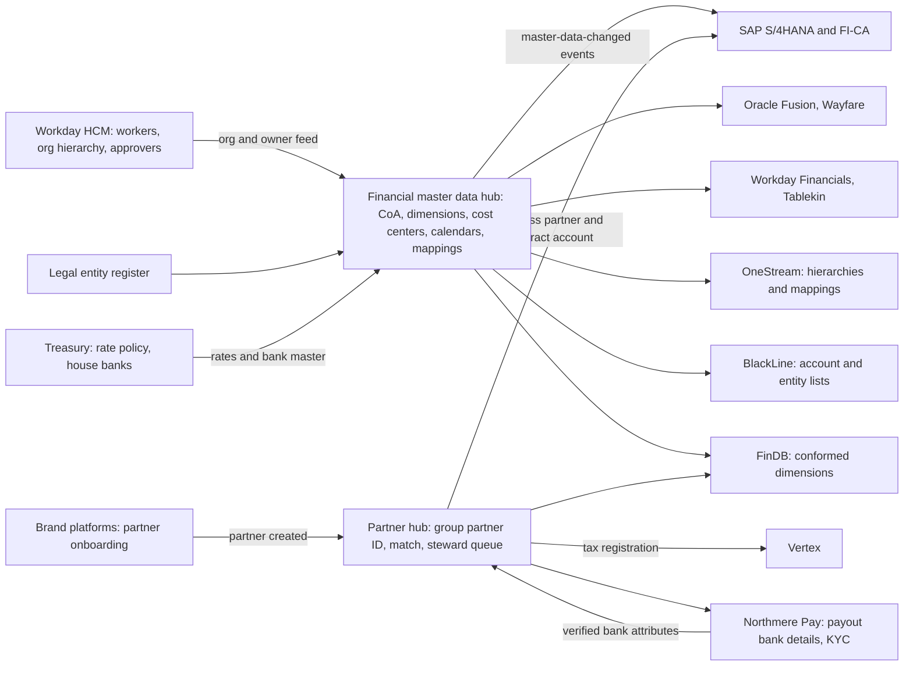
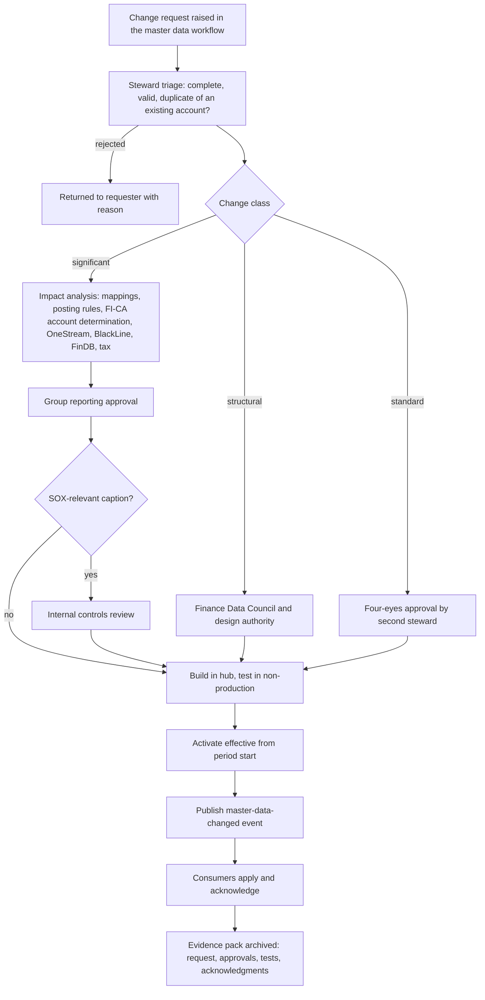
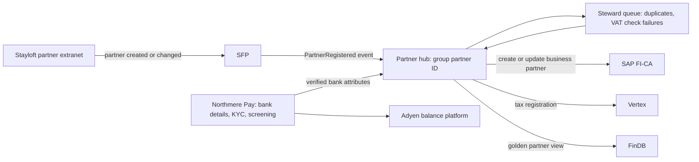
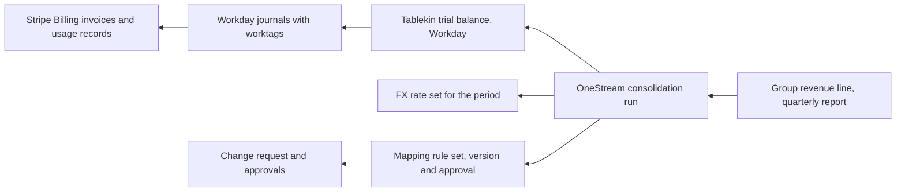

{id: finance-data-architecture}
# 10. Finance Data Architecture: Who Owns the Truth


> **IN THIS CHAPTER, YOU WILL:** Learn which financial master data domains an enterprise finance estate depends on, how to choose a master data management style for each, and how to design and govern a group chart of accounts and a partner master that several platforms share.

> **WHY FINANCE CARES:** Every reported number is a transaction multiplied by its master data: the account it hit, the entity, brand and market it was tagged with, the partner it was owed to. When master data is wrong or inconsistent, the close spends its days reclassifying instead of closing, and the auditor tests mappings instead of balances.

> **WHY ARCHITECTS SHOULD CARE:** Master data is the coupling nobody draws on the integration diagram. Every platform needs it, every platform ships its own create screen, and the authority decision, once missed, turns into mapping tables, reconciliations and duplicate records that outlive every system replacement.

> **KEY POINTS:**
>
> * **Authority is decided per domain and per attribute, not per system.** A partner's name may be authored in the brand platform, its VAT number checked by a steward and its bank account only in the payments platform. One record, several authorities, each written down and enforced through integration.
> * **Choose the master data management style by domain.** The chart of accounts, legal entities and fiscal calendars belong in a centralized hub with a governed workflow; a partner master shared by a brand platform and an ERP subledger needs coexistence; registry and consolidation are steps on the way, not end states.
> * **A mapping table is master data and a control.** The rules that translate brand charts of accounts into the group chart decide which line of the financial statements a balance lands on. They need an owner, effective dating, version history, completeness checks and change approval, exactly like the chart itself.

> **[FAILURE PATTERNS THIS CHAPTER ADDRESSES](#where-finance-architecture-goes-wrong):**
>
> * **The Doppelgänger Record** — partners, entities and accounts are created in several systems with no agreed authority, and every copy drifts.
> * **Spreadsheet Glue** — the mapping from three charts of accounts to the group lives in workbooks that decide where revenue is reported.
> * **The Permanent Exception** — each acquired brand keeps its own account structure and dimensions, so group comparability depends on translation forever.

**Master data** is the comparatively stable data that transactions refer to: the legal entity that books a sale, the account and cost center a cost lands on, the partner who is owed money, the currency and the rate it was converted at. A finance estate processes about a billion events a year, and each one is only as correct as the dozen pieces of master data it points to. A booking with the wrong market code is still a balanced journal; it is just reported in the wrong segment.

Most finance data problems that reach a Chief Architect are master data problems in disguise. "The close takes nine days" turns out to include two days of reclassifying postings that carried the wrong dimensions. "We cannot onboard partners faster" turns out to be five systems that each need the partner created by hand. "Consolidation is a black box" turns out to be **a mapping maintained in spreadsheets** that nobody can reproduce for last year's numbers.

This chapter covers the master data domains, the four management styles, ownership and stewardship, chart of accounts governance, data quality, lineage, data contracts and retention. It stays light on one topic: the full matrix of **which system is authoritative for which object at which lifecycle stage** belongs to [Systems of Record: Ending the Doppelgänger Record](#systems-of-record). Here the question is how master data is designed, owned and kept correct.

{id: finance-data-architecture--setting-the-scene-at-northmere-the-usage-revenue-that-went-missing}
## Setting the Scene at Northmere: The Usage Revenue That Went Missing

Northmere Group, the fictional multi-brand digital commerce group this book follows, closes the first quarter of 2027 in April. On working day 7, Leila Haddad, the Chief Accounting Officer and Group Controller, sees Tablekin's revenue down sharply against forecast at group level while Tablekin's own Workday Financials reports look normal. The analytical review finds the cause within the day. Tablekin had created a new ledger account for usage fees in January to separate per-cover usage from subscription revenue. The group mapping workbook, one of 14 workbooks that translate brand accounts into the group structure in OneStream, had no row for it. A catch-all rule mapped every unrecognized Tablekin revenue account into "Other revenue", so **$41 million of usage revenue** sat in the wrong caption at group level for the whole quarter until the review caught it.

Nothing in any system was broken. Workday posted correctly. OneStream applied the rules it was given. The workbook did what workbooks do. The failure was a missing decision: nobody owned the rule that a new account in a brand ledger must have a group mapping before it can be posted to.

Dana Whitlock, Northmere's Chief Architect for Enterprise Applications and Financial Systems, is asked by Tomás Ferreira, the Group CFO, a question that sounds simple: "How many charts of accounts do we have?" The honest answer is four. There is the SAP S/4HANA chart used by Stayloft, Northmere Pay, Northmere Ads and the corporate entities, with about **3,900 general ledger accounts**, many of them country or product variants of the same account. There is Wayfare's Oracle Fusion chart, a segmented string with about **2,100 natural account values**. There is Tablekin's Workday Financials structure, about **640 ledger accounts** plus worktags. And there is the fourth, invisible one: about **6,100 mapping rows** across those 14 workbooks, maintained by three people in group reporting, which is the only place where the other three become one group.

Dana's follow-up finding is worse for operations than for reporting. Stayloft has about **850,000 partners** (hotels, apartment operators and individual hosts). The same partner exists in the Stayloft Finance Platform (SFP), as a business partner with a contract account in SAP FI-CA (contract accounting, the high-volume subledger for Stayloft's agency partners), in the payout records of Northmere Pay (including, where payouts run through Adyen's balance platform, as a legal entity with a verified payout bank account there), and in Vertex as the party whose VAT registration determines the tax on Stayloft's commission invoices. Each system has its own identifier and its own create path. Program Keystone, Northmere's finance transformation, commits to one group chart of accounts by 2029. This chapter is the design behind that commitment, and behind the partner master that has to come with it.

{id: finance-data-architecture--four-kinds-of-finance-data}
## Four Kinds of Finance Data

Finance data comes in four kinds that differ in volume, change rate and governance. Mixing them up produces the classic mistakes: transactional data managed with master data workflows (too slow), or master data managed like transactional data (no approval, no history).

| Kind | What it is | Examples at Northmere | How it is governed |
| --- | --- | --- | --- |
| **Reference data** | Code lists and values defined outside the enterprise or fixed by policy, used to classify other data | ISO currency and country codes, FX rates, VAT rate tables, fiscal calendar, payment method codes, card scheme reason codes | One distribution point per list; changes are mostly mechanical, but some (fiscal calendar, rate types) need controller approval |
| **Master data** | The enterprise's own long-lived business entities that transactions reference | Legal entities, chart of accounts and dimensions, cost and profit centers, partners, suppliers, customers, bank accounts, products and fee types, tax codes | Owned domains, stewards, workflow, four-eyes approval for sensitive attributes, full change history |
| **Transactional data** | Records of business events and their accounting | Bookings, payments, refunds, payouts, invoices, journal entries, subledger postings | Controlled by application and interface controls; corrected by reversal, never by edit |
| **Derived data** | Data computed from the other three | Balances, revenue schedules, reconciliation results, consolidated statements, metrics, deferred merchant bookings | Reproducible from inputs and rule versions; lineage to its sources |

Two boundaries cause most arguments. The first is **reference versus master**: FX rates look like reference data, but the choice of rate source, rate type and cut-off time is a policy decision with direct P&L effect, so the *rate policy* is mastered and governed while the daily rates are distributed mechanically. The second is **master versus configuration**: a mapping rule, a posting rule or an account determination entry looks like system configuration but behaves like master data. It changes during the year, it decides where amounts land, and it needs history. I treat any table that changes which account or dimension a transaction lands on as master data, whatever the vendor calls it.

{id: finance-data-architecture--the-financial-master-data-domains}
## The Financial Master Data Domains

Ten domains carry nearly all of a finance estate's master data. The table names each, its main attributes, who should own it and why it matters. "Golden source" here means the place where the authoritative version of a record or attribute is created and maintained; [Systems of Record: Ending the Doppelgänger Record](#systems-of-record) distinguishes that carefully from the system of record for a transaction at each lifecycle stage.

| Domain | Key attributes | Natural golden source | Why it is hard |
| --- | --- | --- | --- |
| **Legal entity** | Code, legal name, registration, country, functional currency, tax registrations, licenses, ownership percentage, consolidation method | Legal entity register owned by group reporting, with group legal | Few records, enormous fan-out; a change reaches every platform. [Global by Design: Entities, Currencies, Jurisdictions and Brands](#global-scale) owns the entity model |
| **Chart of accounts and dimensions** | Natural account, account type, normal balance, reporting hierarchy, dimension values and their hierarchies, validation rules | Group finance core | Must be stable for years and still absorb acquisitions, new business models and new disclosures |
| **Cost and profit centers** | Code, owner, hierarchy, validity, linked entity and brand | Finance core for structure; the human capital management (HCM) system for the people assigned and the approvers | Two authorities meet: Finance owns the structure, HR owns who sits where |
| **Organizational hierarchy** | Supervisory organizations, positions, managers, approval roles | Workday HCM | Reorganizations happen on HR's calendar, not the close calendar |
| **Business partners** | Identity, legal form, addresses, tax identifiers, know-your-customer (KYC) status, roles (customer, supplier, marketplace partner, venue), contract accounts | Depends on role; see the partner master below | Millions of records, many created by self-service onboarding, several systems that each need a copy |
| **Bank accounts** | House bank accounts (Northmere's ~410 accounts at 27 banks) and partner and supplier payout accounts | Treasury system for house banks; payments platform for payout accounts | The most fraud-sensitive attributes in the estate; every change must be verified and dual-approved |
| **Products, services and fee types** | Product line, fee type (commission, service fee, subscription, usage, ad click), revenue treatment, tax category | Product catalog per brand, mapped to a group product hierarchy | Product teams create fee types faster than Finance classifies them |
| **Tax codes and tax categories** | Tax codes in ledgers, product tax categories, partner tax status, exemption evidence | Tax engine for determination content; ledger for tax codes | Tax content changes by jurisdiction; ledger tax codes must stay aligned |
| **FX rates** | Rate type (spot, closing, average, budget), source, cut-off time, currency pairs | Treasury policy; a single market rate feed | Two systems using different rates for the same day create intercompany and reconciliation breaks |
| **Fiscal calendars** | Fiscal year, periods, adjustment periods, period status per entity and ledger | Group finance core | Period status is master data with control significance: who can open a closed period |

Three observations matter more than the table. First, **fan-out decides governance effort, not record count**: Northmere has 71 legal entities and 850,000 partners, but a wrong entity attribute reaches every platform, while a wrong partner address reaches one invoice. Second, **domains often have split authority**, with structure in one system and assignment in another; cost centers are the standard example: where HCM and the ERP come from different vendors, a common pattern is for the ERP to own the cost-center structure and feed it to HCM, while HCM owns which worker sits in which cost center. Third, some of the most consequential master data is not called master data by any vendor: the mapping tables, account determination rules and summarization keys that decide where an amount lands.

{id: finance-data-architecture--management-styles-registry-consolidation-coexistence-centralized}
## Management Styles: Registry, Consolidation, Coexistence, Centralized

**Master data management** (MDM) is the set of processes and technology that keeps master data consistent across systems. Four implementation styles are commonly cited, usually attributed to Gartner (no Gartner primary source is cited here; vendor explanations such as [Informatica's](https://www.informatica.com/resources/articles/mdm-implementation.html) describe them consistently). They differ in one thing: **where a record is authored and whether the hub writes back**.

| Style | Where records are authored | What the hub does | Writes back to sources? | Finance fit | Northmere use |
| --- | --- | --- | --- | --- | --- |
| **Registry** | In each source system | Indexes and cross-references source records; holds a global identifier and match keys | No | Good first step to measure duplication; weak as a control, because nothing stops a bad record being created | 2027: partner cross-reference across SFP, FI-CA, Northmere Pay and Vertex, to count duplicates and gaps |
| **Consolidation** | In each source system | Builds a golden record downstream, for analytics and reporting | No | Good for reporting views (customer analytics, spend analysis); does nothing for the transactions themselves | FinDB's conformed partner and supplier views for analytics and audit sampling |
| **Coexistence** | In sources *and* in the hub | Matches, merges, publishes the golden record and synchronizes back | Yes | Fits domains where operational systems must keep creating records (self-service onboarding), but authority per attribute must be enforced | 2028 target for the partner master between the brand platform, FI-CA and payouts |
| **Centralized** (transactional) | Only in the hub, through a governed workflow | Is the system of record; distributes to consumers, which cannot create | Distributes (consumers are read-only) | Fits low-volume, high-fan-out, high-control domains | Group CoA, dimensions, legal entities, fiscal calendar, rate policy, cost-center structure |

The rule I use is simple. **Centralize where the record is rare, shared and control-relevant; coexist where the record is born in an operational process that cannot wait for a workflow.** Nobody should create a natural account in a brand ledger, so the chart of accounts is centralized. A host signing up on Stayloft at midnight cannot wait for a steward, so the partner is born in the brand platform, and the hub's job is to match, enrich, govern sensitive attributes and distribute.

Registry and consolidation are useful but transitional. A registry tells you how bad the duplication is; it does not stop the next duplicate. A consolidated golden record in the data platform makes reports agree; it does not make the payout file agree with the tax engine. I fund them as measurement and as a migration step, and I do not let a program declare victory on either.


**Figure 1:** *The four MDM styles differ in where records are authored and whether the hub writes back: centralize what is rare, shared and control-relevant; coexist where records are born in operational processes.*

In SAP-centric estates, the centralized style is commonly implemented with SAP Master Data Governance (MDG), SAP's governance application for change requests on master data such as financial objects and business partners ([SAP S/4HANA: One Journal, Clean Core](#sap-s4hana) covers its fit; Northmere does not run MDG in 2027); the coexistence and consolidation styles are commonly built with a specialist MDM platform or a custom partner hub. Which product implements the style is a secondary decision. **The style is the architecture; the tool is a sourcing choice**, and [Build, Buy or Compose: Choosing What to Own](#build-versus-buy) covers how to make it.

{id: finance-data-architecture--the-architecture-of-financial-master-data}
## The Architecture of Financial Master Data

The target shape is a small number of authoring points, a governed distribution path, and consumers that subscribe rather than create.



**Figure 2:** *Financial master data has few authoring points and many subscribers. Centralized domains are authored in one governed hub; the partner master coexists with the brand platforms that create partners, with bank attributes authored only in the payments platform in the target state.*

Five design decisions sit behind the picture.

**Subscribers cannot create.** The enforcement mechanism for authority is not a policy document; it is the absence of a create path. In S/4HANA, Oracle Fusion and Workday Financials, the roles that can create natural accounts, dimension values, entities and cost centers are removed from everyone except the integration user that loads from the hub, and a detective control compares each consumer's lists with the hub daily. Where a vendor platform needs local master data that the hub does not hold (an Oracle balancing segment value, a Workday worktag), the hub publishes the value and the local system holds it as a subscribed copy.

**Changes are events with effective dates.** Every change is published as a versioned `master-data-changed` event carrying the object, the attributes changed, the old and new values, the effective-from date and the approval reference. Consumers apply the change for the right period. Effective dating matters because finance reports past periods: a cost center moving from one brand to another in July must not move its January costs.

**Identifiers are owned and immutable.** The hub assigns the group identifier (group account, group entity code, group partner ID) and never reuses one. Local identifiers are kept as cross-references. Renaming a record never changes its identifier.

**Distribution is complete and checked.** A change is not "done" when the hub approves it; it is done when every consumer has applied it. The hub records acknowledgments and raises an exception when a consumer has not applied a change within its agreed window. This is the check that would have caught the renamed Asian entity that reached four systems in a month and the fifth only when treasury noticed it.

**Analytics subscribe to the same masters.** FinDB, Northmere's Snowflake-based finance data platform, uses the hub's dimensions as its conformed dimensions. If the warehouse builds its own brand or market hierarchy, management reporting and statutory reporting will disagree by construction, and Owen Mbeki's team will spend its time explaining the difference.

{id: finance-data-architecture--designing-the-group-chart-of-accounts}
## Designing the Group Chart of Accounts

A **chart of accounts** (CoA) is the list of accounts a ledger posts to. Modern charts separate **what** happened, the **natural account** (cash, partner payables, commission revenue, salaries), from **where, who and why**, the **dimensions** (entity, brand, market, cost center). The combination of account and dimension values on a posting is often called the accounting string. [Accounting for Architects: Ledgers, Journals and Revenue](#accounting-for-architects) covers the accounting; this section covers the design choices.

The design guidance most practitioners accept is short: keep the natural account list small and stable, push analytical variety into dimensions, define the intercompany counterparty as a dimension from day one, map accounts to reporting hierarchies rather than duplicating accounts, and make sure the dimensions that segment reporting needs exist **at posting time**, because they are very expensive to retrofit. New disclosure rules make the last point sharper. US public companies adopt the expense disaggregation requirements of [ASU 2024-03](https://dart.deloitte.com/USDART/home/news/all-news/2025/jan/fasb-effective-date-asu-disaggregation-income-statement) for annual periods beginning after 15 December 2026 (as of 2026), and a disclosure that needs a category the ledger does not carry becomes a data project.

{id: finance-data-architecture--northmere-s-group-coa-version-2}
### Northmere's group CoA, version 2

The Keystone design team, led by Leila's group reporting function with Dana's data architects, proposes a group chart of about **1,150 natural accounts** with seven dimensions. The SAP chart's 3,900 accounts collapse mainly because country, brand and product variants of the same account move into dimensions.

| Element | Values (2027 design) | Authority | Required on | Example |
| --- | --- | --- | --- | --- |
| **Natural account** | ~1,150, six digits; 1 assets, 2 liabilities, 3 equity, 4 revenue, 5 cost of revenue, 6 operating expense, 7 other income and expense, 8 income tax | CoA council | Every posting | 410100 Commission revenue |
| **Entity** | 71 legal entities | Legal entity register | Every posting | Stayloft B.V. |
| **Brand** | 6: Stayloft, Wayfare, Tablekin, Northmere Ads, Northmere Pay, Corporate | CoA council | All P&L accounts; balance-sheet accounts where brand-specific | STL |
| **Business model** | 7: agency, merchant, subscription, usage, payments facilitation, advertising, other | CoA council with accounting policy | Revenue and cost of revenue | MER |
| **Market** | ISO 3166 country codes; ~110 active | CoA council; definition set by accounting policy (country where the service is delivered) | Revenue, cost of revenue, partner balances | PT |
| **Product** | ~40 product lines in a three-level hierarchy | CoA council, proposed by brand finance | Revenue and cost of revenue | ACC-APT (accommodation, apartments) |
| **Intercompany partner** | 71 entity codes, plus "none" | Legal entity register | Required on intercompany accounts; forbidden elsewhere | — |
| **Cost center** | ~4,800, hierarchy to brand and function | Finance core for structure; Workday HCM for owners | Operating expense; optional elsewhere | — |

Under this design, the €90.00 commission on the Lisbon booking (the €600.00 merchant-model stay that recurs through this book) posts to account 410100 with entity Stayloft B.V. (the contracting entity), brand STL, business model MER, market PT and product ACC-APT. In the current SAP chart it posts to one of eleven country-specific commission accounts, and the business model is inferred from which account was used. The new string can answer "merchant commission in Portugal for apartments" without anyone knowing an account number.


**Figure 3:** *Group CoA v2 collapses the SAP chart's 3,900 accounts into a group chart of about 1,150 natural accounts by moving country, brand and product variants into seven dimensions on every posting.*

Three deliberate exceptions keep the design honest.

1. **Clearing accounts stay granular.** Payment service provider (PSP) clearing accounts remain separate natural accounts per provider and currency (Adyen EUR, Stripe EUR and so on), even though a "PSP" dimension would be tidier. The reconciliation unit drives this: BlackLine reconciles accounts, and a clearing account that mixes providers cannot be matched to one provider's settlement report. [Payments-to-Ledger: Draining the Suspense Swamp](#payments-to-ledger) designs the clearing structure.
2. **Some splits must happen in the natural account.** Partner payables (money owed to properties and venues, often safeguarded funds) and trade payables (money owed to suppliers) are different liabilities with different controls and different regulatory meaning. They are separate natural accounts, not one account with a dimension, because their reconciliations, owners and disclosures differ.
3. **Dimensions are required by account type, not everywhere.** A required market on a cash account adds friction and invites junk values ("XX"). The validation rules say which dimensions are required, optional or forbidden for each account range, and the forbidden list matters as much as the required one.

The design deliberately has no customer or booking dimension (that detail stays in subledgers, linked by identifiers; see [Never Update, Only Append: Designing Custom Ledgers](#designing-financial-ledgers)), and it does not serve local statutory charts directly: those are reached through mapped reporting hierarchies or, in Oracle Fusion, through secondary ledgers, which [Oracle documents](https://docs.oracle.com/en/cloud/saas/financials/26c/faigl/ledgers-legal-entities-balancing-segments-and-business-units.html) may differ from the primary ledger in chart of accounts.

{id: finance-data-architecture--platform-realities}
### Platform realities

The same design lands differently in each ledger, and the differences are architectural, not cosmetic.

- **Oracle Fusion** defines the chart as segments of an accounting key (Wayfare's has six: company, cost center, natural account, product line, intercompany and a reserved future segment), and Oracle states that the chart of accounts is one of the elements combined to create a primary ledger. Oracle's standard GL balances cubes have one dimension per chart segment and, in Oracle's words, "dimensions are predefined and new ones can't be added" ([Oracle GL balances cube dimensions](https://docs.oracle.com/en/cloud/saas/financials/26c/faigl/dimensions-for-standard-balance-cubes.html)). For Wayfare, adopting the group design inside Fusion therefore means a new chart and a new ledger, not an edit; that is one reason the group CoA arrives with ledger convergence in 2029, not before.
- **Workday Financials** uses its Foundation Data Model: transactions carry **worktags** (company, cost center, revenue category, spend category and others), and account posting rules derive the ledger account from them ([Workday Financial Management datasheet](https://www.workday.com/content/dam/web/en-us/documents/datasheets/datasheet-workday-financial-management.pdf)). Tablekin's mapping must therefore read ledger account *and* worktags. A common implementation failure is a dimensional model designed as a copy of the legacy account list, which keeps the account explosion and loses the benefit of worktags.
- **SAP S/4HANA** records postings in one line-item journal, the Universal Journal, with account assignments such as cost center, profit center and segment on each line ([SAP S/4HANA: One Journal, Clean Core](#sap-s4hana) covers the details and their limits). Northmere's SAP redesign is the cheapest of the three to start, because SAP is already the group core, and the most expensive to finish, because SFP, FI-CA account determination, Northmere Ads and about 2,300 custom objects all reference today's account numbers.

{id: finance-data-architecture--in-practice-the-mapping-table-as-master-data}
## In Practice: The Mapping Table as Master Data

Until 2029, three ledgers keep their own charts and the group is assembled in OneStream. The decision Dana and Leila take in May 2027 is not to wait. **The mapping comes out of the workbooks in 2027**, into governed transformation rules in OneStream, authored through the same change workflow as the chart itself, with every rule effective-dated and versioned. The reason is simple: in consolidation on an enterprise performance management (EPM) platform, the mapping tables *are* the translation between local and group charts, so they deserve the ownership, change control and testing given to the charts themselves.

{id: finance-data-architecture--a-worked-mapping-table}
### A worked mapping table

The table below shows a sample of Northmere's mapping rules from source ledger to group CoA v2. The codes are illustrative.

| # | Source ledger | Source key | Source meaning | Group account | Dimensions set by the rule | Rule type |
| --- | --- | --- | --- | --- | --- | --- |
| 1 | SAP S/4HANA | 4100117 | Commission revenue, Stayloft agency, Portugal | 410100 Commission revenue | brand STL, model AGY, market PT | Many-to-one: country moves from account to dimension |
| 2 | SAP S/4HANA | 4100217 | Commission revenue, Stayloft merchant, Portugal | 410100 Commission revenue | brand STL, model MER, market PT | Many-to-one |
| 3 | Oracle Fusion | 3105-0000-40210-RAIL-0000-000 | Wayfare France company, service fee revenue, rail product line | 410300 Service fee revenue | entity from company segment 3105 via entity cross-reference; brand WAY; product RAIL; model MER | Segment-based |
| 4 | Oracle Fusion | 3105-0000-13900-0000-1001-000 | Intercompany receivable, intercompany segment 1001 | 131000 Intercompany receivable | IC partner = group code for local company 1001 | Depends on the entity cross-reference, itself master data |
| 5 | Workday | Ledger account 4010 + revenue category "Usage – covers" | Tablekin usage revenue | 420200 Usage revenue | brand TBK, model USG, product TBK-RES, market from company worktag | Account plus worktag |
| 6 | Workday | Ledger account 4000 + revenue category "Subscription – Pro" | Tablekin subscription revenue | 420100 Subscription revenue | brand TBK, model SUB, product TBK-RES | Account plus worktag |
| 7 | Oracle Fusion | 3105-0000-21500-0000-0000-000 | Supplier payables, mixing ground-transport partners and indirect suppliers | **Cannot be mapped at balance level** | — | Split required in source: new Oracle accounts 21510 and 21520 |
| 8 | Workday | Any 4xxx not listed | Catch-all | 490000 Other revenue | — | **Forbidden** after May 2027 |

Rows 1 and 2 show the main effect of the redesign: dozens of SAP accounts collapse into one, and the dimension carries the difference. Rows 3 and 4 show a dependency people forget: a segment-based rule is only as good as the **entity cross-reference** that translates a local company value into a group entity code, so that cross-reference is part of the legal entity domain, governed with it. Row 7 is the expensive lesson: **a mapping cannot create information the source did not record**. If one Oracle account mixes two liabilities, no rule at trial-balance level can separate them; the fix is a source change, and until it is made, group reporting depends on a manual reclassification that is itself a control. Row 8 is the April incident. A catch-all rule turns "unmapped" into "wrong", silently. After May 2027 the rule set must cover 100% of accounts with a balance, and an unmapped account stops the OneStream load for that entity and raises an exception to the steward, rather than defaulting.

{id: finance-data-architecture--rules-that-make-mappings-safe}
### Rules that make mappings safe

Five rules turn the mapping from Spreadsheet Glue into controlled configuration.

1. **No account without a mapping.** A brand ledger cannot activate a new account until the group mapping exists. The check runs in the change workflow (preventive) and again at every load (detective).
2. **Effective dating, no overlaps.** Each rule has valid-from and valid-to periods; two rules may not cover the same source key in the same period. Reporting a prior period uses the rules valid then.
3. **Versioned and reproducible.** Every consolidation run records the mapping version it used. Restating 2027 in 2029 must reproduce 2027's numbers with 2027's rules, then show the effect of the new ones.
4. **Coverage and balance checks.** After mapping, the group trial balance per entity equals the local trial balance per entity, translated; any difference blocks the load.
5. **Owned rows.** Every rule has a named steward in group reporting and a named counterpart in the brand finance team, and the brand cannot change its chart without the group steward's approval.

The mapping table is also the migration specification. When Wayfare converges onto the group core, every one of these rows becomes either a posting rule in the new ledger or a data migration rule. A governed, tested mapping in 2027 is two years of free preparation for 2029.

{id: finance-data-architecture--governing-change-to-the-chart-of-accounts}
## Governing Change to the Chart of Accounts

Chart of accounts changes are rare in count and large in effect. A new natural account can change financial statement lines, reconciliation populations, tax reporting, consolidation, planning models and SOX scoping. That is why the governance belongs to Finance, with Architecture as a required reviewer rather than an owner.

Northmere's **Finance Data Council**, set up under Keystone in Q2 2027, is chaired by Leila as data owner for the chart of accounts and the legal entity register. Members are the brand finance controllers, Kofi Asante for tax and treasury, Mei Tanaka for internal controls, Owen Mbeki for finance data, Sven Aalto for the SAP platform and a data architect from Dana's team. It meets monthly, and its standing agenda is the change log, the data quality scorecard and open exceptions.

Changes are classified by impact.

| Class | Examples | Approval | Lead time |
| --- | --- | --- | --- |
| **Standard** | New cost center under an existing node; new market value; new product line under an existing family | Domain steward, four-eyes | Days; any day of the month |
| **Significant** | New natural account; change to an account's reporting-line mapping; new mapping rule for a brand account; new required dimension on an account range | Steward, group reporting lead, internal controls review where the account is in a SOX-relevant caption | Two weeks; effective from a period start |
| **Structural** | New dimension; change to a dimension's definition (what "market" means); new entity; change to the account numbering scheme | Finance Data Council, with the design authority for platform impact | One quarter; effective from a quarter or year start |

The flow for a significant change looks like this.



**Figure 4:** *A chart of accounts change is a controlled change with an evidence trail: classified by impact, analyzed for downstream effects, approved by the owner, activated from a period start, and complete only when every consumer has acknowledged it.*

The link to SOX is direct. Under the US Sarbanes-Oxley Act, management must maintain effective internal control over financial reporting, and the external auditor tests it. A change to an account's reporting-line mapping changes which financial statement caption a balance lands in, which is exactly what the April usage revenue incident did. Mapping and chart changes are therefore in scope of the same change-management discipline auditors expect for financial applications: authorized, tested, approved before production, with evidence that the control operated for every change in the period, not just a policy. [Controls by Design, Not by Audit Season](#controls-and-auditability) covers IT general controls, information produced by the entity and evidence by design; the design point here is that **the master data workflow produces that evidence as a by-product**. Nobody assembles it before the audit.

{id: finance-data-architecture--the-partner-master-coexistence-in-practice}
## The Partner Master: Coexistence in Practice

The chart of accounts is the clean case for centralization. Partners are the hard case.

A Stayloft partner is born when a property operator or host signs up in Stayloft's partner extranet. From that moment the partner appears in at least five places, each with its own identifier and each with a legitimate need:

| System | Why it holds the partner | Identifier | Attributes it needs |
| --- | --- | --- | --- |
| **SFP** | Commission billing, merchant subledger, payouts instruction | SFP partner ID | Contract terms, commission rate, business model, billing entity |
| **SAP FI-CA** | Agency-model commission invoices, dunning, partner balances (~850,000 contract accounts) | Business partner number and contract account | Legal name, address, tax identifiers, billing and dunning settings |
| **Northmere Pay payout records** | Merchant-model payouts | Payee ID | Verified bank account, beneficiary name, KYC status, sanctions screening |
| **Adyen balance platform** (where payouts run through it) | Payout execution | Adyen legal entity, account holder and transfer instrument | KYC data, verified payout bank account |
| **Vertex** | Tax determination on commission invoices | Customer or taxpayer reference | Country, VAT registration, tax status |

Owen's team runs a registry-style match in Q2 2027 across SFP, FI-CA and Northmere Pay, matching on tax identifier, normalized legal name and address, and bank account. The illustrative results: about **31,000** FI-CA business partners with no live SFP partner; about **12,400** SFP partners linked to two FI-CA business partners, usually after a change of legal owner; and about **4%** of partners whose VAT number differs between SFP and the tax determination calls. Each of these is a quiet cost: duplicate dunning, commission invoices with the wrong VAT treatment, and payouts that a fraud analyst cannot tie to the invoiced partner.

The answer is coexistence with **authority set per attribute**.



**Figure 5:** *The partner master as coexistence: partners are born in the brand platform, matched and governed in a hub that assigns the group partner ID, and distributed to FI-CA and Vertex; in the target state, bank attributes are authored only in the payments platform and flow to the hub, never the other way.*

The attribute-level authority is what makes this more than a synchronization project:

- **Identity and contact data** (name, address, contacts) are authored in the extranet through SFP; the hub matches and distributes.
- **Tax identifiers** are entered in the extranet but are not trusted until validated (for EU VAT numbers, against the EU's VAT Information Exchange System, VIES) and, on failure, reviewed by a steward. Until validated, the partner can trade but commission invoices apply the treatment for an unregistered party, as the tax team's policy prescribes.
- **Bank accounts and KYC status** end up authored only in Northmere Pay, with verification and dual approval, because bank detail changes are where payout fraud happens. That is the target state, not the 2027 baseline: in 2027 partner bank details are still authored in SFP and Northmere Pay holds a copy for execution, a daily SFP-versus-Northmere Pay comparison blocks any payout whose details differ, and authority moves to Northmere Pay by 30 June 2028 ([Systems of Record: Ending the Doppelgänger Record](#systems-of-record) records the transitional row). From then on no other system can change them, and SFP displays them read-only.
- **FI-CA business partners** are created only by the hub, carrying the group partner ID as an external reference. The manual create transaction is removed from user roles.
- **The group partner ID** is assigned by the hub and never reused; merges keep both old identifiers as aliases so that historical invoices remain traceable.

Northmere's sequence is registry in 2027 (to measure and to stop new duplicates at creation through a match check), coexistence in 2028, and in 2029, as the SFP merchant subledger moves to the group core, the partner hub becomes the only path into FI-CA for both business models. Tablekin's venues, held as connected accounts in Stripe Connect, and Wayfare's ground-transport suppliers in Oracle Fusion join the hub as additional sources when their payout engines are reviewed under Keystone; until then they are cross-referenced, not governed.

{id: finance-data-architecture--ownership-and-stewardship}
## Ownership and Stewardship

**Data ownership** is accountability for a domain's definition, quality and access. **Stewardship** is the day-to-day work of keeping it correct. The vocabulary below follows common data-management practice (the DAMA body of knowledge uses similar roles); the names matter less than having each role filled by a named person.

| Role | Accountable for | Northmere example |
| --- | --- | --- |
| **Data owner** | Definitions, policies, approval of significant changes, acceptance of quality levels | Leila for the CoA, dimensions and entity register; Kofi for FX rate policy and house banks; Ingrid Solberg for partner bank and KYC attributes |
| **Data steward** | Daily request handling, triage, duplicate resolution, quality exceptions | Group reporting stewards for the CoA and mappings; a partner data team in Stayloft finance operations |
| **Technical steward (custodian)** | Platform, workflow, distribution, monitoring | Sven's SAP team for the hub; Northmere Pay engineering for payout data |
| **Producer** | Creating records correctly at the source | Stayloft extranet; HR operations in Workday HCM |
| **Consumer** | Using subscribed data, not creating local copies, raising defects | Every brand ledger, OneStream, BlackLine, FinDB |
| **Architecture** | Authority decisions, integration patterns, enforcement design | Dana's data architects; authority recorded in the SoR matrix |

Two ownership rules prevent most disputes. **Owners are business people, not platform teams**: Sven runs the hub, but he does not decide what a natural account means. And **an attribute has exactly one owner**, even when the record has several: the partner record has three owners (Stayloft for identity, tax for tax status, Northmere Pay for bank details), and none of them owns the whole.

Data mesh, in Zhamak Dehghani's [formulation](https://martinfowler.com/articles/data-mesh-principles.html) of domain ownership, data as a product, a self-serve platform and federated computational governance, fits finance with one limit. Northmere Pay should own and publish settlement data as a product, with a contract. The chart of accounts is different: it is the shared language that makes domains comparable, and federating it is The Permanent Exception by another name. I federate data products and centralize the vocabulary.

{id: finance-data-architecture--data-quality-rules}
## Data Quality Rules

Data quality is managed as rules with owners, thresholds and an action, not as a score. The useful split is between **preventive** rules, which stop bad data at creation, and **detective** rules, which find it afterwards. Prefer preventive rules wherever creation is governed; rely on detective ones where creation is self-service.

| Rule | Quality dimension | Type | Where it runs | Action on failure |
| --- | --- | --- | --- | --- |
| Postings to intercompany accounts carry an IC partner that is a valid entity and is not the posting entity | Validity | Preventive | Ledger validation rule | Posting rejected |
| Brand is valid for the entity (a Tablekin entity cannot post brand STL) | Consistency | Preventive | Ledger derivation and validation | Posting rejected |
| Every account with a balance in a brand ledger has an effective group mapping | Completeness | Preventive and detective | Change workflow; OneStream load | Load stopped for the entity; steward alert |
| Closing and average rates exist for all 46 transaction currencies by 06:00 CET on the first working day | Timeliness, completeness | Detective | Rate distribution job | Treasury alert; revaluation held |
| EU VAT number validates against VIES before the partner is treated as registered | Accuracy | Preventive with fallback | Partner hub | Steward queue; unregistered tax treatment until resolved |
| No two active partners share tax identifier and bank account | Uniqueness | Detective | Partner hub match job | Steward merge review |
| Partner bank account change: IBAN checksum, name match, second approver, payout hold of 48 hours on first payout | Accuracy, security | Preventive | Northmere Pay | Change not activated |
| Every cost center has an active owner in Workday HCM | Consistency | Detective | Daily HCM-to-hub comparison | Owner's manager notified; cost center blocked for new purchase orders after 30 days |
| Subscribed master lists in each consumer match the hub | Consistency | Detective | Daily comparison | Exception to technical steward |

Each rule is published with its owner, threshold and trend in the council's monthly scorecard. The scorecard's purpose is not a green dashboard. It is to make visible the rules that keep failing, because a rule that fails every month is a process problem upstream, usually a create path that should not exist.

{id: finance-data-architecture--lineage-and-data-contracts}
## Lineage and Data Contracts

**Data lineage** is the recorded path of data from its source to a reported number, including the transformations applied. For finance, lineage has two strands, and most tools capture only the first.

The **data strand** follows records: a group revenue figure comes from OneStream, from a Tablekin trial balance, from Workday journals, from Stripe Billing invoices and usage events. The open [OpenLineage](https://openlineage.io/docs/) specification models this as datasets, jobs and runs, and FinDB's dbt pipelines can emit it.

The **rule strand** follows the master data and rule versions that shaped the number: which mapping version, which account hierarchy, which FX rate set, which posting rule. A reported number is reproducible only if both strands are recorded. When the auditor asks why Tablekin's Q1 2027 usage revenue moved between captions between the original close and the corrected one, the answer is a mapping version change with its approval, and it should take minutes to produce.



**Figure 6:** *Finance lineage has a data strand and a rule strand. A reported line is reproducible only when both the source records and the versions of the mapping and rate sets that shaped it are recorded.*

A **data contract** is an agreed, versioned specification between a data producer and its consumers: schema, semantics, quality rules, service levels and owners. The [Open Data Contract Standard](https://bitol-io.github.io/open-data-contract-standard/latest/) defines a YAML format with sections for fundamentals, schema, data quality, service levels, roles and team. For finance, a contract has three jobs that a schema alone does not do: it states **completeness** obligations (control totals), **semantics** that accountants rely on (which amounts are gross, which currency, which date governs the period), and the **master data references** that must be valid.

An abbreviated contract for SFP's daily summarized posting to S/4HANA, in the shape of an ODCS contract, looks like this:

```yaml
kind: DataContract
id: sfp-daily-gl-summary
version: 3.1.0
status: active
owner: Stayloft Finance Engineering (Jonas Berg)
consumers: [SAP S/4HANA GL, BlackLine, FinDB]
schema:
  - name: gl_summary_line
    properties:
      - {name: posting_date, type: date, description: "Accounting date; governs the period"}
      - {name: entity, type: string, reference: "group entity code, hub list"}
      - {name: group_account, type: string, reference: "group CoA v2, effective on posting_date"}
      - {name: brand, type: string, reference: "brand dimension"}
      - {name: business_model, type: string, reference: "business model dimension"}
      - {name: market, type: string, reference: "ISO 3166 alpha-2, active market list"}
      - {name: amount_minor, type: integer, description: "Signed, minor units"}
      - {name: currency, type: string, reference: "ISO 4217"}
      - {name: summary_key, type: string, description: "Links to constituent subledger lines"}
quality:
  - "Sum of debits equals sum of credits per entity and currency"
  - "Line count and amount totals equal the batch control record"
  - "Every reference value is valid in the hub on posting_date"
sla:
  delivery: "Daily batch by 04:00 CET; late batch alerts the GL steward"
  retention: "Detail behind each summary_key retained 10 years"
```

The contract gives Sven's team grounds to reject a batch that references a retired account, and gives Jonas's team notice of a chart change through a new contract version. [Files, Events and APIs: How Finance Systems Talk](#integration-architecture) covers control totals and delivery, [Canonical Events: A Common Language for Money](#loosely-coupled-domains) owns the canonical event contracts, and [One Number, Many Views: Finance Data from Operations to Analytics](#finance-data-flows) covers how contracted data reaches the warehouse and the governed metrics.

{id: finance-data-architecture--retention-and-privacy}
## Retention and Privacy

Finance data must be kept for statutory periods and, at the same time, personal data must be minimized and erased when no longer needed. Both are true; the architecture reconciles them.

Retention periods vary by country and record type, and the clock usually starts at the end of the year in which the record was created. Germany is a current example: since 1 January 2025, accounting vouchers such as invoices must be kept for eight years, while books and annual financial statements remain at ten ([reported by Haufe](https://www.haufe.de/steuern/gesetzgebung-politik/viertes-buerokratieentlastungsgesetz_168_613390.html)). Master data has a derived retention: **a master record must be kept as long as any record that references it**, so a partner that last traded in 2027 must remain resolvable until the last invoice referencing it expires, and the chart of accounts and its mapping versions must outlive every period reported with them.

The [GDPR's Article 17(3)](https://gdpr-info.eu/art-17-gdpr/) disapplies the right to erasure to the extent processing is necessary for compliance with a legal obligation or for legal claims. That covers what the law requires, for as long as it requires it, and no more. Stayloft's partner master makes this concrete, because many hosts are individuals, so the partner master holds personal data. Northmere's design:

- **Ledgers and subledgers hold the group partner ID, not identity.** Name, address and contact data live in the partner master, with its own lifecycle.
- **On an erasure request or at the end of the relationship,** attributes not needed for statutory records (contact preferences, phone numbers, extranet profile) are erased; attributes needed to support retained invoices and payouts (legal name, tax identifier, address on the invoice) are restricted: removed from operational use, visible only to a small finance role, and deleted when the last referencing record's retention expires.
- **Invoices themselves are retained as issued,** in the immutable finance document archive, because the invoice is the statutory record.
- **The data platform pseudonymizes** partner and traveler identifiers for analytics and keeps the re-identification key under access control.

The design decision is to make retention a property of the data asset, recorded in the data catalog with its legal basis, rather than a property of each system. [Controls by Design, Not by Audit Season](#controls-and-auditability) covers the security and residency side of the same problem.

{id: finance-data-architecture--trade-offs-where-to-put-the-authority}
## Trade-offs: Where to Put the Authority

The central choice for each domain is where authority sits. The table compares the options for the two Northmere domains that matter most.

| Option | Strengths | Weaknesses | When it is right |
| --- | --- | --- | --- |
| **CoA authored in the group ERP's governance workflow** | One workflow, close to the main ledger; native validation; account determination in the same platform | Brand ledgers on other platforms subscribe through integration; ties the master to one vendor | One group finance core is the target (Northmere from 2029) |
| **CoA authored in the consolidation platform** | Finance-owned; already holds the group view and mappings | Consolidation is downstream of posting; it cannot stop a wrong posting, only reclassify it | Federated estates with no convergence plan; as an interim home for mappings |
| **CoA authored in a separate MDM platform** | Vendor-neutral; strong workflow and multi-domain matching | Another platform to run and integrate; may duplicate ERP governance | Estates with several long-lived ERPs and other domains on the same MDM platform |
| **Partner master in the brand platform only** | Fast onboarding; one team | Other systems create their own copies; no group identity; The Doppelgänger Record | Single-brand, single-ledger businesses |
| **Partner master centralized in a hub before creation** | Strong control, no duplicates | Onboarding waits for workflow; brand resists; often bypassed | Low-volume B2B supplier onboarding (indirect procurement) |
| **Partner master in coexistence with attribute authority** | Fast onboarding plus governed sensitive attributes | More integration and matching logic; needs stewards | High-volume, self-service partner onboarding feeding several finance systems |

Northmere's choices follow the rule stated earlier: **CoA in the group finance core's workflow** (implementation product selection due Q3 2027), mappings governed in OneStream until convergence, and **partner master in coexistence** with attribute-level authority. The cost is real: the partner hub is a new platform with a matching engine, a steward team of about eight people and integration to five systems. The alternative is paying the duplicates' cost forever, in invoices, payouts and audit sampling.

{id: finance-data-architecture--integration-with-the-rest-of-the-estate}
## Integration with the Rest of the Estate

Master data touches every other chapter, and the authority decisions here constrain them. [Systems of Record: Ending the Doppelgänger Record](#systems-of-record) builds the full authority matrix, including the lifecycle hand-offs this chapter avoids. [Global by Design: Entities, Currencies, Jurisdictions and Brands](#global-scale) owns the legal entity, intercompany and multi-currency design that the entity and rate domains serve. [Files, Events and APIs: How Finance Systems Talk](#integration-architecture) carries the `master-data-changed` events and enforces contracts at the boundary. [OneStream: Consolidating Actuals, Planning the Future](#onestream) covers consolidation mapping in depth, and [SAP S/4HANA: One Journal, Clean Core](#sap-s4hana), [Oracle Fusion: An Accounting Hub for High-Volume Events](#oracle-fusion) and [Workday: The Org Chart Behind the Ledger](#workday) cover each platform's chart and dimension model. [Converge or Coexist: Living with More Than One ERP](#multiple-erps) uses the mapping table as the migration specification for convergence, and [The Next Brand Should Be Boring: Onboarding as Configuration](#brands-entities-markets) turns new entities, brands and markets into master data configuration.

{id: finance-data-architecture--failure-modes}
## Failure Modes

- **Workflow nobody waits for.** A governance workflow that takes three weeks for a new cost center teaches people to reuse an old one. Standard changes must take days; if they do not, the workflow is the defect.
- **Local create paths left open.** Authority on paper, create rights in practice. The test is a role review that shows who can create each object in each system.
- **Dimension sprawl.** Seven dimensions easily become eleven, each added for one report. Every dimension has a cost at every posting; add one only for a recurring, owned reporting need.
- **Retrofitting dimensions.** A disclosure or segment change that needs a dimension the ledger never captured forces manual allocation or restatement. Design dimensions with the controller and the SEC reporting team, not only with the ERP implementer.
- **Bank details in two places.** Any second place where a payout bank account can be changed defeats the approval on the first.

{id: finance-data-architecture--the-chief-architect-s-view}
## The Chief Architect's View

The Chief Architect's job here is not to run MDM. It is to make five decisions explicit and to make sure they are enforced in the design of every platform the estate buys or builds.

1. **The domain list and the authority per domain and attribute.** Recorded in the system-of-record (SoR) matrix, decided with the data owners, reviewed when a platform is added.
2. **The management style per domain.** Centralized for the vocabulary (CoA, dimensions, entities, calendars, rate policy), coexistence for high-volume operational masters, registry and consolidation as steps.
3. **The rule that consumers do not create.** Every platform design review checks for create paths on mastered objects. This is the single most effective enforcement point the architect controls.
4. **The group chart of accounts as a long-lived design.** Its structure should survive a decade of acquisitions. I would rather spend six months on the dimension definitions than six years on mapping workarounds.
5. **Governance owned by Finance, designed by Architecture.** The Finance Data Council decides what accounts mean. Architecture decides how that decision reaches every system and how the evidence is produced.

What to watch: the number of systems where each master data object can be created (the target is one per attribute), the count and age of mapping exceptions, the share of partners with a group partner ID, the data quality rules that fail repeatedly, and the time from approved change to acknowledgment by every consumer. Those five numbers tell me whether the governance is working long before the close or the auditor does.

{id: finance-data-architecture--questions-to-ask}
## Questions to Ask

1. For each master data domain, which system is the golden source, and can that be demonstrated by showing that no other system has a create path?
2. Where do the mappings between local and group charts of accounts live, who can change them, and can last year's consolidated numbers be reproduced with last year's mapping version?
3. What happens today when a brand ledger posts to an account that has no group mapping?
4. How many dimensions does the chart require, and which reporting obligation does each one serve?
5. Which partner, supplier or customer records exist in more than one system, and how many duplicates does a match find?
6. Where can a payout bank account be changed, and does every such place enforce the same verification and approval?
7. Who owns the chart of accounts, who stewards it day to day, and how long does a standard change take?
8. Which master data and mapping changes are in SOX scope, and is the evidence produced by the workflow or assembled before the audit?
9. How long must each master record be retained, given the records that reference it, and how is personal data in it erased or restricted?

Master data decides where amounts land; controls decide whether anyone can trust that they landed correctly. The change workflow, the role design that removes local create paths and the evidence pack at the end of Figure 4 are all control design. [Controls by Design, Not by Audit Season](#controls-and-auditability) takes that up directly: how SOX, IT general controls, segregation of duties and audit evidence shape the architecture of every finance platform.

{id: finance-data-architecture--sources-and-evidence}
## Sources and Evidence

*Vendor documentation*

- [Ledgers, Legal Entities, Balancing Segments, and Business Units](https://docs.oracle.com/en/cloud/saas/financials/26c/faigl/ledgers-legal-entities-balancing-segments-and-business-units.html), Oracle, 2026: primary ledgers combine a chart of accounts, calendar, currency and accounting method; secondary ledgers may differ in chart of accounts.
- [Dimensions for Standard Balance Cubes](https://docs.oracle.com/en/cloud/saas/financials/26c/faigl/dimensions-for-standard-balance-cubes.html), Oracle, 2026: one cube dimension per chart segment; dimensions are predefined and cannot be added.
- [Workday Financial Management datasheet](https://www.workday.com/content/dam/web/en-us/documents/datasheets/datasheet-workday-financial-management.pdf), Workday, 2024: dimensions captured at the point of transaction (Foundation Data Model and worktags).
- [MDM Implementation Styles](https://www.informatica.com/resources/articles/mdm-implementation.html), Informatica: description of the registry, consolidation, coexistence and centralized styles (vendor explanation; the styles are commonly attributed to Gartner).

*Standards and regulation*

- [GDPR Article 17](https://gdpr-info.eu/art-17-gdpr/), European Union, 2016: the right to erasure and its exemptions for legal obligations and legal claims.
- [Viertes Bürokratieentlastungsgesetz](https://www.haufe.de/steuern/gesetzgebung-politik/viertes-buerokratieentlastungsgesetz_168_613390.html), Haufe, 2024: reported reduction of the German retention period for accounting vouchers to eight years from 2025.
- [FASB effective date of ASU 2024-03](https://dart.deloitte.com/USDART/home/news/all-news/2025/jan/fasb-effective-date-asu-disaggregation-income-statement), Deloitte DART, 2025: effective dates for expense disaggregation disclosures (secondary source).
- [Open Data Contract Standard](https://bitol-io.github.io/open-data-contract-standard/latest/), Bitol project: the YAML data contract structure used for the contract example.
- [OpenLineage documentation](https://openlineage.io/docs/), LF AI & Data Foundation: the dataset, job and run lineage model.

*Practitioner and research sources*

- [Data Mesh Principles and Logical Architecture](https://martinfowler.com/articles/data-mesh-principles.html), Zhamak Dehghani, 2020: the four data mesh principles.
- [DAMA-DMBOK: Data Management Body of Knowledge](https://www.dama.org/cpages/body-of-knowledge), DAMA International, 2nd edition, 2017: the common vocabulary for data ownership, stewardship and data quality dimensions.
- [Patterns for Accounting](https://martinfowler.com/eaaDev/AccountingNarrative.html), Martin Fowler, 2006 (draft): accounts and entries as the model behind charts of accounts and posting.

Northmere is fictional; architectural recommendations are the author's judgment.
