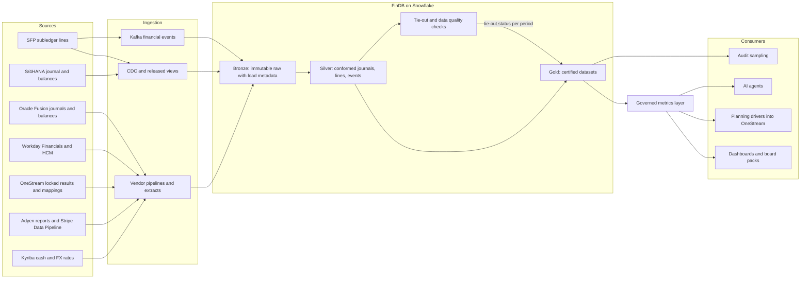
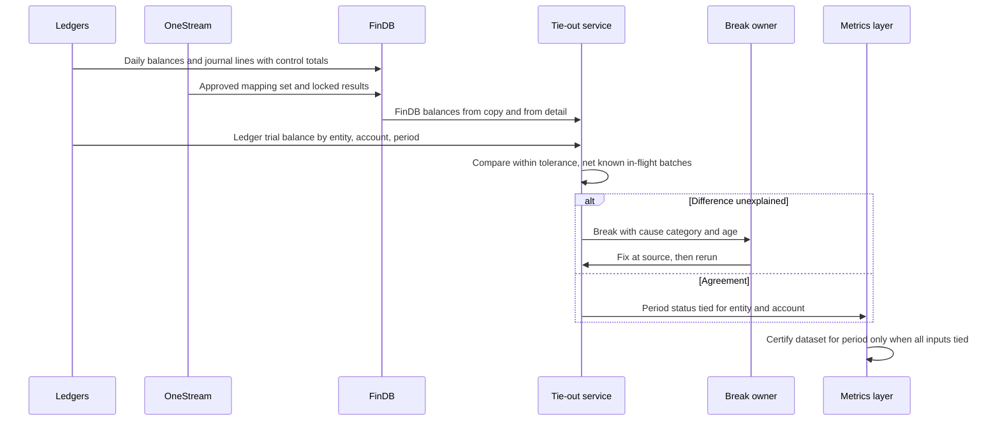
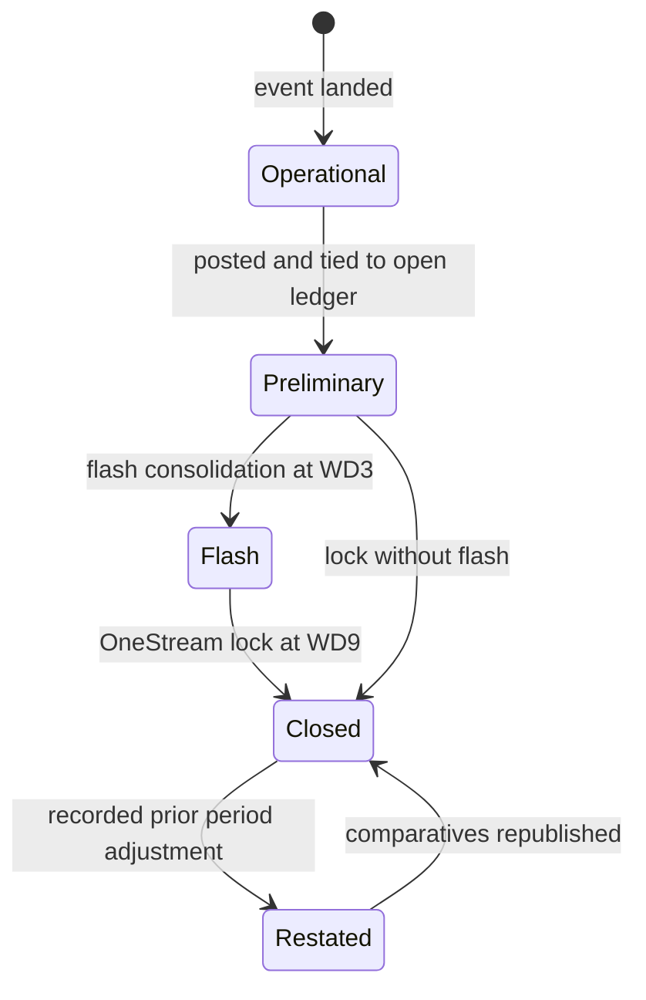
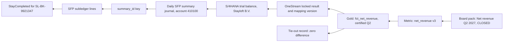

{id: finance-data-flows}
# 29. Finance Data Across the Estate: From Operations to Analytics

> **IN THIS CHAPTER, YOU WILL:** Learn why an enterprise legitimately has several "revenue" numbers, and how to design the finance data platform, the governed metrics layer, the ledger-to-warehouse tie-out, latency tiers and lineage so that every number can be explained, labeled and traced to the books.

> **WHY FINANCE CARES:** When the board deck, the brand dashboards and the investor model show three different revenue figures for the same quarter, the CFO's credibility is spent explaining the differences instead of the business. Numbers that reach investors, plans or AI agents need the same discipline as numbers that reach the 10-Q.

> **WHY ARCHITECTS SHOULD CARE:** The data platform is the one system that reads from every layer of the estate at every grain, so it is where inconsistencies surface and where a second, unofficial set of books grows if nobody draws its boundary. Its design decides whether analytics, planning and agents strengthen the ledger's authority or quietly compete with it.

> **KEY POINTS:**
>
> * **Three kinds of numbers, one bridge.** Operational numbers (bookings, GTV), accounting numbers (revenue under ASC 606, closed) and management numbers (adjusted, segment, KPIs) differ for legitimate reasons: timing, presentation, scope and currency. The fix is not to force them to agree but to define each one once, label its kind and status, and publish the bridge between them.
> * **The finance data platform is the book for nothing.** It may hold more detail than any ledger and serve analytics, audit sampling, planning and agents, but it never becomes the book of record. It earns trust by tying out to the ledger every day, by entity, account and period, with explicit tolerances and owned breaks.
> * **A governed metric is a product with an owner and a control.** Definition, owner, grain, source of truth, tie-out control and certification live in one version-controlled semantic layer. Board packs, planning drivers and AI agents read only certified metrics, and every number carries its status: flash, preliminary or closed.

> **[FAILURE PATTERNS THIS CHAPTER ADDRESSES](#where-finance-architecture-goes-wrong):**
>
> * **The Shadow Ledger** — the warehouse holds the only transaction-level view, starts computing accruals and revenue splits, and its results are posted as manual journals nobody reconciles.
> * **Lost in Aggregation** — here in reverse: the warehouse has all the detail but no keys to the ledger, so nobody can show that the detail adds up to a reported balance.
> * **Spreadsheet Glue** — the investor-relations model rebuilds revenue in workbooks, with its own adjustments and its own labels, outside any control.

Every finance estate produces more numbers than it publishes. The ledgers produce the accounting record; the close and consolidation produce the reported results; operational systems produce bookings, payment volumes and usage; planning produces forecasts; analysts produce the rest. **The problem is not that these numbers differ. They should differ.** A booking made in March for a stay in July is real business activity in March and revenue in July, and a company that cannot see both is managing blind.

The problem is **numbers that differ without anyone being able to say why**. When the same word, "revenue", labels a booking-based figure in a dashboard, a closed US GAAP figure in the board pack and a constant-currency estimate in an investor model, every meeting starts with a reconciliation exercise and ends with less trust in all three.

This chapter follows finance data beyond the ledger: into the **finance data platform** (the analytical store that joins operational, subledger and ledger data), through a **governed metrics layer** (one definition per number, implemented once), and out to dashboards, planning, investors and AI agents. It owns the platform's boundary, the governed metric and the ledger-to-warehouse tie-out. Master data belongs to [Finance Data Architecture: Master Data, Systems of Record and Governance](#finance-data-architecture); the trace of one transaction from booking to filing belongs to [From Customer Transaction to Financial Statement](#transaction-to-report).

{id: finance-data-flows--setting-the-scene-at-northmere-three-revenue-numbers}
## Setting the Scene at Northmere: Three Revenue Numbers

Northmere, the fictional multi-brand digital commerce group this book follows, closed the first quarter of 2027 in April. OneStream locked the consolidation on working day 9. The close itself had a scare: on working day 7, group reporting found $41 million of Tablekin usage revenue sitting in "Other revenue" because a new Workday account had no mapping row ([Finance Data Architecture: Master Data, Systems of Record and Governance](#finance-data-architecture) tells that story). The total was right; one caption was wrong, and it was fixed before the lock.

The real surprise came a week later. Tomás Ferreira, the Group CFO, read three documents in preparation for the earnings call:

- **The board deck**, built from OneStream's locked consolidation, showed Q1 2027 revenue of **$1,986 million**.
- **The brand dashboards**, built by each brand's analysts on FinDB, Northmere's Snowflake finance data platform, added up to **$2,431 million** of "revenue".
- **The investor-relations (IR) model**, a set of spreadsheets maintained by the IR team, showed **$2,021 million**.

None of the three was wrong. The dashboards counted commission and fees on bookings made in the quarter, at the day's exchange rate, before cancellations; Stayloft's first quarter is when travelers book their summer, so bookings run far ahead of completed stays. The IR model had been built on the working-day-3 flash consolidation, before the last close adjustments, and restated at 2026 exchange rates to show constant-currency growth, a column whose "constant currency" footnote had been lost when it was copied into the summary tab. Each number answered a legitimate question. Each was labeled "revenue".

Tomás asked Owen Mbeki, Head of Finance Data and owner of FinDB, to explain the differences by the end of the day. Owen's team could explain the dashboards' number only partly, because FinDB's revenue tables did not tie to the ledger: they used their own copy of the chart-of-accounts mappings, which had drifted from OneStream's, and nobody compared FinDB's balances with the ledger's. Leila Haddad, the Chief Accounting Officer and Group Controller, put the question to Dana Whitlock, the Chief Architect: **"Which of these numbers am I allowed to say out loud, and how would anyone know?"**

The answer took Northmere the rest of 2027. Its parts are the subject of this chapter.

{id: finance-data-flows--three-kinds-of-finance-numbers}
## Three Kinds of Finance Numbers

The first step is vocabulary. Finance numbers come in three kinds that differ in purpose, rules and authority. Most "competing truths" are numbers of different kinds that share a name.

| Kind | What it measures | Rules it follows | Authority | Northmere examples |
| --- | --- | --- | --- | --- |
| **Operational** | Business activity when it happens | Company-defined; event time; usually gross | Operational systems, through the data platform | Gross transaction value (GTV), bookings, room nights, seated covers, billed ad clicks, payment volume |
| **Accounting** | Financial performance and position under a framework | US GAAP (revenue under ASC 606), entity ledgers, period cut-off, closed and locked | The ledgers and the consolidation | Revenue, deferred revenue, partner payables, traveler funds held |
| **Management** | Performance as management chooses to view it | Company-defined adjustments to accounting numbers; segment and KPI definitions | Finance (FP&A, controllership, IR), derived from accounting numbers | Adjusted EBITDA, constant-currency revenue, take rate, segment profit, revenue per room night |

**Operational numbers** are about events. Gross transaction value (GTV), for example, is the total value of transactions customers make through the platforms, regardless of who is principal for the service. Its rules are the company's own, which makes it flexible and dangerous: two teams can define "bookings" differently and both be internally consistent.

**Accounting numbers** follow a framework. Under ASC 606, revenue is recognized when control of a promised service transfers to the customer, and a platform that arranges a service provided by someone else is an **agent** that recognizes only its commission or fee (net presentation), not the gross amount ([Accounting for Architects: Ledgers, Journals and Revenue](#accounting-for-architects) owns the principal-versus-agent analysis). Accounting numbers are closed per period, locked and audited. They are slow, conservative and authoritative.

**Management numbers** are built from accounting numbers with adjustments management chooses: excluding items, restating at constant exchange rates, allocating to segments, dividing by operational drivers. Under the US segment rules (ASC 280, amended by ASU 2023-07), the segment measure is the one the chief operating decision maker actually uses, so even published segment numbers are a management view of the books ([KPMG's segment reporting handbook](https://kpmg.com/us/en/frv/reference-library/2025/handbook-segment-reporting.html) covers the 2023 amendments).

The three kinds differ for four legitimate reasons: **timing** (booking date versus the date the performance obligation is satisfied, within a period cut-off), **presentation** (a €600 booking is €600 of GTV and €90 of revenue for an agent), **scope** (dashboards cover the transactional businesses; the ledger also holds other revenue, incentives and close adjustments) and **currency** (booking-day spot rates versus transaction-date rates in functional currency, translated at average rates).

**Figure 1:** *Operational, accounting and management numbers differ for four legitimate reasons; trust comes from defining each one once and publishing the bridge between them, not from forcing them to agree.*

The disclosure rules recognize the difference too. The SEC's 2020 [guidance on key performance indicators in MD&A](https://www.sec.gov/files/rules/interp/2020/33-10751.pdf) (Release 33-10751) expects a disclosed metric to come with a clear definition and how it is calculated, a statement of why it is useful and how management uses it, and disclosure of any change in calculation method; it also reminds companies that disclosure controls apply to metrics derived from their own information. Operating measures such as GTV are not non-GAAP financial measures, but adjusted measures derived from GAAP numbers are, and [Regulation G](https://www.law.cornell.edu/cfr/text/17/244.100) requires each one to be accompanied by the most directly comparable GAAP measure and a quantitative reconciliation. A listed company is already expected to define, control and bridge its metrics; **the architecture's job is to make that routine instead of a quarterly scramble.**

{id: finance-data-flows--the-q1-2027-bridge}
### The Q1 2027 bridge

The first thing Owen's team produced was a bridge from the dashboards' figure to the board's. It took eleven days in 2027, mostly spent finding which dashboard used which definition. The figures are illustrative, in millions of US dollars:

| Line | Item | $m | Reason it differs |
| --- | --- | ---: | --- |
| A | Brand dashboards, "revenue" (commission and fees on bookings made in Q1) | 2,431 | Operational, booking date, booking-day spot rate |
| 1 | Less Stayloft commission on Q1 bookings with stays after 31 March | −1,012 | Timing: revenue recognized when the stay is completed |
| 2 | Add Stayloft commission on stays completed in Q1 that were booked before 1 January | +596 | Timing, the other direction |
| 3 | Less Q1 bookings canceled before or during the stay | −58 | Dashboards count bookings at creation |
| 4 | Less traveler incentives, loyalty credits and other contra-revenue | −47 | Presentation: incentives reduce revenue, not cost |
| 5 | Less Tablekin billings in excess of ratably recognized subscription revenue | −22 | Timing: annual plans are billed in advance |
| 6 | Less exchange-rate differences (booking-day spot versus ledger rates and average-rate translation) | −9 | Currency |
| 7 | Add revenue not in brand dashboards (insurance commissions, other services) | +96 | Scope |
| 8 | Add close adjustments (accrual true-ups, top-side journals) | +11 | Scope: entries made only in the close |
| B | **Revenue, US GAAP, closed (board deck)** | **1,986** | Accounting, locked working day 9 |
| 9 | Less adjustments made after the working-day-3 flash | −7 | Status: flash versus closed |
| 10 | Add restatement of Q1 at 2026 average exchange rates | +42 | Management view: constant currency |
| C | **IR model, "revenue" (flash, constant currency)** | **2,021** | Management, preliminary |

The Lisbon booking that recurs through this book sits in line 1. The traveler booked on 12 March 2027 and stayed 18–21 April. FinDB's Stayloft dashboard counted €600 of GTV and €90 of commission in March; the ledger recognized the €90 when the stay was completed on 21 April, in the second quarter. Both are correct. Only one is revenue.

Two lessons came out of the bridge. First, **every line is a known mechanism**, and each can be computed from data FinDB already holds. Second, the bridge could not be produced quickly because FinDB had no tie to the ledger: line B had to be typed in from OneStream, and the "unexplained" residual that should have been zero was found only by hand. The rest of the chapter turns those lessons into architecture.

{id: finance-data-flows--what-the-finance-data-platform-is-and-what-it-is-not}
## What the Finance Data Platform Is, and What It Is Not

[Anatomy of a Financial Systems Landscape](#finance-landscape) places the **finance data platform** as layer 8 of the reference model: the analytical store that reads from every other layer, at every grain, and serves analysis, audit sampling, planning and governed metrics. Its defining rule there is that **it is the book for nothing**. This chapter turns that rule into boundaries an architect can enforce.

| The platform **does** | The platform **does not** |
| --- | --- |
| Hold transaction-grain detail too voluminous for the ledger: subledger lines, payment settlement lines, usage records | Hold the book of record for any balance, at any grain |
| Join operational, subledger and ledger data so the bridge between them can be computed | Compute accounting entries, accruals or revenue allocations that are then posted |
| Publish governed metrics with definitions, owners and status | Change a closed number, or publish a closed number that differs from the ledger |
| Serve audit sampling and drill-down from a ledger balance to its transactions | Become the only place a ledger balance can be traced (traceability is the ledger's own design duty) |
| Feed planning drivers and AI agents through certified interfaces | Let consumers query raw tables for certified uses |
| Host normalized, contracted datasets that posting services read, under controls | Hold the posting rules or the decision about what is posted |

The last row needs a word, because Northmere already crosses it. [Stripe: Programmable Payments, Billing and Connected Accounts](#stripe) describes how Stripe Data Pipeline lands every Northmere Stripe account in FinDB and how Tablekin's and Wayfare's posting services read a normalized layer of balance transactions there. That is legitimate, under three conditions I hold to. The normalized layer is a **contracted data product** with control totals, not an analyst's table; the **accounting decision** (which account, which period, which amount) stays in the posting service under its rule versions, never in a transformation in the warehouse; and the pipelines that produce the layer are **in scope for IT general controls**, because data used in a financial process is information produced by the entity (IPE) and must be shown to be complete and accurate ([Controls, Auditability and Security by Design](#controls-and-auditability) owns IPE). A data platform that feeds a posting path accepts a financial system's change and access discipline for that path; worth paying when the alternative is a second normalization engine, but it should be a decision, not a drift.

**Why the rule matters.** A ledger has balanced double entry, period locks, corrections by reversal and an audit trail the auditor has tested; a warehouse table can be rebuilt by a pipeline rerun. Once the warehouse decides an amount that reaches the books, two systems claim authority, and only one was designed for it.

{id: finance-data-flows--platform-options-as-of-2026}
### Platform options, as of 2026

The platform is usually a general-purpose cloud data platform (Snowflake, Databricks or BigQuery), or an ERP vendor's data offering, or both:

- **SAP Business Data Cloud**, announced in February 2025 with Databricks, [bundles SAP Datasphere, SAP Analytics Cloud, SAP BW and SAP Databricks with SAP-managed data products](https://learning.sap.com/courses/introducing-sap-business-data-cloud/exploring-the-architecture-of-sap-business-data-cloud). Datasphere is a component of Business Data Cloud, not a predecessor it replaced. SAP's [May 2026 announcement](https://news.sap.com/2026/05/sap-bdc-accelerate-autonomous-enterprise/) positions zero-copy sharing with external platforms, including Snowflake and Databricks.
- **Oracle Fusion Data Intelligence** is the [renamed Fusion Analytics Warehouse](https://blogs.oracle.com/proactivesupportepm/attention-oracle-fusion-analytics-warehouse-is-now-oracle-fusion-data-intelligence), with a predefined semantic model over Fusion data.
- **Workday Data Cloud**, announced in September 2025, adds zero-copy sharing with Snowflake, Databricks and others to the Prism Analytics capabilities; Workday's [Prism-to-Data Cloud guide](https://www.workday.com/en-us/topics/it/guide-prism-to-data-cloud.html) targets general availability for finance data in release 2027R1, as of October 2026.

A vendor platform knows its own ERP's semantics deeply and the rest of the estate shallowly. **For a group with one dominant ERP, it can be the right center; for a group with three ledgers, payment providers and custom subledgers, the vendor platforms are sources and a general platform is the center.** Northmere is the second case, and the vendor offerings matter to it mainly as cleaner, upgrade-safe extraction paths.

{id: finance-data-flows--architecture-from-sources-to-certified-numbers}
## Architecture: From Sources to Certified Numbers

FinDB's target architecture, agreed in June 2027, has five stages. The layering uses the **medallion** convention that Databricks defines: a **bronze** layer of raw source data with load metadata, a **silver** layer that is matched, conformed and cleansed into an enterprise view, and a **gold** layer of consumption-ready datasets ([Databricks glossary](https://www.databricks.com/glossary/medallion-architecture)). Medallion is a data-engineering convention, not a control framework; the controls in the figure are what make it fit for finance.

**Figure 2:** *FinDB's target architecture. Every source lands immutably in bronze; silver conforms journals, lines and events to the group dimensions; gold datasets are certified only for periods whose tie-out to the ledger has passed; and consumers with certified uses read through the governed metrics layer, never from raw tables.*

**Sources.** Every system that holds finance-relevant data feeds FinDB, but each is read through its supported, upgrade-safe surface. S/4HANA is read through released analytical views, not database tables, so an upgrade does not break the pipeline ([SAP S/4HANA: The Enterprise Finance Core](#sap-s4hana)). Wayfare's Oracle Fusion data arrives through BI Cloud Connector bulk extracts ([Oracle Fusion Cloud ERP: Ledgers, Accounting Hub and Coexistence](#oracle-fusion)). Workday data arrives through report extracts until Data Cloud sharing is available for finance data ([Workday: Financials, People and the Organizational Backbone](#workday)). OneStream publishes its locked results and, since the May 2027 mapping decision, its approved mapping set after every change ([OneStream: Consolidation, Planning and Performance Management](#onestream)). Adyen settlement reports and Stripe Data Pipeline shares land as delivered ([Adyen: Single-Platform Acquiring and Platform Payments](#adyen), [Stripe: Programmable Payments, Billing and Connected Accounts](#stripe)). Kyriba publishes the period's FX rate set, the same one the ERPs and OneStream use.

**Ingestion.** Three styles, chosen per source: change data capture (CDC) for high-volume operational databases such as SFP's subledger; vendor pipelines and scheduled extracts for SaaS platforms; and the Kafka financial event stream for near-real-time operational data. CDC tools commonly deliver at least once, so duplicates on failure are normal ([Debezium FAQ](https://debezium.io/documentation/faq/)); bronze keeps every delivery with its load metadata, and silver deduplicates on the source's own identifiers. Every load records a **control total**: row count and amount sum per source, entity and business date, compared with the total the source declares. [Integration Architecture for Finance](#integration-architecture) owns control totals in general.

**Bronze** is immutable and append-only; a corrected source file is a new load, which is what lets FinDB answer an auditor's question about what it received and when. **Silver** holds conformed, deduplicated datasets on group dimensions: journal lines from three ledgers mapped to group accounts through the approved OneStream mapping version effective on the posting date, SFP subledger lines, canonical money movements and canonical financial events. Silver is where the **ledger keys** live: every detail row that should reach a ledger balance carries the `summary_id` or document number that links it to its summarized journal. Without those keys, the warehouse cannot prove its detail adds up to the books. **Gold** holds consumption-ready datasets such as `fct_net_revenue`, `fct_gtv` and `fct_psp_clearing_ageing`, each with an owner and a certification state per period.

{id: finance-data-flows--data-products-who-owns-which-layer}
### Data products: who owns which layer

[Data mesh](https://martinfowler.com/articles/data-mesh-principles.html), as Zhamak Dehghani defined it, rests on four principles: domain-oriented ownership, data as a product, a self-serve data platform, and federated computational governance. Finance takes the idea seriously but not literally. **Source-aligned data products** belong to the domains that understand the data; **conformed and consumer-aligned products** that must agree with the ledger belong to a central finance data team, because nobody else is accountable for the tie-out.

| Data product | Owner | Why there |
| --- | --- | --- |
| SFP subledger lines with drill-back keys | Jonas Berg, Stayloft Finance Engineering | Only SFP's team knows the line semantics; the contract is theirs |
| Canonical money movements (Adyen, Stripe, APMs) | Northmere Pay normalization service, under Lucía Romero's group standard | One reconciliation unit across providers ([Payments-to-Ledger: Connecting Providers, Brand Platforms and the ERP](#payments-to-ledger)) |
| Ledger journals and balances, three ledgers | Owen Mbeki, Finance Data | Conformed across vendors; the tie-out's ledger side |
| Approved CoA mapping set | Group reporting (steward), published by OneStream | One mapping for consolidation and warehouse |
| Gold financial datasets and governed metrics | Owen Mbeki, Finance Data, with a metric owner in Finance per metric | Accountable for tie-out and certification |
| Brand operational marts | Brand analytics teams | Speed and local questions; not certified |

Each product publishes a data contract: schema, semantics, quality rules, service levels and owners. The [Open Data Contract Standard](https://bitol-io.github.io/open-data-contract-standard/latest/) gives a YAML shape for it; [Finance Data Architecture: Master Data, Systems of Record and Governance](#finance-data-architecture) shows a finance contract and the three extra jobs it must do (completeness, accounting semantics, valid master data references).

{id: finance-data-flows--the-governed-metric}
## The Governed Metric

A **governed metric** is a number the enterprise has decided to define once, implement once and control. It is not a dashboard and not a column. It has six parts, and a metric missing any of them is not governed:

1. **Definition** in words a controller and an engineer would both sign: what is counted, what is excluded, which date governs, which currency and rate.
2. **Owner**: a named person in Finance accountable for the definition and its changes. The data team implements; the owner decides.
3. **Grain**: the finest level at which the metric is valid and the dimensions it can be cut by.
4. **Source of truth**: the system whose number wins if they disagree, and the dataset that implements it.
5. **Tie-out control**: the check, run every period (and daily for open periods), that proves the metric agrees with its source of truth or with its accounting anchor within a stated tolerance.
6. **Certification**: a recorded state per period (not certified, preliminary, closed, restated) that consumers can read.

A definition change is a new version with an effective date, and every published number records the version that produced it, which is what the SEC's guidance expects when a disclosed metric's method changes.

{id: finance-data-flows--worked-definitions}
### Worked definitions

The two definitions Leila and the Group FP&A director signed in July 2027:

| Element | **Net revenue** | **Gross transaction value (GTV)** |
| --- | --- | --- |
| Kind | Accounting | Operational |
| Definition | Revenue as reported in the consolidated statement of operations under US GAAP: commissions and fees as agent (net), subscription and usage revenue, payments revenue where Northmere is principal, advertising, insurance commissions and other services; after incentives and other contra-revenue | Total amount customers commit to pay for bookings and transactions through Northmere platforms, including taxes and fees collected, on the date the booking is confirmed, less bookings canceled within the same period; Stayloft (agency and merchant), Wayfare (all products) and Tablekin diner payments processed through Stripe Connect; excludes Tablekin subscriptions and usage fees and Northmere Ads |
| Governing date | Date the performance obligation is satisfied (for Stayloft, stay completed), within the period's cut-off | Booking confirmation date (event time, UTC, assigned to the period in the booking entity's time zone) |
| Currency | Transaction-date rates in functional currency; translated to US dollars at the period average rate published from Kyriba | Booking-day spot rate from the same Kyriba rate service; constant-currency variant at prior-year average rates |
| Owner | Leila Haddad, CAO and Group Controller | Group FP&A director |
| Grain | Legal entity × brand × business model × market × product × month | Booking × day; aggregable by brand, business model, market, channel, partner segment |
| Source of truth | OneStream locked consolidation for totals by entity, brand and month; the ledgers for open periods | The Kafka financial events (`BookingConfirmed`, `BookingCancelled`) as landed in FinDB silver |
| Tie-out control | Closed periods: FinDB total equals OneStream by entity, brand and month, zero difference; open periods: equals ledger revenue account balances daily within tolerance | Anchor reconciliation: merchant-model GTV ties to payments captured in Northmere Pay and Wayfare within 0.5% per brand and month, with the documented differences (pay-later methods, captures in a later period) itemized; agency GTV has no ledger anchor and is tested by event completeness against the brand platforms' control totals |
| Certification | Preliminary daily; flash at working day 3; closed at OneStream lock; restated only through a recorded prior-period adjustment | Daily, preliminary; final for a month at working day 2 of the next month |
| Q1 2027 (illustrative) | $1,986 million | $17.9 billion |

Two design choices in these definitions matter more than the wording. **First, the word "revenue" is reserved for the accounting number.** The dashboards' figure was renamed "booked commission and fees", an operational metric with its own definition and its own bridge to Net revenue. Renaming did more to end the three-numbers problem than any pipeline. **Second, GTV has an anchor, not a tie-out.** An operational number cannot equal a ledger balance, because the ledger does not record GTV. It can still be tested against something the ledger does record: for merchant-model bookings, the cash actually captured. A metric with no anchor at all is legitimate, but it should say so in its definition.

{id: finance-data-flows--where-the-metric-lives}
### Where the metric lives

Metric definitions can live in four places, and most estates have all four by accident. The choice is about who can change the definition and whether every consumer reads the same one.

| Option | Strengths | Weaknesses | Right when |
| --- | --- | --- | --- |
| **In each BI tool** (calculated fields, workbook logic) | Fast; analysts own it | One definition per dashboard; no tests; no lineage; invisible to planning and agents | Exploration only, never certified numbers |
| **Warehouse semantic layer** (dbt Semantic Layer, Snowflake semantic views, Databricks metric views) | One definition as code, versioned, tested, available to every tool and to agents | Needs a data team with finance literacy; feature names and packaging change often | Multi-ERP estates with a general data platform; Northmere's choice |
| **Vendor semantic model** (Oracle Fusion Data Intelligence, SAP Business Data Cloud data products) | Prebuilt for the vendor's ERP; upgrades maintained by the vendor | Deep on one ERP, shallow on the rest; definitions shaped by the vendor | One dominant ERP; few non-ERP sources |
| **CPM as the governed layer** (OneStream, Oracle EPM) | Already controlled, locked and audited; owns closed accounting numbers | Coarse grain; not built for operational metrics or high-frequency queries | Closed accounting and management metrics at reporting grain |

The dbt Semantic Layer, powered by MetricFlow, defines metrics in the dbt project so that downstream tools use the same definitions; its documentation states the intent plainly: "if a metric definition changes in dbt, it's refreshed everywhere it's invoked" ([dbt documentation](https://docs.getdbt.com/docs/use-dbt-semantic-layer/dbt-sl); the feature requires a paid dbt tier). Snowflake's [semantic views](https://docs.snowflake.com/en/user-guide/views-semantic/overview) store logical tables, relationships, facts, dimensions and metrics as schema-level objects in the database. Either works; what matters is that there is exactly one.

Northmere's decision combined two rows. **OneStream remains the source of truth for closed accounting numbers at reporting grain; the dbt semantic layer on FinDB is the single home of every metric definition**, including Net revenue, whose closed totals it reads from OneStream's published results and whose finer grain (partner, channel, product) it computes from detail that must tie to those totals. The rule Owen wrote on the wall: **OneStream decides the total; FinDB decomposes it, and the decomposition must add up.**

{id: finance-data-flows--the-ledger-to-warehouse-tie-out}
## The Ledger-to-Warehouse Tie-Out

A **tie-out** is a control that proves two records of the same quantity agree, or explains exactly why they do not. The ledger-to-warehouse tie-out proves that the finance data platform's view of balances agrees with the ledgers' and the consolidation's. Without it, every number FinDB publishes is an assertion; with it, FinDB can be certified.

The tie-out has three levels, and the distinction matters because each catches different failures:

| Level | Compares | Catches | Frequency |
| --- | --- | --- | --- |
| **1. Copy tie-out** | FinDB's replicated ledger balances against the ledger's own trial balance | Missing loads, partial extracts, late manual journals, replication bugs | Daily, every entity |
| **2. Derivation tie-out** | Balances FinDB computes from detail (subledger lines, money movements) against the ledger balances those details were posted to | Detail without ledger keys, summarization errors, lines posted to the wrong account, posting gaps | Daily for accounts fed by subledgers |
| **3. Bridge tie-out** | Operational and management metrics against their accounting anchor through the published bridge | Unexplained residuals between metric kinds | Monthly at close; flash at working day 3 |

Level 1 is the minimum; level 2 is what makes FinDB's detail trustworthy for audit sampling and revenue decomposition; level 3 is what lets Tomás say any of the three revenue numbers out loud.

{id: finance-data-flows--design}
### Design

The tie-out Owen's team built between July and October 2027 works as follows:

- **Unit of comparison**: legal entity × group account × currency (transaction and functional) × fiscal period, as balances, plus period activity. For Wayfare and Tablekin, comparison runs on the brand chart first and on the group account through the approved mapping version, so a mapping difference shows up as a mapping break, not as a missing amount.
- **Ledger side**: S/4HANA trial balance through released views; Oracle Fusion balances through a scheduled extract; Workday trial balance through a report extract; after lock, OneStream's consolidated results by entity, brand and month.
- **FinDB side**: the same balances computed from silver journal lines (level 1) and from detail with `summary_id` keys (level 2).
- **Schedule**: daily at 07:00 CET for the previous business day, after the SFP summary posts by 06:00 on working day 1 at month-end; hourly during working days 1–9.
- **Tolerances**: for **closed periods, zero**, in both transaction and functional currency; a closed number that differs is a defect, not a rounding question. For **open periods**, a difference is accepted only when it is fully explained by identified in-flight batches (batch IDs sent but not yet acknowledged by the ledger); any unexplained difference above $1,000 per entity and account is a break. Revenue accounts and partner-payable accounts have no de minimis threshold.
- **Breaks**: each break is a record with entity, account, amount, age, a cause category and an owner. Causes are routed: replication failures to Owen's team; mapping-version mismatches to group reporting; posting gaps to the source system owner (Jonas for SFP, Hana Kowalski for Wayfare, Arjun Rao for Tablekin, Sven Aalto for S/4HANA); late manual journals to the entity's accountant. Breaks age like reconciliation items, and those older than two days are reported to Leila's close review.
- **Certification**: a gold financial dataset is certified for a period only when the tie-out for every entity and account it draws on has passed. The certification state is a column consumers can read, not a status in someone's email.

**Figure 3:** *The daily ledger-to-warehouse tie-out. FinDB never corrects a difference by adjusting its own copy; the break goes to the owner of the source, and certification follows only from agreement.*

**The rule that protects the design is in the figure's caption.** When FinDB disagrees with the ledger, the fix happens at the source or in the pipeline, never by "adjusting" the warehouse to match. A warehouse adjusted to match is a second ledger with manual journals.

{id: finance-data-flows--first-results}
### First results

The first full run on 6 July 2027 compared about 52,000 entity-account-currency balances across the three ledgers and found **1,340 breaks**. The causes, in order: 41% mapping-version drift (FinDB's private mapping copy, retired that month in favor of OneStream's published set); 26% late or partial extracts, mostly Workday report timeouts at month-end; 18% FX rate-set mismatches, where FinDB had converted with its own rate feed instead of Kyriba's published set; 9% manual journals posted in the ledgers after the extract; and 6% genuinely unexplained, which turned out to be Northmere Ads summary lines posted to S/4HANA without drill-back keys. By the November close, daily breaks were below 40, none older than two days, and FinDB's Net revenue for closed periods equalled OneStream's by entity, brand and month. That made the Q3 2027 bridge a report, not a project: it ran on working day 9 with no manual lines and a zero residual.

{id: finance-data-flows--latency-tiers-and-the-status-of-a-number}
## Latency Tiers and the Status of a Number

Finance data arrives at different speeds, and each speed has a different authority. The mistake is not fast data; it is fast data presented with the authority of closed data.

| Tier | Latency | Example uses | Status label | Authority |
| --- | --- | --- | --- | --- |
| **Real-time flash** | Minutes, from the event stream | GTV and bookings today, payment acceptance rates, payout backlog | `OPERATIONAL – UNRECONCILED` | Operational only; never revenue |
| **Daily** | Previous business day, after tie-out | Revenue month-to-date, partner payables, PSP clearing aging, cash | `PRELIMINARY` | Tied to open ledgers within tolerance; may change |
| **Flash close** | Working day 3 | Flash consolidated revenue and margin for the CFO | `FLASH` | Consolidated, not final; adjustments expected |
| **Closed** | Working day 9, after OneStream lock | Board pack, earnings, IR model, plan actuals | `CLOSED` | The reported number |
| **Restated** | When a prior-period adjustment is recorded | Comparatives after a correction | `RESTATED` with reference | Supersedes the closed number for that period |

**Figure 4:** *A number's status moves in one direction with the close. Consumers read the status with the value; a closed number changes only through a recorded restatement, never through a pipeline rerun.*

The schedule comes from the close: from mid-2027 OneStream loads preliminary trial balances daily from working day −2, runs the flash consolidation on working day 3, the final on working day 7 and locks on working day 9 ([OneStream: Consolidation, Planning and Performance Management](#onestream)). FinDB's labels follow that calendar exactly, so the status a dashboard shows is the status the controller would give.

**Labeling is an interface, not a footnote.** At Northmere every certified dataset carries `status`, `as_of` and `metric_version` columns; the BI tool renders the status as a badge on every tile; the IR model's template reads status from the same column and refuses to place a non-`CLOSED` figure in a column headed with a closed quarter. The investor model's Q1 problem would not have survived that rule: its flash figure would have carried the label `FLASH`, and its constant-currency column would have been a different metric with a different name.

A closed number must be **reproducible**: rerunning the pipeline later must return the same value. FinDB achieves this by snapshotting each certified dataset at lock with the mapping version, rate set and metric version that produced it. Late-arriving data after lock goes to the next open period, as it does in the ledger; it does not silently change a closed quarter.

{id: finance-data-flows--lineage-end-to-end}
## Lineage, End to End

**Lineage** is the recorded path from a source to a published number. [Finance Data Architecture: Master Data, Systems of Record and Governance](#finance-data-architecture) distinguishes its two strands: the data strand (which records) and the rule strand (which mapping, rate set and rule versions). In the data platform, lineage has a practical test: **can an auditor, starting from the Net revenue tile in the board pack, reach the subledger lines and the journal entries behind it, and can an analyst, starting from a booking, see which reported number it reached?**

**Figure 5:** *End-to-end lineage for one reported number. The Lisbon booking's €90 commission reaches the Q2 2027 board pack through the stay-completion event, the subledger line, its summary key, the daily journal, the trial balance and the locked consolidation; the metric version and the tie-out record make the path auditable.*

Three mechanisms produce this lineage, and none is optional:

- **Pipeline lineage** from the data platform's own jobs. [OpenLineage](https://openlineage.io/docs/) is an open specification with a dataset, job and run model; its [dbt integration](https://openlineage.io/docs/integrations/dbt) wraps dbt commands and emits lineage events for each run, which suits FinDB's dbt-based transformations.
- **Ledger keys** carried in the data: `correlation_id` (the booking), `event_id`, `summary_id` and the journal document number. Pipeline lineage tells you that table A fed table B; only keys in the rows tell you which booking reached which balance. [Designing for Traceability, Reconciliation and Audit Across Boundaries](#traceability-and-reconciliation) owns the identifier design across boundaries.
- **Version stamps**: every gold row and every published metric value records the mapping version, rate set and metric version that produced it.

**Lost in Aggregation in reverse** is the failure this section prevents. Most discussions of that pattern worry about the ledger losing detail. The warehouse has the opposite problem: it has all the detail, but if the detail lacks ledger keys, nobody can show it adds up to a reported balance. Northmere Ads was the case: its billed-click detail sat in FinDB, its summarized invoices sat in S/4HANA, and the 6% unexplained breaks in July were the gap between them. The fix was upstream (the ad-billing service now stamps each summary line with its key), which is where lineage fixes usually belong.

{id: finance-data-flows--self-service-and-certified-reporting}
## Self-Service and Certified Reporting

Analysts must be able to explore, and the board must be able to rely on what it reads. These are different products, and an estate that tries to serve both from one undifferentiated warehouse ends with either locked-down data nobody uses or certified-looking numbers nobody controls.

Northmere runs three zones in FinDB:

| Zone | Contents | Who builds | Controls | Allowed uses |
| --- | --- | --- | --- | --- |
| **Certified** | Gold datasets and governed metrics with tie-out and status | Finance Data, with metric owners | Definition approval, tests, tie-out, change control under ITGC, access policies | Board and audit committee packs, earnings and IR, planning drivers, AI agents, any key control |
| **Curated** | Silver datasets with documentation and contracts | Finance Data and domain owners | Contracts, data quality tests, lineage | Analysis, investigation, prototype metrics |
| **Sandbox** | Personal and team workspaces | Anyone with access | Access policies; automatic expiry | Exploration; never published outside the team |

The rule between zones is the one that matters: **a number leaves the sandbox or curated zone for a certified use only by becoming a governed metric.** A useful analyst metric is not banned; it is promoted. It gets an owner, a definition, a test and a tie-out or an anchor, and then it appears in the board pack. The governance cost is a few days per metric; the alternative is the metric sprawl the June 2027 inventory found: 1,870 dashboards, 63 distinct measures with "revenue" in their name, and 11 definitions of "bookings". By the end of 2027 the certified catalog held 48 metrics, and the board pack used nothing else.

**Figure 6:** *A number reaches the board pack, planning or an AI agent only by being promoted into the small certified zone as a governed metric with an owner, a definition, a test and a tie-out.*

Certification also has a control consequence. A certified dataset used in a key control (a revenue analytical review, a reserve estimate, an auditor's sample) is IPE, and the pipelines behind it are in scope for change management and access controls. Mei Tanaka's controls team added FinDB's certified zone, and only that zone, to the SOX system inventory in Q3 2027. Keeping the certified zone small keeps the SOX scope small.

{id: finance-data-flows--access-personal-data-and-retention-in-analytics}
## Access, Personal Data and Retention in Analytics

The data platform is the place where data from every system is joined, which makes it the most attractive target in the estate and the easiest place to violate a restriction that each source system enforced on its own.

- **Row-level access by entity and brand.** Brand analysts see their brand; entity accountants see their entities; group roles see everything. In Snowflake this is implemented with [row access policies](https://docs.snowflake.com/en/user-guide/security-row-intro), which require Enterprise Edition or higher; column masking policies handle sensitive attributes.
- **Personal data minimized.** Traveler and partner identifiers are pseudonymized in silver and gold; the re-identification key sits in a restricted schema. Bank details and card data never enter FinDB: Northmere Pay stores no card numbers, and partner bank details stay in the payout systems: authored in SFP in 2027 and, in the target state, only in Northmere Pay from mid-2028 ([Payments for Finance Architects: The Lifecycle of Money Movement](#payments-fundamentals), [Systems of Record and Authoritative Data Boundaries](#systems-of-record)).
- **Material non-public information (MNPI) fenced.** Between the flash close and the earnings release, consolidated results are inside information. FinDB's `FLASH` and `CLOSED` revenue for the current quarter is visible only to an insider-listed role until the release time, after which the policy opens automatically. Operational metrics that would let someone infer the result (group GTV for the quarter, for example) sit behind the same fence.
- **Retention by asset, not by system.** Bronze copies of ledger data follow the ledger's retention; operational event data follows its own (for traveler-linked data, pseudonymization after 24 months); certified snapshots of closed periods are kept as long as the reported numbers they support. [Finance Data Architecture: Master Data, Systems of Record and Governance](#finance-data-architecture) owns the retention-versus-erasure design.

{id: finance-data-flows--feeding-planning-and-ai}
## Feeding Planning and AI

{id: finance-data-flows--planning-drivers}
### Planning drivers

Revenue at a marketplace is planned from drivers: room nights, average daily rate, GTV, take rate, merchant mix, seated covers, subscriptions. [OneStream: Consolidation, Planning and Performance Management](#onestream) describes how those drivers reach OneStream's planning models from FinDB's governed metrics. The data design behind it:

- **Drivers come only from certified metrics**, through a versioned driver snapshot per forecast cycle. The snapshot records the metric versions and the `as_of` time, so a forecast can always be compared with the actuals it was built on.
- **Driver-to-actual consistency is tested.** For each closed month, plan drivers multiplied through the planning logic should reproduce Net revenue within a known variance; a growing unexplained gap means the planning model's revenue logic has diverged from accounting policy (for example, recognizing Stayloft commission at booking instead of at stay).
- **Actuals in the plan come from OneStream, never from FinDB.** The plan compares against the reported number; FinDB supplies the drivers and the decomposition.

{id: finance-data-flows--ai-agents}
### AI agents

AI agents raise the stakes of all of this, because an agent asked "what was Stayloft's revenue in Q1?" will answer from whatever it can reach, fluently and without a footnote. [AI, Automation and Agentic Finance Operations](#ai-in-finance) owns the controls for agents in financial processes; the data rules are these:

- **Agents query the governed metrics layer, not raw tables.** The dbt documentation notes that AI tools can connect to its Semantic Layer through the dbt MCP server so that answers use governed metrics ([dbt documentation](https://docs.getdbt.com/docs/use-dbt-semantic-layer/dbt-sl)); Snowflake documents semantic views as an input to its Cortex Analyst and Cortex Agents features ([Snowflake documentation](https://docs.snowflake.com/en/user-guide/views-semantic/overview)). The specific product does not matter; the restriction does.
- **Every answer carries the metric ID, version and status.** "Group net revenue, Q1 2027, $1,986 million, CLOSED, net_revenue v3" is an answer; a bare number is not.
- **Agents inherit the tie-out status.** Northmere's variance-commentary pilot in late 2027 cited the ledger for financial figures and FinDB only for operational drivers, because FinDB was not yet tied out when the pilot was designed ([AI, Automation and Agentic Finance Operations](#ai-in-finance)). Once certification exists, the agent can read certified datasets and must decline uncertified ones for financial questions.

{id: finance-data-flows--trade-offs}
## Trade-offs

Three decisions shape a finance data platform. None has a universally right answer.

| Decision | Option | Gains | Costs | I would choose it when |
| --- | --- | --- | --- | --- |
| **Who owns certified finance data** | Central finance data team | One accountable owner for tie-out and definitions; finance literacy concentrated | Bottleneck risk; distance from domains | Always for certified, ledger-tied products |
| | Domain teams (full data mesh) | Speed; domain knowledge | Tie-out ownership fragmented; definitions diverge | Source-aligned products and operational marts only |
| **How fresh** | Daily, tied | Every number is reconciled before use | No intraday view of financial metrics | Default for anything labeled financial |
| | Streaming | Intraday operational view | Unreconciled; tempting to present as revenue | Operational metrics, with the label |
| **How much detail** | Full transaction grain in the platform | Audit sampling, decomposition, AI, root-cause analysis | Storage, PII exposure, SOX scope if used in controls | Multi-ledger estates with summarized posting (Northmere) |
| | Balances and summaries only | Small scope; simple controls | Every detail question goes back to source systems | One ERP holding full detail itself |

The trade-off I would argue hardest about is ownership. A pure data-mesh reading gives each domain its own revenue data product, and the result is a revenue number per domain. **Federate production, centralize agreement**: domains own the data they produce, and one team is accountable for the products that must agree with the books.

{id: finance-data-flows--integration-with-the-rest-of-the-estate}
## Integration With the Rest of the Estate

- **Subledgers and ledgers** ([Designing Custom Ledgers and Financial Event Processing](#designing-financial-ledgers)) provide detail with drill-back keys and balances for tie-out; the subledger's own daily tie-out to the GL is upstream of FinDB's derivation tie-out.
- **Payments** ([Payments-to-Ledger: Connecting Providers, Brand Platforms and the ERP](#payments-to-ledger)): BlackLine's matching and FinDB's analytics read the same canonical money movements.
- **Close and consolidation** ([BlackLine: Close Automation, Reconciliation and Continuous Accounting](#blackline), [OneStream: Consolidation, Planning and Performance Management](#onestream)): BlackLine certifies balances, OneStream locks results and publishes mappings, and FinDB's statuses follow their calendar.
- **Disclosure** ([Around the Core: Tax, Treasury, Procurement and Reporting Platforms](#satellite-platforms)): Workiva links to OneStream, not to FinDB. Operational KPIs disclosed in MD&A, such as GTV, are the exception: they come from certified FinDB metrics under disclosure controls.
- **Master data** ([Finance Data Architecture: Master Data, Systems of Record and Governance](#finance-data-architecture)): FinDB subscribes to the hubs' conformed dimensions and never builds its own entity, brand or market hierarchy.
- **Technology spend** ([Technology Spend as Financial Data: FinOps Meets the Ledger](#finops)): FinDB hosts cloud billing data as a contracted data product and publishes unit cost per booking as a governed metric, while the allocation and accrual journals are decided in a posting service, consistent with the rule that FinDB is the book for nothing.

{id: finance-data-flows--failure-modes}
## Failure Modes

**The Shadow Ledger in the warehouse.** The platform holds the only transaction-level view and starts being used for accounting decisions: an accrual estimate computed in a notebook, a revenue split by partner computed in dbt, a PSP fee true-up calculated from settlement lines. The results are posted as manual journals. Each step looks like analytics helping finance; together they make the warehouse an uncontrolled subledger. **Warning signs:** manual journals whose support is a warehouse query; dbt models named `accrual_` or `posting_`; finance asking the data team to "fix" a number before close. **Response:** move the logic into a controlled posting service or the ledger's own engine, and keep FinDB as the evidence, not the calculator.

**Metric sprawl.** Every dashboard defines its own version of a number, each slightly different, each named the same. The symptom is the three-revenue-numbers meeting; the cause is that defining a metric in a BI tool costs nothing and governing one costs a few days. **Response:** reserve accounting words for accounting numbers, run a metric inventory, promote the useful metrics into the governed layer and retire the rest.

**Lost in Aggregation in reverse.** The warehouse has detail without ledger keys, so it cannot prove that the detail adds up to a reported balance. Revenue by partner or channel looks precise and cannot be reconciled. **Response:** make ledger keys a contract obligation for every source whose detail is summarized into a ledger, and make the derivation tie-out the test of that obligation.

**Fast numbers with closed authority.** A flash or intraday figure is quoted as if it were closed, as the IR model's Q1 figure was. **Response:** status labels as columns, rendered everywhere, as described above.

**Spreadsheet Glue at the last mile.** The IR model, the board pack appendix or the segment allocation is rebuilt in workbooks from exports, with its own adjustments. **Response:** give IR and FP&A certified metrics and the bridge as data, so the workbook becomes a layout over governed numbers rather than a calculation.

{id: finance-data-flows--the-chief-architect-s-view}
## The Chief Architect's View

Dana's decision record of June 2027, the FinDB charter, contains six rules. They are the decisions I would make in any multi-ledger estate:

1. **The data platform is the book for nothing.** It never computes what is posted. Where a posting service reads a FinDB dataset, the dataset is a contracted product under IT general controls and the accounting decision stays in the posting service.
2. **Accounting words are reserved.** "Revenue", "cost", "margin" and "cash" without a qualifier mean the accounting number. Operational and management metrics have their own names.
3. **Every financial dataset ties out daily** to the ledgers by entity, account and period, with zero tolerance for closed periods and owned, aged breaks for open ones.
4. **Every number carries its status.** Operational, preliminary, flash, closed, restated, as data, not as a footnote.
5. **Certified uses read only governed metrics.** Board, IR, planning drivers and AI agents; no raw-table access for those uses.
6. **The bridge is a product.** The reconciliation between operational, accounting and management numbers is computed every period from certified data, with a zero residual.

**Who decides.** Metric definitions belong to Finance: the CAO for accounting metrics, FP&A for operational and management metrics, IR for disclosed KPIs with the CAO's agreement. The finance data team owns implementation, tie-out and certification. Architecture owns the boundary (rules 1, 3 and 5) and its enforcement through standards and reviews ([Architecture Governance That Speeds Decisions](#architecture-governance)). The controls team decides what is in SOX scope; the certified zone's design should make that answer short.

**What to watch.** Four numbers tell me whether the platform is healthy: tie-out breaks by age; the residual on the bridge (target zero); the share of board-pack and IR figures that come from certified metrics (target all of them); and the number of manual journals whose support is a warehouse query (target none). A fifth matters from 2027 onward: the share of agent answers on financial questions that cite a certified metric.

**Long-term.** The 2029 group finance core and zero-copy sharing from vendor platforms make ingestion and the derivation tie-out easier; they do not change the design. The boundary, the governed metric and the tie-out remain the enterprise's own, which is why I would keep metric definitions in a portable, code-based layer rather than in any vendor's semantic model ([Vendor Strategy and Avoiding Excessive Dependency](#vendor-portfolio-strategy)).

{id: finance-data-flows--questions-to-ask}
## Questions to Ask

1. If two documents show different revenue for the same quarter, can we produce the bridge between them in an hour, with a zero residual?
2. Which metrics are certified, who owns each definition, and where is the definition stored as code?
3. Does the data platform tie out to every ledger daily by entity, account and period, and what are the tolerances for open and closed periods?
4. Who owns a tie-out break, how old is the oldest one, and is any break ever fixed by adjusting the warehouse?
5. Does every dashboard tile, investor model and agent answer show whether its number is operational, preliminary, flash or closed?
6. Do any manual journals use a warehouse query as their support? Do any posting services read warehouse data, and are those datasets under IT general controls?
7. Does every detail record that is summarized into a ledger carry a key to the summary it was posted in?
8. Which pipelines and datasets are in SOX scope because a key control relies on them, and is that scope deliberately small?
9. Can an AI agent reach raw finance tables, or only governed metrics?
10. Who can see quarter-to-date consolidated results before the earnings release, and how is that enforced?

{id: finance-data-flows--from-data-flows-to-authority}
## From Data Flows to Authority

This chapter kept saying that one system's number "wins": OneStream for closed totals, the ledgers for open balances, the event stream for GTV, the subledger for detail. Each of those statements is a decision about authority, and authority in a finance estate is not fixed: a booking belongs to the brand platform, the receivable it creates to the subledger, the balance to the general ledger and the reported figure to the consolidation. [Systems of Record and Authoritative Data Boundaries](#systems-of-record) makes those decisions explicit: who is authoritative for each data object at each stage of its life, how authority passes from one system to the next, and how the estate enforces it.

{id: finance-data-flows--sources-and-evidence}
## Sources and Evidence

**Vendor documentation**

- [Medallion architecture](https://www.databricks.com/glossary/medallion-architecture), Databricks — definition of bronze, silver and gold layers.
- [dbt Semantic Layer](https://docs.getdbt.com/docs/use-dbt-semantic-layer/dbt-sl), dbt Labs, accessed 2026 — centralized metric definitions powered by MetricFlow, refresh everywhere on change, MCP access for AI tools, paid-tier requirement.
- [Overview of semantic views](https://docs.snowflake.com/en/user-guide/views-semantic/overview), Snowflake, accessed 2026 — logical tables, relationships, facts, dimensions and metrics as schema objects; Cortex integrations.
- [Understanding row access policies](https://docs.snowflake.com/en/user-guide/security-row-intro), Snowflake, accessed 2026 — row-level security, Enterprise Edition requirement, relation to masking policies.
- [Exploring the architecture of SAP Business Data Cloud](https://learning.sap.com/courses/introducing-sap-business-data-cloud/exploring-the-architecture-of-sap-business-data-cloud), SAP — components of Business Data Cloud, Datasphere as a component.
- [SAP Business Data Cloud announcement, May 2026](https://news.sap.com/2026/05/sap-bdc-accelerate-autonomous-enterprise/), SAP, 2026 — zero-copy sharing positioning.
- [Fusion Analytics Warehouse is now Oracle Fusion Data Intelligence](https://blogs.oracle.com/proactivesupportepm/attention-oracle-fusion-analytics-warehouse-is-now-oracle-fusion-data-intelligence), Oracle — the rename.
- [Moving from Prism to Workday Data Cloud](https://www.workday.com/en-us/topics/it/guide-prism-to-data-cloud.html), Workday — Data Cloud packages and finance-data GA target (2027R1).
- [Access data in your warehouse](https://docs.stripe.com/stripe-data/access-data-in-warehouse), Stripe — Data Pipeline destinations and cadence.
- [Debezium FAQ](https://debezium.io/documentation/faq/), Debezium project — at-least-once delivery of change data capture.

**Standards and regulation**

- [Commission Guidance on Management's Discussion and Analysis of Financial Condition and Results of Operations, Release 33-10751](https://www.sec.gov/files/rules/interp/2020/33-10751.pdf), SEC, 2020 — expected disclosures for KPIs and metrics, method changes, disclosure controls over metrics; operating measures are not non-GAAP measures.
- [17 CFR 244.100 (Regulation G)](https://www.law.cornell.edu/cfr/text/17/244.100), via Cornell LII — comparable GAAP measure and quantitative reconciliation for non-GAAP measures.
- [Open Data Contract Standard](https://bitol-io.github.io/open-data-contract-standard/latest/), Bitol — YAML structure for data contracts.
- [OpenLineage documentation](https://openlineage.io/docs/) and [dbt integration](https://openlineage.io/docs/integrations/dbt), LF AI & Data — dataset, job and run lineage model; lineage events from dbt runs.

**Practitioner and research sources**

- [Data Mesh Principles and Logical Architecture](https://martinfowler.com/articles/data-mesh-principles.html), Zhamak Dehghani, martinfowler.com, 2020 — the four data-mesh principles.
- [Handbook: Segment reporting](https://kpmg.com/us/en/frv/reference-library/2025/handbook-segment-reporting.html), KPMG, 2025 — ASC 280 and the ASU 2023-07 amendments (management approach, significant segment expenses).

Northmere Group is fictional, and all its figures are illustrative; the architectural recommendations are the author's judgment.
