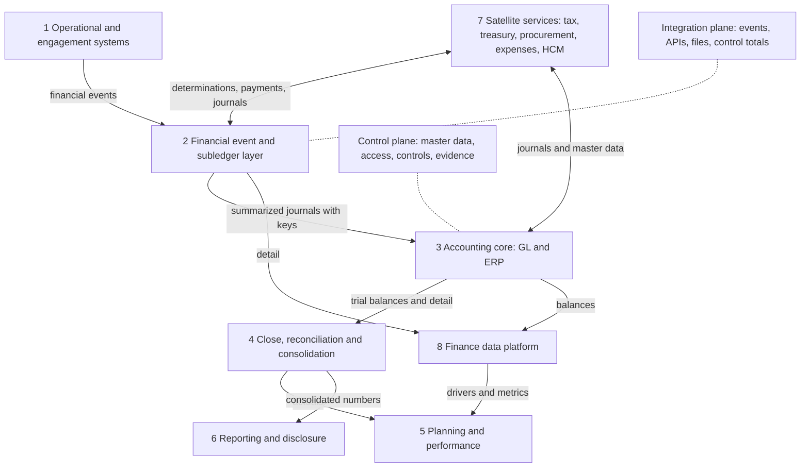
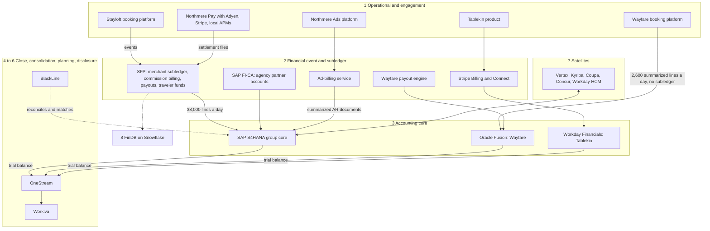

{id: finance-landscape}
# 7. Anatomy of a Finance Estate: Layers, Planes and Boundaries

> **IN THIS CHAPTER, YOU WILL:** Learn the book's reference model of a finance estate: eight layers and two cross-cutting planes. For each one you will see why it exists separately, what data it masters, what volume and latency it carries, which vendors typically fill it and who usually owns it. Then you will map Northmere's landscape onto the model and find its overlaps and gaps.

> **WHY FINANCE CARES:** The controller's hardest questions are about where a number comes from and who vouches for it at each step. A shared model of the layers turns "which system is right?" into "which layer is responsible for this, and how did the number cross into the next one?" That question has an answer.

> **WHY ARCHITECTS SHOULD CARE:** Most expensive finance-architecture mistakes are placement mistakes: product logic built into the ERP, detail pushed into the general ledger, a warehouse quietly turned into a ledger, an operational system posting straight to the books. A reference model with stable layer names makes placement an explicit, reviewable decision before it turns into a migration.

> **KEY POINTS:**
>
> * **The volume gradient explains why finance estates have layers.** Northmere's roughly 1.1 billion events a year become about 3 million subledger lines a day, about 38,000 general-ledger lines a day, about 6,800 reconciled accounts a month and a few hundred reported lines. Each step summarizes, and each layer exists to hold detail at one grain and prove it to the layer above.
> * **Layers are separated by what they master, not by product boundaries.** Operational systems, financial events and subledgers, the accounting core, close and consolidation, planning, reporting, satellites and the data platform each own different data and answer to different owners; the integration and control planes run across all of them. Vendors span layers. The layers do not move.
> * **Most failures are layer failures.** Layer leakage puts logic or detail in the wrong layer; a skipped layer lets operational systems post directly to the ledger; a duplicate layer gives two systems the same job. The model is a thinking tool for spotting these, not a deployment rule that every flow must pass through eight boxes.

> **[FAILURE PATTERNS THIS CHAPTER ADDRESSES](#where-finance-architecture-goes-wrong):**
>
> * **Lost in Aggregation** — The volume gradient forces summarization at every layer boundary; the chapter shows where the keys must be kept so detail survives the step up.
> * **Capability Creep** — Mapping each system to a layer exposes where several platforms do the same job: two payout engines, three billing approaches and reconciliations in three tools at Northmere.
> * **The Swiss-Army ERP** — The model shows which layers an ERP is built for and which it should not be asked to carry at marketplace volume.

Ask five people in a finance organization to draw "the finance systems" and you get five pictures. The controller draws the close. The payments lead draws money moving between providers, banks and partners. The data lead draws pipelines into a warehouse. The enterprise resource planning (ERP) lead draws the ERP's modules, with everything else as an interface. A brand's engineering director draws the product with "finance" as one box at the edge. Each picture is accurate from where its author stands; none can settle a disagreement between the others.

A **reference model** is a shared, vendor-neutral decomposition of a domain into parts whose purpose and boundaries are agreed in advance. This chapter defines the reference model the rest of the book uses: **eight layers and two cross-cutting planes**. When [When the ERP Isn't Enough: Custom Finance Platforms](#custom-finance-platforms) says a brand platform sits in the financial event and subledger layer, or [BlackLine: Matching, Certifying and Closing](#blackline) places close automation in the close, reconciliation and consolidation layer, they mean exactly the layers defined here.

The model rests on one physical fact about finance data: **it gets smaller as it moves up**. Billions of operational events become millions of subledger lines, thousands of ledger summaries and a few hundred reported lines. Every layer boundary is a summarization, and every summarization is where traceability is preserved or lost. That **volume gradient** explains why there are layers, where detail must live, and what goes wrong when a layer is skipped, duplicated or used for the wrong job.

{id: finance-landscape--setting-the-scene-at-northmere-four-teams-one-job}
## Setting the Scene at Northmere: Four Teams, One Job

Northmere, the fictional multi-brand commerce group this book follows (see [Meet Northmere: Five Brands, One Set of Books](#meet-northmere)), launched its architecture review board in the first quarter of 2027 under Program Keystone. One of the first agenda items, in February, came from Northmere Pay. Ingrid Solberg's team proposed a "payments ledger" service: ingest Adyen and Stripe settlement reports, normalize them, keep a balance per payment service provider (PSP) and currency, and post the results to SAP S/4HANA. The target was the payments-to-ledger gap. About 1.9% of settlement lines for Stayloft's alternative payment methods (APMs: local wallets, bank transfers and other non-card methods) were still unmatched on working day 3 of each close, and month-end balances in PSP clearing and suspense accounts averaged €14 million in 2026.

Within ten minutes, three other teams said they already did this, or should. Jonas Berg said the Stayloft Finance Platform (SFP) already held the merchant subledger the settlements clear against. Sven Aalto said SAP FI-CA, the contract-accounting subledger introduced in 2025, was built for exactly this kind of open-item clearing. Owen Mbeki pointed out that FinDB, the Snowflake finance data platform, already held every settlement line and ran half of Finance's matching analysis. Leila Haddad, the Chief Accounting Officer, asked the question nobody could answer: **which of these is the book, and which are copies?**

**Figure 1:** *Four teams claimed the same payment records; until the board shared one picture of the layers, nobody could say which system was the book and which were copies.*

Dana Whitlock, the Chief Architect, took no position that day. The four teams were not disagreeing about payments; they were disagreeing about **what kind of system each of them was**, and each drew the estate around itself. Until the board shared one picture of the layers, agreed before any proposal arrived, every placement decision would be argued from scratch.

By March the board had adopted the model in this chapter. Every decision record now states which layer a proposal belongs to, what data it would master, and which existing system already claims that layer. The payments proposal came back as a layer-2 question: which layer-2 component should own payment records and PSP clearing, and how would it prove completeness to the ledger? Whether the general ledger or the warehouse should do the job was no longer on the table. The answer belongs to [Payments-to-Ledger: Draining the Suspense Swamp](#payments-to-ledger); this chapter builds the frame that made the question answerable.

{id: finance-landscape--what-a-reference-model-is-and-what-it-is-not}
## What a Reference Model Is, and What It Is Not

Four artifacts are often confused. Each answers a different question.

| Artifact | Question it answers | Unit | Owner in this book |
| --- | --- | --- | --- |
| **Capability map** | What must finance be able to do? | Business capability, independent of systems | [Map What Finance Does Before What Runs It](#capability-mapping) |
| **Process model** | In what order does work happen, and who hands off to whom? | Process step and hand-off | [Order to Cash, Procure to Pay, Record to Report](#finance-processes) |
| **Reference model** | What classes of system does a finance estate need, and how do they relate? | Layer or plane | This chapter |
| **Application landscape** | Which systems does this enterprise actually run? | Application and interface | [Manage the Application Portfolio as an Investment](#application-portfolio) |

The reference model sits between the capability map and the landscape. It is more concrete than a capability map, because it assigns responsibilities to classes of system with their own data, volume and controls, and more abstract than a landscape, because it names no products. That makes it the tool for **placement**: which layer does a proposed system belong to, and which system already holds that layer?

I separate layers with four tests. A candidate deserves its own layer only if it differs from its neighbors on at least two:

1. **What it masters.** The general ledger (GL) masters balances by account and period; a subledger masters open items; consolidation masters group numbers.
2. **Grain and volume.** Per event, per open item, per account per period, per reported line: grains that differ by orders of magnitude.
3. **Rate of change and latency.** Some layers change logic weekly and respond in milliseconds; others change structure yearly and work monthly.
4. **Owner and control profile.** Brand engineering, the controller, financial planning and analysis (FP&A), tax, the data team, each with a different position in the scope of internal control over financial reporting (ICFR).

"Reporting" in general fails these tests: management dashboards, consolidated statements and regulatory returns have different masters, grains and owners. "Integration" fails them too, because it runs between every layer. That is why the model has planes as well as layers.

{id: finance-landscape--the-volume-gradient}
## The Volume Gradient

The numbers come first, because they explain the shape. These are Northmere's 2026 figures, rounded.

| Level | What a record is | Northmere volume | Grain |
| --- | --- | --- | --- |
| Operational events | A booking, modification, cancellation, payment, refund, payout or billed ad click | ~**1.1 billion** a year (about 3 million a day), plus ~420 million payment transactions a year through Northmere Pay | Per business event |
| Subledger lines | An accounting-relevant line with treatment applied: a liability per booking, a payable per property, a fee per settlement line | ~**3 million** a day in SFP alone | Per open item or accounting event |
| General-ledger lines | A summarized journal line by date, entity, account and dimensions | ~**38,000** a day from SFP into S/4HANA (about 1.1 million a month); ~2,600 a day from Wayfare's booking platform into Oracle Fusion | Per summarization key |
| Reconciled accounts | A balance-sheet account per entity, substantiated and certified | ~**6,800** a month, in BlackLine | Per account per entity per period |
| Reported lines | A line in the consolidated statements, segment notes and disclosures | A few hundred | Per line per quarter |

The ratios matter more than the totals: roughly **80 to 1** from SFP to the ledger, more than 100 to 1 from a month of ledger lines to reconciled accounts, another factor of ten to the statements. From event to reported line, the data shrinks by six to seven orders of magnitude.

```mermaid
flowchart LR
    A["Operational events: about 1.1 billion a year"] -->|"posting rules applied"| B["Subledger lines: about 3 million a day in SFP"]
    B -->|"daily summarization with keys"| C["General-ledger lines: about 38,000 a day"]
    C -->|"balances by account and entity"| D["Reconciled accounts: about 6,800 a month"]
    D -->|"mapping, translation, eliminations"| E["Consolidated statements: a few hundred lines"]
    E -.->|"drill-back: why is this number what it is"| D
    D -.->|"supporting detail"| C
    C -.->|"summarization key"| B
    B -.->|"event and correlation ids"| A
```

**Figure 2:** *The volume gradient. Each step up summarizes by one or more orders of magnitude; each dotted arrow is the path an auditor or controller needs back down. A boundary that drops the key on the dotted path is where Lost in Aggregation begins.*

Three consequences follow, and the rest of the chapter depends on them.

**Detail must live at the lowest layer that has to answer questions about it.** The general ledger's job is balances by entity, account and period, audited as the book of record. "Which bookings make up this partner payable?" and "which settlement lines are unmatched?" are subledger questions, asked at subledger grain. The rule I use: **every layer keeps what it must prove, and points down for the rest.**

**Every upward step needs a key down and a control across.** A summarized ledger line is acceptable only if it carries a **summarization key** (the date, entity, account combination and batch that let the subledger list every line behind it) and only if somebody proves each period that the subledger total equals the ledger's control account. That proof, **subledger-to-GL reconciliation**, is defined in [Accounting for Architects: Ledgers, Journals and Revenue](#accounting-for-architects).

**Figure 3:** *Every layer keeps what it must prove and points down for the rest: each summary carries a key back to the detail below and a reconciliation across the boundary.*

**Latency and change cadence fall as you go up**, from milliseconds and weekly rule changes at the bottom to quarterly statements at the top. A layer boundary is also a cadence boundary, which is why a fast-changing brand platform must meet a slow-changing ledger through a stable contract ([Files, Events and APIs: How Finance Systems Talk](#integration-architecture)), never a shared database.

| Where detail lives | Strength | Cost | When it is right |
| --- | --- | --- | --- |
| **In the general ledger** (every transaction a journal line) | One place to look; nothing to reconcile below it | Volume; operational dimensions bloat the chart; product changes touch the book of record | Low volume, standard processes such as supplier invoices |
| **In a subledger, summarized with keys** | Each layer works at its own grain; product logic stays out of the ledger | A subledger to own, control and reconcile | High-volume, product-specific flows: bookings, payments, usage, payouts |
| **In the data platform only** | Cheap; analysts already work there | An uncontrolled subledger: no open items, no period locks, outside ICFR scope | Never for amounts that reach the ledger |

{id: finance-landscape--the-reference-model-eight-layers-and-two-planes}
## The Reference Model: Eight Layers and Two Planes

The numbering follows the gradient: business events at the bottom, reported numbers at the top, satellites and data beside the stack.

**Figure 4:** *The finance reference model. Six layers form the stack from business event to published number; satellite services attach at several layers; the data platform reads from all of them and is the book for none. The integration plane carries every arrow; the control plane governs every box.*

| Layer | Purpose | Masters | Grain and volume | Latency | Typical owner |
| --- | --- | --- | --- | --- | --- |
| **1 Operational and engagement systems** | Run the business: sell, book, deliver, charge | Business events | Per event; highest volume | Milliseconds | Brand and product engineering |
| **2 Financial event and subledger layer** | Turn events into financial facts and open items | Billing documents, payment and settlement records, partner balances, payouts, customer funds, revenue schedules | Per open item; millions a day | Seconds to hours; daily summaries | Finance engineering and payments; controller as process owner |
| **3 Accounting core: GL and ERP** | Keep the book of record per legal entity | Journal entries and balances; ERP-native payables, receivables, assets | Per summary line; thousands a day | Daily; period locks | Controller; ERP platform team |
| **4 Close, reconciliation and consolidation** | Prove the books and combine them | Reconciliation evidence, close tasks, consolidated actuals, eliminations, top-side adjustments | Per account per entity per period | Monthly, moving toward daily | Group controller; record-to-report operations |
| **5 Planning and performance** | Plan, forecast, explain variance | Plans, forecasts, scenarios, drivers | Per dimension member per period | Monthly cycles | FP&A |
| **6 Reporting and disclosure** | Publish to regulators, investors, authorities | Filed statements, disclosures, statutory accounts, regulatory returns | Hundreds of lines | Quarterly; daily for some returns | Chief Accounting Officer; regulatory reporting |
| **7 Satellite services** | Specialized domains with fast-changing rules or external networks | Tax determinations, cash positions, suppliers, expenses, workers | Varies | Synchronous to monthly | Tax, treasury, procurement, people |
| **8 Finance data platform** | Analytical, audit and planning access across layers | Analytical datasets and metric definitions, no books | Every grain, copied | Hourly to daily | Finance data team |
| **Integration plane** | Move data between layers completely and once | Delivery records, control totals | Every flow | Every cadence | Integration architecture; platform engineering |
| **Control plane** | Govern structures and people every layer depends on | Chart of accounts and master data, access and segregation of duties, controls and evidence | Reference data and logs | Change-controlled | Controller; internal controls; security |

{id: finance-landscape--layer-1-operational-and-engagement-systems}
### Layer 1: Operational and engagement systems

Booking engines, checkouts, subscription products, ad servers, partner portals and the payments platform's routing. They create the events finance cares about but are not finance systems: they are measured on conversion and availability, and their logic changes with the product. A booking engine can say a booking exists; it should not decide that €90 of it is revenue on 22 April. In digital businesses this layer is mostly built. PSPs such as Adyen and Stripe are external operational systems here, authorizing and capturing for the checkout; their settlement output feeds layer 2.

The one obligation finance should impose is to **emit complete, well-formed financial events**, the canonical events of [Canonical Events: A Common Language for Money](#loosely-coupled-domains) such as `BookingConfirmed`, `PaymentCaptured` and `StayCompleted`. In return, layer 1 is spared from knowing accounting.

{id: finance-landscape--layer-2-financial-event-and-subledger-layer}
### Layer 2: Financial event and subledger layer

This is the layer this chapter owns, and the one most enterprise diagrams leave out.

**Purpose.** The **financial event and subledger layer** turns business events into financial facts at transaction grain, applies the accounting treatment, keeps the resulting open items until they clear, and summarizes them to the ledger with keys. A **subledger**, in the sense of [Accounting for Architects: Ledgers, Journals and Revenue](#accounting-for-architects), is a detailed record for one area whose total must equal a control account in the general ledger. Typical components:

- financial event intake and **posting rules** (the accounting engine);
- billing and invoicing: commission, subscription, usage, advertiser invoices;
- payment record normalization and settlement, one finance-ready record per payment, fee and settlement line whichever provider sent it;
- partner balances, payout calculation, holds and instructions;
- customer funds and contract liabilities per booking;
- revenue recognition schedules under ASC 606 (US GAAP) or IFRS 15;
- refund and dispute accounting;
- summarization to the ledger.

**Why it is separate.** Volume: a marketplace cannot post a billion events a year into its ledger, and its chart of accounts would have to carry booking, partner and payment-method attributes it was never designed for. Logic: commission rules, payout timing and refund policies are commercial decisions that change with the product; in the ERP, every pricing change becomes an ERP change ([When the ERP Isn't Enough: Custom Finance Platforms](#custom-finance-platforms) sets the boundary rules). Layer 2 lets the product move while the book of record stays still.

**Typical vendors.** The most mixed sourcing in the estate:

- **ERP subledgers and accounting hubs.** SAP's contract accounting (FI-CA) is a high-volume subledger for business-partner receivables and payables, part of the SAP Billing and Revenue Innovation Management (BRIM) family that SAP's training describes as [subscription billing plus contract accounting and invoicing](https://learning.sap.com/courses/sap-s-4hana-cloud-for-contract-accounting-invoicing/sap-billing-and-revenue-innovation-management). Oracle's [Accounting Hub](https://docs.oracle.com/en/cloud/saas/financials/26c/faiac/how-oracle-accounting-hub-cloud-works.html) applies the Subledger Accounting rules engine to transactions from non-Oracle sources and transfers detailed journals to the general ledger. Workday's [Accounting Center](https://workday.com/en-us/products/financial-management/accounting-center.html) turns high volumes of external business events into rules-based entries and posts summarized journals with drill-down to source.
- **Billing and revenue specialists.** Zuora positions its billing product as an [accounts receivable subledger](https://www.zuora.com/products/); [Stripe Revenue Recognition](https://docs.stripe.com/revenue-recognition/methodology) is "built … on top of a double-entry accounting ledger" for Stripe-originated revenue.
- **Custom builds.** In marketplaces, most of the layer: commission engines, payout engines, customer-funds ledgers, payment normalization.

These are not interchangeable. An accounting hub applies rules and keeps detail for drill-back; it is not by itself an operational subledger with partner balances, clearing and payout lifecycles, which FI-CA comes closer to. [Never Update, Only Append: Designing Custom Ledgers](#designing-financial-ledgers) compares them.

**Data, volume, latency.** Millions of open items a day, processed per event or in intraday batches and summarized daily, on the providers' rhythm: Adyen's [settlement details report](https://docs.adyen.com/reporting/settlement-reconciliation/transaction-level/settlement-details-report) lists every credit and debit in a payable batch with fees; Stripe records each movement of funds as a [balance transaction](https://docs.stripe.com/api/balance_transactions/object) with gross, fee, net and the date funds become available.

**Owner.** Usually split, and that is the layer's central governance problem. Engineering teams build the components; the controller owns the accounting they produce. Every component that computes an amount that reaches the ledger is in ICFR scope, whoever wrote it. Northmere's FY2026 significant deficiency on the SFP payout engine, where payout rules were changed with developer production access and no documented approval, is that lesson learned the hard way ([Controls by Design, Not by Audit Season](#controls-and-auditability)).

{id: finance-landscape--layer-3-accounting-core-gl-and-erp}
### Layer 3: Accounting core (GL and ERP)

**Purpose.** The **accounting core** keeps the **book of record**: the legally authoritative accounting record of each legal entity, as balanced journal entries and balances by account, dimension, ledger and period. Period control, parallel ledgers for several accounting standards, revaluation, intercompany accounting and the trial balance live here. So do the ERP's native subledgers for back-office processes (supplier payables, customer receivables, fixed assets), because their volumes are modest and their processes standard.

**Why it is separate.** Its structures (charts of accounts, ledgers, entities) outlive any product, and every published number must reconcile to it. A layer that changes with the product cannot also be the layer the auditor relies on.

**Typical vendors.** SAP S/4HANA, whose [Universal Journal](https://blog.sap-press.com/what-is-saps-universal-journal) holds general ledger, controlling, asset and material-ledger line items in one table; Oracle Fusion Cloud ERP, where a ledger combines a chart of accounts, calendar, currency and accounting method and balances sit in [Essbase-based cubes](https://docs.oracle.com/en/cloud/saas/financials/26c/faigl/overview-of-oracle-general-ledger-balances-cubes.html); Workday Financial Management, whose [datasheet](https://www.workday.com/content/dam/web/en-us/documents/datasheets/datasheet-workday-financial-management.pdf) describes a ledger that keeps operational attributes alongside accounting and generates accounting as transactions are approved; NetSuite and mid-market ERPs in smaller entities. Three philosophies for holding accounting and its context; none is the reference model. [SAP S/4HANA: One Journal, Clean Core](#sap-s4hana), [Oracle Fusion: An Accounting Hub for High-Volume Events](#oracle-fusion) and [Workday: The Org Chart Behind the Ledger](#workday) cover each.

**Owner.** The controller as process owner (Leila at Northmere); an ERP platform team to run it (Sven Aalto for S/4HANA, Hana Kowalski for Wayfare's Fusion, Arjun Rao for Tablekin's Workday Financials).

Layer 3 is not the ERP *product*. SAP's suite around S/4HANA also offers FI-CA (layer 2), group reporting (layer 4), treasury (layer 7) and Business Data Cloud (layer 8). **The layer is the responsibility; the ERP is one possible home for several responsibilities**, and keeping the two apart lets an architect ask, rather than assume, whether it is the right home for each.

{id: finance-landscape--layer-4-close-reconciliation-and-consolidation}
### Layer 4: Close, reconciliation and consolidation

**Purpose.** Prove the books and combine them. **Account reconciliation** substantiates and certifies each balance-sheet account. **Transaction matching** pairs high-volume records across sources: PSP settlement to bank, settlement to subledger, intercompany to intercompany. **Close orchestration** runs the task calendar across entities. **Consolidation** loads each entity's trial balance, maps local accounts to the group chart, translates currencies, eliminates intercompany balances and produces group numbers.

**Why it is separate.** Its unit of work is the account per entity per period, and its users are record-to-report teams and group controllers. With more than one ledger it must sit above all of them ([OneStream: Consolidating Actuals, Planning the Future](#onestream)), and reconciliation evidence must be independent enough of the systems it checks to be credible.

**Typical vendors.** BlackLine, whose [FY2025 10-K](https://www.sec.gov/Archives/edgar/data/1666134/000162828026011915/bl-20251231.htm) groups its products into close and consolidation, intercompany, and invoice-to-cash suites; Oracle's Account Reconciliation, with [Transaction Matching](https://docs.oracle.com/en/cloud/saas/account-reconcile-cloud/raarc/transaction_matching_concepts.html) and Oracle's [Financial Consolidation and Close](https://docs.oracle.com/en/cloud/saas/financial-consolidation-cloud/index.html); SAP's Advanced Financial Closing and S/4HANA Finance for group reporting; and corporate performance management (CPM) platforms such as OneStream, which its [FY2025 10-K](https://www.sec.gov/Archives/edgar/data/1889956/000119312526076771/ck0001889956-20251231.htm) describes as one platform for close and consolidation, planning and reporting, and which Hg took private in [April 2026](https://www.onestream.com/news/onestream-announces-completion-of-acquisition-by-hg-for-usd6-4-billion/); and CCH Tagetik. Vendors cross the line both ways: BlackLine sells consolidation, OneStream sells reconciliations and matching.

**Data, volume, latency.** Thousands of accounts per period, plus very high-volume payment matching, which in practice is layer-2-scale work done for layer-4 purposes. The cycle is monthly and quarterly; the aspiration is continuous, which [BlackLine: Matching, Certifying and Closing](#blackline) treats as an architecture rather than a tool. At Northmere, BlackLine reconciles about 6,800 accounts a month under Leila's record-to-report organization.

{id: finance-landscape--layer-5-planning-and-performance}
### Layer 5: Planning and performance

Budgeting, forecasting, scenarios, driver-based plans, allocations and variance analysis. The layer masters something no other layer has: **intentions**. Plans and forecasts are not facts and must never be confused with them. It is dimensionally richer than the ledger (room nights, take rate, merchant mix) and owned by FP&A on its own cadence. Typical vendors are OneStream, Oracle EPM Planning, Workday Adaptive Planning, Anaplan and SAP Analytics Cloud. Whether planning shares a platform with consolidation is a real choice: one dimensional model for actuals and plan removes a mapping; separate platforms let each be chosen on its merits. Actuals come from layer 4; operational drivers increasingly come from layer 8.

{id: finance-landscape--layer-6-reporting-and-disclosure}
### Layer 6: Reporting and disclosure

The numbers the enterprise publishes or files: SEC filings (10-K, 10-Q) in inline XBRL (eXtensible Business Reporting Language, the machine-readable format the SEC requires), statutory accounts per entity, returns for licensed entities such as daily e-money safeguarding, and tax filings drawn from ledger data. The output is legally consequential and frozen once filed; the data is material non-public information until release; the controls are tie-out, tagging review and sign-off. Workiva is the common disclosure platform, linking consolidation output to narrative, tagging and filing ([ERP Research overview](https://erpresearch.com/erp-add-ons/esg-sustainability/workiva)); CPM reporting modules and, for licensed entities, often built tools fill the rest. Management dashboards are a related job but belong to layers 5 and 8, because nothing there is filed.

{id: finance-landscape--layer-7-satellite-services}
### Layer 7: Satellite services

**Purpose.** Specialized domains that attach to the stack at several points: indirect tax determination and e-invoicing; direct tax provision and Pillar Two; treasury (cash positioning, bank connectivity, hedging, the payment factory); procurement and payables capture; employee expenses; and human capital management (HCM) as the source of workers, organizations and approvers.

**Why they sit beside the stack.** Each owns a narrow domain whose rules change fast or depend on external networks, and each attaches at more than one layer. A tax engine is called by layer-2 billing and layer-3 payables and feeds layer-6 returns; a treasury system takes payout instructions from layer 2, posts cash and hedge entries to layer 3 and supplies bank balances to layer-6 safeguarding returns. A vertical layer would hide those attachment points, which is where the integration and reconciliation design lives ([Around the Core: Where Specialist Platforms Earn Their Place](#satellite-platforms) owns the patterns).

| Satellite | Example vendors |
| --- | --- |
| Indirect tax and e-invoicing | [Vertex O Series](https://www.vertexinc.com/solutions/products/vertex-indirect-tax-o-series), Avalara, Thomson Reuters ONESOURCE, Sovos, SAP Document and Reporting Compliance |
| Treasury and bank connectivity | [Kyriba](https://www.kyriba.com/), FIS Treasury and Risk Manager – Quantum Edition, ION Treasury, SAP Treasury and Risk Management |
| Procurement and payables capture | Coupa (private since Thoma Bravo [closed its acquisition](https://www.thomabravo.com/press-releases/thoma-bravo-completes-acquisition-of-coupa-software) in February 2023), SAP Ariba, Oracle Procurement, Workday Strategic Sourcing |
| Expenses | SAP Concur, Navan |
| HCM | Workday HCM, SAP SuccessFactors, Oracle Fusion HCM |

Each satellite is owned by the function it serves (Kofi Asante for tax and treasury at Northmere). That is also why satellites drift: each owner optimizes its domain, and nobody owns the attachment points unless architecture does.

{id: finance-landscape--layer-8-finance-data-platform}
### Layer 8: Finance data platform

**Purpose.** Analytical access across every layer: transaction-grain subledger and payment detail, ledger balances, close status, tax aggregates and operational drivers, for analysis, audit sampling, planning drivers and governed metrics.

**Why it is separate.** It reads every layer at every grain, serves analysts and increasingly AI agents, and is the only place a billion events and the ledger can be joined cheaply. Its defining rule is that **it is the book for nothing**: it masters analytical datasets and metric definitions, not financial facts, and every financial number it publishes must **tie out** to the ledger it came from ([One Number, Many Views: Finance Data from Operations to Analytics](#finance-data-flows) owns that design).

**Typical vendors.** Snowflake, Databricks and BigQuery; and the ERP vendors' finance data offerings: [SAP Business Data Cloud](https://learning.sap.com/courses/introducing-sap-business-data-cloud/exploring-the-architecture-of-sap-business-data-cloud), [Oracle Fusion Data Intelligence](https://blogs.oracle.com/proactivesupportepm/attention-oracle-fusion-analytics-warehouse-is-now-oracle-fusion-data-intelligence) (formerly Fusion Analytics Warehouse) and Workday Prism Analytics, whose capabilities are being packaged into [Workday Data Cloud](https://www.workday.com/en-us/topics/it/guide-prism-to-data-cloud.html) with finance data targeted for 2027 as of October 2026. Owner: a finance data team (Owen Mbeki at Northmere), with metric owners in Finance.

{id: finance-landscape--the-integration-plane}
### The integration plane

The integration plane moves financial data between layers **completely, exactly once in effect, in order where order matters, and with evidence**: the event backbone, APIs, managed file transfer for bank and PSP files, the integration platform for vendor connectors, and the delivery records and **control totals** (counts and amounts per source per period) that prove a flow was complete. Typical technology: Kafka-class event platforms, vendor integration suites (SAP Integration Suite, Oracle Integration, Workday's integration tools, MuleSoft) and managed file transfer. [Files, Events and APIs: How Finance Systems Talk](#integration-architecture) owns the styles and their finance-specific requirements.

It is a plane because it masters no financial data and touches every arrow in Figure 4. Drawn as a layer, it invites mapping logic, account derivations and silent corrections that belong in layer 2 or the control plane. Ownership is usually split between platform engineering (the runtime; Ravi Menon's team runs Kafka at Northmere) and integration architecture (the contracts; Lucía Romero leads the canonical financial events).

{id: finance-landscape--the-control-plane}
### The control plane

The control plane governs what every layer depends on:

- **financial master and reference data**: chart of accounts, legal entities, cost and profit centers, local-to-group mappings, FX rates, calendars;
- **identity, access and segregation of duties (SoD)**: who can post, approve and change what;
- **the control register, monitoring and audit evidence**;
- **retention and archive.**

No layer can own it alone. A chart-of-accounts change must reach posting rules, ledger, consolidation mappings, plan dimensions and metrics on the same effective date; an SoD rule must hold across the payout engine and the ERP that pays the payout. Without the plane, each layer keeps its own copy: **The Doppelgänger Record** for master data, **Spreadsheet Glue** for mappings. Typical tools: SAP Master Data Governance or Oracle Enterprise Data Management, SAP GRC and identity platforms, controls repositories, write-once archives. The controller owns financial structures, internal controls (Mei Tanaka) owns the control register, security (Marco Bellini) owns privileged access. [Finance Data Architecture: Who Owns the Truth](#finance-data-architecture) and [Controls by Design, Not by Audit Season](#controls-and-auditability) go deeper.

{id: finance-landscape--where-vendors-sit}
## Where Vendors Sit

Vendors sell suites, so a product rarely fits one layer. "Primary" is the layer a product was designed for; "extends into" is where the vendor also sells. The table is a map of where overlaps will appear, not a recommendation.

| Vendor or product | Primary layer | Extends into |
| --- | --- | --- |
| SAP (S/4HANA and its suite) | 3 | 2 (FI-CA, BRIM), 4 (group reporting, closing), 7 (treasury, tax compliance), 8 (Business Data Cloud) |
| Oracle (Fusion Cloud ERP and its suite) | 3 | 2 (Accounting Hub, Revenue Management), 7 (procurement, tax), 8 (Fusion Data Intelligence); 4 and 5 through the separate Fusion Cloud EPM |
| Workday (Financial Management and its suite) | 3 | 2 (Accounting Center), 5 (Adaptive Planning), 7 (HCM, procurement, expenses), 8 (Prism, Data Cloud) |
| BlackLine | 4 (close, reconciliation) | 4 (consolidation); layer-2 work in invoice-to-cash |
| OneStream | 4 (consolidation) | 5, 6; reconciliations and matching within 4 |
| Workiva | 6 | ESG and sustainability reporting, still layer 6 |
| Adyen, Stripe | 1 (external payment acceptance) | 2 (settlement data; Stripe Billing and Revenue Recognition) |
| Zuora, Chargebee | 2 (billing, revenue) | Payment gateway connections |
| Vertex, Avalara, Sovos | 7 (tax) | 6 (returns, e-invoice reporting) |
| Kyriba | 7 (treasury) | 2 (payment factory for payouts) |
| Coupa, SAP Ariba | 7 (procurement) | Payables capture feeding layer 3 |
| Snowflake, Databricks | 8 | Vendors build layer-2 and layer-4 features on them |

**Buying a suite does not decide which layer a responsibility lives in; it only adds candidates.** Every long "extends into" cell is a future overlap, decided either in a decision record or by whichever team switches the module on first. [Duplicates and Dependencies: The Hidden Costs of a Grown Estate](#redundancy-and-coupling) owns the overlap register; [Own Your Roadmap: Vendor Strategy Without Lock-In Panic](#vendor-portfolio-strategy) owns the dependency questions.

{id: finance-landscape--in-practice-northmere-mapped-onto-the-model}
## In Practice: Northmere Mapped onto the Model

Dana's team gave each of the 214 finance-relevant applications in LeanIX a mandatory primary layer. The core of the result fits on one diagram.

**Figure 5:** *Northmere's 2027 baseline on the reference model. Stayloft's flow uses every layer; Wayfare's booking platform posts summaries straight into its ledger; the three ledgers meet only at consolidation. Layers 4 to 6 are drawn together for readability, since OneStream spans consolidation, planning and reporting.*

**Overlap** means several systems claim one responsibility in a layer; **gap**, a responsibility no system holds, or only a spreadsheet; **leak**, a responsibility in the wrong layer.

| Layer | Northmere systems | Findings |
| --- | --- | --- |
| 1 Operational | Booking platforms, Tablekin, Ads, Northmere Pay with Adyen (~68% of payments), Stripe (~22%), local APMs (~10%) | Clean while it emits events and keeps no accounting |
| 2 Event and subledger | SFP; SAP FI-CA (~850,000 agency partner accounts); Stripe Billing and Connect; ad-billing service; Wayfare payout engine | **Overlap:** two payout engines. **Overlap:** three billing approaches (SFP, FI-CA, Stripe Billing). **Gap:** no shared financial-event intake across brands. **Gap:** no layer 2 for Wayfare's booking flow. **Question:** ad billing posts summarized documents to S/4HANA receivables, splitting invoice detail from open items. Which is the subledger? |
| 3 Accounting core | S/4HANA (Stayloft, Northmere Pay, Ads, corporate); Oracle Fusion (Wayfare, 12 entities); Workday Financials (Tablekin) | **Overlap, by design for now:** three ledgers, three charts of accounts. **Leak:** ~2,300 custom S/4HANA objects, some carrying product logic. **Overlap:** Fusion's USD reporting currency duplicates OneStream's translation |
| 4 Close and consolidation | BlackLine (~6,800 accounts a month; PSP matching); OneStream; Fusion intercompany | **Overlap:** reconciliation in three tools (BlackLine, OneStream's module, Fusion). **Gap:** brand-to-group mappings in spreadsheets |
| 5 Planning | OneStream; Workday Adaptive Planning at Tablekin | Mostly clean; plan and actuals share one dimensional model. **Overlap, minor:** Tablekin plans in Adaptive Planning and submits a top-down plan to OneStream |
| 6 Reporting | Workiva; Northmere Pay regulatory returns | Clean; safeguarding depends on layer-2 traveler funds and layer-7 bank balances |
| 7 Satellites | Vertex, Kyriba (~410 bank accounts at 27 banks), Coupa, SAP Concur, Workday HCM | **Overlap:** Vertex and Oracle's tax engine both determine tax for Wayfare in some markets |
| 8 Data platform | FinDB on Snowflake with dbt | **Gap:** no ledger-to-warehouse tie-out. **Leak risk:** matching analysis already runs here |
| Integration plane | SAP Integration Suite, Kafka, MuleSoft; ~1,100 interfaces, ~240 flat-file transfers | **Overlap:** three integration technologies. **Gap:** ~70 undocumented spreadsheets in the loop |
| Control plane | S/4HANA master data, BlackLine evidence, the Sarbanes-Oxley (SOX) program | **Gap:** no single governed source for the group chart and its mappings. **Gap:** change control on SFP payout rules |

Three findings changed how Northmere talked about its estate.

**Wayfare skips a layer.** Wayfare's booking platform handles about 150 million financial events a year, summarizes them itself and posts about 2,600 lines a day into Fusion GL through file-based data import (FBDI), with no subledger in between. The treatment of the €84.00 Paris–Lyon rail ticket (a €6.72 margin and a €77.28 payable to the operator) is decided in booking-platform code and reaches the ledger already summarized; listing the tickets behind a ledger line takes an engineering ticket. The design authority had treated the Central Finance-versus-accounting-hub decision, due in the fourth quarter of 2027, as a ledger question. On the model, part of it is a **layer-2 question for Wayfare**: something must apply posting rules and keep detail between the booking platform and whichever ledger wins.

**The group exists only from layer 4 up.** Wayfare and Tablekin join as trial balances in OneStream, mapped through spreadsheets; layers 2 and 3 are federated by brand. That is a legitimate transitional state ([Converge or Coexist: Living with More Than One ERP](#multiple-erps) compares the options), and it explains why drill-back from a group number into a Wayfare transaction crosses two brand systems and a spreadsheet.

**The payments proposal was a duplicate.** Northmere Pay's payments ledger would have been a third system holding payment open items, beside SFP and FI-CA, with FinDB as a fourth, informal copy. The board's decision is told in [Payments-to-Ledger: Draining the Suspense Swamp](#payments-to-ledger); its framing came from this map: **one layer-2 owner for payment records and PSP clearing, one layer-4 tool to certify the clearing accounts, and FinDB as a consumer of both.**

{id: finance-landscape--alternative-decompositions}
## Alternative Decompositions

The layered model is one useful cut of the estate. Others answer different questions well.

- **Process-centric** views ([Order to Cash, Procure to Pay, Record to Report](#finance-processes)) show hand-offs and control points, but processes cross layers: order-to-cash at Northmere touches layers 1, 2, 3, 4 and 7, and a process view alone does not show that three processes share one subledger, or that two have each built their own.
- **Vendor-suite-centric** views follow the dominant ERP's modules and erase what the vendor does not sell: payouts, customer funds and safeguarding become "interfaces". As a skeleton, that is a mild form of **The Borrowed Roadmap**.
- **Capability-centric** and **domain-centric** views ([Map What Finance Does Before What Runs It](#capability-mapping)) are stable across reorganizations and right for investment, team boundaries and contracts, but they draw capabilities and contexts as peers and hide the physics: at Northmere, Subledger Accounting carries about eighty times the line volume of General Ledger Management and must summarize into it.
- **Postmodern or composable ERP**, Gartner's prediction from 2013 or 2014 (sources disagree) that the monolithic ERP would break into loosely coupled applications ([TechTarget summary](https://techtarget.com/searcherp/podcast/Evolution-of-postmodern-ERP-to-composable-ERP-explained)), is a sourcing philosophy, not a decomposition. In my judgment it needs a layered model more than a suite does, because **every seam between composed components is a reconciliation point**; without a model of which piece masters what, a composable estate becomes **Point-to-Point Spaghetti** with better marketing ([Build, Buy or Compose: Choosing What to Own](#build-versus-buy)).

| Decomposition | Best for | Blind spot | Use it when |
| --- | --- | --- | --- |
| **Layered reference model** | Placement of responsibilities and detail | Process sequence; team boundaries | Reviewing a new system or module; finding overlaps, leaks, skipped layers |
| Process-centric | Hand-offs, controls, cycle time | Components shared across processes | Redesigning the close or order-to-cash |
| Vendor-suite-centric | Licenses, configuration, implementation scope | What the vendor does not sell | Planning an ERP release |
| Capability-centric | Investment, duplication, target state | Volume and data flow | Portfolio decisions and roadmaps |
| Domain-centric | Team ownership, integration contracts | Upward summarization | Designing services and interfaces |
| Composable ERP | Sourcing strategy | Structure | Build, buy or compose for one layer |

I use three together: the capability map says what the estate must do, the reference model says where each responsibility belongs, and the process model says how work flows across both. A Northmere decision record now names a capability, a layer and the processes affected.

{id: finance-landscape--a-thinking-tool-not-a-deployment-rule}
### A thinking tool, not a deployment rule

The layers are **logical responsibilities, not physical tiers**. Misreading this does harm in four ways.

1. **One product can host several layers.** S/4HANA running FI-CA, the ledger and group reporting hosts layers 2, 3 and 4. That is fine if each responsibility is governed and reconciled as if separate: FI-CA-to-ledger is still a reconciliation inside one database.
2. **One layer can span several products.** Northmere's layer 2 is SFP, FI-CA, Stripe Billing and the ad-billing service. The goal is **one owner per responsibility**, not one product per layer.
3. **Not every flow needs every layer.** Coupa invoices go into S/4HANA payables, a layer-2 responsibility hosted inside layer 3, and that is right at modest volume. The test is not "did the flow pass through layer 2?" but "**is the accounting treatment applied somewhere designed and controlled for it, with detail retrievable below the ledger?**"
4. **The model does not prescribe an org chart.** It requires a named owner for every layer responsibility and a contract and reconciliation at every boundary between owners.

The model describes a multi-entity commercial group. In banks and insurers, core banking and policy administration are subledgers of extraordinary depth; the model still applies, but layer 2 becomes most of the estate.

{id: finance-landscape--integration-with-the-rest-of-the-estate}
## Integration With the Rest of the Estate

[Systems of Record: Ending the Doppelgänger Record](#systems-of-record) decides authority per data object, which often moves between layers: the booking in layer 1, the receivable in layer 2, the balance in layer 3. [Files, Events and APIs: How Finance Systems Talk](#integration-architecture) designs the integration plane; [Controls by Design, Not by Audit Season](#controls-and-auditability) and [Reconciled by Design: Traceability and Audit Across Boundaries](#traceability-and-reconciliation) design the control plane and the reconciliation at each boundary. [Never Update, Only Append: Designing Custom Ledgers](#designing-financial-ledgers) goes deep into layer 2, Part II places each vendor on the model, and [The Life of a Booking: From €600 Payment to $97.38 of Revenue](#transaction-to-report) follows one booking through every layer from event to filing.

{id: finance-landscape--failure-modes}
## Failure Modes

Most failures in a finance estate are layer failures.

**Figure 6:** *Three families of layer failure: a responsibility in the wrong layer, an operational system posting straight to the ledger, and two systems doing one layer's job.*

{id: finance-landscape--layer-leakage-responsibility-in-the-wrong-layer}
### Layer leakage: responsibility in the wrong layer

- **Product logic in the general ledger.** Commission or revenue-timing rules written as ERP custom code: every product change becomes an ERP change, every upgrade a product regression test. Northmere's ~2,300 custom S/4HANA objects and seven-month upgrades are partly this (**Customization Concrete**).
- **Operational dimensions in the chart of accounts.** Channel or payment method become account segments; the chart multiplies and the ledger carries layer-2 detail.
- **Ledger detail in the warehouse.** The data platform holds the only transaction-level view and starts driving matching, accruals and revenue splits, posted as manual journals: an uncontrolled subledger, **The Shadow Ledger**. FinDB is one step away.
- **Accounting in operational systems.** A brand platform computes its own "net revenue", and its numbers drift from the ledger.
- **Top-side adjustments that never reach the ledgers**, so group numbers and entity books drift apart ([OneStream: Consolidating Actuals, Planning the Future](#onestream)).

{id: finance-landscape--skipped-layers-operational-systems-posting-to-the-ledger}
### Skipped layers: operational systems posting to the ledger

When layer 1 posts directly to layer 3, three things are lost at once: a place that holds the accounting treatment as configuration under change control; detail below the ledger that Finance can query; and a subledger total to reconcile with the control account. The booking platform's summary *is* the evidence. Wayfare is the Northmere case, the pattern is **Lost in Aggregation**, and the symptom is a finance team filing engineering tickets to answer audit requests.

Skipping is not always wrong; low-volume back-office flows rightly use the ERP's own subledgers. It is wrong when **volume or product-specific logic** is high enough that the treatment needs its own home, usually in a business that grew past its original design.

{id: finance-landscape--duplicate-layers-two-systems-one-job}
### Duplicate layers: two systems, one job

- **Two subledgers for the same open items**, reconciled to each other by spreadsheet every month.
- **Two reconciliation systems of record for the same accounts**, so the auditor asks which certification counts (**Capability Creep**; Northmere has three).
- **Two payout engines, two tax engines, three billing approaches**: each rational when acquired, together doubling controls and audit scope.
- **Two masters of the chart of accounts and its mappings**: **The Doppelgänger Record**.

Two quieter failures complete the list. A **missing control plane** leaves master data, mappings and access governed inside each layer, so mappings live in spreadsheets (**Spreadsheet Glue**) and controls arrive when the auditor asks (**Audit Archaeology**). An **integration plane that becomes a hidden layer** accumulates mapping tables, account derivations and fix-up transformations where neither Finance nor system owners can see them.

{id: finance-landscape--the-chief-architect-s-view}
## The Chief Architect's View

For a Chief Architect the reference model is a **governance instrument** first and a diagram second. The decisions I would make with it, roughly in order:

**Make it the shared vocabulary.** At Northmere, "primary layer" became a mandatory field on every LeanIX fact sheet and on every decision record that adds or changes a system. Once the names are stable, "is this a layer-2 or a layer-8 responsibility?" takes thirty seconds to ask and one meeting to answer.

**Set a few placement rules as standards**, each with waivers that expire:

1. **One book of record per legal entity.** The layer-3 ledger is authoritative for balances; other layers may hold copies, never alternatives.
2. **Detail in layer 2, summaries in layer 3, a key on every summary.** High-volume, product-specific flows need a controlled layer-2 home before they post to a ledger.
3. **A contract and a reconciliation at every layer boundary**: control totals on the integration plane, and an equality proof (subledger to GL, ledger to consolidation, ledger to warehouse) at the boundary.
4. **One owner per responsibility within a layer.** A second system that wants to master the same open items, accounts or reconciliations needs a decision record.
5. **Layer 8 is the book for nothing.** Nothing posts to a ledger from the data platform without a controlled layer-2 step.

**Decide who decides.** Placement is the Chief Architect's call under the mandatory standards; accounting treatment within a layer is the controller's; control design is shared with internal controls; overlaps that cross budgets go to the design authority, under the decision rights agreed in November 2026 ([The Chief Architect's Job: Making Many Systems Tell One Story](#chief-architect-role)).

**Watch four measures**, which [Technical Debt on the Balance Sheet](#technical-debt-and-fitness) turns into fitness functions: operational systems posting directly to a ledger without a waiver; the share of high-volume ledger lines with a working drill-back key; responsibilities with more than one system of record in a layer; and whether the ledger-to-warehouse tie-out passes. Northmere's 2027 baseline: one skipped layer (Wayfare), drill-back keys on SFP lines but not on ad-billing or Wayfare lines, at least five duplicate responsibilities, no tie-out.

**Change the model rarely.** Layer names should outlive vendors, reorganizations and Keystone itself; what changes, through decisions, is where systems sit. I review the model yearly and change it only when a responsibility appears that no layer explains.

{id: finance-landscape--questions-to-ask}
## Questions to Ask

1. Which layer does this system belong to, and which existing system already holds that responsibility for this business?
2. What data will it master, and which system masters the same data today?
3. For every high-volume flow, where is the accounting treatment applied, and can Finance change it under change control without a product release?
4. Does any operational system post directly to a general ledger? At what volume, and how is the detail behind each line retrieved?
5. For every summarized ledger line, what is the summarization key, and how long does it take to list the transactions behind it?
6. Which reconciliation proves each layer boundary (subledger to ledger, ledger to consolidation, ledger to warehouse), who certifies it, and in which tool?
7. Where are local-to-group account mappings maintained, and who approves a change?
8. Which vendor modules overlap with a responsibility another system already holds, and who decided the owner? Is anything in the data platform posted back to the ledger?

{id: finance-landscape--from-layers-to-ledgers}
## From Layers to Ledgers

The reference model explains the shape of a finance estate: why there are layers, where detail must live and how the layers fail. It leans on accounting ideas it has not fully explained: what a journal entry must contain, why a subledger's open items must equal a control account, why cash received is not revenue, and why a marketplace that collects €600 may earn only €90 of it. Those ideas decide what each layer must record and preserve, and they are the subject of the next chapter, [Accounting for Architects: Ledgers, Journals and Revenue](#accounting-for-architects).

{id: finance-landscape--sources-and-evidence}
## Sources and Evidence

{id: finance-landscape--vendor-documentation}
### Vendor documentation

- [How Oracle Accounting Hub Cloud Works](https://docs.oracle.com/en/cloud/saas/financials/26c/faiac/how-oracle-accounting-hub-cloud-works.html), Oracle, 26C documentation, 2026 — Accounting Hub applies the Subledger Accounting rules engine to non-Oracle transactions and transfers detailed journals to GL.
- [Overview of Oracle General Ledger Balances Cubes](https://docs.oracle.com/en/cloud/saas/financials/26c/faigl/overview-of-oracle-general-ledger-balances-cubes.html), Oracle, 26C documentation, 2026 — Fusion GL balances held in Essbase-based cubes.
- [Transaction Matching concepts](https://docs.oracle.com/en/cloud/saas/account-reconcile-cloud/raarc/transaction_matching_concepts.html), Oracle Account Reconciliation documentation — high-volume matching in Oracle's reconciliation product.
- [Oracle Cloud EPM Financial Consolidation and Close](https://docs.oracle.com/en/cloud/saas/financial-consolidation-cloud/index.html), Oracle — Oracle's consolidation platform, separate from Fusion ERP.
- [Oracle Fusion Analytics Warehouse is now Oracle Fusion Data Intelligence](https://blogs.oracle.com/proactivesupportepm/attention-oracle-fusion-analytics-warehouse-is-now-oracle-fusion-data-intelligence), Oracle blog — the rename of Oracle's finance analytics offering.
- [SAP Billing and Revenue Innovation Management](https://learning.sap.com/courses/sap-s-4hana-cloud-for-contract-accounting-invoicing/sap-billing-and-revenue-innovation-management), SAP Learning — BRIM as subscription billing plus contract accounting and invoicing (seen via search; widely reported).
- [Exploring the Architecture of SAP Business Data Cloud](https://learning.sap.com/courses/introducing-sap-business-data-cloud/exploring-the-architecture-of-sap-business-data-cloud), SAP Learning, 2025 — the components of Business Data Cloud.
- [Workday Financial Management datasheet](https://www.workday.com/content/dam/web/en-us/documents/datasheets/datasheet-workday-financial-management.pdf), Workday, 2024 — ledger with operational attributes; accounting generated as transactions are approved.
- [Workday Accounting Center](https://workday.com/en-us/products/financial-management/accounting-center.html), Workday — high-volume external events turned into rules-based entries, summarized posting, drill-down.
- [From Prism to Data Cloud](https://www.workday.com/en-us/topics/it/guide-prism-to-data-cloud.html), Workday, 2026 — packaging of Prism into Data Cloud and finance-data availability targets.
- [BlackLine, Inc. Form 10-K for fiscal year 2025](https://www.sec.gov/Archives/edgar/data/1666134/000162828026011915/bl-20251231.htm), BlackLine, 2026 — product suites across close, consolidation, intercompany and invoice-to-cash.
- [OneStream, Inc. Form 10-K for fiscal year 2025](https://www.sec.gov/Archives/edgar/data/1889956/000119312526076771/ck0001889956-20251231.htm), OneStream, 2026 — one platform for close, consolidation, planning and reporting, with reconciliation and matching applications.
- [OneStream Announces Completion of Acquisition by Hg](https://www.onestream.com/news/onestream-announces-completion-of-acquisition-by-hg-for-usd6-4-billion/), OneStream, 2026 — private ownership from 1 April 2026.
- [Zuora products](https://www.zuora.com/products/), Zuora — billing positioned as an accounts receivable subledger.
- [Stripe Revenue Recognition methodology](https://docs.stripe.com/revenue-recognition/methodology), Stripe — revenue recognition built on a double-entry ledger.
- [The Balance Transaction object](https://docs.stripe.com/api/balance_transactions/object), Stripe API reference — gross, fee, net and availability date per movement of funds.
- [Settlement details report](https://docs.adyen.com/reporting/settlement-reconciliation/transaction-level/settlement-details-report), Adyen documentation — every credit and debit in a payable batch, with fees.
- [Vertex Indirect Tax O Series](https://www.vertexinc.com/solutions/products/vertex-indirect-tax-o-series), Vertex — indirect tax determination deployable on-premise, in the cloud or at the edge.
- [Kyriba](https://www.kyriba.com/), Kyriba — SaaS treasury and bank connectivity.
- [Thoma Bravo Completes Acquisition of Coupa Software](https://www.thomabravo.com/press-releases/thoma-bravo-completes-acquisition-of-coupa-software), Thoma Bravo, 2023 — Coupa's ownership and closing date.

{id: finance-landscape--standards-and-regulation}
### Standards and regulation

- ASC 606 and IFRS 15, revenue from contracts with customers — the basis of layer-2 revenue scheduling; sources in [Accounting for Architects: Ledgers, Journals and Revenue](#accounting-for-architects).
- Sarbanes-Oxley Act section 404 and ICFR — the control profile of each layer; sources in [Controls by Design, Not by Audit Season](#controls-and-auditability).

{id: finance-landscape--practitioner-and-research-sources}
### Practitioner and research sources

- [What Is SAP's Universal Journal?](https://blog.sap-press.com/what-is-saps-universal-journal), SAP PRESS blog — one line-item table for GL, controlling, assets and material ledger (secondary; SAP Help was not fetchable).
- [Workiva overview](https://erpresearch.com/erp-add-ons/esg-sustainability/workiva), ERP Research — SEC filing with inline XBRL and linked data from ERPs (secondary).
- [Evolution of postmodern ERP to composable ERP explained](https://techtarget.com/searcherp/podcast/Evolution-of-postmodern-ERP-to-composable-ERP-explained), TechTarget — Gartner's postmodern and composable ERP concepts.

Northmere Group and all its figures, system choices and people are fictional; the reference model, the placement rules and the architectural recommendations in this chapter are the author's judgment.
